# Supplier NCR OOTB baseline logical model

| Property | Value |
|---|---|
| Mode | Baseline extraction; no proposed changes |
| Component | Supplier Non-Conformance Management |
| Package | `Supplier NCR Extract`, version `1.0.0.0` |
| Package ID | `d9aebd67-600a-4f72-bdec-263bfb7fc13f` |
| Version ID | `9e3122a1-e408-42b2-a90c-c2f10596fdcc` |
| Source tenant | `SIA-SummitDEV` |
| Exported | 2026-11-04 17:17:25Z |
| Target platform | Intelex `6.6.28.2` |
| As of | 2026-11-04 |

## 1. Findings and architectural consequences

1. **Supplier Nonconformance is a concrete leaf with no directly declared fields.** Its effective record contract is inherited through six direct inheritance edges from `Event Scenario`, `Event`, and the nonconformance framework.
2. **Supplier-specific data belongs to Supplier Nonconformance Base.** Supplier, Assigned To, NCR Type, Supplier Action Plans, the supplier foreign-key helper, and the action-plan count helper are declared on `SupplierMgmt_SupNonconformObject`, not on the concrete leaf.
3. **The general nonconformance framework remains part of the record.** Category, Priority, Process, related nonconformances, recurrence, 8D usage, investigation, cause, cost, risk, evidence, CAPA, and event relationships are inherited rather than duplicated on the supplier subtype.
4. **Supplier Action Plan uses a separate inheritance family.** It inherits the generic corrective-action contract through `Action Plan Abstract` and links back to `Supplier Nonconformance Base` through `Related Supplier NCR`.
5. **The package contains two configured workflows.** They are named `Supplier Nonconformance` and `Supplier Action Plan`. This data-model baseline records their existence and the workflow-instance relationships, but does not claim a complete workflow specification.
6. **Only one controlled lookup type is included.** `Supplier_Mgmt_NCRType` exposes a `Value` field, but the package does not contain its permissible value records.
7. **This is a logical Intelex object model.** Exported table names are supporting metadata only; the package does not establish complete physical keys, indexes, constraints, or storage behavior.

All findings are **Extracted** unless a relationship cardinality is explicitly labelled **Inferred** or **Unresolved**.

## 2. Package inspection

| Property | Result |
|---|---|
| Source file | [`ootb_config_packages/Supplier NCR Extract(v1.0.0.0).ipack`](<../../../../ootb_config_packages/Supplier NCR Extract(v1.0.0.0).ipack>) |
| Actual format | UTF-8 JSON with BOM; not an archive |
| Size | 1,367,628 bytes |
| SHA-256 | `88C39B04BD8A867B2CA871712F1752AC5409657AB9661014ACC391BBFF99897B` |
| Build timestamp | 2026-11-04 17:17:24Z |
| Export timestamp | 2026-11-04 17:17:25Z |
| Root graph | 250 items, 649 relations, 8 roots, 155 included items, 95 dependencies, 0 exclusions |
| Extracted model | 40 record objects, 1 lookup object, 91 fields, 38 canonical logical relationships, 21 inheritance edges |
| Additional configuration | 2 workflows and 26 configurable-view representations |

Declared application requirements are:

| Application | Internal name | Version |
|---|---|---:|
| Quality Comply Framework | `ComplyFramework` | 1.0.0 |
| Risk Framework | `RiskFmk` | 1.0.0 |
| Action Plans | `ActionPlans` | 1.2.1 |
| Audit Management | `AuditMgmt` | 1.0.0 |
| My Tasks Summary | `MyTasksSummary` | 1.0.0 |
| System Objects | `Setup` | 1.0.0 |
| Fragment Application | `FragApplication` | 1.0.2 |
| Event Framework | `EventFwk` | 1.0.3 |
| HSE Nonconformances | `NonConf` | 1.2.0 |
| Supplier Management Framework | `SupplierMgmt` | 1.0.0 |
| Audit Framework | `AFW` | 1.0.0 |
| Checklist Framework (v2) | `CFW` | 1.0.0 |
| Cause Analysis | `CauseAnalysis` | 1.0.0 |

The parser walked the complete nested graph, keyed objects and fields by stable metadata identifier, resolved field ownership and type edges, and retained unresolved relationship evidence instead of guessing.

## 3. Core inheritance model

The supplier NCR record is assembled through this direct inheritance hierarchy:

```text
Event Scenario
└── Event
    └── Nonconformance Abstract
        └── Nonconformance Base
            └── Nonconformance
                └── Supplier Nonconformance Base
                    └── Supplier Nonconformance
```

The related supplier action-plan family is:

```text
Abstract Corrective Action
└── Action Plan Abstract
    └── Supplier Action Plan
```

These are inheritance relationships. Supplier, Assigned To, Related Supplier NCR, and the Supplier Action Plans grid are record relationships and are not inheritance parents.

## 4. Baseline Mermaid overview

```mermaid
classDiagram
direction LR

class EventFwk_EventScenarioObject {
  +AutoNumber RecordNo
  +Text Name
  +Employee CreatedBy
  +Location Location
  +WorkflowInstance Workflow
}
class EventFwk_EventObject {
  +DateTime Date
  +Text Summary
  +Employee ReportedBy
  +Employee Investigator
  +Date InvestDueDate
  +Text InvestResults
  +Severity Severity
  +OperationalRisk Risk
}
class EventFwk_NonConfAbstractObject {
  +Date firstdiscovered
  +YesNo thisarecurrence
  +YesNo Use8DMethod
}
class NonConf_NonconformancesObject {
  +Text RecordTitle
  +Date DateClosed
  +Category Category
  +Priority Priority
  +Process Process
}
class NonConf_NonconfPlatinumObject {
  +Guid Id
  +YesNo vNonconformance
  +Text CoordinatoNotes
}
class SupplierMgmt_SupNonconformObject {
  +SupplierAbstract SupplierAbs
  +SupplierContact SupPersonRespon
  +SupplierNCRType NCRType
  +SupplierActionPlan SupActionPlans
}
class SupplierMgmt_SRMNonConformObject
class FragApplication_AbCorrectivActiObject {
  +Date DueDate
  +YesNo IsCompleted
  +Date CompletionDate
  +Text CompletionNotes
}
class ActionPlans_ActionPlanAbsObject
class SupplierMgmt_SuppActionPlanObject {
  +SupplierNonconformanceBase RelatedSupNCR
  +SupplierContact SupPersonResp
  +YesNo ActionValidated
}
class SupplierMgmt_SupAbstractObject
class SupplierMgmt_SupplierContactObject
class SupplierMgmt_SupplierNCRTypeObject

EventFwk_EventScenarioObject <|-- EventFwk_EventObject : inherits
EventFwk_EventObject <|-- EventFwk_NonConfAbstractObject : inherits
EventFwk_NonConfAbstractObject <|-- NonConf_NonconformancesObject : inherits
NonConf_NonconformancesObject <|-- NonConf_NonconfPlatinumObject : inherits
NonConf_NonconfPlatinumObject <|-- SupplierMgmt_SupNonconformObject : inherits
SupplierMgmt_SupNonconformObject <|-- SupplierMgmt_SRMNonConformObject : inherits

FragApplication_AbCorrectivActiObject <|-- ActionPlans_ActionPlanAbsObject : inherits
ActionPlans_ActionPlanAbsObject <|-- SupplierMgmt_SuppActionPlanObject : inherits

SupplierMgmt_SupNonconformObject "0..*" --> "0..1" SupplierMgmt_SupAbstractObject : SupplierAbs
SupplierMgmt_SupNonconformObject "0..*" --> "0..1" SupplierMgmt_SupplierContactObject : SupPersonRespon
SupplierMgmt_SupNonconformObject "0..*" --> "0..1" SupplierMgmt_SupplierNCRTypeObject : NCRType
SupplierMgmt_SuppActionPlanObject "0..*" --> "0..1" SupplierMgmt_SupNonconformObject : RelatedSupNCR
SupplierMgmt_SuppActionPlanObject "0..*" --> "0..1" SupplierMgmt_SupplierContactObject : SupPersonResp
```



The field list above is intentionally selective. The complete model contains 41 exported record/lookup types plus two explicit junction implementations and all 38 canonical relationships; its source is in [`baseline-logical-model.mmd`](baseline-logical-model.mmd).

## 5. Object inventory

### 5.1 Core supplier NCR inheritance family

| Display name | Internal name | Stable metadata ID | Inheritance parent | Direct fields | Package role | Evidence |
|---|---|---|---|---:|---|---|
| Event Scenario | `EventFwk_EventScenarioObject` | `c0d0d372-c03c-46cd-9f51-cdd28b620177` | None | 6 | Root; Included | Extracted |
| Event | `EventFwk_EventObject` | `3979d543-6df2-46a1-a26e-293cd7978bdc` | Event Scenario | 41 | Root; Included | Extracted |
| Nonconformance Abstract | `EventFwk_NonConfAbstractObject` | `ac4266ea-f1d6-4bb3-aca7-31e1585dd540` | Event | 3 | Root; Included | Extracted |
| Nonconformance Base | `NonConf_NonconformancesObject` | `e3ab2745-3739-48c4-bd23-4fd41c47f357` | Nonconformance Abstract | 7 | Root; Included | Extracted |
| Nonconformance | `NonConf_NonconfPlatinumObject` | `61ec80a4-1ce7-40a2-982a-f0e6112a47c5` | Nonconformance Base | 7 | Root; Included | Extracted |
| Supplier Nonconformance Base | `SupplierMgmt_SupNonconformObject` | `a453a879-d652-48d3-a74e-789b8cd5ba0b` | Nonconformance | 6 | Root; Included | Extracted |
| Supplier Nonconformance | `SupplierMgmt_SRMNonConformObject` | `8bebdef2-8f2f-4693-8eff-53f92bcd0fa9` | Supplier Nonconformance Base | 0 | Root; Included | Extracted |

The chain declares 70 fields in total. The concrete Supplier Nonconformance inherits all 70 and does not redeclare them.

### 5.2 Supplier action-plan family

| Display name | Internal name | Stable metadata ID | Inheritance parent | Direct fields | Package role | Evidence |
|---|---|---|---|---:|---|---|
| Abstract Corrective Action | `FragApplication_AbCorrectivActiObject` | `ffaeb11a-e798-47ed-a3fb-1336a82876dd` | None | 7 | Dependency | Extracted |
| Action Plan Abstract | `ActionPlans_ActionPlanAbsObject` | `edca9466-cdf8-4317-85c9-d3efb40373a2` | Abstract Corrective Action | 0 | Dependency | Extracted |
| Supplier Action Plan | `SupplierMgmt_SuppActionPlanObject` | `8c66ee0c-9bc6-4f5f-a401-14e3f8543b38` | Action Plan Abstract | 3 | Root; Included | Extracted |

Supplier Action Plan therefore has the seven inherited corrective-action fields plus three directly declared supplier fields.

### 5.3 Supporting domains

| Domain | Objects represented | Purpose in this package |
|---|---:|---|
| Event and nonconformance framework | 14 | Event identity, investigation, evidence, cause, risk, cost, category, priority, related records, and common NCR behavior |
| Corrective action and action plans | 8 | Generic corrective actions, CAPA, event actions, supplier actions, lessons learned, and cost records |
| Supplier management | 5 record objects plus 1 lookup | Supplier context, supplier contacts, supplier-specific NCR fields, action plans, and NCR type |
| Audit/finding framework | 3 | Finding inheritance dependencies available to the event/nonconformance framework |
| Platform and shared reference data | 10 | Employee/subject, location, workflow, process, severity, event type, and shared reference targets |

The authoritative complete inventory is [`object-inventory.csv`](object-inventory.csv). It includes internal and display names, stable IDs, source JSON pointers, table names, direct inheritance parents, directly declared field counts, identity evidence, reference counts, system/abstract flags, and package role. [`controlled-lookup-inventory.csv`](controlled-lookup-inventory.csv) contains the separate lookup-object inventory.

## 6. Field allocation and inherited contract

| Object | Direct fields | Effective role |
|---|---:|---|
| Event Scenario | 6 | Record number, name, description, creator, location, and workflow |
| Event | 41 | Dates, summary, reporting and investigation roles, investigation content, risk, severity, cause/evidence/cost/action collections, related events, approval, and cost calculations |
| Nonconformance Abstract | 3 | First-discovered date, recurrence flag, and 8D flag |
| Nonconformance Base | 7 | Category, priority, process, record title, closure date, and related-NCR relationships |
| Nonconformance | 7 | Primary identity, validity, coordinator notes, days-open helper, and reference/revision relationship |
| Supplier Nonconformance Base | 6 | Supplier, assigned supplier contact, NCR type, supplier action-plan grid, supplier ID helper, and action-plan count helper |
| Supplier Nonconformance | 0 | Concrete instantiable subtype; all fields inherited |

The authoritative field register is [`field-inventory.csv`](field-inventory.csv). Each row preserves the owning object, exact display/internal field name, stable metadata ID, type, requiredness, primary-key evidence, system flag, relationship metadata, and source JSON pointer.

### 6.1 Supplier-specific fields

| Declaring object | Field | Type / relationship | Required | Configuration evidence |
|---|---|---|---:|---|
| Supplier Nonconformance Base | `NbOfCAPAHelper` / NbOfCAPAHelper | Number | N | Read only; calculated as `COUNT(SupActionPlans)` |
| Supplier Nonconformance Base | `NCRType` / NCR Type | M:1 to Supplier_Mgmt_NCRType | N | Read only; inverse not exported |
| Supplier Nonconformance Base | `SupActionPlans` / Supplier Action Plans | Inverse 1:M navigation from Supplier Action Plan.RelatedSupNCR | N | Relationship stored on Supplier Action Plan; no duplicate relationship asserted |
| Supplier Nonconformance Base | `SupPersonRespon` / Assigned To | M:1 to Supplier Contact | N | Selection filter requires a contact related to `SupplierAbs` and a non-null Employee |
| Supplier Nonconformance Base | `SupplierAbs` / Supplier | M:1 to Supplier Abstract | N | Read only; inverse name `SupplierNCRs` is referenced but not exported as a field definition |
| Supplier Nonconformance Base | `SupplierAbsId` / Supplier Id | Guid | N | System relationship helper |
| Supplier Action Plan | `ActionValidated` / Action Validated? | Yes/No | N | Read only; default `FALSE` |
| Supplier Action Plan | `RelatedSupNCR` / Related Supplier NCR | M:1 to Supplier Nonconformance Base | N | Declaring relationship for the Supplier Action Plans inverse grid |
| Supplier Action Plan | `SupPersonResp` / Person Responsible | M:1 to Supplier Contact | N | Selection filter uses `RelatedSupNCR.SupplierAbs.SupContacts` and requires a non-null Employee |

### 6.2 Extracted defaults and calculations with architectural significance

| Declaring object | Field | Extracted behavior |
|---|---|---|
| Event Scenario | Record No. | Auto-number sequence; start 1, increment 1 |
| Event | Date | Required Date/Time with timezone capture enabled; default uses the exported Today value generator |
| Event | Reported By | Default expression `CURRENTUSER()` |
| Event | Date Reported | Read only; default expression `NOW` |
| Event | Date Investigated | Default expression `NOW()` |
| Event | Date (only) | Read only; `IFERROR(DATE(YEAR(DateUserEntered),MONTH(DateUserEntered),DAY(DateUserEntered)), NULL)` |
| Event | # CAPAs | Read only; `COUNT(CAPAs)` |
| Event | # Opened CAPAs | Read only; `COUNT(FILTER(CAPAs.IsCompleted, "=", FALSE))` |
| Event | Total Cost | Read only; `SUM(Costs.ConvertedCost) + SUM(EventActionPlan.ToCostofActions)` |
| Nonconformance Base | Record Title | Read only; `CONCATENATE("Record No. ",RecordNo,": Nonconformance")` |
| Nonconformance | CounterHelper | Read only; `COUNT(RelatedEvents)+ COUNT(TeamLeader)+ COUNT(TeamMembers)` |
| Abstract Corrective Action | Is Completed | Default `FALSE` |
| Abstract Corrective Action | Total Actual Cost | Read only; `SUM(Costs.ConvertedCost)` |
| Supplier Nonconformance Base | NbOfCAPAHelper | Read only; `COUNT(SupActionPlans)` |
| Supplier Action Plan | Action Validated? | Read only; default `FALSE` |

These expressions are recorded as **Extracted** package content. Their inclusion does not assert that they are desirable target-state formulas.

## 7. Relationship register

The package contains 42 exported reference/navigation fields. After inverse duplicates are paired, 38 canonical logical relationships remain.

### 7.1 Supplier NCR relationships

| Source object | Declaring field | Target object | Cardinality | Required | Evidence | Classification |
|---|---|---|---|---:|---|---|
| Supplier Nonconformance Base | NCRType | Supplier_Mgmt_NCRType | Many to zero-or-one | N | Type-2 relationship metadata | Inferred; lower bound extracted |
| Supplier Nonconformance Base | SupPersonRespon | Supplier Contact | Many to zero-or-one | N | Type-2 relationship metadata | Inferred; lower bound extracted |
| Supplier Nonconformance Base | SupplierAbs | Supplier Abstract | Many to zero-or-one | N | Type-2 relationship metadata; reverse name `SupplierNCRs` | Inferred; lower bound extracted |
| Supplier Action Plan | RelatedSupNCR | Supplier Nonconformance Base | Many to zero-or-one | N | Type-2 relationship metadata; inverse `SupActionPlans` | Inferred; lower bound extracted |
| Supplier Action Plan | SupPersonResp | Supplier Contact | Many to zero-or-one | N | Type-2 relationship metadata | Inferred; lower bound extracted |

### 7.2 Structural relationships inherited by supplier NCR

| Source object | Declaring field | Target object | Cardinality | Classification |
|---|---|---|---|---|
| Nonconformance Base | RelatedNonconf | Nonconformance Base | M:N self-relationship | Extracted from Type-3 metadata and named junction |
| Nonconformance | RefNonconforman | Nonconformance | Many to zero-or-one; inverse `RNonconformance` | Inferred |
| Event | ParentEvent | Event | Zero-or-one to many; inverse `Subs` | Inferred |
| Event | CAREvent | CAR Abstract | M:N | Extracted from Type-3 metadata and named junction |
| Event | Severity | Severity | Many to zero-or-one | Inferred |
| Event | Risk | Operational Risk Abstract | Many to zero-or-one | Inferred |
| Event | ReportedBy | Employee | Many to zero-or-one | Inferred |
| Event | Investigator | Employee | Many to zero-or-one | Inferred |
| Event Scenario | CreatedBy | Employee | Many to exactly one | Inferred; requiredness extracted |
| Event Scenario | Location | Location | Many to exactly one | Inferred; requiredness extracted |
| Event Scenario | Workflow | Workflow Instance | Many to zero-or-one | Inferred |

The complete canonical register is [`canonical-relationship-register.csv`](canonical-relationship-register.csv). [`relationship-register.csv`](relationship-register.csv) retains all exported reference and inverse-navigation fields. [`junction-object-register.csv`](junction-object-register.csv) records the two explicitly named M:N implementation objects.

## 8. Complete inheritance hierarchy

| Inheritance parent | Direct child |
|---|---|
| Abstract Cost | Action Cost |
| Abstract Cost | Event Cost |
| Abstract Corrective Action | Action Plan Abstract |
| Abstract Corrective Action | CAPA |
| Abstract Corrective Action | Global Action Plan Abstract |
| Action Plan Abstract | Event Action Plan |
| Action Plan Abstract | Supplier Action Plan |
| Audit Finding (AFW) | Audit Finding |
| Finding (CFW) | Audit Finding (AFW) |
| Event Scenario | Event |
| Event Scenario | Risk |
| Event | Finding (CFW) |
| Event | Nonconformance Abstract |
| Global Action Plan Abstract | Lesson Learned |
| Nonconformance Abstract | Nonconformance Base |
| Nonconformance Base | Nonconformance |
| Nonconformance | Supplier Nonconformance Base |
| Supplier Nonconformance Base | Supplier Nonconformance |
| Risk | Operational Risk Abstract |
| Business Function | Process |
| Subject | Employee |

These are direct inheritance edges only. The package contains no missing inheritance parent, conflicting parent declaration, multiple-parent ambiguity, or inheritance cycle. Stable IDs and internal names are retained in [`inheritance-register.csv`](inheritance-register.csv).

## 9. Workflow boundary

Two workflow package items are included:

| Workflow | Package item ID | Scope in this baseline |
|---|---|---|
| Supplier Nonconformance | `8da7a9e9-b844-45b0-bc2a-af04fc24dc66` | Existence and object/workflow relationship recorded; stage/action contract not yet documented |
| Supplier Action Plan | `09dfe444-d0b0-4a68-94f7-3266955475be` | Existence and object/workflow relationship recorded; stage/action contract not yet documented |

Workflow stages, actions, permissions, notifications, termination states, and ordered action behavior require a separate workflow-baseline extraction. They must not be inferred from object or field names.

## 10. Ambiguities and validation findings

| Finding | Classification | Result |
|---|---|---|
| Graph-reference resolution | Extracted | Every relation start and end resolves across the nested graph. |
| Field ownership and types | Extracted | All 91 fields resolve to one owning record/lookup object and one type. |
| Stable identifiers | Extracted | No duplicate object or field stable IDs were found. |
| Inheritance | Extracted | 21 direct edges; no missing parents, conflicts, or cycles. |
| Canonical relationships | Extracted/Inferred | 38 canonical logical relationships derived from 42 exported relationship fields. |
| Ten relationship cardinalities | Unresolved | The inverse field definition is absent for Event action plans, CAPAs, cause analysis, costs, evidence, lessons learned, root causes, team members, and generic action costs. |
| Type-2 cardinalities | Inferred | Orientation and lower bounds use exported relation type, start/end metadata, requiredness, and reverse-property names; they are not asserted as physical constraints. |
| Required relationships | Extracted | Three canonical references are required: Event Scenario.CreatedBy, Event Scenario.Location, and Supplier Abstract.Location. These dependencies can block record creation when their targets are unavailable. |
| Identity | Extracted/Unresolved | Nonconformance.Id is the only exported field explicitly marked primary key. No additional record keys are asserted. |
| Controlled values | Unresolved | Supplier_Mgmt_NCRType and its Value field are exported, but value records are absent. |
| Workflow behavior | Unresolved in this deliverable | Two workflows are present, but their stage/action contracts are outside this data-model baseline. |
| Formula semantics | Extracted | Formula text is preserved where material; runtime behavior has not been revalidated in a tenant. |
| Physical schema | Unresolved | Table names are exported, but complete indexes, constraints, and physical storage behavior are not. |

## 11. Baseline preservation and next step

This folder is the immutable OOTB baseline for subsequent design work. New requirements should be represented in a separate target specification with explicit requirement IDs, change records, traceability, and impact analysis. The target model must not silently replace this baseline.

Generated evidence:

- [`baseline-logical-model.mmd`](baseline-logical-model.mmd) — complete Mermaid source
- [`object-inventory.csv`](object-inventory.csv) — 40 record objects
- [`controlled-lookup-inventory.csv`](controlled-lookup-inventory.csv) — 1 lookup object
- [`field-inventory.csv`](field-inventory.csv) — 91 directly exported fields
- [`canonical-relationship-register.csv`](canonical-relationship-register.csv) — 38 logical relationships
- [`relationship-register.csv`](relationship-register.csv) — all 42 relationship/navigation fields
- [`junction-object-register.csv`](junction-object-register.csv) — 2 explicit M:N implementation objects
- [`inheritance-register.csv`](inheritance-register.csv) — 21 direct inheritance edges
- [`extraction-summary.json`](extraction-summary.json) — package counts and validation results
- [`scripts/analyze_intelex_ipack.py`](../../../../scripts/analyze_intelex_ipack.py) — repeatable extractor

