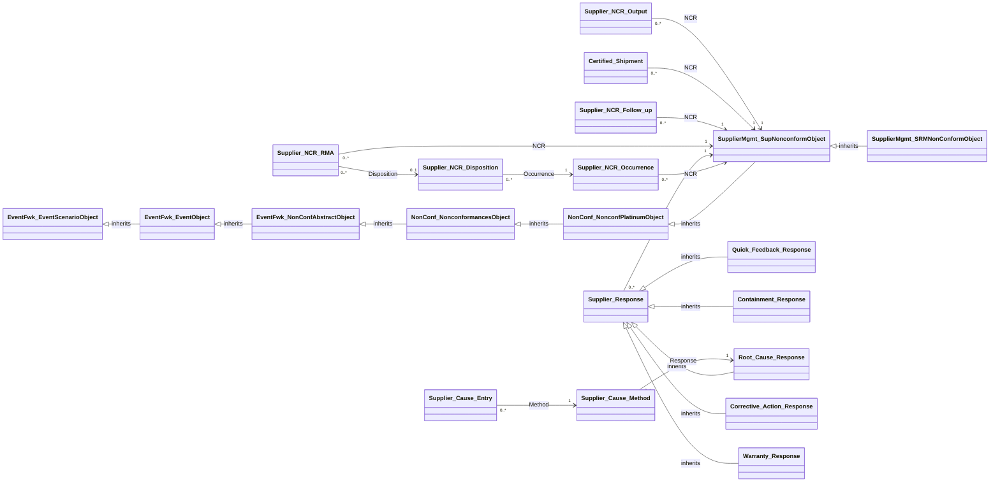

# Supplier Nonconformances — Technical Specification

| Property | Value |
|---|---|
| Revision | 0.1 — ADR-informed target design for review |
| Date | 2026-11-04 |
| Component | Supplier Non-Conformance Management |
| Baseline | [Supplier NCR Extract 1.0.0.0](../ootb-supplier-ncr-baseline-model/README.md), platform 6.6.28.2 |
| Governing architecture | ADR-046 through ADR-054, refined by ADR-093, ADR-094 and ADR-117 |
| Status | Reviewable target specification; business-rule and tenant-verification gates remain open |

## 1. Solution and architectural decisions

Supplier Nonconformance governs the complete supplier issue from intake to closure. PIR, WCAR and Supplier-Reported Problem use one configurable form and one governing workflow. The type and subtype select a governed process configuration defining applicable stages, responsibilities, response content, deadlines, guidance, notifications and release rules.

The target preserves the verified seven-object inheritance chain. New supplier-only fields are declared on **Supplier Nonconformance Base** (`SupplierMgmt_SupNonconformObject`). The concrete **Supplier Nonconformance** (`SupplierMgmt_SRMNonConformObject`) retains no direct declarations. Common platform and event fields remain on their existing declaring objects. A later Internal NCR design can consume the shared framework without inheriting supplier release permissions or supplier workflow behavior.

Repeating occurrences and independently reviewed responses are related records. One NCR can contain multiple containment records when the configured process calls for them, but one governing root-cause response container holds its required analysis methods and is reviewed as a whole. Supplier response forms collect evidence of the supplier's work; they do not assign and manage the supplier's internal problem-solving team as internal Action Plan tasks. Corrective action stays within the supplier NCR lifecycle.

**Classification:** baseline object/field identities and inheritance are **Extracted**. Cardinalities labelled in the baseline register retain their **Inferred** or **Unresolved** classification. Every new object, field, code, stage, handler, seed value and detailed implementation choice in this target is **Proposed**, implementing the cited ADR requirement. Business decisions explicitly made by accepted ADRs are **Required**. Missing business values or unverified platform behavior are **Unresolved**. Proposed names do not establish tenant metadata IDs or implemented configuration.

This specification comprises:

- [Complete field-level contract](supplier-nonconformances-field-contract.md), the canonical field definition for each object and inverse grid.
- [Target object inventory](supplier-nonconformances-object-inventory.md), including all exported dependencies and each proposed object.
- [Complete target Mermaid model](supplier-nonconformances-target-model.mmd), containing the extracted backbone and proposed supplier extensions.
- [ADR applicability and traceability](supplier-nonconformances-adr-traceability.md), including superseded and out-of-scope decisions.
- [Structural validation results](supplier-nonconformances-validation.json).

These artifacts form a new target state. The OOTB baseline remains separately preserved.

## 2. ADR interpretation, precedence and scope

The requirements register uses `SN-<ADR number>` as stable identifiers; each row links to its source ADR in the companion traceability document. All repository ADRs were considered for applicability through the NCR, supplier-security, role, product, inspection, warranty, scorecard, meetings, incident and SPANF interfaces.

| Decision family | Consequence for this design |
|---|---|
| ADR-046–050 | One configured supplier case; occurrence aggregation; human-maintained risk; secure release; independent component review and rejection history |
| ADR-051–053 | Conditional closure approval; repeatable follow-up; controlled generated outputs; WCAR shipment-triggered release and one coordinator approval |
| ADR-054, 056, 057, 087–091, 096 | Separate internal NCR/audit/CAR ownership. Supplier NCR does not acquire SQDIIR review stages, environmental escalation scoring, or internal CAR approval stages |
| ADR-093, 094, 117 | Separate disposition-linked RMA; sequential identifier and normalized search; reporter-supplier intake separate from manufacturer PIR |
| ADR-003, 004, 061, 076, 078, 079, 082–084 | Shared roles, contact/account distinction, exact supplier entity scope, mutable classification, supplier eligibility and correct portal URLs |
| ADR-045, 062, 073, 092 | Pilot failure interface, canonical part authority, internal history workspace and role-qualified supplier selection |
| ADR-058, 115 | Chargeable disposition quantities and component submission times are governed scorecard sources; aggregate scorecard access does not grant transaction drill-through |
| ADR-059, 071, 095, 103 | Warranty Analysis is proposed as Supplier Surveys; broader SPANF remains separate; supplier visits use proposed Meetings Management and shared Supplier Tasks |

**Precedence:** ADR-083 supersedes ADR-001's portal-entry proposal. ADR-087 supersedes ADR-055's audit-to-compliance-NCR direction. ADR-098 supersedes ADR-042's proposed pilot part-assignment routing; the PPAP/program engineer and explicit inspection assignments govern pilot responsibility. ADR-053 defines the WCAR-specific release exception to the ordinary explicit PIR release gate. ADR-117 defines the Supplier-Reported Problem visibility exception: the reporting supplier may see its own intake before the separate manufacturer's PIR is released. Neither exception weakens PIR intake security.

Proposed ADRs remain proposed in the source register. Including their integration direction here does not change their governance status. The Meetings, Supplier Tasks and Warranty Analysis interfaces are conditional delivery dependencies, not reasons to extend the governing NCR workflow with meetings or recurring surveys.

## 3. Object structure and ownership

The diagram uses existing internal names for the baseline family and sanitized proposed names for new objects. The inventory provides the name mapping. This overview omits reference catalogues and shared dependencies; the complete Mermaid source includes them. Direct reference edges represent declaring fields, not enabled catalogue-side inverse grids.

**Shared authorities:** Supplier Abstract, Supplier Contact, Supplier Management Role and Supplier Specific Role remain owned by SRM. The [Supplier Management Role specification](../../supplier-relationship-management/solution_specification/object_model/supplier-management-role-logical-model.md) defines operational group membership. Canonical Part and Drawing remain Product Management authorities under ADR-062 and ADR-092. Shared Visibility Classification is the governed security domain under ADR-084; its final technical identity and codes remain G-07. Incident, Pilot Inspection Failure, SPANF and Meeting are source-application authorities; this specification defines only the consuming NCR relationship. Platform Workflow Instance, Subject, Employee, attachments, audit and notification facilities retain platform ownership.

The Supplier NCR Process Configuration is a directly maintained, uniquely numbered configuration revision, locked when first referenced. A new configuration revision serves new cases; existing cases retain the referenced revision. This is a proposed minimal versioning mechanism: it has no separate editable authoring graph or Publish copying operation. Administrators prepare a new inactive revision, validate all rules, then activate it atomically while deactivating the previous revision for that type/subtype. Stage Rules and Response Rules lock with their Configuration. Only one active configuration may exist per type/subtype. No silent re-resolution occurs on an existing case.

## 4. Type and response configuration

| Type code | Initiator and initial scope | Release condition | Response and approval | Closure |
|---|---|---|---|---|
| `PIR` | Qualified internal user; internal intake | Explicit Submit to Supplier after duplicate review, supplier/part confirmation, occurrence and complete risk assessment | QUICK, CONTAINMENT or PRC tier selects required independently reviewed components; exact matrix G-03 | Engineer prerequisite review; conditional group-leader approval; required follow-up |
| `WCAR` | Warranty user; internal draft/shipping | Tracking Number first becomes nonblank and release preflight succeeds | One Warranty Response, supplier warranty role, one warranty-coordinator approval; analysis may be reduced for NTF | Close after response approval and mandatory warranty data/prerequisites; no extra PIR approval stage |
| `SUPPLIER_REPORTED` | Authenticated reporting supplier for its authorized entity; SAP-part quality report | Supplier sees its own intake; Submit Report routes to SIA triage | Internal validity/action decision and handling instructions; no investigation obligation imposed on reporter | Close when triage and instructions are complete and any required linked PIR is successfully created |
| `PILOT_FAILURE` | Disabled initial configuration candidate from ADR-045 | Engineer review before external response | Reuse typed responses where fit is verified; retain pilot/build/inspection source access boundary | Replacement requires new pilot shipment through Pilot Part Data; detailed adapter remains G-08 |

Issue Subtype must belong to Issue Type. No WCAR subtype, risk option, defect class, problem profile or impact seed is invented from an ADR example. The field contract supplies proposed stable type/tier/outcome codes; business-owned catalogue seeds are deployment inputs. Root-cause methods use fixed implementation codes `FIVE_WHY`, `FISHBONE`, `TIMELINE`, `EXTERNAL`; they select renderer behavior rather than a new governed business-domain selector.

Stage Rule.Stage Code selects only the registered stages in section 7. Its activation and instruction content may vary by type/subtype. Stage Rule.Due Offset uses business days anchored to stage entry; Response Rule.Due Offset is anchored to successful supplier release. Calendar, cutoffs, offsets and exact due-time handling remain G-02. Configuration activation rejects unspecified required deadlines, missing required roles, overlapping active revisions, unsupported stage codes and incoherent component/closure rules.

Risk uses one governing assessment on the case. The four input concepts are responsibility, vehicle impact, reporting area and recurrence. The controlled source form must establish exact prompts, answer options, weights, arithmetic and tier thresholds (G-01). A count of occurrences does not write any input. Until the controlled calculation is verified, PIR release remains unavailable; a plausible numeric formula is not a substitute.

Response rules are keyed by Configuration, Tier and Component Code. QUICK/CONTAINMENT/PRC component membership and conditional requirements must be confirmed, not assumed to mean an identical fixed set for every profile. Requirement matching also considers Problem Profile, Impact Level, Defect Classification and the reporting-area rating. One ROOT_CAUSE container per case is enforced; it can contain multiple analysis methods and is approved once. Containment can repeat through explicitly configured rule slots. Every repeating response slot needs a distinct rule identity.

## 5. Inherited fields and supplier-specific overrides

The companion contract retains all 91 extracted field rows once at their declaring objects, including dependency-only objects. It adds each proposed field/grid in a separate row. This preserves the verified baseline and makes platform omissions visible. The 70 fields inherited by the supplier NCR concrete leaf are not redeclared on that leaf.

Apply these **Proposed supplier-branch overrides** through its forms, handlers and permissions. They must not change shared-object metadata globally:

| Existing field and owner | Supplier-branch behavior | Compatibility |
|---|---|---|
| Event Scenario.Record No. | Reuse native sequence, unique system identifier; no type/year/VIN composite | Sequence scope must be validated G-09; do not resequence legacy records |
| Event Scenario.Name / Description | Description is required for initial submission; Name remains optional concise narrative | No change for other Event Scenario descendants |
| Event.Date | Reuse as event date/time; required; preserve timezone-enabled metadata | Preserve existing Date Reported semantics; no date conversion proposed |
| Event.Reported By | Reuse default CURRENTUSER(); supplier reports retain actual reporting actor | Created By stays native system evidence |
| Supplier Nonconformance Base.Supplier | Existing SupplierAbs is required before intake submission; editable by internal intake before release despite read-only metadata; locked for supplier-originated intake to authenticated scope; immutable after release | Requires supplier-form/handler override verification G-12; do not globally remove read-only protection |
| Supplier Nonconformance Base.NCR Type | Preserve legacy NCRType as historical relationship; new cases select Issue Type and map legacy lookup when a verified mapping exists | Unknown package lookup values prevent fabricated mapping; migration G-09 |
| Supplier Nonconformance Base.Assigned To | Optional named contact for communication; actionable responsibility uses Supplier Owner group | Do not treat a contact without a portal account as an assignee |
| Event.Investigator / Final Approver | Optional historical actor/selection fields; live owner and reviewer roles govern target actions | Stamp actual actors in workflow/audit; no permanent person assignment for follow-up |
| Nonconformance Base.Date Closed | Terminal handler writes business closure date alongside new timezone-enabled Closed At | Supplier branch handler only |
| Event.Summary | Concise issue summary; Description retains full problem; no manual composite search title | Keep normalized Part, Drawing, VIN, type and supplier searchable |
| Supplier Nonconformance Base.Supplier Action Plans | Existing grid remains for compatible historical records; new supplier responses use typed response objects | Do not delete Supplier Action Plan or its shared corrective-action fields |
| Event.CAPAs / # CAPAs / # Opened CAPAs and NbOfCAPAHelper | Preserve existing data/calculations; exclude these counts as sole target closure gates | Target gates explicitly evaluate Responses, Dispositions, RMAs, Shipments and Follow-up Checks |
| Event.Cause Analysis / Root Causes | Preserve historical analysis navigation; target analyses belong to Root Cause Response.Methods | Any native cause-analysis reuse requires adapter evidence G-08 before replacing proposed methods |

Issue Type, Issue Subtype and Configuration freeze on first submission to prevent silent workflow replacement. Internal users can correct Part, Drawing, Supplier and defect classification before release. They must revalidate scope, duplicate suggestions, configuration applicability and risk. After release, Supplier and supplier security scope are immutable. An incorrect supplier requires cancellation/closure and a new case, with an internal-only Replacement NCR link. Changing Part/Drawing after release requires engineer-controlled correction and revalidation of occurrence and source links; it never moves a record to another supplier.

Supplier-Reported Problem always keeps Supplier as the reporter's entity. Responsible Manufacturer is internal-only and mandatory when Create PIR? is TRUE. The linked manufacturer's PIR stores Source Intake internally; neither link nor its caption, counts or search result is exposed to the other supplier. Pre-release intake editing by the reporting supplier is limited to its own draft fields.

Conditional fields have the following controlling rules, supplementing the field contract:

- Drawing is required for PIR release when Product Management resolves a drawing for the selected part. Missing mandatory drawing context blocks release pending master-data reconciliation.
- Response Tier and all four risk ratings, Problem Profile, Impact Level and Defect Classification are required at PIR release. They are internal-only. WCAR/intake do not acquire mandatory PIR scoring by default; unused values remain NULL.
- Supplier Owner is required for every externally actionable response; configuration resolves the quality or warranty role for the exact Supplier. Warranty Contact and Shipping Address are required before WCAR enters SHIPPING. VIN is required only for the configured WCAR subtype; exact subtype matrix is G-03. Inapplicable VIN is hidden and historical values retained read only.
- Triage Instructions and Create PIR? are required before Supplier-Reported Problem closes. Responsible Manufacturer is required only when Create PIR?=TRUE; otherwise hidden and retained internally if previously entered. No reporting supplier can edit it.
- RMA.Disposition may be NULL until completion, then must belong to the same NCR. RMA supplier authorization and handling instructions are required before supplier submission; quantity is required before internal completion.
- Three Certified Shipments?=TRUE requires exactly three distinct verified entries. Disabling the flag retains prior rows as history and removes the closure requirement. Third-Party Sort Requested?=TRUE requires authorization, job, link and instructions. Disabling it hides but retains those values; it does not fabricate a return authorization.
- Configuration role fields are mandatory only for enabled actions/stages consuming that role. Response Rule.Required?=TRUE makes its Due Offset mandatory. Method.Conclusion is required on container submission; Method.External Evidence is required for EXTERNAL. Corrective Response.Preventive Actions is mandatory only where the resolved rule requires it.

## 6. Record creation, security and data behavior

### 6.1 Intake, matching and occurrences

Create captures Supplier, Part, Issue Type, applicable Issue Subtype, Event.Date and Description. Resolve the single active Configuration for that type/subtype. Portal initiation permits only SUPPLIER_REPORTED. Only qualified internal users can create PIR or WCAR. Minimum intake supports drafts; release/completion gates apply progressive requiredness.

Before internal case creation, show authorized open matches using supplier, drawing, part context, Defect Classification and description text. The user decides whether the same drawing/problem already exists. Different defects stay separate. A duplicate suggestion must not reveal a restricted record; use an internal escalation path when the user lacks access. Choosing an existing match creates a new Occurrence without another supplier case. Capture Reported At, Source Area, Shift, Part, Quantity, Evidence and Comments. Later occurrences remain possible while the case is open; they notify the internal owner for reassessment. Closed cases are not silently reopened.

The occurrence quantity rollup is separate from chargeable disposition quantities. Split dispositions must not allocate more than their Occurrence.Quantity. RMA quantities are return quantities, not additional defective-part occurrences. A shared source event must not be counted twice when creating a downstream PIR from intake; source carry-forward creates the initial PIR occurrence once.

### 6.2 Release and membership

PIR Submit to Supplier locks the case, rechecks actor authority and supplier eligibility, validates part/drawing responsibility, duplicate review, occurrence, complete risk, configured roles, current authenticated contact membership and response deadlines. It creates required response records and method placeholders idempotently, stamps Released At, applies supplier ACLs, transitions to RESPONSE and queues notifications. No external access is committed if preflight or record creation fails.

WCAR initiation notifies the Parts Collection Center of Warranty Contact and Shipping Address. The WCAR remains internal in SHIPPING. An Update Action Handler watches Tracking Number. The first valid nonblank value invokes the same release preflight specialized for WCAR, creates one Warranty Response and notifies the supplier warranty role with shipping details. An internal tracking update is a persisted-field trigger, not a second release button. Failed preflight preserves the internal state and a recoverable execution error; retrying the release operation does not create duplicate responses or notifications.

Operational responsibility points to Supplier Specific Role, resolved by exact Supplier Abstract plus configured Supplier Management Role. Required group membership must be current, active and eligible. No corporate-to-facility role fallback is inferred. For a shared approval slot, the first currently eligible authorized member to act satisfies it; concurrent second actions fail the stage/version check. Native history preserves the individual actor. Recipient membership for informational email can differ from authenticated actionable assignment.

### 6.3 Risk revisions and concurrent work

An internal responsible engineer edits ratings/profile/impact on the same case with an audit reason. An Update Action Handler watches Responsibility Rating, Vehicle Impact Rating, Reporting Area Rating, Recurrence Rating, Problem Profile, Impact Level and Defect Classification. It validates the calculation, determines the new required component set and serializes with response submission and closure.

If applicability changes after release, retain all prior submissions and approvals. Newly required records are generated once. Previously applicable records become Applicable?=FALSE and read only after any in-flight review is explicitly withdrawn with a recorded reason. Unchanged approved components remain approved unless the reviewed rule explicitly invalidates them. Superseded content does not satisfy new requirements. The supplier is notified of the changed work and deadlines. No response data is silently cleared or deleted. Exact tier migration and deadline policy remain G-03; activation is blocked until transitions in both directions are defined.

### 6.4 Security contract

| Record/data | Internal access | External access |
|---|---|---|
| Unreleased PIR/WCAR | Authorized NCR roles plus classification | None, including files, inverse grids, counts, exports and direct URL |
| Released supplier NCR | Authorized application roles/classification; role ownership controls action, not all visibility | Supplier entity scope AND allowed classification AND released external content AND portal permissions |
| Supplier-Reported Problem | SIA triage plus classification | Reporting supplier's own record and approved instructions; no manufacturer selection or downstream PIR disclosure |
| Responses, occurrences, disposition, RMA, shipment and outputs | Governing NCR scope, with internal-field allowlists | Only case-authorized, released content; child access alone cannot bypass NCR security |
| Internal history, source records, risk details and replacement/lineage | Source application and internal classification ACL | None unless independently and explicitly authorized in that source application |
| Configuration and scorecard override rationale | Application administrators and governed maintainers | No configuration-edit or internal-rationale access |

Supplier entity scope follows ADR-078, including a contact's authorized company scope covering its facilities. Location metadata remains technically available but is not the supplier visibility rule. Mutable Visibility Classification changes access without changing workflow owner or stage. New-model-authorized internal users receive applicable mass-production history; mass-production-only users cannot obtain new-model detail. Cross-application drill-through always rechecks source permissions.

Internal URLs use the SIA Entra SSO endpoint. Supplier messages use the external Intelex URL. The existing SIA supplier portal remains the upstream entry point under ADR-083. Surface assigned NCR work, overdue responses, items awaiting SIA and pending follow-ups with filtered drill-through rather than unrestricted record totals.

## 7. Workflow and ordered actions

All stages and actions below are **Proposed** target configuration. They do not claim to reproduce the two package workflows, whose full behavior was outside the data-model baseline. Workflow stage/status remains platform-managed; no new custom State or Workflow field is introduced.

### 7.1 Governing Supplier Nonconformance workflow

| Stage code / label | Responsible principal | Applicability and outgoing paths |
|---|---|---|
| `DRAFT` / Draft | Originator | Internal cases begin here; reporting supplier owns its scoped intake draft. Submit Intake routes by type |
| `INTAKE` / Internal Intake | Configured Internal Owner group | PIR duplicate/scope/risk validation; Submit to Supplier → RESPONSE |
| `SHIPPING` / Awaiting Shipment | Internal warranty owner group | WCAR only; tracking handler releases → RESPONSE |
| `TRIAGE` / Supplier Report Triage | Configured internal triage role | SUPPLIER_REPORTED only; Complete Triage terminates after instructions and required downstream PIR creation |
| `RESPONSE` / Supplier Response | Supplier Owner group | Parent remains supplier-owned while components are independently reviewed; qualifying completion handler → ENGINEER_REVIEW or warranty terminal closure |
| `ENGINEER_REVIEW` / Closure Review | Internal Owner group | Applicable PIR prerequisites confirmed; qualifying case routes automatically to GROUP_REVIEW; otherwise schedules follow-up or closes |
| `GROUP_REVIEW` / Group Leader Closure Review | Configured group-leader role | Required only by configured closure condition; approve → pending follow-up/closed; reject → ENGINEER_REVIEW with reason and dashboard item |
| `PENDING_FOLLOWUP` / Pending Follow-up | Configured non-operational holding Subject | Scheduled/active child checks carry work; last required passing check closes case |
| `DETERMINATION` / Follow-up Determination | Configured internal management role | Failed/inconclusive check: Create Further Check → PENDING_FOLLOWUP, or Create Escalation → close with linked new case once creation succeeds |

Termination states are **Closed**, **Cancelled**, and **Triage Complete**. They are not ordinary stages. Draft deletion is limited to unsent records with no governed children; issued history is retained. Cancellation is internal-only.

Every mutation below first locks/rechecks workflow version, verifies authenticated actor/current eligible role and checks case security. Validate before transition. Persist data, child changes and transition as one logical transaction. Queue notification only after durable success. A retry resumes the same action/child identity; a stale action is rejected. Platform transaction/outbox support must be verified (G-11); no guarantee is claimed without that verification.

| Action / actor | Ordered behavior | Failure behavior |
|---|---|---|
| Submit Intake / originator | Validate common fields, resolve immutable configuration; freeze type/subtype; PIR → INTAKE; WCAR validates warranty contact/address → SHIPPING and PCC email; supplier report → TRIAGE | Remain Draft with specific missing-field/configuration message |
| Submit to Supplier / internal owner in INTAKE | Apply section 6.2 release preflight; create required components/placeholders; stamp Released At; activate external ACL; RESPONSE; notify Supplier Owner | No supplier access or partial issued component set |
| Confirm Prerequisites / engineer in ENGINEER_REVIEW | Recheck approved required responses, root-cause container, containment completion, shipments, dispositions, RMA reconciliation and configured related tasks; if management review required, route GROUP_REVIEW automatically; otherwise initiate required follow-up or close | Missing prerequisite is named; remain ENGINEER_REVIEW |
| Approve Closure / group leader | Recheck prerequisites; persist approval evidence; generate required follow-up set once; PENDING_FOLLOWUP or Closed with Date Closed/Closed At | Remain GROUP_REVIEW on changed prerequisites or generation failure |
| Return Closure / group leader | Require rejection reason in review dialog/native history; record actor/time/reason; ENGINEER_REVIEW; notify internal owner and show dashboard item | Blank reason prevents transition |
| Complete Triage / internal triage owner | Require validity/action decision (existing vNonconformance plus Create PIR?), approved Triage Instructions; if Create PIR? then resolve manufacturer, create/reuse linked PIR and initial occurrence; record instructions; Triage Complete; notify reporter | No closure until downstream lineage persists; never assign investigator to reporter solely due to initiation |
| Create Further Check / management in DETERMINATION | Require rationale, new schedule/due date/owner; create new check without modifying failed evidence; PENDING_FOLLOWUP | Existing failed check remains and case stays DETERMINATION if creation fails |
| Create Escalation / management in DETERMINATION | Require rationale and explicitly selected authorized supplier/case context; create linked escalation, retain failed checks; close original only after creation succeeds | No original-case closure without successful lineage |
| Cancel NCR / internal owner or manager | Require Cancellation Reason; withdraw open response reviews and cancel eligible unfinished RMA/check work; preserve completed children, response values and audit; stop reminders; terminate after cascade succeeds | Remain actionable internally; retry only unfinished cascade steps; no supplier reassignment |

Tracking-triggered release, component-completion evaluation, follow-up scheduling and last-check closure are handlers/services, not workflow buttons. Confirm Prerequisites is the engineer's review completion action, not an extra request for group-leader review. Group review activates automatically from its result when required by configuration.

### 7.2 Typed supplier responses

Each response has Draft/Returned and Review stages, terminating as Approved or Withdrawn. The supplier can save drafts and edit other applicable components while a submitted component is in Review. Reviewer owns the response review, while the governing NCR remains assigned to Supplier Owner.

| Action | Actor and validation | Ordered result |
|---|---|---|
| Submit Response | Supplier Owner member; current applicability; required typed content/evidence complete; root-cause container validates all required methods | Freeze submitted content, stamp Submitted At/By, enter Review, notify current Reviewer group |
| Approve Response | Reviewer member; matching submitted revision; required evidence verified | Persist native approval actor/time; terminate Approved; run prerequisite evaluator after commit |
| Return Response | Reviewer member; mandatory Review Comment | Append immutable rejection evidence; reopen same response Returned; notify supplier; other components remain independent |

Containment requires its actions, suspect population, breakpoint and execution date. Quick Feedback requires Feedback. Corrective Action requires owner, implementation date, actions and rule-required preventive content. Root Cause requires its summary and configured methods/external evidence. WCAR requires Outcome and Findings, plus Corrective Response for ANALYSIS; NTF retains any historical analytical content read only and suppresses new analytical mandatory fields. Accepted components become read only; a material revision requires an explicit auditable reopen path governed by G-03, never an unlogged edit.

### 7.3 Disposition, RMA and follow-up

Disposition is drafted by the internal owner and completed by **Approve Disposition** after category/quantity/instructions validation. Approval stamps Approved On; category requiring RMA cannot satisfy NCR closure until its required completed RMA is reconciled. Corrections invalidate the prior completion for closure until reviewed again; quantities and audit evidence are retained.

RMA stages are Internal Request (internal owner), Supplier Response (RMA.Supplier Owner) and Internal Completion (internal owner), terminating Completed or Cancelled. **Request Authorization** validates the request and active supplier members, then notifies the supplier. **Submit Authorization** requires authorization and handling instructions, stamps Responded At and routes internally. **Complete RMA** requires a same-case Disposition, quantity reconciliation and completed internal processing. **Return Authorization** requires a native-history comment and returns the same record for supplier revision. Exact parcel/hand carry/rework/scrap controls and no-defect sort handling remain G-06; they cannot be guessed from example categories.

Follow-up begins Scheduled, owned by the holding subject until Activate On. A proposed daily Event Service at 06:00 America/Toronto selects open scheduled checks with Activate On on or before the current business date and invokes a hidden **Activate Check** action under a service principal restricted to this operation. Activation rechecks the date, case state and current Owner membership, enters Active and queues a reminder. Missed schedules select again the next run; unique Schedule Key and stage checks prevent duplicate activation.

**Submit Check** by the current Owner requires Result and Evidence Notes. PASS stamps Completed At and completes the check; FAIL/INCONCLUSIVE preserves evidence and routes the case to DETERMINATION. The handler closes the case only when the required generated check set is complete and passing and all other closure prerequisites still pass. A failed check cannot be overwritten to manufacture a pass; another check is a new record. Scheduled future checks keep the governing NCR in PENDING_FOLLOWUP with holding-subject ownership. Cadence/timezone here is a proposed implementation default, not an ADR-established interval; business follow-up due intervals remain G-05.

## 8. Automation, notifications and audit

| Mechanism | Watched fields / trigger | Responsibility and retry key |
|---|---|---|
| Create handler | Initial Supplier Nonconformance save | Resolve Configuration; native Record No.; defaults and scoped originator; case identity is retry anchor |
| Release handler | Submit to Supplier, or WCAR Tracking Number change | Section 6.2 preflight and component generation; unique NCR/Rule; root-cause uniqueness per NCR |
| Risk revision handler | Seven ratings/profile/impact/classification fields listed in 6.3 | Recalculate validated score, reconcile applicability and deadlines; same-case serialized revision |
| Response actions | Submit/approve/return | Immutable audit/history evidence; one transaction per expected stage/revision |
| Prerequisite evaluator | Response approval/applicability change; shipment verification; disposition/RMA/task completion; engineer review | Re-evaluate current predicate; never infer completion from one count alone |
| Follow-up generator | Successful closure authorization | Generate exactly the frozen schedule set; unique NCR/Schedule Key |
| Event Service | Scheduled date selection | Activate Check only; service execution logs and owned recoverable failures |
| Check completion handler | Successful Submit Check | Re-evaluate schedule completeness, result and closure predicates; close once |
| NCR output action | Generate Controlled Output | Validate template mapping and authorization; render then retain file; unique NCR/template/generation number |

Metadata-only writes must not retrigger generation/revision logic. Relationship changes must invoke the relevant scope and validation handler. Service failures are owned by NCR application support through native execution logs; missing role membership remains an owned recoverable failure. No generic custom Event, Reminder Rule or Audit object is introduced.

Use native reminders on active response Due Date and active follow-up Due Date. Deadline changes recalculate reminders; approved, withdrawn, cancelled and completed work stops reminders. Supplier responsibility stays current through role membership changes. Native histories must retain each submitted deadline and timestamp, reviewer, rejected reason, outcome and prior content. G-11 verifies append-only behavior and reportability; if native evidence cannot meet ADR-050, the retention design must be revised before implementation.

Notifications cover PCC shipping request, supplier release, response submission to reviewer, response return with reason, changed risk/work requirements, closure return to engineer, scheduled check activation, failed-check management determination and terminal completion. Each template has separate internal/external URL and content allowlists. Supplier emails contain no internal risk, other-supplier lineage or unrestricted source-file link. Delivery should be deduplicated by native transition/execution identity and template/recipient; unavailable delivery evidence remains a verification gate.

## 9. Integration, outputs, reporting and user experience

**Supplier-reported problem → PIR.** The triage handler copies Part, Drawing, Event.Date, Description, Summary and approved occurrence facts/evidence into the manufacturer's draft PIR, sets Supplier to Responsible Manufacturer, sets Issue Type=PIR and resolves a fresh PIR Configuration. Source Intake links the records internally. Do not copy reporter-specific Supplier Owner, risk score/ratings, released status, warranty contact or portal ACL. Review/redact evidence before carrying it across suppliers. A unique Source Intake constraint is proposed for the single downstream PIR path; retry reuses it. Multiple manufacturer cases would require a deliberate future extension, not repeated retries.

**Pilot failure, incident and SPANF.** A source investigator may create a separately scoped supplier NCR using its typed source relationship. Pilot failures are grouped/reviewed under ADR-045; replacement creates a new pilot shipment linked to the same build event and failure. Preserve program classification; supplier users do not gain unit inspection/program access. Incident-to-NCR creation requires an independently meaningful supplier nonconformance under ADR-091. SPANF optionally creates/links an NCR under ADR-071; Supplier-Reported Problem does not deliver SPANF. Source adapters and external object identities remain G-08.

Pilot routing takes the responsible engineer from the PPAP or explicit pilot program assignment under ADR-098. The adapter must preserve that responsibility rather than derive it from visibility classification; its representation in the NCR role model is verified under G-08. Replacement shipment headers and part-level data logs follow ADR-099, with the data log retaining PPAP/build-event and source failure. Product Management retains the historical inspection specification version under ADR-038 and ECS checkpoint under ADR-039. The part hierarchy under ADR-097 assists directed-buy/component responsibility review without assuming that the assembly supplier manufactured every component. Scrap and financial debit settlement remain with their source/Procurement authorities under ADR-063; chargeable NCR quantities do not constitute a financial debit.

**Part history.** An internal-only tab resolves selected Part/Drawing to drawing revisions, inspection specifications/results, PPAP, APQP, prior NCR, DCR/ECS references and other approved context. Queries remain at authoritative source records and recheck source ACLs. Use paginated panels and bounded date filters; proposed default is 25 rows per panel with a user-expanded search. No history data is copied into a generic snapshot. Unavailable external history is clearly identified rather than represented as an empty successful search.

**Controlled outputs.** Generate SIA 7-4 and other overlapping documents from structured NCR, occurrence, approved response, cause, ownership, dates and evidence metadata. Template mappings must identify every field, ordered child list, null handling and unpopulated completion area (G-10). Supplier NCR Output retains source NCR, Template Version, Generation Number, Generated At/By and immutable Artifact. Regeneration creates another artifact; prior artifacts are retained. Signature behavior remains G-10. NCR Output is justified by the explicit retained/versioned output requirement in ADR-052; native attachment storage supplies the file rather than a new file system.

**Meetings.** Supplier visits/7-4 activity belong to Meetings Management under proposed ADR-095. Meetings may link NCRs and generated outputs informationally; they do not block NCR closure merely because they exist. Meeting actions belong to shared Supplier Tasks under proposed ADR-103. Procedure-driven effectiveness checks remain Supplier NCR Follow-up records. A configured genuinely mandatory related task may be a closure dependency only after a typed shared-task relationship and business rule are confirmed (G-08); no vague arbitrary-task query is accepted as a gate.

**Reporting.** NCR inventories expose Record No., Issue Type/Subtype, reporting/event dates, Supplier and facility context, Part, Drawing, VIN, classification, tier, internal/supplier role, workflow stage, overdue components and Released At/Closed At. Simple sequential identity supports normalized search under ADR-094. A VIN last-eight display is optional and not part of identity; it is not introduced without an operational need. Preserve legacy identifiers only through the approved migration mapping G-09.

Response-timeliness reporting compares the deadline effective at each submission with its successful Submitted At, preserving earlier return cycles. Scorecard query capture is enabled only after the governing report and metric semantics are verified. PPM uses approved Chargeable? disposition quantities and the same-period parts-consumption dataset owned by the scorecard/integration design. Approval date as period basis is proposed in the field table and remains G-09; source ADR-058 does not settle all date, duplicate and reversal rules. Published scorecards retain their governed snapshots. Broader scorecard aggregate permission under ADR-115 never authorizes restricted NCR drill-through or internal override rationale.

## 10. Change summary and impact

| Change | Action | Baseline | Target and rationale | Requirements |
|---|---|---|---|---|
| CH-01 | No structural change | Seven-object supplier inheritance | Preserve; declare extensions only on supplier base | SN-046, SN-054 |
| CH-02 | Add/Modify | Sparse supplier fields and two included workflows | Configured type/subtype revision and one governing target workflow | SN-046, SN-053, SN-117 |
| CH-03 | Add | No exported occurrence model | Occurrence, disposition and explicit quantity allocation | SN-047, SN-093, SN-058 |
| CH-04 | Add | Generic risk relationship | Governing human-maintained four-input case assessment and controlled rule | SN-048 |
| CH-05 | Add | Supplier Action Plan and shared action families | Typed supplier response family and cause methods; preserve historical action data | SN-046, SN-050 |
| CH-06 | Add | No extracted RMA/shipment/follow-up/output contract | RMA, three certified shipments, scheduled checks and retained generated artifacts | SN-048, SN-051, SN-052, SN-093 |
| CH-07 | Modify | Metadata Supplier read only; legacy type lookup | Supplier-scoped intake correction, immutable release scope, new governed type mapping | SN-049, SN-094 |
| CH-08 | Add | No package evidence for source adapters | Internal typed lineage, reporter/manufacturer split and secured history | SN-073, SN-117, SN-045, SN-091, SN-071 |
| CH-09 | Modify | Named contact relationships | Shared operational roles, classification ACLs, portal routing and report filters | SN-003, SN-004, SN-078, SN-084 |

Shared-object metadata is not globally changed. Regression tests must cover other Event, Nonconformance, Audit Finding, Risk, CAPA and Action Plan descendants because shared forms, handlers or views could otherwise apply supplier rules to them. Existing target specifications are consumed as authorities; no SRM, Product Management, scorecard or internal-CAR field definition is superseded by this specification. External adapter changes require coordinated revisions in their owning specifications before build completion.

Do not remove/reparent exported objects or delete legacy supplier action plans. Baseline unresolved inverse fields remain unresolved until verified; proposed new relationships have explicit declaring fields and inverse configurations. No target custom object is claimed implemented.

## 11. Open design and implementation gates

| Gate | Required evidence / owner | Design effect |
|---|---|---|
| G-01 | SQA controlled four-question risk form, options, points, weights, thresholds and authority | Blocks risk expression and PIR production release |
| G-02 | Process owners: deadlines, business calendar, stage anchors, cutoff/timezone and extensions | Blocks activation of any configuration with unresolved required timing |
| G-03 | SQA/Warranty: type/subtype/profile/impact/defect seeds, component/conditional-field matrix, risk-tier transition policy and method forms | Blocks affected type/subtype activation; WCAR NTF and analysis controls require business validation |
| G-04 | SQA: exact risk/category/reporting-area conditions for group review and full closure prerequisite matrix | Blocks production closure automation |
| G-05 | SQA/procedure owners: follow-up source triggers, intervals, lead times, repeats and management escalation rules | Blocks required follow-up configuration; proposed scheduler cadence may be changed |
| G-06 | Material handling: disposition types/RMA flags, quantity split/reconciliation, return modes, no-defect sort outcome and request identifiers | Blocks material completion/closure for affected scenarios |
| G-07 | Security/SRM: role codes, exact entity capability matrix, classification IDs/codes and holding subject | Blocks external release and production ACL certification |
| G-08 | Product/Pilot/Incident/SPANF/Meetings/Tasks owners: stable target identities, adapter payloads and mandatory typed-task relationships; native cause-analysis fit | Blocks affected integration only; shared authorities remain outside this document |
| G-09 | Data/Scorecard owners: legacy type/identifier mapping, sequence scope, PPM period/reversal/deduplication and response metric report | Blocks migration and automated scorecard capture |
| G-10 | Quality document owners: controlled templates, mapping, version/signature rules, retention and attachment capacities | Blocks controlled-output publication |
| G-11 | Intelex implementer: atomic operations, outbox/deduplication, append-only native rejection/submission evidence, attachment version retention/reportability, role membership refresh | Blocks production review/release automation if unsupported |
| G-12 | Tenant inspection: baseline incomplete dependency fields/inverses, read-only population mechanisms, scoped Supplier edit override and inherited-field ACL behavior | Blocks implementation-contract certification for unresolved fields |

This is an intentionally reviewable technical specification, **not yet a fully resolved deployment contract**. Field rows with unresolved baseline metadata or business values are retained explicitly. The specification is ready for design review and requirements refinement; the gates identify concrete missing inputs instead of presenting unverified formulas or platform capabilities as facts.

## 12. Migration, build sequence and acceptance

Build configuration/catalogues and role/security adapters first, then supplier fields/children and native audit, then target workflow/release handlers, material handling/follow-ups, outputs and source reports. Validate type activation rules before loading production-active configuration. Configure the inactive PILOT_FAILURE candidate only after the source fit review; it must not become an independent cloned governing workflow by default.

Migration inventories existing cases by supplier/type/stage and maps legacy NCRType to Issue Type explicitly. Retain existing field identities, original record numbers, actor/date evidence, historic action plans and related records. Do not infer absent occurrences, supplier releases, rejected reasons or timestamps from current status. Reconcile existing supplier responsibility and response components before migrating an open case to a target stage; when history is insufficient retain a clearly identified legacy read-only case. Stage cutover is an approved mapping exercise, not a guessed match to the two workflow names. No Date/Time-to-Date conversion is proposed; any later timezone conversion requires a separate migration rule.

| Acceptance scenario | Expected result |
|---|---|
| Inspect inheritance and field ownership | Exact baseline chain; concrete Supplier Nonconformance declares no fields; new supplier fields are on supplier base; shared descendants unchanged |
| Submit minimal case | Only common intake required initially; correct type/subtype configuration resolves; inactive or ambiguous revision blocks submission |
| Match duplicate and add occurrence | Same supplier/drawing/problem can reuse open case; different defect creates separate case; quantity and history retained; no risk input silently changes |
| Attempt early supplier access | Unreleased PIR/WCAR absent from direct URL, search, grids, attachments, exports and counts |
| Correct supplier before/after release | Internal intake correction allowed after revalidation; post-release reassignment rejected; replacement linkage remains internal |
| WCAR shipment release | PCC receives approved contact/address; no supplier disclosure before tracking; tracking handler creates one response once and supplies shipment details |
| Supplier reports SAP-part issue | Reporter retains scoped intake; SIA triages; linked manufacturer PIR gets fresh owner/configuration; neither supplier obtains the other's lineage/content |
| Parallel response work | Containment review does not block editing later components; each due date/submission/rejection remains independently attributable |
| Return response twice | Reasons mandatory and immutable; earlier submissions and files remain reconstructable; same response reopens without erased history |
| Root cause container | Required methods validate together and receive one review; external evidence supported; incomplete placeholder cannot be approved |
| Risk rises/falls after release | New required work generated once; old content/approvals retained with explicit applicability; supplier notified; incompatible content never silently deleted |
| WCAR no trouble found | Only required outcome/findings collected; irrelevant analysis hidden and prior values retained; one coordinator approval; no PIR final approval |
| Material and shipments | Required RMA blocks closure until completed and reconciled; RMA may precede disposition; exactly three verified certified shipments when required |
| Conditional group review | Qualifying engineer confirmation activates management review automatically; rejection visible to engineer with reason/dashboard entry |
| Follow-up scheduling/retry | Unique scheduled set, lead-time activation and live role assignment; last required passing check closes once; failed/inconclusive check requires management decision |
| Cancel with open children | Eligible open work cancelled/withdrawn; completed evidence retained; reminders stop; partial cascade retry cannot erase history |
| Role membership change/concurrent approval | Departing member loses action rights; replacement can act; first eligible approval wins; individual actor retained |
| Reclassify record | Authorized access changes without changing stage or ownership; descendants/files obey updated classification |
| Internal history and scorecard drill-through | Source permission enforced per panel/link; aggregate scorecard access does not reveal restricted NCR detail |
| Generate output twice | Two immutable artifacts with source and template version; old file remains; required unmapped areas identified |
| Migrate legacy open case | Verified type/stage/owner mapping; no fabricated releases or submissions; unreconstructable history stays identified as legacy |

Structural checks reconcile inventory-to-sections, one row per declared field/grid, requiredness vocabulary, preserved baseline field count, direct inheritance coverage and proposed catalogue inverse suppression. Semantic review must resolve G-01–G-12 and execute the acceptance cases in the target tenant. The baseline contains two fields captioned Event Type (`EventType` Text and `TypeOfEvent` reference); their internal names and stable IDs remain distinct in the contract. No tenant tests or successful implementation are claimed by document generation.
