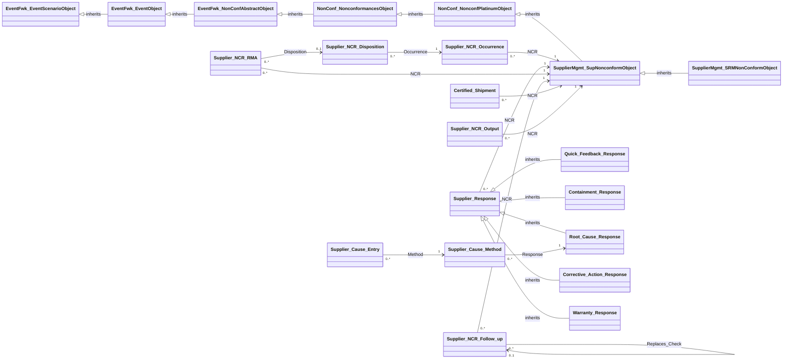

# Supplier Nonconformances — Technical Specification

| Property | Value |
|---|---|
| Revision | 0.3 — complete field contract embedded in this specification |
| Date | 2026-11-12 |
| Component | Supplier Non-Conformance Management |
| Baseline | [Supplier NCR Extract 1.0.0.0](../ootb-supplier-ncr-baseline-model/README.md), platform 6.6.28.2 |
| Governing architecture | ADR-046 through ADR-054, refined by ADR-093, ADR-094 and ADR-117 |
| Status | Reviewable target specification; business-rule and tenant-verification gates remain open |

## 1. Solution and architectural decisions

Supplier Nonconformance governs the complete supplier issue from intake to closure. PIR, WCAR and Supplier-Reported Problem use one configurable form and one governing workflow. The type and subtype select a governed process configuration defining applicable stages, responsibilities, response content, deadlines, guidance, notifications and release rules.

The target preserves the verified seven-object inheritance chain. New supplier-only fields are declared on **Supplier Nonconformance Base** (`SupplierMgmt_SupNonconformObject`). The concrete **Supplier Nonconformance** (`SupplierMgmt_SRMNonConformObject`) retains no direct declarations. Common platform and event fields remain on their existing declaring objects. A later Internal NCR design can consume the shared framework without inheriting supplier release permissions or supplier workflow behavior.

Repeating occurrences and independently reviewed responses are related records. One NCR can contain multiple containment records when the configured process calls for them, but one governing root-cause response container holds its required analysis methods and is reviewed as a whole. Supplier response forms collect evidence of the supplier's work; they do not assign and manage the supplier's internal problem-solving team as internal Action Plan tasks. Corrective action stays within the supplier NCR lifecycle.

**Classification:** baseline object/field identities and inheritance are **Extracted**. Cardinalities labelled in the baseline register retain their **Inferred** or **Unresolved** classification. Every new object, field, code, stage, handler, seed value and detailed implementation choice in this target is **Proposed**, implementing the cited ADR requirement. Business decisions explicitly made by accepted ADRs are **Required**. Missing business values or unverified platform behavior are **Unresolved**. Proposed names do not establish tenant metadata IDs or implemented configuration.

This specification comprises:

- [Complete field-level contract in section 5](#5-inherited-fields-and-supplier-specific-overrides), the canonical field definition for each object and inverse grid, included in this document.
- [Target object inventory](supplier-nonconformances-object-inventory.md), including all exported dependencies and each proposed object.
- [Complete target Mermaid model](supplier-nonconformances-target-model.mmd), containing the extracted backbone and proposed supplier extensions.
- [ADR applicability and traceability](supplier-nonconformances-adr-traceability.md), including superseded and out-of-scope decisions.
- [Structural validation results](supplier-nonconformances-validation.json).
- [Reviewed source manifest](supplier-nonconformances-source-manifest.json), recording the package hash and each reviewed ADR's path, status and hash.

These artifacts form a new target state. The OOTB baseline remains separately preserved.

## 2. ADR interpretation, precedence and scope

The requirements register uses `SN-<ADR number>` as stable identifiers; each row links to its source ADR in the companion traceability document. All repository ADRs were considered for applicability through the NCR, supplier-security, role, product, inspection, warranty, scorecard, meetings, incident and SPANF interfaces.

| Decision family | Consequence for this design |
|---|---|
| ADR-046–050 | One configured supplier case; occurrence aggregation; human-maintained risk; secure release; independent component review and rejection history |
| ADR-051–053 | Conditional closure approval; repeatable follow-up; controlled generated outputs; WCAR shipment-triggered release and one coordinator approval |
| ADR-054, 056, 057, 087–091, 096 | Separate internal NCR/audit/CAR ownership. Supplier NCR does not acquire SQDIIR review stages, environmental escalation scoring, or internal CAR approval stages |
| ADR-093, 094, 117 | Separate disposition-linked RMA; sequential identifier and normalized search; reporter-supplier intake separate from manufacturer PIR |
| ADR-003, 004, 061, 076, 078, 079, 082–084 | Shared roles, contact/account distinction, exact supplier entity scope, mutable classification, supplier eligibility and correct portal URLs |
| ADR-045, 062, 073, 092 | Pilot failure interface, canonical part authority, internal history workspace and role-qualified supplier selection |
| ADR-058, 115 | Chargeable disposition quantities and component submission times are governed scorecard sources; aggregate scorecard access does not grant transaction drill-through |
| ADR-059, 071, 095, 103 | Warranty Analysis is proposed as Supplier Surveys; broader SPANF remains separate; supplier visits use proposed Meetings Management and shared Supplier Tasks |
| ADR-006, 074, 086, 113, 116 | Role maintenance stays with SRM; native file capacity and retention apply to NCR evidence; scorecard publication and proposed company rollups consume governed NCR sources without granting source access |

**Precedence:** ADR-083 supersedes ADR-001's portal-entry proposal. ADR-087 supersedes ADR-055's audit-to-compliance-NCR direction. ADR-098 supersedes ADR-042's proposed pilot part-assignment routing; the PPAP/program engineer and explicit inspection assignments govern pilot responsibility. ADR-053 defines the WCAR-specific release exception to the ordinary explicit PIR release gate. ADR-117 defines the Supplier-Reported Problem visibility exception: the reporting supplier may see its own intake before the separate manufacturer's PIR is released. Neither exception weakens PIR intake security.

Proposed ADRs remain proposed in the source register. Including their integration direction here does not change their governance status. The Meetings, Supplier Tasks and Warranty Analysis interfaces are conditional delivery dependencies, not reasons to extend the governing NCR workflow with meetings or recurring surveys.

Revision 0.2 screens all 115 repository ADR files and records every file in the source manifest. The traceability register distinguishes core requirements, shared interfaces, architecture boundaries, superseded decisions and screened-out component-specific decisions. The accepted ADR text governs the architecture; proposed implementation choices and unresolved business matrices remain labelled in the field contract. This revision refines the 2026-11-04 target draft; it preserves the OOTB baseline and does not change an ADR's governance status.

## 3. Object structure and ownership

The diagram uses existing internal names for the baseline family and sanitized proposed names for new objects. The inventory provides the name mapping. This overview omits reference catalogues and shared dependencies; the complete Mermaid source includes them. Direct reference edges represent declaring fields, not enabled catalogue-side inverse grids.

**Shared authorities:** Supplier Abstract, Supplier Contact, Supplier Management Role and Supplier Specific Role remain owned by SRM. The [Supplier Management Role specification](../../supplier-relationship-management/solution_specification/object_model/supplier-management-role-logical-model.md) defines operational group membership. Canonical Part and Drawing remain Product Management authorities under ADR-062 and ADR-092. Shared Visibility Classification is the governed security domain under ADR-084; its final technical identity and codes remain G-07. Incident, Pilot Inspection Failure, SPANF and Meeting are source-application authorities; this specification defines only the consuming NCR relationship. Platform Workflow Instance, Subject, Employee, attachments, audit and notification facilities retain platform ownership.

The inventory and field contract also list referenced authorities and the two extracted native M:N implementation names individually. These entries define the NCR consumption boundary and any evidenced inheritance; they introduce no duplicate master fields. Objects whose tenant metadata is absent remain explicitly unresolved. Supplier Management Role and Supplier Specific Role inherit Group under the SRM target authority; Group inherits Subject. Membership is maintained on the operational Supplier Specific Role, while library records supply the configured responsibility.

The newer [Product Management API Data specification](../../product-management/solution_specification/object_model/product-management-api-technical-specification.md) defines an isolated eleven-object intake component. Its `BOMECS Part API Recod`, Supplier Reference and Program Reference are not the canonical masters consumed here. This NCR design adds no relationship, matching, synchronization or writeback to that component. ADR-062's canonical-master integration remains a distinct unresolved interface under G-08; receiving a source payload does not by itself establish a selectable NCR part or manufacturer.

The Supplier NCR Process Configuration is a directly maintained, uniquely numbered configuration revision, locked when first referenced. A new configuration revision serves new cases; existing cases retain the referenced revision. This is a proposed minimal versioning mechanism: it has no separate editable authoring graph or Publish copying operation. Administrators prepare a new inactive revision, validate all rules, then activate it atomically while deactivating the previous revision for that type/subtype. Stage Rules and Response Rules lock with their Configuration. Only one active configuration may exist per type/subtype. No silent re-resolution occurs on an existing case.

## 4. Type and response configuration

| Type code | Initiator and initial scope | Release condition | Response and approval | Closure |
|---|---|---|---|---|
| `PIR` | Qualified internal user; internal intake | Explicit Submit to Supplier after duplicate review, supplier/part confirmation, occurrence and complete risk assessment | QUICK, CONTAINMENT or PRC tier selects required independently reviewed components; exact matrix G-03 | Engineer prerequisite review; conditional group-leader approval; required follow-up |
| `WCAR` | Warranty user; internal draft/shipping | Tracking Number first becomes nonblank and release preflight succeeds | One Warranty Response, supplier warranty role, one warranty-coordinator approval; analysis may be reduced for NTF | Close after response approval and mandatory warranty data/prerequisites; no extra PIR approval stage |
| `SUPPLIER_REPORTED` | Authenticated reporting supplier for its authorized entity; SAP-part quality report | Supplier sees its own intake; Submit Report routes to SIA triage | Internal validity/action decision and handling instructions; no investigation obligation imposed on reporter | Close when triage and instructions are complete and any required linked PIR is successfully created |
| `PILOT_FAILURE` | Disabled initial configuration candidate from ADR-045 | Engineer review before external response | Reuse typed responses where fit is verified; retain pilot/build/inspection source access boundary | Replacement requires new pilot shipment through Pilot Part Data; detailed adapter remains G-08 |

Issue Subtype must belong to Issue Type. No WCAR subtype, risk option, defect class, problem profile or impact seed is invented from an ADR example. The field contract supplies proposed stable type/tier/outcome codes; business-owned catalogue seeds are deployment inputs. Root-cause methods use fixed implementation codes `FIVE_WHY`, `FISHBONE`, `TIMELINE`, `EXTERNAL`; they select renderer behavior rather than a new governed business-domain selector.

Stage Rule.Stage Code selects only the registered stages in section 7. Its activation and instruction content may vary by type/subtype. Stage Rule.Due Offset uses business days anchored to stage entry; Response Rule.Due Offset is anchored to successful supplier release. Calendar, cutoffs, offsets and exact due-time handling remain G-02. Configuration activation rejects unspecified required deadlines, missing required roles, overlapping active revisions, unsupported stage codes and incoherent component/closure rules.

Risk uses one governing assessment on the case. The four input concepts are responsibility, vehicle impact, reporting area and recurrence. The controlled source form must establish exact prompts, answer options, weights, arithmetic and tier thresholds (G-01). A count of occurrences does not write any input. Until the controlled calculation is verified, PIR release remains unavailable; a plausible numeric formula is not a substitute.

Response rules are keyed by Configuration, Tier, Component Code and Slot Code. QUICK/CONTAINMENT/PRC component membership and conditional requirements must be confirmed, not assumed to mean an identical fixed set for every profile. Requirement matching also considers Problem Profile, Impact Level, Defect Classification and the reporting-area rating. One ROOT_CAUSE container per case is enforced; it can contain multiple analysis methods and is approved once. Containment can repeat through explicitly configured rule slots. Every repeating response slot needs a distinct rule identity.

The exact response-rule uniqueness key is `(Configuration, Tier, Component Code, Slot Code)`, treating a blank Tier consistently. Each generated response references its Rule; `(NCR, Rule)` is unique. Several CONTAINMENT slots can therefore coexist without retry duplicates. Several matching ROOT_CAUSE rules are a configuration error: activation/release must select one governing container. Applicability Rule is a declarative predicate evaluated by the reviewed handler, and Preventive Actions Required? is an explicit rule field consumed by the corrective-response form. Every generated response requires a Due Offset, including an optional response, because submission timeliness needs an unambiguous deadline.

Configuration is locked at its first case reference, including all Stage Rules and Response Rules. Maintenance creates a new inactive revision rather than changing an existing case's meaning. First-reference locking and activation both serialize with case creation. Holding Subject is mandatory when pending follow-up or a scheduled check can occur. No publication-copy operation is introduced by this direct-revision design.

## 5. Inherited fields and supplier-specific overrides

This section contains the complete field contract: all 91 extracted field rows retained once at their declaring objects, including dependency-only objects, plus each proposed field/grid in its own row. This preserves the verified baseline and makes platform omissions visible. The 70 baseline fields inherited by the supplier NCR concrete leaf are not redeclared on that leaf. The full tables follow the behavior summaries below.

Where a target rule changes a reused field's behavior, that declaring row carries the supplier-only override and preserves the extracted identifier and metadata evidence. Req=Conditional denotes action-time mandatory content; it must not introduce a mandatory stored value that prevents a permitted draft. The rows remain authoritative if a summary is less specific. Complete Triage rejects `Is this a valid Nonconformance?=FALSE` together with `Create PIR?=TRUE`; an invalid report may be closed with approved handling instructions and a recorded decision to take no further action.

Apply these **Proposed supplier-branch overrides** through its forms, handlers and permissions. They must not change shared-object metadata globally:

| Existing field and owner | Supplier-branch behavior | Compatibility |
|---|---|---|
| Event Scenario.Record No. | Reuse native sequence, unique system identifier; no type/year/VIN composite | Sequence scope must be validated G-09; do not resequence legacy records |
| Event Scenario.Name / Description | Description is required for initial submission; Name remains optional concise narrative | No change for other Event Scenario descendants |
| Event.Date | Reuse as event date/time; required; preserve timezone-enabled metadata | Preserve existing Date Reported semantics; no date conversion proposed |
| Event.Reported By | Reuse default CURRENTUSER(); supplier reports retain actual reporting actor | Created By stays native system evidence |
| Supplier Nonconformance Base.Supplier | Existing SupplierAbs is required before intake submission; editable by internal intake before release despite read-only metadata; locked for supplier-originated intake to authenticated scope; immutable after release | Requires supplier-form/handler override verification G-12; do not globally remove read-only protection |
| Supplier Nonconformance Base.NCR Type | Preserve legacy NCRType as historical relationship; new cases select Issue Type and map legacy lookup when a verified mapping exists | Unknown package lookup values prevent fabricated mapping; migration G-09 |
| Supplier Nonconformance Base.Assigned To | Optional named contact for communication; actionable responsibility uses Supplier Owner group | Do not treat a contact without a portal account as an assignee |
| Event.Investigator / Final Approver | Optional historical actor/selection fields; live owner and reviewer roles govern target actions | Stamp actual actors in workflow/audit; no permanent person assignment for follow-up |
| Nonconformance Base.Date Closed | Terminal handler writes business closure date alongside new timezone-enabled Closed At | Supplier branch handler only |
| Event.Summary | Concise issue summary; Description retains full problem; no manual composite search title | Keep normalized Part, Drawing, VIN, type and supplier searchable |
| Supplier Nonconformance Base.Supplier Action Plans | Existing grid remains for compatible historical records; new supplier responses use typed response objects | Do not delete Supplier Action Plan or its shared corrective-action fields |
| Event.CAPAs / # CAPAs / # Opened CAPAs and NbOfCAPAHelper | Preserve existing data/calculations; exclude these counts as sole target closure gates | Target gates explicitly evaluate Responses, Dispositions, RMAs, Shipments and Follow-up Checks |
| Event.Cause Analysis / Root Causes | Preserve historical analysis navigation; target analyses belong to Root Cause Response.Methods | Any native cause-analysis reuse requires adapter evidence G-08 before replacing proposed methods |

Issue Type, Issue Subtype and Configuration freeze on first submission to prevent silent workflow replacement. Internal users can correct Part, Drawing, Supplier and defect classification before release. They must revalidate scope, duplicate suggestions, configuration applicability and risk. After release, Supplier and supplier security scope are immutable. An incorrect supplier requires cancellation/closure and a new case, with an internal-only Replacement NCR link. Changing Part/Drawing after release requires engineer-controlled correction and revalidation of occurrence and source links; it never moves a record to another supplier.

Supplier-Reported Problem always keeps Supplier as the reporter's entity. Responsible Manufacturer is internal-only and mandatory when Create PIR? is TRUE. The linked manufacturer's PIR stores Source Intake internally; neither link nor its caption, counts or search result is exposed to the other supplier. Pre-release intake editing by the reporting supplier is limited to its own draft fields.

Conditional fields have the following controlling rules, supplementing the field contract:

- Drawing is required for PIR release when Product Management resolves a drawing for the selected part. Missing mandatory drawing context blocks release pending master-data reconciliation.
- Response Tier and all four risk ratings, Problem Profile, Impact Level and Defect Classification are required at PIR release. They are internal-only. WCAR/intake do not acquire mandatory PIR scoring by default; unused values remain NULL.
- Supplier Owner is required for every externally actionable response; configuration resolves the quality or warranty role for the exact Supplier. Warranty Contact and Shipping Address are required before WCAR enters SHIPPING. VIN is required only for the configured WCAR subtype; exact subtype matrix is G-03. Inapplicable VIN is hidden and historical values retained read only.
- Triage Instructions and Create PIR? are required before Supplier-Reported Problem closes. Responsible Manufacturer is required only when Create PIR?=TRUE; otherwise hidden and retained internally if previously entered. No reporting supplier can edit it.
- RMA.Disposition may be NULL until completion, then must belong to the same NCR. RMA supplier authorization and handling instructions are required before supplier submission; quantity is required before internal completion.
- Three Certified Shipments?=TRUE requires exactly three distinct verified entries. Disabling the flag retains prior rows as history and removes the closure requirement. Third-Party Sort Requested?=TRUE requires authorization, job, link and instructions. Disabling it hides but retains those values; it does not fabricate a return authorization.
- Configuration role fields are mandatory only for enabled actions/stages consuming that role. Response Rule.Required?=TRUE makes its Due Offset mandatory. Method.Conclusion is required on container submission; Method.External Evidence is required for EXTERNAL. Corrective Response.Preventive Actions is mandatory only where the resolved rule requires it.

<!-- BEGIN GENERATED FULL FIELD CONTRACT -->

The following tables are the canonical full field list. Each object has its own numbered subsection; inherited fields are defined once on the declaring object. Req uses Y, N or Conditional; action-time conditions permit the documented draft behavior. Extracted identifiers and source pointers are preserved, while supplier-specific changes are labelled Proposed. Dependency objects with no exported declarations and referenced external authorities are identified explicitly rather than assigned invented fields.

### 5.1 Abstract Corrective Action

**Inheritance parent:** None

**Classification:** Extracted; unchanged unless a supplier-scoped override is specified

**Responsibility:** Existing package object; baseline declaration retained

**Directly declared fields:** Completion Date, Completion Notes, Costs, Due Date, Is Completed, Total Actual Cost, Workflow

Stable metadata ID: `ffaeb11a-e798-47ed-a3fb-1336a82876dd`. Source: `/GraphData/Items/24/GraphData/Items/16`.

| Field | Type / relationship | Req | Default / calculation | Editability and visibility | Automation / lifecycle |
| --- | --- | --- | --- | --- | --- |
| Completion Date | Date | N | None | Metadata editable; effective stage/field ACL and form visibility require tenant verification | Existing configuration; `CompletionDate`; `9a09042e-ff57-4a57-b3e6-795e06006fd7`; `/GraphData/Items/24/GraphData/Items/20` |
| Completion Notes | Text; max length not exported | N | None | Metadata editable; effective stage/field ACL and form visibility require tenant verification | Existing configuration; `CompletionNotes`; `86b9c673-ec53-4c9b-829d-ebac8bb5e503`; `/GraphData/Items/24/GraphData/Items/21` |
| Costs | Reference to Action Cost; Unresolved; inverse Action; Unresolved cardinality: inverse field is not exported | N | None | Metadata editable; effective stage/field ACL and form visibility require tenant verification | Existing configuration; `Costs`; `365d6dd3-6623-4050-b653-179f5ef59bdc`; `/GraphData/Items/90` |
| Due Date | Date | N | None | Metadata editable; effective stage/field ACL and form visibility require tenant verification | Existing configuration; `DueDate`; `664fc9c8-4c2c-43d4-9b44-e67467fdbab4`; `/GraphData/Items/24/GraphData/Items/6` |
| Is Completed | Yes/No | N | false | Metadata editable; effective stage/field ACL and form visibility require tenant verification | Existing configuration; `IsCompleted`; `84565854-3e9a-4898-aad8-0fc944032bc4`; `/GraphData/Items/63` |
| Total Actual Cost | Float; precision=None; scale=None (null means unspecified) | N | Calculation: SUM(Costs.ConvertedCost) | Metadata read only; effective stage/field ACL and form visibility require tenant verification | Existing configuration; `ToCostofActions`; `4722399e-aec9-439c-9811-cc65d737caf5`; `/GraphData/Items/59` |
| Workflow | Reference to Workflow Instance; 0..* to 0..1; inverse not exported; Inferred (foreign-key start; lower bound extracted) | N | None | Metadata editable; effective stage/field ACL and form visibility require tenant verification | Existing configuration; `Workflow`; `852492da-9429-4bb5-849e-b38e817d7ae5`; `/GraphData/Items/219` |

### 5.2 Abstract Cost

**Inheritance parent:** None

**Classification:** Extracted; unchanged unless a supplier-scoped override is specified

**Responsibility:** Existing package object; baseline declaration retained

**Directly declared fields:** Actual Cost (USD)

Stable metadata ID: `b14ca608-e356-4b60-b9ec-3db8e6e208e0`. Source: `/GraphData/Items/179`.

| Field | Type / relationship | Req | Default / calculation | Editability and visibility | Automation / lifecycle |
| --- | --- | --- | --- | --- | --- |
| Actual Cost (USD) | Float; precision=None; scale=None (null means unspecified) | N | None | Metadata read only; effective stage/field ACL and form visibility require tenant verification | Existing configuration; `ConvertedCost`; `9451172b-8f00-4bd1-b3be-5f0b6ba485fd`; `/GraphData/Items/58`; population mechanism unresolved (G-12) |

### 5.3 Abstract Evidence

**Inheritance parent:** None

**Classification:** Extracted; unchanged unless a supplier-scoped override is specified

**Responsibility:** Existing package object; baseline declaration retained

**Directly declared fields:** None declared by this specification. No additional fields are evidenced here; complete tenant/authority metadata remains unresolved or externally owned.

Stable metadata ID: `92a1b764-06f7-4556-8e6a-1f72be0b1c7c`. Source: `/GraphData/Items/38`.

### 5.4 Action Cost

**Inheritance parent:** Abstract Cost

**Classification:** Extracted; unchanged unless a supplier-scoped override is specified

**Responsibility:** Existing package object; baseline declaration retained

**Directly declared fields:** None declared by this specification. Inherited fields: Actual Cost (USD).

Stable metadata ID: `9121f9af-5120-47d8-97e8-a04ea1ee6ce8`. Source: `/GraphData/Items/91`.

### 5.5 Action Plan Abstract

**Inheritance parent:** Abstract Corrective Action

**Classification:** Extracted; unchanged unless a supplier-scoped override is specified

**Responsibility:** Existing package object; baseline declaration retained

**Directly declared fields:** None declared by this specification. Inherited fields: Completion Date, Completion Notes, Costs, Due Date, Is Completed, Total Actual Cost, Workflow.

Stable metadata ID: `edca9466-cdf8-4317-85c9-d3efb40373a2`. Source: `/GraphData/Items/24/GraphData/Items/14`.

### 5.6 Audit Finding

**Inheritance parent:** Audit Finding (AFW)

**Classification:** Extracted; unchanged unless a supplier-scoped override is specified

**Responsibility:** Existing package object; baseline declaration retained

**Directly declared fields:** None declared by this specification. Inherited fields: Created By, Description, Location, Name, Record No., Workflow, Action Plan, Additional Cost, CAPAs, CAREvent, Cause Analysis, Effectiveness of Corrective Actions, Costs, Date Investigated, Date, Date Approved, Date (only), Date Reported, Date User Entered, End Date, Estimated Cost, Event Action Plans, Event Type, Evidence, Final Approver Notes, Final Approver, Immediate Action, Investigation Due Date, Investigation Results, Investigator, Lessons Learned, # CAPAs, # Opened CAPAs, Parent Event, Reported By, Review Notes, Risk, Root Causes, Severity, Sub Events, Summary, Suspected Cause, Team Leader, Team Leader Id, Team Members, Total Cost, Event Type.

Stable metadata ID: `0f572752-7913-4941-a977-6b5961d37e73`. Source: `/GraphData/Items/67`.

### 5.7 Audit Finding (AFW)

**Inheritance parent:** Finding (CFW)

**Classification:** Extracted; unchanged unless a supplier-scoped override is specified

**Responsibility:** Existing package object; baseline declaration retained

**Directly declared fields:** None declared by this specification. Inherited fields: Created By, Description, Location, Name, Record No., Workflow, Action Plan, Additional Cost, CAPAs, CAREvent, Cause Analysis, Effectiveness of Corrective Actions, Costs, Date Investigated, Date, Date Approved, Date (only), Date Reported, Date User Entered, End Date, Estimated Cost, Event Action Plans, Event Type, Evidence, Final Approver Notes, Final Approver, Immediate Action, Investigation Due Date, Investigation Results, Investigator, Lessons Learned, # CAPAs, # Opened CAPAs, Parent Event, Reported By, Review Notes, Risk, Root Causes, Severity, Sub Events, Summary, Suspected Cause, Team Leader, Team Leader Id, Team Members, Total Cost, Event Type.

Stable metadata ID: `34098221-b909-44a1-8c64-48a9e8681fb9`. Source: `/GraphData/Items/220`.

### 5.8 Business Function

**Inheritance parent:** None

**Classification:** Extracted; unchanged unless a supplier-scoped override is specified

**Responsibility:** Existing package object; baseline declaration retained

**Directly declared fields:** None declared by this specification. No additional fields are evidenced here; complete tenant/authority metadata remains unresolved or externally owned.

Stable metadata ID: `4a9452b8-2456-4184-9a3a-3df7857e766b`. Source: `/GraphData/Items/18`.

### 5.9 CAPA

**Inheritance parent:** Abstract Corrective Action

**Classification:** Extracted; unchanged unless a supplier-scoped override is specified

**Responsibility:** Existing package object; baseline declaration retained

**Directly declared fields:** None declared by this specification. Inherited fields: Completion Date, Completion Notes, Costs, Due Date, Is Completed, Total Actual Cost, Workflow.

Stable metadata ID: `11b88061-922a-4690-86df-61f1b766b34a`. Source: `/GraphData/Items/205`.

### 5.10 CAR Abstract

**Inheritance parent:** None

**Classification:** Extracted; unchanged unless a supplier-scoped override is specified

**Responsibility:** Existing package object; baseline declaration retained

**Directly declared fields:** None declared by this specification. No additional fields are evidenced here; complete tenant/authority metadata remains unresolved or externally owned.

Stable metadata ID: `9e02f3af-cb69-48f0-8206-dfbe8cb7d06c`. Source: `/GraphData/Items/234`.

### 5.11 Cause Analysis

**Inheritance parent:** None

**Classification:** Extracted; unchanged unless a supplier-scoped override is specified

**Responsibility:** Existing package object; baseline declaration retained

**Directly declared fields:** None declared by this specification. No additional fields are evidenced here; complete tenant/authority metadata remains unresolved or externally owned.

Stable metadata ID: `a631a825-2e5f-4fb7-ae45-6d084d8582d3`. Source: `/GraphData/Items/131`.

### 5.12 Employee

**Inheritance parent:** Subject

**Classification:** Extracted; unchanged unless a supplier-scoped override is specified

**Responsibility:** Existing package object; baseline declaration retained

**Directly declared fields:** None declared by this specification. No additional fields are evidenced here; complete tenant/authority metadata remains unresolved or externally owned.

Stable metadata ID: `6afb3ac6-96db-4072-9293-4d02699d1264`. Source: `/GraphData/Items/24/GraphData/Items/19`.

### 5.13 Event

**Inheritance parent:** Event Scenario

**Classification:** Extracted; unchanged unless a supplier-scoped override is specified

**Responsibility:** Existing package object; baseline declaration retained

**Directly declared fields:** Action Plan, Additional Cost, CAPAs, CAREvent, Cause Analysis, Effectiveness of Corrective Actions, Costs, Date Investigated, Date, Date Approved, Date (only), Date Reported, Date User Entered, End Date, Estimated Cost, Event Action Plans, Event Type, Evidence, Final Approver Notes, Final Approver, Immediate Action, Investigation Due Date, Investigation Results, Investigator, Lessons Learned, # CAPAs, # Opened CAPAs, Parent Event, Reported By, Review Notes, Risk, Root Causes, Severity, Sub Events, Summary, Suspected Cause, Team Leader, Team Leader Id, Team Members, Total Cost, Event Type

Stable metadata ID: `3979d543-6df2-46a1-a26e-293cd7978bdc`. Source: `/GraphData/Items/1`.

| Field | Type / relationship | Req | Default / calculation | Editability and visibility | Automation / lifecycle |
| --- | --- | --- | --- | --- | --- |
| Action Plan | Reference to Abstract Corrective Action; Unresolved; inverse EventRelated; Unresolved cardinality: inverse field is not exported | N | None | Metadata editable; effective stage/field ACL and form visibility require tenant verification | Existing configuration; `AbsCorActPlan`; `3ea730da-aceb-4224-8793-27c61f2e1e40`; `/GraphData/Items/171` |
| Additional Cost | Float; precision=None; scale=None (null means unspecified) | N | None | Metadata read only; effective stage/field ACL and form visibility require tenant verification | Existing configuration; `AdditionalCost`; `a542a8b8-dd90-48bc-a535-7b10a15e0759`; `/GraphData/Items/202`; population mechanism unresolved (G-12) |
| CAPAs | Reference to CAPA; Unresolved; inverse Event; Unresolved cardinality: inverse field is not exported | N | None | Metadata editable; effective stage/field ACL and form visibility require tenant verification | Existing configuration; `CAPAs`; `52172e03-323f-456d-83f8-a1be8f25a1e2`; `/GraphData/Items/65` |
| CAREvent | Reference to CAR Abstract; 0..* to 0..*; inverse RelatedEvents; Extracted (RelationData.Type=3 and m:n label) | N | None | Metadata editable; effective stage/field ACL and form visibility require tenant verification | Existing configuration; `CAREvent`; `eb34cf88-1d00-4d8e-9884-911b58f0ff26`; `/GraphData/Items/193` |
| Cause Analysis | Reference to Cause Analysis; Unresolved; inverse Event; Unresolved cardinality: inverse field is not exported | N | None | Metadata editable; effective stage/field ACL and form visibility require tenant verification | Existing configuration; `CauseAnalysis`; `a1799794-6b40-45d5-bb0d-20f01c47c474`; `/GraphData/Items/130` |
| Effectiveness of Corrective Actions | Text; max length 1000 | N | None | Metadata editable; effective stage/field ACL and form visibility require tenant verification | Existing configuration; `CorrectiActions`; `06b8b703-3ab8-4169-99d8-8b55d06142ec`; `/GraphData/Items/71` |
| Costs | Reference to Event Cost; Unresolved; inverse Event; Unresolved cardinality: inverse field is not exported | N | None | Metadata editable; effective stage/field ACL and form visibility require tenant verification | Existing configuration; `Costs`; `c143290b-6bee-4303-bdcf-e8d782544b33`; `/GraphData/Items/57` |
| Date Investigated | Date and Time; TimeZoneCapture=False | N | NOW() | Metadata editable; effective stage/field ACL and form visibility require tenant verification | Existing configuration; `DatInvestigated`; `1af36c43-8f16-4196-a359-06183b63327b`; `/GraphData/Items/0` |
| Date | Date and Time; TimeZoneCapture=True | Y | Exported value generator: TodayValueGenerator | Metadata editable; effective stage/field ACL and form visibility require tenant verification | Existing configuration; `Date`; `0c3dee6c-4c57-468b-93b4-bcefa53838ea`; `/GraphData/Items/187` |
| Date Approved | Date and Time; TimeZoneCapture=None | N | None | Metadata editable; effective stage/field ACL and form visibility require tenant verification | Existing configuration; `DateApproved`; `fad9ae94-1ceb-4db8-aebf-750dd4b6fa92`; `/GraphData/Items/43` |
| Date (only) | Date | N | Calculation: IFERROR(DATE(YEAR(DateUserEntered),MONTH(DateUserEntered),DAY(DateUserEntered)), NULL)  | Metadata read only; effective stage/field ACL and form visibility require tenant verification | Existing configuration; `DateOnly`; `5115ab78-7ac4-4656-b8fb-0e965a1894fe`; `/GraphData/Items/72` |
| Date Reported | Date and Time; TimeZoneCapture=False | N | NOW | Metadata read only; effective stage/field ACL and form visibility require tenant verification | Existing configuration; `DateReported`; `760c52c0-2a61-4139-a0aa-a55022e38a3b`; `/GraphData/Items/44` |
| Date User Entered | Date and Time; TimeZoneCapture=False | N | None | Metadata editable; effective stage/field ACL and form visibility require tenant verification | Existing configuration; `DateUserEntered`; `e66d6677-14c5-44c5-875b-4fdd6231c3a6`; `/GraphData/Items/73` |
| End Date | Date and Time; TimeZoneCapture=None | N | None | Metadata editable; effective stage/field ACL and form visibility require tenant verification | Existing configuration; `EndDate`; `496a88f9-6f7a-4383-bf59-02dc7e166aa7`; `/GraphData/Items/183` |
| Estimated Cost | Float; precision=None; scale=None (null means unspecified) | N | None | Metadata editable; effective stage/field ACL and form visibility require tenant verification | Existing configuration; `EstimatedCost`; `975585b6-ca4b-43e3-9b84-bb89621a037a`; `/GraphData/Items/35` |
| Event Action Plans | Reference to Event Action Plan; Unresolved; inverse RelatedEvent; Unresolved cardinality: inverse field is not exported | N | None | Metadata editable; effective stage/field ACL and form visibility require tenant verification | Existing configuration; `EventActionPlan`; `04bfe728-720f-4a4b-aa46-008492ccd75b`; `/GraphData/Items/55` |
| Event Type | Text; max length not exported | N | None | Metadata editable; effective stage/field ACL and form visibility require tenant verification | Existing configuration; `EventType`; `019fa055-545a-4039-ace5-8d61a1c4e278`; `/GraphData/Items/181` |
| Evidence | Reference to Abstract Evidence; Unresolved; inverse Event; Unresolved cardinality: inverse field is not exported | N | None | Metadata editable; effective stage/field ACL and form visibility require tenant verification | Existing configuration; `Evidence`; `e3a6f9ec-88bb-460c-851a-e841ebb6e0a3`; `/GraphData/Items/37` |
| Final Approver Notes | Text; max length not exported | N | None | Metadata editable; effective stage/field ACL and form visibility require tenant verification | Existing configuration; `FinalAppNotes`; `3e281908-b2fa-47fd-b91d-1bf2892687d6`; `/GraphData/Items/201` |
| Final Approver | Reference to Employee; 0..* to 0..1; inverse not exported; Inferred (foreign-key start; lower bound extracted) | N | None | Metadata editable; effective stage/field ACL and form visibility require tenant verification | Existing configuration; `FinalApprover`; `3117446a-5f8b-492a-92ed-91ab8b125cd4`; `/GraphData/Items/163` |
| Immediate Action | Text; max length not exported | N | None | Metadata editable; effective stage/field ACL and form visibility require tenant verification | Existing configuration; `ImmediateAction`; `086ba0b0-9427-47df-9ed9-bfe9533504d3`; `/GraphData/Items/180` |
| Investigation Due Date | Date | N | None | Metadata editable; effective stage/field ACL and form visibility require tenant verification | Existing configuration; `InvestDueDate`; `1bc4009a-c02a-49b1-a4af-f1fea9df5fe7`; `/GraphData/Items/128` |
| Investigation Results | Text; max length not exported | N | None | Metadata editable; effective stage/field ACL and form visibility require tenant verification | Existing configuration; `InvestResults`; `a258080d-cc53-4f23-ad66-ac7c6d29c621`; `/GraphData/Items/196` |
| Investigator | Reference to Employee; 0..* to 0..1; inverse not exported; Inferred (foreign-key start; lower bound extracted) | N | None | Metadata editable; effective stage/field ACL and form visibility require tenant verification | Existing configuration; `Investigator`; `a40f99fb-438b-47ab-98db-b7a30317c059`; `/GraphData/Items/188` |
| Lessons Learned | Reference to Lesson Learned; Unresolved; inverse RelatedEvent; Unresolved cardinality: inverse field is not exported | N | None | Metadata editable; effective stage/field ACL and form visibility require tenant verification | Existing configuration; `LessonsLearned`; `32766e14-5021-4a87-a367-b4c3b3a4d0e2`; `/GraphData/Items/192` |
| # CAPAs | Number; precision=None; scale=None (null means unspecified) | N | Calculation: COUNT(CAPAs) | Metadata read only; effective stage/field ACL and form visibility require tenant verification | Existing configuration; `NBCAPAs`; `a559ab46-261b-40a9-b6da-a02d5dc14cda`; `/GraphData/Items/75` |
| # Opened CAPAs | Number; precision=None; scale=None (null means unspecified) | N | Calculation: COUNT(FILTER(CAPAs.IsCompleted, "=", FALSE)) | Metadata read only; effective stage/field ACL and form visibility require tenant verification | Existing configuration; `NBOpenedCAPAs`; `7f67fdc1-cd8e-46f7-9db2-d98c76c4a3b2`; `/GraphData/Items/62` |
| Parent Event | M:1 to Event; many to zero or one; inverse Subs; Inferred from declaring IsStartOfRelation=true and the paired Subs foreign-key metadata; corrects target orientation only | N | None | Metadata editable; effective stage/field ACL and form visibility require tenant verification | Existing configuration; `ParentEvent`; `713746cf-a42b-4668-898f-a7584a158c4c`; `/GraphData/Items/189` |
| Reported By | Reference to Employee; 0..* to 0..1; inverse not exported; Inferred (foreign-key start; lower bound extracted) | N | CURRENTUSER() | Metadata editable; effective stage/field ACL and form visibility require tenant verification | Existing configuration; `ReportedBy`; `5453ca68-a7da-47d3-97a7-3d4fe3453480`; `/GraphData/Items/195` |
| Review Notes | Text; max length not exported | N | None | Metadata editable; effective stage/field ACL and form visibility require tenant verification | Existing configuration; `ReviewNotes`; `56512862-479d-4c9e-8d95-e6a3c981b3e9`; `/GraphData/Items/199` |
| Risk | Reference to Operational Risk Abstract; 0..* to 0..1; inverse not exported; Inferred (foreign-key start; lower bound extracted) | N | None | Metadata editable; effective stage/field ACL and form visibility require tenant verification | Existing configuration; `Risk`; `dfdc7fde-1138-4e7a-9fc6-f684551f6245`; `/GraphData/Items/191` |
| Root Causes | Reference to Root Cause; Unresolved; inverse Event; Unresolved cardinality: inverse field is not exported | N | None | Metadata editable; effective stage/field ACL and form visibility require tenant verification | Existing configuration; `RootCauses`; `72ddf4db-f95a-4ca3-afcb-606a33e3daa9`; `/GraphData/Items/197` |
| Severity | Reference to Severity; 0..* to 0..1; inverse not exported; Inferred (foreign-key start; lower bound extracted) | N | None | Metadata editable; effective stage/field ACL and form visibility require tenant verification; exported filter retained in package; scope dependencies require verification | Existing configuration; `Severity`; `9ae4fed4-f390-4652-a2a8-81d182f574b5`; `/GraphData/Items/79` |
| Sub Events | Reference to Event; 0..1 to 0..*; inverse ParentEvent; Inferred (foreign-key reverse collection; lower bound from inverse) | N | None | Metadata editable; effective stage/field ACL and form visibility require tenant verification | Existing configuration; `Subs`; `bc2c5a2b-6725-4c3d-9d54-89c9e7428108`; `/GraphData/Items/78` |
| Summary | Text; max length 1000 | N | None | Metadata editable; effective stage/field ACL and form visibility require tenant verification | Existing configuration; `Summary`; `ebc4aaca-ae78-4dec-8913-16dd6d0675ee`; `/GraphData/Items/186` |
| Suspected Cause | Text; max length not exported | N | None | Metadata editable; effective stage/field ACL and form visibility require tenant verification | Existing configuration; `SuspectedCause`; `b270e844-5c18-42bf-a3d7-e778ad45b5c1`; `/GraphData/Items/10` |
| Team Leader | Reference to Employee; 0..* to 0..1; inverse not exported; Inferred (foreign-key start; lower bound extracted) | N | None | Metadata editable; effective stage/field ACL and form visibility require tenant verification | Existing configuration; `TeamLeader`; `97fe76e0-1e0d-48be-a763-c0f9a17909b2`; `/GraphData/Items/198` |
| Team Leader Id | Guid | N | None | Metadata editable; effective stage/field ACL and form visibility require tenant verification | Existing configuration; `TeamLeaderId`; `0486cb82-d6ee-4630-b3dd-9e554ea203ff`; `/GraphData/Items/243` |
| Team Members | Reference to Team Member; Unresolved; inverse Event; Unresolved cardinality: inverse field is not exported | N | None | Metadata editable; effective stage/field ACL and form visibility require tenant verification | Existing configuration; `TeamMembers`; `c3fd66c9-f24a-4a45-80bd-2b5a9a1ca679`; `/GraphData/Items/194` |
| Total Cost | Float; precision=None; scale=None (null means unspecified) | N | Calculation: SUM(Costs.ConvertedCost) + SUM(EventActionPlan.ToCostofActions) | Metadata read only; effective stage/field ACL and form visibility require tenant verification | Existing configuration; `TotalCost`; `a24ac374-0c8b-4e97-bae8-172955ca1586`; `/GraphData/Items/54` |
| Event Type | Reference to Event Type; 0..* to 0..1; inverse not exported; Inferred (foreign-key start; lower bound extracted) | N | None | Metadata read only; effective stage/field ACL and form visibility require tenant verification | Existing configuration; `TypeOfEvent`; `e7832899-27d1-4335-b3aa-0c5d7e75f5ab`; `/GraphData/Items/20`; population mechanism unresolved (G-12) |

### 5.14 Event Action Plan

**Inheritance parent:** Action Plan Abstract

**Classification:** Extracted; unchanged unless a supplier-scoped override is specified

**Responsibility:** Existing package object; baseline declaration retained

**Directly declared fields:** None declared by this specification. Inherited fields: Completion Date, Completion Notes, Costs, Due Date, Is Completed, Total Actual Cost, Workflow.

Stable metadata ID: `684c77dc-7d3c-4387-98ca-d93cf8b6ae16`. Source: `/GraphData/Items/242`.

### 5.15 Event Cost

**Inheritance parent:** Abstract Cost

**Classification:** Extracted; unchanged unless a supplier-scoped override is specified

**Responsibility:** Existing package object; baseline declaration retained

**Directly declared fields:** None declared by this specification. Inherited fields: Actual Cost (USD).

Stable metadata ID: `b2ca1b26-74a4-4a99-aa8c-fac02454835b`. Source: `/GraphData/Items/208`.

### 5.16 Event Scenario

**Inheritance parent:** None

**Classification:** Extracted; unchanged unless a supplier-scoped override is specified

**Responsibility:** Existing package object; baseline declaration retained

**Directly declared fields:** Created By, Description, Location, Name, Record No., Workflow

Stable metadata ID: `c0d0d372-c03c-46cd-9f51-cdd28b620177`. Source: `/GraphData/Items/4`.

| Field | Type / relationship | Req | Default / calculation | Editability and visibility | Automation / lifecycle |
| --- | --- | --- | --- | --- | --- |
| Created By | Reference to Employee; 0..* to 1..1; inverse not exported; Inferred (foreign-key start; lower bound extracted) | Y | None | Metadata editable; effective stage/field ACL and form visibility require tenant verification | Existing configuration; `CreatedBy`; `3a13447d-0907-465f-9cae-6230042a104e`; `/GraphData/Items/159` |
| Description | Text; max length not exported | Conditional | None | Metadata editable; effective stage/field ACL and form visibility require tenant verification; PROPOSED Supplier Nonconformance branch only: originator edits in Draft; required at Submit Intake; supplier may edit only its own SUPPLIER_REPORTED draft; internal-only problem detail is not exposed by default | Existing configuration; `Description`; `72f0501c-5196-4fdd-9c48-6d2d1966a064`; `/GraphData/Items/248`; supplier branch population/lifecycle: Submit Intake validates; supplier-visible release uses approved content allowlist; other Event Scenario descendants unchanged; extracted IsRequired=False |
| Location | Reference to Location; 0..* to 1..1; inverse EventFwkEventScenarioObject; Inferred (foreign-key start; lower bound extracted) | Y | None | Metadata editable; effective stage/field ACL and form visibility require tenant verification | Existing configuration; `Location`; `0c3d1802-174b-40cf-af02-834e8b11a5ca`; `/GraphData/Items/126` |
| Name | Text; max length 250 | N | None | Metadata editable; effective stage/field ACL and form visibility require tenant verification | Existing configuration; `Name`; `93ec7652-3348-4f98-b794-ac890ef7d602`; `/GraphData/Items/235` |
| Record No. | Auto Number | N | 1; 1 | Metadata read only; effective stage/field ACL and form visibility require tenant verification | Existing configuration; `RecordNo`; `b0732ad6-0546-4bea-9f04-e99d1f89a1c1`; `/GraphData/Items/165` |
| Workflow | Reference to Workflow Instance; 0..* to 0..1; inverse not exported; Inferred (foreign-key start; lower bound extracted) | N | None | Metadata editable; effective stage/field ACL and form visibility require tenant verification | Existing configuration; `Workflow`; `826a22df-06f0-4567-bff3-1161031cf59e`; `/GraphData/Items/232` |

### 5.17 Event Type

**Inheritance parent:** None

**Classification:** Extracted; unchanged unless a supplier-scoped override is specified

**Responsibility:** Existing package object; baseline declaration retained

**Directly declared fields:** None declared by this specification. No additional fields are evidenced here; complete tenant/authority metadata remains unresolved or externally owned.

Stable metadata ID: `33cdd92d-1fc4-4a8a-9cbe-48e6ffb26a13`. Source: `/GraphData/Items/21`.

### 5.18 Finding (CFW)

**Inheritance parent:** Event

**Classification:** Extracted; unchanged unless a supplier-scoped override is specified

**Responsibility:** Existing package object; baseline declaration retained

**Directly declared fields:** None declared by this specification. Inherited fields: Created By, Description, Location, Name, Record No., Workflow, Action Plan, Additional Cost, CAPAs, CAREvent, Cause Analysis, Effectiveness of Corrective Actions, Costs, Date Investigated, Date, Date Approved, Date (only), Date Reported, Date User Entered, End Date, Estimated Cost, Event Action Plans, Event Type, Evidence, Final Approver Notes, Final Approver, Immediate Action, Investigation Due Date, Investigation Results, Investigator, Lessons Learned, # CAPAs, # Opened CAPAs, Parent Event, Reported By, Review Notes, Risk, Root Causes, Severity, Sub Events, Summary, Suspected Cause, Team Leader, Team Leader Id, Team Members, Total Cost, Event Type.

Stable metadata ID: `97529fd9-8002-44d3-a87b-d540f421c578`. Source: `/GraphData/Items/81`.

### 5.19 Global Action Plan Abstract

**Inheritance parent:** Abstract Corrective Action

**Classification:** Extracted; unchanged unless a supplier-scoped override is specified

**Responsibility:** Existing package object; baseline declaration retained

**Directly declared fields:** None declared by this specification. Inherited fields: Completion Date, Completion Notes, Costs, Due Date, Is Completed, Total Actual Cost, Workflow.

Stable metadata ID: `2746e1f2-7359-4939-8476-0426fb8e5f3e`. Source: `/GraphData/Items/240`.

### 5.20 Lesson Learned

**Inheritance parent:** Global Action Plan Abstract

**Classification:** Extracted; unchanged unless a supplier-scoped override is specified

**Responsibility:** Existing package object; baseline declaration retained

**Directly declared fields:** None declared by this specification. Inherited fields: Completion Date, Completion Notes, Costs, Due Date, Is Completed, Total Actual Cost, Workflow.

Stable metadata ID: `63e2eb5b-3f7b-4dd3-a295-9f4f9f712cef`. Source: `/GraphData/Items/217`.

### 5.21 Location

**Inheritance parent:** None

**Classification:** Extracted; unchanged unless a supplier-scoped override is specified

**Responsibility:** Existing package object; baseline declaration retained

**Directly declared fields:** None declared by this specification. No additional fields are evidenced here; complete tenant/authority metadata remains unresolved or externally owned.

Stable metadata ID: `f5d5209b-0a7d-4858-a302-678fcc065dd2`. Source: `/GraphData/Items/127`.

### 5.22 Nonconformance

**Inheritance parent:** Nonconformance Base

**Classification:** Extracted; unchanged unless a supplier-scoped override is specified

**Responsibility:** Existing package object; baseline declaration retained

**Directly declared fields:** Coordinator Notes, CounterHelper, Id, Number of Days Opened, Revised Nonconformance, Reference Nonconformance, Is this a valid Nonconformance?

Stable metadata ID: `61ec80a4-1ce7-40a2-982a-f0e6112a47c5`. Source: `/GraphData/Items/6/GraphData/Items/1`.

| Field | Type / relationship | Req | Default / calculation | Editability and visibility | Automation / lifecycle |
| --- | --- | --- | --- | --- | --- |
| Coordinator Notes | Text; max length 1000 | N | None | Metadata editable; effective stage/field ACL and form visibility require tenant verification | Existing configuration; `CoordinatoNotes`; `b0f966f7-38ec-422b-b6c7-4ec9ddd4e40f`; `/GraphData/Items/150` |
| CounterHelper | Number; precision=None; scale=None (null means unspecified) | N | Calculation: COUNT(RelatedEvents)+ COUNT(TeamLeader)+ COUNT(TeamMembers) | Metadata read only; effective stage/field ACL and form visibility require tenant verification | Existing configuration; `CounterHelper`; `eed5b89e-da24-49e7-979a-2f79a4f59a63`; `/GraphData/Items/153` |
| Id | Guid | Y | None | Metadata editable; effective stage/field ACL and form visibility require tenant verification | Existing configuration; `Id`; `3931facb-8e96-42f8-bdd1-a94ca1fe3331`; `/GraphData/Items/45` |
| Number of Days Opened | Number; precision=None; scale=None (null means unspecified) | N | None | Metadata read only; effective stage/field ACL and form visibility require tenant verification | Existing configuration; `NumofDaysOpened`; `80922b76-e6aa-41ed-aba5-e1e0340a5820`; `/GraphData/Items/144`; population mechanism unresolved (G-12) |
| Revised Nonconformance | Reference to Nonconformance; 0..1 to 0..*; inverse RefNonconforman; Inferred from extracted inverse foreign-key field | N | None | Metadata editable; effective stage/field ACL and form visibility require tenant verification | Existing configuration; `RNonconformance`; `c995a716-3ca8-4f8c-82e1-925ea260756c`; `/GraphData/Items/155` |
| Reference Nonconformance | Reference to Nonconformance; 0..* to 0..1; inverse RNonconformance; Inferred (foreign-key start; lower bound extracted) | N | None | Metadata editable; effective stage/field ACL and form visibility require tenant verification | Existing configuration; `RefNonconforman`; `85eb5683-fdc1-4431-9b86-4bdcd8488063`; `/GraphData/Items/46` |
| Is this a valid Nonconformance? | Yes/No | Conditional | None | Metadata editable; effective stage/field ACL and form visibility require tenant verification; PROPOSED Supplier Nonconformance branch only: internal triage owner must decide before Complete Triage for Issue Type.Code=SUPPLIER_REPORTED; reporter cannot edit; other supplier types optional | Existing configuration; `vNonconformance`; `5ff45169-57bf-453f-bf60-e89c8468510b`; `/GraphData/Items/136`; supplier branch population/lifecycle: Complete Triage requires validity decision and Create PIR?; reject invalid report combined with Create PIR?=TRUE; extracted IsRequired=False |

### 5.23 Nonconformance Abstract

**Inheritance parent:** Event

**Classification:** Extracted; unchanged unless a supplier-scoped override is specified

**Responsibility:** Existing package object; baseline declaration retained

**Directly declared fields:** Use 8D Methodology, Date first discovered, Is this a recurrence?

Stable metadata ID: `ac4266ea-f1d6-4bb3-aca7-31e1585dd540`. Source: `/GraphData/Items/13`.

| Field | Type / relationship | Req | Default / calculation | Editability and visibility | Automation / lifecycle |
| --- | --- | --- | --- | --- | --- |
| Use 8D Methodology | Yes/No | N | None | Metadata editable; effective stage/field ACL and form visibility require tenant verification | Existing configuration; `Use8DMethod`; `07fa544e-b95c-48e0-9c5e-b4d58623c6ee`; `/GraphData/Items/221` |
| Date first discovered | Date | N | None | Metadata editable; effective stage/field ACL and form visibility require tenant verification | Existing configuration; `firstdiscovered`; `8f18354b-0934-4383-b507-f2905a2e48ce`; `/GraphData/Items/212` |
| Is this a recurrence? | Yes/No | N | None | Metadata editable; effective stage/field ACL and form visibility require tenant verification | Existing configuration; `thisarecurrence`; `70f73b22-3162-465d-bbd7-c2a4b780099d`; `/GraphData/Items/246` |

### 5.24 Nonconformance Base

**Inheritance parent:** Nonconformance Abstract

**Classification:** Extracted; unchanged unless a supplier-scoped override is specified

**Responsibility:** Existing package object; baseline declaration retained

**Directly declared fields:** Category, Date Closed, Priority, Process, Record Title, Related Process Events, Related Nonconformances

Stable metadata ID: `e3ab2745-3739-48c4-bd23-4fd41c47f357`. Source: `/GraphData/Items/84`.

| Field | Type / relationship | Req | Default / calculation | Editability and visibility | Automation / lifecycle |
| --- | --- | --- | --- | --- | --- |
| Category | Reference to Nonconformance Category; 0..* to 0..1; inverse not exported; Inferred (foreign-key start; lower bound extracted) | N | None | Metadata editable; effective stage/field ACL and form visibility require tenant verification | Existing configuration; `Category`; `4692e5a6-3b20-4820-ae72-18e3384717de`; `/GraphData/Items/244` |
| Date Closed | Date | N | None | Metadata editable; effective stage/field ACL and form visibility require tenant verification; PROPOSED Supplier Nonconformance branch only: read only for all participants on supplier records | Existing configuration; `DateClosed`; `fff1de1f-efc1-4c51-b777-2fe005325b70`; `/GraphData/Items/204`; supplier branch population/lifecycle: Terminal closure handler stamps business closure date in America/Toronto together with Closed At; cancellation does not assert successful closure |
| Priority | Reference to Priority; 0..* to 0..1; inverse not exported; Inferred (foreign-key start; lower bound extracted) | N | None | Metadata editable; effective stage/field ACL and form visibility require tenant verification | Existing configuration; `Priority`; `9f97e5a6-bca3-47df-8078-9c616c9af0a8`; `/GraphData/Items/185` |
| Process | Reference to Process; 0..* to 0..1; inverse not exported; Inferred (foreign-key start; lower bound extracted) | N | None | Metadata editable; effective stage/field ACL and form visibility require tenant verification | Existing configuration; `Process`; `02140d6b-73b9-43c9-9dbb-c4a786b03392`; `/GraphData/Items/164` |
| Record Title | Text; max length 255 | N | Calculation: CONCATENATE("Record No. ",RecordNo,": Nonconformance") | Metadata read only; effective stage/field ACL and form visibility require tenant verification | Existing configuration; `RecordTitle`; `cf7880c2-4654-4db7-866b-8260486b708c`; `/GraphData/Items/211` |
| Related Process Events | Reference to Nonconformance Base; 0..* to 0..*; inverse RelatedNonconf; Inferred from extracted inverse m:n field | N | None | Metadata editable; effective stage/field ACL and form visibility require tenant verification; exported filter retained in package; scope dependencies require verification | Existing configuration; `RelatedEvents`; `9dbf1ae6-694e-464f-a52f-470e2d175ef2`; `/GraphData/Items/237` |
| Related Nonconformances | Reference to Nonconformance Base; 0..* to 0..*; inverse RelatedEvents; Extracted (RelationData.Type=3 and m:n label) | N | None | Metadata editable; effective stage/field ACL and form visibility require tenant verification | Existing configuration; `RelatedNonconf`; `4bc95f52-4d52-45b4-badd-30fe4978a607`; `/GraphData/Items/176` |

### 5.25 Nonconformance Category

**Inheritance parent:** None

**Classification:** Extracted; unchanged unless a supplier-scoped override is specified

**Responsibility:** Existing package object; baseline declaration retained

**Directly declared fields:** None declared by this specification. No additional fields are evidenced here; complete tenant/authority metadata remains unresolved or externally owned.

Stable metadata ID: `8624092c-de79-48ac-8586-6c6f949ed47d`. Source: `/GraphData/Items/50`.

### 5.26 Operational Risk Abstract

**Inheritance parent:** Risk

**Classification:** Extracted; unchanged unless a supplier-scoped override is specified

**Responsibility:** Existing package object; baseline declaration retained

**Directly declared fields:** None declared by this specification. Inherited fields: Created By, Description, Location, Name, Record No., Workflow.

Stable metadata ID: `3ede7c62-0206-4a39-b6ed-ba8c99b79f4c`. Source: `/GraphData/Items/206`.

### 5.27 Priority

**Inheritance parent:** None

**Classification:** Extracted; unchanged unless a supplier-scoped override is specified

**Responsibility:** Existing package object; baseline declaration retained

**Directly declared fields:** Severity Mapping

Stable metadata ID: `673059dd-e8fa-45d8-ac60-8c6b2cd7e7d3`. Source: `/GraphData/Items/178`.

| Field | Type / relationship | Req | Default / calculation | Editability and visibility | Automation / lifecycle |
| --- | --- | --- | --- | --- | --- |
| Severity Mapping | Reference to Severity; 0..* to 0..1; inverse not exported; Inferred (foreign-key start; lower bound extracted) | N | None | Metadata editable; effective stage/field ACL and form visibility require tenant verification | Existing configuration; `SeverityMapping`; `72163ff6-8d18-435f-857a-9a317ccbf181`; `/GraphData/Items/177` |

### 5.28 Process

**Inheritance parent:** Business Function

**Classification:** Extracted; unchanged unless a supplier-scoped override is specified

**Responsibility:** Existing package object; baseline declaration retained

**Directly declared fields:** None declared by this specification. No additional fields are evidenced here; complete tenant/authority metadata remains unresolved or externally owned.

Stable metadata ID: `8e19ea4a-4105-4640-acf0-944d7b2b0ad9`. Source: `/GraphData/Items/120`.

### 5.29 Risk

**Inheritance parent:** Event Scenario

**Classification:** Extracted; unchanged unless a supplier-scoped override is specified

**Responsibility:** Existing package object; baseline declaration retained

**Directly declared fields:** None declared by this specification. Inherited fields: Created By, Description, Location, Name, Record No., Workflow.

Stable metadata ID: `da1604a8-ddbd-463b-83c3-8b5240f9cbbe`. Source: `/GraphData/Items/122`.

### 5.30 Root Cause

**Inheritance parent:** None

**Classification:** Extracted; unchanged unless a supplier-scoped override is specified

**Responsibility:** Existing package object; baseline declaration retained

**Directly declared fields:** None declared by this specification. No additional fields are evidenced here; complete tenant/authority metadata remains unresolved or externally owned.

Stable metadata ID: `cb8d3588-d610-4120-b084-f31276410731`. Source: `/GraphData/Items/15`.

### 5.31 Severity

**Inheritance parent:** None

**Classification:** Extracted; unchanged unless a supplier-scoped override is specified

**Responsibility:** Existing package object; baseline declaration retained

**Directly declared fields:** None declared by this specification. No additional fields are evidenced here; complete tenant/authority metadata remains unresolved or externally owned.

Stable metadata ID: `412062e5-1181-47a1-83c0-91d0e52a2bd6`. Source: `/GraphData/Items/80`.

### 5.32 Subject

**Inheritance parent:** None

**Classification:** Extracted; unchanged unless a supplier-scoped override is specified

**Responsibility:** Existing package object; baseline declaration retained

**Directly declared fields:** None declared by this specification. No additional fields are evidenced here; complete tenant/authority metadata remains unresolved or externally owned.

Stable metadata ID: `785124a0-20be-4606-8d25-56dd86248bbf`. Source: `/GraphData/Items/24/GraphData/Items/25`.

### 5.33 Supplier Abstract

**Inheritance parent:** None

**Classification:** Extracted; unchanged unless a supplier-scoped override is specified

**Responsibility:** Existing package object; baseline declaration retained

**Directly declared fields:** Location

Stable metadata ID: `904aac63-aa3d-42d5-8a35-9c8426e7b96a`. Source: `/GraphData/Items/129`.

| Field | Type / relationship | Req | Default / calculation | Editability and visibility | Automation / lifecycle |
| --- | --- | --- | --- | --- | --- |
| Location | Reference to Location; 0..* to 1..1; inverse SupplierMgmtSupAbstractObject; Inferred (foreign-key start; lower bound extracted) | Y | None | Metadata editable; effective stage/field ACL and form visibility require tenant verification | Existing configuration; `Location`; `5788c4ba-b62e-439f-9389-2cbce0e48e6a`; `/GraphData/Items/215` |

### 5.34 Supplier Action Plan

**Inheritance parent:** Action Plan Abstract

**Classification:** Extracted; unchanged unless a supplier-scoped override is specified

**Responsibility:** Existing package object; baseline declaration retained

**Directly declared fields:** Action Validated?, Related Supplier NCR, Person Responsible

Stable metadata ID: `8c66ee0c-9bc6-4f5f-a401-14e3f8543b38`. Source: `/GraphData/Items/22`.

| Field | Type / relationship | Req | Default / calculation | Editability and visibility | Automation / lifecycle |
| --- | --- | --- | --- | --- | --- |
| Action Validated? | Yes/No | N | false | Metadata read only; effective stage/field ACL and form visibility require tenant verification | Existing configuration; `ActionValidated`; `09733335-a3fa-4a21-ae97-403c0ec8ccc6`; `/GraphData/Items/24/GraphData/Items/3` |
| Related Supplier NCR | Reference to Supplier Nonconformance Base; 0..* to 0..1; inverse SupActionPlans; Inferred (foreign-key start; lower bound extracted) | N | None | Metadata editable; effective stage/field ACL and form visibility require tenant verification | Existing configuration; `RelatedSupNCR`; `0cf9fdca-005a-44da-9161-df1cce788c48`; `/GraphData/Items/32` |
| Person Responsible | Reference to Supplier Contact; 0..* to 0..1; inverse not exported; Inferred (foreign-key start; lower bound extracted) | N | None | Metadata editable; effective stage/field ACL and form visibility require tenant verification; exported filter retained in package; scope dependencies require verification | Existing configuration; `SupPersonResp`; `a16eb05c-c0f6-4461-901e-9d44edce18f1`; `/GraphData/Items/24/GraphData/Items/8` |

### 5.35 Supplier Contact

**Inheritance parent:** None

**Classification:** Extracted; unchanged unless a supplier-scoped override is specified

**Responsibility:** Existing package object; baseline declaration retained

**Directly declared fields:** Employee

Stable metadata ID: `2ade6733-a831-440e-8505-ed8fa81444aa`. Source: `/GraphData/Items/24/GraphData/Items/18`.

| Field | Type / relationship | Req | Default / calculation | Editability and visibility | Automation / lifecycle |
| --- | --- | --- | --- | --- | --- |
| Employee | Reference to Employee; 0..* to 0..1; inverse not exported; Inferred (foreign-key start; lower bound extracted) | N | None | Metadata editable; effective stage/field ACL and form visibility require tenant verification | Existing configuration; `Employee`; `d1cb9b41-5dad-493e-b527-a11e4bd4de5e`; `/GraphData/Items/24/GraphData/Items/9` |

### 5.36 Supplier Nonconformance

**Inheritance parent:** Supplier Nonconformance Base

**Classification:** Extracted; unchanged unless a supplier-scoped override is specified

**Responsibility:** Existing package object; baseline declaration retained

**Directly declared fields:** None declared by this specification. Inherited fields: Created By, Description, Location, Name, Record No., Workflow, Action Plan, Additional Cost, CAPAs, CAREvent, Cause Analysis, Effectiveness of Corrective Actions, Costs, Date Investigated, Date, Date Approved, Date (only), Date Reported, Date User Entered, End Date, Estimated Cost, Event Action Plans, Event Type, Evidence, Final Approver Notes, Final Approver, Immediate Action, Investigation Due Date, Investigation Results, Investigator, Lessons Learned, # CAPAs, # Opened CAPAs, Parent Event, Reported By, Review Notes, Risk, Root Causes, Severity, Sub Events, Summary, Suspected Cause, Team Leader, Team Leader Id, Team Members, Total Cost, Event Type, Use 8D Methodology, Date first discovered, Is this a recurrence?, Category, Date Closed, Priority, Process, Record Title, Related Process Events, Related Nonconformances, Coordinator Notes, CounterHelper, Id, Number of Days Opened, Revised Nonconformance, Reference Nonconformance, Is this a valid Nonconformance?, NCR Type, NbOfCAPAHelper, Supplier Action Plans, Assigned To, Supplier, Supplier Id, Problem Profile, Impact Level, Defect Classification, Source Pilot Failure, Source Incident, Source SPANF, Replacement NCR, Issue Type, Issue Subtype, Configuration, Part, Drawing, Visibility Classification, Response Tier, Internal Owner, Supplier Owner, Source Intake, Responsible Manufacturer, Responsibility Rating, Vehicle Impact Rating, Reporting Area Rating, Recurrence Rating, Risk Score, Released At, Closed At, VIN, Tracking Number, Shipping Address, Warranty Contact, Triage Instructions, Create PIR?, Cancellation Reason, Occurrences, Responses, Dispositions, RMAs, Shipments, Follow-up Checks, Generated Outputs, Downstream PIRs, Affected Quantity, Three Certified Shipments?, Third-Party Sort Requested?, Sort Authorization, Sort Job, Sort Link, Sort Instructions.

Stable metadata ID: `8bebdef2-8f2f-4693-8eff-53f92bcd0fa9`. Source: `/GraphData/Items/9`.

### 5.37 Supplier Nonconformance Base

**Inheritance parent:** Nonconformance

**Classification:** Extracted; unchanged unless a supplier-scoped override is specified

**Responsibility:** Existing package object; baseline declaration retained

**Directly declared fields:** NCR Type, NbOfCAPAHelper, Supplier Action Plans, Assigned To, Supplier, Supplier Id, Problem Profile, Impact Level, Defect Classification, Source Pilot Failure, Source Incident, Source SPANF, Replacement NCR, Issue Type, Issue Subtype, Configuration, Part, Drawing, Visibility Classification, Response Tier, Internal Owner, Supplier Owner, Source Intake, Responsible Manufacturer, Responsibility Rating, Vehicle Impact Rating, Reporting Area Rating, Recurrence Rating, Risk Score, Released At, Closed At, VIN, Tracking Number, Shipping Address, Warranty Contact, Triage Instructions, Create PIR?, Cancellation Reason, Occurrences, Responses, Dispositions, RMAs, Shipments, Follow-up Checks, Generated Outputs, Downstream PIRs, Affected Quantity, Three Certified Shipments?, Third-Party Sort Requested?, Sort Authorization, Sort Job, Sort Link, Sort Instructions

Stable metadata ID: `a453a879-d652-48d3-a74e-789b8cd5ba0b`. Source: `/GraphData/Items/77`.

| Field | Type / relationship | Req | Default / calculation | Editability and visibility | Automation / lifecycle |
| --- | --- | --- | --- | --- | --- |
| NCR Type | Reference to Supplier_Mgmt_NCRType; 0..* to 0..1; inverse not exported; Inferred (foreign-key start; lower bound extracted) | N | None | Metadata read only; effective stage/field ACL and form visibility require tenant verification; PROPOSED Supplier Nonconformance branch only: legacy NCRType is historical read-only information; new-case selection uses Issue Type | Existing configuration; `NCRType`; `6975a562-ba6a-48cf-8c00-1274f23f1003`; `/GraphData/Items/106`; population mechanism unresolved (G-12); supplier branch population/lifecycle: Map only verified legacy lookup values G-09; never fabricate a lookup default |
| NbOfCAPAHelper | Number; precision=None; scale=None (null means unspecified) | N | Calculation: COUNT(SupActionPlans) | Metadata read only; effective stage/field ACL and form visibility require tenant verification | Existing configuration; `NbOfCAPAHelper`; `40424a85-07df-4def-9218-945867e3029c`; `/GraphData/Items/104` |
| Supplier Action Plans | Reference to Supplier Action Plan; 0..1 to 0..*; inverse RelatedSupNCR; Inferred from extracted inverse foreign-key field | N | None | Metadata editable; effective stage/field ACL and form visibility require tenant verification | Existing configuration; `SupActionPlans`; `8c0b25b4-5f89-4b5f-b973-0b04eba9d318`; `/GraphData/Items/110` |
| Assigned To | Reference to Supplier Contact; 0..* to 0..1; inverse not exported; Inferred (foreign-key start; lower bound extracted) | N | None | Metadata editable; effective stage/field ACL and form visibility require tenant verification; exported filter retained in package; scope dependencies require verification; PROPOSED Supplier Nonconformance branch only: optional communication contact; internal selector requires same supplier plus non-null Employee; does not establish actionable responsibility | Existing configuration; `SupPersonRespon`; `1fd7e1bd-bb6e-4a62-b3ef-c69a7d546f70`; `/GraphData/Items/99`; supplier branch population/lifecycle: Supplier Owner operational group controls work; preserve existing named-contact history |
| Supplier | Reference to Supplier Abstract; 0..* to 0..1; inverse SupplierNCRs; Inferred (foreign-key start; lower bound extracted) | Conditional | None | Metadata read only; effective stage/field ACL and form visibility require tenant verification; PROPOSED Supplier Nonconformance branch only: authorized internal intake editor may correct before release through verified scoped override G-12; supplier-originated intake forced to authenticated reporting entity; mandatory at Submit Intake; immutable after release | Existing configuration; `SupplierAbs`; `84861555-95e4-4245-aad5-b9514f8eeb74`; `/GraphData/Items/93`; population mechanism unresolved (G-12); supplier branch population/lifecycle: Draft save/Submit Intake validates exact supplier scope; release freezes; correction after release creates another NCR; extracted IsRequired=False |
| Supplier Id | Guid | N | None | Metadata editable; effective stage/field ACL and form visibility require tenant verification | Existing configuration; `SupplierAbsId`; `16b4194d-5bc0-40ae-a070-5a234f3b7ef6`; `/GraphData/Items/239` |
| Problem Profile | M:1 to Supplier Problem Profile; many to zero or one; inverse disabled | Conditional | None | Internal only; required before release when Issue Type.Code=PIR; internal associate before release and responsible engineer afterward; hidden and NULL for other types unless an activated type rule explicitly requires it; retain existing historical values read only when inapplicable; active catalogue values only | Release validates required values; frozen Configuration governs applicability; post-release changes invoke audited risk reconciliation and supplier notice |
| Impact Level | M:1 to Supplier Impact Level; many to zero or one; inverse disabled | Conditional | None | Internal only; required before release when Issue Type.Code=PIR; internal associate before release and responsible engineer afterward; hidden and NULL for other types unless an activated type rule explicitly requires it; retain existing historical values read only when inapplicable; active catalogue values only | Release validates required values; frozen Configuration governs applicability; post-release changes invoke audited risk reconciliation and supplier notice |
| Defect Classification | M:1 to Supplier Defect Classification; many to zero or one; inverse disabled | Conditional | None | Internal only; required before release when Issue Type.Code=PIR; internal associate before release and responsible engineer afterward; hidden and NULL for other types unless an activated type rule explicitly requires it; retain existing historical values read only when inapplicable; active catalogue values only | Release validates required values; frozen Configuration governs applicability; post-release changes invoke audited risk reconciliation and supplier notice |
| Source Pilot Failure | M:1 to Pilot Inspection Failure; many to zero or one; inverse disabled | N | None | Internal only; integration handler or authorized investigator | Typed lineage; target access checked independently; never exposed across supplier entities |
| Source Incident | M:1 to Incident; many to zero or one; inverse disabled | N | None | Internal only; integration handler or authorized investigator | Typed lineage; target access checked independently; never exposed across supplier entities |
| Source SPANF | M:1 to SPANF; many to zero or one; inverse disabled | N | None | Internal only; integration handler or authorized investigator | Typed lineage; target access checked independently; never exposed across supplier entities |
| Replacement NCR | M:1 to Supplier Nonconformance Base; many to zero or one; inverse disabled | N | None | Internal only; integration handler or authorized investigator | Typed lineage; target access checked independently; never exposed across supplier entities |
| Issue Type | M:1 to Supplier Issue Type; many to exactly one; inverse disabled | Y | None | Internal originator selects active PIR or WCAR; portal originator is forced to SUPPLIER_REPORTED; immutable after Submit Intake; supplier may never initiate PIR/WCAR | Create handler constrains permitted codes; submission freezes identity; no type-switch access bypass |
| Issue Subtype | M:1 to Supplier Issue Subtype; many to zero or one; inverse disabled | N | None | Originator before Submit Intake; active subtype belonging to Issue Type only; changing type in Draft clears incompatible subtype after warning; immutable after submission | Resolve a matching active Configuration; reject cross-type subtype |
| Configuration | M:1 to Supplier NCR Process Configuration; many to exactly one; inverse disabled | Y | None | Read only; Create handler resolves exactly one active revision for Issue Type/Issue Subtype; Draft type/subtype change re-resolves; immutable after submission | Existing cases retain frozen revision; no automatic switch when administrators activate a new revision |
| Part | M:1 to Canonical Part; many to exactly one; inverse disabled | Y | None | Originator in Draft/intake; authorized Canonical Part selector; never select API Data staging objects; engineer may correct after release within same Supplier scope with audit reason | Every write revalidates Drawing, supplier responsibility and occurrences; canonical target identity unresolved G-08 |
| Drawing | M:1 to Drawing; many to zero or one; inverse disabled | Conditional | None | Internal intake; select only the drawing applicable to Part; required at PIR release when Part has governed drawing context; missing required master context blocks release G-08; otherwise optional; engineer correction after release retains audit and revalidates occurrences | Audited; Issue Type/Issue Subtype/Configuration frozen at first submission; Supplier frozen at release; external lineage fields internal only |
| Visibility Classification | M:1 to Shared Visibility Classification; many to exactly one; inverse disabled | Y | None | Authorized internal classifier or lifecycle handler; active shared classification only; external users cannot modify it | Audit old/new value, actor and reason; update case and governed descendant ACLs without changing workflow stage or owner; preserve source-record ACLs |
| Response Tier | M:1 to Supplier Response Tier; many to zero or one; inverse disabled | Conditional | None | Internal only; required before release when Issue Type.Code=PIR; internal associate before release and responsible engineer afterward; hidden and NULL for other types unless an activated type rule explicitly requires it; retain existing historical values read only when inapplicable; active catalogue values only | Release validates required values; frozen Configuration governs applicability; post-release changes invoke audited risk reconciliation and supplier notice |
| Internal Owner | M:1 to Supplier Specific Role; many to exactly one; inverse disabled | Y | None | Read only; Create/Submit handler resolves configured Supplier Management Role to exact-supplier internal Supplier Specific Role; triage/shipping/review use their configured stage role | Current members act; native action history records individual; no external field or global-view restriction inferred from assignment |
| Supplier Owner | M:1 to Supplier Specific Role; many to zero or one; inverse disabled | Conditional | None | Internal release handler only; required before any supplier response or RMA is assigned; resolve exact Supplier and quality/warranty role; read only to supplier; NULL for SUPPLIER_REPORTED intake until independently actionable work is configured | Resolve at release from frozen Configuration; same-supplier group only; current eligible membership controls every action; retain role on completed cases |
| Source Intake | M:1 to Supplier Nonconformance Base; many to zero or one; inverse Downstream PIRs | N | None | Internal creation handler only; visible only to authorized internal users; read only after downstream creation | Unique per populated Source Intake in this single-PIR design; source and target security rechecked independently; inverse Downstream PIRs is internal only |
| Responsible Manufacturer | M:1 to Supplier Abstract; many to zero or one; inverse disabled | Conditional | None | Internal triage only; visible for Issue Type.Code=SUPPLIER_REPORTED; required when Create PIR?=TRUE; active applicable manufacturing supplier shortlisted from Part relationships; otherwise hide and retain internally; never visible to reporter | Complete Triage handler validates manufacturer and writes separate PIR.Supplier; reporting intake Supplier never changes |
| Responsibility Rating | M:1 to Supplier Risk Option; many to zero or one; inverse disabled | Conditional | None | Internal only; visible and required for Issue Type.Code=PIR at release; active Supplier Risk Option.Input Code=RESPONSIBILITY; human editable before release and by responsible engineer afterward; other types hide and retain historical values read only | Audit actor/time/prior and new values plus reason; validate G-01 scoring before release; occurrence counts never write this input |
| Vehicle Impact Rating | M:1 to Supplier Risk Option; many to zero or one; inverse disabled | Conditional | None | Internal only; visible and required for Issue Type.Code=PIR at release; active Supplier Risk Option.Input Code=VEHICLE_IMPACT; human editable before release and by responsible engineer afterward; other types hide and retain historical values read only | Audit actor/time/prior and new values plus reason; validate G-01 scoring before release; occurrence counts never write this input |
| Reporting Area Rating | M:1 to Supplier Risk Option; many to zero or one; inverse disabled | Conditional | None | Internal only; visible and required for Issue Type.Code=PIR at release; active Supplier Risk Option.Input Code=REPORTING_AREA; human editable before release and by responsible engineer afterward; other types hide and retain historical values read only | Audit actor/time/prior and new values plus reason; validate G-01 scoring before release; occurrence counts never write this input |
| Recurrence Rating | M:1 to Supplier Risk Option; many to zero or one; inverse disabled | Conditional | None | Internal only; visible and required for Issue Type.Code=PIR at release; active Supplier Risk Option.Input Code=RECURRENCE; human editable before release and by responsible engineer afterward; other types hide and retain historical values read only | Audit actor/time/prior and new values plus reason; validate G-01 scoring before release; occurrence counts never write this input |
| Risk Score | Float; precision/scale G-01 | N | Calculated from the four selected ratings and frozen Configuration.Risk Calculation Rule; exact expression unresolved G-01 | Read only; internal risk display | Calculation/handler syntax and thresholds require controlled form verification |
| Released At | Date/Time; timezone enabled | N | NULL | Read only | Release transaction stamps once after successful preflight; immutable |
| Closed At | Date/Time; timezone enabled | N | NULL | Read only | Successful terminal closure handler; timezone-aware source for reporting |
| VIN | Text, max 17 | Conditional | None | Internal WCAR intake; visible and required only for WCAR subtypes whose frozen Configuration requires VIN (exact subtype matrix G-03); otherwise hidden and retain historical value read only | Validate configured VIN format; normalized search field; never part of sequential identifier |
| Tracking Number | Text, max 255 | Conditional | None | Internal shipping user; WCAR SHIPPING only before release; first nonblank valid entry is release trigger; other types hide; retain read only after release | Update Action Handler validates shipment and release preflight; successful release is stamped once; audited later correction sends notice and never regenerates responses |
| Shipping Address | Text, max 4000 | Conditional | None | Internal warranty initiator; required for Issue Type.Code=WCAR before PCC notice; otherwise hidden and retain historical value read only | PCC and release use this address; audited changes after notice require correction notification |
| Warranty Contact | M:1 to Supplier Contact; many to zero or one; inverse disabled | Conditional | None | Internal warranty initiator; required for Issue Type.Code=WCAR before Submit Intake enters SHIPPING; select contact belonging to Supplier warranty role; otherwise hidden and retain historical value read only | PCC notification receives selected contact/address; later correction is audited and notified; does not substitute for authenticated Supplier Owner membership |
| Triage Instructions | Text, max 4000 | Conditional | None | Internal triage owner for SUPPLIER_REPORTED; required before Complete Triage; reporter sees approved instructions only; other types hide and retain history | Complete Triage publishes the approved instruction content and audits changes |
| Create PIR? | Yes/No | Conditional | NULL | Internal triage for SUPPLIER_REPORTED only; decision required; otherwise hidden and NULL | TRUE requires Responsible Manufacturer and successful downstream creation before intake closure |
| Cancellation Reason | Text, max 4000 | Conditional | None | Internal owner/manager; required by Cancel NCR; otherwise hidden; retain read only after cancellation | Cancellation action commits reason before cancelling related eligible open work; immutable audit evidence |
| Occurrences | Inverse 1:M grid from Supplier NCR Occurrence.NCR | N | None | Read only; security-filtered navigation | Navigation over the named reference; no duplicate stored relationship |
| Responses | Inverse 1:M grid from Supplier Response.NCR | N | None | Read only; security-filtered navigation | Navigation over the named reference; no duplicate stored relationship |
| Dispositions | Inverse 1:M grid from Supplier NCR Disposition.NCR | N | None | Read only; security-filtered navigation | Navigation over the named reference; no duplicate stored relationship |
| RMAs | Inverse 1:M grid from Supplier NCR RMA.NCR | N | None | Read only; security-filtered navigation | Navigation over the named reference; no duplicate stored relationship |
| Shipments | Inverse 1:M grid from Certified Shipment.NCR | N | None | Read only; security-filtered navigation | Navigation over the named reference; no duplicate stored relationship |
| Follow-up Checks | Inverse 1:M grid from Supplier NCR Follow-up.NCR | N | None | Read only; security-filtered navigation | Navigation over the named reference; no duplicate stored relationship |
| Generated Outputs | Inverse 1:M grid from Supplier NCR Output.NCR | N | None | Read only; security-filtered navigation | Navigation over the named reference; no duplicate stored relationship |
| Downstream PIRs | Inverse 1:M grid from Supplier Nonconformance Base.Source Intake | N | None | Read only; security-filtered navigation | Navigation over the named reference; no duplicate stored relationship |
| Affected Quantity | Number; nonnegative integer | N | Sum of Occurrences.Quantity; declarative calculation, validate platform expression | Read only | Computed rollup; never used to change risk inputs automatically |
| Three Certified Shipments? | Yes/No | Y | FALSE | Responsible engineer; applicable PIR profile only; retain historical shipment rows when disabled | TRUE requires exactly three distinct verified shipment entries before closure |
| Third-Party Sort Requested? | Yes/No | Y | FALSE | Responsible engineer; applicable PIR profile | TRUE activates Sort Authorization, Sort Job, Sort Link, Sort Instructions; FALSE hides and retains historical values read only |
| Sort Authorization | Text, max 4000 | Conditional | None | Engineer/supplier as permitted by stage; required when Third-Party Sort Requested?=TRUE; otherwise hidden and retained read only | Sort instructions have no RMA identity; URL validation for Sort Link |
| Sort Job | Text, max 4000 | Conditional | None | Engineer/supplier as permitted by stage; required when Third-Party Sort Requested?=TRUE; otherwise hidden and retained read only | Sort instructions have no RMA identity; URL validation for Sort Link |
| Sort Link | Text, max 4000 | Conditional | None | Engineer/supplier as permitted by stage; required when Third-Party Sort Requested?=TRUE; otherwise hidden and retained read only | Sort instructions have no RMA identity; URL validation for Sort Link |
| Sort Instructions | Text, max 4000 | Conditional | None | Engineer/supplier as permitted by stage; required when Third-Party Sort Requested?=TRUE; otherwise hidden and retained read only | Sort instructions have no RMA identity; URL validation for Sort Link |

### 5.38 Team Member

**Inheritance parent:** None

**Classification:** Extracted; unchanged unless a supplier-scoped override is specified

**Responsibility:** Existing package object; baseline declaration retained

**Directly declared fields:** None declared by this specification. No additional fields are evidenced here; complete tenant/authority metadata remains unresolved or externally owned.

Stable metadata ID: `88f9a145-d866-4be9-961a-a741789ec394`. Source: `/GraphData/Items/216`.

### 5.39 Workflow Instance

**Inheritance parent:** None

**Classification:** Extracted; unchanged unless a supplier-scoped override is specified

**Responsibility:** Existing package object; baseline declaration retained

**Directly declared fields:** Current Stage, Due Date, Person Responsible, Person Responsible Id, Workflow Status

Stable metadata ID: `ff5895e2-f1a0-4f19-83fc-417947fcef53`. Source: `/GraphData/Items/87`.

| Field | Type / relationship | Req | Default / calculation | Editability and visibility | Automation / lifecycle |
| --- | --- | --- | --- | --- | --- |
| Current Stage | Reference to Workflow Stage; 0..* to 0..1; inverse not exported; Inferred (foreign-key start; lower bound extracted) | N | None | Metadata editable; effective stage/field ACL and form visibility require tenant verification | Existing configuration; `CurrentStage`; `3d6d06e9-f939-4570-8a50-96e2b0cf2e0c`; `/GraphData/Items/213` |
| Due Date | Date and Time; TimeZoneCapture=False | N | None | Metadata editable; effective stage/field ACL and form visibility require tenant verification | Existing configuration; `DueDate`; `e4998719-4187-4bb5-946d-268882a2557b`; `/GraphData/Items/231` |
| Person Responsible | Reference to Subject; 0..* to 0..1; inverse not exported; Inferred (foreign-key start; lower bound extracted) | N | None | Metadata editable; effective stage/field ACL and form visibility require tenant verification | Existing configuration; `PersonResponsible`; `f50139e1-050f-4af7-9b08-2ea71d9f6d93`; `/GraphData/Items/174` |
| Person Responsible Id | Guid | N | None | Metadata editable; effective stage/field ACL and form visibility require tenant verification | Existing configuration; `PersonResponsibleId`; `8dc1c8dc-f39c-4159-8e38-699de87f3e8f`; `/GraphData/Items/173` |
| Workflow Status | Workflow  Status  Type | Y | None | Metadata editable; effective stage/field ACL and form visibility require tenant verification | Existing configuration; `WorkflowStatus`; `e082ebf7-344c-4215-a8e5-ae1f4e77937f`; `/GraphData/Items/85` |

### 5.40 Workflow Stage

**Inheritance parent:** None

**Classification:** Extracted; unchanged unless a supplier-scoped override is specified

**Responsibility:** Existing package object; baseline declaration retained

**Directly declared fields:** System Name

Stable metadata ID: `f3ca6a8e-9736-4749-9c16-6c27e180b90e`. Source: `/GraphData/Items/53`.

| Field | Type / relationship | Req | Default / calculation | Editability and visibility | Automation / lifecycle |
| --- | --- | --- | --- | --- | --- |
| System Name | Text; max length 250 | Y | None | Metadata editable; effective stage/field ACL and form visibility require tenant verification | Existing configuration; `SystemName`; `60d81ee3-cc89-4829-8b47-381956d72c0d`; `/GraphData/Items/52` |

### 5.41 Supplier_Mgmt_NCRType

**Inheritance parent:** Unresolved

**Classification:** Extracted

**Responsibility:** Legacy NCR type lookup; read-only historical authority pending mapped replacement

**Directly declared fields:** Value

Stable metadata ID: `7d1148ac-b0d3-4863-81c4-cd7a00424548`. Source: `/GraphData/Items/40`.

| Field | Type / relationship | Req | Default / calculation | Editability and visibility | Automation / lifecycle |
| --- | --- | --- | --- | --- | --- |
| Value | Text; max length not exported | Y | None | Metadata editable; effective stage/field ACL and form visibility require tenant verification | Existing configuration; `Value`; `13669f41-8b55-4585-91fc-017430979a05`; `/GraphData/Items/224` |

### 5.42 Supplier Issue Type

**Inheritance parent:** None

**Classification:** Proposed

**Responsibility:** Governed replacement for new-case NCR Type selection

**Directly declared fields:** Code, Name, Active?, Sort

| Field | Type / relationship | Req | Default / calculation | Editability and visibility | Automation / lifecycle |
| --- | --- | --- | --- | --- | --- |
| Code | Text, max 100 | Y | None | Administrator; stable after first use | Unique within catalogue; non-localizable |
| Name | Text, max 255 | Y | None | Administrator; localizable | Localizable catalogue and Name field |
| Active? | Yes/No | Y | TRUE | Administrator | FALSE prevents new selection; preserves existing references |
| Sort | Float; precision/scale tenant validation required | N | None | Administrator | Presentation order only |

Initial values:

| Code | Name | Active? | Sort |
| --- | --- | --- | --- |
| PIR | PIR | True | 10 |
| WCAR | WCAR | True | 20 |
| SUPPLIER_REPORTED | Supplier-Reported Problem | True | 30 |
| PILOT_FAILURE | Pilot Inspection Failure | False | 40 |

Seed records and codes are Proposed; the package does not establish these values.

### 5.43 Supplier Issue Subtype

**Inheritance parent:** None

**Classification:** Proposed

**Responsibility:** Type-specific governed subtype; business values unresolved

**Directly declared fields:** Code, Name, Active?, Sort, Issue Type

| Field | Type / relationship | Req | Default / calculation | Editability and visibility | Automation / lifecycle |
| --- | --- | --- | --- | --- | --- |
| Code | Text, max 100 | Y | None | Administrator; stable after first use | Unique within catalogue; non-localizable |
| Name | Text, max 255 | Y | None | Administrator; localizable | Localizable catalogue and Name field |
| Active? | Yes/No | Y | TRUE | Administrator | FALSE prevents new selection; preserves existing references |
| Sort | Float; precision/scale tenant validation required | N | None | Administrator | Presentation order only |
| Issue Type | M:1 to Supplier Issue Type; many to exactly one; inverse disabled | Y | None | Administrator; active values only for new selection; retain inactive historical values | Validate scope on every write; audit relationship changes |

### 5.44 Supplier Response Tier

**Inheritance parent:** None

**Classification:** Proposed

**Responsibility:** Risk-controlled response depth

**Directly declared fields:** Code, Name, Active?, Sort

| Field | Type / relationship | Req | Default / calculation | Editability and visibility | Automation / lifecycle |
| --- | --- | --- | --- | --- | --- |
| Code | Text, max 100 | Y | None | Administrator; stable after first use | Unique within catalogue; non-localizable |
| Name | Text, max 255 | Y | None | Administrator; localizable | Localizable catalogue and Name field |
| Active? | Yes/No | Y | TRUE | Administrator | FALSE prevents new selection; preserves existing references |
| Sort | Float; precision/scale tenant validation required | N | None | Administrator | Presentation order only |

Initial values:

| Code | Name | Active? | Sort |
| --- | --- | --- | --- |
| QUICK | Quick Feedback | True | 10 |
| CONTAINMENT | Containment | True | 20 |
| PRC | PRC | True | 30 |

Seed records and codes are Proposed; the package does not establish these values.

### 5.45 Supplier Risk Option

**Inheritance parent:** None

**Classification:** Proposed

**Responsibility:** Allowed answers for four risk inputs; exact controlled form values remain G-01

**Directly declared fields:** Code, Name, Active?, Sort, Input Code, Points

| Field | Type / relationship | Req | Default / calculation | Editability and visibility | Automation / lifecycle |
| --- | --- | --- | --- | --- | --- |
| Code | Text, max 100 | Y | None | Administrator; stable after first use | Unique within catalogue; non-localizable |
| Name | Text, max 255 | Y | None | Administrator; localizable | Localizable catalogue and Name field |
| Active? | Yes/No | Y | TRUE | Administrator | FALSE prevents new selection; preserves existing references |
| Sort | Float; precision/scale tenant validation required | N | None | Administrator | Presentation order only |
| Input Code | Text, max 100 | Y | None | Administrator; one of RESPONSIBILITY, VEHICLE_IMPACT, REPORTING_AREA, RECURRENCE | Configuration validation; never display-label comparison |
| Points | Float; precision/scale unresolved G-01 | Conditional | None | Administrator before first case use; required only when controlled form defines a numeric answer; immutable after use | Scoring disabled until G-01 resolved; changed scoring uses new option records and a reviewed configuration revision |

### 5.46 Disposition Category

**Inheritance parent:** None

**Classification:** Proposed

**Responsibility:** Disposition rules; initial production values and RMA flags remain G-06

**Directly declared fields:** Code, Name, Active?, Sort, RMA Required?

| Field | Type / relationship | Req | Default / calculation | Editability and visibility | Automation / lifecycle |
| --- | --- | --- | --- | --- | --- |
| Code | Text, max 100 | Y | None | Administrator; stable after first use | Unique within catalogue; non-localizable |
| Name | Text, max 255 | Y | None | Administrator; localizable | Localizable catalogue and Name field |
| Active? | Yes/No | Y | TRUE | Administrator | FALSE prevents new selection; preserves existing references |
| Sort | Float; precision/scale tenant validation required | N | None | Administrator | Presentation order only |
| RMA Required? | Yes/No | Y | FALSE | Administrator before first disposition use; immutable after use | Changed RMA behavior requires a new category record/code and reviewed configuration revision; old references retain their meaning |

### 5.47 Warranty Response Outcome

**Inheritance parent:** None

**Classification:** Proposed

**Responsibility:** Outcome controls warranty analysis applicability

**Directly declared fields:** Code, Name, Active?, Sort

| Field | Type / relationship | Req | Default / calculation | Editability and visibility | Automation / lifecycle |
| --- | --- | --- | --- | --- | --- |
| Code | Text, max 100 | Y | None | Administrator; stable after first use | Unique within catalogue; non-localizable |
| Name | Text, max 255 | Y | None | Administrator; localizable | Localizable catalogue and Name field |
| Active? | Yes/No | Y | TRUE | Administrator | FALSE prevents new selection; preserves existing references |
| Sort | Float; precision/scale tenant validation required | N | None | Administrator | Presentation order only |

Initial values:

| Code | Name | Active? | Sort |
| --- | --- | --- | --- |
| ANALYSIS | Analysis Required | True | 10 |
| NTF | No Trouble Found | True | 20 |

Seed records and codes are Proposed; the package does not establish these values.

### 5.48 Follow-up Result

**Inheritance parent:** None

**Classification:** Proposed

**Responsibility:** Result of one effectiveness check

**Directly declared fields:** Code, Name, Active?, Sort

| Field | Type / relationship | Req | Default / calculation | Editability and visibility | Automation / lifecycle |
| --- | --- | --- | --- | --- | --- |
| Code | Text, max 100 | Y | None | Administrator; stable after first use | Unique within catalogue; non-localizable |
| Name | Text, max 255 | Y | None | Administrator; localizable | Localizable catalogue and Name field |
| Active? | Yes/No | Y | TRUE | Administrator | FALSE prevents new selection; preserves existing references |
| Sort | Float; precision/scale tenant validation required | N | None | Administrator | Presentation order only |

Initial values:

| Code | Name | Active? | Sort |
| --- | --- | --- | --- |
| PASS | Pass | True | 10 |
| FAIL | Fail | True | 20 |
| INCONCLUSIVE | Inconclusive | True | 30 |

Seed records and codes are Proposed; the package does not establish these values.

### 5.49 Supplier Problem Profile

**Inheritance parent:** None

**Classification:** Proposed

**Responsibility:** Business-owned profile selecting response/evidence requirements; seed matrix G-03

**Directly declared fields:** Code, Name, Active?, Sort

| Field | Type / relationship | Req | Default / calculation | Editability and visibility | Automation / lifecycle |
| --- | --- | --- | --- | --- | --- |
| Code | Text, max 100 | Y | None | Administrator; stable after first use | Unique within catalogue; non-localizable |
| Name | Text, max 255 | Y | None | Administrator; localizable | Localizable catalogue and Name field |
| Active? | Yes/No | Y | TRUE | Administrator | FALSE prevents new selection; preserves existing references |
| Sort | Float; precision/scale tenant validation required | N | None | Administrator | Presentation order only |

### 5.50 Supplier Impact Level

**Inheritance parent:** None

**Classification:** Proposed

**Responsibility:** Governed impact domain for response/closure applicability; seed matrix G-03

**Directly declared fields:** Code, Name, Active?, Sort

| Field | Type / relationship | Req | Default / calculation | Editability and visibility | Automation / lifecycle |
| --- | --- | --- | --- | --- | --- |
| Code | Text, max 100 | Y | None | Administrator; stable after first use | Unique within catalogue; non-localizable |
| Name | Text, max 255 | Y | None | Administrator; localizable | Localizable catalogue and Name field |
| Active? | Yes/No | Y | TRUE | Administrator | FALSE prevents new selection; preserves existing references |
| Sort | Float; precision/scale tenant validation required | N | None | Administrator | Presentation order only |

### 5.51 Supplier Defect Classification

**Inheritance parent:** None

**Classification:** Proposed

**Responsibility:** Search and matching classification; business-owned seed values G-03

**Directly declared fields:** Code, Name, Active?, Sort

| Field | Type / relationship | Req | Default / calculation | Editability and visibility | Automation / lifecycle |
| --- | --- | --- | --- | --- | --- |
| Code | Text, max 100 | Y | None | Administrator; stable after first use | Unique within catalogue; non-localizable |
| Name | Text, max 255 | Y | None | Administrator; localizable | Localizable catalogue and Name field |
| Active? | Yes/No | Y | TRUE | Administrator | FALSE prevents new selection; preserves existing references |
| Sort | Float; precision/scale tenant validation required | N | None | Administrator | Presentation order only |

### 5.52 Supplier NCR Process Configuration

**Inheritance parent:** None

**Classification:** Proposed

**Responsibility:** One governed immutable configuration revision for a type/subtype; direct configuration maintenance, no separate authoring object

**Directly declared fields:** Issue Type, Issue Subtype, Revision, Active?, Holding Subject, Risk Calculation Rule, Closure Rule, Follow-up Schedule, Internal Owner Role, Supplier Quality Role, Supplier Warranty Role, Warranty Coordinator Role, Group Leader Role, Stage Rules, Response Rules

| Field | Type / relationship | Req | Default / calculation | Editability and visibility | Automation / lifecycle |
| --- | --- | --- | --- | --- | --- |
| Issue Type | M:1 to Supplier Issue Type; many to exactly one; inverse disabled | Y | None | Administrator; active values only for new selection; retain inactive historical values | Validate scope on every write; audit relationship changes |
| Issue Subtype | M:1 to Supplier Issue Subtype; many to zero or one; inverse disabled | N | None | Administrator; active values only for new selection; retain inactive historical values | Validate scope on every write; audit relationship changes |
| Revision | Number; integer | Y | None | Administrator; unique for type/subtype | Immutable once referenced; issue a new configuration record for later cases |
| Active? | Yes/No | Y | FALSE | Administrator; activate only after all readiness gates for this type pass | Exactly one active revision per type/subtype; deactivation blocks new cases, retains existing cases |
| Holding Subject | M:1 to Subject; many to zero or one; inverse disabled | Conditional | None | Administrator; required when an enabled PENDING_FOLLOWUP stage or follow-up schedule exists; otherwise optional, retain prior value | Non-operational platform subject; generation and stage-entry handlers assign it; never a fabricated person or an external portal account |
| Risk Calculation Rule | Text, max 4000 | N | None | Administrator; declarative non-executable specification | Controlled arithmetic and weights G-01; reviewed handler implements validated rule |
| Closure Rule | Text, max 4000 | Y | None | Administrator; declarative non-executable specification | Exact risk/category/reporting-area criteria G-04; reject incomplete configuration |
| Follow-up Schedule | Text, max 4000 | N | None | Administrator; declarative non-executable schedule specification | Intervals, business calendar, lead time and repeat rules G-05; no invented executable recurrence expression |
| Internal Owner Role | M:1 to Supplier Management Role; many to zero or one; inverse disabled | Conditional | None | Administrator before first use; required when every active Configuration; otherwise optional and retained; active SRM library roles only; Internal Owner/Warranty Coordinator/Group Leader must be internal roles and supplier Quality/Warranty must be external roles | Resolve exact Supplier Specific Role when the consuming stage/action activates; configuration locks on first case reference; no cross-entity fallback |
| Supplier Quality Role | M:1 to Supplier Management Role; many to zero or one; inverse disabled | Conditional | None | Administrator before first use; required when Issue Type.Code=PIR or an enabled pilot supplier-response path; otherwise optional and retained; active SRM library roles only; Internal Owner/Warranty Coordinator/Group Leader must be internal roles and supplier Quality/Warranty must be external roles | Resolve exact Supplier Specific Role when the consuming stage/action activates; configuration locks on first case reference; no cross-entity fallback |
| Supplier Warranty Role | M:1 to Supplier Management Role; many to zero or one; inverse disabled | Conditional | None | Administrator before first use; required when Issue Type.Code=WCAR; otherwise optional and retained; active SRM library roles only; Internal Owner/Warranty Coordinator/Group Leader must be internal roles and supplier Quality/Warranty must be external roles | Resolve exact Supplier Specific Role when the consuming stage/action activates; configuration locks on first case reference; no cross-entity fallback |
| Warranty Coordinator Role | M:1 to Supplier Management Role; many to zero or one; inverse disabled | Conditional | None | Administrator before first use; required when Issue Type.Code=WCAR; otherwise optional and retained; active SRM library roles only; Internal Owner/Warranty Coordinator/Group Leader must be internal roles and supplier Quality/Warranty must be external roles | Resolve exact Supplier Specific Role when the consuming stage/action activates; configuration locks on first case reference; no cross-entity fallback |
| Group Leader Role | M:1 to Supplier Management Role; many to zero or one; inverse disabled | Conditional | None | Administrator before first use; required when a Stage Rule with Stage Code=GROUP_REVIEW can activate; otherwise optional and retained; active SRM library roles only; Internal Owner/Warranty Coordinator/Group Leader must be internal roles and supplier Quality/Warranty must be external roles | Resolve exact Supplier Specific Role when the consuming stage/action activates; configuration locks on first case reference; no cross-entity fallback |
| Stage Rules | Inverse 1:M grid from Supplier NCR Stage Rule.Configuration | N | None | Read only; security-filtered navigation | Navigation over the named reference; no duplicate stored relationship |
| Response Rules | Inverse 1:M grid from Supplier NCR Response Rule.Configuration | N | None | Read only; security-filtered navigation | Navigation over the named reference; no duplicate stored relationship |

### 5.53 Supplier NCR Stage Rule

**Inheritance parent:** None

**Classification:** Proposed

**Responsibility:** Governed activation, ownership, deadlines, guidance and notifications for one configured stage

**Directly declared fields:** Configuration, Stage Code, Activation Rule, Owner Role, Due Offset, Instructions, Notification Template Key

| Field | Type / relationship | Req | Default / calculation | Editability and visibility | Automation / lifecycle |
| --- | --- | --- | --- | --- | --- |
| Configuration | M:1 to Supplier NCR Process Configuration; many to exactly one; inverse Stage Rules | Y | None | Authorized editor within the same NCR and supplier scope | Validate scope on every write; audit relationship changes |
| Stage Code | Text, max 100 | Y | None | Administrator; allowed codes are the lifecycle codes in section 7 | Unique within Configuration; explicit code registry, not free executable code |
| Activation Rule | Text, max 4000 | Y | None | Administrator; declarative non-executable conditions over modelled fields | Handler implements and tests reviewed condition |
| Owner Role | M:1 to Supplier Management Role; many to zero or one; inverse disabled | Conditional | None | Administrator before Configuration is first referenced; required for actionable stages except DRAFT; DRAFT uses originator and PENDING_FOLLOWUP uses Configuration.Holding Subject, with Owner Role blank for those two stages; active SRM library roles only | Stage entry resolves role for exact NCR.Supplier; current membership rechecked at action time; inherited workflow actor history records the individual |
| Due Offset | Number; integer business days | N | None | Administrator | Anchor and calendar must be defined before activation; G-02 |
| Instructions | Text, max 4000 | Y | None | Administrator; sanitized instructional content | Displayed to authorized participant for matching stage and subtype |
| Notification Template Key | Text, max 255 | N | None | Administrator | Reference to governed platform email template; key validation before activation |

### 5.54 Supplier NCR Response Rule

**Inheritance parent:** None

**Classification:** Proposed

**Responsibility:** Response type activation and deadlines per configuration and tier

**Directly declared fields:** Configuration, Tier, Component Code, Slot Code, Applicability Rule, Required?, Due Offset, Preventive Actions Required?, Reviewer Role

| Field | Type / relationship | Req | Default / calculation | Editability and visibility | Automation / lifecycle |
| --- | --- | --- | --- | --- | --- |
| Configuration | M:1 to Supplier NCR Process Configuration; many to exactly one; inverse Response Rules | Y | None | Authorized editor within the same NCR and supplier scope | Validate scope on every write; audit relationship changes |
| Tier | M:1 to Supplier Response Tier; many to zero or one; inverse disabled | N | None | Administrator; active values only for new selection; retain inactive historical values | Validate scope on every write; audit relationship changes |
| Component Code | Text, max 100 | Y | None | Administrator; QUICK, CONTAINMENT, ROOT_CAUSE, CORRECTIVE, WARRANTY | Code selects concrete response class; slot identity is Configuration/Tier/Component Code/Slot Code |
| Slot Code | Text, max 100 | Y | None | Administrator; stable non-localizable slot within Configuration | Unique within Configuration/Tier/Component Code; several CONTAINMENT slots are permitted; one ROOT_CAUSE container per case |
| Applicability Rule | Text, max 4000 | Y | None | Administrator; declarative non-executable predicate over Issue Type/Subtype, Tier, Problem Profile, Impact Level, Defect Classification and Reporting Area Rating | Validated by activation preflight; explicit TRUE means unconditional within the selected Configuration/Tier; evaluated on release and risk revision |
| Required? | Yes/No | Y | TRUE | Administrator | Case applicability evaluated at release and on controlled risk revision |
| Due Offset | Number; integer business days | Y | None | Administrator; required for every generated response, including optional response slots | Release-based deadline; business calendar G-02; optional content still has a measurable due date |
| Preventive Actions Required? | Yes/No | Y | FALSE | Administrator; editable only for Component Code=CORRECTIVE; otherwise force FALSE | CORRECTIVE response validation consumes this flag; changing it requires a new frozen configuration revision |
| Reviewer Role | M:1 to Supplier Management Role; many to exactly one; inverse disabled | Y | None | Administrator; active values only for new selection; retain inactive historical values | Resolve exact supplier-specific internal role at action time |

### 5.55 Supplier NCR Occurrence

**Inheritance parent:** None

**Classification:** Proposed

**Responsibility:** One reported instance of the same drawing/problem; retained event history

**Directly declared fields:** NCR, Reported At, Part, Source Area, Shift, Quantity, Comments, Evidence, Dispositions

| Field | Type / relationship | Req | Default / calculation | Editability and visibility | Automation / lifecycle |
| --- | --- | --- | --- | --- | --- |
| NCR | M:1 to Supplier Nonconformance Base; many to exactly one; inverse Occurrences | Y | None | Authorized editor within the same NCR and supplier scope | Validate scope on every write; audit relationship changes |
| Reported At | Date/Time; timezone enabled | N | NULL | Read only | Create handler stamps current server time once |
| Part | M:1 to Canonical Part; many to exactly one; inverse disabled | Y | None | Authorized editor within the same NCR and supplier scope | Must belong to governing NCR drawing/problem context |
| Source Area | Text, max 255 | Y | None | Assigned participant; editable in its draft or returned stage | Audited; preserve prior submitted values through native audit |
| Shift | Text, max 100 | N | None | Assigned participant; editable in its draft or returned stage | Audited; preserve prior submitted values through native audit |
| Quantity | Number; nonnegative integer | Y | None | Internal reporter; correction audited | NCR affected-quantity rollup recalculates; disposition quantities reconciled separately |
| Comments | Text, max 4000 | N | None | Assigned participant; editable in its draft or returned stage | Audited; preserve prior submitted values through native audit |
| Evidence | File collection; native secured attachments | N | None | Reporter; supplier sees only approved shared evidence | Audit deletion; retention G-10; evidence access follows NCR release/classification |
| Dispositions | Inverse 1:M grid from Supplier NCR Disposition.Occurrence | N | None | Read only; security-filtered navigation | Navigation over the named reference; no duplicate stored relationship |

### 5.56 Supplier Response

**Inheritance parent:** None

**Classification:** Proposed

**Responsibility:** Abstract non-instantiable response contract; independent submission/approval cycle

**Directly declared fields:** NCR, Rule, Applicable?, Due Date, Submitted At, Submitted By, Reviewer, Review Comment, Evidence

| Field | Type / relationship | Req | Default / calculation | Editability and visibility | Automation / lifecycle |
| --- | --- | --- | --- | --- | --- |
| NCR | M:1 to Supplier Nonconformance Base; many to exactly one; inverse Responses | Y | None | Authorized editor within the same NCR and supplier scope | Validate scope on every write; audit relationship changes |
| Rule | M:1 to Supplier NCR Response Rule; many to exactly one; inverse disabled | Y | None | Authorized editor within the same NCR and supplier scope | Frozen generation source; unique NCR/Rule; regenerate idempotently |
| Applicable? | Yes/No | Y | TRUE | Read only | Release/risk-change handler sets from current required component set; inactive content retained |
| Due Date | Date | Y | Release date plus Rule.Due Offset using approved business calendar | Internal owner may extend with audited reason; supplier read only | Retain every prior deadline in audit; native reminders use current deadline |
| Submitted At | Date/Time; timezone enabled | N | NULL | Read only | Submit stamps successful submission time on each cycle; previous timestamps immutable in native history |
| Submitted By | M:1 to Employee; many to zero or one; inverse disabled | N | None | Read only | Submit action stamps authenticated supplier actor |
| Reviewer | M:1 to Supplier Specific Role; many to exactly one; inverse disabled | Y | None | Read only | Generation resolves Rule.Reviewer Role for exact NCR supplier; membership remains live |
| Review Comment | Text, max 4000 | Conditional | None | Internal reviewer on Return Response or engineer on Reopen Response; required nonblank for those actions; supplier can read authorized returned reason; retain every prior comment in append-only native history | Action records comment, actor, time, affected submission and outcome before state change; native mechanism must pass G-11 |
| Evidence | File collection; native secured attachments | N | None | Supplier owner in draft/returned; read only during review/approval | Prior submissions preserved through audit and retained attachment versions; gate G-11 |

### 5.57 Quick Feedback Response

**Inheritance parent:** Supplier Response

**Classification:** Proposed

**Responsibility:** Concrete typed response; common submission and review inherited

**Directly declared fields:** Feedback

| Field | Type / relationship | Req | Default / calculation | Editability and visibility | Automation / lifecycle |
| --- | --- | --- | --- | --- | --- |
| Feedback | Text, max 4000 | Conditional | None | Supplier Owner may save blank drafts in Draft/Returned; required when Submit Response is invoked for this Applicable?=TRUE component; read only in Review/Approved; retain previous submissions and return-cycle evidence | Submission validates this field before transition; one component approval never approves another; frozen content is reconstructed through verified native history G-11 |

### 5.58 Containment Response

**Inheritance parent:** Supplier Response

**Classification:** Proposed

**Responsibility:** Concrete typed response; common submission and review inherited

**Directly declared fields:** Containment Actions, Suspect Population, Breakpoint, Completed On

| Field | Type / relationship | Req | Default / calculation | Editability and visibility | Automation / lifecycle |
| --- | --- | --- | --- | --- | --- |
| Containment Actions | Text, max 4000 | Conditional | None | Supplier Owner may save blank drafts in Draft/Returned; required when Submit Response is invoked for this Applicable?=TRUE component; read only in Review/Approved; retain previous submissions and return-cycle evidence | Submission validates this field before transition; one component approval never approves another; frozen content is reconstructed through verified native history G-11 |
| Suspect Population | Text, max 4000 | Conditional | None | Supplier Owner may save blank drafts in Draft/Returned; required when Submit Response is invoked for this Applicable?=TRUE component; read only in Review/Approved; retain previous submissions and return-cycle evidence | Submission validates this field before transition; one component approval never approves another; frozen content is reconstructed through verified native history G-11 |
| Breakpoint | Text, max 4000 | Conditional | None | Supplier Owner may save blank drafts in Draft/Returned; required when Submit Response is invoked for this Applicable?=TRUE component; read only in Review/Approved; retain previous submissions and return-cycle evidence | Submission validates this field before transition; one component approval never approves another; frozen content is reconstructed through verified native history G-11 |
| Completed On | Date | Conditional | None | Supplier Owner may save blank drafts in Draft/Returned; required when Submit Response is invoked for this Applicable?=TRUE component; read only in Review/Approved; retain previous submissions and return-cycle evidence | Submission validates this field before transition; one component approval never approves another; frozen content is reconstructed through verified native history G-11 |

### 5.59 Root Cause Response

**Inheritance parent:** Supplier Response

**Classification:** Proposed

**Responsibility:** Concrete typed response; common submission and review inherited

**Directly declared fields:** Methods, Root Cause Summary

| Field | Type / relationship | Req | Default / calculation | Editability and visibility | Automation / lifecycle |
| --- | --- | --- | --- | --- | --- |
| Methods | Inverse 1:M grid from Supplier Cause Method.Response | N | None | Read only; security-filtered navigation | Navigation over the named reference; no duplicate stored relationship |
| Root Cause Summary | Text, max 4000 | Conditional | None | Supplier Owner may save blank drafts in Draft/Returned; required when Submit Response is invoked for this Applicable?=TRUE component; read only in Review/Approved; retain previous submissions and return-cycle evidence | Submission validates this field before transition; one component approval never approves another; frozen content is reconstructed through verified native history G-11 |

### 5.60 Corrective Action Response

**Inheritance parent:** Supplier Response

**Classification:** Proposed

**Responsibility:** Concrete typed response; common submission and review inherited

**Directly declared fields:** Corrective Actions, Preventive Actions, Action Owner, Implementation Date

| Field | Type / relationship | Req | Default / calculation | Editability and visibility | Automation / lifecycle |
| --- | --- | --- | --- | --- | --- |
| Corrective Actions | Text, max 4000 | Conditional | None | Supplier Owner may save blank drafts in Draft/Returned; required when Submit Response is invoked for this Applicable?=TRUE component; read only in Review/Approved; retain previous submissions and return-cycle evidence | Submission validates this field before transition; one component approval never approves another; frozen content is reconstructed through verified native history G-11 |
| Preventive Actions | Text, max 4000 | Conditional | None | Supplier in Draft/Returned; required when Rule.Preventive Actions Required?=TRUE; otherwise optional and retain entered content; read only in Review/Approved | Submit validates rule flag; record is frozen with submitted corrective response |
| Action Owner | Text, max 255 | Conditional | None | Supplier Owner may save blank drafts in Draft/Returned; required when Submit Response is invoked for this Applicable?=TRUE component; read only in Review/Approved; retain previous submissions and return-cycle evidence | Submission validates this field before transition; one component approval never approves another; frozen content is reconstructed through verified native history G-11 |
| Implementation Date | Date | Conditional | None | Supplier Owner may save blank drafts in Draft/Returned; required when Submit Response is invoked for this Applicable?=TRUE component; read only in Review/Approved; retain previous submissions and return-cycle evidence | Submission validates this field before transition; one component approval never approves another; frozen content is reconstructed through verified native history G-11 |

### 5.61 Warranty Response

**Inheritance parent:** Supplier Response

**Classification:** Proposed

**Responsibility:** Concrete typed response; common submission and review inherited

**Directly declared fields:** Outcome, Findings, Corrective Response

| Field | Type / relationship | Req | Default / calculation | Editability and visibility | Automation / lifecycle |
| --- | --- | --- | --- | --- | --- |
| Outcome | M:1 to Warranty Response Outcome; many to exactly one; inverse disabled | Conditional | None | Supplier Owner may save blank drafts in Draft/Returned; required when Submit Response is invoked for this Applicable?=TRUE component; read only in Review/Approved; retain previous submissions and return-cycle evidence | Submission validates this field before transition; one component approval never approves another; frozen content is reconstructed through verified native history G-11 |
| Findings | Text, max 4000 | Conditional | None | Supplier Owner may save blank drafts in Draft/Returned; required when Submit Response is invoked for this Applicable?=TRUE component; read only in Review/Approved; retain previous submissions and return-cycle evidence | Submission validates this field before transition; one component approval never approves another; frozen content is reconstructed through verified native history G-11 |
| Corrective Response | Text, max 4000 | Conditional | None | Supplier draft/returned; required for Outcome.Code=ANALYSIS; NTF hides and retains earlier content read only | No root-cause-analysis requirement by default; reviewed subtype rule may enable it |

### 5.62 Supplier Cause Method

**Inheritance parent:** None

**Classification:** Proposed

**Responsibility:** One structured analysis or external evidence entry in the single root-cause response container

**Directly declared fields:** Response, Method Code, Conclusion, External Evidence, Analysis Entries

| Field | Type / relationship | Req | Default / calculation | Editability and visibility | Automation / lifecycle |
| --- | --- | --- | --- | --- | --- |
| Response | M:1 to Root Cause Response; many to exactly one; inverse Methods | Y | None | Authorized editor within the same NCR and supplier scope | Validate scope on every write; audit relationship changes |
| Method Code | Text, max 100 | Y | None | Supplier draft/returned; FIVE_WHY, FISHBONE, TIMELINE or EXTERNAL | Fixed method registry; not a selectable business catalogue |
| Conclusion | Text, max 4000 | Conditional | None | Supplier while governing Root Cause Response is Draft/Returned; blank permitted in generated placeholder; required for Submit Response on the container; retain through returns | Root-cause container submission validates every applicable method; single container approval covers methods |
| External Evidence | File | Conditional | NULL | Supplier while container is Draft/Returned; required when Method Code=EXTERNAL; otherwise optional; method changes retain file; all methods read only during Review/Approved | Changing method after submission requires audited Reopen/Return of container; file retention G-11 |
| Analysis Entries | Inverse 1:M grid from Supplier Cause Entry.Method | N | None | Read only; security-filtered navigation | Navigation over the named reference; no duplicate stored relationship |

### 5.63 Supplier Cause Entry

**Inheritance parent:** None

**Classification:** Proposed

**Responsibility:** Structured why chain, fishbone branch, or timeline entry

**Directly declared fields:** Method, Sequence, Category, Question, Answer

| Field | Type / relationship | Req | Default / calculation | Editability and visibility | Automation / lifecycle |
| --- | --- | --- | --- | --- | --- |
| Method | M:1 to Supplier Cause Method; many to exactly one; inverse Analysis Entries | Y | None | Authorized editor within the same NCR and supplier scope | Validate scope on every write; audit relationship changes |
| Sequence | Number; positive integer | Y | None | Supplier draft/returned | Unique within Method; order used by outputs |
| Category | Text, max 255 | N | None | Supplier draft/returned; fishbone branch or timeline label | Required per controlled method form G-03 |
| Question | Text, max 4000 | N | None | Assigned participant; editable in its draft or returned stage | Audited; preserve prior submitted values through native audit |
| Answer | Text, max 4000 | Y | None | Assigned participant; editable in its draft or returned stage | Audited; preserve prior submitted values through native audit |

### 5.64 Supplier NCR Disposition

**Inheritance parent:** None

**Classification:** Proposed

**Responsibility:** Governed material treatment and chargeable quantities

**Directly declared fields:** NCR, Occurrence, Category, Quantity, Chargeable?, Approved On, RMAs, Instructions

| Field | Type / relationship | Req | Default / calculation | Editability and visibility | Automation / lifecycle |
| --- | --- | --- | --- | --- | --- |
| NCR | M:1 to Supplier Nonconformance Base; many to exactly one; inverse Dispositions | Y | None | Authorized editor within the same NCR and supplier scope | Validate scope on every write; audit relationship changes |
| Occurrence | M:1 to Supplier NCR Occurrence; many to exactly one; inverse Dispositions | Y | None | Authorized editor within the same NCR and supplier scope | Occurrence.NCR must equal NCR; no cross-case allocation |
| Category | M:1 to Disposition Category; many to exactly one; inverse disabled | Y | None | Administrator; active values only for new selection; retain inactive historical values | Validate scope on every write; audit relationship changes |
| Quantity | Number; nonnegative integer | Y | None | Internal disposition owner | Aggregate allocated quantity cannot exceed occurrence quantity; reconcile split dispositions |
| Chargeable? | Yes/No | Y | FALSE | Authorized internal disposition owner | Audit changes; source for PPM only after approved disposition |
| Approved On | Date | N | NULL | Read only | Approve Disposition action stamps business date; defines proposed PPM period basis pending G-09 |
| RMAs | Inverse 1:M grid from Supplier NCR RMA.Disposition | N | None | Read only; security-filtered navigation | Navigation over the named reference; no duplicate stored relationship |
| Instructions | Text, max 4000 | Y | None | Assigned participant; editable in its draft or returned stage | Audited; preserve prior submitted values through native audit |

### 5.65 Supplier NCR RMA

**Inheritance parent:** None

**Classification:** Proposed

**Responsibility:** Independent true return authorization; optional disposition until completion

**Directly declared fields:** NCR, Disposition, Supplier Owner, Request Reference, Supplier Authorization, Handling Instructions, Quantity, Responded At

| Field | Type / relationship | Req | Default / calculation | Editability and visibility | Automation / lifecycle |
| --- | --- | --- | --- | --- | --- |
| NCR | M:1 to Supplier Nonconformance Base; many to exactly one; inverse RMAs | Y | None | Authorized editor within the same NCR and supplier scope | Validate scope on every write; audit relationship changes |
| Disposition | M:1 to Supplier NCR Disposition; many to zero or one; inverse RMAs | Conditional | None | Internal request or reconciliation; required at Complete RMA; may be null before disposition exists | Same NCR required; completion validates quantities and permitted return method |
| Supplier Owner | M:1 to Supplier Specific Role; many to exactly one; inverse disabled | Y | None | Authorized editor within the same NCR and supplier scope | Same supplier; eligible current portal membership required before request |
| Request Reference | Text, max 255 | N | None | Assigned participant; editable in its draft or returned stage | Audited; preserve prior submitted values through native audit |
| Supplier Authorization | Text, max 4000 | Conditional | None | Supplier Owner in Supplier Response stage; required for Submit Authorization; internal request may be blank; retain read only after successful submission | Submit Authorization validates nonblank value and preserves prior return cycles in native history |
| Handling Instructions | Text, max 4000 | Conditional | None | Supplier Owner in Supplier Response stage; required for Submit Authorization; blank permitted in Internal Request; retain and lock during Internal Completion | Return Authorization reopens same record with mandatory reason; prior submitted instructions remain reconstructable |
| Quantity | Number; nonnegative integer | Conditional | NULL | Internal completion owner; required to complete | Sum completed RMA quantities reconciles with disposition; exact split rules G-06 |
| Responded At | Date/Time; timezone enabled | N | NULL | Read only | Submit Authorization stamps successful supplier response |

### 5.66 Certified Shipment

**Inheritance parent:** None

**Classification:** Proposed

**Responsibility:** One verified logistics evidence entry in the required set of three

**Directly declared fields:** NCR, Shipment Identifier, Ship Date, Verified?

| Field | Type / relationship | Req | Default / calculation | Editability and visibility | Automation / lifecycle |
| --- | --- | --- | --- | --- | --- |
| NCR | M:1 to Supplier Nonconformance Base; many to exactly one; inverse Shipments | Y | None | Authorized editor within the same NCR and supplier scope | Validate scope on every write; audit relationship changes |
| Shipment Identifier | Text, max 255 | Y | None | Assigned participant; editable in its draft or returned stage | Audited; preserve prior submitted values through native audit |
| Ship Date | Date | Y | None | Supplier during response | Accept supplier-appropriate logistics identifiers; unique NCR/Shipment Identifier |
| Verified? | Yes/No | Y | FALSE | Internal engineer | Closure requires exactly three distinct verified entries if Three Certified Shipments?=TRUE |

### 5.67 Supplier NCR Follow-up

**Inheritance parent:** None

**Classification:** Proposed

**Responsibility:** Scheduled procedure-driven effectiveness check; independent repeated checks

**Directly declared fields:** NCR, Replaces Check, Schedule Key, Due Date, Activate On, Owner, Result, Evidence Notes, Completed At

| Field | Type / relationship | Req | Default / calculation | Editability and visibility | Automation / lifecycle |
| --- | --- | --- | --- | --- | --- |
| NCR | M:1 to Supplier Nonconformance Base; many to exactly one; inverse Follow-up Checks | Y | None | Authorized editor within the same NCR and supplier scope | Validate scope on every write; audit relationship changes |
| Replaces Check | M:1 to Supplier NCR Follow-up; many to zero or one; inverse disabled | N | None | Management selects only during Create Further Check; read only afterward; target must be a failed/inconclusive check on the same NCR | At most one successor per check; no cycles; a retry reuses successor; historical failed check remains immutable; closure evaluates passing terminal successors for each required schedule slot |
| Schedule Key | Text, max 255 | Y | None | Read only | Generation handler identifies rule and occurrence; unique NCR/Schedule Key; repeat allocates new key |
| Due Date | Date | Y | Generated from Configuration.Follow-up Schedule | Internal owner; extensions audited | Exact intervals and calendar G-05 |
| Activate On | Date | Y | Due Date less configured lead time | Read only | Generation handler populates once; scheduler activates only eligible scheduled checks |
| Owner | M:1 to Supplier Specific Role; many to exactly one; inverse disabled | Y | None | Authorized editor within the same NCR and supplier scope | Live internal supplier-specific role; role replacement transfers open responsibility |
| Result | M:1 to Follow-up Result; many to zero or one; inverse disabled | Conditional | None | Current internal Owner in Active; required for Submit Check; active result code PASS, FAIL or INCONCLUSIVE; Scheduled hides blank value; immutable after submission | PASS completes check; FAIL/INCONCLUSIVE completes failed evidence and sends NCR to management determination; later attempt is a new check |
| Evidence Notes | Text, max 4000 | Conditional | None | Current internal Owner in Active; required for Submit Check; optional in Scheduled; read only after result submission | Submit Check preserves result/notes together; retry cannot overwrite failed evidence |
| Completed At | Date/Time; timezone enabled | N | NULL | Read only | Submit Check stamps successful evidence submission for PASS, FAIL or INCONCLUSIVE; failed/inconclusive result also routes governing case to DETERMINATION; immutable afterward |

### 5.68 Supplier NCR Output

**Inheritance parent:** None

**Classification:** Proposed

**Responsibility:** Immutable generated controlled artifact with source and template version

**Directly declared fields:** NCR, Template Version, Generation Number, Generated At, Generated By, Artifact

| Field | Type / relationship | Req | Default / calculation | Editability and visibility | Automation / lifecycle |
| --- | --- | --- | --- | --- | --- |
| NCR | M:1 to Supplier Nonconformance Base; many to exactly one; inverse Generated Outputs | Y | None | Authorized editor within the same NCR and supplier scope | Validate scope on every write; audit relationship changes |
| Template Version | Text, max 255 | Y | None | Read only | Generation handler stamps approved controlled template identity/version |
| Generation Number | Number; positive integer | Y | Next number within NCR/template; first 1 | Read only | Generation handler serializes allocation; every regeneration creates a new record |
| Generated At | Date/Time; timezone enabled | N | NULL | Read only | Generation handler stamps once after render succeeds |
| Generated By | M:1 to Employee; many to exactly one; inverse disabled | Y | None | Read only | Generation handler stamps authenticated requesting user |
| Artifact | File | Y | None | Read only | Generation writes complete file before committing record; retained immutable; no overwrite |

### 5.69 Canonical Part

**Inheritance parent:** Unresolved

**Classification:** Referenced dependency; not configured or redefined by this specification

**Responsibility:** Referenced authority only: ADR-062 / ADR-092; Product Management canonical-master authority, target identity unresolved G-08

**Directly declared fields:** None declared by this specification. No additional fields are evidenced here; complete tenant/authority metadata remains unresolved or externally owned.

### 5.70 Drawing

**Inheritance parent:** Unresolved

**Classification:** Referenced dependency; not configured or redefined by this specification

**Responsibility:** Referenced authority only: ADR-062 / ADR-073; Product Management drawing/revision authority, target identity unresolved G-08

**Directly declared fields:** None declared by this specification. No additional fields are evidenced here; complete tenant/authority metadata remains unresolved or externally owned.

### 5.71 Incident

**Inheritance parent:** Unresolved

**Classification:** Referenced dependency; not configured or redefined by this specification

**Responsibility:** Referenced authority only: ADR-091; Incident Management owns fields, workflow and source permissions

**Directly declared fields:** None declared by this specification. No additional fields are evidenced here; complete tenant/authority metadata remains unresolved or externally owned.

### 5.72 Pilot Inspection Failure

**Inheritance parent:** Unresolved

**Classification:** Referenced dependency; not configured or redefined by this specification

**Responsibility:** Referenced authority only: ADR-045 / ADR-098 / ADR-099; Pilot Part Data owns failure, PPAP/build-event links and replacement shipments

**Directly declared fields:** None declared by this specification. No additional fields are evidenced here; complete tenant/authority metadata remains unresolved or externally owned.

### 5.73 SPANF

**Inheritance parent:** Unresolved

**Classification:** Referenced dependency; not configured or redefined by this specification

**Responsibility:** Referenced authority only: ADR-071; SPANF owns notification lifecycle and optional NCR escalation

**Directly declared fields:** None declared by this specification. No additional fields are evidenced here; complete tenant/authority metadata remains unresolved or externally owned.

### 5.74 Shared Visibility Classification

**Inheritance parent:** Unresolved

**Classification:** Referenced dependency; not configured or redefined by this specification

**Responsibility:** Referenced authority only: ADR-084; shared security catalogue authority and codes unresolved G-07; no local catalogue duplication

**Directly declared fields:** None declared by this specification. No additional fields are evidenced here; complete tenant/authority metadata remains unresolved or externally owned.

### 5.75 Supplier Management Role

**Inheritance parent:** Group

**Classification:** Referenced dependency; not configured or redefined by this specification

**Responsibility:** Referenced authority only: SRM Supplier Management Role specification; governed role library; inherited membership is not maintained on library records

**Directly declared fields:** None declared by this specification. No additional fields are evidenced here; complete tenant/authority metadata remains unresolved or externally owned.

### 5.76 Supplier Specific Role

**Inheritance parent:** Group

**Classification:** Referenced dependency; not configured or redefined by this specification

**Responsibility:** Referenced authority only: SRM Supplier Management Role specification; operational group for exact Supplier Abstract; current eligible Members supply accountability

**Directly declared fields:** None declared by this specification. No additional fields are evidenced here; complete tenant/authority metadata remains unresolved or externally owned.

### 5.77 Group

**Inheritance parent:** Subject

**Classification:** Referenced dependency; not configured or redefined by this specification

**Responsibility:** Referenced authority only: SRM Supplier Management Role specification and native platform; Members inherited here; full platform contract requires tenant verification

**Directly declared fields:** None declared by this specification. No additional fields are evidenced here; complete tenant/authority metadata remains unresolved or externally owned.

### 5.78 ComplyFramework_CARAbstractRelatedEventsToEventFwk_EventMapObject

**Inheritance parent:** Unresolved

**Classification:** Extracted implementation name; field metadata and stable ID not exported

**Responsibility:** Native M:N implementation extracted by name; EventFwk_EventObject.CAREvent to ComplyFramework_CARAbstractObject

**Directly declared fields:** None declared by this specification. No additional fields are evidenced here; complete tenant/authority metadata remains unresolved or externally owned.

### 5.79 NonConf_NonconformancesRelatedEventsToNonConf_NonconformancesMapObject

**Inheritance parent:** Unresolved

**Classification:** Extracted implementation name; field metadata and stable ID not exported

**Responsibility:** Native M:N implementation extracted by name; NonConf_NonconformancesObject.RelatedNonconf to NonConf_NonconformancesObject

**Directly declared fields:** None declared by this specification. No additional fields are evidenced here; complete tenant/authority metadata remains unresolved or externally owned.

<!-- END GENERATED FULL FIELD CONTRACT -->

## 6. Record creation, security and data behavior

### 6.1 Intake, matching and occurrences

Create captures Supplier, Part, Issue Type, applicable Issue Subtype, Event.Date and Description. Resolve the single active Configuration for that type/subtype. Portal initiation permits only SUPPLIER_REPORTED. Only qualified internal users can create PIR or WCAR. Minimum intake supports drafts; release/completion gates apply progressive requiredness.

Before internal case creation, show authorized open matches using supplier, drawing, part context, Defect Classification and description text. The user decides whether the same drawing/problem already exists. Different defects stay separate. A duplicate suggestion must not reveal a restricted record; use an internal escalation path when the user lacks access. Choosing an existing match creates a new Occurrence without another supplier case. Capture Reported At, Source Area, Shift, Part, Quantity, Evidence and Comments. Later occurrences remain possible while the case is open; they notify the internal owner for reassessment. Closed cases are not silently reopened.

The occurrence quantity rollup is separate from chargeable disposition quantities. Split dispositions must not allocate more than their Occurrence.Quantity. RMA quantities are return quantities, not additional defective-part occurrences. A shared source event must not be counted twice when creating a downstream PIR from intake; source carry-forward creates the initial PIR occurrence once.

### 6.2 Release and membership

PIR Submit to Supplier locks the case, rechecks actor authority and supplier eligibility, validates part/drawing responsibility, duplicate review, occurrence, complete risk, configured roles, current authenticated contact membership and response deadlines. It creates required response records and method placeholders idempotently, stamps Released At, applies supplier ACLs, transitions to RESPONSE and queues notifications. No external access is committed if preflight or record creation fails.

WCAR initiation notifies the Parts Collection Center of Warranty Contact and Shipping Address. The WCAR remains internal in SHIPPING. An Update Action Handler watches Tracking Number. The first valid nonblank value invokes the same release preflight specialized for WCAR, creates one Warranty Response and notifies the supplier warranty role with shipping details. An internal tracking update is a persisted-field trigger, not a second release button. Failed preflight preserves the internal state and a recoverable execution error; retrying the release operation does not create duplicate responses or notifications.

Operational responsibility points to Supplier Specific Role, resolved by exact Supplier Abstract plus configured Supplier Management Role. Required group membership must be current, active and eligible. No corporate-to-facility role fallback is inferred. For a shared approval slot, the first currently eligible authorized member to act satisfies it; concurrent second actions fail the stage/version check. Native history preserves the individual actor. Recipient membership for informational email can differ from authenticated actionable assignment.

### 6.3 Risk revisions and concurrent work

An internal responsible engineer edits ratings/profile/impact on the same case with an audit reason. An Update Action Handler watches Responsibility Rating, Vehicle Impact Rating, Reporting Area Rating, Recurrence Rating, Problem Profile, Impact Level and Defect Classification. It validates the calculation, determines the new required component set and serializes with response submission and closure.

If applicability changes after release, retain all prior submissions and approvals. Newly required records are generated once. Previously applicable records become Applicable?=FALSE and read only after any in-flight review is explicitly withdrawn with a recorded reason. Unchanged approved components remain approved unless the reviewed rule explicitly invalidates them. Superseded content does not satisfy new requirements. The supplier is notified of the changed work and deadlines. No response data is silently cleared or deleted. Exact tier migration and deadline policy remain G-03; activation is blocked until transitions in both directions are defined.

New occurrences, risk revisions, or a reopened response invalidate any closure authorization that depended on the changed content. The prerequisite evaluator rechecks the current case under a lock before final completion. If the case is already in GROUP_REVIEW or PENDING_FOLLOWUP, it withdraws the obsolete pending review with a reason, preserves completed evidence, and routes substantive rework to RESPONSE or ENGINEER_REVIEW as applicable. Scheduled checks that no longer have valid prerequisites stay suspended until reauthorization; no new occurrence silently overwrites a failed check or a prior approval.

### 6.4 Security contract

| Record/data | Internal access | External access |
|---|---|---|
| Unreleased PIR/WCAR | Authorized NCR roles plus classification | None, including files, inverse grids, counts, exports and direct URL |
| Released supplier NCR | Authorized application roles/classification; role ownership controls action, not all visibility | Supplier entity scope AND allowed classification AND released external content AND portal permissions |
| Supplier-Reported Problem | SIA triage plus classification | Reporting supplier's own record and approved instructions; no manufacturer selection or downstream PIR disclosure |
| Responses, occurrences, disposition, RMA, shipment and outputs | Governing NCR scope, with internal-field allowlists | Only case-authorized, released content; child access alone cannot bypass NCR security |
| Internal history, source records, risk details and replacement/lineage | Source application and internal classification ACL | None unless independently and explicitly authorized in that source application |
| Configuration and scorecard override rationale | Application administrators and governed maintainers | No configuration-edit or internal-rationale access |

Supplier entity scope follows ADR-078, including a contact's authorized company scope covering its facilities. Location metadata remains technically available but is not the supplier visibility rule. Mutable Visibility Classification changes access without changing workflow owner or stage. New-model-authorized internal users receive applicable mass-production history; mass-production-only users cannot obtain new-model detail. Cross-application drill-through always rechecks source permissions.

Internal URLs use the SIA Entra SSO endpoint. Supplier messages use the external Intelex URL. The existing SIA supplier portal remains the upstream entry point under ADR-083. Surface assigned NCR work, overdue responses, items awaiting SIA and pending follow-ups with filtered drill-through rather than unrestricted record totals.

## 7. Workflow and ordered actions

All stages and actions below are **Proposed** target configuration. They do not claim to reproduce the two package workflows, whose full behavior was outside the data-model baseline. Workflow stage/status remains platform-managed; no new custom State or Workflow field is introduced.

### 7.1 Governing Supplier Nonconformance workflow

| Stage code / label | Responsible principal | Applicability and outgoing paths |
|---|---|---|
| `DRAFT` / Draft | Originator | Internal cases begin here; reporting supplier owns its scoped intake draft. Submit Intake routes by type |
| `INTAKE` / Internal Intake | Configured Internal Owner group | PIR duplicate/scope/risk validation; Submit to Supplier → RESPONSE |
| `SHIPPING` / Awaiting Shipment | Internal warranty owner group | WCAR only; tracking handler releases → RESPONSE |
| `TRIAGE` / Supplier Report Triage | Configured internal triage role | SUPPLIER_REPORTED only; Complete Triage terminates after instructions and required downstream PIR creation |
| `RESPONSE` / Supplier Response | Supplier Owner group | Parent remains supplier-owned while components are independently reviewed; qualifying completion handler → ENGINEER_REVIEW or warranty terminal closure |
| `ENGINEER_REVIEW` / Closure Review | Internal Owner group | Applicable PIR prerequisites confirmed; qualifying case routes automatically to GROUP_REVIEW; otherwise schedules follow-up or closes |
| `GROUP_REVIEW` / Group Leader Closure Review | Configured group-leader role | Required only by configured closure condition; approve → pending follow-up/closed; reject → ENGINEER_REVIEW with reason and dashboard item |
| `PENDING_FOLLOWUP` / Pending Follow-up | Configured non-operational holding Subject | Scheduled/active child checks carry work; last required passing check closes case |
| `DETERMINATION` / Follow-up Determination | Configured internal management role | Failed/inconclusive check: Create Further Check → PENDING_FOLLOWUP, or Create Escalation → close with linked new case once creation succeeds |

Termination states are **Closed**, **Cancelled**, and **Triage Complete**. They are not ordinary stages. Draft deletion is limited to unsent records with no governed children; issued history is retained. Cancellation is internal-only.

Every mutation below first locks/rechecks workflow version, verifies authenticated actor/current eligible role and checks case security. Validate before transition. Persist data, child changes and transition as one logical transaction. Queue notification only after durable success. A retry resumes the same action/child identity; a stale action is rejected. Platform transaction/outbox support must be verified (G-11); no guarantee is claimed without that verification.

| Action / actor | Ordered behavior | Failure behavior |
|---|---|---|
| Submit Intake / originator | Validate common fields, resolve immutable configuration; freeze type/subtype; PIR → INTAKE; WCAR validates warranty contact/address → SHIPPING and PCC email; supplier report → TRIAGE | Remain Draft with specific missing-field/configuration message |
| Submit to Supplier / internal owner in INTAKE | Apply section 6.2 release preflight; create required components/placeholders; stamp Released At; activate external ACL; RESPONSE; notify Supplier Owner | No supplier access or partial issued component set |
| Confirm Prerequisites / engineer in ENGINEER_REVIEW | Recheck approved required responses, root-cause container, containment completion, shipments, dispositions, RMA reconciliation and configured related tasks; if management review required, route GROUP_REVIEW automatically; otherwise initiate required follow-up or close | Missing prerequisite is named; remain ENGINEER_REVIEW |
| Approve Closure / group leader | Recheck prerequisites; persist approval evidence; generate required follow-up set once; PENDING_FOLLOWUP or Closed with Date Closed/Closed At | Remain GROUP_REVIEW on changed prerequisites or generation failure |
| Return Closure / group leader | Require rejection reason in review dialog/native history; record actor/time/reason; ENGINEER_REVIEW; notify internal owner and show dashboard item | Blank reason prevents transition |
| Complete Triage / internal triage owner | Require validity/action decision (existing vNonconformance plus Create PIR?), approved Triage Instructions; if Create PIR? then resolve manufacturer, create/reuse linked PIR and initial occurrence; record instructions; Triage Complete; notify reporter | No closure until downstream lineage persists; never assign investigator to reporter solely due to initiation |
| Create Further Check / management in DETERMINATION | Require rationale, new schedule/due date/owner; create new check without modifying failed evidence; PENDING_FOLLOWUP | Existing failed check remains and case stays DETERMINATION if creation fails |
| Create Escalation / management in DETERMINATION | Require rationale and explicitly selected authorized supplier/case context; create linked escalation, retain failed checks; close original only after creation succeeds | No original-case closure without successful lineage |
| Cancel NCR / internal owner or manager | Require Cancellation Reason; withdraw open response reviews and cancel eligible unfinished RMA/check work; preserve completed children, response values and audit; stop reminders; terminate after cascade succeeds | Remain actionable internally; retry only unfinished cascade steps; no supplier reassignment |

Tracking-triggered release, component-completion evaluation, follow-up scheduling and last-check closure are handlers/services, not workflow buttons. Confirm Prerequisites is the engineer's review completion action, not an extra request for group-leader review. Group review activates automatically from its result when required by configuration.

### 7.2 Typed supplier responses

Each response has Draft/Returned and Review stages, terminating as Approved or Withdrawn. The supplier can save drafts and edit other applicable components while a submitted component is in Review. Reviewer owns the response review, while the governing NCR remains assigned to Supplier Owner.

Typed response content is conditionally required by Submit Response rather than by initial persistence. The release handler can create blank draft components and method placeholders. An empty draft never satisfies a closure gate. After submission, native workflow/audit and attachment retention must reconstruct that exact submission; the current editable record alone is insufficient evidence of the earlier review.

| Action | Actor and validation | Ordered result |
|---|---|---|
| Submit Response | Supplier Owner member; current applicability; required typed content/evidence complete; root-cause container validates all required methods | Freeze submitted content, stamp Submitted At/By, enter Review, notify current Reviewer group |
| Approve Response | Reviewer member; matching submitted revision; required evidence verified | Persist native approval actor/time; terminate Approved; run prerequisite evaluator after commit |
| Return Response | Reviewer member; mandatory Review Comment | Append immutable rejection evidence; reopen same response Returned; notify supplier; other components remain independent |
| Reopen Response | Internal engineer; Applicable?=TRUE, Approved response, open governing NCR and mandatory reason | Preserve earlier approval/content; reopen same response as Returned; invalidate dependent closure authorization; notify Supplier Owner and reviewer; do not copy a response iteration |

Containment requires its actions, suspect population, breakpoint and execution date. Quick Feedback requires Feedback. Corrective Action requires owner, implementation date, actions and rule-required preventive content. Root Cause requires its summary and configured methods/external evidence. WCAR requires Outcome and Findings, plus Corrective Response for ANALYSIS; NTF retains any historical analytical content read only and suppresses new analytical mandatory fields. Accepted components become read only; a material revision requires an explicit auditable reopen path governed by G-03, never an unlogged edit.

### 7.3 Disposition, RMA and follow-up

Disposition is drafted by the internal owner and completed by **Approve Disposition** after category/quantity/instructions validation. Approval stamps Approved On; category requiring RMA cannot satisfy NCR closure until its required completed RMA is reconciled. Corrections invalidate the prior completion for closure until reviewed again; quantities and audit evidence are retained.

RMA stages are Internal Request (internal owner), Supplier Response (RMA.Supplier Owner) and Internal Completion (internal owner), terminating Completed or Cancelled. **Request Authorization** validates the request and active supplier members, then notifies the supplier. **Submit Authorization** requires authorization and handling instructions, stamps Responded At and routes internally. **Complete RMA** requires a same-case Disposition, quantity reconciliation and completed internal processing. **Return Authorization** requires a native-history comment and returns the same record for supplier revision. Exact parcel/hand carry/rework/scrap controls and no-defect sort handling remain G-06; they cannot be guessed from example categories.

Follow-up begins Scheduled, owned by the holding subject until Activate On. A proposed daily Event Service at 06:00 America/Toronto selects open scheduled checks with Activate On on or before the current business date and invokes a hidden **Activate Check** action under a service principal restricted to this operation. Activation rechecks the date, case state and current Owner membership, enters Active and queues a reminder. Missed schedules select again the next run; unique Schedule Key and stage checks prevent duplicate activation.

**Submit Check** by the current Owner requires Result and Evidence Notes. PASS stamps Completed At and completes the check; FAIL/INCONCLUSIVE preserves evidence and routes the case to DETERMINATION. The handler closes the case only when the required generated check set is complete and passing and all other closure prerequisites still pass. A failed check cannot be overwritten to manufacture a pass; another check is a new record. Scheduled future checks keep the governing NCR in PENDING_FOLLOWUP with holding-subject ownership. Cadence/timezone here is a proposed implementation default, not an ADR-established interval; business follow-up due intervals remain G-05.

Create Further Check sets the new check's Replaces Check to the failed or inconclusive check. Both belong to the same NCR; one predecessor has at most one successor and cycles are rejected. The failed check retains its original Result, Evidence Notes and Completed At. Closure evaluates the terminal successor for every required original schedule slot: each chain must end in a completed PASS, with no pending determination or additional required check outstanding. A retry reuses the successor. This replaces the earlier ambiguous requirement that every historical check must pass, which would otherwise prevent closure after a documented failed attempt and successful repeat. Submit Check stamps Completed At for every submitted result, not only PASS.

Response Due Date is a calendar date. Pending confirmation of the process calendar in G-02, the proposed timeliness boundary is the start of the following local day in America/Toronto, exclusive: a submission at or after that instant is late. Convert timezone-enabled Submitted At for comparison; do not add a fixed 24 hours across daylight-saving changes. Retain the applicable due date and every successful submission timestamp in native history so SIA review delay is distinguishable from supplier delay. The selected scorecard measure's treatment of first submissions, rejected submissions and extensions remains G-09.

## 8. Automation, notifications and audit

| Mechanism | Watched fields / trigger | Responsibility and retry key |
|---|---|---|
| Create handler | Initial Supplier Nonconformance save | Resolve Configuration; native Record No.; defaults and scoped originator; case identity is retry anchor |
| Release handler | Submit to Supplier, or WCAR Tracking Number change | Section 6.2 preflight and component generation; unique NCR/Rule; root-cause uniqueness per NCR |
| Risk revision handler | Seven ratings/profile/impact/classification fields listed in 6.3 | Recalculate validated score, reconcile applicability and deadlines; same-case serialized revision |
| Response actions | Submit/approve/return | Immutable audit/history evidence; one transaction per expected stage/revision |
| Prerequisite evaluator | Response approval/applicability change; shipment verification; disposition/RMA/task completion; engineer review | Re-evaluate current predicate; never infer completion from one count alone |
| Follow-up generator | Successful closure authorization | Generate exactly the frozen schedule set; unique NCR/Schedule Key |
| Event Service | Scheduled date selection | Activate Check only; service execution logs and owned recoverable failures |
| Check completion handler | Successful Submit Check | Re-evaluate schedule completeness, result and closure predicates; close once |
| NCR output action | Generate Controlled Output | Validate template mapping and authorization; render then retain file; unique NCR/template/generation number |

Metadata-only writes must not retrigger generation/revision logic. Relationship changes must invoke the relevant scope and validation handler. Service failures are owned by NCR application support through native execution logs; missing role membership remains an owned recoverable failure. No generic custom Event, Reminder Rule or Audit object is introduced.

Use native reminders on active response Due Date and active follow-up Due Date. Deadline changes recalculate reminders; approved, withdrawn, cancelled and completed work stops reminders. Supplier responsibility stays current through role membership changes. Native histories must retain each submitted deadline and timestamp, reviewer, rejected reason, outcome and prior content. G-11 verifies append-only behavior and reportability; if native evidence cannot meet ADR-050, the retention design must be revised before implementation.

Notifications cover PCC shipping request, supplier release, response submission to reviewer, response return with reason, changed risk/work requirements, closure return to engineer, scheduled check activation, failed-check management determination and terminal completion. Each template has separate internal/external URL and content allowlists. Supplier emails contain no internal risk, other-supplier lineage or unrestricted source-file link. Delivery should be deduplicated by native transition/execution identity and template/recipient; unavailable delivery evidence remains a verification gate.

## 9. Integration, outputs, reporting and user experience

**Supplier-reported problem → PIR.** The triage handler copies Part, Drawing, Event.Date, Description, Summary and approved occurrence facts/evidence into the manufacturer's draft PIR, sets Supplier to Responsible Manufacturer, sets Issue Type=PIR and resolves a fresh PIR Configuration. Source Intake links the records internally. Do not copy reporter-specific Supplier Owner, risk score/ratings, released status, warranty contact or portal ACL. Review/redact evidence before carrying it across suppliers. A unique Source Intake constraint is proposed for the single downstream PIR path; retry reuses it. Multiple manufacturer cases would require a deliberate future extension, not repeated retries.

**Pilot failure, incident and SPANF.** A source investigator may create a separately scoped supplier NCR using its typed source relationship. Pilot failures are grouped/reviewed under ADR-045; replacement creates a new pilot shipment linked to the same build event and failure. Preserve program classification; supplier users do not gain unit inspection/program access. Incident-to-NCR creation requires an independently meaningful supplier nonconformance under ADR-091. SPANF optionally creates/links an NCR under ADR-071; Supplier-Reported Problem does not deliver SPANF. Source adapters and external object identities remain G-08.

Pilot routing takes the responsible engineer from the PPAP or explicit pilot program assignment under ADR-098. The adapter must preserve that responsibility rather than derive it from visibility classification; its representation in the NCR role model is verified under G-08. Replacement shipment headers and part-level data logs follow ADR-099, with the data log retaining PPAP/build-event and source failure. Product Management retains the historical inspection specification version under ADR-038 and ECS checkpoint under ADR-039. The part hierarchy under ADR-097 assists directed-buy/component responsibility review without assuming that the assembly supplier manufactured every component. Scrap and financial debit settlement remain with their source/Procurement authorities under ADR-063; chargeable NCR quantities do not constitute a financial debit.

**Part history.** An internal-only tab resolves selected Part/Drawing to drawing revisions, inspection specifications/results, PPAP, APQP, prior NCR, DCR/ECS references and other approved context. Queries remain at authoritative source records and recheck source ACLs. Use paginated panels and bounded date filters; proposed default is 25 rows per panel with a user-expanded search. No history data is copied into a generic snapshot. Unavailable external history is clearly identified rather than represented as an empty successful search.

**Controlled outputs.** Generate SIA 7-4 and other overlapping documents from structured NCR, occurrence, approved response, cause, ownership, dates and evidence metadata. Template mappings must identify every field, ordered child list, null handling and unpopulated completion area (G-10). Supplier NCR Output retains source NCR, Template Version, Generation Number, Generated At/By and immutable Artifact. Regeneration creates another artifact; prior artifacts are retained. Signature behavior remains G-10. NCR Output is justified by the explicit retained/versioned output requirement in ADR-052; native attachment storage supplies the file rather than a new file system.

ADR-074 governs file storage for response evidence, occurrence files and generated outputs. Keep governed files in Intelex unless an approved supported content integration provides equivalent access and retention. Measure representative evidence volumes, retained submission versions and generated artifacts; monitor capacity with the platform owner. Imported/browser files are not assumed compressed. Access or file-version removal must not make an approved or rejected submission impossible to reconstruct. Large meeting recordings remain with the meeting's approved hosting service under ADR-095 and are not copied into the NCR file store.

**Meetings.** Supplier visits/7-4 activity belong to Meetings Management under proposed ADR-095. Meetings may link NCRs and generated outputs informationally; they do not block NCR closure merely because they exist. Meeting actions belong to shared Supplier Tasks under proposed ADR-103. Procedure-driven effectiveness checks remain Supplier NCR Follow-up records. A configured genuinely mandatory related task may be a closure dependency only after a typed shared-task relationship and business rule are confirmed (G-08); no vague arbitrary-task query is accepted as a gate.

**Reporting.** NCR inventories expose Record No., Issue Type/Subtype, reporting/event dates, Supplier and facility context, Part, Drawing, VIN, classification, tier, internal/supplier role, workflow stage, overdue components and Released At/Closed At. Simple sequential identity supports normalized search under ADR-094. A VIN last-eight display is optional and not part of identity; it is not introduced without an operational need. Preserve legacy identifiers only through the approved migration mapping G-09.

Response-timeliness reporting compares the deadline effective at each submission with its successful Submitted At, preserving earlier return cycles. Scorecard query capture is enabled only after the governing report and metric semantics are verified. PPM uses approved Chargeable? disposition quantities and the same-period parts-consumption dataset owned by the scorecard/integration design. Approval date as period basis is proposed in the field table and remains G-09; source ADR-058 does not settle all date, duplicate and reversal rules. Published scorecards retain their governed snapshots. Broader scorecard aggregate permission under ADR-115 never authorizes restricted NCR drill-through or internal override rationale.

ADR-058 requires direct entry for the initial scorecard catalogue, followed by incremental adoption of validated query sources. Delivery of this NCR component supplies a future source contract and does not itself turn on automatic KPI capture. Preserve facility/depot attribution where known; proposed company rollups under ADR-113 aggregate those records without counting another copy of the same disposition. ADR-086 leaves scorecard publication/correction with the scorecard owner and does not automatically create an NCR for a poor score. Supplier-profile/report links under ADR-116 always recheck NCR permissions. The scorecard's browser/offline decision does not establish a separate NCR device requirement.

## 10. Change summary and impact

| Change ID | Action | Element | Baseline | Proposed | Requirement | Rationale | Confidence |
|---|---|---|---|---|---|---|---|
| CH-01 | No structural change | Supplier inheritance | Seven-object chain | Preserve direct inheritance; extensions on supplier base | SN-046, SN-054 | Shared reuse without leaking supplier security to other branches | High; extracted chain |
| CH-02 | Add/Modify | Type configuration and workflow | Sparse supplier fields; two workflow package items | Frozen type/subtype revision and one governing target workflow | SN-046, SN-053, SN-117 | Common case with applicable paths | High architecture; rule values open |
| CH-03 | Add | Occurrence and disposition | No exported occurrence contract | Occurrence history and reconciled quantity allocation | SN-047, SN-093, SN-058 | Avoid duplicate cases and quantities | High architecture; G-06/G-09 |
| CH-04 | Add | Governing risk inputs | Generic Risk relationship | Four human-maintained inputs and validated controlled calculation | SN-048 | One revisable assessment per case | High requirement; arithmetic G-01 |
| CH-05 | Add | Response and cause family | Generic action families | Independently reviewed typed responses; historical actions retained | SN-046, SN-050 | Supplier evidence without internal team task management | High architecture; G-03/G-11 |
| CH-06 | Add | RMA, shipment, follow-up and output | Incomplete/absent extracted contracts | Separate child records with closure and retention rules | SN-048, SN-051, SN-052, SN-093 | Preserve distinct operational lifecycles | High intent; G-05/G-06/G-10 |
| CH-07 | Modify | Supplier scope and type selection | Read-only Supplier metadata; legacy lookup | Scoped intake correction, immutable released supplier, mapped Issue Type | SN-049, SN-094 | Prevent cross-supplier disclosure | High rule; tenant override G-12 |
| CH-08 | Add | Source adapters and history | No complete adapter contract exported | Internal typed lineage and reporter/manufacturer split | SN-073, SN-117, SN-045, SN-091, SN-071 | Source ownership and secure traceability | Proposed; interface G-08 |
| CH-09 | Modify | Responsibility and security | Named contact references | Live operational groups, classifications and filtered navigation | SN-003, SN-004, SN-078, SN-084 | Personnel continuity and entity isolation | High rule; G-07/G-11 |
| CH-10 | Modify | 0.1 target response/check rules | Ambiguous repeat identities and historical-pass condition | Slot Code, Applicability Rule, passing successor chains and submission-time mandatory content | SN-046, SN-050, SN-051 | Retry-safe repeated work with retained evidence | Proposed implementation refinement |
| CH-11 | Modify | 0.1 target authority coverage | Incomplete dependency sections and source sequencing | Individual authority/junction sections, source manifest, API isolation and scorecard rollout contract | SN-006, SN-062, SN-074, SN-086, SN-113, SN-116 | One definition per owner and visible current evidence | High documentary coverage; interfaces unresolved as listed |

Shared-object metadata is not globally changed. Regression tests must cover other Event, Nonconformance, Audit Finding, Risk, CAPA and Action Plan descendants because shared forms, handlers or views could otherwise apply supplier rules to them. Existing target specifications are consumed as authorities; no SRM, Product Management, scorecard or internal-CAR field definition is superseded by this specification. External adapter changes require coordinated revisions in their owning specifications before build completion.

Do not remove/reparent exported objects or delete legacy supplier action plans. Baseline unresolved inverse fields remain unresolved until verified; proposed new relationships have explicit declaring fields and inverse configurations. No target custom object is claimed implemented.

## 11. Open design and implementation gates

| Gate | Required evidence / owner | Design effect |
|---|---|---|
| G-01 | SQA controlled four-question risk form, options, points, weights, thresholds and authority | Blocks risk expression and PIR production release |
| G-02 | Process owners: deadlines, business calendar, stage anchors, cutoff/timezone and extensions | Blocks activation of any configuration with unresolved required timing |
| G-03 | SQA/Warranty: type/subtype/profile/impact/defect seeds, component/conditional-field matrix, risk-tier transition policy and method forms | Blocks affected type/subtype activation; WCAR NTF and analysis controls require business validation |
| G-04 | SQA: exact risk/category/reporting-area conditions for group review and full closure prerequisite matrix | Blocks production closure automation |
| G-05 | SQA/procedure owners: follow-up source triggers, intervals, lead times, repeats and management escalation rules | Blocks required follow-up configuration; proposed scheduler cadence may be changed |
| G-06 | Material handling: disposition types/RMA flags, quantity split/reconciliation, return modes, no-defect sort outcome and request identifiers | Blocks material completion/closure for affected scenarios |
| G-07 | Security/SRM: role codes, exact entity capability matrix, classification IDs/codes and holding subject | Blocks external release and production ACL certification |
| G-08 | Product/Pilot/Incident/SPANF/Meetings/Tasks owners: stable target identities, adapter payloads and mandatory typed-task relationships; native cause-analysis fit | Blocks affected integration only; shared authorities remain outside this document |
| G-09 | Data/Scorecard owners: legacy type/identifier mapping, sequence scope, PPM period/reversal/deduplication and response metric report | Blocks migration and automated scorecard capture |
| G-10 | Quality document owners: controlled templates, mapping, version/signature rules, retention and attachment capacities | Blocks controlled-output publication |
| G-11 | Intelex implementer: atomic operations, outbox/deduplication, append-only native rejection/submission evidence, attachment version retention/reportability, role membership refresh | Blocks production review/release automation if unsupported |
| G-12 | Tenant inspection: baseline incomplete dependency fields/inverses, read-only population mechanisms, scoped Supplier edit override and inherited-field ACL behavior | Blocks implementation-contract certification for unresolved fields |

This is an intentionally reviewable technical specification, **not yet a fully resolved deployment contract**. Field rows with unresolved baseline metadata or business values are retained explicitly. The specification is ready for design review and requirements refinement; the gates identify concrete missing inputs instead of presenting unverified formulas or platform capabilities as facts.

## 12. Migration, build sequence and acceptance

Build configuration/catalogues and role/security adapters first, then supplier fields/children and native audit, then target workflow/release handlers, material handling/follow-ups, outputs and source reports. Validate type activation rules before loading production-active configuration. Configure the inactive PILOT_FAILURE candidate only after the source fit review; it must not become an independent cloned governing workflow by default.

Migration inventories existing cases by supplier/type/stage and maps legacy NCRType to Issue Type explicitly. Retain existing field identities, original record numbers, actor/date evidence, historic action plans and related records. Do not infer absent occurrences, supplier releases, rejected reasons or timestamps from current status. Reconcile existing supplier responsibility and response components before migrating an open case to a target stage; when history is insufficient retain a clearly identified legacy read-only case. Stage cutover is an approved mapping exercise, not a guessed match to the two workflow names. No Date/Time-to-Date conversion is proposed; any later timezone conversion requires a separate migration rule.

| Acceptance scenario | Expected result |
|---|---|
| Inspect inheritance and field ownership | Exact baseline chain; concrete Supplier Nonconformance declares no fields; new supplier fields are on supplier base; shared descendants unchanged |
| Submit minimal case | Only common intake required initially; correct type/subtype configuration resolves; inactive or ambiguous revision blocks submission |
| Match duplicate and add occurrence | Same supplier/drawing/problem can reuse open case; different defect creates separate case; quantity and history retained; no risk input silently changes |
| Attempt early supplier access | Unreleased PIR/WCAR absent from direct URL, search, grids, attachments, exports and counts |
| Correct supplier before/after release | Internal intake correction allowed after revalidation; post-release reassignment rejected; replacement linkage remains internal |
| WCAR shipment release | PCC receives approved contact/address; no supplier disclosure before tracking; tracking handler creates one response once and supplies shipment details |
| Supplier reports SAP-part issue | Reporter retains scoped intake; SIA triages; linked manufacturer PIR gets fresh owner/configuration; neither supplier obtains the other's lineage/content |
| Parallel response work | Containment review does not block editing later components; each due date/submission/rejection remains independently attributable |
| Return response twice | Reasons mandatory and immutable; earlier submissions and files remain reconstructable; same response reopens without erased history |
| Root cause container | Required methods validate together and receive one review; external evidence supported; incomplete placeholder cannot be approved |
| Risk rises/falls after release | New required work generated once; old content/approvals retained with explicit applicability; supplier notified; incompatible content never silently deleted |
| WCAR no trouble found | Only required outcome/findings collected; irrelevant analysis hidden and prior values retained; one coordinator approval; no PIR final approval |
| Material and shipments | Required RMA blocks closure until completed and reconciled; RMA may precede disposition; exactly three verified certified shipments when required |
| Conditional group review | Qualifying engineer confirmation activates management review automatically; rejection visible to engineer with reason/dashboard entry |
| Follow-up scheduling/retry | Unique scheduled set, lead-time activation and live role assignment; last required passing check closes once; failed/inconclusive check requires management decision |
| Cancel with open children | Eligible open work cancelled/withdrawn; completed evidence retained; reminders stop; partial cascade retry cannot erase history |
| Role membership change/concurrent approval | Departing member loses action rights; replacement can act; first eligible approval wins; individual actor retained |
| Reclassify record | Authorized access changes without changing stage or ownership; descendants/files obey updated classification |
| Internal history and scorecard drill-through | Source permission enforced per panel/link; aggregate scorecard access does not reveal restricted NCR detail |
| Generate output twice | Two immutable artifacts with source and template version; old file remains; required unmapped areas identified |
| Migrate legacy open case | Verified type/stage/owner mapping; no fabricated releases or submissions; unreconstructable history stays identified as legacy |
| Generate two containment slots and retry release | Two distinct Rule-linked containment responses exist; retry creates no additional response; only one governing root-cause container exists |
| Release with blank generated component content | Draft responses and analysis placeholders save; Submit Response names missing content and stays in draft until complete |
| Fail a follow-up then pass its replacement | Failed evidence remains unchanged; same-case Replaces Check links the new attempt; a passing terminal successor satisfies that slot; another pending slot still prevents closure |
| Reopen an approved response or add material evidence during closure | Mandatory reason and prior approval retained; stale closure authorization withdrawn; case returns to the applicable working stage before reevaluation |
| Inspect Product API staging boundary | NCR Part/Drawing and supplier selectors do not target BOMECS Part API Recod or component-local Supplier Reference; unresolved canonical-master interface remains G-08 |
| Enable future scorecard capture | Direct-entry-first rollout remains valid; query capture begins only after source, period, chargeability and response-timeliness rules are validated; no duplicate company-level quantity |

Structural checks reconcile inventory-to-sections, one row per declared field/grid, requiredness vocabulary, preserved baseline field count, direct inheritance coverage and proposed catalogue inverse suppression. Semantic review must resolve G-01–G-12 and execute the acceptance cases in the target tenant. The baseline contains two fields captioned Event Type (`EventType` Text and `TypeOfEvent` reference); their internal names and stable IDs remain distinct in the contract. No tenant tests or successful implementation are claimed by document generation.

Revision 0.2 validation reconciles 79 object/dependency sections, 290 individually declared field/grid rows, all 91 extracted fields, and 14 proposed inverse grids. Every complete-diagram class appears in the inventory; every proposed inverse grid resolves to one source M:1 field. There are no missing inheritance parents, inheritance cycles, unmapped baseline fields or proposed catalogue inverse violations. The two native M:N map entries have no exported field metadata, and referenced master contracts remain with their named authorities. The target field contract corrects the source-side orientation of Event.Parent Event using its own `IsStartOfRelation=true`; the preserved baseline register is unchanged. These are structural results. Unresolved business matrices, ten baseline collection cardinalities, and tenant verification mean the implementation contract remains incomplete until the listed gates are resolved.

## 13. Revision record

| Revision | Date | Scope | Superseded assumption or clarification |
|---|---|---|---|
| 0.1 | 2026-11-04 | Initial ADR-informed review draft over the verified Supplier NCR package | Original target state; OOTB baseline remains separate |
| 0.2 | 2026-11-12 | Reconcile 115 ADRs; refine canonical conditional fields, repeated response slots, follow-up successor evidence, shared-authority coverage, storage and scorecard interfaces | Replaces three-part response-rule uniqueness with a four-part slot key; replaces an all-historical-checks-pass interpretation with passing terminal successors; typed component content becomes required at submission so blank drafts can persist; Product API Data does not establish canonical-master integration |
| 0.3 | 2026-11-12 | Embed the complete 79-subsection, 290-row field contract in section 5 of this specification | Replaces the split main-specification/companion field-list arrangement; existing companion links point to this single field authority; no model or workflow changes |
