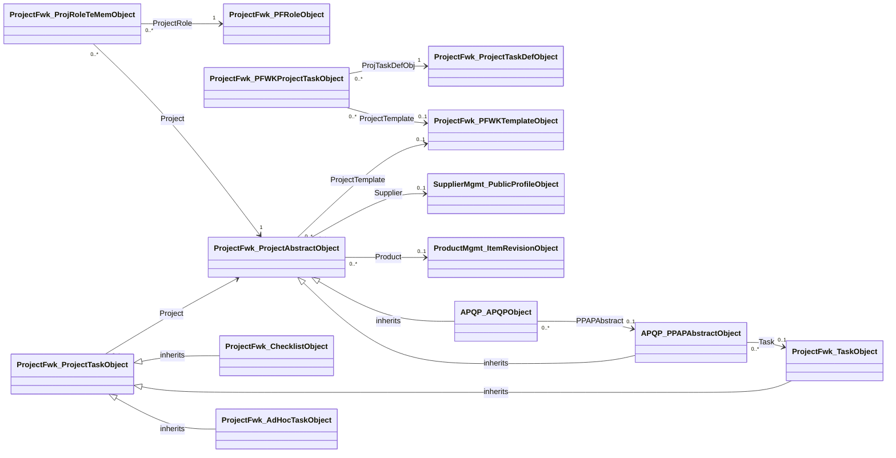
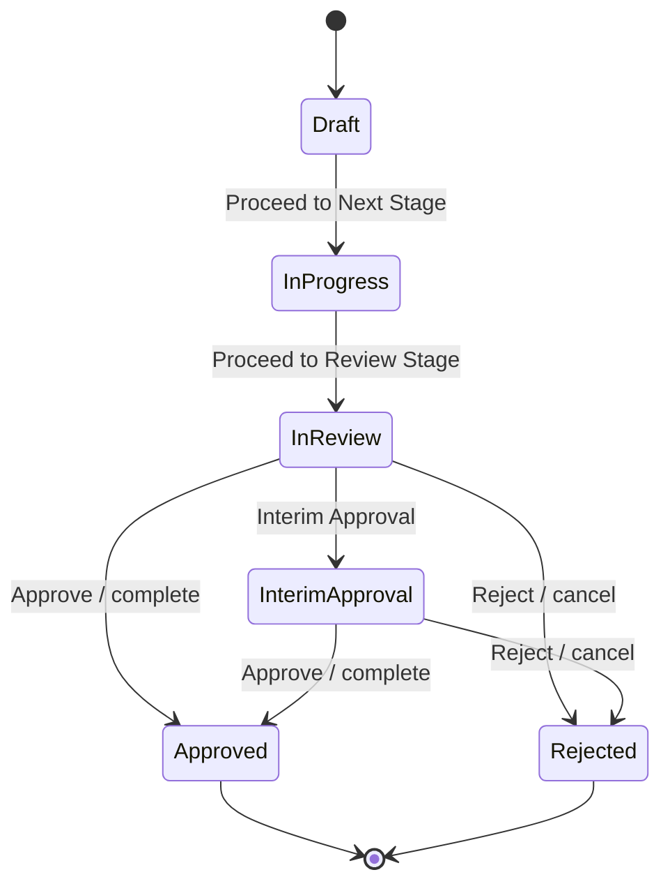

# PPAP OOTB Technical Specification

**Revision:** 0.1 | **Prepared:** 17 November 2026 | **Mode:** Package baseline

## 1. Findings and architectural consequences

The supplied APQP & PPAP Manager product implements PPAP as a concrete subtype of **Project Abstract**, using the shared Project Framework for templates, phases, tasks, contributors, and progress. Its internal name is `APQP_PPAPAbstractObject`, but the exported `IsAbstract` flag is **false**. The baseline contains 48 directly declared PPAP fields and 27 fields declared on Project Abstract. These declarations are preserved separately so inherited fields are not duplicated.

The product context is a **single Item Revision** selected through `Project Abstract.Product`; the supplier reference targets **Public Profile**. The PPAP create view requires the product, template, and Project Owner even though those fields are not all required in the object metadata. A drawing-scoped approval with a selected-parts table is not established by this OOTB model. [Object and field evidence](baseline-model.json), [view evidence](security-seeds-views.md)

The exported PPAP workflow has four stages: **Draft, In Progress, In Review, and Interim Approval**. Approved and Rejected are terminal outcomes. Reject cancels the workflow; it does not return the package for clarification. The same Project Owner is responsible for In Progress, In Review, and Interim Approval. Both approval and rejection check that no project tasks remain open. [Workflow evidence](workflow-automation.md)

Two further behaviors materially affect the modification baseline. The `Auto Close Related Task WF` Action Handler completes the linked integrated task when PPAP is either completed **or cancelled**. Completed PPAP and PSW view fields expose `EditReadOnly` behavior, so read-only rendering is not proof of immutable approved records. Both behaviors are documented as supplied. [Workflow evidence](workflow-automation.md), [view evidence](security-seeds-views.md)

This is a **logical Intelex object model and configuration specification** for the supplied historical bundle. It is not a physical database specification or a verified export of the current Subaru tenant. The main application/data exports are from October 2017, the supporting Checklist Framework exports from 2014, and the Views Add-on from May 2018. The date above records this specification's preparation, not a product release or tenant inspection date.

## 2. Scope and evidence rules

This baseline covers the three identified packages and the two Checklist Framework packages supplied in the same bundle. The shared checklist definitions are needed to explain PPAP checklists, published questions, answers, and related task behavior. APQP and other framework definitions remain visible where the package contains them or PPAP depends on them.

| Evidence classification | Use in this specification |
|---|---|
| Extracted | Exact object/field metadata, stable identifiers, graph references, configured flows, view markup, grants, or data records present in the bundle. |
| Inferred | Logical cardinality interpreted from foreign-key/start/end metadata or a paired inverse. The relationship register identifies these interpretations. |
| Unresolved | Missing dependency metadata, absent owner/type edges, unverified import/runtime semantics, or material differences between package representations. |
| Proposed | No proposed changes are incorporated into this baseline. |

The [PPAP Solution Brief](../solution-brief.md) and ADRs describe the intended solution separately. They do not supply missing OOTB fields, approvals, security rules, or workflow stages. Later modification specifications should reference this revision and classify each change explicitly.

The original downloads were read without modification. Byte-identical working copies are retained in the [package folder](<../../../../ootb_config_packages/APQP & PPAP Manager v1.0.0>). No package was imported, no workflow was published, and no tenant configuration was changed. The installation text is retained as product evidence rather than executed as an instruction.

## 3. Package inspection and dependencies

All five `.ipack` files are UTF-8 JSON with a byte-order mark, rather than archives. The reconstruction indexes every nested package-local `$id` and `$ref`, then joins declarations across packages by stable metadata or record GUID. Package-local graph IDs are not cross-package identifiers. Relation and reverse-property records are dereferenced before interpreting their direction.

| Package | Version | Bytes | Exported platform | Role |
|---|---|---:|---|---|
| APQP & PPAP Manager | 1.0.0.0 | 4,280,537 | 6.5.58.0 | Application metadata, fields, views, security, workflows, automation, reports, and some configuration data. |
| APQP & PPAP Manager - Data | 1.0.0.0 | 1,207,973 | 6.5.58.0 | Templates, task assignments, published checklists/questions, settings, roles, phases, and supporting relationships. |
| Views Add-on | 1.0.0.0 | 69,425 | 6.5.74.0 | Eleven shared selection views and associated dependency metadata; no directly declared PPAP field or PPAP-named view. |
| Checklist Framework | 1.0.0 | 960,618 | 6.4.2.0 | Shared checklist, question, publication, answer, finding, and inspection-action configuration. |
| Checklist Framework - Data | 1.0.0 | 21,424 | 6.4.1.0 | Shared answer/choice and finding-related data. |

The [source manifest](source-manifest.json) records each package ID, version ID, SHA-256 hash, source export timestamp, graph counts, and declared application requirements. Requirements include System Objects, Fragment Application, Supplier Management Framework, Product Management, Event Framework, Action Plans, Quality Comply Framework, Checklist Framework, User Registration, and other shared components. The Views Add-on also references Program Framework, Calendar Management, and Risk Framework.

The supplied [installation note](<../../../../ootb_config_packages/APQP & PPAP Manager v1.0.0/Installation Instructions.txt>) identifies Supplier Relationship Management 1.3.0, Product Management 1.2.1, and Quality Comply Solution 1.0.0 as preconditions. It lists Checklist Framework, APQP & PPAP Manager, Checklist Framework Data, then APQP & PPAP Manager Data, with the Views Add-on for platform 6.5.75 or higher. These instructions and the packages' own requirement versions are separate evidence; neither establishes the target tenant's installed dependencies.

### 3.1 Reconstruction coverage

| Measure | Result |
|---|---:|
| Distinct exported object/lookup/hierarchy definitions or dependency stubs | 92 |
| Direct inheritance edges | 34 |
| Distinct exported field declarations | 508 |
| Fields with resolved declaring object and type | 403 |
| Detached dependency fields without owner/type graph edges | 105 |
| Reference-field declarations, including inverse and detached entries | 181 |
| Canonical owner/target-resolved logical relationships | 101 |
| Named native association-map implementations | 12 |
| Object subsections in the field catalogue | 92 |
| Field rows in the field catalogue | 403 |
| Documented configuration records associated with modelled objects | 489 |
| Exported workflow wrappers / wrappers with stage graphs | 8 / 6 |
| Exported workflow actions / object Action Handlers | 18 / 63 |

The 105 detached fields are retained in [their unresolved inventory](unresolved-field-inventory.csv) and the complete machine model. They are external dependency declarations; the independent review found no unplaced core APQP or Project Framework field. A dependency object with zero directly declared fields exported is not assumed to have no fields on an installed tenant.

## 4. Logical architecture

### 4.1 Principal objects

The [complete object inventory](object-inventory.csv) provides stable IDs, internal names, exported flags, inheritance, field counts, and source pointers for all 92 entries. Display names are not unique: the bundle contains multiple objects captioned Task and Checklist, which must be distinguished by internal name and GUID.

| Object | Internal name | Inheritance parent | Responsibility |
|---|---|---|---|
| PPAP | `APQP_PPAPAbstractObject` | Project Abstract | PPAP ownership, due date, stage completion dates, progress weights, PSW data, and integration with an associated task. |
| APQP | `APQP_APQPObject` | Project Abstract | Related APQP process with its own gate workflow and shared configuration dependencies. |
| Project Abstract | `ProjectFwk_ProjectAbstractObject` | None | Product, supplier, customer, template, project type, phase, location, creator, contributor assignments, tasks, progress, and workflow reference. |
| Project Task | `ProjectFwk_ProjectTaskObject` | Action Plan Abstract | Shared task scope, phase, project role, contributor assignment, and template-assignment lineage. |
| Task | `ProjectFwk_AdHocTaskObject` | Project Task | Task execution without a linked specialist record. |
| Integrated Task | `ProjectFwk_TaskObject` | Project Task | Task fulfilled through a configured specialist record, including PPAP. |
| Checklist | `ProjectFwk_ChecklistObject` | Project Task | Project task fulfilled through the Checklist Framework. |
| Project Task Definition | `ProjectFwk_ProjectTaskDefObject` | None | Abstract reusable requirement/task configuration, role, type, and related definitions. |
| Task Definition | `ProjectFwk_TaskDefObject` | Project Task Definition | Concrete task-definition configuration. |
| Checklist Definition | `ProjectFwk_ChecklistDefObject` | Project Task Definition | Concrete checklist-task configuration. |
| Project Template | `ProjectFwk_PFWKTemplateObject` | None | Reusable project type/template definition and its assignment grid. |
| Project/Task | `ProjectFwk_PFWKProjectTaskObject` | None | Association record between a template and a task definition, carrying phase, order, and helper relationships. |
| Project/Role/Team Member | `ProjectFwk_ProjRoleTeMemObject` | None | A project-specific role/member assignment used by task responsibility. |
| APQP Settings | `APQP_SettingsObject` | None | Shared APQP/PPAP defaults, caution thresholds, CAR display, draft-task display, and APQP gate options. |
| Checklist and published content | `CLF_*` family | See field catalogue | Reusable checklist/question authoring, published definitions, execution answers, choices, findings, and supporting catalogues. |

### 4.2 Structural overview

The overview shows selected direct inheritance and source-declared associations. M:1 multiplicities are inferred from the exported foreign-key direction; optionality follows the declaring field's requiredness. The complete model and domain diagrams retain further relationships and named native maps.

Detailed diagrams: [complete logical model](baseline-logical-model.mmd), [APQP/PPAP and Project Framework](baseline-project-model.mmd), [Checklist Framework](baseline-checklist-model.mmd), and [direct inheritance](baseline-inheritance.mmd). These files use stable internal names; the object inventory supplies display-name mappings.

### 4.3 Relationship interpretation

`PPAP.Task` declares an optional M:1 reference to Integrated Task; `Integrated Task.PPAPs` is its inverse collection. Separately, `APQP.PPAPAbstract` declares an optional M:1 reference to PPAP; `PPAP.APQPAbstract` is the inverse collection. Their names do not establish the opposite direction.

`Project/Task.ProjTaskDefObj` is a required reference to Project Task Definition. `ProjectTemplate`, `Phase`, and `Order` give the assignment its template-specific context. These configuration records must not be mistaken for completed operational tasks. The explicit association object is retained in the model.

`PPAP.ResultsFor` is an M:N selection of the results lookup domain. Twelve native association-map names are documented in the [junction register](junction-object-register.csv); these are extracted implementation names, not invented configurable business objects. The [reference register](relationship-register.csv) includes every reference declaration, while the [canonical register](canonical-relationship-register.csv) removes inverse duplication and omits detached references whose targets cannot be resolved.

## 5. Field and configuration contract

The [field catalogue](field-catalogue.md) is the detailed baseline contract. It gives every modelled object its own numbered subsection and identifies its direct inheritance parent, exported fields, flags, and source. Each directly declared field or exported inverse has one row covering type/relationship, requiredness, default/calculation, editability/visibility, and population or lifecycle evidence. Configuration records appear under their concrete object as initial values.

The catalogue preserves the distinction between object metadata and view behavior. For example, `Product` is optional in Project Abstract metadata but required in the PPAP create view; this condition is explicit. A metadata read-only flag does not identify the permitted editor or prove that a view's Edit Read Only action is inaccessible.

The [expression register](field-expressions.md) retains 158 exact default, calculation, and filter definitions, including value-generator XML. Expressions are extracted evidence and have not been revalidated against the target platform. The [population evidence](field-population-evidence.json) maps resolvable Action Handler and workflow writes to field GUIDs; it does not reinterpret dependency edges as a proven watched-field trigger list.

### 5.1 PPAP and warrant data

The 48 PPAP declarations include Project Owner, Settings, PPAP Due Date (`SubmissionDate`), the linked Task, stage completion/rejection dates, stage progress weights, and warrant-related information. Warrant fields include customer part number, drawing/change identifiers and dates, safety/government regulation, purchase order, weight in kilograms, checking aid, IMDS/other format, submission reason and level, results, mold/cavity/process, run rate, run-rate hours, and comments.

Project Abstract contributes the Item Revision, Public Profile supplier, customer, location, creator, record number, workflow, template, project type, phase, task and contributor collections, and progress/count helpers. Its fields remain defined there rather than repeated on PPAP.

The legacy lookup values are preserved exactly. In particular, the lookup captioned **IMDS #** contains change-related options such as “Change in Part Processing” and “Other - please specify.” The `Clear IMDS Field` handler clears `IMDSOther` when the selected value differs from the latter literal. The baseline does not rename or repair this domain based on contemporary expectations. [Lookup values and settings](security-seeds-views.md), [field catalogue](field-catalogue.md)

### 5.2 Templates, requirements, and checklist publication

| Supplied configuration | Count or behavior |
|---|---|
| PPAP project templates | Five active templates, Level 1 through Level 5 PPAP. |
| PPAP template assignments | Eighteen Project/Task records for each level. This count alone does not mean every level requires identical evidence treatment. |
| APQP template | Standard APQP with 43 assignments. |
| Total template assignment records | 133, preserved with phase/order/definition relationships. |
| Task Definition records | 61 across the shared application configuration. |
| PPAP checklist authoring questions | 18, references `PPAP01.1` through `PPAP01.18`. |
| PPAP checklists and published checklists | Five authoring and five published records. |
| Published question records | 90 across the five published checklists. |
| APQP typed lookup domains | Six domains with 25 supplied values, including risk, submission information/reason/level, IMDS, and results. |

The questions cover design documentation, engineering changes/approval, DFMEA, process flow, PFMEA, control plan, MSA, dimensional and material/performance results, initial process studies, laboratory evidence, appearance, samples, checking aids, customer-specific requirements, and PSW completion. The complete definitions and reference mappings are retained in the field catalogue, [seed records](seed-records.json), and [template assignment register](template-task-assignments.csv).

The documentary seed projection joins repeated records by GUID and retains their scalar values and relationship edges. It excludes object definitions themselves from initial-value records. It is not an asserted result of executing the import policies. Different representations of the Yes/No choice list, module metadata, and other records remain explicit in the evidence rather than being silently treated as one installed truth.

## 6. Workflow, automation, and notifications

### 6.1 PPAP workflow

**Schema GUID:** `9a418af3-17a9-4df0-aa8e-91cf1784a6c0`. **Source:** main application package, `/GraphData/Items/379`.

| Stage | Responsible principal source | Due-date source |
|---|---|---|
| Draft | Project Abstract.CreatedBy | PPAP.SubmissionDate |
| In Progress | PPAP.ProjectOwner | PPAP.SubmissionDate |
| In Review | PPAP.ProjectOwner | PPAP.SubmissionDate |
| Interim Approval | PPAP.ProjectOwner | PPAP.SubmissionDate |

| Action | Guard and principal effects |
|---|---|
| Draft — Proceed to Next Stage | Transitions to In Progress, updates the current-stage helper and weighted progress, and sets the task workflow-change helper. The exported order puts the transition first. |
| In Progress — Proceed to Review Stage | Blocks when `NbOpenProTasks>0`; moves to In Review; updates stage/progress and In-progress Completion Date; sends submission notification. |
| In Review — Approve | Requires no open tasks; completes as Approved; clears phase/stage helper; sets progress to 1 and PPAP/review completion dates; notifies recipients. |
| In Review — Interim Approval | Requires no open tasks; enters Interim Approval; updates stage/progress and review completion date; sends interim notification. |
| In Review — Reject | Requires no open tasks; cancels as Rejected; clears phase/stage helper; stamps rejection/review dates; notifies recipients. |
| Interim Approval — Approve | Requires no open tasks; completes as Approved; sets final progress and PPAP/interim completion dates; notifies recipients. |
| Interim Approval — Reject | Requires no open tasks; cancels as Rejected; stamps rejection/interim completion dates; notifies recipients. |

The exact ordered operations, guards, error text, stable IDs, notification templates, and source pointers are authoritative in the [workflow appendix](workflow-automation.md). No return-for-information action, per-element engineer approval loop, or classification-dependent management stage is added to this baseline.

### 6.2 Shared tasks and automation

Ad Hoc Task, Integrated Task, and Project Checklist each have an Open-stage workflow. The completion actions require completion notes, set a completion date if absent, complete as Closed, and set completion actor/flag fields. Integrated Task additionally checks that its specialist record exists; its completion action is hidden. Project Checklist requires all checklist questions to be answered. Due-date-based start conditions support delayed activation until a task has a date.

The APQP workflow has six exported stages and shares the project/task/template mechanisms. Lesson Learned and Item Revision wrappers have no exported stage graphs and remain incomplete dependencies. Checklist Framework contributes a separate two-stage Inspection Action Plan workflow.

The 63 exported object Action Handlers all contain non-empty, parseable flow programs. Forty-five have resolved object-owner edges; eighteen are dependency actions without exported ownership links. PPAP and Project Framework flows include template task generation, project-role/member creation and synchronization, phase/date validation, related-task initialization, PPAP owner/due-date synchronization, IMDS clearing, completion notifications, and related-task closure. The full flow programs remain in [workflow evidence JSON](workflow-baseline.json).

Four PPAP email templates support submission, approval, interim approval, and rejection. Their recipients include project role members and the person responsible for the related integrated task's project workflow. Shared task assignment/completion, APQP completion, Lesson Learned, Item Revision, and CAR assignment templates are also retained; eleven distinct notification template records are documented overall.

Numeric ActionType values, field dependencies, and ordered flow operations are extracted without asserting an unexported enum mapping or runtime transaction model. Handler recursion, concurrent saves, rollback, retry safety, and scheduler cadence require tenant verification before modifying shared automation.

## 7. Security, forms, reporting, and outputs

### 7.1 Security baseline

The bundle contains sixteen distinct group records and eight group-membership edges. Principal product groups are **APQP and PPAP Owners** and **APQP and PPAP Contributors**. Owners are members of Contributors and Item Coordinator. Group membership associations are separate from object inheritance.

The security export contains 102 representations and 56 direct allow ACL rows. Those security representations inherit permissions. The PPAP object has no direct ACL entries in its exported security record; this does not establish absence of access. The module grants Contributors View Details/View in Inventory and Owners Create/Edit/HardDelete. The PPAP dashboard and report definitions separately grant Everyone View and Owners Edit; artifact access does not prove access to every contributing source record. [Security grants](security-grants.csv), [security interpretation](security-seeds-views.md)

PPAP stage permissions add further evidence: each of the four stages has explicit allow entries for **Person Responsible** and **Immediate supervisor**, granting Edit, Create, Delete (`HardDelete`), and WF Action. All four stages have `InheritedPermission=true` and `IsStandardPermission=false`. The serialized `ApplyTo="2"` value is retained without guessing its scope semantics. All subject and operation GUIDs resolve in the [stage permission appendix](workflow-automation.md).

The PPAP object metadata reports `IsSecurityEnabled=false` and `IsAuditEnabled=false`, while inherited security records and workflow-stage grants also exist. These different layers must be considered together. No individual user membership, effective supplier visibility, direct URL, attachment, export, or tenant authorization test is supplied.

### 7.2 Forms and settings

The principal form is `APQP_PPAP_Detail`, GUID `ee3fad4b-3787-45b3-a463-9f6f9ba01364`, main package `/GraphData/Items/812`. Its create mode requires Template, Part Number (`Product`), and Project Owner, with Save captioned Continue. Draft retains the selected template as read only and exposes the business context. Later stages render several context fields read only with Edit Read Only enabled. Completed/cancelled forms display the applicable completion/rejection dates and read-only grids/PSW fields, also with relevant Edit Read Only markup.

Contributor assignments pair Project Role and Member. Task views show responsibility, due date, status, completion details, specialist-record links, attachments, and an Assign Due Dates mass-update action. CAR visibility depends on `EnableCARPPAP`. General attachments, documents, workflow comments, and a PSW mail-merge panel are present.

The exported Default settings use 15 for each APQP/PPAP record/task caution threshold; CAR options are true. `PPAPHidTskDraft=false` is interpreted by the actual Draft conditional to suppress the task block. The literal view condition governs behavior regardless of the internal setting name. This condition and the settings values are preserved together in the [view appendix](security-seeds-views.md).

The view flags are `IsPublic=false` and `IsParsedForMobile=false`; they do not establish responsive-browser behavior or current native-mobile compatibility. The Views Add-on supplies shared selection helpers, including an inspection selector change from `_DependsOn.Parent` to `_DependsOn.Parent$`. Its Product Management employee selector is not evidence of a PPAP-specific eligible final-approver pool.

### 7.3 Reporting and PSW output

The supplied application includes PPAP status dashboard/report definitions and visualizations such as PPAP by Stage. Their source configuration is retained in the [view/security evidence](security-seeds-views.json), with shared project counts, progress fields, phases, suppliers, and owners available in the schema. No target dashboard latency or live-workflow reporting architecture is inferred from these exports.

PPAP enables mail merge and the form exposes PSW Templates. The installation note requires `PSW_Intelex.docx` on the PPAP object, downloaded as Word. That DOCX is absent from the bundle. Consequently its merge mappings, rendered warrant, and output layout cannot be verified. The package does not establish the intended approval-certificate PDF feature.

## 8. Validation findings and baseline limitations

| ID | Finding | Consequence for later modification work |
|---|---|---|
| BL-01 | All five package graphs parse; package-local graph references resolve. Original/copy hashes are recorded. | Source evidence is traceable and reproducible. |
| BL-02 | Independent extraction matches all 92 objects, 508 fields, and 403 resolved field owner/type assignments, with no relationship-orientation mismatches. | Use stable GUIDs and declaring objects when specifying changes. |
| BL-03 | No inheritance cycles or duplicate canonical field rows were found. | Direct inheritance and the field catalogue reconcile structurally. |
| BL-04 | 105 dependency field declarations lack owner/type graph edges. | Preserve them as unresolved; obtain relevant dependency exports before changing those contracts. |
| BL-05 | Document, Requirement Abstract, and Hazards dependency stubs omit inheritance metadata. | Their inheritance parent remains Unresolved. |
| BL-06 | Fourteen scalar metadata-property variations exist across object/field representations. Compatibility add-on values and import policy can matter. | Review the variation register before treating the selected documentary representation as an installed value. |
| BL-07 | Repeated data records include divergent Yes/No choice-list and shared-module values. Numeric IfExists/IfNotExists policy meanings were not verified. | Preserve per-package values and confirm actual import behavior rather than assuming overlay precedence. |
| BL-08 | Lesson Learned and Item Revision workflows lack stage/action graphs; eighteen object actions lack owner edges. | Additional exports are needed for a complete dependency lifecycle/ownership contract. |
| BL-09 | Flow JSON parses and formula text is preserved, but runtime execution, permissions, scheduling, and atomicity were not tested. | Validate on the intended platform before migration or shared-handler changes. |
| BL-10 | `PSW_Intelex.docx` is missing. | Obtain the original merge template before confirming warrant output parity. |
| BL-11 | Historical installation notes list six known issues, including contributor access to other users' checklist answers and Owner creation of SRM Public Profiles. | Retain these as historical product notes and verify their applicability on the target tenant. |
| BL-12 | PPAP and Project Abstract both directly declare a field named `Id`, under different field GUIDs. | Both exported declarations are preserved. Confirm their effective inherited identity binding before changing keys or integrations; do not infer a physical key layout. |

The complete [validation results](validation.json), [document and source checks](document-validation.json), [independent schema comparison](independent-schema-validation.json), [metadata variations](metadata-variation-register.csv), and workflow validation provide the supporting detail. A successful static extraction is not evidence that the historical package can be installed unchanged on the current platform.

## 9. Baseline preservation and future traceability

This folder remains the OOTB reference. The solution brief and future target specification should remain separate. A modification should identify the affected baseline object/field/workflow GUID, retain the original behavior, state the intended change, identify any APQP/shared dependency impact, and link the governing requirement or ADR. The current baseline does not prescribe those changes.

Reconstruction scripts are [schema extraction](../../../../scripts/extract_ppap_ootb_baseline.cjs) and [catalogue assembly](../../../../scripts/build_ppap_ootb_specification.cjs). They create documentary artifacts and do not perform tenant operations. Raw source packages, per-package representations, and stable-ID evidence take precedence over a generated summary if a discrepancy is found.
