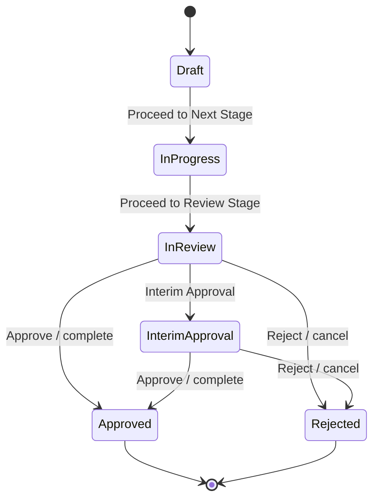

# OOTB PPAP workflow and automation baseline

**Evidence status:** Extracted configuration, with explicitly identified unresolved runtime behavior. No target ADR changes are applied. The source flows are JSON programs stored in `FlowDefinition`/`Flow`; they are not XML workflow definitions.

## 1. Findings and boundaries

- The main package contains seven workflow wrappers, of which five have exported stage graphs: Ad Hoc Task, integrated Task, PPAP, Project Checklist, and APQP. Lesson Learned and Item Revision wrappers contain only schema metadata in this export and do not establish their complete workflows. The supporting Checklist Framework package adds the Inspection Action Plan workflow.
- PPAP is assigned to the `APQP_PPAPAbstractObject` object labelled PPAP. Draft is assigned from `Project Abstract.CreatedBy`; In Progress, In Review, and Interim Approval are assigned from `PPAP.ProjectOwner`. Every PPAP stage uses `PPAP.SubmissionDate` as its due-date property.
- PPAP has four stages and six status records. Approved and Rejected are terminal outcomes invoked by `complete` and `cancel` respectively, rather than ordinary stages. Interim Approval is an active stage.
- Seven PPAP actions exist. In Review and Interim Approval allow Approve and Reject; In Review additionally allows Interim Approval. Reject cancels the workflow; the package does not define a Return for More Information action in this workflow.
- Every PPAP action after Draft first checks `NbOpenProTasks>0` and raises an error when tasks remain open. This includes rejection.
- PPAP owner and submission date are synchronized with the linked integrated task by object actions. The OOTB `Auto Close Related Task WF` action marks that task complete for either Completed or Cancelled PPAP workflow outcomes.
- PPAP template/phase/task behavior is shared with APQP through Project Framework. Changing the shared objects or actions can affect both processes.
- Object-action `ActionType` integers, flow text, field dependencies and ownership edges are extracted. The enum mapping and transaction/rollback/retry guarantees are not independently proved by these packages. Descriptive action names are not treated as executed behavior when their flow does something narrower.
- No complete Event Service cadence/configuration was found. A dependency action description says a recalculation must run with an Event Service, but that statement does not establish a deployed scheduler.

## 2. Workflow inventory

| Workflow | Object | Schema stable ID | Exported stages | Exported actions | Source |
|---|---|---|---:|---:|---|
| Task | ProjectFwk_AdHocTaskObject | `37c547dd-a3c5-42b5-9e95-d018286f3872` | 1 | 1 | APQP & PPAP Manager(v1.0.0.0).ipack `/GraphData/Items/185` |
| Task | ProjectFwk_TaskObject | `88ebd9b3-c019-40c9-bac0-f251dee83e4a` | 1 | 1 | APQP & PPAP Manager(v1.0.0.0).ipack `/GraphData/Items/310` |
| Lesson Learned | Object edge not exported | `92a7da06-8d90-4df8-9419-9eb11ec3fa8f` | 0 | 0 | APQP & PPAP Manager(v1.0.0.0).ipack `/GraphData/Items/332` |
| PPAP | APQP_PPAPAbstractObject | `9a418af3-17a9-4df0-aa8e-91cf1784a6c0` | 4 | 7 | APQP & PPAP Manager(v1.0.0.0).ipack `/GraphData/Items/379` |
| Project Checklist | ProjectFwk_ChecklistObject | `1ca87d8f-da06-4fcc-88a6-950e57921b57` | 1 | 1 | APQP & PPAP Manager(v1.0.0.0).ipack `/GraphData/Items/452` |
| APQP | APQP_APQPObject | `07b608a0-efb7-4f2e-9731-ed1fc1b35573` | 6 | 6 | APQP & PPAP Manager(v1.0.0.0).ipack `/GraphData/Items/535` |
| Item Revision | Object edge not exported | `08166b0e-c067-406c-91be-031595d00f37` | 0 | 0 | APQP & PPAP Manager(v1.0.0.0).ipack `/GraphData/Items/763` |
| Inspection Action Plan | CLF_InsActionPlanObject | `c7f95fd5-34a5-45d5-9231-727910d22265` | 2 | 2 | Checklist Framework(v1.0.0).ipack `/GraphData/Items/102` |

## 3. PPAP stage flow

The transition diagram summarizes the exported actions. Guards and mutations appear in the ordered action tables below. It does not add a return loop or conditional management-approval stage.

## 4. Task — ProjectFwk_AdHocTaskObject

**Schema stable ID:** `37c547dd-a3c5-42b5-9e95-d018286f3872`. **Source:** `APQP & PPAP Manager(v1.0.0.0).ipack` `/GraphData/Items/185`.

Schema flags: IsActive=`true`, EnableActionsOnCreate=`false`, EnableActionsOnEdit=`true`, IsCommentsEnable=`true`, IsDateNotRequiredEnabled=`false`, IsRecurring=`false`, HasPendingChanges=`false`, LastPublishDate=`2017-09-20T19:42:18.013Z`. These are exported schema properties, not proof of the current tenant state.

Initial stage: `Open`. Status records: `Closed` (`67c1c506-8ea6-458d-9c6c-5a49cf1b0c21`); `In Progress` (`9ff077f0-4881-433e-ae5a-d72616b21510`).

| Stage | System name | Status | Responsibility | Due date | Stable ID |
|---|---|---|---|---|---|
| Open | `Open` | In Progress | IFNULL(IF(PersResponsible<>NULL,PersResponsible.Member,PersonResp),Project.Workflow.PersonResponsible) | Abstract Corrective Action.DueDate | `a3d72958-704a-4186-8cff-c40274ae5716` |

Start-condition field: `StartCondition`; calculation metadata: `<?xml version="1.0" encoding="utf-16"?><CalculationBase xmlns:i="http://www.w3.org/2001/XMLSchema-instance" i:type="XScriptExpressionCalculation" xmlns="http://schemas.intelex.net"><Expression>IF(DueDate&lt;&gt;NULL,TRUE,FALSE)</Expression></CalculationBase>`.

| Stage | Action order and name | Visibility / signature | Ordered exported operations | Stable ID and source |
|---|---|---|---|---|
| Open | 1: Complete Task | IsHidden=`false`; RequireSignature=`false`; TriggerCondition=`NULL` | 1. If `CompletionNotes=NULL`: Raise error `Please fill out the 'Completion Notes'.` 2. If `CompletionDate=NULL`: Set `CompletionDate` = `TODAY` 3. Complete with status `Closed` 4. Set `IsCompleted` = `TRUE` 5. Set `CompletedBy` = `CURRENTUSER` | `d74d3aac-1eb9-4262-b8d2-911c314f0766`; `/GraphData/Items/185/GraphData/Items/19` |

Start notifications:
- `[ProjectFwk] Project task assignment`; subject records: `Person Responsible`.

## 5. Task — ProjectFwk_TaskObject

**Schema stable ID:** `88ebd9b3-c019-40c9-bac0-f251dee83e4a`. **Source:** `APQP & PPAP Manager(v1.0.0.0).ipack` `/GraphData/Items/310`.

Schema flags: IsActive=`true`, EnableActionsOnCreate=`false`, EnableActionsOnEdit=`true`, IsCommentsEnable=`true`, IsDateNotRequiredEnabled=`true`, IsRecurring=`false`, HasPendingChanges=`false`, LastPublishDate=`2017-09-20T19:51:23.41Z`. These are exported schema properties, not proof of the current tenant state.

Initial stage: `Open`. Status records: `Closed` (`6d0ec270-ce26-472e-a60e-c6ef68529a06`); `In Progress` (`f30aff90-7040-46d2-a737-8ca4c2858142`).

| Stage | System name | Status | Responsibility | Due date | Stable ID |
|---|---|---|---|---|---|
| Open | `Open` | In Progress | IFNULL(IF(PersResponsible<>NULL,PersResponsible.Member,PersonResp),Project.Workflow.PersonResponsible) | DueDate | `bd2e2062-d735-43f1-b3cd-8d5e584234cc` |

Start-condition field: `StartCondition`; calculation metadata: `<?xml version="1.0" encoding="utf-16"?><CalculationBase xmlns:i="http://www.w3.org/2001/XMLSchema-instance" i:type="XScriptExpressionCalculation" xmlns="http://schemas.intelex.net"><Expression>IF(DueDate&lt;&gt;NULL,TRUE,FALSE)</Expression></CalculationBase>`.

Date-not-required final status: `Closed`.

| Stage | Action order and name | Visibility / signature | Ordered exported operations | Stable ID and source |
|---|---|---|---|---|
| Open | 1: Complete Task | IsHidden=`true`; RequireSignature=`false`; TriggerCondition=`NULL` | 1. If `CompletionNotes=NULL`: Raise error `Please fill out the 'Completion Notes'.` 2. If `CompletionDate=NULL`: Set `CompletionDate` = `TODAY` 3. If `NOT(HelpeTaskExists)`: Raise error `Please create the Integrated Task.` 4. Complete with status `Closed` 5. Set `IsCompleted` = `TRUE` 6. Set `CompletedBy` = `CURRENTUSER` | `3bc1f16f-c247-4fb8-9763-277794eb35bf`; `/GraphData/Items/310/GraphData/Items/19` |

Start notifications:
- `[ProjectFwk] Project task assignment`; subject records: `Person Responsible`.

## 6. Lesson Learned — incomplete dependency export

**Schema stable ID:** `92a7da06-8d90-4df8-9419-9eb11ec3fa8f`. **Source:** `APQP & PPAP Manager(v1.0.0.0).ipack` `/GraphData/Items/332`.

Schema flags: IsActive=`true`, EnableActionsOnCreate=`false`, EnableActionsOnEdit=`true`, IsCommentsEnable=`true`, IsDateNotRequiredEnabled=`false`, IsRecurring=`false`, HasPendingChanges=`true`, LastPublishDate=`2017-07-12T20:56:59.9Z`. These are exported schema properties, not proof of the current tenant state.

**Unresolved:** Stage, action, assignment and transition graphs are not included in this wrapper. Do not infer them from the workflow name.

## 7. PPAP — APQP_PPAPAbstractObject

**Schema stable ID:** `9a418af3-17a9-4df0-aa8e-91cf1784a6c0`. **Source:** `APQP & PPAP Manager(v1.0.0.0).ipack` `/GraphData/Items/379`.

Schema flags: IsActive=`true`, EnableActionsOnCreate=`false`, EnableActionsOnEdit=`true`, IsCommentsEnable=`true`, IsDateNotRequiredEnabled=`false`, IsRecurring=`false`, HasPendingChanges=`false`, LastPublishDate=`2017-09-26T19:16:54.367Z`. These are exported schema properties, not proof of the current tenant state.

Initial stage: `Draft`. Status records: `Draft` (`217f781f-51bb-4f73-aec0-0165d9eb47fa`); `In Progress` (`18a47934-a3db-435d-ba9f-08e097e8f3d5`); `Approved` (`c750deb9-546a-4c65-bdd9-393b0a7c82a0`); `Rejected` (`f211427c-858d-4e06-b49a-549ab1e5c95b`); `Interim Approval` (`34833753-9adc-4702-95f8-6b9df7990081`); `In Review` (`0a90fd3b-d957-48f6-bad1-e2a8e5c06c64`).

| Stage | System name | Status | Responsibility | Due date | Stable ID |
|---|---|---|---|---|---|
| Draft | `Draft` | Draft | Project Abstract.CreatedBy | PPAP.SubmissionDate | `17d46ca0-8a09-4b1f-b14a-65657f6f2e65` |
| In Progress | `InProgress` | In Progress | PPAP.ProjectOwner | PPAP.SubmissionDate | `0c31f42f-8e41-40a5-b3dc-0415ea020857` |
| In Review | `InReview` | In Review | PPAP.ProjectOwner | PPAP.SubmissionDate | `46fcf23a-387b-47c8-86dd-43c89c555e17` |
| Interim Approval | `InterimApproval` | Interim Approval | PPAP.ProjectOwner | PPAP.SubmissionDate | `717a7c56-a72a-49a3-ac47-c2d6301625f8` |

| Stage | Action order and name | Visibility / signature | Ordered exported operations | Stable ID and source |
|---|---|---|---|---|
| Draft | 1: Proceed to Next Stage | IsHidden=`false`; RequireSignature=`false`; TriggerCondition=`NULL` | 1. Transition to `In Progress` 2. Set `MyCurrentStage` = `Workflow.CurrentStage.SystemName` 3. Set `Progress` = `Progress+ DraftWeight` 4. Set `ProjectTasks.HelpProjWorkCh` = `TRUE` | `db040717-9e07-466d-bcc1-3ea8bf335370`; `/GraphData/Items/379/GraphData/Items/20` |
| In Progress | 1: Proceed to Review Stage | IsHidden=`false`; RequireSignature=`false`; TriggerCondition=`NULL` | 1. If `NbOpenProTasks>0`: Raise error `All Tasks must be completed before moving to the next gate.` 2. Transition to `In Review` 3. Set `MyCurrentStage` = `Workflow.CurrentStage.SystemName` 4. Set `Progress` = `Progress+ InProgresWeight` 5. Set `InProgCompDate` = `TODAY` 6. Notify using `[PPAP] PPAP Submission for Approval`; recipient fields `ProjRoleTeamMem.Member, Task.Project.Workflow.PersonResponsible`; explicit subjects `none` | `f99c0dc7-1a2e-4192-80dc-f202878cb95d`; `/GraphData/Items/379/GraphData/Items/24` |
| In Review | 1: Approve | IsHidden=`false`; RequireSignature=`false`; TriggerCondition=`NULL` | 1. If `NbOpenProTasks>0`: Raise error `All Tasks must be completed before approving the PPAP.` 2. Complete with status `Approved` 3. Set `MyCurrentStage` = `NULL` 4. Set `Phase` = `NULL` 5. Set `Progress` = `1` 6. Set `PPAPCompDate` = `TODAY` 7. Set `ReviewCompDate` = `TODAY` 8. Notify using `[PPAP] PPAP Submission Approved`; recipient fields `ProjRoleTeamMem.Member, Task.Project.Workflow.PersonResponsible`; explicit subjects `none` | `59d77971-7084-48a3-8eab-c61f961e7771`; `/GraphData/Items/379/GraphData/Items/26` |
| In Review | 2: Interim Approval | IsHidden=`false`; RequireSignature=`false`; TriggerCondition=`NULL` | 1. If `NbOpenProTasks>0`: Raise error `All Tasks must be completed before moving to the next stage.` 2. Transition to `Interim Approval` 3. Set `MyCurrentStage` = `Workflow.CurrentStage.SystemName` 4. Set `Progress` = `Progress+ InReviewWeight` 5. Set `ReviewCompDate` = `TODAY` 6. Notify using `[PPAP] PPAP Submission Interim Approval`; recipient fields `ProjRoleTeamMem.Member, Task.Project.Workflow.PersonResponsible`; explicit subjects `none` | `b782ce3a-ed0a-47a7-815c-c1f377b077f6`; `/GraphData/Items/379/GraphData/Items/25` |
| In Review | 3: Reject | IsHidden=`false`; RequireSignature=`false`; TriggerCondition=`NULL` | 1. If `NbOpenProTasks>0 `: Raise error `All Tasks must be completed before rejecting the PPAP.` 2. Cancel with status `Rejected` 3. Set `MyCurrentStage` = `NULL` 4. Set `Phase` = `NULL` 5. Set `PPAPRejeDate` = `TODAY` 6. Set `ReviewCompDate` = `TODAY` 7. Notify using `[PPAP] PPAP Submission Rejected`; recipient fields `ProjRoleTeamMem.Member, Task.Project.Workflow.PersonResponsible`; explicit subjects `none` | `1eb129c2-9ea6-4b3c-8067-cc9fd215bbcb`; `/GraphData/Items/379/GraphData/Items/27` |
| Interim Approval | 1: Approve | IsHidden=`false`; RequireSignature=`false`; TriggerCondition=`NULL` | 1. If `NbOpenProTasks>0`: Raise error `All Tasks must be completed before approving the PPAP.` 2. Complete with status `Approved` 3. Set `MyCurrentStage` = `NULL` 4. Set `Phase` = `NULL` 5. Set `Progress` = `1` 6. Set `PPAPCompDate` = `TODAY` 7. Set `IApprovCompDate` = `TODAY` 8. Notify using `[PPAP] PPAP Submission Approved`; recipient fields `ProjRoleTeamMem.Member, Task.Project.Workflow.PersonResponsible`; explicit subjects `none` | `9d7a9360-42cc-4ab2-b778-a3bd7d98b62a`; `/GraphData/Items/379/GraphData/Items/28` |
| Interim Approval | 2: Reject | IsHidden=`false`; RequireSignature=`false`; TriggerCondition=`NULL` | 1. If `NbOpenProTasks>0`: Raise error `All Tasks must be completed before rejecting the PPAP.` 2. Cancel with status `Rejected` 3. Set `MyCurrentStage` = `NULL` 4. Set `Phase` = `NULL` 5. Set `PPAPRejeDate` = `TODAY` 6. Set `IApprovCompDate` = `TODAY` 7. Notify using `[PPAP] PPAP Submission Rejected`; recipient fields `ProjRoleTeamMem.Member, Task.Project.Workflow.PersonResponsible`; explicit subjects `none` | `8e768b51-c858-4ab6-9285-c8306dfd5eaf`; `/GraphData/Items/379/GraphData/Items/29` |

## 8. Project Checklist — ProjectFwk_ChecklistObject

**Schema stable ID:** `1ca87d8f-da06-4fcc-88a6-950e57921b57`. **Source:** `APQP & PPAP Manager(v1.0.0.0).ipack` `/GraphData/Items/452`.

Schema flags: IsActive=`true`, EnableActionsOnCreate=`false`, EnableActionsOnEdit=`true`, IsCommentsEnable=`true`, IsDateNotRequiredEnabled=`false`, IsRecurring=`false`, HasPendingChanges=`false`, LastPublishDate=`2017-09-20T19:43:41.767Z`. These are exported schema properties, not proof of the current tenant state.

Initial stage: `Open`. Status records: `In Progress` (`394db885-4929-4a82-a96c-004d0596d360`); `Closed` (`992827da-12b7-478a-ba9a-992e1a36163a`).

| Stage | System name | Status | Responsibility | Due date | Stable ID |
|---|---|---|---|---|---|
| Open | `Open` | In Progress | IFNULL(IF(PersResponsible<>NULL,PersResponsible.Member,PersonResp),Project.Workflow.PersonResponsible) | DueDate | `09b4952f-2d0f-4ec2-ae68-c3a7625f0d7b` |

Start-condition field: `StartCondition`; calculation metadata: `<?xml version="1.0" encoding="utf-16"?><CalculationBase xmlns:i="http://www.w3.org/2001/XMLSchema-instance" i:type="XScriptExpressionCalculation" xmlns="http://schemas.intelex.net"><Expression>IF(DueDate&lt;&gt;NULL,TRUE,FALSE)</Expression></CalculationBase>`.

| Stage | Action order and name | Visibility / signature | Ordered exported operations | Stable ID and source |
|---|---|---|---|---|
| Open | 1: Complete Task | IsHidden=`false`; RequireSignature=`false`; TriggerCondition=`NULL` | 1. If `CompletionNotes=NULL `: Raise error `Please fill out the 'Completion Notes'.` 2. If `CompletionDate=NULL`: Set `CompletionDate` = `TODAY` 3. If `ChecklistAnswer.Progress<1`: Raise error `Please answer all the checklist questions to complete the task.` 4. Complete with status `Closed` 5. Set `IsCompleted` = `TRUE` 6. Set `CompletedBy` = `CURRENTUSER` | `d27ff9e6-b9a2-425e-a22f-cc4cdbc53bff`; `/GraphData/Items/452/GraphData/Items/19` |

Start notifications:
- `[ProjectFwk] Project task assignment`; subject records: `Person Responsible`.

## 9. APQP — APQP_APQPObject

**Schema stable ID:** `07b608a0-efb7-4f2e-9731-ed1fc1b35573`. **Source:** `APQP & PPAP Manager(v1.0.0.0).ipack` `/GraphData/Items/535`.

Schema flags: IsActive=`true`, EnableActionsOnCreate=`false`, EnableActionsOnEdit=`true`, IsCommentsEnable=`true`, IsDateNotRequiredEnabled=`false`, IsRecurring=`false`, HasPendingChanges=`false`, LastPublishDate=`2017-07-21T14:06:34Z`. These are exported schema properties, not proof of the current tenant state.

Initial stage: `Draft`. Status records: `Process Design & Development` (`7d6f3fe3-9485-4d58-841b-21cabdcac076`); `Plan & Define` (`6461f238-c5f0-4d35-bf67-244fb6f0fd56`); `Product Design & Development` (`14061dbd-eaea-4a70-99d9-39235c6ffd44`); `Product & Process Validation` (`95db1e4c-8bb9-40a2-8fb1-6f1e174cc175`); `Feedback Assessment & Corrective Action` (`b03249df-ed7d-44e6-93da-8b7166693cfc`); `Draft` (`74998ded-744f-4ae2-b5d7-97995df66af6`); `Approved` (`cb5b8dff-3c5e-4c5e-8dab-bd9b11d4cdc5`).

| Stage | System name | Status | Responsibility | Due date | Stable ID |
|---|---|---|---|---|---|
| Draft | `Draft` | Draft | Project Abstract.CreatedBy | None exported | `99e84b64-aa40-4407-9a0d-8f68e7671c0b` |
| Gate 1 | `FirstGate` | Plan & Define | APQP.ProcessOwner | None exported | `41914afc-9652-4631-8f61-ac3273342c19` |
| Gate 2 | `SecondGate` | Product Design & Development | APQP.ProcessOwner | None exported | `cb12a3be-c5c1-4334-b550-fcbeb6d66535` |
| Gate 3 | `ThirdGate` | Process Design & Development | APQP.ProcessOwner | None exported | `dd140743-1c4f-44e9-a82a-3f759c115309` |
| Gate 4 | `FourthGate` | Product & Process Validation | APQP.ProcessOwner | APQP.PPAPDueDate | `ab53e7fe-e78b-4955-90ce-dc933c145bf9` |
| Gate 5 | `FifthGate` | Feedback Assessment & Corrective Action | APQP.ProcessOwner | APQP.SignoffDate | `0d1ca420-8c76-4243-b1f2-6d3cf351d9ec` |

| Stage | Action order and name | Visibility / signature | Ordered exported operations | Stable ID and source |
|---|---|---|---|---|
| Draft | 1: Proceed to First Gate | IsHidden=`false`; RequireSignature=`false`; TriggerCondition=`NULL` | 1. Transition to `Gate 1` 2. Set `Progress` = `Progress+DraftWeight ` 3. Set `MyCurrentStage` = `Workflow.CurrentStage.SystemName` | `75aec4cc-2a78-4373-b61a-a8a0ea866ec8`; `/GraphData/Items/535/GraphData/Items/22` |
| Gate 1 | 1: Proceed to Next Gate | IsHidden=`false`; RequireSignature=`false`; TriggerCondition=`NULL` | 1. If `GETSETTING("APQP_SettingsObject", "SkipGate2")`: Transition to `Gate 3`; Set `Progress` = `Progress+FirstGateWeight+SecGateWeight`; otherwise Transition to `Gate 2`; Set `Progress` = `Progress+ FirstGateWeight` 2. Set `MyCurrentStage` = `Workflow.CurrentStage.SystemName` 3. Set `Gate1Completed` = `TODAY` | `459fdd16-99aa-42fc-aa8b-e4601277a088`; `/GraphData/Items/535/GraphData/Items/26` |
| Gate 2 | 1: Proceed to Next Gate | IsHidden=`false`; RequireSignature=`false`; TriggerCondition=`NULL` | 1. Transition to `Gate 3` 2. Set `Progress` = `Progress+SecGateWeight ` 3. Set `MyCurrentStage` = `Workflow.CurrentStage.SystemName` 4. Set `Gate2Completed` = `TODAY` | `f19131bd-ec63-4934-84e6-e6db6e3a0eca`; `/GraphData/Items/535/GraphData/Items/27` |
| Gate 3 | 1: Proceed to Next Gate | IsHidden=`false`; RequireSignature=`false`; TriggerCondition=`NULL` | 1. Transition to `Gate 4` 2. Set `Progress` = `Progress+ThirdGateWeight` 3. Set `MyCurrentStage` = `Workflow.CurrentStage.SystemName` 4. Set `Gate3Completed` = `TODAY` | `1822903d-102c-4e95-a2d7-fb39860f70f3`; `/GraphData/Items/535/GraphData/Items/28` |
| Gate 4 | 1: Proceed to Next Gate | IsHidden=`false`; RequireSignature=`false`; TriggerCondition=`NULL` | 1. If `NbOpenProTasks>0`: Raise error `All Tasks must be completed before moving to the next gate.` 2. If `COUNT(LessonLearned)<1`: Raise error `At least one Lesson Learned must be added before moving to the next gate.` 3. Transition to `Gate 5` 4. Set `Progress` = `Progress+ FourGateWeight` 5. Set `MyCurrentStage` = `Workflow.CurrentStage.SystemName` 6. Set `Gate4Completed` = `TODAY` | `e162eaab-8a46-4b76-8951-491aa653df18`; `/GraphData/Items/535/GraphData/Items/30` |
| Gate 5 | 1: Approve | IsHidden=`false`; RequireSignature=`false`; TriggerCondition=`NULL` | 1. If `NbOpenProTasks>0`: Raise error `All Tasks must be completed before closing this APQP record.` 2. Complete with status `Approved` 3. Set `Progress` = `Progress+ FifthGateWeight` 4. Set `MyCurrentStage` = `NULL` 5. Set `Phase` = `NULL` 6. Set `Gate5Completed` = `TODAY` 7. Set `ProjCompletedOn` = `TODAY` 8. Notify using `[APQP] Feedback Assessment & Corrective Actions Completed`; recipient fields `ProjRoleTeamMem.Member`; explicit subjects `none` | `f976d235-8755-4a99-8b97-7feafd0df32c`; `/GraphData/Items/535/GraphData/Items/32` |

## 10. Item Revision — incomplete dependency export

**Schema stable ID:** `08166b0e-c067-406c-91be-031595d00f37`. **Source:** `APQP & PPAP Manager(v1.0.0.0).ipack` `/GraphData/Items/763`.

Schema flags: IsActive=`true`, EnableActionsOnCreate=`true`, EnableActionsOnEdit=`true`, IsCommentsEnable=`true`, IsDateNotRequiredEnabled=`true`, IsRecurring=`false`, HasPendingChanges=`false`, LastPublishDate=`2016-03-09T15:00:43.03Z`. These are exported schema properties, not proof of the current tenant state.

**Unresolved:** Stage, action, assignment and transition graphs are not included in this wrapper. Do not infer them from the workflow name.

## 11. Inspection Action Plan — CLF_InsActionPlanObject

**Schema stable ID:** `c7f95fd5-34a5-45d5-9231-727910d22265`. **Source:** `Checklist Framework(v1.0.0).ipack` `/GraphData/Items/102`.

Schema flags: IsActive=`true`, EnableActionsOnCreate=`true`, EnableActionsOnEdit=`true`, IsCommentsEnable=`true`, IsDateNotRequiredEnabled=`false`, IsRecurring=`false`, HasPendingChanges=`false`, LastPublishDate=`2014-11-26T20:48:46.51Z`. These are exported schema properties, not proof of the current tenant state.

Initial stage: `Draft`. Status records: `In Progress` (`a3306f8e-36c7-4a19-b534-7385362b93f1`); `Completed` (`d0186f2b-77e1-46d4-a2d0-e1e1866718ea`).

| Stage | System name | Status | Responsibility | Due date | Stable ID |
|---|---|---|---|---|---|
| Draft | `Draft` | In Progress | Abstract Corrective Action.CreatedBy | None exported | `a46ac072-681e-4cf4-acd2-1f8096cc3a22` |
| In Progress | `InProgress` | In Progress | Inspection Action Plan.ActionOwner | Abstract Corrective Action.DueDate | `6ad61842-6918-437f-83fe-0c499a08bd20` |

| Stage | Action order and name | Visibility / signature | Ordered exported operations | Stable ID and source |
|---|---|---|---|---|
| Draft | 1: Submit to Action Owner | IsHidden=`NULL`; RequireSignature=`NULL`; TriggerCondition=`NULL` | 1. Transition to `In Progress` | `ad05ad7e-5798-44ca-b673-8aa18a4058fb`; `/GraphData/Items/102/GraphData/Items/7` |
| In Progress | 1: Complete | IsHidden=`NULL`; RequireSignature=`NULL`; TriggerCondition=`NULL` | 1. Complete with status `Completed`; Set `84565854-3e9a-4898-aad8-0fc944032bc4` = `TRUE`; If `CompletionDate=NULL`: true branch: Set `9a09042e-ff57-4a57-b3e6-795e06006fd7` = `TODAY`; false branch: no operations; If `CompletedBy=NULL`: true branch: Set `c49aee33-a42a-4fe2-ba2a-d309e1091942` = `CURRENTUSER`; false branch: no operations; If `CompletionNotes=NULL`: true branch: Raise error `In order to proceed, please fill out Completion Notes`; false branch: no operations | `b736836e-f77d-4a45-967a-712179a2cf74`; `/GraphData/Items/102/GraphData/Items/12` |

## 12. PPAP object actions and shared execution behavior

The following actions are attached to PPAP or to Project Framework objects used by PPAP. They are separate from the user workflow actions above. Their source-order operations are preserved in the JSON evidence. `ActionType` is shown exactly as exported; no unsupported enum names are substituted.

| Owning object | Action | ActionType | Behavior from exported flow | Stable ID and source |
|---|---|---:|---|---|
| ProjectFwk_ProjRoleTeMemObject | Update Task Person Responsible | 2 | 1. If `ISCHANGED(Member)`: Set `ProjectTasks.HelpMemChanged` = `TRUE` | `a66b7248-f1d0-4214-884c-8373b83eb0a3`; `/GraphData/Items/94` |
| ProjectFwk_ProjectTaskObject | Send Notification on Completion | 2 | 1. If `IsCompleted`: Notify using `[ProjectFwk] Project task completed`; recipient fields `Project.Workflow.PersonResponsible`; explicit subjects `none` | `1e68083e-8783-41ac-b126-cf981bb2ccfd`; `/GraphData/Items/134` |
| ProjectFwk_PFWKProjectTaskObject | Assign Gate on Mass Update | 2 | 1. If `ISCHANGED(GateMassHelper)`: If `GateMassHelper.ProjectType.Id <> ProjectTemplate.ProjectType.Id`: Raise error `The Gate selected does not belong to the required Project Type. Please select a Gate for the Template Project Type`; otherwise Set `Phase` = `GateMassHelper`; Set `GateMassHelper` = `NULL` | `8c11f7aa-51b5-423a-9ab7-9a284322f3bb`; `/GraphData/Items/212` |
| ProjectFwk_TaskObject | Update Related PPAP Project Owner and Due Date | 2 | 1. If `RelatedPPAP <> NULL`: If `AND(ISCHANGED(DueDate), Workflow.WorkflowStatus="Open")`: Set `RelatedPPAP.SubmissionDate` = `DueDate`; If `PersResponsible<>NULL`: If `AND(PersResponsible<>NULL,PersResponsible.MemberId<>NULL,OR(ISCHANGED(PersResponsible),ISCHANGED(PersResponsible.Member)), Workflow.WorkflowStatus="Open")`: Set `RelatedPPAP.ProjectOwnerId` = `PersResponsible.MemberId `; If `AND(PersResponsible=NULL,PersonResp<>NULL ,ISCHANGED(PersonResp), Workflow.WorkflowStatus="Open")`: Set `RelatedPPAP.ProjectOwnerId` = `PersonRespId`; otherwise If `AND(PersResponsible<>NULL,PersResponsible.MemberId=NULL,Workflow.WorkflowStatus="Open")`: Set `RelatedPPAP.ProjectOwnerId` = `Project.Workflow.PersonResponsibleId` | `4b1cb894-4720-4ba0-b469-dafbf4913664`; `/GraphData/Items/245` |
| ProjectFwk_TaskObject | Copy Values on Create and Create PPAP | 1 | 1. If `Def=NULL`: Set `DefId` = `ProjectTaskMap.ProjTaskDefObj.Id` | `0ded9b46-572f-4fad-bd6d-c7c2450b09b4`; `/GraphData/Items/289` |
| ProjectFwk_ChecklistDefObject | Set Relation with Task Type | 1 | 1. Set `TaskType` = `GETRELATED("ProjectFwk_TaskTypeObject", "TableName", "ProjectFwk_ChecklistObject")` | `8c99c9a7-5b0f-4b01-b81b-abe2aacf5999`; `/GraphData/Items/353` |
| APQP_PPAPAbstractObject | Clear IMDS Field | 2 | 1. If `IMDS.Value <> "Other - please specify"`: Set `IMDSOther` = `NULL` | `6578b2b3-e10d-4ce5-b286-a003ba3606bd`; `/GraphData/Items/392` |
| ProjectFwk_ChecklistRecordObject | Generate Question Answers | 1 | 1. Invoke advanced action `CLF_ChecklistAnswerObject:ProjectFwk_ChecklistRecordObject.CreateAnswers` | `e2daea1a-5fbf-4c60-8226-abaf9c3b16c5`; `/GraphData/Items/403` |
| ProjectFwk_PhaseObject | Clear Product Design & Development and dehactivate | 2 | 1. If `AND(OR(ISCHANGED(WeightAssigned),ISCHANGED(Active)), DevelopmeHelper = TRUE, WFStageName="SecondGate")`: Raise error `You cannot change Weighting Assigned or gate activity for a skipped workflow stage.  To make these modifications you must disable 'Skip Product Design Gate'.` 2. If `AND(ISCHANGED(DevelopmeHelper), DevelopmeHelper = TRUE, WFStageName="SecondGate")`: Set `WeightAssigned` = `NULL`; Set `Active` = `FALSE` | `3b05f75e-2967-4017-b1a4-88cdfb340689`; `/GraphData/Items/437` |
| ProjectFwk_TaskDefObject | Set Relation with Task Type | 1 | 1. Set `TaskType` = `GETRELATED("ProjectFwk_TaskTypeObject", "TableName", "ProjectFwk_TaskObject")` | `751153a5-db9c-4ebe-ae17-bd02d2006805`; `/GraphData/Items/450` |
| ProjectFwk_ProjectTaskObject | Initialize when Project <> NULL | 1 | 1. If `Project<>NULL`: Set `LocationId` = `Project.LocationId` 2. If `Phase=NULL`: Set `PhaseId` = `FETCHVALUE("ProjectFwk_PhaseObject", "Id", "Order Ascending", "ProjectTypeId", "=", Project.ProjectTypeId,"WFStageName","=",Project.Workflow.CurrentStage.SystemName)` | `cd82bba4-4f01-4b8e-99bf-efece4cc6f82`; `/GraphData/Items/478` |
| APQP_PPAPAbstractObject | Update Integrated Task Due Date | 2 | 1. If `AND(Task<>NULL,ISCHANGED(SubmissionDate))`: Set `Task.DueDate` = `SubmissionDate` | `19fa8394-fd01-4057-a7bb-8780d5b67b7d`; `/GraphData/Items/502` |
| ProjectFwk_ProjectTaskObject | Sync Person Responsible | 2 | 1. If `AND(PersResponsible<>NULL,PersResponsible.MemberId<>NULL,Workflow.PersonResponsibleId<>PersResponsible.MemberId,Workflow.WorkflowStatus="Open")`: Set `Workflow.PersonResponsibleId` = `PersResponsible.MemberId`; otherwise If `AND(PersResponsible=NULL,PersonResp<>NULL ,ISCHANGED(PersonResp),Workflow.PersonResponsibleId<>PersonRespId,Workflow.WorkflowStatus="Open")`: Set `Workflow.PersonResponsibleId` = `PersonRespId`; otherwise If `AND(PersResponsible<>NULL,PersResponsible.MemberId=NULL,Workflow.WorkflowStatus="Open")`: Set `Workflow.PersonResponsibleId` = `Project.Workflow.PersonResponsibleId` | `0503d7d8-c8f5-4b34-a429-af14326c8739`; `/GraphData/Items/630` |
| ProjectFwk_ChecklistObject | Copy Values on Create | 1 | 1. If `Def=NULL`: Set `DefId` = `ProjectTaskMap.ProjTaskDefObj.Id` 2. Set `HelpPubCheck` = `FETCHVALUE("CLF_PubChecklistObject", "Id", "DateCreated Descending", "ChecklistId", "=", Def.Checklist.Id)` 3. If `HelpPubCheck<>NULL`: Set `ChecklistAnswer` = `GETRELATED( "ProjectFwk_ChecklistRecordObject", "LocationId", LocationId, "PubChecklistId", HelpPubCheck, "DateCreated", NOW )  `; otherwise Raise error `No Published Version of "{#Def.Checklist}" Checklist was found.` | `56198296-7d7f-4cd8-9d87-c50a65600ff8`; `/GraphData/Items/633` |
| APQP_PPAPAbstractObject | Set RelatedPPAP on Task | 1 | 1. If `Task<>NULL`: Set `Task.RelatedPPAPId` = `Id` | `891eff41-8aa1-44b2-83ab-aa3258126fae`; `/GraphData/Items/756` |
| ProjectFwk_PFWKProjectTaskObject | [Listener] Create Tasks | 2 | 1. If `AND(HelpProjUp<>NULL, ISCHANGED(HelpProjUp))`: If `Phase=HelpProjUp.Phase`: If `ProjTaskDefObj.TaskType.TableName="ProjectFwk_TaskObject"`: If `ProjTaskDefObj:ProjectFwk_TaskDefObject.TypeofRecord<>NULL`: Set `HelpProjTask` = `GETRELATED( "ProjectFwk_TaskObject", "ProjectId", HelpProjUpId, "PhaseId",PhaseId, "ProjectTaskMapId", Id ) `; otherwise Set `HelpProjTask` = `GETRELATED( "ProjectFwk_AdHocTaskObject", "ProjectId", HelpProjUpId, "PhaseId",PhaseId, "ProjectTaskMapId", Id ) `; If `ProjTaskDefObj.TaskType.TableName="ProjectFwk_ChecklistObject"`: Set `HelpProjTask` = `GETRELATED( "ProjectFwk_ChecklistObject", "ProjectId", HelpProjUpId, "PhaseId",PhaseId, "ProjectTaskMapId", Id ) `; Set `HelpProjUp` = `NULL` | `ac1a709d-5ca9-422c-aa49-aa78924327d0`; `/GraphData/Items/774` |
| ProjectFwk_ProjectAbstractObject | Role Creation | 1 | 1. Set `ProjectTemplate.ProjectTasks.ProjTaskDefObj.ProjectRole.HelperProjectID` = `Id` | `e75c1108-299d-4ecf-83bd-0a91ea2b79be`; `/GraphData/Items/778` |
| APQP_PPAPAbstractObject | Sync Person Responsible | 2 | 1. If `AND(Workflow.PersonResponsibleId <> ProjectOwnerId, Workflow.CurrentStage.SystemName <> "Draft")`: Set `Workflow.PersonResponsibleId` = `ProjectOwnerId` | `c79ef2d8-6659-46d0-81c3-0708c760a0c4`; `/GraphData/Items/837` |
| APQP_PPAPAbstractObject | Set Relation to Project Type | 1 | 1. Set `ProjectType` = `GETRELATED("ProjectFwk_ProjectTypeObject", "Name", "PPAP")` | `3f9590ca-03dc-461f-b335-7970c5ef0dc5`; `/GraphData/Items/843` |
| APQP_PPAPAbstractObject | Initialize PPAP When Task<>NULL | 1 | 1. If `Task<>NULL`: Set `ProductId` = `Task.Project.ProductId`; Set `SupplierId` = `Task.Project.SupplierId`; Set `CustomerId` = `Task.Project.CustomerId`; Set `ProjectOwnerId` = `Task.Workflow.PersonResponsibleId`; Set `SubmissionDate` = `Task.Workflow.DueDate`; If `Task.Def.PPAPTemplate<>NULL`: Set `ProjectTemplateId` = `Task.Def.PPAPTemplateId` | `fc0d5679-5d86-4c11-b026-f76ff4d28eae`; `/GraphData/Items/845` |
| ProjectFwk_ProjectTaskObject | Update Phase for open tasks | 2 | 1. If `AND(HelpProjWorkCh = TRUE, IsCompleted="FALSE" )`: Set `Phase` = `GETRELATED( "ProjectFwk_PhaseObject", "WFStageName", "InProgress", "ProjectTypeId", Project.ProjectType.Id )`; Set `HelpProjWorkCh` = `FALSE` | `8e9db346-5543-455f-9d32-5e5606e4a3ab`; `/GraphData/Items/859` |
| ProjectFwk_PFRoleObject | [Listener] Create Project/Role/TeamMembers | 2 | 1. If `AND(HelperProjectID<>NULL, ISCHANGED(HelperProjectID))`: Set `HelpProjRolMem` = `GETRELATED( "ProjectFwk_ProjRoleTeMemObject", "ProjectAbstractProjRoleTeamMemId", HelperProjectID, "ProjectRoleId", Id ) `; Set `HelperProjectID` = `NULL` | `60d7d9db-bb5a-4998-bcb7-32d765819002`; `/GraphData/Items/889` |
| ProjectFwk_ProjectAbstractObject | Set Phase Field & Task Creation | 3 | 1. If `AND(Phase=NULL, OR(Workflow=NULL, Workflow.WorkflowStatus="Open"))`: Set `PhaseId` = `FETCHVALUE("ProjectFwk_PhaseObject", "Id", "Order Ascending", "ProjectTypeId", "=", ProjectTypeId)` 2. If `AND(MyCurrentStage<>NULL, ISCHANGED(MyCurrentStage))`: Set `Phase` = `GETRELATED("ProjectFwk_PhaseObject", "ProjectTypeId", ProjectTypeId, "WFStageName", Workflow.CurrentStage.SystemName)` 3. If `AND(Phase<>NULL, ISCHANGED(Phase))`: Set `ProjectTemplate.ProjectTasks.HelpProjUpId` = `Id` | `d5da1088-aa43-4014-857e-8c50a19e6857`; `/GraphData/Items/938` |
| APQP_PPAPAbstractObject | Auto Close Related Task WF | 2 | 1. If `AND(Task<>NULL,OR(Workflow.WorkflowStatus="Completed",Workflow.WorkflowStatus="Cancelled"))`: Set `Task.Workflow.DateNotRequired` = `TODAY()`; Set `Task.IsCompleted` = `TRUE`; Set `Task.CompletedBy` = `CURRENTUSER` | `b4b01894-d81c-41cf-be14-ba9f519ea0af`; `/GraphData/Items/954` |
| ProjectFwk_ProjectTaskObject | DueDate Update validation | 2 | 1. If `AND(ISCHANGED(DueDate),Workflow.WorkflowStatus="Completed")`: Raise error `Due Date can not be changed on completed Tasks.` | `9c3408a2-d143-4f6d-a21d-c6155d74855b`; `/GraphData/Items/959` |
| ProjectFwk_ProjectTaskObject | Set Person Responsible on create | 1 | 1. If `AND(PersResponsible=NULL,ProjectRole<>NULL)`: Set `PersResponsibleId` = `FETCHVALUE("ProjectFwk_ProjRoleTeMemObject", "Id", "Id Ascending", "ProjectAbstractProjRoleTeamMemId", "=", ProjectId, "ProjectRoleId", "=",ProjectRoleId) `; If `PersResponsibleId =NULL`: Set `PersResponsible` = `GETRELATED( "ProjectFwk_ProjRoleTeMemObject", "ProjectAbstractProjRoleTeamMemId", ProjectId, "ProjectRoleId", ProjectRoleId)` | `0b748107-344b-42c7-a5ee-b2f6591a01ea`; `/GraphData/Items/995` |

Specific integration behavior:

- `Initialize PPAP When Task<>NULL` copies ProductId, SupplierId, CustomerId, ProjectOwnerId and SubmissionDate from the integrated task/project; it copies ProjectTemplateId only when `Task.Def.PPAPTemplate<>NULL`.
- `Set RelatedPPAP on Task` establishes `Task.RelatedPPAPId=Id` when Task is populated. `Update Integrated Task Due Date` writes `Task.DueDate=SubmissionDate` on a changed submission date.
- `Auto Close Related Task WF` checks for Completed or Cancelled PPAP workflow state, writes `Task.Workflow.DateNotRequired=TODAY()`, `Task.IsCompleted=TRUE`, and `Task.CompletedBy=CURRENTUSER`. It does not distinguish approved PPAP from rejection/cancellation for task completion.
- `Copy Values on Create and Create PPAP` only sets DefId in its exported flow. Its name and description alone do not prove that this action creates a PPAP. The task/template listener and relationship/default metadata must be considered with it.
- `Set Phase Field & Task Creation` initializes the phase, resolves phase after workflow-stage changes, and triggers template-task map generation through `ProjectTemplate.ProjectTasks.HelpProjUpId`. `[Listener] Create Tasks` contains the actual selected-type record-generation expressions.

## 13. Notification templates

| Template | Stable ID | Message subject | Calling action recipients | Source |
|---|---|---|---|
| Lesson Learned submitted to you. | `9e488658-690d-4c2f-a112-acf685eb429b` | Lesson Learned was submitted to you. | See start-notification graph or dependency evidence | APQP & PPAP Manager(v1.0.0.0).ipack `/GraphData/Items/24/GraphData/Items/0` |
| [ProjectFwk] Project task completed | `9f75a7d9-a669-45c9-a90f-9fdc74aa1e59` | A Project Task has been completed | See start-notification graph or dependency evidence | APQP & PPAP Manager(v1.0.0.0).ipack `/GraphData/Items/135/GraphData/Items/0` |
| [ProjectFwk] Project task assignment | `e816bdf5-8f48-4224-b1e8-11a0403c69c6` | A Project Task has been assigned to you | See start-notification graph or dependency evidence | APQP & PPAP Manager(v1.0.0.0).ipack `/GraphData/Items/185/GraphData/Items/23/GraphData/Items/0` |
| [PPAP] PPAP Submission for Approval | `39ab8d45-6400-4f00-b015-57e85c577ce0` | PPAP Submission for Approval | PPAP.In Progress.Proceed to Review Stage | APQP & PPAP Manager(v1.0.0.0).ipack `/GraphData/Items/379/GraphData/Items/33/GraphData/Items/0` |
| [PPAP] PPAP Submission Interim Approval | `37d1d66b-7843-4cd4-b73a-bede3feca231` | PPAP Submission Interim Approval | PPAP.In Review.Interim Approval | APQP & PPAP Manager(v1.0.0.0).ipack `/GraphData/Items/379/GraphData/Items/34/GraphData/Items/0` |
| [PPAP] PPAP Submission Approved | `5fa145cd-cc5d-4d9a-9a9b-0c7129f81b3b` | PPAP Submission Approved | PPAP.In Review.Approve; PPAP.Interim Approval.Approve | APQP & PPAP Manager(v1.0.0.0).ipack `/GraphData/Items/379/GraphData/Items/35/GraphData/Items/0` |
| [PPAP] PPAP Submission Rejected | `2aff300b-a268-49cd-98df-1326bfb0041b` | PPAP Submission Rejected | PPAP.In Review.Reject; PPAP.Interim Approval.Reject | APQP & PPAP Manager(v1.0.0.0).ipack `/GraphData/Items/379/GraphData/Items/36/GraphData/Items/0` |
| [APQP] Feedback Assessment & Corrective Actions Completed | `63e47143-4dcb-4d91-9bbc-113fa599e3b3` | Feedback Assessment & Corrective Actions Completed for APQP {#RecordNo} | APQP.Gate 5.Approve | APQP & PPAP Manager(v1.0.0.0).ipack `/GraphData/Items/535/GraphData/Items/36/GraphData/Items/0` |
| Item revision has been submitted. | `fc2e2d2d-178e-4c07-a909-532f6e1f8e94` | Not exported | See start-notification graph or dependency evidence | APQP & PPAP Manager(v1.0.0.0).ipack `/GraphData/Items/787/GraphData/Items/0` |
| CAR has been assigned to you. (Team Members) | `fade39a3-0413-42e5-984f-082a5a8948e2` | Not exported | See start-notification graph or dependency evidence | APQP & PPAP Manager(v1.0.0.0).ipack `/GraphData/Items/798/GraphData/Items/0` |
| Approval attempt for Item Revision has been cancelled. | `289ee431-e58a-44ca-955c-2e59c0028222` | Not exported | See start-notification graph or dependency evidence | APQP & PPAP Manager(v1.0.0.0).ipack `/GraphData/Items/908/GraphData/Items/0` |

The PPAP submission/review/interim/approval/rejection actions target the exact recipient field paths `ProjRoleTeamMem.Member` and `Task.Project.Workflow.PersonResponsible`. They do not define a new supplier coordinator group or an important-safety management pool. Exported HTML messages include PPAP DisplayField, Product.Name, Product and System.Link placeholders. Delivery, recipient eligibility, authentication and mail configuration require tenant validation.

## 14. Full automation evidence index

Across the five packages, 63 object-action records and 11 notification template records were extracted. Owner edges were resolved for 45 object actions; the remainder remain dependency entries with no exported owner edge in the inspected graph.

| Package | Object action | Owner | ActionType | Stable ID | JSON pointer |
|---|---|---|---:|---|---|
| APQP & PPAP Manager(v1.0.0.0).ipack | Send Safety Notification | EventFwk_LessonLearnedObject | 4 | `2c40a97c-e2b3-47bf-b5e3-0508079bb45d` | `/GraphData/Items/22` |
| APQP & PPAP Manager(v1.0.0.0).ipack | Update Task Person Responsible | ProjectFwk_ProjRoleTeMemObject | 2 | `a66b7248-f1d0-4214-884c-8373b83eb0a3` | `/GraphData/Items/94` |
| APQP & PPAP Manager(v1.0.0.0).ipack | Send Notification on Completion | ProjectFwk_ProjectTaskObject | 2 | `1e68083e-8783-41ac-b126-cf981bb2ccfd` | `/GraphData/Items/134` |
| APQP & PPAP Manager(v1.0.0.0).ipack | Reset values if Revision Type is Obsolete | Unresolved: owner association not exported | 1 | `0723078d-3b68-4cf7-b41d-cf21c61690a2` | `/GraphData/Items/141` |
| APQP & PPAP Manager(v1.0.0.0).ipack | Trigger - Cancel Approval Records | Unresolved: owner association not exported | 2 | `4c28dba9-5fc9-47b9-b05e-64766d555ac6` | `/GraphData/Items/155` |
| APQP & PPAP Manager(v1.0.0.0).ipack | Set Relation to Settings | Unresolved: owner association not exported | 3 | `0702f59a-931a-4f64-8ad3-666f5419c37b` | `/GraphData/Items/205` |
| APQP & PPAP Manager(v1.0.0.0).ipack | Assign Gate on Mass Update | ProjectFwk_PFWKProjectTaskObject | 2 | `8c11f7aa-51b5-423a-9ab7-9a284322f3bb` | `/GraphData/Items/212` |
| APQP & PPAP Manager(v1.0.0.0).ipack | Trigger - Create Item Approval Records | Unresolved: owner association not exported | 2 | `f16a38d8-92f3-47ab-afb2-b27ed9353a42` | `/GraphData/Items/223` |
| APQP & PPAP Manager(v1.0.0.0).ipack | Item Revision can not be deleted if it is released | Unresolved: owner association not exported | 8 | `a2382c6e-a550-4bfc-8468-5530b1feb911` | `/GraphData/Items/242` |
| APQP & PPAP Manager(v1.0.0.0).ipack | Update Related PPAP Project Owner and Due Date | ProjectFwk_TaskObject | 2 | `4b1cb894-4720-4ba0-b469-dafbf4913664` | `/GraphData/Items/245` |
| APQP & PPAP Manager(v1.0.0.0).ipack | Copy Values on Create and Create PPAP | ProjectFwk_TaskObject | 1 | `0ded9b46-572f-4fad-bd6d-c7c2450b09b4` | `/GraphData/Items/289` |
| APQP & PPAP Manager(v1.0.0.0).ipack | Set Relation with Task Type | ProjectFwk_ChecklistDefObject | 1 | `8c99c9a7-5b0f-4b01-b81b-abe2aacf5999` | `/GraphData/Items/353` |
| APQP & PPAP Manager(v1.0.0.0).ipack | Sync Workflow Person Responsible with Item Owner | Unresolved: owner association not exported | 2 | `ec72669f-5138-4952-8290-aea62b826986` | `/GraphData/Items/373` |
| APQP & PPAP Manager(v1.0.0.0).ipack | Clear IMDS Field | APQP_PPAPAbstractObject | 2 | `6578b2b3-e10d-4ce5-b286-a003ba3606bd` | `/GraphData/Items/392` |
| APQP & PPAP Manager(v1.0.0.0).ipack | Generate Question Answers | ProjectFwk_ChecklistRecordObject | 1 | `e2daea1a-5fbf-4c60-8226-abaf9c3b16c5` | `/GraphData/Items/403` |
| APQP & PPAP Manager(v1.0.0.0).ipack | Update Last Evaluation | Unresolved: owner association not exported | 2 | `185b0752-e988-4fc2-ac37-29e8ef00ffc3` | `/GraphData/Items/434` |
| APQP & PPAP Manager(v1.0.0.0).ipack | Clear Product Design & Development and dehactivate | ProjectFwk_PhaseObject | 2 | `3b05f75e-2967-4017-b1a4-88cdfb340689` | `/GraphData/Items/437` |
| APQP & PPAP Manager(v1.0.0.0).ipack | Set Relation with Task Type | ProjectFwk_TaskDefObject | 1 | `751153a5-db9c-4ebe-ae17-bd02d2006805` | `/GraphData/Items/450` |
| APQP & PPAP Manager(v1.0.0.0).ipack | Update Item's Current Revision | Unresolved: owner association not exported | 2 | `ef7b5839-1f0c-48a1-9bb7-7b911ab72a62` | `/GraphData/Items/460` |
| APQP & PPAP Manager(v1.0.0.0).ipack | Initialize when Project <> NULL | ProjectFwk_ProjectTaskObject | 1 | `cd82bba4-4f01-4b8e-99bf-efece4cc6f82` | `/GraphData/Items/478` |
| APQP & PPAP Manager(v1.0.0.0).ipack | Update Integrated Task Due Date | APQP_PPAPAbstractObject | 2 | `19fa8394-fd01-4057-a7bb-8780d5b67b7d` | `/GraphData/Items/502` |
| APQP & PPAP Manager(v1.0.0.0).ipack | Default Person Responsible on Create | Unresolved: owner association not exported | 16 | `6587eecc-2f43-4c13-a6b2-c5b2ebc1aa53` | `/GraphData/Items/515` |
| APQP & PPAP Manager(v1.0.0.0).ipack | Prevent creation and deletion | APQP_SettingsObject | 9 | `936c9086-d0c2-4ada-9960-a75b21dd0601` | `/GraphData/Items/518` |
| APQP & PPAP Manager(v1.0.0.0).ipack | Update "Skip Product Design Gate" (Helper) on phases for APQP project type | APQP_SettingsObject | 2 | `92c5d842-111d-4d19-9ff1-b185be8b993d` | `/GraphData/Items/520` |
| APQP & PPAP Manager(v1.0.0.0).ipack | Trigger - Create Sub Relations | Unresolved: owner association not exported | 2 | `bdb05c58-ef3f-41b1-91b5-38ba38ec59f3` | `/GraphData/Items/529` |
| APQP & PPAP Manager(v1.0.0.0).ipack | Days Open | Unresolved: owner association not exported | 3 | `e7be9fe0-1235-4c57-a4d1-4c5fdeaf9c35` | `/GraphData/Items/538` |
| APQP & PPAP Manager(v1.0.0.0).ipack | Set Type | Unresolved: owner association not exported | 1 | `8bbf2f84-a450-4b43-ab07-1bb847d27751` | `/GraphData/Items/539` |
| APQP & PPAP Manager(v1.0.0.0).ipack | Sync Person Responsible | APQP_APQPObject | 2 | `dce7312b-32c2-4302-83d3-d24c5c966133` | `/GraphData/Items/623` |
| APQP & PPAP Manager(v1.0.0.0).ipack | Set Relation to Project Type | APQP_APQPObject | 1 | `3668e785-86b9-4ece-b6ed-7d8eadad8836` | `/GraphData/Items/624` |
| APQP & PPAP Manager(v1.0.0.0).ipack | Sync Person Responsible | ProjectFwk_ProjectTaskObject | 2 | `0503d7d8-c8f5-4b34-a429-af14326c8739` | `/GraphData/Items/630` |
| APQP & PPAP Manager(v1.0.0.0).ipack | Copy Values on Create | ProjectFwk_ChecklistObject | 1 | `56198296-7d7f-4cd8-9d87-c50a65600ff8` | `/GraphData/Items/633` |
| APQP & PPAP Manager(v1.0.0.0).ipack | Country and Region should Not be Null | Unresolved: owner association not exported | 3 | `dd29aabe-3776-47a2-9b9a-a362de3d36c4` | `/GraphData/Items/726` |
| APQP & PPAP Manager(v1.0.0.0).ipack | Set RelatedPPAP on Task | APQP_PPAPAbstractObject | 1 | `891eff41-8aa1-44b2-83ab-aa3258126fae` | `/GraphData/Items/756` |
| APQP & PPAP Manager(v1.0.0.0).ipack | [Listener] Create Tasks | ProjectFwk_PFWKProjectTaskObject | 2 | `ac1a709d-5ca9-422c-aa49-aa78924327d0` | `/GraphData/Items/774` |
| APQP & PPAP Manager(v1.0.0.0).ipack | Role Creation | ProjectFwk_ProjectAbstractObject | 1 | `e75c1108-299d-4ecf-83bd-0a91ea2b79be` | `/GraphData/Items/778` |
| APQP & PPAP Manager(v1.0.0.0).ipack | No more than one revision of the same Item can be initiated at once. | Unresolved: owner association not exported | 1 | `f5da66c6-7005-47a2-903b-72df1fab380c` | `/GraphData/Items/794` |
| APQP & PPAP Manager(v1.0.0.0).ipack | Sync Person Responsible | APQP_PPAPAbstractObject | 2 | `c79ef2d8-6659-46d0-81c3-0708c760a0c4` | `/GraphData/Items/837` |
| APQP & PPAP Manager(v1.0.0.0).ipack | Set Relation to Project Type | APQP_PPAPAbstractObject | 1 | `3f9590ca-03dc-461f-b335-7970c5ef0dc5` | `/GraphData/Items/843` |
| APQP & PPAP Manager(v1.0.0.0).ipack | Initialize PPAP When Task<>NULL | APQP_PPAPAbstractObject | 1 | `fc0d5679-5d86-4c11-b026-f76ff4d28eae` | `/GraphData/Items/845` |
| APQP & PPAP Manager(v1.0.0.0).ipack | Update Phase for open tasks | ProjectFwk_ProjectTaskObject | 2 | `8e9db346-5543-455f-9d32-5e5606e4a3ab` | `/GraphData/Items/859` |
| APQP & PPAP Manager(v1.0.0.0).ipack | [Listener] Create Project/Role/TeamMembers | ProjectFwk_PFRoleObject | 2 | `60d7d9db-bb5a-4998-bcb7-32d765819002` | `/GraphData/Items/889` |
| APQP & PPAP Manager(v1.0.0.0).ipack | Recalculate Count Released Supplier Items Helper | Unresolved: owner association not exported | 16 | `403d2d01-2693-4d40-99ac-0610b25709ef` | `/GraphData/Items/923` |
| APQP & PPAP Manager(v1.0.0.0).ipack | Check for Item Category | Unresolved: owner association not exported | 1 | `eb77c3d8-674a-47a2-9f23-b4c05b110261` | `/GraphData/Items/930` |
| APQP & PPAP Manager(v1.0.0.0).ipack | Set Phase Field & Task Creation | ProjectFwk_ProjectAbstractObject | 3 | `d5da1088-aa43-4014-857e-8c50a19e6857` | `/GraphData/Items/938` |
| APQP & PPAP Manager(v1.0.0.0).ipack | [Security] Prevent Creation | Unresolved: owner association not exported | 1 | `c2e0b35a-0f5c-4737-9cce-68b4787a5a18` | `/GraphData/Items/941` |
| APQP & PPAP Manager(v1.0.0.0).ipack | Trigger - New Revision Helper = TRUE | Unresolved: owner association not exported | 2 | `06cfef01-1857-46e2-85b6-4ea16fd39081` | `/GraphData/Items/947` |
| APQP & PPAP Manager(v1.0.0.0).ipack | Auto Close Related Task WF | APQP_PPAPAbstractObject | 2 | `b4b01894-d81c-41cf-be14-ba9f519ea0af` | `/GraphData/Items/954` |
| APQP & PPAP Manager(v1.0.0.0).ipack | DueDate Update validation | ProjectFwk_ProjectTaskObject | 2 | `9c3408a2-d143-4f6d-a21d-c6155d74855b` | `/GraphData/Items/959` |
| APQP & PPAP Manager(v1.0.0.0).ipack | Set Person Responsible on create | ProjectFwk_ProjectTaskObject | 1 | `0b748107-344b-42c7-a5ee-b2f6591a01ea` | `/GraphData/Items/995` |
| Checklist Framework(v1.0.0).ipack | On Create | CLF_SubchecklistObject | 1 | `69990af1-7f77-4564-ad82-88b993514121` | `/GraphData/Items/28` |
| Checklist Framework(v1.0.0).ipack | Create Anwer Records | CLF_SinglechecklistObject | 1 | `3959c807-2419-407d-9c28-c45fcc9b2f2b` | `/GraphData/Items/65` |
| Checklist Framework(v1.0.0).ipack | Update Status | CLF_FindingObject | 3 | `1481a998-d1d2-4406-9242-c71a5b84c837` | `/GraphData/Items/80` |
| Checklist Framework(v1.0.0).ipack | Set Record Name | CLF_InsActionPlanObject | 3 | `9963eeda-5d67-415b-bbce-2add56ec6d0f` | `/GraphData/Items/101` |
| Checklist Framework(v1.0.0).ipack | Set Field values on Abstract | CLF_InsActionPlanObject | 1 | `a5a0ee90-129b-494c-a4da-ecd5ca266705` | `/GraphData/Items/104` |
| Checklist Framework(v1.0.0).ipack | Copy Values | CLF_PubChecklistObject | 1 | `4f0babb6-3f8a-4033-9a9b-eb9aaf19946e` | `/GraphData/Items/115` |
| Checklist Framework(v1.0.0).ipack | Init Abstract Field Values on Create | CLF_FindingObject | 1 | `5fa8dfc8-7279-4025-bc21-54418178b6e8` | `/GraphData/Items/147` |
| Checklist Framework(v1.0.0).ipack | Clean up Choice List Field | CLF_QuestObject | 3 | `39a5f868-dfd3-46d0-80b5-5d5d46e629a4` | `/GraphData/Items/187` |
| Checklist Framework(v1.0.0).ipack | Calc Due Date | CLF_FindingObject | 1 | `8b21a817-47f1-4572-bc24-43e143c315a9` | `/GraphData/Items/217` |
| Checklist Framework(v1.0.0).ipack | Init Values | CLF_QuestObject | 1 | `643d5500-6424-44d9-9efc-e85caddd9045` | `/GraphData/Items/240` |
| Checklist Framework(v1.0.0).ipack | Track Modified Changes | CLF_QuestObject | 2 | `fdc47b90-4340-4bc0-a5dc-91073878c5fe` | `/GraphData/Items/247` |
| Checklist Framework(v1.0.0).ipack | Check Consistency | CLF_QuestionAnswerObject | 2 | `e5c42452-1ce2-41f7-a61f-7f02479de807` | `/GraphData/Items/254` |
| Checklist Framework(v1.0.0).ipack | Set Record Name | CLF_FindingObject | 3 | `5a9bf245-7ccd-4347-ac83-1e817981f6f7` | `/GraphData/Items/266` |
| Checklist Framework(v1.0.0).ipack | Copy Values from Question during Publish | CLF_PubQuestObject | 1 | `2423e735-77e4-4fef-a298-75d196cfa945` | `/GraphData/Items/301` |

## 15. Validation findings

1. **Extracted:** All exported workflow action FlowDefinition values and object-action Flow values parse as JSON. The original property text and parsed trees are retained in `workflow-baseline.json`.
2. **Extracted:** PPAP action targets resolve to its exported stages or status IDs. The main package has four PPAP email templates invoked by the action flows.
3. **Unresolved:** `Lesson Learned` and `Item Revision` workflows lack stage graphs in their wrappers. They cannot be treated as complete lifecycle baselines.
4. **Unresolved:** The package does not provide a verified enum dictionary for ActionType/RecipientType/TaskType codes. Responsibility is reconstructed from explicit graph relationships and expressions, rather than guessed code names.
5. **Unresolved:** Permission inheritance and stage/action masks are retained in machine evidence, but this extraction is not a tenant-effective-access test. Object and group security must be combined with stage permissions and current memberships.
6. **Unresolved:** Several inherited/dependency actions have no exported object-ownership edge. They are retained in the automation index with that limitation.
7. **Unresolved:** No runtime concurrency, rollback, recursion, error recovery, execution-order-across-handlers, notification-delivery or idempotency behavior has been tested. The tables describe the ordered operations inside each exported action only.
8. **Readiness finding:** Inspection Action Plan uses a legacy action-body format. Its Complete flow places completion and stamps before the missing-Completion-Notes error check in the serialized order. Runtime rollback must be confirmed before relying on that ordering.
9. **Readiness finding:** Raw formulas contain legacy spellings, embedded escaped quotes/newlines and helper names; they are preserved as baseline evidence and have not been rewritten or validated as deployable expressions.
10. **Boundary:** No platform installation, package import, application execution, workflow publication or tenant mutation was performed.

## 16. PPAP stage permission appendix

These entries come directly from each stage's `SerializedPermissions` property. They are distinct evidence from object/group ACLs exported as `SecurityPackageItemData`. `InheritedPermission=true` and `IsStandardPermission=false` are retained as stage flags. Their runtime interaction with object ACLs, escalation resolution, current membership and inherited security has not been tested. The `ApplyTo` value is kept as raw code `"2"`; its scope enum is not identified by the export.

| PPAP stage | Stage stable ID | InheritedPermission | IsStandardPermission | Explicit serialized entries | Source pointer |
|---|---|---:|---:|---:|---|
| Draft | `17d46ca0-8a09-4b1f-b14a-65657f6f2e65` | true | false | 2 | `/GraphData/Items/379/GraphData/Items/1/FieldData/SerializedPermissions` |
| In Progress | `0c31f42f-8e41-40a5-b3dc-0415ea020857` | true | false | 2 | `/GraphData/Items/379/GraphData/Items/9/FieldData/SerializedPermissions` |
| In Review | `46fcf23a-387b-47c8-86dd-43c89c555e17` | true | false | 2 | `/GraphData/Items/379/GraphData/Items/10/FieldData/SerializedPermissions` |
| Interim Approval | `717a7c56-a72a-49a3-ac47-c2d6301625f8` | true | false | 2 | `/GraphData/Items/379/GraphData/Items/11/FieldData/SerializedPermissions` |

The two subject identifiers are exported platform principals; neither is an APQP user group:

| Subject | Exact SubjectId | Exported principal type | Exported qualifier | Source |
|---|---|---|---|
| Person Responsible | `05a2dfd2-f1a2-44d3-805d-fc19e218bbbc` | `SysSystemSubjectEntity` | None exported | `/GraphData/Items/185/GraphData/Items/16` |
| Immediate supervisor | `63e54c85-1280-4fa8-8078-6d0762e573ce` | `SysEscalationLevelEntity` | Level=1 | `/GraphData/Items/185/GraphData/Items/14` |

| Operation caption | Exact allow identifier | Internal permission name | Exported type | Source |
|---|---|---|---|---|
| Edit | `8f7763dd-1df1-48b1-9295-93676b5b3347` | `null` | `SecSystemPermissionMaskEntity` | `/GraphData/Items/379/GraphData/Items/17` |
| Create | `dfbea09e-d6b9-46f5-bd35-9e0c6f1d2874` | `null` | `SecSystemPermissionMaskEntity` | `/GraphData/Items/379/GraphData/Items/18` |
| Delete | `e9ffc090-8c43-49cf-b007-e46ed58e4ed5` | `HardDelete` | `SecPermissionEntity` | `/GraphData/Items/379/GraphData/Items/19` |
| WF Action | `32d1b9ce-03cf-4acb-bd38-20ce0accef6f` | `WFAction` | `SecPermissionEntity` | `/GraphData/Items/4` |

Each stage grants the same four allow identifiers to both subjects. The eight source entries are enumerated separately below; source order is preserved.

| Stage | Entry index | Subject | Exact SubjectId | Allow operations | Deny | ApplyTo raw code | ApplyToObjectId |
|---|---:|---|---|---|---|---|---|
| Draft | 0 | Person Responsible | `05a2dfd2-f1a2-44d3-805d-fc19e218bbbc` | `Edit`, `Create`, `Delete`, `WF Action` | `[]` | `"2"` | `null` |
| Draft | 1 | Immediate supervisor | `63e54c85-1280-4fa8-8078-6d0762e573ce` | `Edit`, `Create`, `Delete`, `WF Action` | `[]` | `"2"` | `null` |
| In Progress | 0 | Immediate supervisor | `63e54c85-1280-4fa8-8078-6d0762e573ce` | `Edit`, `Create`, `Delete`, `WF Action` | `[]` | `"2"` | `null` |
| In Progress | 1 | Person Responsible | `05a2dfd2-f1a2-44d3-805d-fc19e218bbbc` | `Edit`, `Create`, `Delete`, `WF Action` | `[]` | `"2"` | `null` |
| In Review | 0 | Person Responsible | `05a2dfd2-f1a2-44d3-805d-fc19e218bbbc` | `Edit`, `Create`, `Delete`, `WF Action` | `[]` | `"2"` | `null` |
| In Review | 1 | Immediate supervisor | `63e54c85-1280-4fa8-8078-6d0762e573ce` | `Edit`, `Create`, `Delete`, `WF Action` | `[]` | `"2"` | `null` |
| Interim Approval | 0 | Immediate supervisor | `63e54c85-1280-4fa8-8078-6d0762e573ce` | `Edit`, `Create`, `Delete`, `WF Action` | `[]` | `"2"` | `null` |
| Interim Approval | 1 | Person Responsible | `05a2dfd2-f1a2-44d3-805d-fc19e218bbbc` | `Edit`, `Create`, `Delete`, `WF Action` | `[]` | `"2"` | `null` |

**Extracted consequence:** The serialized stage grants explicitly name Person Responsible and Immediate supervisor and allow Edit, Create, Delete/HardDelete and WF Action. They do not establish a custom final-approval pool. The exact granting subject changes with platform responsibility/escalation resolution; the package supplies no current employee or supervisor memberships. An empty Deny array is an absence of denies in this serialized entry, not proof that no other security layer denies access.

## 17. Object-action flow completeness

| Measure | Result |
|---|---:|
| Object-action records across main and supporting packages | 63 |
| Records in APQP & PPAP Manager(v1.0.0.0).ipack | 49 |
| Records in Checklist Framework(v1.0.0).ipack | 14 |
| Non-empty, parseable exported Flow programs | 63 |
| Empty/absent Flow programs | 0 |
| Object actions with resolved owner edges | 45 |
| Object actions with unresolved owner edges | 18 |

All 63 object-action records contain actual serialized flow programs; none is a blank flow placeholder. Eighteen dependency action records lack an exported owner edge, which limits the ownership contract without erasing their flow evidence. This is separate from the two incomplete workflow wrappers (Lesson Learned and Item Revision), whose stage/action graphs are absent. Full Flow properties are preserved in `workflow-baseline.json`; runtime execution, trigger-code semantics and completeness against an installed tenant remain unverified.
