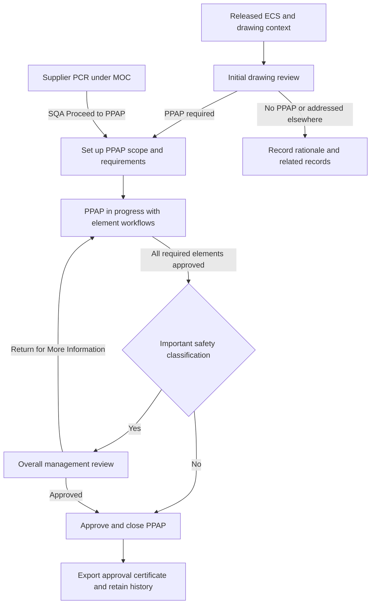

# PPAP Solution Brief

**Subaru of Indiana Automotive | Intelex Phase 2 | 17 November 2026**

## Purpose and business outcome

The Production Part Approval Process (PPAP) solution will provide one traceable approval package for a supplier, drawing, and explicitly selected set of part numbers. It brings engineering context, supplier evidence, internal inspections, review decisions, and approval history into a common Intelex workspace. The intended outcomes are clearer approval scope, less repeat submission of unchanged evidence, and current visibility of outstanding work.

The design addresses gaps discussed in the workshops: drawing-level approvals that can inadvertently include the wrong parts, fragmented email discussions, unclear rejection feedback, repeated schedule maintenance, and supplier reliance on screenshots as proof of approval. PPAP remains the approval process; specialist applications retain detailed measurement execution and change-concept review. [ADR-021][adr-021], [ADR-024][adr-024], [ADR-028][adr-028], [ADR-029][adr-029], [ADR-107][adr-107]

The agreed core is supported by 15 accepted PPAP ADRs. Shipment integration and recurring operational validation remain proposed. The separate supplier-request application described in the title of ADR-105 was rejected; the current direction places that request within Management of Change (MOC). This brief describes the target solution, rather than asserting that it has been implemented.

## Solution structure

| Component | Responsibility |
|---|---|
| Initial drawing review | Records the engineering assessment before a PPAP exists, including a decision to launch PPAP, omit it with a governed reason, or relate the change to another PPAP. |
| PPAP parent and included parts | Holds one supplier and drawing, source and revision context, the exact included part numbers, responsible engineer, classification, and overall approval. The integrated part table replaces a separate part-submission-warrant upload. |
| Governed element library and templates | Define evidence requirements, instructions, checklists, attachments, routing patterns, and date rules. Versioned templates initialize the applicable child elements. |
| Element workflows and evidence | Allow each requirement to be submitted, reviewed, returned, and approved independently, with its own dates, responsibility, files, and history. |
| Model-change summary | Provides shared phase and manufacturing-stage dates, separate physical build events, and aggregate navigation across related PPAPs. Running and process changes normally retain their own schedules. |
| Discussions and reporting | Keep classified conversation threads alongside the PPAP and use workflow instances for current workload and overdue views. |

These components preserve one consolidated view while allowing individual requirements to progress separately. [ADR-021][adr-021], [ADR-022][adr-022], [ADR-029][adr-029], [ADR-030][adr-030], [ADR-101][adr-101], [ADR-107][adr-107]

## How work moves through the solution

### Initiate from engineering context or a supplier change

A released Engineering Change Summary (ECS) supplies drawing, revision, part, model, and source context through BOMEX integration. Each applicable SIA drawing receives a separate initial review, with a two-week target from drawing release. The working assumption is that engineering changes require PPAP unless the reviewer records an exception. The review also addresses inspection-specification requirements; it does not automatically create a pilot program. Drawing number and revision provide the principal engineering context because ECS numbering does not establish revision order. [ADR-030][adr-030]

Suppliers initiate process changes through one PCR entry point under MOC. Phase 2 provides the minimum supplier submission, SQA clarification or rejection, and **Proceed to PPAP** decision needed to replace the existing quality-focused capability. Phase 3 extends the same PCR with broader internal review and implementation activity. Proceeding launches a linked process-change PPAP and does not authorize shipment. Broader no-PPAP outcomes belong to the expanded PCR workflow unless separately approved for the transition increment. [ADR-105 rejected option and current outcome][adr-105], [ADR-032][adr-032], [ADR-068][adr-068]; [16 October integration meeting, 11:55–14:15][meeting-integration]

### Establish the exact approval package

The initiator reviews the active parts associated with the drawing and excludes those outside the submission before release. The supplier confirms the included parts and supplies applicable part-level values, including average actual mass and average metal mass. Evidence elements remain drawing-scoped and may contain multiple files for variants or subcomponents. [ADR-021][adr-021], [ADR-023][adr-023]

The engineer selects governed requirements from the applicable template and determines which need new submissions and which can retain approved evidence. Every PPAP requires data review; part review and joint inspection apply according to the PPAP type and setup. Engineers can include or exclude governed elements without inventing new element types within an individual PPAP. Template publication affects new PPAPs; existing packages retain their initialized structure unless an authorized bulk change is deliberately applied. [ADR-022][adr-022]; [30 September morning workshop, 0:18:20–0:29:45][meeting-day2-am]

### Complete and review elements independently

Reusable workflow patterns support supplier submission, internal engineering work, inspection-team completion followed by engineer review, and joint inspection. Every supplier and internal element receives the responsible engineer's review. Rejecting an element requires assignee-visible feedback and returns only that element for correction. Approved elements remain accepted, and the parent cannot advance to engineer completion or final management review while required work remains open or unreviewed. [ADR-022][adr-022]

Retained evidence is suggested from the latest approved lineage and copied into an immutable task-level snapshot with its source context. Several PPAPs must not depend on one mutable evidence container. Rejected files and decisions remain in internal history but leave the supplier's active requirement, which requires a replacement submission. Evidence uploaded to another open PPAP becomes eligible for baseline reuse only when approved. [ADR-023][adr-023], [ADR-027][adr-027]; [30 September afternoon workshop, 1:31:47–1:35:31][meeting-day2-pm]

Detailed measurements remain in Product Management, Shipping, Receiving and Inspection, or other specialist tools. PPAP retains the linked results, evidence, and review decision. New-model pilot programs are initiated deliberately from PPAP and use model build-event context; pilot activity can run concurrently with PPAP element work. [ADR-024][adr-024], [ADR-098][adr-098]

### Approve the complete package

Only the **important-safety** classification activates the additional overall management review. Important-quality or regulated classifications change evidence defaults without independently triggering that stage. The engineer selects an available final approver from a governed eligible pool. Approved element data is locked during final review. [ADR-025][adr-025]

A manager can approve or **Return for More Information**, with a required internal comment. A return moves the PPAP back to internal work while the supplier continues to see it as pending or in progress. The engineer can clarify internally or reopen affected elements with separate assignee-visible feedback. Final approval produces an exportable certificate identifying the supplier, drawing, included parts, approval date, status, and authority; PDF is preferred, with a verification reference or QR code where feasible. [ADR-025][adr-025], [ADR-028][adr-028]; [1 October morning workshop, 0:06:20–0:10:52][meeting-day3-am]

## Operating controls

**Responsibility and access.** Supplier tasks route to a stable PPAP coordinator role for the relevant supplier depot; release is blocked if the required role has no active member. Separate supplier-scoped internal roles cover model, running, and process changes. Inspection teams can receive work before authorized reassignment to an individual. Supplier-entity access and record classification protect development information; internal tasks and management exchanges remain restricted. A controlled handover can expand mass-production visibility without changing the stage or owner of unfinished work. [ADR-026][adr-026], [ADR-084][adr-084]

**Schedules and date history.** Model leads maintain a phase-by-manufacturing-stage date matrix, with template offsets determining element due dates. Shared changes recalculate connected PPAPs. An exceptional PPAP can disconnect and use manual dates; reconnecting replaces those dates with calculated values. Both actions require a warning. Keep model-planned dates, approved operational due dates, and actual completion separate. Already-overdue calculated dates generate warnings without preventing creation. Engineers control individual or selected-task date updates, and every effective-date change is audited. Suppliers raise extension needs through discussion or another agreed channel; there is no dedicated extension-request workflow initially. [ADR-101][adr-101], [ADR-108][adr-108]

**Engineering changes and concurrent work.** An ECS arriving during an open PPAP becomes supplemental context, and the engineer reopens only affected elements while preserving history. After approval and closure, a later change requires a new PPAP unless the drawing review records a governed exception. Concurrent PPAPs may overlap drawings and parts; explicit source, revision, part scope, and dates support human sequencing. Automated conflict merging or blocking is outside the current design. [ADR-027][adr-027], [ADR-030][adr-030], [ADR-104][adr-104]

**Collaboration and user experience.** PPAP-level threads retain subjects, authors, replies, notification recipients, and Intelex-managed attachments. Access depends on the PPAP and internal/external classification; notification targeting does not make a conversation private to its recipients. Internal content cannot become external. If secure mixed-visibility replies prove too complex, separate threads with immutable visibility provide the accepted fallback. Discussion entries do not create workflow tasks. Forms, plans, tasks, and discussions use one responsive, connected browser experience across desktop, tablet, and phone. [ADR-107][adr-107], [ADR-110][adr-110]

**Operational visibility.** Workflow-instance reporting shows open, completed, overdue, and materially overdue work by model, supplier, source, engineer or role, stage, due date, and age. Shared-role responsibility remains distinguishable from the individual who acts. Internal return and rejection histories support review of repeated iterations. Scorecard use of PPAP dates needs separately governed scoring rules. [ADR-022][adr-022], [ADR-025][adr-025], [ADR-029][adr-029], [ADR-101][adr-101]

## Integration boundaries and decisions to close

BOMEX integration is an accepted design direction: SIA's system-development group supplies REST-based engineering context after Production Control publication, with administrator-restricted staging, retained source-to-Intelex identifiers, and later updates. Payloads, file handling, matching, batching, retries, and reconciliation still need an implementation contract. [ADR-030][adr-030]

The proposed part-master refinement keeps BOMEX and PartsMaster consolidation in SIA's upstream integration layer and supplies one operational Intelex part. Part identity, field authority, supplier/depot enrichment, and the mapping from isolated API intake to operational records remain dependencies. The existing isolated API intake specification does not itself deliver that operational connection. [ADR-062 proposed][adr-062]

| Area | Decision or configuration still required |
|---|---|
| Requirements and migration | Reconcile the existing IntelliQuest requirement library, levels, checklists, and defaults; finalize template versions, element routing, attachment rules, and retained-evidence lineage/copy behavior. Define treatment of inactive parts and scope changes after issue. [ADR-021][adr-021], [ADR-022][adr-022], [ADR-023][adr-023] |
| Routing and security | Complete the role and visibility matrix, empty-role fallbacks, reassignment, management approver pools, escalation, and controlled handover. Validate discussion visibility and attachment access. [ADR-025][adr-025], [ADR-026][adr-026], [ADR-084][adr-084], [ADR-107][adr-107] |
| Schedules and engineering changes | Finalize phases, stages, offsets, build-event maintenance, override permissions, effective-date audit, and matching of supplemental ECS records to open PPAPs. Define review-exception reasons and overdue escalation. [ADR-030][adr-030], [ADR-101][adr-101], [ADR-104][adr-104], [ADR-108][adr-108] |
| PCR and inspection connections | Define minimum Phase 2 PCR fields and transfer to PPAP, inspection links, and frozen specification versions. Reconcile the broader running-change pilot wording in ADR-039 with ADR-098's new-model-only Pilot Part Data boundary before configuration. [ADR-024][adr-024], [ADR-039][adr-039], [ADR-098][adr-098], [ADR-105][adr-105] |
| Shipment compliance — proposed | Confirm commitment and actual shipment/ASN sources, date offsets, alerts, and responses. ADR-031 proposes schedule-conflict and shipment-without-approval detection, with authorized manual exception logging until reliable events exist. Automatic shipping blocks or quarantine are unresolved. [ADR-031][adr-031] |
| Recurring validation — proposed | Select the host and lifecycle for ongoing quality-test, dimensional, and material-certification records. Confirm applicability by part/evidence type, frequency, ownership, review, stopping rules, and escalation. Evaluate shared Supplier Tasks/Surveys. These records remain separate from PPAP snapshots and Safe Launch. [ADR-102][adr-102] |
| Approval outputs and performance | Confirm certificate layout, signatures, verification access, and withdrawal/supersession behavior; define dashboard aging thresholds and scorecard rules. [ADR-028][adr-028], [ADR-029][adr-029], [ADR-101][adr-101] |

## Source basis

The 18 PPAP ADRs are summarized above: **accepted** ADR-021–030, ADR-101, ADR-104, ADR-107, ADR-108, and ADR-110; **proposed** ADR-031 and ADR-102; and **rejected** ADR-105. The rejected ADR's title describes the discarded application boundary; its body and the 16 October meeting establish the current MOC-based PCR direction. Supporting cross-application ADRs are cited where they define a PPAP dependency.

| Meeting source | Contribution to the solution |
|---|---|
| [30 September 2026 morning workshop][meeting-day2-am] | PPAP requirements and approval classifications; initial drawing review; model scheduling; routing and supplier visibility. |
| [30 September 2026 afternoon workshop][meeting-day2-pm] | Element completion and rejection; immutable evidence reuse; in-flight changes; final review; pilot/build-event context and the earlier supplier-request proposal. |
| [1 October 2026 morning workshop][meeting-day3-am] | Internal management returns; threaded discussions; date-change audit; handover access; connected browser use. |
| [1 October 2026 afternoon workshop][meeting-day3-pm] | Scorecard and source-access boundaries; earlier PPAP/MOC split discussed around 1:55:55–2:00:41 and subsequently rejected. |
| [16 October 2026 supplier PPAP integration meeting][meeting-integration] | Resolves supplier initiation and the single MOC PCR lifecycle delivered incrementally across Phases 2 and 3. The [existing PCR form evidence][existing-pcr-form] accompanies this meeting. |

[adr-021]: ADR-021-model-ppap-as-a-drawing-scoped-parent-with-selected-part-numbers-and-an-integrated-part-warrant.md
[adr-022]: ADR-022-model-ppap-elements-as-independently-routed-child-workflows.md
[adr-023]: ADR-023-version-and-reuse-approved-ppap-element-evidence.md
[adr-024]: ADR-024-keep-detailed-measurement-execution-outside-ppap.md
[adr-025]: ADR-025-apply-conditional-overall-group-leader-approval.md
[adr-026]: ADR-026-route-ppap-work-through-stable-supplier-depot-and-internal-roles.md
[adr-027]: ADR-027-manage-concurrent-ppaps-through-explicit-scope-and-human-sequencing.md
[adr-028]: ADR-028-generate-an-exportable-ppap-approval-certificate.md
[adr-029]: ADR-029-use-live-workflow-instances-for-ppap-operational-reporting.md
[adr-030]: ADR-030-stage-bomex-drawing-and-ecs-data-and-create-source-linked-draft-ppaps.md
[adr-031]: ADR-031-integrate-shipping-commitments-and-shipment-events-with-ppap-scheduling-and-compliance.md
[adr-101]: ADR-101-manage-model-changes-as-scheduled-parents-over-related-ppaps.md
[adr-102]: ADR-102-separate-ppap-evidence-snapshots-from-recurring-validation-records.md
[adr-104]: ADR-104-absorb-in-flight-engineering-changes-into-open-ppaps-and-start-new-ppaps-after-closure.md
[adr-105]: ADR-105-place-minimum-supplier-ppap-request-in-ppap-and-keep-internal-pcr-in-moc.md
[adr-107]: ADR-107-model-ppap-discussions-as-secured-threaded-related-records.md
[adr-108]: ADR-108-audit-ppap-task-due-date-changes-without-a-dedicated-extension-workflow.md
[adr-110]: ADR-110-use-a-responsive-connected-browser-experience-for-ppap.md
[adr-032]: ../../pcr/ADR-032-use-supplier-initiated-pcr-with-context-specific-concept-outcomes.md
[adr-068]: ../../management-of-change/ADR-068-implement-distinct-change-processes-as-moc-subtypes-while-preserving-the-core-moc-framework.md
[adr-039]: ../product-management/ADR-039-make-ecs-processing-gate-inspection-specification-review-and-revision.md
[adr-062]: ../product-management/ADR-062-create-a-composite-part-master-from-bomex-and-partsmaster-data.md
[adr-084]: ../supplier-relationship-management/adrs/ADR-084-apply-mutable-visibility-classifications-to-supplier-related-records.md
[adr-098]: ../pilot-part-data/ADR-098-initiate-pilot-part-programs-from-ppap-build-event-context.md
[meeting-day2-am]: raw_artifacts/meeting_transcripts/2026-09-30-phase-2a-design-workshop-day-2-morning.md
[meeting-day2-pm]: raw_artifacts/meeting_transcripts/2026-09-30-phase-2a-design-workshop-day-2-afternoon.md
[meeting-day3-am]: raw_artifacts/meeting_transcripts/2026-10-01-phase-2a-design-workshop-day-3-morning.md
[meeting-day3-pm]: raw_artifacts/meeting_transcripts/2026-10-01-phase-2a-design-workshop-day-3-afternoon.md
[meeting-integration]: raw_artifacts/meeting_transcripts/2026-10-16-summit-ehsq-sia-integration-supplier-ppap.md
[existing-pcr-form]: raw_artifacts/meeting_transcripts/2026-10-16-integration-supplier-ppap-existing-pcr-form.md
