# PPAP implementation plan

**Draft · 17 November 2026 · Proposed configuration assignments.** This plan uses the target specification and preserved package evidence; no live tenant configuration or verification is claimed. The SIA PPAP Engineer is an internal SIA user. Supplier personnel use Supplier PPAP Coordinator/Assignee roles.

## Scope and planning basis

Configuration of the new target PPAP product and its PPAP-side interfaces; preserve historical PPAP, APQP and isolated Product Integration boundaries.

- [Target PPAP technical specification](ppap-target-technical-specification.md): proposed design, not a tenant build.
- [Canonical target field contract](ppap-target-field-contract.md) and [logical model](ppap-target-model.json):335 active field/list rows, including six reused existing field definitions.
- [Workflows and automation](ppap-workflows-and-automation.md); [interfaces/security/reporting](ppap-interfaces-security-and-reporting.md).
- [Package baseline](../ootb-ppap-baseline-model/ppap-ootb-technical-specification.md) and [verified baseline impact](ppap-baseline-change-impact.md): source-export evidence, not current tenant verification.
- [Current confirmed decisions](../target-requirements-decisions.json) and user clarification: SIA PPAP Engineer is an internal SIA user. The client has been asked to supply the missing SIA library.

An Action Handler is Intelex configuration that runs the named business operation. A version/saved evidence copy preserves the values effective at that moment. Related-record lists show links stored elsewhere and do not create another stored relationship. Native workflow owns stage and action history; native audit owns governed changes. Intelex supplies its processing context and permissions without a separate build assignment.

The plan groups ordinary fields, forms and checks around complete outcomes. Objects and new stage identities are provided first because several families link in both directions; this avoids circular field-build dependencies. Publication, evidence copying, source receipt, security and cancellation are separate substantial operations with their own failure rules. No task count, timing or role is inherited from another project, and no estimates or project schedule are supplied.

The requested client spreadsheet/procedure/library remains pending. Known fields and settings may proceed where identified; unknown content/methods are supplied information. No active/historical PPAP or evidence migration, formal-testing workstream, deployment, training or documentation workstream is assigned. Shared SRM, MOC/PCR, inspection, pilot and scorecard applications keep their own ownership. Shipment integration, recurring validation and a dedicated TACT-TRI build are deferred.

## Task summary

| Task Number | Task Category | Task Name | Objective and Detailed Scope | Recommended Implementer |
|---|---|---|---|---|
| IMP-01 | Object setup | Create the PPAP Objects and workflow stages | **Objective:** Provide the Objects and stage names needed before related PPAP features can be configured.  **Detailed scope:** Create the 25 new non-catalogue Objects and the separate target PPAP, element and drawing-review workflow stages. Add the target-record marker on the existing PPAP. These early outputs let later assignments create links in both directions without circular build dependencies. | Senior Associate Consultant |
| IMP-02 | Lists and settings | Set up PPAP reference lists and operating settings | **Objective:** Give PPAP a consistent set of selections and known review/reminder defaults.  **Detailed scope:** Create seven independent PPAP reference lists with their exact fields and known starting values, plus the Operating Policy fields and settings form. Load controlled SIA values only when supplied; require complete role/timezone connections before activating the default policy. | Associate Consultant |
| IMP-03 | Fields and forms | Set up PPAP scope and the integrated part warrant | **Objective:** Let the SIA PPAP Engineer prepare the exact facility, drawing and part scope that a supplier will confirm.  **Detailed scope:** Add the target PPAP scope fields, selected-part and shipping-depot controls, and ordinary Draft form behavior. Change the two verified legacy display/due-date settings while retaining existing identity, owner, settings and originating links. Keep authoritative criticality read only and make the two part masses available for supplier entry at the permitted stage. | Senior Associate Consultant |
| IMP-04 | Fields and forms | Set up PPAP issue and approval facts | **Objective:** Preserve who issued, confirmed, cancelled and approved each PPAP without allowing direct edits to decision evidence.  **Detailed scope:** Add the PPAP issue, confirmation, replacement-hold, review, cancellation and approval fields and their stage-aware controls. Provide separate internal return comments and frozen certificate labels; retain the existing PPAP Completion Date field definition. | Senior Associate Consultant |
| IMP-05 | Fields and forms | Set up element work and checklist answers | **Objective:** Give each governed PPAP requirement a separate work area with the right dates, assignees and typed answers.  **Detailed scope:** Add PPAP Element and working PPAP Answer fields, related controls and ordinary conditional behavior. Keep required/protected setup and scope-controlled assignment visible to the SIA PPAP Engineer, and show only the matching answer type to the assignee. | Senior Associate Consultant |
| IMP-06 | Fields and forms | Set up retained submission evidence | **Objective:** Keep every submitted or retained file and answer separate from later working corrections.  **Detailed scope:** Add PPAP Evidence Snapshot and PPAP Evidence Answer fields and historical views, including source lineage and write-once approval/rejection facts. The submission and retention assignments perform copying; this assignment provides the fields and protected ordinary controls. | Senior Associate Consultant |
| IMP-07 | Library configuration | Set up the governed requirement library | **Objective:** Let configuration administrators maintain approved requirement content and typed questions without editing published versions.  **Detailed scope:** Create requirement/question authoring and version fields and ordinary administration forms. Enter the supplied SIA requirement and question rows by stable Code, with separate content, routing, protection and attachment rules; retain the version fields for publication. | Senior Associate Consultant |
| IMP-08 | Publication | Publish complete requirement versions | **Objective:** Make each published requirement a complete unchangeable copy of the content used by later PPAPs.  **Detailed scope:** Configure the proposed Publish Requirement Action Handler to copy requirement fields, every question and every instruction file together, number versions safely and change the active version only after the complete copy succeeds. | Senior Consultant |
| IMP-09 | Template configuration | Set up PPAP templates and their requirement matrix | **Objective:** Let administrators define which requirements and date rules apply to each PPAP type.  **Detailed scope:** Create Template and Template Requirement authoring/version fields and ordinary forms. Enter approved SIA template rows with one stable requirement per template, classification triggers, protected applicability, schedule phase and calendar offset. | Senior Associate Consultant |
| IMP-10 | Publication | Publish complete PPAP templates | **Objective:** Preserve the exact requirement and scheduling rules used to initialize each PPAP.  **Detailed scope:** Configure the proposed Publish Template Action Handler to save the complete template/matrix together and resolve stable requirement identities to exact active published versions. | Senior Consultant |
| IMP-11 | Fields and forms | Set up model schedules and physical build events | **Objective:** Give model leads one schedule for related PPAPs while keeping physical builds distinct.  **Detailed scope:** Add Model Change, Model Date and Build Event fields/forms plus the three PPAP model/schedule controls. Enforce one phase-by-stage date per model, separate inclusive event start/end dates and one governing model/stage per model-change PPAP. | Senior Associate Consultant |
| IMP-12 | Fields and forms | Set up engineering source and drawing-review forms | **Objective:** Keep released engineering evidence and the initial SIA review available before a PPAP exists.  **Detailed scope:** Add Engineering Release/Part and Drawing Review fields/forms, including source keys, explicit unknown classifications, correction lineage, exact routing context and released-specification reference. Provide restricted manual preparation controls without issuing PPAP directly. | Senior Associate Consultant |
| IMP-13 | Integration | Receive released engineering changes without duplicate reviews | **Objective:** Create the correct internal drawing review when an operational engineering release arrives.  **Detailed scope:** Configure the separate operational BOMEX/ECS receiver and the restricted Accept Engineering Release action, using the same acceptance path for controlled manual fallback. Save the accepted source/part graph and initial review together and reconcile replays, ordering and delayed automated delivery. | Senior Consultant |
| IMP-14 | Workflow | Configure the initial SIA drawing-review decisions | **Objective:** Require a recorded PPAP determination and the applicable released inspection specification before the initial review completes.  **Detailed scope:** Configure Launch PPAP, Link Same-Change PPAP and Complete Drawing Review on Engineering Review. Route work to the current exact-entity SIA engineer role, use the fixed release+14-day target and preserve governed no-PPAP decisions. | Consultant |
| IMP-15 | Automation | Hold affected PPAPs when source classifications are corrected | **Objective:** Require replacement when an issued open PPAP no longer matches its original authoritative classifications.  **Detailed scope:** Configure Source Correction processing against accepted source context and exact affected original drawing/part revision. Refresh unissued preparation through controlled replacement source context and set an issued open PPAP replacement hold without treating a different new engineering revision as a correction. | Senior Consultant |
| IMP-16 | Scheduling | Calculate and change connected element dates | **Objective:** Keep shared model dates current while preserving issued commitments and authorized manual dates.  **Detailed scope:** Configure model-date and element-date Action Handlers plus Change Due Dates, Move Schedule Phase, Disconnect Schedule and Reconnect Schedule actions. Recalculate only open connected work and keep issued/first-submission history unchanged. | Senior Consultant |
| IMP-17 | Responsibility and access checks | Resolve SIA and supplier responsibility and eligibility | **Objective:** Route PPAP work to the right current people and enforce shared supplier participation rules.  **Detailed scope:** Configure a shared PPAP responsibility/capability check, role-aware Project Owner selection and permitted reassignment. Use exact supplier-entity roles, current membership and central service/inactive rules rather than company-role or creator fallbacks. | Senior Consultant |
| IMP-18 | Record creation | Create internal target PPAP drafts | **Objective:** Provide one controlled Draft creation path for engineering review, manual fallback and originating applications.  **Detailed scope:** Configure the proposed target Draft creation Action Handler, using supplied launch correlation and accepted source context. Set the target marker before legacy processing, require an overall date, bind valid authoritative scope and keep supplier access closed. | Senior Consultant |
| IMP-19 | Draft setup | Initialize and adjust governed requirements before issue | **Objective:** Prepare one controlled requirement set from the exact published configuration and freeze its meaning for issue.  **Detailed scope:** Configure Initialize Elements, Add Governed Element, Reset Draft Elements and Exclude/Require Element. Resolve exact configuration versions, combine classification applicability and create one working answer per question, with no post-issue additions or waivers. | Senior Consultant |
| IMP-20 | Workflow | Issue PPAP and obtain supplier scope confirmation | **Objective:** Release a complete internal package explicitly and require supplier acknowledgment before its first submission.  **Detailed scope:** Configure Issue PPAP and Confirm Scope with ordered authority, source, requirement, date and assignment checks. Freeze issued scope and original due baselines, start required element workflows and keep internal work independent of supplier confirmation. | Senior Consultant |
| IMP-21 | Submission | Save complete element submissions and their first-submission facts | **Objective:** Preserve the exact evidence submitted and measure supplier timing at the first complete submission.  **Detailed scope:** Configure Submit Element for supplier and internal work, including required answers/files, frozen evidence/result links, current review target and write-once first supplier submission facts. | Senior Consultant |
| IMP-22 | Review workflow | Review, return and correct individual elements | **Objective:** Let the SIA PPAP Engineer accept or return one element without disturbing other accepted work.  **Detailed scope:** Configure Approve Element, Return Element, Reopen for Correction and the hidden Cancel Element Work action, preserving each submitted decision and the prior approved snapshot during permitted non-engineering correction. | Senior Consultant |
| IMP-23 | Evidence reuse | Retain compatible approved evidence | **Objective:** Reuse approved evidence without sharing a mutable file container or bypassing scope checks.  **Detailed scope:** Configure candidate selection and Retain Evidence for the same manufacturing facility, drawing and stable requirement. Require engineer compatibility confirmation, reasoned nonlatest selection and independent copied evidence/answer/result content before approving the receiving element. | Senior Consultant |
| IMP-24 | Inspection connection | Connect required inspection results to their evidence | **Objective:** Let the SIA PPAP Engineer accept the exact result version needed for a required element.  **Detailed scope:** Add Inspection Result Link fields/controls and the PPAP-side link/acceptance operation. Preserve correct specification/result version meaning or a controlled artifact copy; only explicitly required inspection/run-at-rate evidence gates acceptance. | Consultant |
| IMP-25 | Pilot connection | Launch pilot work from the correct new-model build event | **Objective:** Create linked pilot work only where a new-model PPAP explicitly needs it.  **Detailed scope:** Add Pilot Program Link fields/controls and Launch Pilot Program using the supplied external operation. Require NEW_MODEL and a Build Event from the same governing Model Change; retain one result per explicit launch correlation. | Consultant |
| IMP-26 | Approval workflow | Complete PPAP and obtain required management approval | **Objective:** Close a fully accepted package and require an explicit management decision whenever important-safety applies.  **Detailed scope:** Configure Complete PPAP, Approve PPAP, Return for More Information and Request Mass Correction. Validate required elements/masses/source hold before finalization, retain review cycles and invoke the controlled certificate/outcome operations. | Senior Consultant |
| IMP-27 | Cancellation | Cancel outstanding PPAP work without reporting success | **Objective:** Stop an open package safely while preserving evidence and informing its originating owners.  **Detailed scope:** Configure reasoned Cancel PPAP with a resumable open-element cancellation cascade, durable cancelled-outcome recording, closed discussion and stopped reminders. Keep approved elements/history and originating PCR/APQP records intact. | Senior Consultant |
| IMP-28 | Originating application connection | Connect PCR and APQP launches, dates and outcomes | **Objective:** Keep PPAP linked to its originating work without overwriting concurrent approvals or completing cancelled work.  **Detailed scope:** Configure PPAP-side MOC Proceed to PPAP and APQP launch/outcome adapters, including the verified task pointer/date handlers. Use complete source validation and one launch result per origin decision token; resolve multiple linked PPAP obligations explicitly. | Senior Consultant |
| IMP-29 | Conversation | Configure append-only PPAP discussion | **Objective:** Keep supplier-visible and internal conversation separate and preserve every posted correction.  **Detailed scope:** Add Discussion Thread/Post fields, ordinary forms and posting actions with fixed thread audience, nonblank text and unchangeable posted files. Close all posting when PPAP is approved/cancelled and notify only authorized recipients. | Senior Consultant |
| IMP-30 | Approval output | Generate controlled approval certificates | **Objective:** Give authorized users a certificate that always reflects the original approved package.  **Detailed scope:** Configure approval-label copying, controlled English PDF rendering, opaque reference, saved original bytes and authenticated verification/export. Keep internal content and bulk evidence packaging outside the output. | Consultant |
| IMP-31 | Existing automation changes | Separate target PPAP creation from legacy generation | **Objective:** Prevent old project-task/phase logic from running on the new target PPAP path.  **Detailed scope:** Change the verified legacy creation/generation handlers to preserve their historical/APQP branches and route marked target records into the supplied separate workflow and Draft initializer. Do not rebuild unchanged shared fields or downstream listeners made unreachable by these checks. | Senior Consultant |
| IMP-32 | Record and file permissions | Restrict PPAP records, decisions and files | **Objective:** Give each user only the PPAP information and actions allowed by entity, classification and stage.  **Detailed scope:** Enable governed PPAP audit/security and configure new record/field/attachment rules across supplier/internal work, history and closure. Apply controlled visibility-only handover and direct-access enforcement without duplicating shared SRM or platform permissions. | Senior Consultant |
| IMP-33 | Notifications | Send assignment, review and overdue notices | **Objective:** Remind the current responsible people and escalate overdue work without changing its ownership or outcome.  **Detailed scope:** Configure English native issue/assignment/submission/return/approval/cancellation/discussion notices and the calendar-day reminder rules. Use the supplied business timezone, current access checks and native repeat prevention/retry. | Consultant |
| IMP-34 | Screens and navigation | Build the connected PPAP workspace | **Objective:** Let users work through scope, elements, evidence and discussion in one responsive browser workspace.  **Detailed scope:** Change only target branches of the verified PPAP/APQP/task views, replacing obsolete product/template/PSW/interim panels with the target scope, warrant, element, evidence/history and discussion controls. Keep historical rendering and server-side permissions separate. | Senior Associate Consultant |
| IMP-35 | Operational reports | Show current PPAP and review workload | **Objective:** Give SIA users a reliable live view of open PPAP, review and element work.  **Detailed scope:** Configure current drawing-review, PPAP and element worklists, overdue/age filters and authorized linked-result readiness using native workflow instances. Update only target branches of existing PPAP inventories and keep Approved separate from Cancelled. | Consultant |
| IMP-36 | Historical reports | Report submission timeliness and rework separately | **Objective:** Show both original and revised commitments without making rework or cancellation rewrite supplier history.  **Detailed scope:** Configure first-complete supplier submission, open due-work and rejection/date/decision-history reports using saved deadline facts and native history. Expose governed facts for a later scorecard connection without changing scorecard rules. | Consultant |

## External inputs and constraints

These are information supplied outside the configuration tasks. They have no task numbers or dependency arrows. Task-local descriptions name only the settings that wait. The default separate reviewer is a Senior Consultant acting as PPAP build reviewer, not the person performing the assignment.

- **IN-01 — Client PPAP library and procedure:** The client has been asked for the controlled SIA PPAP spreadsheet, procedure, IntelliQuest requirements/questions and template/classification matrix. They have not yet been supplied. Their exact content, protection rules, routing, dates and approved category/phase/stage/exception values are needed to complete the affected configuration; Objects and known controls can proceed.
- **IN-02 — Operational engineering data and record links:** SIA and the operational Product Management owner must supply the separate BOMEX/ECS delivery contract, producer/event/revision keys, drawing and part object/field identifiers, facility/depot crosswalks, explicit classification authority/precedence, full/delta/correction/removal rules, source ordering, accepted release criteria and external endpoint/credentials. Source selectors, receipt and correction processing wait for these exact values; the isolated Product Integration application is not that connection.
- **IN-03 — Supported target workflow and shared-handler connection:** The technical team must supply the supported way to select a new PPAP-only workflow for target records, read the PPAP-only Target Configuration? field from shared handlers, set it before legacy handlers run, and resolve the direct/inherited Id name collision. The plan assigns the resulting configuration changes, not a tenant-verification exercise.
- **IN-04 — Supported complete-save, copy and recovery methods:** The technical team must supply the supported native methods for saving related records/files together, preventing conflicting simultaneous changes, retaining action/audit reasons, reopening an approved element without losing history, and durably resuming failed publication/submission/cancellation/outcome delivery. Only the consuming operations wait; no processing-permission or custom audit subsystem is requested.
- **IN-05 — Approved SIA roles, supplier roles and capability rules:** The SRM/security owners must supply the governed library-role and exact-entity role identifiers, populated memberships, SIA engineer selections, inspection teams/leaders, management approver pool and PPAP administrator group. They must also supply central ACTIVE/SERVICE/INACTIVE capability identifiers and reconcile the annotated central open-work transition rule. These are existing shared authorities; membership administration and central policy decisions are outside the build assignments.
- **IN-06 — Record visibility, file access and supplier actor connection:** The security/technical team must supply visibility classification values and access rules, native record/file/API/export enforcement methods, authorized handover principals, and the supported external-supplier-user to native actor/recipient identity connection. This information limits the affected security, posting, confirmation and recorded-actor settings.
- **IN-07 — Released inspection specifications and result evidence:** The Product Management/Inspection owners must supply released-specification and result object/field identifiers, valid released states and scope keys, and an immutable result-version reference or controlled result-artifact export. Required review/result checks and links wait for those values; measurements and specification publishing remain external.
- **IN-08 — PCR and APQP launch and outcome connections:** The PCR/APQP owners must supply the Proceed to PPAP decision token and fields, authorized launch/callback actions, originating owner-resolution destination, and the rule for obligations served by multiple linked PPAPs. Target launch and successful/cancelled outcomes wait for those connections; no new MOC/PCR lifecycle is assigned.
- **IN-09 — New-model pilot launch connection:** The Pilot Part Data owner must supply the program launch operation, identifiers and PPAP/model/build-event/part mappings, including retry correlation. The PPAP launch link waits; the pilot application and its shipments/measurements are outside this plan.
- **IN-10 — Business timezone and native notice scheduling:** SIA must supply its business timezone. The technical team must supply the native reminder/delivery settings for the proposed daily 08:00 scan, repeat prevention, retry and access checks at delivery. Calendar-day values are known; the timezone and native connection cannot be inferred from the workstation.
- **IN-11 — Approval certificate and authorized verification route:** SIA must supply the approved certificate layout and required supplier/facility identity labels. The technical team must supply native PDF generation, saved-file/opaque-reference handling, authenticated verification route and native display-field sources for frozen approval labels. Optional QR rendering does not block the ordinary PDF.
- **IN-12 — Report source fields and reporting periods:** The technical team must supply native workflow/history/audit/report field identifiers and supported report/query methods. SIA must agree the materially-overdue report threshold and reporting-period/cohort boundaries for historical supplier timeliness. Any later scorecard attribution/query connection is supplied by the scorecard owner; scoring configuration and published-scorecard updates are not PPAP tasks.
- **IN-13 — Supported attachment limits and file controls:** The tenant administrator must supply supported file sizes/types and the native method that protects posted/submitted files from editing or deletion. Average files are 1 MB, not an upload maximum. Ordinary attachments need no specialist viewer.
- **IN-14 — Target screens and supported expressions:** The technical team must supply supported expressions and view-action methods where this design states business logic rather than executable Intelex syntax, together with the effective tenant view/module identifiers if they differ from the package. Build assignments use the verified package names and must not guess a replacement expression or tenant target.

## Detailed configuration tasks

### IMP-01 — Create the PPAP Objects and workflow stages

**Task ID:** IMP-01

**Title:** Create the PPAP Objects and workflow stages

**Category:** Object setup

**Objective:** Provide the Objects and stage names needed before related PPAP features can be configured.

**Detailed scope:** Create the 25 new non-catalogue Objects and the separate target PPAP, element and drawing-review workflow stages. Add the target-record marker on the existing PPAP. These early outputs let later assignments create links in both directions without circular build dependencies.

**Deliverable:** New PPAP Objects, new stage/termination entries and the target-record marker.

**Work needed first:** None

**What is waiting:** Partly waiting: Objects and the target marker can be created; selecting the separate workflow for new target records waits for the supported native method.

**Recommended implementer role:** Senior Associate Consultant

**Recommended reviewer/approver role:** Senior Consultant — PPAP build reviewer (a different person)

**Why this role is recommended:** The assignment combines established field, related-list and form settings. A Senior Associate Consultant can apply the conditions consistently, with the separate build reviewer checking their effect on the wider process.

**Fields and features to set up:**

| Field or feature | What to set up |
|---|---|
| PPAP Requirement Object | Create this concrete Object in the existing PPAP product area. Business inheritance: none. Enable native audit and security; set attachments enabled. Enable object localization for its marked display/instruction fields; stable Codes remain untranslated. Do not add a separate custom workflow or status field. Purpose: Stable authoring identity of a governed element type. New internal names and metadata identifiers are allocated through normal Intelex configuration, not copied from the logical design IDs. |
| PPAP Requirement Version Object | Create this concrete Object in the existing PPAP product area. Business inheritance: none. Enable native audit and security; set attachments enabled. Enable object localization for its marked display/instruction fields; stable Codes remain untranslated. Do not add a separate custom workflow or status field. Purpose: Immutable approved publication of requirement content and routing; genuinely required operational configuration evidence. New internal names and metadata identifiers are allocated through normal Intelex configuration, not copied from the logical design IDs. |
| PPAP Question Object | Create this concrete Object in the existing PPAP product area. Business inheritance: none. Enable native audit and security; set attachments disabled unless native infrastructure requires otherwise. Enable object localization for its marked display/instruction fields; stable Codes remain untranslated. Do not add a separate custom workflow or status field. Purpose: Typed checklist question authored within a requirement. New internal names and metadata identifiers are allocated through normal Intelex configuration, not copied from the logical design IDs. |
| PPAP Question Version Object | Create this concrete Object in the existing PPAP product area. Business inheritance: none. Enable native audit and security; set attachments disabled unless native infrastructure requires otherwise. Enable object localization for its marked display/instruction fields; stable Codes remain untranslated. Do not add a separate custom workflow or status field. Purpose: Immutable question component published with its requirement version. New internal names and metadata identifiers are allocated through normal Intelex configuration, not copied from the logical design IDs. |
| PPAP Template Object | Create this concrete Object in the existing PPAP product area. Business inheritance: none. Enable native audit and security; set attachments disabled unless native infrastructure requires otherwise. Enable object localization for its marked display/instruction fields; stable Codes remain untranslated. Do not add a separate custom workflow or status field. Purpose: Stable authoring identity of an SIA requirement matrix for a PPAP type. New internal names and metadata identifiers are allocated through normal Intelex configuration, not copied from the logical design IDs. |
| PPAP Template Version Object | Create this concrete Object in the existing PPAP product area. Business inheritance: none. Enable native audit and security; set attachments disabled unless native infrastructure requires otherwise. Enable object localization for its marked display/instruction fields; stable Codes remain untranslated. Do not add a separate custom workflow or status field. Purpose: Immutable published complete requirement/date/applicability matrix. New internal names and metadata identifiers are allocated through normal Intelex configuration, not copied from the logical design IDs. |
| PPAP Template Requirement Object | Create this concrete Object in the existing PPAP product area. Business inheritance: none. Enable native audit and security; set attachments disabled unless native infrastructure requires otherwise.  Do not add a separate custom workflow or status field. Purpose: Authoring association of template and governed requirement with applicability and scheduling attributes. New internal names and metadata identifiers are allocated through normal Intelex configuration, not copied from the logical design IDs. |
| PPAP Template Requirement Version Object | Create this concrete Object in the existing PPAP product area. Business inheritance: none. Enable native audit and security; set attachments disabled unless native infrastructure requires otherwise.  Do not add a separate custom workflow or status field. Purpose: Immutable matrix row; captures the exact requirement version resolved during publication. New internal names and metadata identifiers are allocated through normal Intelex configuration, not copied from the logical design IDs. |
| PPAP Operating Policy Object | Create this concrete Object in the existing PPAP product area. Business inheritance: none. Enable native audit and security; set attachments disabled unless native infrastructure requires otherwise.  Do not add a separate custom workflow or status field. Purpose: One governed current policy for configurable reminder and review targets. New internal names and metadata identifiers are allocated through normal Intelex configuration, not copied from the logical design IDs. |
| PPAP Model Change Object | Create this concrete Object in the existing PPAP product area. Business inheritance: none. Enable native audit and security; set attachments disabled unless native infrastructure requires otherwise.  Do not add a separate custom workflow or status field. Purpose: One governing model/program with owned schedule and physical build-event navigation. New internal names and metadata identifiers are allocated through normal Intelex configuration, not copied from the logical design IDs. |
| PPAP Model Date Object | Create this concrete Object in the existing PPAP product area. Business inheritance: none. Enable native audit and security; set attachments disabled unless native infrastructure requires otherwise.  Do not add a separate custom workflow or status field. Purpose: One model × phase × manufacturing-stage calendar milestone. New internal names and metadata identifiers are allocated through normal Intelex configuration, not copied from the logical design IDs. |
| PPAP Build Event Object | Create this concrete Object in the existing PPAP product area. Business inheritance: none. Enable native audit and security; set attachments disabled unless native infrastructure requires otherwise.  Do not add a separate custom workflow or status field. Purpose: Physical build occurrence, separate from the date matrix. New internal names and metadata identifiers are allocated through normal Intelex configuration, not copied from the logical design IDs. |
| PPAP Engineering Release Object | Create this concrete Object in the existing PPAP product area. Business inheritance: none. Enable native audit and security; set attachments enabled.  Do not add a separate custom workflow or status field. Purpose: Accepted immutable source-linked operational drawing release context from separate intake, including controlled manual fallback. New internal names and metadata identifiers are allocated through normal Intelex configuration, not copied from the logical design IDs. |
| PPAP Engineering Release Part Object | Create this concrete Object in the existing PPAP product area. Business inheritance: none. Enable native audit and security; set attachments disabled unless native infrastructure requires otherwise.  Do not add a separate custom workflow or status field. Purpose: Per-part source classifications and mapping for an accepted drawing release. New internal names and metadata identifiers are allocated through normal Intelex configuration, not copied from the logical design IDs. |
| PPAP Drawing Review Object | Create this concrete Object in the existing PPAP product area. Business inheritance: none. Enable native audit and security; set attachments disabled unless native infrastructure requires otherwise.  Enable its new native workflow. Purpose: Initial engineering review for a released drawing before PPAP exists, with inspection-specification disposition. New internal names and metadata identifiers are allocated through normal Intelex configuration, not copied from the logical design IDs. |
| PPAP Part Object | Create this concrete Object in the existing PPAP product area. Business inheritance: none. Enable native audit and security; set attachments disabled unless native infrastructure requires otherwise.  Do not add a separate custom workflow or status field. Purpose: Exact selected part and authoritative criticality snapshot, plus integrated part-warrant masses. New internal names and metadata identifiers are allocated through normal Intelex configuration, not copied from the logical design IDs. |
| PPAP Shipping Depot Object | Create this concrete Object in the existing PPAP product area. Business inheritance: none. Enable native audit and security; set attachments disabled unless native infrastructure requires otherwise.  Do not add a separate custom workflow or status field. Purpose: Facility approval context linked to distinct shipping depots for routing; not an additional approval scope. New internal names and metadata identifiers are allocated through normal Intelex configuration, not copied from the logical design IDs. |
| PPAP Element Object | Create this concrete Object in the existing PPAP product area. Business inheritance: none. Enable native audit and security; set attachments enabled.  Enable its new native workflow. Purpose: One independently routed requirement work item; native workflow owns work/review/terminal state. New internal names and metadata identifiers are allocated through normal Intelex configuration, not copied from the logical design IDs. |
| PPAP Answer Object | Create this concrete Object in the existing PPAP product area. Business inheritance: none. Enable native audit and security; set attachments disabled unless native infrastructure requires otherwise.  Do not add a separate custom workflow or status field. Purpose: One editable typed answer per element and question version; native audit preserves preparation changes. New internal names and metadata identifiers are allocated through normal Intelex configuration, not copied from the logical design IDs. |
| PPAP Evidence Snapshot Object | Create this concrete Object in the existing PPAP product area. Business inheritance: none. Enable native audit and security; set attachments enabled.  Do not add a separate custom workflow or status field. Purpose: Immutable multi-file/answer submission, approval and reuse lineage required by ADR-023; native audit alone cannot provide independent copied evidence containers. New internal names and metadata identifiers are allocated through normal Intelex configuration, not copied from the logical design IDs. |
| PPAP Evidence Answer Object | Create this concrete Object in the existing PPAP product area. Business inheritance: none. Enable native audit and security; set attachments disabled unless native infrastructure requires otherwise.  Do not add a separate custom workflow or status field. Purpose: Immutable typed answer component copied into an evidence snapshot. New internal names and metadata identifiers are allocated through normal Intelex configuration, not copied from the logical design IDs. |
| PPAP Inspection Result Link Object | Create this concrete Object in the existing PPAP product area. Business inheritance: none. Enable native audit and security; set attachments disabled unless native infrastructure requires otherwise.  Do not add a separate custom workflow or status field. Purpose: Links a required element to a specialist result/version with engineer acceptance evidence. New internal names and metadata identifiers are allocated through normal Intelex configuration, not copied from the logical design IDs. |
| PPAP Pilot Program Link Object | Create this concrete Object in the existing PPAP product area. Business inheritance: none. Enable native audit and security; set attachments disabled unless native infrastructure requires otherwise.  Do not add a separate custom workflow or status field. Purpose: Links new-model PPAP and physical build event to an externally owned pilot program. New internal names and metadata identifiers are allocated through normal Intelex configuration, not copied from the logical design IDs. |
| PPAP Discussion Thread Object | Create this concrete Object in the existing PPAP product area. Business inheritance: none. Enable native audit and security; set attachments disabled unless native infrastructure requires otherwise.  Do not add a separate custom workflow or status field. Purpose: Subject and immutable audience boundary, independent of workflow tasks. New internal names and metadata identifiers are allocated through normal Intelex configuration, not copied from the logical design IDs. |
| PPAP Discussion Post Object | Create this concrete Object in the existing PPAP product area. Business inheritance: none. Enable native audit and security; set attachments enabled.  Do not add a separate custom workflow or status field. Purpose: Append-only posted body and attachments, optional reply relationship. New internal names and metadata identifiers are allocated through normal Intelex configuration, not copied from the logical design IDs. |
| Target PPAP workflow | Create Draft, In Progress and Management Review stages; set initial stage=Draft. Create Approved as a completed termination and Cancelled as a cancelled termination. Keep historical PPAP/APQP workflow definitions unchanged. Add no Interim Approval, withdrawal or closed-package reopen action. Consequential actions and responsibility rules are added by their owning process assignments before the target creation path is connected. |
| PPAP Element workflow | Create Work In Progress and Engineer Review stages; set initial stage=Work In Progress. Create Approved as completed and Cancelled as cancelled termination entries. Excluded requirements have no operational workflow. |
| PPAP Drawing Review workflow | Create Engineering Review stage and set it as initial. Create Review Complete with completed termination type. Do not add an Exception stage for transport failures. |
| PPAP.Target Configuration? | Set the type to Yes/No (Boolean). Required. Initial value or continuing calculation: FALSE for existing; TRUE for target create path only. Who can use it and when: Users cannot edit this value directly; hidden. Field/control lifecycle: Target Create handler sets TRUE before guarded shared handlers run; never toggle after creation. |

**Build instructions:**

1. Set Target Configuration? to FALSE for ordinary existing records and allow only the proposed target creation action to write TRUE when creating a new target PPAP. Prevent later manual/API/import changes to that marker.
2. Create workflow/stage identities without attaching the new process to historical PPAP or APQP records. The creation connection will consume these new identities after its remaining checks are configured.

**How to check the result:**

- The 25 new non-catalogue Objects exist and no shared supplier, identity, inspection or APQP Object has been recreated.
- A target workflow has only the named stages/terminations; historical PPAP/APQP instances still point to their existing workflow definitions.

**Information needed for this task:** IN-03: Supply the supported target-only workflow selection and stage setup method; new Objects and the marker can be created before the target creation connection is completed.

**Specification references:** [Target PPAP technical specification](ppap-target-technical-specification.md) [Canonical target field contract](ppap-target-field-contract.md)

**Assumptions and open questions:** New operational PPAPs only. SIA PPAP Engineer means an internal SIA user; supplier personnel act through their separate supplier roles.

### IMP-02 — Set up PPAP reference lists and operating settings

**Task ID:** IMP-02

**Title:** Set up PPAP reference lists and operating settings

**Category:** Lists and settings

**Objective:** Give PPAP a consistent set of selections and known review/reminder defaults.

**Detailed scope:** Create seven independent PPAP reference lists with their exact fields and known starting values, plus the Operating Policy fields and settings form. Load controlled SIA values only when supplied; require complete role/timezone connections before activating the default policy.

**Deliverable:** PPAP lists, known starting entries, and an operating-policy form with controlled defaults.

**Work needed first:** IMP-01

**What is waiting:** Partly waiting: all list/policy fields and the eleven known list entries can proceed; controlled SIA entries and policy activation wait for the listed content, group/role references and timezone.

**Recommended implementer role:** Associate Consultant

**Recommended reviewer/approver role:** Senior Consultant — PPAP build reviewer (a different person)

**Why this role is recommended:** The record/list settings and known starting values follow an established pattern. An Associate Consultant can build them while a separate Senior Consultant reviews conditional behavior and supplied values.

What the earlier tasks provide: IMP-01 provides the new Objects, native stage/termination identities and target-record marker.

**Fields and features to set up:**

| Field or feature | What to set up |
|---|---|
| PPAP Type.Code | Set the type to Text; up to 100 characters. Required. Initial value or continuing calculation: None; unique within this concrete catalogue. Who can use it and when: PPAP configuration administrator; fixed after first reference. Field/control lifecycle: Save validates uniqueness; never translated. |
| PPAP Type.Name | Set the type to Text; up to 255 characters. Required. Initial value or continuing calculation: None. Who can use it and when: PPAP configuration administrator; localizable English launch label. Field/control lifecycle: Save updates display label; existing references retained. |
| PPAP Type.Active? | Set the type to Yes/No (Boolean). Required. Initial value or continuing calculation: TRUE. Who can use it and when: PPAP configuration administrator. Field/control lifecycle: FALSE prevents new selection and new generation; historical references remain valid. |
| PPAP Type.Sort | Set the type to a finite number allowing decimals (Float); display up to 6 decimal places; no silent rounding of stored values. Optional. Initial value or continuing calculation: NULL. Who can use it and when: PPAP configuration administrator. Field/control lifecycle: Presentation order, then Code for ties. |
| PPAP Work Pattern.Code | Set the type to Text; up to 100 characters. Required. Initial value or continuing calculation: None; unique within this concrete catalogue. Who can use it and when: PPAP configuration administrator; fixed after first reference. Field/control lifecycle: Save validates uniqueness; never translated. |
| PPAP Work Pattern.Name | Set the type to Text; up to 255 characters. Required. Initial value or continuing calculation: None. Who can use it and when: PPAP configuration administrator; localizable English launch label. Field/control lifecycle: Save updates display label; existing references retained. |
| PPAP Work Pattern.Active? | Set the type to Yes/No (Boolean). Required. Initial value or continuing calculation: TRUE. Who can use it and when: PPAP configuration administrator. Field/control lifecycle: FALSE prevents new selection and new generation; historical references remain valid. |
| PPAP Work Pattern.Sort | Set the type to a finite number allowing decimals (Float); display up to 6 decimal places; no silent rounding of stored values. Optional. Initial value or continuing calculation: NULL. Who can use it and when: PPAP configuration administrator. Field/control lifecycle: Presentation order, then Code for ties. |
| PPAP Answer Type.Code | Set the type to Text; up to 100 characters. Required. Initial value or continuing calculation: None; unique within this concrete catalogue. Who can use it and when: PPAP configuration administrator; fixed after first reference. Field/control lifecycle: Save validates uniqueness; never translated. |
| PPAP Answer Type.Name | Set the type to Text; up to 255 characters. Required. Initial value or continuing calculation: None. Who can use it and when: PPAP configuration administrator; localizable English launch label. Field/control lifecycle: Save updates display label; existing references retained. |
| PPAP Answer Type.Active? | Set the type to Yes/No (Boolean). Required. Initial value or continuing calculation: TRUE. Who can use it and when: PPAP configuration administrator. Field/control lifecycle: FALSE prevents new selection and new generation; historical references remain valid. |
| PPAP Answer Type.Sort | Set the type to a finite number allowing decimals (Float); display up to 6 decimal places; no silent rounding of stored values. Optional. Initial value or continuing calculation: NULL. Who can use it and when: PPAP configuration administrator. Field/control lifecycle: Presentation order, then Code for ties. |
| PPAP Requirement Category.Code | Set the type to Text; up to 100 characters. Required. Initial value or continuing calculation: None; unique within this concrete catalogue. Who can use it and when: PPAP configuration administrator; fixed after first reference. Field/control lifecycle: Save validates uniqueness; never translated. |
| PPAP Requirement Category.Name | Set the type to Text; up to 255 characters. Required. Initial value or continuing calculation: None. Who can use it and when: PPAP configuration administrator; localizable English launch label. Field/control lifecycle: Save updates display label; existing references retained. |
| PPAP Requirement Category.Active? | Set the type to Yes/No (Boolean). Required. Initial value or continuing calculation: TRUE. Who can use it and when: PPAP configuration administrator. Field/control lifecycle: FALSE prevents new selection and new generation; historical references remain valid. |
| PPAP Requirement Category.Sort | Set the type to a finite number allowing decimals (Float); display up to 6 decimal places; no silent rounding of stored values. Optional. Initial value or continuing calculation: NULL. Who can use it and when: PPAP configuration administrator. Field/control lifecycle: Presentation order, then Code for ties. |
| PPAP Schedule Phase.Code | Set the type to Text; up to 100 characters. Required. Initial value or continuing calculation: None; unique within this concrete catalogue. Who can use it and when: PPAP configuration administrator; fixed after first reference. Field/control lifecycle: Save validates uniqueness; never translated. |
| PPAP Schedule Phase.Name | Set the type to Text; up to 255 characters. Required. Initial value or continuing calculation: None. Who can use it and when: PPAP configuration administrator; localizable English launch label. Field/control lifecycle: Save updates display label; existing references retained. |
| PPAP Schedule Phase.Active? | Set the type to Yes/No (Boolean). Required. Initial value or continuing calculation: TRUE. Who can use it and when: PPAP configuration administrator. Field/control lifecycle: FALSE prevents new selection and new generation; historical references remain valid. |
| PPAP Schedule Phase.Sort | Set the type to a finite number allowing decimals (Float); display up to 6 decimal places; no silent rounding of stored values. Optional. Initial value or continuing calculation: NULL. Who can use it and when: PPAP configuration administrator. Field/control lifecycle: Presentation order, then Code for ties. |
| PPAP Manufacturing Stage.Code | Set the type to Text; up to 100 characters. Required. Initial value or continuing calculation: None; unique within this concrete catalogue. Who can use it and when: PPAP configuration administrator; fixed after first reference. Field/control lifecycle: Save validates uniqueness; never translated. |
| PPAP Manufacturing Stage.Name | Set the type to Text; up to 255 characters. Required. Initial value or continuing calculation: None. Who can use it and when: PPAP configuration administrator; localizable English launch label. Field/control lifecycle: Save updates display label; existing references retained. |
| PPAP Manufacturing Stage.Active? | Set the type to Yes/No (Boolean). Required. Initial value or continuing calculation: TRUE. Who can use it and when: PPAP configuration administrator. Field/control lifecycle: FALSE prevents new selection and new generation; historical references remain valid. |
| PPAP Manufacturing Stage.Sort | Set the type to a finite number allowing decimals (Float); display up to 6 decimal places; no silent rounding of stored values. Optional. Initial value or continuing calculation: NULL. Who can use it and when: PPAP configuration administrator. Field/control lifecycle: Presentation order, then Code for ties. |
| PPAP Drawing Review Exception Reason.Code | Set the type to Text; up to 100 characters. Required. Initial value or continuing calculation: None; unique within this concrete catalogue. Who can use it and when: PPAP configuration administrator; fixed after first reference. Field/control lifecycle: Save validates uniqueness; never translated. |
| PPAP Drawing Review Exception Reason.Name | Set the type to Text; up to 255 characters. Required. Initial value or continuing calculation: None. Who can use it and when: PPAP configuration administrator; localizable English launch label. Field/control lifecycle: Save updates display label; existing references retained. |
| PPAP Drawing Review Exception Reason.Active? | Set the type to Yes/No (Boolean). Required. Initial value or continuing calculation: TRUE. Who can use it and when: PPAP configuration administrator. Field/control lifecycle: FALSE prevents new selection and new generation; historical references remain valid. |
| PPAP Drawing Review Exception Reason.Sort | Set the type to a finite number allowing decimals (Float); display up to 6 decimal places; no silent rounding of stored values. Optional. Initial value or continuing calculation: NULL. Who can use it and when: PPAP configuration administrator. Field/control lifecycle: Presentation order, then Code for ties. |
| PPAP Operating Policy.Code | Set the type to Text; up to 100 characters. Required. Initial value or continuing calculation: PPAP_DEFAULT. Who can use it and when: Administrator; stable after use. Field/control lifecycle: Enforce a single active default policy. |
| PPAP Operating Policy.Business Time Zone | Set the type to Text; up to 100 characters. Required. Initial value or continuing calculation: None; SIA reporting timezone pending confirmation. Who can use it and when: Configuration administrator; native-supported timezone identifier required before activation. Field/control lifecycle: Native scheduler and UTC timestamp-to-calendar-date comparisons use this timezone; workstation timezone is not inferred. |
| PPAP Operating Policy.Active? | Set the type to Yes/No (Boolean). Required. Initial value or continuing calculation: TRUE. Who can use it and when: Administrator. Field/control lifecycle: Exactly one active policy; do not deactivate while target create paths have no replacement. |
| PPAP Operating Policy.Reminder Lead Days | Set the type to a whole number (Integer/Int32). Required. Initial value or continuing calculation: 3. Who can use it and when: PPAP administrator; audited; nonnegative except interval must be >=1. Field/control lifecycle: Native reminder/review configuration reads current value for future scheduled work; existing issued/review due snapshots not rewritten. |
| PPAP Operating Policy.Overdue Reminder Interval Days | Set the type to a whole number (Integer/Int32). Required. Initial value or continuing calculation: 7. Who can use it and when: PPAP administrator; audited; nonnegative except interval must be >=1. Field/control lifecycle: Native reminder/review configuration reads current value for future scheduled work; existing issued/review due snapshots not rewritten. |
| PPAP Operating Policy.Escalation Overdue Days | Set the type to a whole number (Integer/Int32). Required. Initial value or continuing calculation: 7. Who can use it and when: PPAP administrator; audited; nonnegative except interval must be >=1. Field/control lifecycle: Native reminder/review configuration reads current value for future scheduled work; existing issued/review due snapshots not rewritten. |
| PPAP Operating Policy.Engineer Review Days | Set the type to a whole number (Integer/Int32). Required. Initial value or continuing calculation: 5. Who can use it and when: PPAP administrator; audited; nonnegative except interval must be >=1. Field/control lifecycle: Native reminder/review configuration reads current value for future scheduled work; existing issued/review due snapshots not rewritten. |
| PPAP Operating Policy.Management Review Days | Set the type to a whole number (Integer/Int32). Required. Initial value or continuing calculation: 5. Who can use it and when: PPAP administrator; audited; nonnegative except interval must be >=1. Field/control lifecycle: Native reminder/review configuration reads current value for future scheduled work; existing issued/review due snapshots not rewritten. |
| PPAP Operating Policy.Drawing Review Days | Set the type to a whole number (Integer/Int32). Required. Initial value or continuing calculation: 14. Who can use it and when: Users cannot edit this value directly; 14 fixed as the agreed drawing-review target. Field/control lifecycle: Policy Create Action Handler sets 14; changing this confirmed target requires a controlled requirements revision. |
| PPAP Operating Policy.PPAP Administrators | Create a link to Group, selecting exactly one target record (M:1; many source records may select it). Keep its inverse disabled. Required. Initial value or continuing calculation: NULL. Who can use it and when: Configuration administrator. Field/control lifecycle: Current eligible members receive internal/review/management escalations and may cancel open PPAP; no supplier access. |
| PPAP Operating Policy.Default Management Approver Pool | Create a link to Group, selecting zero or one target record (M:1; many source records may select it). Keep its inverse disabled. Optional. Initial value or continuing calculation: NULL. Who can use it and when: Configuration administrator. Field/control lifecycle: Default PPAP.Management Approver Pool; required whenever safety work is issued. |
| PPAP Operating Policy.Model Engineer Role | Create a link to Supplier Management Role, selecting exactly one target record (M:1; many source records may select it). Keep its inverse disabled. Required. Initial value or continuing calculation: NULL. Who can use it and when: Configuration administrator; shared governed library role. Field/control lifecycle: Resolve exact Supplier Specific Role for review/PPAP routing entity; operational Members come from specific role, never library membership. |
| PPAP Operating Policy.Running Change Engineer Role | Create a link to Supplier Management Role, selecting exactly one target record (M:1; many source records may select it). Keep its inverse disabled. Required. Initial value or continuing calculation: NULL. Who can use it and when: Configuration administrator; shared governed library role. Field/control lifecycle: Resolve exact Supplier Specific Role for review/PPAP routing entity; operational Members come from specific role, never library membership. |
| PPAP Operating Policy.Process Change Engineer Role | Create a link to Supplier Management Role, selecting exactly one target record (M:1; many source records may select it). Keep its inverse disabled. Required. Initial value or continuing calculation: NULL. Who can use it and when: Configuration administrator; shared governed library role. Field/control lifecycle: Resolve exact Supplier Specific Role for review/PPAP routing entity; operational Members come from specific role, never library membership. |
| PPAP Type entry NEW_MODEL | Create Code=NEW_MODEL, Name=Model change, Active?=TRUE, Sort=10. Names are localizable; Codes never change after use. |
| PPAP Type entry RUNNING_CHANGE | Create Code=RUNNING_CHANGE, Name=Running change, Active?=TRUE, Sort=20. Names are localizable; Codes never change after use. |
| PPAP Type entry PROCESS_CHANGE | Create Code=PROCESS_CHANGE, Name=Process change, Active?=TRUE, Sort=30. Names are localizable; Codes never change after use. |
| PPAP Work Pattern entry SUPPLIER | Create Code=SUPPLIER, Name=Supplier submission, Active?=TRUE, Sort=10. Names are localizable; Codes never change after use. |
| PPAP Work Pattern entry INTERNAL | Create Code=INTERNAL, Name=Internal engineering work, Active?=TRUE, Sort=20. Names are localizable; Codes never change after use. |
| PPAP Work Pattern entry INSPECTION | Create Code=INSPECTION, Name=Inspection-team work, Active?=TRUE, Sort=30. Names are localizable; Codes never change after use. |
| PPAP Work Pattern entry JOINT | Create Code=JOINT, Name=Joint inspection, Active?=TRUE, Sort=40. Names are localizable; Codes never change after use. |
| PPAP Answer Type entry TEXT | Create Code=TEXT, Name=Text, Active?=TRUE, Sort=10. Names are localizable; Codes never change after use. |
| PPAP Answer Type entry NUMBER | Create Code=NUMBER, Name=Number, Active?=TRUE, Sort=20. Names are localizable; Codes never change after use. |
| PPAP Answer Type entry BOOLEAN | Create Code=BOOLEAN, Name=Yes or no, Active?=TRUE, Sort=30. Names are localizable; Codes never change after use. |
| PPAP Answer Type entry DATE | Create Code=DATE, Name=Calendar date, Active?=TRUE, Sort=40. Names are localizable; Codes never change after use. |
| Default PPAP policy entry | Create Code=PPAP_DEFAULT. Set Reminder Lead Days=3, Overdue Reminder Interval Days=7, Escalation Overdue Days=7, Engineer Review Days=5 and Management Review Days=5. Set Drawing Review Days=14 and read only. Populate Business Time Zone, PPAP Administrators, Default Management Approver Pool, Model Engineer Role, Running Change Engineer Role and Process Change Engineer Role from their supplied governed records. Permit exactly one active default after required values are complete. |

**Build instructions:**

1. Create each list as a concrete independent localizable Object with native audit/security; no abstract catalogue family is added. Provide one Code, Name, Active? and Sort control per list. Make Name localizable for future translations and keep Code untranslated; launch labels are English. Keep references to inactive entries readable and block new selections of them.
2. Enter only the supplied SIA category/phase/stage/exception values, one record per Code with its approved Name, Active? and Sort. Do not substitute the OOTB eighteen elements or five levels.
3. On the policy form require whole nonnegative lead/escalation/review days; require overdue interval at least 1. Lock the confirmed 14-day drawing-review value. Prevent activation with missing required references/timezone or a second active default.

**How to check the result:**

- The known Codes NEW_MODEL, RUNNING_CHANGE, PROCESS_CHANGE; SUPPLIER, INTERNAL, INSPECTION, JOINT; TEXT, NUMBER, BOOLEAN and DATE are separate records with the exact labels/order in their rows.
- Inactive list entries cannot be newly selected but historical references remain visible.
- The default policy cannot activate without required groups, role references and timezone; drawing review remains fixed at 14 calendar days.

**Information needed for this task:** IN-01: Supply the exact category, schedule phase, manufacturing stage and drawing-review exception records. Their list structures and the eleven known type/pattern/answer entries can proceed. IN-05: Supply the administrator group, management pool and three internal engineer library-role references used by the policy. Group creation and membership administration are not assigned here. IN-10: Supply the business timezone identifier for Operating Policy.Business Time Zone. The numeric defaults and form can proceed before that selection is made.

**Specification references:** [Target PPAP technical specification](ppap-target-technical-specification.md) [Canonical target field contract](ppap-target-field-contract.md)

**Assumptions and open questions:** New operational PPAPs only. SIA PPAP Engineer means an internal SIA user; supplier personnel act through their separate supplier roles.

### IMP-03 — Set up PPAP scope and the integrated part warrant

**Task ID:** IMP-03

**Title:** Set up PPAP scope and the integrated part warrant

**Category:** Fields and forms

**Objective:** Let the SIA PPAP Engineer prepare the exact facility, drawing and part scope that a supplier will confirm.

**Detailed scope:** Add the target PPAP scope fields, selected-part and shipping-depot controls, and ordinary Draft form behavior. Change the two verified legacy display/due-date settings while retaining existing identity, owner, settings and originating links. Keep authoritative criticality read only and make the two part masses available for supplier entry at the permitted stage.

**Deliverable:** A scoped PPAP setup form and part-warrant fields with clear internal/supplier responsibilities.

**Work needed first:** IMP-01, IMP-02, IMP-09, IMP-12

**What is waiting:** Partly waiting: the ordinary scalar, part-mass and local-record controls can proceed; external selectors and the replacement legacy expressions wait for the named bindings.

**Recommended implementer role:** Senior Associate Consultant

**Recommended reviewer/approver role:** Senior Consultant — PPAP build reviewer (a different person)

**Why this role is recommended:** The assignment combines established field, related-list and form settings. A Senior Associate Consultant can apply the conditions consistently, with the separate build reviewer checking their effect on the wider process.

What the earlier tasks provide: IMP-01 provides the new Objects, native stage/termination identities and target-record marker. IMP-02 provides the seven governed lists and operating-policy fields/default entries. IMP-09 provides the template/matrix authoring and version fields/forms. IMP-12 provides the engineering-release/source-part/review fields and preparation forms.

**Fields and features to set up:**

| Field or feature | What to set up |
|---|---|
| PPAP.Type | Create a link to PPAP Type, selecting exactly one target record (M:1; many source records may select it). Keep its inverse disabled. Required. Initial value or continuing calculation: NULL. Who can use it and when: Responsible SIA PPAP Engineer in Draft; read only after Issue; new selection filters Active?=TRUE; preserve existing inactive references read only. Field/control lifecycle: Draft Save validates; fixed at Issue. |
| PPAP.Manufacturing Facility | Create a link to Supplier Facility, selecting zero or one target record (M:1; many source records may select it). Keep its inverse disabled. Required only in the conditions stated below; otherwise optional. Initial value or continuing calculation: NULL. Who can use it and when: SIA PPAP Engineer selects current eligible manufacturing facility in Draft; supplier read only; mandatory before Issue. Field/control lifecycle: Issue freezes scope; never use inherited Location or Supplier as this relationship. |
| PPAP.Drawing Revision | Create a link to Operational Drawing Revision, selecting zero or one target record (M:1; many source records may select it). Keep its inverse disabled. Required only in the conditions stated below; otherwise optional. Initial value or continuing calculation: NULL. Who can use it and when: System maps accepted operational source; SIA PPAP Engineer selects validated source in Draft; mandatory before Issue. Field/control lifecycle: Issue freezes released engineering context; a different engineering change creates a NEW PPAP. |
| PPAP.Engineering Release | Create a link to PPAP Engineering Release, selecting zero or one target record (M:1; many source records may select it). Enable the reverse read-only list PPAP Engineering Release.PPAPs. Required only in the conditions stated below; otherwise optional. Initial value or continuing calculation: NULL. Who can use it and when: SIA PPAP Engineer selects accepted authoritative drawing/part context in Draft; mandatory before Issue for ALL origins including PCR/manual. Field/control lifecycle: PCR/manual may reference the existing accepted released drawing context without a new ECS event; controlled intake captures it if absent. Create initializes source; Issue snapshots classifications; no in-flight absorption. |
| PPAP.Drawing Number | Set the type to Text; up to 100 characters. Required only in the conditions stated below; otherwise optional. Initial value or continuing calculation: PPAP Engineering Release.Drawing Number at source selection. Who can use it and when: Users cannot edit this value directly; must be populated before Issue. Field/control lifecycle: Controlled manual fallback imports authoritative source; issue locks number, no PPAP override. |
| PPAP.Drawing Revision Code | Set the type to Text; up to 100 characters. Required only in the conditions stated below; otherwise optional. Initial value or continuing calculation: PPAP Engineering Release.Drawing Revision Code at source selection. Who can use it and when: Users cannot edit this value directly; mandatory before Issue. Field/control lifecycle: Issue freezes original revision; later change creates new PPAP. |
| PPAP.Drawing Review | Create a link to PPAP Drawing Review, selecting zero or one target record (M:1; many source records may select it). Enable the reverse read-only list PPAP Drawing Review.PPAPs. Optional. Initial value or continuing calculation: NULL. Who can use it and when: System set by Launch PPAP; read only. Field/control lifecycle: Retain initial review provenance. |
| PPAP.Originating PCR | Create a link to MOC PCR, selecting zero or one target record (M:1; many source records may select it). Keep its inverse disabled. Optional. Initial value or continuing calculation: NULL. Who can use it and when: System set by authorized Proceed to PPAP adapter; internal read only. Field/control lifecycle: Idempotent launch per PCR decision token and approved scope; no shipment authorization. |
| PPAP.Replaces PPAP | Create a link to PPAP, selecting zero or one target record (M:1; many source records may select it). Keep its inverse disabled. Optional. Initial value or continuing calculation: NULL. Who can use it and when: SIA PPAP Engineer selects relevant cancelled PPAP in Draft; read only after Issue. Field/control lifecycle: Informational lineage only; does not bypass cancelled-source evidence exclusion. |
| PPAP.Service Parts Only? | Set the type to Yes/No (Boolean). Required. Initial value or continuing calculation: FALSE. Who can use it and when: SIA PPAP Engineer in Draft; mandatory validation against approved part purpose before Issue. Field/control lifecycle: Eligibility adapter queries central supplier status capabilities; service flag is purpose, not a supplier-status override. |
| PPAP.Visibility Classification | Create a link to Shared Record Visibility Classification, selecting exactly one target record (M:1; many source records may select it). Keep its inverse disabled. Required. Initial value or continuing calculation: NULL. Who can use it and when: Designated visibility manager only; supplier read only. Field/control lifecycle: Controlled audited ADR-084 handover may change access without changing criticality, workflow or ownership. |
| PPAP.Template | Create a link to PPAP Template, selecting zero or one target record (M:1; many source records may select it). Keep its inverse disabled. Required only in the conditions stated below; otherwise optional. Initial value or continuing calculation: NULL. Who can use it and when: SIA PPAP Engineer in Draft; active published template matching Type; mandatory before Issue. Field/control lifecycle: Select Template action resolves exact active published version; cannot switch while generated elements remain. |
| PPAP.Template Version | Create a link to PPAP Template Version, selecting zero or one target record (M:1; many source records may select it). Keep its inverse disabled. Required only in the conditions stated below; otherwise optional. Initial value or continuing calculation: NULL. Who can use it and when: Users cannot edit this value directly; mandatory before Issue. Field/control lifecycle: Initialize Elements resolves exact active version under lock, stores and never refreshes on later publication. |
| PPAP.Operating Policy | Create a link to PPAP Operating Policy, selecting exactly one target record (M:1; many source records may select it). Keep its inverse disabled. Required. Initial value or continuing calculation: NULL. Who can use it and when: Users cannot edit this value directly. Field/control lifecycle: Create handler binds single active operating policy; current configurable settings govern future reminders; issued deadline snapshots remain fixed. |
| PPAP.Engineer Routing Entity | Create a link to Supplier Abstract, selecting zero or one target record (M:1; many source records may select it). Keep its inverse disabled. Required only in the conditions stated below; otherwise optional. Initial value or continuing calculation: NULL. Who can use it and when: SIA PPAP Engineer or administrator in Draft; required before Issue; exact governed supplier context. Field/control lifecycle: Resolve internal supplier-specific SIA PPAP Engineer role by Type and Operating Policy role mapping; no company-to-facility/depot fallback; issued routing context retained. |
| PPAP.Engineer Role | Create a link to Supplier Specific Role, selecting zero or one target record (M:1; many source records may select it). Keep its inverse disabled. Required only in the conditions stated below; otherwise optional. Initial value or continuing calculation: NULL. Who can use it and when: Users cannot edit this value directly; required before Issue. Field/control lifecycle: Resolve Engineer Routing Entity plus current policy role for Type; Project Owner must be current eligible member at Issue and on SIA PPAP Engineer action; reassignment stays in eligible role. |
| PPAP Part.PPAP | Create a link to PPAP, selecting exactly one target record (M:1; many source records may select it). Enable the reverse read-only list PPAP.Parts. Required. Initial value or continuing calculation: NULL. Who can use it and when: Users cannot edit this value directly; creation action binds exact owning record; no later reassignment. Field/control lifecycle: Create Action Handler binds relationship in the authorized creation context; never user-reassign; preserve related-record history. |
| PPAP Part.Part | Create a link to Operational Part, selecting exactly one target record (M:1; many source records may select it). Keep its inverse disabled. Required. Initial value or continuing calculation: NULL. Who can use it and when: SIA PPAP Engineer selects active drawing-associated part in Draft. Field/control lifecycle: Validate exact drawing association and facility eligibility; no free-text part identity. |
| PPAP Part.Source Release Part | Create a link to PPAP Engineering Release Part, selecting zero or one target record (M:1; many source records may select it). Keep its inverse disabled. Required only in the conditions stated below; otherwise optional. Initial value or continuing calculation: NULL. Who can use it and when: Users cannot edit this value directly; mandatory before Issue for ALL origins. Field/control lifecycle: Selection handler requires Part equal selected Part, Engineering Release equal PPAP.Engineering Release and its Drawing Revision equal PPAP.Drawing Revision; copies authoritative flags and identity; missing/mismatched provenance blocks Issue. |
| PPAP Part.Part Number | Set the type to Text; up to 100 characters. Required. Initial value or continuing calculation: Source Release Part.Part Number. Who can use it and when: Users cannot edit this value directly. Field/control lifecycle: Select Part copies display identity; frozen at Issue. |
| PPAP Part.Part Description | Set the type to Text; up to 255 characters. Optional. Initial value or continuing calculation: Source Release Part.Part Description. Who can use it and when: Users cannot edit this value directly. Field/control lifecycle: Select Part captures description for approved certificate and historical scope. |
| PPAP Part.Important Safety? | Set the type to Yes/No (Boolean). Required only in the conditions stated below; otherwise optional. Initial value or continuing calculation: NULL until authoritative source known. Who can use it and when: Users cannot edit this value directly; all three must be non-NULL before Issue. Field/control lifecycle: Select Part copies Source Release Part.Important Safety?; no PPAP override; Issue freezes; applicable correction requires cancel/replace. |
| PPAP Part.Important Quality? | Set the type to Yes/No (Boolean). Required only in the conditions stated below; otherwise optional. Initial value or continuing calculation: NULL until authoritative source known. Who can use it and when: Users cannot edit this value directly; all three must be non-NULL before Issue. Field/control lifecycle: Select Part copies Source Release Part.Important Quality?; no PPAP override; Issue freezes; applicable correction requires cancel/replace. |
| PPAP Part.Regulated? | Set the type to Yes/No (Boolean). Required only in the conditions stated below; otherwise optional. Initial value or continuing calculation: NULL until authoritative source known. Who can use it and when: Users cannot edit this value directly; all three must be non-NULL before Issue. Field/control lifecycle: Select Part copies Source Release Part.Regulated?; no PPAP override; Issue freezes; applicable correction requires cancel/replace. |
| PPAP Part.Average Actual Mass (kg) | Set the type to a finite number allowing decimals (Float); display up to 6 decimal places; no silent rounding of stored values. Required only in the conditions stated below; otherwise optional. Initial value or continuing calculation: NULL. Who can use it and when: Authorized supplier may edit before final submission; internal SIA PPAP Engineer read only. Field/control lifecycle: Required for every included part before Complete PPAP; >0; freeze at final submission, reopen for non-scope correction on management return only. |
| PPAP Part.Average Metal Mass (kg) | Set the type to a finite number allowing decimals (Float); display up to 6 decimal places; no silent rounding of stored values. Required only in the conditions stated below; otherwise optional. Initial value or continuing calculation: NULL. Who can use it and when: Authorized supplier may edit before final submission; internal SIA PPAP Engineer read only. Field/control lifecycle: Required for every included part before Complete PPAP; 0 <= value <= Average Actual Mass (kg); 0 confirms no metal; NULL remains unknown; freeze at final submission; coordinated correction of both mass fields on management return uses supplier-safe feedback, audit and refreezes on resubmission. |
| PPAP Shipping Depot.PPAP | Create a link to PPAP, selecting exactly one target record (M:1; many source records may select it). Enable the reverse read-only list PPAP.Shipping Depots. Required. Initial value or continuing calculation: NULL. Who can use it and when: Users cannot edit this value directly; creation action binds exact owning record; no later reassignment. Field/control lifecycle: Create Action Handler binds relationship in the authorized creation context; never user-reassign; preserve related-record history. |
| PPAP Shipping Depot.Shipping Depot | Create a link to Supplier Facility, selecting exactly one target record (M:1; many source records may select it). Keep its inverse disabled. Required. Initial value or continuing calculation: NULL. Who can use it and when: SIA PPAP Engineer selects eligible shipping depot for Manufacturing Facility context while open; audited; no scope expansion. Field/control lifecycle: Validate governed depot semantics and entity access; unique PPAP+Shipping Depot; does not change approved manufacturing scope. |
| PPAP.Parts | Create a read-only related-record list over PPAP Part.PPAP; one owning record can show many linked entries (inverse 1:M). Store no second link. Optional navigation only. Apply the owning-record and file permissions; make the list read only and populate it only through the declaring link, with no separate stored value. |
| PPAP.Shipping Depots | Create a read-only related-record list over PPAP Shipping Depot.PPAP; one owning record can show many linked entries (inverse 1:M). Store no second link. Optional navigation only. Apply the owning-record and file permissions; make the list read only and populate it only through the declaring link, with no separate stored value. |
| PPAP Engineering Release.PPAPs | Create a read-only related-record list over PPAP.Engineering Release; one owning record can show many linked entries (inverse 1:M). Store no second link. Optional navigation only. Apply the owning-record and file permissions; make the list read only and populate it only through the declaring link, with no separate stored value. |
| PPAP Drawing Review.PPAPs | Create a read-only related-record list over PPAP.Drawing Review; one owning record can show many linked entries (inverse 1:M). Store no second link. Optional navigation only. Apply the owning-record and file permissions; make the list read only and populate it only through the declaring link, with no separate stored value. |

**Changes to the existing setup:**

| Existing field or screen | What needs to change |
|---|---|
| PPAP Due Date / SubmissionDate (928f4637-0e14-46dc-89bc-90cb6e3fadd2; APQP & PPAP Manager package /GraphData/Items/249) | The package defaults to Task.Workflow.DueDate. Keep its required Date type and timezone setting. For target records remove that unconditional default: require the SIA PPAP Engineer to supply the date at Draft creation, or let the authorized APQP launch copy a valid linked Task due date once. Historical records retain the original branch. |
| PPAP DisplayField (998bd167-41b8-46bf-bc08-b1baa5ec3a50; /GraphData/Items/579) | The package uses CONCATENATE("PPAP ",Product," - ",Product.Name) and exports no maximum. For target records set maximum 512 characters and a continuing display calculation from inherited RecordNo, Drawing Number and Drawing Revision Code in that order, separated by " / "; omit empty context components and never silently truncate identity. Keep the historical Product-based branch; supported executable syntax is a supplied input. |

**Build instructions:**

1. Arrange the internal Draft controls around Manufacturing Facility, Drawing Revision/Engineering Release, Type, selected Parts, Shipping Depots, Template and responsibility. Label the existing Project Owner control SIA PPAP Engineer in the target view; it remains the same existing field and always represents an internal user.
2. Limit selected parts to the authoritative drawing/revision and release. Require Source Release Part.Part to equal the selected Part, its release to equal PPAP.Engineering Release and that release Drawing Revision to equal the PPAP Drawing Revision. Copy Part Number, Part Description and all three criticality values; never provide PPAP criticality overrides.
3. Keep manufacturing facility, drawing/revision, selected parts and authoritative flags read only after issue. Keep a depot separate from approved manufacturing scope; adding contextual depot routing does not grant facility access.
4. Show both mass controls to authorized supplier users while PPAP is In Progress. Require each actual mass >0 and metal mass >=0 and <= actual mass before final submission, with kilograms displayed; NULL is unknown, metal 0 means confirmed no metal. Hide internal management content. Finalization owns the final server-side completeness check.

**How to check the result:**

- A selected source part from another part, release or drawing revision is rejected instead of supplying its flags to the PPAP.
- A target Draft can use a supplied overall date with no Task link; its label no longer depends on singular Product.
- Actual mass 1.2 and metal mass 0 are valid; metal 1.3 against actual 1.2 is rejected; missing mass is not converted to zero.

**Information needed for this task:** IN-02: Supply native operational Drawing Revision/Part identifiers and authoritative source/facility/depot mapping for the reference controls; known scalar and mass controls can proceed. IN-06: Supply the visibility record selection and supplier actor/access connection used by these controls; no supplier may receive draft access. IN-14: Supply the supported target-only display/default expression method; the required business calculation and maximum are specified in this assignment. IN-05: Supply the exact shared Engineer Routing Entity/Engineer Role reference bindings and eligible internal role identifiers for those selectors; ordinary scalar and mass controls remain ready. IN-08: Supply the actual MOC PCR record/field binding for PPAP.Originating PCR. This blocks only that external selector; launch/outcome behavior belongs to the originating connection assignment.

**Specification references:** [Target PPAP technical specification](ppap-target-technical-specification.md) [Canonical target field contract](ppap-target-field-contract.md)

**Assumptions and open questions:** New operational PPAPs only. SIA PPAP Engineer means an internal SIA user; supplier personnel act through their separate supplier roles.

### IMP-04 — Set up PPAP issue and approval facts

**Task ID:** IMP-04

**Title:** Set up PPAP issue and approval facts

**Category:** Fields and forms

**Objective:** Preserve who issued, confirmed, cancelled and approved each PPAP without allowing direct edits to decision evidence.

**Detailed scope:** Add the PPAP issue, confirmation, replacement-hold, review, cancellation and approval fields and their stage-aware controls. Provide separate internal return comments and frozen certificate labels; retain the existing PPAP Completion Date field definition.

**Deliverable:** Decision controls that the named PPAP actions can populate while users cannot rewrite history.

**Work needed first:** IMP-01, IMP-03

**What is waiting:** Partly waiting: the local decision fields and stage controls can proceed; supplier actor and certificate-label/reference bindings wait for the listed information.

**Recommended implementer role:** Senior Associate Consultant

**Recommended reviewer/approver role:** Senior Consultant — PPAP build reviewer (a different person)

**Why this role is recommended:** The assignment combines established field, related-list and form settings. A Senior Associate Consultant can apply the conditions consistently, with the separate build reviewer checking their effect on the wider process.

What the earlier tasks provide: IMP-01 provides the new Objects, native stage/termination identities and target-record marker. IMP-03 provides the PPAP facility/drawing/part/warrant fields and target due/display settings.

**Fields and features to set up:**

| Field or feature | What to set up |
|---|---|
| PPAP.Management Approver Pool | Create a link to Group, selecting zero or one target record (M:1; many source records may select it). Keep its inverse disabled. Required only in the conditions stated below; otherwise optional. Initial value or continuing calculation: NULL. Who can use it and when: Administrator sets governed eligible group; mandatory before Issue when any selected part Important Safety?=TRUE. Field/control lifecycle: Current membership validated on final action; no HR Immediate Supervisor shortcut. |
| PPAP.Final Management Approver | Create a link to Employee, selecting zero or one target record (M:1; many source records may select it). Keep its inverse disabled. Required only in the conditions stated below; otherwise optional. Initial value or continuing calculation: NULL. Who can use it and when: SIA PPAP Engineer selects current eligible pool member before Complete PPAP when management required; otherwise NULL and hidden. Field/control lifecycle: Assign/reassign only while open, notify; SIA PPAP Engineer can select self if eligible; no automatic stage bypass. |
| PPAP.Issued Overall Due Date | Set the type to Date; no time component; business-day boundary uses PPAP Operating Policy.Business Time Zone. Required only in the conditions stated below; otherwise optional. Initial value or continuing calculation: NULL. Who can use it and when: Users cannot edit this value directly; mandatory once issued. Field/control lifecycle: Issue snapshots PPAP Due Date once. |
| PPAP.Issued At | Set the type to Date/Time; time-zone support enabled; store UTC, display user zone. Optional. Initial value or continuing calculation: NULL. Who can use it and when: Users cannot edit this value directly. Field/control lifecycle: Issue writes authenticated server timestamp once; retained after closure. |
| PPAP.Issued By | Create a link to Employee, selecting zero or one target record (M:1; many source records may select it). Keep its inverse disabled. Optional. Initial value or continuing calculation: NULL. Who can use it and when: Users cannot edit this value directly. Field/control lifecycle: Issue writes actual actor. |
| PPAP.Scope Confirmed At | Set the type to Date/Time; time-zone support enabled; store UTC, display user zone. Optional. Initial value or continuing calculation: NULL. Who can use it and when: Users cannot edit this value directly. Field/control lifecycle: Confirm Scope supplier action writes once; no mass requirement at this point. |
| PPAP.Scope Confirmed By | Create a link to Employee, selecting zero or one target record (M:1; many source records may select it). Keep its inverse disabled. Optional. Initial value or continuing calculation: NULL. Who can use it and when: Users cannot edit this value directly. Field/control lifecycle: Confirm Scope writes authenticated supplier actor; actual platform external-user identity binding must be verified. |
| PPAP.Replacement Required? | Set the type to Yes/No (Boolean). Required. Initial value or continuing calculation: FALSE. Who can use it and when: Users cannot edit this value directly; internal warning and supplier non-technical action hold. Field/control lifecycle: Source correction handler sets TRUE only for authoritative criticality correction applicable to this issued original context; blocks finalization until SIA PPAP Engineer cancels/replaces. Different engineering revision alone never sets it. |
| PPAP.Replacement Reason | Set the type to Text; up to 2000 characters. Required only in the conditions stated below; otherwise optional. Initial value or continuing calculation: NULL. Who can use it and when: Users cannot edit this value directly; required when Replacement Required?=TRUE, otherwise NULL. Field/control lifecycle: Source correction handler stores affected context and changed flags; reason persists on cancellation. |
| PPAP.Management Submitted At | Set the type to Date/Time; time-zone support enabled; store UTC, display user zone. Optional. Initial value or continuing calculation: NULL. Who can use it and when: Users cannot edit this value directly. Field/control lifecycle: Complete PPAP writes current submission/resubmission time on entry to Management Review; native workflow retains each prior entry. |
| PPAP.Management Review Due Date | Set the type to Date; no time component; business-day boundary uses PPAP Operating Policy.Business Time Zone. Optional. Initial value or continuing calculation: NULL. Who can use it and when: Users cannot edit this value directly; hidden unless Management Review or its history. Field/control lifecycle: Complete PPAP computes local submission date plus current policy Management Review Days; freeze for that review cycle. |
| PPAP.Management Return Comment | Set the type to Text; up to 2000 characters. Required only in the conditions stated below; otherwise optional. Initial value or continuing calculation: NULL. Who can use it and when: Current eligible management approver; internal only; required for Return for More Information; otherwise retain prior value read only. Field/control lifecycle: Return Action Handler validates nonblank, writes audit/workflow history; never include in supplier notification. |
| PPAP.Cancellation Reason | Set the type to Text; up to 2000 characters. Required only in the conditions stated below; otherwise optional. Initial value or continuing calculation: NULL. Who can use it and when: Responsible SIA PPAP Engineer or PPAP administrator through Cancel PPAP only; required on cancellation; otherwise NULL. Field/control lifecycle: Cancel writes before cascade; preserve after terminal cancellation. |
| PPAP.Cancelled At | Set the type to Date/Time; time-zone support enabled; store UTC, display user zone. Optional. Initial value or continuing calculation: NULL. Who can use it and when: Users cannot edit this value directly. Field/control lifecycle: Cancel PPAP writes only after outstanding work cascade succeeds. |
| PPAP.Cancelled By | Create a link to Employee, selecting zero or one target record (M:1; many source records may select it). Keep its inverse disabled. Optional. Initial value or continuing calculation: NULL. Who can use it and when: Users cannot edit this value directly. Field/control lifecycle: Cancel PPAP writes actual actor after successful cascade. |
| PPAP.Approved At | Set the type to Date/Time; time-zone support enabled; store UTC, display user zone. Optional. Initial value or continuing calculation: NULL. Who can use it and when: Users cannot edit this value directly. Field/control lifecycle: Final approval or non-safety Complete PPAP writes once, in same successful save as fixed output creation. |
| PPAP.Approved By | Create a link to Employee, selecting zero or one target record (M:1; many source records may select it). Keep its inverse disabled. Optional. Initial value or continuing calculation: NULL. Who can use it and when: Users cannot edit this value directly. Field/control lifecycle: Records actual authenticated approving actor; SIA PPAP Engineer for non-safety; eligible management actor for safety. |
| PPAP.Approved Manufacturing Facility Label | Set the type to Text; up to 255 characters. Required only in the conditions stated below; otherwise optional. Initial value or continuing calculation: NULL. Who can use it and when: Users cannot edit this value directly; required at approval, NULL beforehand. Field/control lifecycle: Approval Action Handler snapshots Manufacturing Facility native display value with its stable identity; native display-field binding verified under certificate gate; fixed source for certificate rendering/authorized retry. |
| PPAP.Approved Supplier Label | Set the type to Text; up to 255 characters. Required only in the conditions stated below; otherwise optional. Initial value or continuing calculation: NULL. Who can use it and when: Users cannot edit this value directly; required at approval, NULL beforehand. Field/control lifecycle: Approval Action Handler snapshots Manufacturing Facility.ParentCompany native display value; exact existing shared field binding verified before build; stable facility/company identity remains in shared relationship; fixed certificate evidence. |
| PPAP.Approved Authority Label | Set the type to Text; up to 255 characters. Required only in the conditions stated below; otherwise optional. Initial value or continuing calculation: NULL. Who can use it and when: Users cannot edit this value directly; required at approval, NULL beforehand. Field/control lifecycle: Approval Action Handler snapshots authenticated Approved By native display value; actual actor identity remains Approved By; label fixed so later person-name changes cannot rewrite certificate. |
| PPAP.Certificate Reference | Set the type to Text; up to 100 characters. Optional. Initial value or continuing calculation: NULL. Who can use it and when: Users cannot edit this value directly; authorized supplier/internal view after approval. Field/control lifecycle: Approve allocates unique opaque reference; verification always requires authorized access; QR optional, no public endpoint assumed. |
| PPAP.Approval Certificate | Use the Intelex native attachment collection, retaining file identity, name, length and content type. Do not create a custom file table. Optional. Initial value or continuing calculation: None. Who can use it and when: Read only authorized download after approval. Field/control lifecycle: Approval renderer creates controlled PDF from approved frozen package; exactly one active issued artifact, retry by Certificate Reference; retain original bytes. |

**Build instructions:**

1. Show Management Return Comment only to authorized internal users; require a nonblank value only through Return for More Information. Keep it out of supplier screens and messages.
2. Require Cancellation Reason only through Cancel PPAP and Replacement Reason when Replacement Required?=TRUE. Keep other action-stamped dates, people, labels and reference fields read only on forms and direct update paths.
3. Use native audit for changes and action history. Provide no direct closed-record edit, interim approval, withdrawal or post-closure discussion control. The approval/cancellation action assignments own the actual writes, not an additional Save process here.

**How to check the result:**

- Supplier users cannot see internal management comments or edit issue/approval/cancellation stamps.
- Approval labels and certificate reference have no ordinary editor; a replacement hold clearly prevents finalization without changing issued scope.

**Information needed for this task:** IN-06: Supply external supplier-to-native actor and record/file visibility bindings for Scope Confirmed By and protected decision controls; the ordinary local fields can proceed. IN-11: Supply native facility/company/person display-field sources for the three frozen approval labels and the certificate attachment/reference connection. IN-05: Supply approved management-pool group and eligible final-approver reference identifiers for the decision controls; the local date/reason/label fields can proceed.

**Specification references:** [Target PPAP technical specification](ppap-target-technical-specification.md) [Canonical target field contract](ppap-target-field-contract.md)

**Assumptions and open questions:** New operational PPAPs only. SIA PPAP Engineer means an internal SIA user; supplier personnel act through their separate supplier roles.

### IMP-05 — Set up element work and checklist answers

**Task ID:** IMP-05

**Title:** Set up element work and checklist answers

**Category:** Fields and forms

**Objective:** Give each governed PPAP requirement a separate work area with the right dates, assignees and typed answers.

**Detailed scope:** Add PPAP Element and working PPAP Answer fields, related controls and ordinary conditional behavior. Keep required/protected setup and scope-controlled assignment visible to the SIA PPAP Engineer, and show only the matching answer type to the assignee.

**Deliverable:** Element and answer forms ready for independent native work/review actions.

**Work needed first:** IMP-01, IMP-02, IMP-03, IMP-07, IMP-09

**What is waiting:** Partly waiting: element fields, dates and typed-answer controls can proceed; live eligible role/team/person selections wait for the shared-role references.

**Recommended implementer role:** Senior Associate Consultant

**Recommended reviewer/approver role:** Senior Consultant — PPAP build reviewer (a different person)

**Why this role is recommended:** The assignment combines established field, related-list and form settings. A Senior Associate Consultant can apply the conditions consistently, with the separate build reviewer checking their effect on the wider process.

What the earlier tasks provide: IMP-01 provides the new Objects, native stage/termination identities and target-record marker. IMP-02 provides the seven governed lists and operating-policy fields/default entries. IMP-03 provides the PPAP facility/drawing/part/warrant fields and target due/display settings. IMP-07 provides the requirement/question authoring and version fields/forms. IMP-09 provides the template/matrix authoring and version fields/forms.

**Fields and features to set up:**

| Field or feature | What to set up |
|---|---|
| PPAP Element.PPAP | Create a link to PPAP, selecting exactly one target record (M:1; many source records may select it). Enable the reverse read-only list PPAP.Elements. Required. Initial value or continuing calculation: NULL. Who can use it and when: Users cannot edit this value directly; creation action binds exact owning record; no later reassignment. Field/control lifecycle: Create Action Handler binds relationship in the authorized creation context; never user-reassign; preserve related-record history. |
| PPAP Element.Requirement Version | Create a link to PPAP Requirement Version, selecting exactly one target record (M:1; many source records may select it). Keep its inverse disabled. Required. Initial value or continuing calculation: NULL. Who can use it and when: Users cannot edit this value directly. Field/control lifecycle: Initialize Elements copies exact Template Requirement Version.Requirement Version; never latest on reopen. |
| PPAP Element.Template Requirement Version | Create a link to PPAP Template Requirement Version, selecting zero or one target record (M:1; many source records may select it). Keep its inverse disabled. Required only in the conditions stated below; otherwise optional. Initial value or continuing calculation: NULL. Who can use it and when: Users cannot edit this value directly; required for template-generated elements, NULL for governed additions in Draft. Field/control lifecycle: Initialize Elements stores row that generated work; Add Governed Element in Draft selects active published Requirement Version; unique PPAP+stable Requirement identity. No arbitrary new requirement type. |
| PPAP Element.Setup Addition Reason | Set the type to Text; up to 2000 characters. Required only in the conditions stated below; otherwise optional. Initial value or continuing calculation: NULL. Who can use it and when: SIA PPAP Engineer in Draft; mandatory when Template Requirement Version=NULL; otherwise NULL. Field/control lifecycle: Add Governed Element records reason and exact requirement version; source identity and applicability lock at Issue. |
| PPAP Element.Required? | Set the type to Yes/No (Boolean). Required. Initial value or continuing calculation: Template Requirement Version applicability evaluation; TRUE for Add Governed Element. Who can use it and when: SIA PPAP Engineer in Draft only; supplier read only. Field/control lifecycle: Protected requirements cannot become FALSE; FALSE requires Exclusion Reason; after Issue never change. |
| PPAP Element.Protected? | Set the type to Yes/No (Boolean). Required. Initial value or continuing calculation: Requirement Version.Protected? OR applicable Template Requirement Version.Protected?; absent template row contributes FALSE. Who can use it and when: Users cannot edit this value directly. Field/control lifecycle: Initialize Elements/Add Governed Element computes combined mandate; requirement-set and flags freeze at Issue. |
| PPAP Element.Exclusion Reason | Set the type to Text; up to 2000 characters. Required only in the conditions stated below; otherwise optional. Initial value or continuing calculation: NULL. Who can use it and when: SIA PPAP Engineer in Draft; required when Required?=FALSE; visible internal and supplier applicable explanation; cleared on Draft change back to TRUE. Field/control lifecycle: Issue retains excluded row and reason as scope evidence; no operational task/reminders for excluded work. |
| PPAP Element.Work Pattern | Create a link to PPAP Work Pattern, selecting exactly one target record (M:1; many source records may select it). Keep its inverse disabled. Required. Initial value or continuing calculation: Requirement Version.Work Pattern. Who can use it and when: Users cannot edit this value directly; new selection filters Active?=TRUE; preserve existing inactive references read only. Field/control lifecycle: Initialize Elements copies Requirement Version.Work Pattern; issue locks routing pattern. |
| PPAP Element.Routing Entity | Create a link to Supplier Abstract, selecting zero or one target record (M:1; many source records may select it). Keep its inverse disabled. Required only in the conditions stated below; otherwise optional. Initial value or continuing calculation: NULL. Who can use it and when: SIA PPAP Engineer chooses exact linked depot/facility in Draft; required for SUPPLIER pattern and where internal supplier-specific route applies; otherwise NULL. Field/control lifecycle: Resolve exact-entity Supplier Specific Role; no company/facility/depot fallback; preserve used entity after Issue. |
| PPAP Element.Assigned Role | Create a link to Supplier Specific Role, selecting zero or one target record (M:1; many source records may select it). Keep its inverse disabled. Required only in the conditions stated below; otherwise optional. Initial value or continuing calculation: NULL. Who can use it and when: System resolves exact Routing Entity plus Requirement Version.Routing Role; SIA PPAP Engineer can resolve missing assignment before issue. Field/control lifecycle: Required when pattern SUPPLIER or configured role routing applies; recheck current membership at actions; no automatic fallback. |
| PPAP Element.Assigned Team | Create a link to Group, selecting zero or one target record (M:1; many source records may select it). Keep its inverse disabled. Required only in the conditions stated below; otherwise optional. Initial value or continuing calculation: NULL. Who can use it and when: SIA PPAP Engineer selects inspection team for Work Pattern.Code=INSPECTION or JOINT; hidden/NULL for other patterns unless requirement config defines internal team. Field/control lifecycle: Current eligible members can act; no copy of members into another group. |
| PPAP Element.Assigned Person | Create a link to Employee, selecting zero or one target record (M:1; many source records may select it). Keep its inverse disabled. Optional. Initial value or continuing calculation: NULL. Who can use it and when: SIA PPAP Engineer may assign/reassign eligible individual while open; person must remain eligible for entity/team/role context. Field/control lifecycle: Initialize defaults PPAP.Project Owner for INTERNAL when no separate configured route; otherwise NULL leaves current eligible role/team responsible. Issue requires a real eligible route. Assignment handler audits/notifies; no automatic overdue reassignment. |
| PPAP Element.Schedule Phase | Create a link to PPAP Schedule Phase, selecting zero or one target record (M:1; many source records may select it). Keep its inverse disabled. Optional. Initial value or continuing calculation: Template Requirement Version.Schedule Phase, otherwise NULL. Who can use it and when: SIA PPAP Engineer may assign in Draft or Move Schedule Phase for open schedule-connected work with mandatory reason; supplier read only; new selection filters Active?=TRUE; preserve existing inactive references read only. Field/control lifecycle: Initialize copies Template Requirement Version.Schedule Phase; NULL for manual date rules. Model-specific bulk phase move validates new cell, warns/clears incompatible Manual Due Date only on connected work, recalculates open work; disconnected manual dates await explicit Reconnect; completed/closed work and issued baseline/config lineage preserved. |
| PPAP Element.Offset Days | Set the type to a whole number (Integer/Int32). Required. Initial value or continuing calculation: Template Requirement Version.Offset Days, otherwise 0. Who can use it and when: Read only for template row; SIA PPAP Engineer in Draft for governed addition. Field/control lifecycle: Integer calendar offset frozen at Issue; may be negative. |
| PPAP Element.Calculated Due Date | Set the type to Date; no time component; business-day boundary uses PPAP Operating Policy.Business Time Zone. Optional. Initial value or continuing calculation: NULL. Who can use it and when: Users cannot edit this value directly. Field/control lifecycle: Initialize/recalculate uses exact Model Change + Schedule Phase + Manufacturing Stage date plus Offset Days; NULL when no connected model rule. |
| PPAP Element.Manual Due Date | Set the type to Date; no time component; business-day boundary uses PPAP Operating Policy.Business Time Zone. Optional. Initial value or continuing calculation: NULL. Who can use it and when: SIA PPAP Engineer while open with mandatory reason; supplier read only. Field/control lifecycle: Manual date used while disconnected or explicit authorized per-element override; clearing warns and returns connected calculation. |
| PPAP Element.Effective Due Date | Set the type to Date; no time component; business-day boundary uses PPAP Operating Policy.Business Time Zone. Required only in the conditions stated below; otherwise optional. Initial value or continuing calculation: NULL. Who can use it and when: Users cannot edit this value directly; required for every Required?=TRUE element before Issue; NULL permitted for excluded work. Field/control lifecycle: Date handler uses Manual Due Date if supplied, otherwise Calculated Due Date; connected refresh changes open non-overridden work only. Past dates warn, never block solely for age. |
| PPAP Element.Issued Baseline Due Date | Set the type to Date; no time component; business-day boundary uses PPAP Operating Policy.Business Time Zone. Required only in the conditions stated below; otherwise optional. Initial value or continuing calculation: NULL. Who can use it and when: Users cannot edit this value directly; required for required elements after issue. Field/control lifecycle: Issue snapshots Effective Due Date once; never recalculated. |
| PPAP Element.Date Change Reason | Set the type to Text; up to 2000 characters. Required only in the conditions stated below; otherwise optional. Initial value or continuing calculation: NULL. Who can use it and when: SIA PPAP Engineer required on manual date change, Disconnect/Reconnect and bulk updates; internal only; retain last reason otherwise. Field/control lifecycle: Save handler watches Manual Due Date, Effective Due Date and schedule connection action; native audit must retain each old/new date, actor, timestamp and reason. |
| PPAP Element.Engineer Review Due Date | Set the type to Date; no time component; business-day boundary uses PPAP Operating Policy.Business Time Zone. Optional. Initial value or continuing calculation: NULL. Who can use it and when: Users cannot edit this value directly; displayed during Engineer Review and historical reports. Field/control lifecycle: Submit/resubmit computes local submission date plus Operating Policy.Engineer Review Days; distinct from supplier due date. |
| PPAP Element.Submission Comment | Set the type to Text; up to 2000 characters. Optional. Initial value or continuing calculation: NULL. Who can use it and when: Current assignee may edit in Work In Progress; SIA PPAP Engineer read only. Field/control lifecycle: Submit snapshots to Evidence Snapshot.Submission Comment; begin correction prepares fresh value while previous submission stays frozen. |
| PPAP Element.Working Files | Use the Intelex native attachment collection, retaining file identity, name, length and content type. Do not create a custom file table. Optional. Initial value or continuing calculation: None. Who can use it and when: Current assignee may edit only Work In Progress while issued PPAP In Progress; supplier uses scope gate on Submit. Field/control lifecycle: Submit copies to fixed Evidence Snapshot.Files; no shared mutable container; clearing working preparation never deletes saved evidence. |
| PPAP Element.Current Submission | Create a link to PPAP Evidence Snapshot, selecting zero or one target record (M:1; many source records may select it). Keep its inverse disabled. Optional. Initial value or continuing calculation: NULL. Who can use it and when: Users cannot edit this value directly. Field/control lifecycle: Submit stores exact newly frozen saved copy; return preserves it in history; points to current submitted cycle. |
| PPAP Element.Latest Approved Snapshot | Create a link to PPAP Evidence Snapshot, selecting zero or one target record (M:1; many source records may select it). Keep its inverse disabled. Optional. Initial value or continuing calculation: NULL. Who can use it and when: Users cannot edit this value directly. Field/control lifecycle: Approve Element or Retain Evidence updates after approval; correction reopening retains prior pointer until replacement approval. |
| PPAP Element.Review Feedback | Set the type to Text; up to 2000 characters. Required only in the conditions stated below; otherwise optional. Initial value or continuing calculation: NULL. Who can use it and when: Responsible SIA PPAP Engineer on Return Element; assignee-visible; required on return; previous feedback retained in native history. Field/control lifecycle: Return writes to current saved copy feedback and workflow history; supplier-safe content only; rework quality separate from timeliness. |
| PPAP Element.Correction Reason | Set the type to Text; up to 2000 characters. Required only in the conditions stated below; otherwise optional. Initial value or continuing calculation: NULL. Who can use it and when: Responsible SIA PPAP Engineer on Reopen for Correction; required for approved element; otherwise NULL or retained historical reason. Field/control lifecycle: Only before PPAP closure and only same scope/classes/requirement set; never for engineering change; native reopen action binding must be verified. |
| PPAP Element.First Complete Submission At | Set the type to Date/Time; time-zone support enabled; store UTC, display user zone. Optional. Initial value or continuing calculation: NULL. Who can use it and when: Users cannot edit this value directly. Field/control lifecycle: First successful complete supplier Submit writes once; mandatory file/answer checks precede write; never overwritten by rejection/resubmission. |
| PPAP Element.First Submission Issued Due Date | Set the type to Date; no time component; business-day boundary uses PPAP Operating Policy.Business Time Zone. Optional. Initial value or continuing calculation: NULL. Who can use it and when: Users cannot edit this value directly. Field/control lifecycle: First complete supplier Submit copies Issued Baseline Due Date for frozen timeliness comparison. |
| PPAP Element.First Submission Effective Due Date | Set the type to Date; no time component; business-day boundary uses PPAP Operating Policy.Business Time Zone. Optional. Initial value or continuing calculation: NULL. Who can use it and when: Users cannot edit this value directly. Field/control lifecycle: First complete supplier Submit copies Effective Due Date for second frozen timeliness comparison. |
| PPAP Element.Retained At | Set the type to Date/Time; time-zone support enabled; store UTC, display user zone. Optional. Initial value or continuing calculation: NULL. Who can use it and when: Users cannot edit this value directly. Field/control lifecycle: Retain Evidence writes for explicit retained path; does not create a supplier-submission performance event. |
| PPAP Answer.Element | Create a link to PPAP Element, selecting exactly one target record (M:1; many source records may select it). Enable the reverse read-only list PPAP Element.Answers. Required. Initial value or continuing calculation: NULL. Who can use it and when: Users cannot edit this value directly; creation action binds exact owning record; no later reassignment. Field/control lifecycle: Create Action Handler binds relationship in the authorized creation context; never user-reassign; preserve related-record history. |
| PPAP Answer.Question Version | Create a link to PPAP Question Version, selecting exactly one target record (M:1; many source records may select it). Keep its inverse disabled. Required. Initial value or continuing calculation: NULL. Who can use it and when: Users cannot edit this value directly. Field/control lifecycle: Initialize Elements creates exactly one answer per Element+Question Version; resubmission edits same working answer. |
| PPAP Answer.Answer - Text | Set the type to Text; up to 8000 characters. Required only in the conditions stated below; otherwise optional. Initial value or continuing calculation: NULL. Who can use it and when: Current assignee may edit Work In Progress only; visible when Question Version.Answer Type.Code=TEXT; required only when that type matches AND Question Version.Required?=TRUE; optional matching-type questions remain visible; other types hidden. Field/control lifecycle: Save clears other typed fields only in editable preparation; if published type changes it creates a new Question Version, never mutate old question/answer context. Submit validates the matching value (FALSE and numeric 0 count as answered). |
| PPAP Answer.Answer - Number | Set the type to a finite number allowing decimals (Float); no silent rounding. Required only in the conditions stated below; otherwise optional. Initial value or continuing calculation: NULL. Who can use it and when: Current assignee may edit Work In Progress only; visible when Question Version.Answer Type.Code=NUMBER; required only when that type matches AND Question Version.Required?=TRUE; optional matching-type questions remain visible; other types hidden. Field/control lifecycle: Save clears other typed fields only in editable preparation; if published type changes it creates a new Question Version, never mutate old question/answer context. Submit validates the matching value (FALSE and numeric 0 count as answered). |
| PPAP Answer.Answer - Yes or No | Set the type to Nullable Boolean; NULL is unanswered. Required only in the conditions stated below; otherwise optional. Initial value or continuing calculation: NULL. Who can use it and when: Current assignee may edit Work In Progress only; visible when Question Version.Answer Type.Code=BOOLEAN; required only when that type matches AND Question Version.Required?=TRUE; optional matching-type questions remain visible; other types hidden. Field/control lifecycle: Save clears other typed fields only in editable preparation; if published type changes it creates a new Question Version, never mutate old question/answer context. Submit validates the matching value (FALSE and numeric 0 count as answered). |
| PPAP Answer.Answer - Date | Set the type to Date; no time component. Required only in the conditions stated below; otherwise optional. Initial value or continuing calculation: NULL. Who can use it and when: Current assignee may edit Work In Progress only; visible when Question Version.Answer Type.Code=DATE; required only when that type matches AND Question Version.Required?=TRUE; optional matching-type questions remain visible; other types hidden. Field/control lifecycle: Save clears other typed fields only in editable preparation; if published type changes it creates a new Question Version, never mutate old question/answer context. Submit validates the matching value (FALSE and numeric 0 count as answered). |
| PPAP.Elements | Create a read-only related-record list over PPAP Element.PPAP; one owning record can show many linked entries (inverse 1:M). Store no second link. Optional navigation only. Apply the owning-record and file permissions; make the list read only and populate it only through the declaring link, with no separate stored value. |
| PPAP Element.Answers | Create a read-only related-record list over PPAP Answer.Element; one owning record can show many linked entries (inverse 1:M). Store no second link. Optional navigation only. Apply the owning-record and file permissions; make the list read only and populate it only through the declaring link, with no separate stored value. |

**Build instructions:**

1. For each working answer, show the field matching Question Version.Answer Type.Code. TEXT uses Answer - Text, NUMBER uses Answer - Number, BOOLEAN uses Answer - Yes or No and DATE uses Answer - Date. Make it mandatory only when that question Required?=TRUE; optional questions remain visible. Clear the other typed fields while preparation is editable. FALSE and numeric 0 are answered values.
2. Set one working answer per Element+Question Version and one element per PPAP+stable Requirement identity. Do not make a new custom status, audit or rejection-log record.
3. Present Required?, Protected?, exclusion/addition reason, assignment and schedule controls with the exact edit restrictions in their rows. Approved evidence and first-submission facts cannot be edited through this work form.

**How to check the result:**

- Optional NUMBER questions remain visible without becoming mandatory, and FALSE passes a required BOOLEAN answer.
- The same question version cannot be added twice to one element; a typed answer does not silently change type when a newer library version is published.

**Information needed for this task:** IN-05: Supply exact role/team/member selection bindings for Assigned Role, Assigned Team and Assigned Person. Ordinary work/date/answer fields can proceed. IN-06: Supply the external supplier-user to native person selection connection for Assigned Person on supplier work. Role-based assignments can remain without an individual; ordinary field/answer controls can proceed.

**Specification references:** [Target PPAP technical specification](ppap-target-technical-specification.md) [Canonical target field contract](ppap-target-field-contract.md)

**Assumptions and open questions:** New operational PPAPs only. SIA PPAP Engineer means an internal SIA user; supplier personnel act through their separate supplier roles.

### IMP-06 — Set up retained submission evidence

**Task ID:** IMP-06

**Title:** Set up retained submission evidence

**Category:** Fields and forms

**Objective:** Keep every submitted or retained file and answer separate from later working corrections.

**Detailed scope:** Add PPAP Evidence Snapshot and PPAP Evidence Answer fields and historical views, including source lineage and write-once approval/rejection facts. The submission and retention assignments perform copying; this assignment provides the fields and protected ordinary controls.

**Deliverable:** Evidence record forms that show saved submission content and lineage without editable file/answer replacements.

**Work needed first:** IMP-01, IMP-05, IMP-07

**What is waiting:** Partly waiting: local evidence fields and historical layouts can proceed; external actor/visibility and native file protection remain supplied inputs.

**Recommended implementer role:** Senior Associate Consultant

**Recommended reviewer/approver role:** Senior Consultant — PPAP build reviewer (a different person)

**Why this role is recommended:** The assignment combines established field, related-list and form settings. A Senior Associate Consultant can apply the conditions consistently, with the separate build reviewer checking their effect on the wider process.

What the earlier tasks provide: IMP-01 provides the new Objects, native stage/termination identities and target-record marker. IMP-05 provides the element/working-answer fields and typed preparation controls. IMP-07 provides the requirement/question authoring and version fields/forms.

**Fields and features to set up:**

| Field or feature | What to set up |
|---|---|
| PPAP Evidence Snapshot.Element | Create a link to PPAP Element, selecting exactly one target record (M:1; many source records may select it). Enable the reverse read-only list PPAP Element.Evidence Snapshots. Required. Initial value or continuing calculation: NULL. Who can use it and when: Users cannot edit this value directly; creation action binds exact owning record; no later reassignment. Field/control lifecycle: Create Action Handler binds relationship in the authorized creation context; never user-reassign; preserve related-record history. |
| PPAP Evidence Snapshot.Sequence | Set the type to a whole number (Integer/Int32). Required. Initial value or continuing calculation: Next integer within Element under lock. Who can use it and when: Users cannot edit this value directly. Field/control lifecycle: Submit/Retain allocates with unique Element+Sequence; retry key action correlation, not double-click count. |
| PPAP Evidence Snapshot.Submission Comment | Set the type to Text; up to 2000 characters. Optional. Initial value or continuing calculation: PPAP Element.Submission Comment on Submit. Who can use it and when: Users cannot edit this value directly; assignee may see own active submission; rejected snapshots internal history. Field/control lifecycle: Submit copies once; no direct edits. |
| PPAP Evidence Snapshot.Files | Use the Intelex native attachment collection, retaining file identity, name, length and content type. Do not create a custom file table. Optional. Initial value or continuing calculation: None. Who can use it and when: System writes at Submit/Retain; read only download subject to saved copy audience. Field/control lifecycle: Copy original bytes and native file metadata; validate copy completeness before workflow transition; approved/rejected history retained; no automatic deletion. |
| PPAP Evidence Snapshot.Reused From | Create a link to PPAP Evidence Snapshot, selecting zero or one target record (M:1; many source records may select it). Keep its inverse disabled. Optional. Initial value or continuing calculation: NULL. Who can use it and when: Users cannot edit this value directly; internal lineage navigation only. Field/control lifecycle: Retain stores immediate source; fresh submission NULL. Never grant receiving supplier access to source PPAP through lineage. |
| PPAP Evidence Snapshot.Compatibility Confirmation | Set the type to Text; up to 2000 characters. Required only in the conditions stated below; otherwise optional. Initial value or continuing calculation: NULL. Who can use it and when: SIA PPAP Engineer via Retain Evidence; required when Reused From populated; otherwise NULL. Field/control lifecycle: Explicit confirmation of revision and selected-part compatibility; records source/receiving frozen contexts; same facility/drawing/element validated. |
| PPAP Evidence Snapshot.Nonlatest Selection Reason | Set the type to Text; up to 2000 characters. Required only in the conditions stated below; otherwise optional. Initial value or continuing calculation: NULL. Who can use it and when: SIA PPAP Engineer via Retain Evidence; required if selected source differs from latest eligible approved saved copy; otherwise NULL. Field/control lifecycle: Store decision at selection; suggested latest determined by Approved At then fixed identity as tie breaker. |
| PPAP Evidence Snapshot.Submitted At | Set the type to Date/Time; time-zone support enabled; store UTC, display user zone. Optional. Initial value or continuing calculation: NULL. Who can use it and when: Users cannot edit this value directly. Field/control lifecycle: Submit or Retain records actual action time once; native history retains action correlation. |
| PPAP Evidence Snapshot.Submitted By | Create a link to Employee, selecting exactly one target record (M:1; many source records may select it). Keep its inverse disabled. Required. Initial value or continuing calculation: NULL. Who can use it and when: Users cannot edit this value directly. Field/control lifecycle: Submit/Retain writes actual actor identity; external identity binding must be verified. |
| PPAP Evidence Snapshot.Approved At | Set the type to Date/Time; time-zone support enabled; store UTC, display user zone. Optional. Initial value or continuing calculation: NULL. Who can use it and when: Users cannot edit this value directly. Field/control lifecycle: Approve Element or Retain Evidence records approval once; absent until approved; never clear when element correction reopens. |
| PPAP Evidence Snapshot.Approved By | Create a link to Employee, selecting zero or one target record (M:1; many source records may select it). Keep its inverse disabled. Optional. Initial value or continuing calculation: NULL. Who can use it and when: Users cannot edit this value directly. Field/control lifecycle: SIA PPAP Engineer approval or explicit retention actor stamps once; SIA PPAP Engineer can approve own internal work. |
| PPAP Evidence Snapshot.Rejected At | Set the type to Date/Time; time-zone support enabled; store UTC, display user zone. Optional. Initial value or continuing calculation: NULL. Who can use it and when: Users cannot edit this value directly. Field/control lifecycle: Return Element records rejection once on current saved copy; rejected saved copy never becomes reusable. |
| PPAP Evidence Snapshot.Review Feedback | Set the type to Text; up to 2000 characters. Required only in the conditions stated below; otherwise optional. Initial value or continuing calculation: NULL. Who can use it and when: Users cannot edit this value directly; assignee sees current return feedback, prior rejected saved copy remains internal. Field/control lifecycle: Return copies nonblank Element.Review Feedback; approved saved copy cannot later become rejected. |
| PPAP Evidence Answer.Evidence Snapshot | Create a link to PPAP Evidence Snapshot, selecting exactly one target record (M:1; many source records may select it). Enable the reverse read-only list PPAP Evidence Snapshot.Answers. Required. Initial value or continuing calculation: NULL. Who can use it and when: Users cannot edit this value directly; creation action binds exact owning record; no later reassignment. Field/control lifecycle: Create Action Handler binds relationship in the authorized creation context; never user-reassign; preserve related-record history. |
| PPAP Evidence Answer.Question Version | Create a link to PPAP Question Version, selecting exactly one target record (M:1; many source records may select it). Keep its inverse disabled. Required. Initial value or continuing calculation: NULL. Who can use it and when: Users cannot edit this value directly. Field/control lifecycle: Submit/Retain copies exact question version; unique Evidence Snapshot+Question Version. |
| PPAP Evidence Answer.Answer - Text | Set the type to Text; up to 8000 characters. Required only in the conditions stated below; otherwise optional. Initial value or continuing calculation: Submit: PPAP Answer.Answer - Text; Retain: selected source PPAP Evidence Answer.Answer - Text, or reconciled receiving PPAP Answer.Answer - Text. Who can use it and when: Users cannot edit this value directly; visible when Question Version.Answer Type.Code=TEXT; required only when that type matches AND Question Version.Required?=TRUE; optional matching-type questions remain visible; other types hidden. Field/control lifecycle: Submit/Retain Action Handler copies named source value; fixed, other typed values NULL. Preserve original source question version; receiving required answers must also be satisfied, never coerce changed answer types. |
| PPAP Evidence Answer.Answer - Number | Set the type to a finite number allowing decimals (Float); no silent rounding. Required only in the conditions stated below; otherwise optional. Initial value or continuing calculation: Submit: PPAP Answer.Answer - Number; Retain: selected source PPAP Evidence Answer.Answer - Number, or reconciled receiving PPAP Answer.Answer - Number. Who can use it and when: Users cannot edit this value directly; visible when Question Version.Answer Type.Code=NUMBER; required only when that type matches AND Question Version.Required?=TRUE; optional matching-type questions remain visible; other types hidden. Field/control lifecycle: Submit/Retain Action Handler copies named source value; fixed, other typed values NULL. Preserve original source question version; receiving required answers must also be satisfied, never coerce changed answer types. |
| PPAP Evidence Answer.Answer - Yes or No | Set the type to Nullable Boolean; NULL is unanswered. Required only in the conditions stated below; otherwise optional. Initial value or continuing calculation: Submit: PPAP Answer.Answer - Yes or No; Retain: selected source PPAP Evidence Answer.Answer - Yes or No, or reconciled receiving PPAP Answer.Answer - Yes or No. Who can use it and when: Users cannot edit this value directly; visible when Question Version.Answer Type.Code=BOOLEAN; required only when that type matches AND Question Version.Required?=TRUE; optional matching-type questions remain visible; other types hidden. Field/control lifecycle: Submit/Retain Action Handler copies named source value; fixed, other typed values NULL. Preserve original source question version; receiving required answers must also be satisfied, never coerce changed answer types. |
| PPAP Evidence Answer.Answer - Date | Set the type to Date; no time component. Required only in the conditions stated below; otherwise optional. Initial value or continuing calculation: Submit: PPAP Answer.Answer - Date; Retain: selected source PPAP Evidence Answer.Answer - Date, or reconciled receiving PPAP Answer.Answer - Date. Who can use it and when: Users cannot edit this value directly; visible when Question Version.Answer Type.Code=DATE; required only when that type matches AND Question Version.Required?=TRUE; optional matching-type questions remain visible; other types hidden. Field/control lifecycle: Submit/Retain Action Handler copies named source value; fixed, other typed values NULL. Preserve original source question version; receiving required answers must also be satisfied, never coerce changed answer types. |
| PPAP Element.Evidence Snapshots | Create a read-only related-record list over PPAP Evidence Snapshot.Element; one owning record can show many linked entries (inverse 1:M). Store no second link. Optional navigation only. Apply the owning-record and file permissions; make the list read only and populate it only through the declaring link, with no separate stored value. |
| PPAP Evidence Snapshot.Answers | Create a read-only related-record list over PPAP Evidence Answer.Evidence Snapshot; one owning record can show many linked entries (inverse 1:M). Store no second link. Optional navigation only. Apply the owning-record and file permissions; make the list read only and populate it only through the declaring link, with no separate stored value. |

**Build instructions:**

1. Show saved evidence separately from Working Files and current editable answers. Preserve Sequence, source lineage and source Question Version; do not replace a submitted answer with the current working answer.
2. Allow only the named Submit/Retain/Approve/Return actions to write their listed fields. After submission content is saved, prohibit direct content edits; review actions may stamp their own decision fields once. An approved snapshot cannot later be relabeled rejected.
3. Keep old rejected evidence in internal history and show current supplier-safe feedback through the element work area. Selecting lineage never grants access to the source PPAP.

**How to check the result:**

- Changing a working answer or file does not alter a previously saved submission.
- Approval and rejection facts identify their actual actors/times and cannot both be applied to the same saved submission.

**Information needed for this task:** IN-06: Supply supplier actor and historical-record visibility bindings for Submitted By and rejected/internal evidence. IN-13: Supply the supported native file protection settings; field/form creation can proceed but final protection cannot be completed without them.

**Specification references:** [Target PPAP technical specification](ppap-target-technical-specification.md) [Canonical target field contract](ppap-target-field-contract.md)

**Assumptions and open questions:** New operational PPAPs only. SIA PPAP Engineer means an internal SIA user; supplier personnel act through their separate supplier roles.

### IMP-07 — Set up the governed requirement library

**Task ID:** IMP-07

**Title:** Set up the governed requirement library

**Category:** Library configuration

**Objective:** Let configuration administrators maintain approved requirement content and typed questions without editing published versions.

**Detailed scope:** Create requirement/question authoring and version fields and ordinary administration forms. Enter the supplied SIA requirement and question rows by stable Code, with separate content, routing, protection and attachment rules; retain the version fields for publication.

**Deliverable:** Requirement and question forms with exact authoring/version settings and source-backed initial content when received.

**Work needed first:** IMP-01, IMP-02

**What is waiting:** Partly waiting: the authoring/version structures and ordinary forms can proceed; initial SIA content and route selections wait for the supplied controlled rows and library-role identifiers.

**Recommended implementer role:** Senior Associate Consultant

**Recommended reviewer/approver role:** Senior Consultant — PPAP build reviewer (a different person)

**Why this role is recommended:** The assignment combines established field, related-list and form settings. A Senior Associate Consultant can apply the conditions consistently, with the separate build reviewer checking their effect on the wider process.

What the earlier tasks provide: IMP-01 provides the new Objects, native stage/termination identities and target-record marker. IMP-02 provides the seven governed lists and operating-policy fields/default entries.

**Fields and features to set up:**

| Field or feature | What to set up |
|---|---|
| PPAP Requirement.Code | Set the type to Text; up to 100 characters; unique stable authoring key. Required. Initial value or continuing calculation: None. Who can use it and when: Configuration administrator; fixed after first Publish. Field/control lifecycle: Publish copies PPAP Requirement.Code to PPAP Requirement Version.Code; editing author does not change existing versions. |
| PPAP Requirement.Name | Set the type to Text; up to 255 characters; localizable. Required. Initial value or continuing calculation: None. Who can use it and when: PPAP configuration administrator before Publish. Field/control lifecycle: Publish copies PPAP Requirement.Name to PPAP Requirement Version.Name; editing author does not change existing versions. |
| PPAP Requirement.Instructions | Set the type to Text; up to 16000 characters; localizable. Required. Initial value or continuing calculation: None. Who can use it and when: PPAP configuration administrator before Publish. Field/control lifecycle: Publish copies PPAP Requirement.Instructions to PPAP Requirement Version.Instructions; editing author does not change existing versions. |
| PPAP Requirement.Category | Create a link to PPAP Requirement Category, selecting exactly one target record (M:1; many source records may select it). Keep its inverse disabled. Required. Initial value or continuing calculation: None. Who can use it and when: Configuration administrator; new selection Active?=TRUE; preserve inactive existing reference. Field/control lifecycle: Publish copies PPAP Requirement.Category to PPAP Requirement Version.Category; editing author does not change existing versions. |
| PPAP Requirement.Work Pattern | Create a link to PPAP Work Pattern, selecting exactly one target record (M:1; many source records may select it). Keep its inverse disabled. Required. Initial value or continuing calculation: None. Who can use it and when: Configuration administrator; new selection Active?=TRUE; preserve inactive existing reference. Field/control lifecycle: Publish copies PPAP Requirement.Work Pattern to PPAP Requirement Version.Work Pattern; editing author does not change existing versions. |
| PPAP Requirement.Routing Role | Create a link to Supplier Management Role, selecting zero or one target record (M:1; many source records may select it). Keep its inverse disabled. Optional. Initial value or continuing calculation: NULL. Who can use it and when: PPAP configuration administrator before Publish. Field/control lifecycle: Publish copies PPAP Requirement.Routing Role to PPAP Requirement Version.Routing Role; editing author does not change existing versions. |
| PPAP Requirement.Supplier Visible? | Set the type to Yes/No (Boolean). Required. Initial value or continuing calculation: FALSE. Who can use it and when: Configuration administrator; SUPPLIER pattern forces TRUE; INTERNAL forces FALSE; INSPECTION/JOINT governed by SIA source. Field/control lifecycle: Publish copies PPAP Requirement.Supplier Visible? to PPAP Requirement Version.Supplier Visible?; editing author does not change existing versions. |
| PPAP Requirement.Protected? | Set the type to Yes/No (Boolean). Required. Initial value or continuing calculation: FALSE. Who can use it and when: PPAP configuration administrator before Publish. Field/control lifecycle: Publish copies PPAP Requirement.Protected? to PPAP Requirement Version.Protected?; editing author does not change existing versions. |
| PPAP Requirement.Minimum Files | Set the type to Integer (Int32); >=0. Required. Initial value or continuing calculation: 0. Who can use it and when: PPAP configuration administrator before Publish. Field/control lifecycle: Publish copies PPAP Requirement.Minimum Files to PPAP Requirement Version.Minimum Files; editing author does not change existing versions. |
| PPAP Requirement.Allowed File Extensions | Set the type to Text; up to 1000 characters; declarative comma-separated normalized extensions, not executable. Optional. Initial value or continuing calculation: NULL; only native tenant restrictions apply when NULL. Who can use it and when: PPAP configuration administrator before Publish. Field/control lifecycle: Publish copies PPAP Requirement.Allowed File Extensions to PPAP Requirement Version.Allowed File Extensions; editing author does not change existing versions. |
| PPAP Requirement.Inspection Acceptance Required? | Set the type to Yes/No (Boolean). Required. Initial value or continuing calculation: FALSE. Who can use it and when: PPAP configuration administrator before Publish. Field/control lifecycle: Publish copies PPAP Requirement.Inspection Acceptance Required? to PPAP Requirement Version.Inspection Acceptance Required?; editing author does not change existing versions. |
| PPAP Requirement.Source Procedure Reference | Set the type to Text; up to 1000 characters. Required. Initial value or continuing calculation: None. Who can use it and when: PPAP configuration administrator before Publish. Field/control lifecycle: Publish copies PPAP Requirement.Source Procedure Reference to PPAP Requirement Version.Source Procedure Reference; editing author does not change existing versions. |
| PPAP Requirement.Active? | Set the type to Yes/No (Boolean). Required. Initial value or continuing calculation: TRUE. Who can use it and when: Configuration administrator. Field/control lifecycle: Controls new selection and publication only; not copied to version because version Active? is publication managed; existing issued work unchanged. |
| PPAP Requirement.Instruction Attachments | Use the Intelex native attachment collection, retaining file identity, name, length and content type. Do not create a custom file table. Optional. Initial value or continuing calculation: None. Who can use it and when: Configuration administrator edits authoring files. Field/control lifecycle: Publish copies every native attachment to Requirement Version.Instruction Attachments; no mutable shared container. |
| PPAP Requirement Version.Code | Set the type to Text; up to 100 characters; copied stable authoring key; not unique across versions. Required. Initial value or continuing calculation: Stored default-value copy from PPAP Requirement.Code at Publish. Who can use it and when: Users cannot edit this value directly; fixed after successful Publish. Field/control lifecycle: Publish PPAP Requirement creates this value once; no continuing calculation. |
| PPAP Requirement Version.Name | Set the type to Text; up to 255 characters; localizable. Required. Initial value or continuing calculation: Stored default-value copy from PPAP Requirement.Name at Publish. Who can use it and when: Users cannot edit this value directly; fixed after successful Publish. Field/control lifecycle: Publish PPAP Requirement creates this value once; no continuing calculation. |
| PPAP Requirement Version.Instructions | Set the type to Text; up to 16000 characters; localizable. Required. Initial value or continuing calculation: Stored default-value copy from PPAP Requirement.Instructions at Publish. Who can use it and when: Users cannot edit this value directly; fixed after successful Publish. Field/control lifecycle: Publish PPAP Requirement creates this value once; no continuing calculation. |
| PPAP Requirement Version.Category | Create a link to PPAP Requirement Category, selecting exactly one target record (M:1; many source records may select it). Keep its inverse disabled. Required. Initial value or continuing calculation: Stored default-value copy from PPAP Requirement.Category at Publish. Who can use it and when: Users cannot edit this value directly; fixed after successful Publish; no manual selection; Publish validates Active?=TRUE at resolution, then preserves copied reference if later inactive. Field/control lifecycle: Publish PPAP Requirement creates this value once; no continuing calculation. |
| PPAP Requirement Version.Work Pattern | Create a link to PPAP Work Pattern, selecting exactly one target record (M:1; many source records may select it). Keep its inverse disabled. Required. Initial value or continuing calculation: Stored default-value copy from PPAP Requirement.Work Pattern at Publish. Who can use it and when: Users cannot edit this value directly; fixed after successful Publish; no manual selection; Publish validates Active?=TRUE at resolution, then preserves copied reference if later inactive. Field/control lifecycle: Publish PPAP Requirement creates this value once; no continuing calculation. |
| PPAP Requirement Version.Routing Role | Create a link to Supplier Management Role, selecting zero or one target record (M:1; many source records may select it). Keep its inverse disabled. Optional. Initial value or continuing calculation: Stored default-value copy from PPAP Requirement.Routing Role at Publish. Who can use it and when: Users cannot edit this value directly; fixed after successful Publish. Field/control lifecycle: Publish PPAP Requirement creates this value once; no continuing calculation. |
| PPAP Requirement Version.Supplier Visible? | Set the type to Yes/No (Boolean). Required. Initial value or continuing calculation: Stored default-value copy from PPAP Requirement.Supplier Visible? at Publish. Who can use it and when: Users cannot edit this value directly; fixed after successful Publish. Field/control lifecycle: Publish PPAP Requirement creates this value once; no continuing calculation. |
| PPAP Requirement Version.Protected? | Set the type to Yes/No (Boolean). Required. Initial value or continuing calculation: Stored default-value copy from PPAP Requirement.Protected? at Publish. Who can use it and when: Users cannot edit this value directly; fixed after successful Publish. Field/control lifecycle: Publish PPAP Requirement creates this value once; no continuing calculation. |
| PPAP Requirement Version.Minimum Files | Set the type to Integer (Int32); >=0. Required. Initial value or continuing calculation: Stored default-value copy from PPAP Requirement.Minimum Files at Publish. Who can use it and when: Users cannot edit this value directly; fixed after successful Publish. Field/control lifecycle: Publish PPAP Requirement creates this value once; no continuing calculation. |
| PPAP Requirement Version.Allowed File Extensions | Set the type to Text; up to 1000 characters; declarative comma-separated normalized extensions, not executable. Optional. Initial value or continuing calculation: Stored default-value copy from PPAP Requirement.Allowed File Extensions at Publish. Who can use it and when: Users cannot edit this value directly; fixed after successful Publish. Field/control lifecycle: Publish PPAP Requirement creates this value once; no continuing calculation. |
| PPAP Requirement Version.Inspection Acceptance Required? | Set the type to Yes/No (Boolean). Required. Initial value or continuing calculation: Stored default-value copy from PPAP Requirement.Inspection Acceptance Required? at Publish. Who can use it and when: Users cannot edit this value directly; fixed after successful Publish. Field/control lifecycle: Publish PPAP Requirement creates this value once; no continuing calculation. |
| PPAP Requirement Version.Source Procedure Reference | Set the type to Text; up to 1000 characters. Required. Initial value or continuing calculation: Stored default-value copy from PPAP Requirement.Source Procedure Reference at Publish. Who can use it and when: Users cannot edit this value directly; fixed after successful Publish. Field/control lifecycle: Publish PPAP Requirement creates this value once; no continuing calculation. |
| PPAP Requirement Version.Instruction Attachments | Use the Intelex native attachment collection, retaining file identity, name, length and content type. Do not create a custom file table. Optional. Initial value or continuing calculation: None. Who can use it and when: Users cannot edit this value directly. Field/control lifecycle: Publish copies from Requirement.Instruction Attachments once; full graph rollback if copy fails. |
| PPAP Requirement Version.Authoring Record | Create a link to PPAP Requirement, selecting exactly one target record (M:1; many source records may select it). Enable the reverse read-only list PPAP Requirement.Versions. Required. Initial value or continuing calculation: NULL. Who can use it and when: Users cannot edit this value directly. Field/control lifecycle: Publish PPAP Requirement retains stable source; authoring record cannot be deleted after use. |
| PPAP Requirement Version.Version Number | Set the type to a whole number (Integer/Int32). Required. Initial value or continuing calculation: Maximum related Versions.Version Number + 1; first 1. Who can use it and when: Users cannot edit this value directly. Field/control lifecycle: Publish serializes by authoring identity; enforce unique Authoring Record+Version Number. |
| PPAP Requirement Version.Active? | Set the type to Yes/No (Boolean). Required. Initial value or continuing calculation: TRUE on successful Publish. Who can use it and when: Users cannot edit this value directly. Field/control lifecycle: Publish atomically deactivates older versions of same author; no ordinary user edit; inactive version remains valid for existing PPAP. |
| PPAP Requirement Version.Published At | Set the type to Date/Time; time-zone support enabled; store UTC, display user zone. Optional. Initial value or continuing calculation: NULL. Who can use it and when: Users cannot edit this value directly. Field/control lifecycle: Publish PPAP Requirement stamps server timestamp after full graph validation. |
| PPAP Requirement Version.Published By | Create a link to Employee, selecting exactly one target record (M:1; many source records may select it). Keep its inverse disabled. Required. Initial value or continuing calculation: NULL. Who can use it and when: Users cannot edit this value directly. Field/control lifecycle: Publish PPAP Requirement writes actual authenticated administrator. |
| PPAP Question.Requirement | Create a link to PPAP Requirement, selecting exactly one target record (M:1; many source records may select it). Enable the reverse read-only list PPAP Requirement.Questions. Required. Initial value or continuing calculation: NULL. Who can use it and when: Configuration administrator before Publish. Field/control lifecycle: Publish uses this authoring membership to create Requirement Version.Questions components. |
| PPAP Question.Code | Set the type to Text; up to 100 characters; unique within Requirement. Required. Initial value or continuing calculation: None. Who can use it and when: PPAP configuration administrator before Publish. Field/control lifecycle: Publish copies PPAP Question.Code to PPAP Question Version.Code; editing author does not change existing versions. |
| PPAP Question.Prompt | Set the type to Text; up to 2000 characters; localizable. Required. Initial value or continuing calculation: None. Who can use it and when: PPAP configuration administrator before Publish. Field/control lifecycle: Publish copies PPAP Question.Prompt to PPAP Question Version.Prompt; editing author does not change existing versions. |
| PPAP Question.Answer Type | Create a link to PPAP Answer Type, selecting exactly one target record (M:1; many source records may select it). Keep its inverse disabled. Required. Initial value or continuing calculation: None. Who can use it and when: Configuration administrator; new selection Active?=TRUE; preserve inactive existing reference. Field/control lifecycle: Publish copies PPAP Question.Answer Type to PPAP Question Version.Answer Type; editing author does not change existing versions. |
| PPAP Question.Required? | Set the type to Yes/No (Boolean). Required. Initial value or continuing calculation: TRUE. Who can use it and when: PPAP configuration administrator before Publish. Field/control lifecycle: Publish copies PPAP Question.Required? to PPAP Question Version.Required?; editing author does not change existing versions. |
| PPAP Question.Instructions | Set the type to Text; up to 8000 characters; localizable. Optional. Initial value or continuing calculation: NULL. Who can use it and when: PPAP configuration administrator before Publish. Field/control lifecycle: Publish copies PPAP Question.Instructions to PPAP Question Version.Instructions; editing author does not change existing versions. |
| PPAP Question.Sort | Set the type to a finite number allowing decimals (Float). Required. Initial value or continuing calculation: 0. Who can use it and when: PPAP configuration administrator before Publish. Field/control lifecycle: Publish copies PPAP Question.Sort to PPAP Question Version.Sort; editing author does not change existing versions. |
| PPAP Question Version.Requirement Version | Create a link to PPAP Requirement Version, selecting exactly one target record (M:1; many source records may select it). Enable the reverse read-only list PPAP Requirement Version.Questions. Required. Initial value or continuing calculation: NULL. Who can use it and when: Users cannot edit this value directly. Field/control lifecycle: Publish Requirement links created fixed components to the new requirement version. |
| PPAP Question Version.Authoring Question | Create a link to PPAP Question, selecting exactly one target record (M:1; many source records may select it). Keep its inverse disabled. Required. Initial value or continuing calculation: NULL. Who can use it and when: Users cannot edit this value directly. Field/control lifecycle: Publish traces exact source question; not a separate independently published family. |
| PPAP Question Version.Code | Set the type to Text; up to 100 characters; unique within Requirement Version. Required. Initial value or continuing calculation: Stored default-value copy from PPAP Question.Code at Publish. Who can use it and when: Users cannot edit this value directly; fixed after successful Publish. Field/control lifecycle: Publish PPAP Question creates this value once; no continuing calculation. |
| PPAP Question Version.Prompt | Set the type to Text; up to 2000 characters; localizable. Required. Initial value or continuing calculation: Stored default-value copy from PPAP Question.Prompt at Publish. Who can use it and when: Users cannot edit this value directly; fixed after successful Publish. Field/control lifecycle: Publish PPAP Question creates this value once; no continuing calculation. |
| PPAP Question Version.Answer Type | Create a link to PPAP Answer Type, selecting exactly one target record (M:1; many source records may select it). Keep its inverse disabled. Required. Initial value or continuing calculation: Stored default-value copy from PPAP Question.Answer Type at Publish. Who can use it and when: Users cannot edit this value directly; fixed after successful Publish; no manual selection; Publish validates Active?=TRUE at resolution, then preserves copied reference if later inactive. Field/control lifecycle: Publish PPAP Question creates this value once; no continuing calculation. |
| PPAP Question Version.Required? | Set the type to Yes/No (Boolean). Required. Initial value or continuing calculation: Stored default-value copy from PPAP Question.Required? at Publish. Who can use it and when: Users cannot edit this value directly; fixed after successful Publish. Field/control lifecycle: Publish PPAP Question creates this value once; no continuing calculation. |
| PPAP Question Version.Instructions | Set the type to Text; up to 8000 characters; localizable. Optional. Initial value or continuing calculation: Stored default-value copy from PPAP Question.Instructions at Publish. Who can use it and when: Users cannot edit this value directly; fixed after successful Publish. Field/control lifecycle: Publish PPAP Question creates this value once; no continuing calculation. |
| PPAP Question Version.Sort | Set the type to a finite number allowing decimals (Float). Required. Initial value or continuing calculation: Stored default-value copy from PPAP Question.Sort at Publish. Who can use it and when: Users cannot edit this value directly; fixed after successful Publish. Field/control lifecycle: Publish PPAP Question creates this value once; no continuing calculation. |
| PPAP Requirement.Versions | Create a read-only related-record list over PPAP Requirement Version.Authoring Record; one owning record can show many linked entries (inverse 1:M). Store no second link. Optional navigation only. Apply the owning-record and file permissions; make the list read only and populate it only through the declaring link, with no separate stored value. |
| PPAP Requirement.Questions | Create a read-only related-record list over PPAP Question.Requirement; one owning record can show many linked entries (inverse 1:M). Store no second link. Optional navigation only. Apply the owning-record and file permissions; make the list read only and populate it only through the declaring link, with no separate stored value. |
| PPAP Requirement Version.Questions | Create a read-only related-record list over PPAP Question Version.Requirement Version; one owning record can show many linked entries (inverse 1:M). Store no second link. Optional navigation only. Apply the owning-record and file permissions; make the list read only and populate it only through the declaring link, with no separate stored value. |

**Build instructions:**

1. Provide separate editable authoring and read-only published-version screens. Keep authoring Code unique and stable after first publication; allow the same copied Code on later versions of that authoring record. Question Code is unique within its Requirement; a published question Code is unique within its Requirement Version.
2. Create only the supplied controlled SIA requirements/questions. Map each requirement and question value to its same-named authoring field, preserve the Source Procedure Reference, attach approved instructions and use the supplied Code keys rather than matching display names. Do not load the OOTB eighteen elements as an assumed final library.
3. Configure SUPPLIER work pattern to force Supplier Visible?=TRUE and INTERNAL to force FALSE. Configure INSPECTION/JOINT visibility from supplied SIA content. Keep every protected requirement mandatory when applicable; a supplier cannot waive it.
4. Set Minimum Files to a whole number >=0. Treat Allowed File Extensions as a declarative normalized extension list, not executable code; empty means native tenant file restrictions only.

**How to check the result:**

- An administrator can prepare a new library revision while existing published instructions/questions remain read only.
- A second published version may retain its authoring Code; duplicate question Code within one requirement is rejected.
- Supplier/internal visibility and protected/file settings are separate explicit fields, not buried in a description.

**Information needed for this task:** IN-01: Supply every approved requirement Code/Name/instructions/category/routing/protection/file rule/procedure reference and question Code/prompt/type/requiredness/instructions/order. Field/form configuration can proceed; actual library entries cannot be invented. IN-05: Supply the shared Supplier Management Role identifiers used by requirement Routing Role; this is a reference to the shared library, not membership on the library group.

**Specification references:** [Target PPAP technical specification](ppap-target-technical-specification.md) [Canonical target field contract](ppap-target-field-contract.md)

**Assumptions and open questions:** New operational PPAPs only. SIA PPAP Engineer means an internal SIA user; supplier personnel act through their separate supplier roles.

### IMP-08 — Publish complete requirement versions

**Task ID:** IMP-08

**Title:** Publish complete requirement versions

**Category:** Publication

**Objective:** Make each published requirement a complete unchangeable copy of the content used by later PPAPs.

**Detailed scope:** Configure the proposed Publish Requirement Action Handler to copy requirement fields, every question and every instruction file together, number versions safely and change the active version only after the complete copy succeeds.

**Deliverable:** A repeat-safe Publish Requirement action with complete version content and preserved old versions.

**Work needed first:** IMP-07

**What is waiting:** Waiting: the complete-save, lock and independent-file-copy method is required to implement this publication action without exposing partial active content.

**Recommended implementer role:** Senior Consultant

**Recommended reviewer/approver role:** Senior Consultant — PPAP build reviewer (a different person)

**Why this role is recommended:** This work changes several related records or decisions. A Senior Consultant should configure its order and recovery behavior because an incomplete update could change approval history or expose the wrong work.

What the earlier tasks provide: IMP-07 provides the requirement/question authoring and version fields/forms.

**Build instructions:**

1. Allow the configuration administrator to publish an active authoring requirement only after its required fields and active catalogue/role references are valid. Lock that authoring identity against simultaneous publication before allocating Version Number=maximum existing related version+1, starting at 1.
2. Create Requirement Version.Authoring Record from the requirement; copy Code, Name, Instructions, Category, Work Pattern, Routing Role, Supplier Visible?, Protected?, Minimum Files, Allowed File Extensions, Inspection Acceptance Required? and Source Procedure Reference into their same-named version fields as stored values. Copy every Instruction Attachment independently. Do not copy authoring Active? into version Active?.
3. For every authoring Question, create a Question Version linked to the new Requirement Version and Authoring Question. Copy Code, Prompt, Answer Type, Required?, Instructions and Sort to their same-named version fields. Retain source question identity; no separate question-publication process is added.
4. Validate the full copied content and files, then stamp Published At/By, set the new version Active?=TRUE and prior versions for that authoring record FALSE in the same successful save. If any component fails, expose no new active version and preserve the previous one.
5. Use the native action correlation to return the same successful result when retried. Enforce uniqueness on Authoring Record+Version Number and question Code within the new version. Never rewrite a version already used by a PPAP.

**How to check the result:**

- A failed question/file copy leaves the previous active requirement version available and no incomplete new active version.
- Two simultaneous publish requests cannot allocate the same version number; replay of a completed request does not create another version.

**Information needed for this task:** IN-04: Supply the native whole-save/lock/file-copy and retry method for publishing the requirement and all questions/files without a partial active result. The copy mappings and validation order below are fixed.

**Specification references:** [Target PPAP technical specification](ppap-target-technical-specification.md) [Canonical target field contract](ppap-target-field-contract.md)

**Assumptions and open questions:** New operational PPAPs only. SIA PPAP Engineer means an internal SIA user; supplier personnel act through their separate supplier roles.

### IMP-09 — Set up PPAP templates and their requirement matrix

**Task ID:** IMP-09

**Title:** Set up PPAP templates and their requirement matrix

**Category:** Template configuration

**Objective:** Let administrators define which requirements and date rules apply to each PPAP type.

**Detailed scope:** Create Template and Template Requirement authoring/version fields and ordinary forms. Enter approved SIA template rows with one stable requirement per template, classification triggers, protected applicability, schedule phase and calendar offset.

**Deliverable:** Template authoring and published forms with an explicit governed requirement matrix.

**Work needed first:** IMP-01, IMP-02, IMP-07

**What is waiting:** Partly waiting: the template/matrix fields and ordinary forms can proceed; source-backed SIA templates and row values wait for the requested matrix.

**Recommended implementer role:** Senior Associate Consultant

**Recommended reviewer/approver role:** Senior Consultant — PPAP build reviewer (a different person)

**Why this role is recommended:** The assignment combines established field, related-list and form settings. A Senior Associate Consultant can apply the conditions consistently, with the separate build reviewer checking their effect on the wider process.

What the earlier tasks provide: IMP-01 provides the new Objects, native stage/termination identities and target-record marker. IMP-02 provides the seven governed lists and operating-policy fields/default entries. IMP-07 provides the requirement/question authoring and version fields/forms.

**Fields and features to set up:**

| Field or feature | What to set up |
|---|---|
| PPAP Template.Code | Set the type to Text; up to 100 characters; unique stable authoring key. Required. Initial value or continuing calculation: None. Who can use it and when: Configuration administrator; fixed after first Publish. Field/control lifecycle: Publish copies PPAP Template.Code to PPAP Template Version.Code; editing author does not change existing versions. |
| PPAP Template.Name | Set the type to Text; up to 255 characters; localizable. Required. Initial value or continuing calculation: None. Who can use it and when: PPAP configuration administrator before Publish. Field/control lifecycle: Publish copies PPAP Template.Name to PPAP Template Version.Name; editing author does not change existing versions. |
| PPAP Template.Type | Create a link to PPAP Type, selecting exactly one target record (M:1; many source records may select it). Keep its inverse disabled. Required. Initial value or continuing calculation: None. Who can use it and when: Configuration administrator; new selection Active?=TRUE; preserve inactive existing reference. Field/control lifecycle: Publish copies PPAP Template.Type to PPAP Template Version.Type; editing author does not change existing versions. |
| PPAP Template.Source Procedure Reference | Set the type to Text; up to 1000 characters. Required. Initial value or continuing calculation: None. Who can use it and when: PPAP configuration administrator before Publish. Field/control lifecycle: Publish copies PPAP Template.Source Procedure Reference to PPAP Template Version.Source Procedure Reference; editing author does not change existing versions. |
| PPAP Template.Active? | Set the type to Yes/No (Boolean). Required. Initial value or continuing calculation: TRUE. Who can use it and when: Configuration administrator. Field/control lifecycle: Controls new selection and Publish; not copied because Template Version.Active? is publication managed; existing issued work unchanged. |
| PPAP Template Version.Code | Set the type to Text; up to 100 characters; copied stable authoring key; not unique across versions. Required. Initial value or continuing calculation: Stored default-value copy from PPAP Template.Code at Publish. Who can use it and when: Users cannot edit this value directly; fixed after successful Publish. Field/control lifecycle: Publish PPAP Template creates this value once; no continuing calculation. |
| PPAP Template Version.Name | Set the type to Text; up to 255 characters; localizable. Required. Initial value or continuing calculation: Stored default-value copy from PPAP Template.Name at Publish. Who can use it and when: Users cannot edit this value directly; fixed after successful Publish. Field/control lifecycle: Publish PPAP Template creates this value once; no continuing calculation. |
| PPAP Template Version.Type | Create a link to PPAP Type, selecting exactly one target record (M:1; many source records may select it). Keep its inverse disabled. Required. Initial value or continuing calculation: Stored default-value copy from PPAP Template.Type at Publish. Who can use it and when: Users cannot edit this value directly; fixed after successful Publish; no manual selection; Publish validates Active?=TRUE at resolution, then preserves copied reference if later inactive. Field/control lifecycle: Publish PPAP Template creates this value once; no continuing calculation. |
| PPAP Template Version.Source Procedure Reference | Set the type to Text; up to 1000 characters. Required. Initial value or continuing calculation: Stored default-value copy from PPAP Template.Source Procedure Reference at Publish. Who can use it and when: Users cannot edit this value directly; fixed after successful Publish. Field/control lifecycle: Publish PPAP Template creates this value once; no continuing calculation. |
| PPAP Template Version.Authoring Record | Create a link to PPAP Template, selecting exactly one target record (M:1; many source records may select it). Enable the reverse read-only list PPAP Template.Versions. Required. Initial value or continuing calculation: NULL. Who can use it and when: Users cannot edit this value directly. Field/control lifecycle: Publish PPAP Template retains stable source; authoring record cannot be deleted after use. |
| PPAP Template Version.Version Number | Set the type to a whole number (Integer/Int32). Required. Initial value or continuing calculation: Maximum related Versions.Version Number + 1; first 1. Who can use it and when: Users cannot edit this value directly. Field/control lifecycle: Publish serializes by authoring identity; enforce unique Authoring Record+Version Number. |
| PPAP Template Version.Active? | Set the type to Yes/No (Boolean). Required. Initial value or continuing calculation: TRUE on successful Publish. Who can use it and when: Users cannot edit this value directly. Field/control lifecycle: Publish atomically deactivates older versions of same author; no ordinary user edit; inactive version remains valid for existing PPAP. |
| PPAP Template Version.Published At | Set the type to Date/Time; time-zone support enabled; store UTC, display user zone. Optional. Initial value or continuing calculation: NULL. Who can use it and when: Users cannot edit this value directly. Field/control lifecycle: Publish PPAP Template stamps server timestamp after full graph validation. |
| PPAP Template Version.Published By | Create a link to Employee, selecting exactly one target record (M:1; many source records may select it). Keep its inverse disabled. Required. Initial value or continuing calculation: NULL. Who can use it and when: Users cannot edit this value directly. Field/control lifecycle: Publish PPAP Template writes actual authenticated administrator. |
| PPAP Template Requirement.Template | Create a link to PPAP Template, selecting exactly one target record (M:1; many source records may select it). Enable the reverse read-only list PPAP Template.Requirements. Required. Initial value or continuing calculation: NULL. Who can use it and when: Configuration administrator. Field/control lifecycle: Publish Template reads each authoring line exactly once. |
| PPAP Template Requirement.Requirement | Create a link to PPAP Requirement, selecting exactly one target record (M:1; many source records may select it). Keep its inverse disabled. Required. Initial value or continuing calculation: NULL. Who can use it and when: Configuration administrator; active with published version. Field/control lifecycle: Publish resolves exact active Requirement Version under lock; unique Template+Requirement authoring identity; publication disposition is transformed to Requirement Version, stable identity retained via that version. |
| PPAP Template Requirement.Always Applicable? | Set the type to Yes/No (Boolean). Required. Initial value or continuing calculation: TRUE. Who can use it and when: PPAP configuration administrator before Publish. Field/control lifecycle: Publish copies PPAP Template Requirement.Always Applicable? to PPAP Template Requirement Version.Always Applicable?; editing author does not change existing versions. |
| PPAP Template Requirement.On Important Safety? | Set the type to Yes/No (Boolean). Required. Initial value or continuing calculation: FALSE. Who can use it and when: PPAP configuration administrator before Publish. Field/control lifecycle: Publish copies PPAP Template Requirement.On Important Safety? to PPAP Template Requirement Version.On Important Safety?; editing author does not change existing versions. |
| PPAP Template Requirement.On Important Quality? | Set the type to Yes/No (Boolean). Required. Initial value or continuing calculation: FALSE. Who can use it and when: PPAP configuration administrator before Publish. Field/control lifecycle: Publish copies PPAP Template Requirement.On Important Quality? to PPAP Template Requirement Version.On Important Quality?; editing author does not change existing versions. |
| PPAP Template Requirement.On Regulated? | Set the type to Yes/No (Boolean). Required. Initial value or continuing calculation: FALSE. Who can use it and when: PPAP configuration administrator before Publish. Field/control lifecycle: Publish copies PPAP Template Requirement.On Regulated? to PPAP Template Requirement Version.On Regulated?; editing author does not change existing versions. |
| PPAP Template Requirement.Protected? | Set the type to Yes/No (Boolean). Required. Initial value or continuing calculation: FALSE. Who can use it and when: PPAP configuration administrator before Publish. Field/control lifecycle: Publish copies PPAP Template Requirement.Protected? to PPAP Template Requirement Version.Protected?; editing author does not change existing versions. |
| PPAP Template Requirement.Schedule Phase | Create a link to PPAP Schedule Phase, selecting zero or one target record (M:1; many source records may select it). Keep its inverse disabled. Optional. Initial value or continuing calculation: NULL. Who can use it and when: Configuration administrator; new selection Active?=TRUE; preserve inactive existing reference. Field/control lifecycle: Publish copies PPAP Template Requirement.Schedule Phase to PPAP Template Requirement Version.Schedule Phase; editing author does not change existing versions. |
| PPAP Template Requirement.Offset Days | Set the type to Integer (Int32); calendar days; negative permitted. Required. Initial value or continuing calculation: 0. Who can use it and when: PPAP configuration administrator before Publish. Field/control lifecycle: Publish copies PPAP Template Requirement.Offset Days to PPAP Template Requirement Version.Offset Days; editing author does not change existing versions. |
| PPAP Template Requirement.Sort | Set the type to a finite number allowing decimals (Float). Required. Initial value or continuing calculation: 0. Who can use it and when: PPAP configuration administrator before Publish. Field/control lifecycle: Publish copies PPAP Template Requirement.Sort to PPAP Template Requirement Version.Sort; editing author does not change existing versions. |
| PPAP Template Requirement Version.Template Version | Create a link to PPAP Template Version, selecting exactly one target record (M:1; many source records may select it). Enable the reverse read-only list PPAP Template Version.Requirements. Required. Initial value or continuing calculation: NULL. Who can use it and when: Users cannot edit this value directly. Field/control lifecycle: Publish Template creates full fixed child graph. |
| PPAP Template Requirement Version.Authoring Requirement Row | Create a link to PPAP Template Requirement, selecting exactly one target record (M:1; many source records may select it). Keep its inverse disabled. Required. Initial value or continuing calculation: NULL. Who can use it and when: Users cannot edit this value directly. Field/control lifecycle: Publish retains source matrix row. |
| PPAP Template Requirement Version.Requirement Version | Create a link to PPAP Requirement Version, selecting exactly one target record (M:1; many source records may select it). Keep its inverse disabled. Required. Initial value or continuing calculation: NULL. Who can use it and when: Users cannot edit this value directly. Field/control lifecycle: Publish resolves Template Requirement.Requirement to exact active version and validates all referenced question/file components exist; no continuing latest lookup. |
| PPAP Template Requirement Version.Always Applicable? | Set the type to Yes/No (Boolean). Required. Initial value or continuing calculation: Stored default-value copy from PPAP Template Requirement.Always Applicable? at Publish. Who can use it and when: Users cannot edit this value directly; fixed after successful Publish. Field/control lifecycle: Publish PPAP Template Requirement creates this value once; no continuing calculation. |
| PPAP Template Requirement Version.On Important Safety? | Set the type to Yes/No (Boolean). Required. Initial value or continuing calculation: Stored default-value copy from PPAP Template Requirement.On Important Safety? at Publish. Who can use it and when: Users cannot edit this value directly; fixed after successful Publish. Field/control lifecycle: Publish PPAP Template Requirement creates this value once; no continuing calculation. |
| PPAP Template Requirement Version.On Important Quality? | Set the type to Yes/No (Boolean). Required. Initial value or continuing calculation: Stored default-value copy from PPAP Template Requirement.On Important Quality? at Publish. Who can use it and when: Users cannot edit this value directly; fixed after successful Publish. Field/control lifecycle: Publish PPAP Template Requirement creates this value once; no continuing calculation. |
| PPAP Template Requirement Version.On Regulated? | Set the type to Yes/No (Boolean). Required. Initial value or continuing calculation: Stored default-value copy from PPAP Template Requirement.On Regulated? at Publish. Who can use it and when: Users cannot edit this value directly; fixed after successful Publish. Field/control lifecycle: Publish PPAP Template Requirement creates this value once; no continuing calculation. |
| PPAP Template Requirement Version.Protected? | Set the type to Yes/No (Boolean). Required. Initial value or continuing calculation: Stored default-value copy from PPAP Template Requirement.Protected? at Publish. Who can use it and when: Users cannot edit this value directly; fixed after successful Publish. Field/control lifecycle: Publish PPAP Template Requirement creates this value once; no continuing calculation. |
| PPAP Template Requirement Version.Schedule Phase | Create a link to PPAP Schedule Phase, selecting zero or one target record (M:1; many source records may select it). Keep its inverse disabled. Optional. Initial value or continuing calculation: Stored default-value copy from PPAP Template Requirement.Schedule Phase at Publish. Who can use it and when: Users cannot edit this value directly; fixed after successful Publish; no manual selection; Publish validates Active?=TRUE at resolution, then preserves copied reference if later inactive. Field/control lifecycle: Publish PPAP Template Requirement creates this value once; no continuing calculation. |
| PPAP Template Requirement Version.Offset Days | Set the type to Integer (Int32); calendar days; negative permitted. Required. Initial value or continuing calculation: Stored default-value copy from PPAP Template Requirement.Offset Days at Publish. Who can use it and when: Users cannot edit this value directly; fixed after successful Publish. Field/control lifecycle: Publish PPAP Template Requirement creates this value once; no continuing calculation. |
| PPAP Template Requirement Version.Sort | Set the type to a finite number allowing decimals (Float). Required. Initial value or continuing calculation: Stored default-value copy from PPAP Template Requirement.Sort at Publish. Who can use it and when: Users cannot edit this value directly; fixed after successful Publish. Field/control lifecycle: Publish PPAP Template Requirement creates this value once; no continuing calculation. |
| PPAP Template.Versions | Create a read-only related-record list over PPAP Template Version.Authoring Record; one owning record can show many linked entries (inverse 1:M). Store no second link. Optional navigation only. Apply the owning-record and file permissions; make the list read only and populate it only through the declaring link, with no separate stored value. |
| PPAP Template.Requirements | Create a read-only related-record list over PPAP Template Requirement.Template; one owning record can show many linked entries (inverse 1:M). Store no second link. Optional navigation only. Apply the owning-record and file permissions; make the list read only and populate it only through the declaring link, with no separate stored value. |
| PPAP Template Version.Requirements | Create a read-only related-record list over PPAP Template Requirement Version.Template Version; one owning record can show many linked entries (inverse 1:M). Store no second link. Optional navigation only. Apply the owning-record and file permissions; make the list read only and populate it only through the declaring link, with no separate stored value. |

**Build instructions:**

1. Use one authoring Template Requirement row per Template+stable Requirement. Keep its Requirement link to the stable authoring record; the publication action resolves and saves the exact version. Prevent duplicate row identity.
2. Show Always Applicable?, On Important Safety?, On Important Quality? and On Regulated? as separate fields. A row applies when Always is TRUE, or any enabled classification trigger matches any included part. Combine applicable rows into one requirement set, with no duplicate requirement.
3. Enter the supplied approved templates and matrix values only. Protect the mandatory SIA data-review requirement and every other source-mandated/classification requirement; do not guess which OOTB entries satisfy them. Keep authoring and published Code uniqueness scoped correctly across versions.

**How to check the result:**

- One template cannot contain two authoring rows for the same governed requirement.
- Safety/quality/regulated triggers are independently represented and combine by the stated OR rule; published rows are read only.

**Information needed for this task:** IN-01: Supply the actual template Codes/Names/types/procedure references and every requirement row with Always/Safety/Quality/Regulated triggers, protection, phase, offset and order. Structures can proceed; row values remain waiting.

**Specification references:** [Target PPAP technical specification](ppap-target-technical-specification.md) [Canonical target field contract](ppap-target-field-contract.md)

**Assumptions and open questions:** New operational PPAPs only. SIA PPAP Engineer means an internal SIA user; supplier personnel act through their separate supplier roles.

### IMP-10 — Publish complete PPAP templates

**Task ID:** IMP-10

**Title:** Publish complete PPAP templates

**Category:** Publication

**Objective:** Preserve the exact requirement and scheduling rules used to initialize each PPAP.

**Detailed scope:** Configure the proposed Publish Template Action Handler to save the complete template/matrix together and resolve stable requirement identities to exact active published versions.

**Deliverable:** A repeat-safe template publication action that leaves existing PPAPs unchanged.

**Work needed first:** IMP-08, IMP-09

**What is waiting:** Waiting: the supported whole-save/locking method is required to implement complete template publication; field mappings and conditions are already specified.

**Recommended implementer role:** Senior Consultant

**Recommended reviewer/approver role:** Senior Consultant — PPAP build reviewer (a different person)

**Why this role is recommended:** This work changes several related records or decisions. A Senior Consultant should configure its order and recovery behavior because an incomplete update could change approval history or expose the wrong work.

What the earlier tasks provide: IMP-08 provides the complete requirement-version publication action. IMP-09 provides the template/matrix authoring and version fields/forms.

**Build instructions:**

1. Allow only the configuration administrator to publish an active authoring template with valid Type, Code, Name and Source Procedure Reference and one valid row per stable Requirement. Lock the template identity and allocate next Version Number, first 1.
2. Create Template Version.Authoring Record and copy Code, Name, Type and Source Procedure Reference as stored values. For each authoring row create a Template Requirement Version linked to the new Template Version and Authoring Requirement Row.
3. Resolve each row Requirement to its exact active Requirement Version while publication is locked. Copy Always Applicable?, On Important Safety?, On Important Quality?, On Regulated?, Protected?, Schedule Phase, Offset Days and Sort into same-named row-version fields; store the resolved Requirement Version. Require the controlled mandatory requirements and complete referenced question/file content.
4. After all rows exist and validate, stamp Published At/By, activate the new version and deactivate older versions of the same template together. Failure leaves no partial active result. Retry returns the completed result without another version. Do not republish requirements or update existing initialized PPAPs.

**How to check the result:**

- A new template version captures the requirement version resolved at publication even if the library is published again later.
- A failed row/version resolution preserves the former active template; existing issued PPAPs keep their original configuration.

**Information needed for this task:** IN-04: Supply the native whole-save, lock and retry method for complete template publication and active-version replacement.

**Specification references:** [Target PPAP technical specification](ppap-target-technical-specification.md) [Canonical target field contract](ppap-target-field-contract.md)

**Assumptions and open questions:** New operational PPAPs only. SIA PPAP Engineer means an internal SIA user; supplier personnel act through their separate supplier roles.

### IMP-11 — Set up model schedules and physical build events

**Task ID:** IMP-11

**Title:** Set up model schedules and physical build events

**Category:** Fields and forms

**Objective:** Give model leads one schedule for related PPAPs while keeping physical builds distinct.

**Detailed scope:** Add Model Change, Model Date and Build Event fields/forms plus the three PPAP model/schedule controls. Enforce one phase-by-stage date per model, separate inclusive event start/end dates and one governing model/stage per model-change PPAP.

**Deliverable:** Model schedule/event forms and PPAP model-connection controls.

**Work needed first:** IMP-01, IMP-02

**What is waiting:** Partly waiting: the record/date controls and uniqueness rules can proceed; final phase/stage choices wait for controlled SIA values.

**Recommended implementer role:** Senior Associate Consultant

**Recommended reviewer/approver role:** Senior Consultant — PPAP build reviewer (a different person)

**Why this role is recommended:** The assignment combines established field, related-list and form settings. A Senior Associate Consultant can apply the conditions consistently, with the separate build reviewer checking their effect on the wider process.

What the earlier tasks provide: IMP-01 provides the new Objects, native stage/termination identities and target-record marker. IMP-02 provides the seven governed lists and operating-policy fields/default entries.

**Fields and features to set up:**

| Field or feature | What to set up |
|---|---|
| PPAP Model Change.Code | Set the type to Text; up to 100 characters. Required. Initial value or continuing calculation: None. Who can use it and when: Designated model lead; fixed after first related PPAP Issue. Field/control lifecycle: Unique model/program code; not ECS number. |
| PPAP Model Change.Name | Set the type to Text; up to 255 characters. Required. Initial value or continuing calculation: None. Who can use it and when: Designated model lead; audited. Field/control lifecycle: Display label; not a schedule key. |
| PPAP Model Change.Model Lead | Create a link to Employee, selecting exactly one target record (M:1; many source records may select it). Keep its inverse disabled. Required. Initial value or continuing calculation: NULL. Who can use it and when: Designated schedule administrator. Field/control lifecycle: Current designated lead maintains date matrix/build events; does not inherit ownership of linked PPAP. |
| PPAP Model Change.Active? | Set the type to Yes/No (Boolean). Required. Initial value or continuing calculation: TRUE. Who can use it and when: Schedule administrator. Field/control lifecycle: FALSE blocks new connections; current PPAP and published historical context retained. |
| PPAP Model Date.Model Change | Create a link to PPAP Model Change, selecting exactly one target record (M:1; many source records may select it). Enable the reverse read-only list PPAP Model Change.Dates. Required. Initial value or continuing calculation: NULL. Who can use it and when: Model lead or schedule administrator. Field/control lifecycle: Unique Model Change+Phase+Manufacturing Stage; update triggers connected-open-work recalculation. |
| PPAP Model Date.Phase | Create a link to PPAP Schedule Phase, selecting exactly one target record (M:1; many source records may select it). Keep its inverse disabled. Required. Initial value or continuing calculation: NULL. Who can use it and when: Model lead; active values for new row; new selection filters Active?=TRUE; preserve existing inactive references read only. Field/control lifecycle: Freeze identity once referenced by issued work; changing key means a deliberate new row. |
| PPAP Model Date.Manufacturing Stage | Create a link to PPAP Manufacturing Stage, selecting exactly one target record (M:1; many source records may select it). Keep its inverse disabled. Required. Initial value or continuing calculation: NULL. Who can use it and when: Model lead; active values for new row; new selection filters Active?=TRUE; preserve existing inactive references read only. Field/control lifecycle: One cell per governed stage; key fixed once used. |
| PPAP Model Date.Planned Date | Set the type to Date; no time component; business-day boundary uses PPAP Operating Policy.Business Time Zone. Required. Initial value or continuing calculation: None. Who can use it and when: Model lead or schedule administrator; audited. Field/control lifecycle: Save handler watches Planned Date only, queues recalculation for open connected elements with matching phase/stage; no closed history rewrite. |
| PPAP Model Date.Change Reason | Set the type to Text; up to 2000 characters. Required only in the conditions stated below; otherwise optional. Initial value or continuing calculation: NULL. Who can use it and when: Model lead; required when Planned Date changes; otherwise retain read only. Field/control lifecycle: Native audit preserves old/new date, reason, actor/time; metadata-only handler changes must not recurse. |
| PPAP Build Event.Model Change | Create a link to PPAP Model Change, selecting exactly one target record (M:1; many source records may select it). Enable the reverse read-only list PPAP Model Change.Build Events. Required. Initial value or continuing calculation: NULL. Who can use it and when: Model lead or schedule administrator. Field/control lifecycle: Physical event belongs to exactly one model; not a phase-matrix cell. |
| PPAP Build Event.Code | Set the type to Text; up to 100 characters. Required. Initial value or continuing calculation: None. Who can use it and when: Model lead; stable after downstream use. Field/control lifecycle: Unique within Model Change. |
| PPAP Build Event.Name | Set the type to Text; up to 255 characters. Required. Initial value or continuing calculation: None. Who can use it and when: Model lead. Field/control lifecycle: Display label. |
| PPAP Build Event.Manufacturing Stage | Create a link to PPAP Manufacturing Stage, selecting exactly one target record (M:1; many source records may select it). Keep its inverse disabled. Required. Initial value or continuing calculation: NULL. Who can use it and when: Model lead; new selection filters Active?=TRUE; preserve existing inactive references read only. Field/control lifecycle: Used for pilot context and navigation, not substitute for date-matrix phase. |
| PPAP Build Event.Start Date | Set the type to Date; no time component; business-day boundary uses PPAP Operating Policy.Business Time Zone. Required. Initial value or continuing calculation: None. Who can use it and when: Model lead; audited. Field/control lifecycle: Inclusive physical-event start; must be <= End Date. Changes notify downstream pilot adapter, not PPAP date calculations unless matrix separately changes. |
| PPAP Build Event.End Date | Set the type to Date; no time component; business-day boundary uses PPAP Operating Policy.Business Time Zone. Required. Initial value or continuing calculation: None. Who can use it and when: Model lead; audited. Field/control lifecycle: Inclusive physical-event end; must be >= Start Date; same-day event uses equal values; no inferred duration rule. |
| PPAP.Model Change | Create a link to PPAP Model Change, selecting zero or one target record (M:1; many source records may select it). Enable the reverse read-only list PPAP Model Change.PPAPs. Required only in the conditions stated below; otherwise optional. Initial value or continuing calculation: NULL. Who can use it and when: SIA PPAP Engineer in Draft; required when Type.Code=NEW_MODEL; optional for explicit connected other types. Field/control lifecycle: Changing Type away from NEW_MODEL does not silently clear populated context: Draft user confirms retention or clears all model fields together; fixed context after Issue. |
| PPAP.Manufacturing Stage | Create a link to PPAP Manufacturing Stage, selecting zero or one target record (M:1; many source records may select it). Keep its inverse disabled. Required only in the conditions stated below; otherwise optional. Initial value or continuing calculation: NULL. Who can use it and when: SIA PPAP Engineer in Draft; required when Model Change populated; hidden and NULL when no Model Change; new selection filters Active?=TRUE; preserve existing inactive references read only. Field/control lifecycle: Draft context clearing clears stage after warning; issued context locked. |
| PPAP.Schedule Connected? | Set the type to Yes/No (Boolean). Required. Initial value or continuing calculation: TRUE when Model Change selected; FALSE otherwise. Who can use it and when: SIA PPAP Engineer may Disconnect/Reconnect while open with warning and reason; FALSE forced if Model Change NULL. Field/control lifecycle: Schedule recalculation handler operates only when TRUE; manual dates persist disconnected. |
| PPAP Model Change.PPAPs | Create a read-only related-record list over PPAP.Model Change; one owning record can show many linked entries (inverse 1:M). Store no second link. Optional navigation only. Apply the owning-record and file permissions; make the list read only and populate it only through the declaring link, with no separate stored value. |
| PPAP Model Change.Dates | Create a read-only related-record list over PPAP Model Date.Model Change; one owning record can show many linked entries (inverse 1:M). Store no second link. Optional navigation only. Apply the owning-record and file permissions; make the list read only and populate it only through the declaring link, with no separate stored value. |
| PPAP Model Change.Build Events | Create a read-only related-record list over PPAP Build Event.Model Change; one owning record can show many linked entries (inverse 1:M). Store no second link. Optional navigation only. Apply the owning-record and file permissions; make the list read only and populate it only through the declaring link, with no separate stored value. |

**Build instructions:**

1. Configure one Model Date per Model Change+Phase+Manufacturing Stage. Require a reason when Planned Date changes. Give the designated Model Lead/schedule administrator ordinary date maintenance; the shared security assignment provides record grants.
2. Configure physical Build Event Start Date and End Date as inclusive dates; require Start Date<=End Date, with equal values for a same-day event. Do not use a build event as a phase-matrix cell.
3. Require Model Change when PPAP Type.Code=NEW_MODEL and Manufacturing Stage whenever Model Change is populated. If no Model Change, keep stage NULL/hidden and force Schedule Connected?=FALSE. In Draft, clearing model context warns and clears related stage/connection together; issued context is locked.

**How to check the result:**

- Duplicate model/phase/stage cells and an event ending before it starts are rejected.
- A NEW_MODEL PPAP cannot be prepared without one model/stage; running/process changes may retain independent dates.

**Information needed for this task:** IN-01: Supply approved schedule phases and manufacturing stages; field/form structure and date-range rules can proceed before those entries arrive.

**Specification references:** [Target PPAP technical specification](ppap-target-technical-specification.md) [Canonical target field contract](ppap-target-field-contract.md)

**Assumptions and open questions:** New operational PPAPs only. SIA PPAP Engineer means an internal SIA user; supplier personnel act through their separate supplier roles.

### IMP-12 — Set up engineering source and drawing-review forms

**Task ID:** IMP-12

**Title:** Set up engineering source and drawing-review forms

**Category:** Fields and forms

**Objective:** Keep released engineering evidence and the initial SIA review available before a PPAP exists.

**Detailed scope:** Add Engineering Release/Part and Drawing Review fields/forms, including source keys, explicit unknown classifications, correction lineage, exact routing context and released-specification reference. Provide restricted manual preparation controls without issuing PPAP directly.

**Deliverable:** Operational source and initial-review forms with clear provenance and read-only accepted content.

**Work needed first:** IMP-01, IMP-02

**What is waiting:** Partly waiting: known scalar fields and internal layouts can proceed; external record references, routing selections and released-specification selector wait for their supplied identifiers.

**Recommended implementer role:** Senior Associate Consultant

**Recommended reviewer/approver role:** Senior Consultant — PPAP build reviewer (a different person)

**Why this role is recommended:** The assignment combines established field, related-list and form settings. A Senior Associate Consultant can apply the conditions consistently, with the separate build reviewer checking their effect on the wider process.

What the earlier tasks provide: IMP-01 provides the new Objects, native stage/termination identities and target-record marker. IMP-02 provides the seven governed lists and operating-policy fields/default entries.

**Fields and features to set up:**

| Field or feature | What to set up |
|---|---|
| PPAP Engineering Release.Source System | Set the type to Text; up to 100 characters. Required. Initial value or continuing calculation: None. Who can use it and when: Integration service or restricted intake administrator; fixed after Engineering Release.Accepted At is populated. Field/control lifecycle: Canonical source-system identifier supplied by separate operational connection. Corrections create controlled replacement source context; never overwrite an accepted release graph. |
| PPAP Engineering Release.Source Release Key | Set the type to Text; up to 255 characters. Required. Initial value or continuing calculation: None. Who can use it and when: Integration service or restricted controlled-manual intake; fixed after Engineering Release.Accepted At is populated. Field/control lifecycle: Stable upstream event/release identity; never infer revision ordering from ECS number. Corrections create controlled replacement source context; never overwrite an accepted release graph. |
| PPAP Engineering Release.ECS Number | Set the type to Text; up to 100 characters. Optional. Initial value or continuing calculation: NULL. Who can use it and when: Integration service; restricted manual intake with source evidence; fixed after Engineering Release.Accepted At is populated. Field/control lifecycle: Identifier for provenance, not an ordinal revision. Corrections create controlled replacement source context; never overwrite an accepted release graph. |
| PPAP Engineering Release.Drawing Number | Set the type to Text; up to 100 characters. Required. Initial value or continuing calculation: None. Who can use it and when: Integration service or controlled-manual intake; fixed after acceptance; fixed after Engineering Release.Accepted At is populated. Field/control lifecycle: Validate source mapping before initial review creation. Corrections create controlled replacement source context; never overwrite an accepted release graph. |
| PPAP Engineering Release.Drawing Revision Code | Set the type to Text; up to 100 characters. Required. Initial value or continuing calculation: None. Who can use it and when: Integration service or controlled-manual intake; fixed after acceptance; fixed after Engineering Release.Accepted At is populated. Field/control lifecycle: Explicit revision identity; no numeric inference. Corrections create controlled replacement source context; never overwrite an accepted release graph. |
| PPAP Engineering Release.Drawing Release Date | Set the type to Date; no time component; business-day boundary uses PPAP Operating Policy.Business Time Zone. Required. Initial value or continuing calculation: None. Who can use it and when: Integration service or controlled manual intake; fixed after acceptance; fixed after Engineering Release.Accepted At is populated. Field/control lifecycle: Authoritative calendar release date anchors initial drawing review plus 14 days. Corrections create controlled replacement source context; never overwrite an accepted release graph. |
| PPAP Engineering Release.Drawing Revision | Create a link to Operational Drawing Revision, selecting exactly one target record (M:1; many source records may select it). Keep its inverse disabled. Required. Initial value or continuing calculation: NULL. Who can use it and when: Integration service or authorized mapping administrator; fixed after Engineering Release.Accepted At is populated. Field/control lifecycle: Separate operational adapter resolves governed type/key; unresolved mapping stays in native integration diagnostics, no unvalidated review generation. Corrections create controlled replacement source context; never overwrite an accepted release graph. |
| PPAP Engineering Release.Change Type | Create a link to PPAP Type, selecting exactly one target record (M:1; many source records may select it). Keep its inverse disabled. Required. Initial value or continuing calculation: NULL. Who can use it and when: Operational integration or controlled intake administrator before acceptance; new selection filters Active?=TRUE; preserve existing inactive references read only; fixed after Engineering Release.Accepted At is populated. Field/control lifecycle: Source change-context mapping determines correct internal SIA PPAP Engineer role; fixed after acceptance. Corrections create controlled replacement source context; never overwrite an accepted release graph. |
| PPAP Engineering Release.Routing Entity | Create a link to Supplier Abstract, selecting exactly one target record (M:1; many source records may select it). Keep its inverse disabled. Required. Initial value or continuing calculation: NULL. Who can use it and when: Operational integration or controlled mapping administrator before acceptance; fixed after Engineering Release.Accepted At is populated. Field/control lifecycle: Exact authoritative supplier entity for initial-review role resolution; missing mapping stays owned intake work, never defaults creator; fixed after acceptance. Corrections create controlled replacement source context; never overwrite an accepted release graph. |
| PPAP Engineering Release.Candidate Manufacturing Facilities | Create the native multiple-selection link to Supplier Facility (M:N); inverse disabled. Use native link storage without a new Object. Optional. Initial value or continuing calculation: Source-approved operational supplier crosswalk. Who can use it and when: Integration or controlled mapping administrator before acceptance; authorized internal users only; fixed after Engineering Release.Accepted At is populated. Field/control lifecycle: Retain source candidates for PPAP Draft facility selection; not an approved scope and never role membership fallback; fixed after acceptance. Corrections create controlled replacement source context; never overwrite an accepted release graph. |
| PPAP Engineering Release.Manual Intake? | Set the type to Yes/No (Boolean). Required. Initial value or continuing calculation: FALSE. Who can use it and when: Users cannot edit this value directly; fixed after Engineering Release.Accepted At is populated. Field/control lifecycle: Controlled manual creation sets TRUE and requires source evidence; automated reconciliation matches same governed release identity, does not generate another review. Corrections create controlled replacement source context; never overwrite an accepted release graph. |
| PPAP Engineering Release.Content Fingerprint | Set the type to Text; up to 64 characters. Required. Initial value or continuing calculation: Integration computes SHA-256 of agreed governed semantic payload. Who can use it and when: Users cannot edit this value directly; fixed after Engineering Release.Accepted At is populated. Field/control lifecycle: Payload canonicalization/transport mapping requires interface agreement; replay same identity+fingerprint is safe to run again without duplicates, conflicting content uses controlled source-correction route. Corrections create controlled replacement source context; never overwrite an accepted release graph. |
| PPAP Engineering Release.Corrects Release | Create a link to PPAP Engineering Release, selecting zero or one target record (M:1; many source records may select it). Keep its inverse disabled. Optional. Initial value or continuing calculation: NULL. Who can use it and when: Integration service or controlled intake administrator before acceptance; fixed after Engineering Release.Accepted At is populated. Field/control lifecycle: Only a genuine source correction to same source event/drawing revision; preserve both fixed contexts. New engineering change never uses this field to absorb into older PPAP. Corrections create controlled replacement source context; never overwrite an accepted release graph. |
| PPAP Engineering Release.Source Evidence | Use the Intelex native attachment collection, retaining file identity, name, length and content type. Do not create a custom file table. Optional. Initial value or continuing calculation: None. Who can use it and when: Integration service or intake administrator before accept; read only after acceptance; fixed after Engineering Release.Accepted At is populated. Field/control lifecycle: Retain original source/file evidence; no automatic deletion; native execution logs own retry diagnostics. Corrections create controlled replacement source context; never overwrite an accepted release graph. |
| PPAP Engineering Release.Accepted At | Set the type to Date/Time; time-zone support enabled; store UTC, display user zone. Optional. Initial value or continuing calculation: NULL. Who can use it and when: Users cannot edit this value directly; fixed after Engineering Release.Accepted At is populated. Field/control lifecycle: Accept Release handler stamps only after full release+part graph validation; no partial accepted graph. Corrections create controlled replacement source context; never overwrite an accepted release graph. |
| PPAP Engineering Release Part.Engineering Release | Create a link to PPAP Engineering Release, selecting exactly one target record (M:1; many source records may select it). Enable the reverse read-only list PPAP Engineering Release.Parts. Required. Initial value or continuing calculation: NULL. Who can use it and when: Integration service or intake administrator before acceptance; fixed after Engineering Release.Accepted At is populated. Field/control lifecycle: Unique Engineering Release+Part governed identity. Corrections create controlled replacement source context; never overwrite an accepted release graph. |
| PPAP Engineering Release Part.Part | Create a link to Operational Part, selecting exactly one target record (M:1; many source records may select it). Keep its inverse disabled. Required. Initial value or continuing calculation: NULL. Who can use it and when: Integration maps; restricted administrator resolves authoritative mapping; fixed after Engineering Release.Accepted At is populated. Field/control lifecycle: Accepted graph requires governed operational part; no isolated API-object relationship. Corrections create controlled replacement source context; never overwrite an accepted release graph. |
| PPAP Engineering Release Part.Part Number | Set the type to Text; up to 100 characters. Required. Initial value or continuing calculation: Authoritative source part number. Who can use it and when: Integration service before acceptance; fixed afterward; fixed after Engineering Release.Accepted At is populated. Field/control lifecycle: Original semantic source path recorded by interface mapping; PPAP selection snapshots it. Corrections create controlled replacement source context; never overwrite an accepted release graph. |
| PPAP Engineering Release Part.Part Description | Set the type to Text; up to 255 characters. Optional. Initial value or continuing calculation: Authoritative source description or NULL. Who can use it and when: Integration service before acceptance; fixed afterward; fixed after Engineering Release.Accepted At is populated. Field/control lifecycle: Copied to PPAP Part for historical scope. Corrections create controlled replacement source context; never overwrite an accepted release graph. |
| PPAP Engineering Release Part.Important Safety? | Set the type to Yes/No (Boolean). Required only in the conditions stated below; otherwise optional. Initial value or continuing calculation: NULL until explicit TRUE or FALSE from authority. Who can use it and when: Integration service only; no PPAP editing; incomplete source may enter review/draft, never Issue; fixed after Engineering Release.Accepted At is populated. Field/control lifecycle: Preserve unknown/conflict in source preparation diagnostics; all three explicit flags required at PPAP Issue. Source correction creates controlled accepted context and impacts only matching issued original context. Corrections create controlled replacement source context; never overwrite an accepted release graph. |
| PPAP Engineering Release Part.Important Quality? | Set the type to Yes/No (Boolean). Required only in the conditions stated below; otherwise optional. Initial value or continuing calculation: NULL until explicit TRUE or FALSE from authority. Who can use it and when: Integration service only; no PPAP editing; incomplete source may enter review/draft, never Issue; fixed after Engineering Release.Accepted At is populated. Field/control lifecycle: Preserve unknown/conflict in source preparation diagnostics; all three explicit flags required at PPAP Issue. Source correction creates controlled accepted context and impacts only matching issued original context. Corrections create controlled replacement source context; never overwrite an accepted release graph. |
| PPAP Engineering Release Part.Regulated? | Set the type to Yes/No (Boolean). Required only in the conditions stated below; otherwise optional. Initial value or continuing calculation: NULL until explicit TRUE or FALSE from authority. Who can use it and when: Integration service only; no PPAP editing; incomplete source may enter review/draft, never Issue; fixed after Engineering Release.Accepted At is populated. Field/control lifecycle: Preserve unknown/conflict in source preparation diagnostics; all three explicit flags required at PPAP Issue. Source correction creates controlled accepted context and impacts only matching issued original context. Corrections create controlled replacement source context; never overwrite an accepted release graph. |
| PPAP Drawing Review.Engineering Release | Create a link to PPAP Engineering Release, selecting exactly one target record (M:1; many source records may select it). Enable the reverse read-only list PPAP Engineering Release.Drawing Reviews. Required. Initial value or continuing calculation: NULL. Who can use it and when: Users cannot edit this value directly. Field/control lifecycle: Accept Release creates one initial review per governed released SIA drawing context; replay/manual reconciliation cannot create duplicates. |
| PPAP Drawing Review.Responsible Engineer | Create a link to Employee, selecting exactly one target record (M:1; many source records may select it). Keep its inverse disabled. Required. Initial value or continuing calculation: NULL. Who can use it and when: Routing adapter resolves governed SIA PPAP Engineer; authorized intake administrator corrects missing route. Field/control lifecycle: Missing required assignment remains owned integration diagnostic and cannot silently assign creator. |
| PPAP Drawing Review.Routing Entity | Create a link to Supplier Abstract, selecting exactly one target record (M:1; many source records may select it). Keep its inverse disabled. Required. Initial value or continuing calculation: NULL. Who can use it and when: Users cannot edit this value directly. Field/control lifecycle: Accept Release copies Engineering Release.Routing Entity; exact-entity role resolution only. |
| PPAP Drawing Review.Change Type | Create a link to PPAP Type, selecting exactly one target record (M:1; many source records may select it). Keep its inverse disabled. Required. Initial value or continuing calculation: NULL. Who can use it and when: Users cannot edit this value directly; new selection filters Active?=TRUE; preserve existing inactive references read only. Field/control lifecycle: Accept Release copies Engineering Release.Change Type; selects Operating Policy internal SIA PPAP Engineer role by stable Type.Code. |
| PPAP Drawing Review.Engineer Role | Create a link to Supplier Specific Role, selecting exactly one target record (M:1; many source records may select it). Keep its inverse disabled. Required. Initial value or continuing calculation: NULL. Who can use it and when: Users cannot edit this value directly. Field/control lifecycle: Accept Release resolves Routing Entity + policy Model/Running/Process Engineer Role; Responsible Engineer must be an eligible current member. |
| PPAP Drawing Review.Due Date | Set the type to Date; no time component; business-day boundary uses PPAP Operating Policy.Business Time Zone. Required. Initial value or continuing calculation: Engineering Release.Drawing Release Date + Operating Policy.Drawing Review Days. Who can use it and when: Users cannot edit this value directly. Field/control lifecycle: Accept Release calculates calendar date; past date warns, no holiday roll. |
| PPAP Drawing Review.Operating Policy | Create a link to PPAP Operating Policy, selecting exactly one target record (M:1; many source records may select it). Keep its inverse disabled. Required. Initial value or continuing calculation: NULL. Who can use it and when: Users cannot edit this value directly. Field/control lifecycle: Accept Release binds current policy; initial Due Date saved copy preserved. |
| PPAP Drawing Review.PPAP Required? | Set the type to Yes/No (Boolean). Required. Initial value or continuing calculation: TRUE. Who can use it and when: Responsible SIA PPAP Engineer while review open. Field/control lifecycle: No-PPAP decision requires active Exception Reason and mandatory rationale; new revision cannot be absorbed by an older PPAP. |
| PPAP Drawing Review.Exception Reason | Create a link to PPAP Drawing Review Exception Reason, selecting zero or one target record (M:1; many source records may select it). Keep its inverse disabled. Required only in the conditions stated below; otherwise optional. Initial value or continuing calculation: NULL. Who can use it and when: SIA PPAP Engineer when PPAP Required?=FALSE; hidden/NULL when TRUE; active values only; new selection filters Active?=TRUE; preserve existing inactive references read only. Field/control lifecycle: Save clears only before review closure if PPAP Required? returns TRUE; no-PPAP completion requires controlled source-backed reason. |
| PPAP Drawing Review.Decision Rationale | Set the type to Text; up to 2000 characters. Required only in the conditions stated below; otherwise optional. Initial value or continuing calculation: NULL. Who can use it and when: SIA PPAP Engineer; mandatory if PPAP Required?=FALSE; retained on closure. Field/control lifecycle: Records governed exception or PPAP launch explanation; native workflow preserves decision. |
| PPAP Drawing Review.Already Created PPAP | Create a link to PPAP, selecting zero or one target record (M:1; many source records may select it). Keep its inverse disabled. Optional. Initial value or continuing calculation: NULL. Who can use it and when: SIA PPAP Engineer may link only PPAP created for SAME governed source change and intended facility/scope. Field/control lifecycle: This is duplicate-link reconciliation only; never address a different engineering change using an existing open PPAP. |
| PPAP Drawing Review.Inspection Specification Review Required? | Set the type to Yes/No (Boolean). Required. Initial value or continuing calculation: TRUE. Who can use it and when: SIA PPAP Engineer while review open. Field/control lifecycle: Initial review explicitly decides specification-review need; detailed spec version control stays in Product Management. |
| PPAP Drawing Review.Inspection Specification Disposition | Set the type to Text; up to 2000 characters. Required only in the conditions stated below; otherwise optional. Initial value or continuing calculation: NULL. Who can use it and when: SIA PPAP Engineer; required to complete initial review; records linked spec-review outcome or routed work reference. Field/control lifecycle: Review completion does not auto-create pilot program or require all later inspection execution complete. |
| PPAP Drawing Review.Released Inspection Specification Version | Create a link to Released Inspection Specification Version, selecting zero or one target record (M:1; many source records may select it). Keep its inverse disabled. Required only in the conditions stated below; otherwise optional. Initial value or continuing calculation: NULL. Who can use it and when: SIA PPAP Engineer selects released version covering affected drawing/revision/parts; mandatory when Inspection Specification Review Required?=TRUE. Field/control lifecycle: Complete Drawing Review validates released status, correct scope and version binding; pending routed work/text alone cannot satisfy this checkpoint; NULL retained only when review not required with rationale. |
| PPAP Engineering Release.Parts | Create a read-only related-record list over PPAP Engineering Release Part.Engineering Release; one owning record can show many linked entries (inverse 1:M). Store no second link. Optional navigation only. Apply the owning-record and file permissions; make the list read only and populate it only through the declaring link, with no separate stored value. |
| PPAP Engineering Release.Drawing Reviews | Create a read-only related-record list over PPAP Drawing Review.Engineering Release; one owning record can show many linked entries (inverse 1:M). Store no second link. Optional navigation only. Apply the owning-record and file permissions; make the list read only and populate it only through the declaring link, with no separate stored value. |

**Build instructions:**

1. Keep source identity, drawing/revision, source evidence and every accepted release-part value read only after Accepted At is populated. A correction creates another accepted context linked through Corrects Release; it never edits the accepted graph in place.
2. Show important-safety, important-quality and regulated flags with NULL as unknown until the authority supplies explicit TRUE/FALSE. Missing flags may enter initial review/Draft, but expose no local PPAP override or false default.
3. For manual preparation require source evidence and the same canonical source/crosswalk fields as automated intake. Keep Candidate Manufacturing Facilities contextual rather than an approved scope or inherited role grant.
4. On review forms default PPAP Required?=TRUE. When FALSE require an active Exception Reason and Decision Rationale; returning TRUE before review closure clears the reason. Require an explicit inspection-specification disposition, and show the released-version selector when review is required.

**How to check the result:**

- An accepted source record and its accepted parts cannot be changed through ordinary forms.
- Unknown classification remains empty rather than false; an unapproved free-text specification promise cannot replace the released-version link.

**Information needed for this task:** IN-02: Supply operational drawing/part/facility fields and source/routing mappings for external selectors. Known source text/date fields can proceed. IN-05: Supply exact internal review role/person selection references and the approved manual-intake users. IN-07: Supply the actual released inspection-specification version type/status/scope reference for the drawing-review selector.

**Specification references:** [Target PPAP technical specification](ppap-target-technical-specification.md) [Canonical target field contract](ppap-target-field-contract.md)

**Assumptions and open questions:** New operational PPAPs only. SIA PPAP Engineer means an internal SIA user; supplier personnel act through their separate supplier roles.

### IMP-13 — Receive released engineering changes without duplicate reviews

**Task ID:** IMP-13

**Title:** Receive released engineering changes without duplicate reviews

**Category:** Integration

**Objective:** Create the correct internal drawing review when an operational engineering release arrives.

**Detailed scope:** Configure the separate operational BOMEX/ECS receiver and the restricted Accept Engineering Release action, using the same acceptance path for controlled manual fallback. Save the accepted source/part graph and initial review together and reconcile replays, ordering and delayed automated delivery.

**Deliverable:** An operational intake action that creates one accepted context and initial review per agreed source change.

**Work needed first:** IMP-12, IMP-14, IMP-17

**What is waiting:** Waiting: the receiver/manual acceptance action needs the agreed operational contract and native complete-save/retry method before its executable connection can be built.

**Recommended implementer role:** Senior Consultant

**Recommended reviewer/approver role:** Senior Consultant — PPAP build reviewer (a different person)

**Why this role is recommended:** This work changes several related records or decisions. A Senior Consultant should configure its order and recovery behavior because an incomplete update could change approval history or expose the wrong work.

What the earlier tasks provide: IMP-12 provides the engineering-release/source-part/review fields and preparation forms. IMP-14 provides the initial-review decision actions and valid completion checkpoint. IMP-17 provides the exact-entity role/capability checks and eligible assignment operation.

**Build instructions:**

1. Create the proposed Accept Engineering Release Action Handler on the separate operational connection. Authenticate its external producer using the supplied endpoint/credential settings and accept only the agreed Production Control release condition; do not connect any of the eleven isolated Product Integration objects.
2. Before writing, validate Source System, Source Release Key, Drawing Number, Drawing Revision Code, Drawing Release Date, canonical operational Drawing Revision, Change Type, Routing Entity and the mapped part graph. Preserve ECS Number as a reference, never a revision sequence. Preserve available source files; calculate Content Fingerprint using SHA-256 and the supplied payload-normalization rule.
3. Use the agreed source-system/release/drawing/revision identity and content fingerprint to prevent duplicate acceptance. The same replay returns its prior accepted result/review; a stale delivery cannot replace newer confirmed context. Different content for the same source change goes through controlled correction, never overwrite or delete by omission.
4. Create PPAP Engineering Release Part rows uniquely by release+canonical Part, saving Part Number, Part Description and explicit source classification values, including NULL when unknown. Preserve drawing-level authority in the effective per-part assertions; conflicting/missing flags remain visible for reconciliation and cannot permit Issue.
5. Save the complete accepted graph and set Accepted At, then create/resolve the initial PPAP Drawing Review with exact release/routing/type/policy, responsible engineer role/member and due date release+14 calendar days. Missing mapping or eligible reviewer leaves owned native integration diagnostics and no falsely accepted/issued package. Never issue a PPAP from receipt.
6. Expose restricted manual preparation/acceptance through this same action, with Manual Intake?=TRUE and required source evidence. When delayed automated delivery matches that canonical source context, return the existing review/draft; ambiguous matching stays owned reconciliation, not an automatic merge. A failed save exposes no partial accepted graph; replay resumes safely using native execution correlation.

**How to check the result:**

- Replaying one accepted source delivery produces no second review or source-part graph.
- A restricted manual entry and later matching automated delivery resolve to the same source change; an ordinary supplier cannot edit authoritative source flags.
- A new engineering revision creates new source/review work and does not modify or cancel an older PPAP.

**Information needed for this task:** IN-02: Supply the exact source endpoint/credentials, event and drawing/part keys, ordering, release/full/delta/removal rules and operational mappings. This receiver cannot be configured from semantic names alone. IN-04: Supply the supported whole-save, independent-source-file copy, lock and replay/retry methods for accepted source graphs and reviews. IN-05: Supply the approved restricted manual-intake group; no supplier is granted source-authority editing here.

**Specification references:** [Target PPAP technical specification](ppap-target-technical-specification.md) [Canonical target field contract](ppap-target-field-contract.md)

**Assumptions and open questions:** New operational PPAPs only. SIA PPAP Engineer means an internal SIA user; supplier personnel act through their separate supplier roles.

### IMP-14 — Configure the initial SIA drawing-review decisions

**Task ID:** IMP-14

**Title:** Configure the initial SIA drawing-review decisions

**Category:** Workflow

**Objective:** Require a recorded PPAP determination and the applicable released inspection specification before the initial review completes.

**Detailed scope:** Configure Launch PPAP, Link Same-Change PPAP and Complete Drawing Review on Engineering Review. Route work to the current exact-entity SIA engineer role, use the fixed release+14-day target and preserve governed no-PPAP decisions.

**Deliverable:** A drawing-review workflow that launches internal drafts and records justified completion.

**Work needed first:** IMP-12, IMP-17, IMP-18

**What is waiting:** Partly waiting: named actions, stages, fixed 14-day logic and reason controls can proceed; final exception choices, released-specification validation and business-zone date binding wait for the named inputs.

**Recommended implementer role:** Consultant

**Recommended reviewer/approver role:** Senior Consultant — PPAP build reviewer (a different person)

**Why this role is recommended:** The assignment connects defined records and actions through supplied native methods. A Consultant should configure the cross-record checks and failure messages; it does not assign the external application build.

What the earlier tasks provide: IMP-12 provides the engineering-release/source-part/review fields and preparation forms. IMP-17 provides the exact-entity role/capability checks and eligible assignment operation. IMP-18 provides the repeat-safe internal target Draft creation operation.

**Build instructions:**

1. Assign Engineering Review to the eligible current Responsible Engineer from its exact Routing Entity and Change Type: NEW_MODEL uses Operating Policy.Model Engineer Role, RUNNING_CHANGE uses Running Change Engineer Role and PROCESS_CHANGE uses Process Change Engineer Role. Use the shared configured responsibility check, not creator or company-role fallback.
2. Set Due Date from Engineering Release.Drawing Release Date plus exactly 14 calendar days. Allow past dates with a warning. Native review completion records actual actor/time and does not create a custom state.
3. Configure Launch PPAP as a repeat-safe action that keeps the review in Engineering Review, requires PPAP Required?=TRUE and passes exact release/review/facility/intended-scope and launch token to the configured target Draft creation operation. A drawing may lead to separate facility PPAPs. Do not issue them.
4. Configure Link Same-Change PPAP to set Already Created PPAP only when its source engineering change, drawing/revision and intended facility/part scope match the review decision. Reject a different engineering change even when an earlier PPAP is open.
5. Before Complete Drawing Review: when PPAP Required?=FALSE require an active Exception Reason and nonblank Decision Rationale; when TRUE require created/linked same-change PPAP work. Require explicit Inspection Specification Disposition. If Inspection Specification Review Required?=TRUE, require Released Inspection Specification Version to be released and cover the affected drawing/revision/parts. Free text or pending review is insufficient.
6. Only after those checks terminate Review Complete and retain the decision. Do not create a pilot program or require unrelated later measurement execution to complete.

**How to check the result:**

- A no-PPAP review cannot complete without both a governed reason and rationale.
- A required specification review cannot complete with only text or an unreleased/wrong-scope version.
- Launch creates an internal Draft and a repeated launch token returns its existing result.

**Information needed for this task:** IN-01: Supply approved no-PPAP exception entries and required SIA specification-review content. The known transition/mandatory-link rules can proceed. IN-07: Supply released inspection-specification status and drawing/revision/part scope fields for completion validation. IN-10: Supply the business timezone used when deriving the release calendar date and evaluating due-date notices.

**Specification references:** [Target PPAP technical specification](ppap-target-technical-specification.md) [Canonical target field contract](ppap-target-field-contract.md)

**Assumptions and open questions:** New operational PPAPs only. SIA PPAP Engineer means an internal SIA user; supplier personnel act through their separate supplier roles.

### IMP-15 — Hold affected PPAPs when source classifications are corrected

**Task ID:** IMP-15

**Title:** Hold affected PPAPs when source classifications are corrected

**Category:** Automation

**Objective:** Require replacement when an issued open PPAP no longer matches its original authoritative classifications.

**Detailed scope:** Configure Source Correction processing against accepted source context and exact affected original drawing/part revision. Refresh unissued preparation through controlled replacement source context and set an issued open PPAP replacement hold without treating a different new engineering revision as a correction.

**Deliverable:** A controlled source-correction action that holds only the affected open package and preserves history.

**Work needed first:** IMP-03, IMP-04, IMP-13, IMP-19, IMP-20, IMP-26

**What is waiting:** Waiting: applying source corrections needs the producer correction keys and supported protected-update method. The issued-scope and finalization checks are configured by their owning tasks.

**Recommended implementer role:** Senior Consultant

**Recommended reviewer/approver role:** Senior Consultant — PPAP build reviewer (a different person)

**Why this role is recommended:** This work changes several related records or decisions. A Senior Consultant should configure its order and recovery behavior because an incomplete update could change approval history or expose the wrong work.

What the earlier tasks provide: IMP-03 provides the PPAP facility/drawing/part/warrant fields and target due/display settings. IMP-04 provides the issue, review, replacement, cancellation and frozen approval/output fields. IMP-13 provides the complete accepted-source receiver and replay-safe source contexts. IMP-19 provides the prepared requirement-set generator and validation operation. IMP-20 provides the issued-scope locks, original due baselines and supplier confirmation action. IMP-26 provides the final approval/management-return operations.

**Build instructions:**

1. Create the proposed Source Correction Action Handler, invoked only for accepted context explicitly linked through Corrects Release. Compare the same original source event/drawing revision and affected parts; do not infer a correction solely from later arrival or ECS number.
2. For an unissued Draft, bind the corrected authoritative source context, refresh copied part flags and deliberately reset/regenerate prepared requirement rows through the configured Draft setup action. Preserve audit and reject the change if the PPAP is already issued.
3. For an issued open PPAP whose own applicable important-safety, important-quality or regulated values changed, set Replacement Required?=TRUE and populate Replacement Reason with source context and changed flags. Retain issued flags, scope, dates and evidence; finalization checks stop completion/approval until the SIA PPAP Engineer cancels/replaces. Notify that engineer with the action required.
4. For a different new engineering revision create its new context/review through intake; do not set the older package hold, absorb it, reopen its elements or automatically cancel the old PPAP. Closed approved packages remain unchanged. Native retry must not apply one correction twice or clear a hold silently.

**How to check the result:**

- A correction to an issued package own classification sets its hold and preserves original copied flags/evidence.
- Flags on a different new revision leave the older PPAP on its original context; closed approvals remain unchanged.

**Information needed for this task:** IN-02: Supply correction identifiers, original-context keys and authoritative before/after classification mappings so different revisions cannot be confused. IN-04: Supply the native protected-update/retry method for applying one source correction without a partial PPAP hold/source refresh.

**Specification references:** [Target PPAP technical specification](ppap-target-technical-specification.md) [Canonical target field contract](ppap-target-field-contract.md)

**Assumptions and open questions:** New operational PPAPs only. SIA PPAP Engineer means an internal SIA user; supplier personnel act through their separate supplier roles.

### IMP-16 — Calculate and change connected element dates

**Task ID:** IMP-16

**Title:** Calculate and change connected element dates

**Category:** Scheduling

**Objective:** Keep shared model dates current while preserving issued commitments and authorized manual dates.

**Detailed scope:** Configure model-date and element-date Action Handlers plus Change Due Dates, Move Schedule Phase, Disconnect Schedule and Reconnect Schedule actions. Recalculate only open connected work and keep issued/first-submission history unchanged.

**Deliverable:** Audited date rules and explicit schedule connection actions.

**Work needed first:** IMP-03, IMP-05, IMP-11, IMP-17

**What is waiting:** Partly waiting: action labels, warnings and known calendar/selection rules can proceed; executable calculations, complete reason history and safe bulk updates wait for supported native methods/timezone.

**Recommended implementer role:** Senior Consultant

**Recommended reviewer/approver role:** Senior Consultant — PPAP build reviewer (a different person)

**Why this role is recommended:** This work changes several related records or decisions. A Senior Consultant should configure its order and recovery behavior because an incomplete update could change approval history or expose the wrong work.

What the earlier tasks provide: IMP-03 provides the PPAP facility/drawing/part/warrant fields and target due/display settings. IMP-05 provides the element/working-answer fields and typed preparation controls. IMP-11 provides the model/date/build-event fields and PPAP schedule links. IMP-17 provides the exact-entity role/capability checks and eligible assignment operation.

**Build instructions:**

1. Configure the proposed Model-date Update Action Handler to watch Model Date.Planned Date and its Change Reason. Find the exact Model Change+Phase+Manufacturing Stage cell. For prepared Draft/open In Progress target PPAP elements with Schedule Connected?=TRUE, set Calculated Due Date to Planned Date+Offset Days. Skip completed/closed work.
2. Configure the proposed Element-date Update Action Handler to set Effective Due Date from Manual Due Date when non-NULL, otherwise Calculated Due Date. Write only changed values. Keep Issued Baseline Due Date and both first-submission deadline facts unchanged; a normal model-date refresh retains explicit per-element manual overrides. Metadata-only writes must not run the same handler again.
3. Configure Change Due Dates for the responsible SIA PPAP Engineer on one or selected open elements, requiring Date Change Reason and writing Manual Due Date/effective result. Overall PPAP Due Date changes use the same native reason history. Warn for past dates without rejecting only for lateness; prohibit completed/closed changes.
4. Configure Move Schedule Phase for selected open schedule-connected elements of one Model Change. Require a reason and active destination phase with a valid model/stage cell; warn and clear incompatible manual dates, set Schedule Phase and recalculate. Preserve source template/version and issued due baseline. Exclude disconnected work until explicit reconnection.
5. Configure Disconnect Schedule with warning/reason: copy current effective dates for open work into manual dates and set Schedule Connected?=FALSE. Configure Reconnect with warning/reason: clear the disconnected manual overrides, set TRUE and recompute current open work from the unchanged model/stage. Missing required cell/date blocks the action without discarding prior dates.
6. Expose a refresh/validation operation for Issue PPAP so prepared dates are current before their first issued baseline is copied. Preserve native old/new date, actual actor, timestamp and reason for each individual/bulk/source change. Do not add a custom date-log or extension-request workflow.

**How to check the result:**

- Moving a model date changes matching open connected work but not disconnected manual dates, issued baselines or completed history.
- Reconnect cannot silently discard manual dates if the required model cell is missing.
- Issue can call the refresh before freezing its baseline; a permitted past date generates a warning.

**Information needed for this task:** IN-04: Supply native audit/action-reason history and safe batch/update methods for model-wide and selected-element date changes. IN-10: Supply the business timezone for date-event boundaries; all offsets remain calendar days. IN-14: Supply supported calendar-date/filter expressions or Action Handler methods for the declarative date calculations below.

**Specification references:** [Target PPAP technical specification](ppap-target-technical-specification.md) [Canonical target field contract](ppap-target-field-contract.md)

**Assumptions and open questions:** New operational PPAPs only. SIA PPAP Engineer means an internal SIA user; supplier personnel act through their separate supplier roles.

### IMP-17 — Resolve SIA and supplier responsibility and eligibility

**Task ID:** IMP-17

**Title:** Resolve SIA and supplier responsibility and eligibility

**Category:** Responsibility and access checks

**Objective:** Route PPAP work to the right current people and enforce shared supplier participation rules.

**Detailed scope:** Configure a shared PPAP responsibility/capability check, role-aware Project Owner selection and permitted reassignment. Use exact supplier-entity roles, current membership and central service/inactive rules rather than company-role or creator fallbacks.

**Deliverable:** Reusable role/capability checks and audited assignment actions for the PPAP processes.

**Work needed first:** IMP-02, IMP-03, IMP-05, IMP-12

**What is waiting:** Waiting: executable role/capability resolution and selector replacement need the exact shared identifiers, actor/entity connection and supported selector method.

**Recommended implementer role:** Senior Consultant

**Recommended reviewer/approver role:** Senior Consultant — PPAP build reviewer (a different person)

**Why this role is recommended:** This work changes several related records or decisions. A Senior Consultant should configure its order and recovery behavior because an incomplete update could change approval history or expose the wrong work.

What the earlier tasks provide: IMP-02 provides the seven governed lists and operating-policy fields/default entries. IMP-03 provides the PPAP facility/drawing/part/warrant fields and target due/display settings. IMP-05 provides the element/working-answer fields and typed preparation controls. IMP-12 provides the engineering-release/source-part/review fields and preparation forms.

**Changes to the existing setup:**

| Existing field or screen | What needs to change |
|---|---|
| PPAP Project Owner selector / ProjectOwner (1235abd4-f363-46d1-a1b6-314aefe130b9; /GraphData/Items/201) | The package selector uses APQP and PPAP Owners group bfbec27b-d0b6-47b2-b6d4-9241abf697c7. For target records select only current eligible internal SIA members of the exact resolved Engineer Role; preserve the field type and historic selection context. Do not treat the extracted selector filter as a default or create another responsible-engineer field. |

**Build instructions:**

1. Create the proposed PPAP Responsibility Check used by review, setup, Issue and mutating actions. Resolve exactly one Supplier Specific Role whose Supplier Abstract equals the selected exact routing entity and Supplier Management Role equals the governed library role. Use its current inherited Members. Zero matches, duplicates or no eligible active member reject the dependent assignment/action with a clear correction message.
2. For the PPAP/review internal engineer choose Model Engineer Role for NEW_MODEL, Running Change Engineer Role for RUNNING_CHANGE and Process Change Engineer Role for PROCESS_CHANGE. Require the selected Project Owner/Responsible Engineer to be a current internal eligible member. Never substitute supplier personnel or company/facility/depot role fallback.
3. For SUPPLIER elements resolve the configured exact depot/entity coordinator role and ensure its members can access the manufacturing-facility-scoped PPAP. For INTERNAL without separate route default Assigned Person to PPAP.Project Owner. For INSPECTION/JOINT require the configured eligible internal team/coordinator; an authorized team leader may assign an eligible individual.
4. Before participation consume central capabilities for the manufacturing facility, its company restrictions and routed entities. SERVICE permits only Service Parts Only?=TRUE work; INACTIVE denies operational action while preserving centrally allowed history. Missing capability/status is not permission. Do not automatically cancel PPAP or introduce a separate supplier-status transition rule.
5. Require current selected pool membership for the final management action, allowing the SIA PPAP Engineer when eligible. Configure Reassign Work to validate current eligible role/team membership, preserve former/new assignment and reason in native audit, and send the assignment event after successful save. All current eligible role members may receive work; the first authorized successful action acts once and retains the actual person.

**How to check the result:**

- An exact depot assignment cannot be satisfied by a company role; empty/duplicate roles prevent issue or action.
- A supplier employee with job title Engineer cannot act as the internal SIA PPAP Engineer.
- SERVICE suppliers can perform service-related PPAP work but cannot start new mass-production work; a status change does not cancel PPAP automatically.

**Information needed for this task:** IN-05: Supply exact shared role/group/member and capability identifiers plus the central open-work policy outcome. These values determine assignment filters, action checks and reassignment; membership maintenance remains client administration. IN-06: Supply supplier-user/native-actor mapping and the approved entity/visibility intersection for members routed through a depot. IN-14: Supply the supported role-aware selector/check method replacing the package hard-coded Project Owner group filter.

**Specification references:** [Target PPAP technical specification](ppap-target-technical-specification.md) [Canonical target field contract](ppap-target-field-contract.md)

**Assumptions and open questions:** The target field contract carries the exported Project Owner group filter in its Default/calculation column. Package evidence identifies it as selector filtering, so this assignment changes the selector and retains the existing field definition rather than inventing a field default. SIA PPAP Engineer is an internal user.

### IMP-18 — Create internal target PPAP drafts

**Task ID:** IMP-18

**Title:** Create internal target PPAP drafts

**Category:** Record creation

**Objective:** Provide one controlled Draft creation path for engineering review, manual fallback and originating applications.

**Detailed scope:** Configure the proposed target Draft creation Action Handler, using supplied launch correlation and accepted source context. Set the target marker before legacy processing, require an overall date, bind valid authoritative scope and keep supplier access closed.

**Deliverable:** A repeat-safe target Draft creation operation with original source and role context.

**Work needed first:** IMP-01, IMP-03, IMP-04, IMP-11, IMP-12, IMP-17, IMP-31

**What is waiting:** Waiting: executable creation needs authoritative source mappings and the supported target-first creation/workflow/retry connection.

**Recommended implementer role:** Senior Consultant

**Recommended reviewer/approver role:** Senior Consultant — PPAP build reviewer (a different person)

**Why this role is recommended:** This work changes several related records or decisions. A Senior Consultant should configure its order and recovery behavior because an incomplete update could change approval history or expose the wrong work.

What the earlier tasks provide: IMP-01 provides the new Objects, native stage/termination identities and target-record marker. IMP-03 provides the PPAP facility/drawing/part/warrant fields and target due/display settings. IMP-04 provides the issue, review, replacement, cancellation and frozen approval/output fields. IMP-11 provides the model/date/build-event fields and PPAP schedule links. IMP-12 provides the engineering-release/source-part/review fields and preparation forms. IMP-17 provides the exact-entity role/capability checks and eligible assignment operation. IMP-31 provides the target-only bypass of legacy shared generation.

**Build instructions:**

1. Create the proposed Create Target PPAP Draft Action Handler used by review and PPAP-side launch adapters. Validate authenticated launch authority, exact source context, intended one manufacturing facility, drawing/revision and selected part identity, and launch correlation before creation. Lock that launch key so replay returns its prior Draft.
2. Set Target Configuration?=TRUE through the supplied supported ordering before any shared legacy generation can run; select the separate target workflow Draft. Bind existing required APQP Settings and required administrative Location using the established native settings; Location is not manufacturing scope. Supply Project Owner from the governed internal role.
3. Require an engineer-supplied PPAP Due Date or explicit one-time valid originating APQP Task due date copy. Bind Type, Engineering Release, Drawing Review/Originating PCR/Task where provided, Drawing Revision, Manufacturing Facility, copied Drawing Number/Revision and selected PPAP Parts with matched source-part flags. Bind the one active Operating Policy; do not auto-issue.
4. For NEW_MODEL require one Model Change and Manufacturing Stage; for independently scheduled changes retain manual dates unless explicit model context is chosen. Keep Draft internal, scope confirmation and decision facts empty, and frozen approval labels/PDF unpopulated. Do not create a separate supplier request application.
5. If creation fails, leave no half-created operational Draft or duplicate selected parts. Preserve native diagnostics and return the existing complete result on retry. A later distinct engineering change always receives new Draft work without cancelling the older PPAP.

**How to check the result:**

- Replayed launch creates one target Draft with matched part/source context and no legacy project-task generation.
- A process-change Draft can refer to an existing accepted drawing release without a fabricated new ECS.
- Supplier users cannot see the new Draft or its files before Issue.

**Information needed for this task:** IN-02: Supply canonical source/facility/part crosswalks for every origin; a PCR/manual launch may use existing accepted drawing context but still needs authoritative provenance. IN-03: Supply the supported target-marker/default/handler order and separate workflow selection method. IN-04: Supply native creation lock and retry correlation so the same intended launch does not create another Draft.

**Specification references:** [Target PPAP technical specification](ppap-target-technical-specification.md) [Canonical target field contract](ppap-target-field-contract.md)

**Assumptions and open questions:** New operational PPAPs only. SIA PPAP Engineer means an internal SIA user; supplier personnel act through their separate supplier roles.

### IMP-19 — Initialize and adjust governed requirements before issue

**Task ID:** IMP-19

**Title:** Initialize and adjust governed requirements before issue

**Category:** Draft setup

**Objective:** Prepare one controlled requirement set from the exact published configuration and freeze its meaning for issue.

**Detailed scope:** Configure Initialize Elements, Add Governed Element, Reset Draft Elements and Exclude/Require Element. Resolve exact configuration versions, combine classification applicability and create one working answer per question, with no post-issue additions or waivers.

**Deliverable:** Repeat-safe Draft setup actions and the prepared-requirement validation used by Issue.

**Work needed first:** IMP-03, IMP-05, IMP-06, IMP-08, IMP-10, IMP-11, IMP-16, IMP-17

**What is waiting:** Partly waiting: exact-version initialization, uniqueness and known setup conditions can be configured once the native save method is supplied; final mandate/content checks wait for the client matrix.

**Recommended implementer role:** Senior Consultant

**Recommended reviewer/approver role:** Senior Consultant — PPAP build reviewer (a different person)

**Why this role is recommended:** This work changes several related records or decisions. A Senior Consultant should configure its order and recovery behavior because an incomplete update could change approval history or expose the wrong work.

What the earlier tasks provide: IMP-03 provides the PPAP facility/drawing/part/warrant fields and target due/display settings. IMP-05 provides the element/working-answer fields and typed preparation controls. IMP-06 provides the saved evidence/answer fields and protected history controls. IMP-08 provides the complete requirement-version publication action. IMP-10 provides the complete template-version publication action. IMP-11 provides the model/date/build-event fields and PPAP schedule links. IMP-16 provides the current-date calculation, issue refresh and controlled schedule actions. IMP-17 provides the exact-entity role/capability checks and eligible assignment operation.

**Build instructions:**

1. Allow all four Draft setup actions only to the responsible internal SIA PPAP Engineer with current governed-role eligibility. On Initialize Elements in Draft require selected active Template matching PPAP.Type, no remaining generated preparation and explicit known classifications for setup evaluation. Resolve and store its exact active Template Version under a protected action; do not refresh automatically after later publication.
2. For each Template Requirement Version evaluate: Always Applicable? OR (On Important Safety? AND any included part Important Safety?) OR (On Important Quality? AND any included part Important Quality?) OR (On Regulated? AND any included part Regulated?). Create one Element per PPAP+stable Requirement identity, storing Requirement Version and Template Requirement Version, Required? from applicability, Protected? from requirement OR applicable matrix mandate, Work Pattern, Schedule Phase and Offset Days from the versions.
3. Create one PPAP Answer per Element+exact Question Version with typed values NULL; populate routing/assignment through the configured responsibility check and dates through the configured date calculation. For each source-inapplicable unprotected row set Required?=FALSE and Exclusion Reason="Not applicable under template classification rules." Start no operational workflow/reminders. This generated explanation is not an engineer waiver. If protected mandatory content would be excluded, reject setup as inconsistent configuration instead of generating a waiver; preserve every applicable protected SIA requirement.
4. Configure Add Governed Element in Draft to select an active published Requirement Version only, require Setup Addition Reason, keep Template Requirement Version=NULL, set Required?=TRUE and Protected?=Requirement Version.Protected?, and permit an explicit phase/offset/manual date rule. Reject duplicate stable Requirement identity and free-text new element types.
5. Configure Exclude/Require Element in Draft only: refuse FALSE for Protected?=TRUE; otherwise require Exclusion Reason when excluded and clear it if made required again. Suppliers can request N/A through discussion, but cannot run this action or change applicability.
6. Configure Reset Draft Elements only for unissued preparation, with warning and reason: deliberately remove/reset generated preparation, clear Template Version, then permit another template selection. Never remove issued evidence. Validate the exact generated set, protected mandates and version completeness through a reusable prepared-set check called by Issue; failure retains the previous usable preparation or no usable partial result.

**How to check the result:**

- Repeated initialization produces no duplicate element or answer and later template publication does not rewrite prepared/issued version references.
- Protected requirements cannot be excluded, and additions/exclusions after issue are rejected.
- A governed addition without a template row sets Required?=TRUE and copies only the requirement protection flag.

**Information needed for this task:** IN-01: Supply the actual mandatory/protected SIA requirement matrix and any joint-work participant acknowledgments. The known version/copy/setup action structure can proceed, but final source-backed mandate checks need that content. IN-04: Supply the native complete-save/lock/reset methods so failed initialization cannot expose a partial prepared requirement set.

**Specification references:** [Target PPAP technical specification](ppap-target-technical-specification.md) [Canonical target field contract](ppap-target-field-contract.md)

**Assumptions and open questions:** New operational PPAPs only. SIA PPAP Engineer means an internal SIA user; supplier personnel act through their separate supplier roles.

### IMP-20 — Issue PPAP and obtain supplier scope confirmation

**Task ID:** IMP-20

**Title:** Issue PPAP and obtain supplier scope confirmation

**Category:** Workflow

**Objective:** Release a complete internal package explicitly and require supplier acknowledgment before its first submission.

**Detailed scope:** Configure Issue PPAP and Confirm Scope with ordered authority, source, requirement, date and assignment checks. Freeze issued scope and original due baselines, start required element workflows and keep internal work independent of supplier confirmation.

**Deliverable:** An explicit Issue action and a supplier-only scope confirmation action.

**Work needed first:** IMP-03, IMP-04, IMP-05, IMP-11, IMP-14, IMP-16, IMP-17, IMP-19, IMP-32

**What is waiting:** Waiting: the final Issue/confirmation connection requires the supported target workflow/save method and supplier actor authorization. Fields and ordinary forms are built by earlier tasks.

**Recommended implementer role:** Senior Consultant

**Recommended reviewer/approver role:** Senior Consultant — PPAP build reviewer (a different person)

**Why this role is recommended:** This work changes several related records or decisions. A Senior Consultant should configure its order and recovery behavior because an incomplete update could change approval history or expose the wrong work.

What the earlier tasks provide: IMP-03 provides the PPAP facility/drawing/part/warrant fields and target due/display settings. IMP-04 provides the issue, review, replacement, cancellation and frozen approval/output fields. IMP-05 provides the element/working-answer fields and typed preparation controls. IMP-11 provides the model/date/build-event fields and PPAP schedule links. IMP-14 provides the initial-review decision actions and valid completion checkpoint. IMP-16 provides the current-date calculation, issue refresh and controlled schedule actions. IMP-17 provides the exact-entity role/capability checks and eligible assignment operation. IMP-19 provides the prepared requirement-set generator and validation operation. IMP-32 provides the scoped record/field/file and visibility-handover rules.

**Changes to the existing setup:**

| Existing field or screen | What needs to change |
|---|---|
| Sync Person Responsible (c79ef2d8-6659-46d0-81c3-0708c760a0c4; /GraphData/Items/837) | The package forces ProjectOwner outside Draft. For target records set Draft/In Progress responsibility to the internal Project Owner but preserve the explicitly selected current eligible Final Management Approver in Management Review. Leave historical/APQP branches unchanged; do not let a shared owner-sync overwrite management responsibility. |

**Build instructions:**

1. Configure Issue PPAP for the current responsible internal SIA PPAP Engineer in Draft. Lock against concurrent issue/cancellation and recheck current entity/classification/capability/role authority before any supplier release.
2. Validate one eligible facility, exact accepted drawing/revision and at least one part; every selected source part must match that part, release and drawing context. Require explicit nonconflicting authoritative safety/quality/regulated flags, complete exact published versions, all applicable protected requirements, correct Type/model/stage and no Replacement Required? hold.
3. Require completed initial Drawing Review where applicable and its valid required released-specification checkpoint. Validate the prepared requirement set using the configured setup check and recheck all required assignees/roles/teams; safety work requires a governed management pool.
4. Refresh open connected dates before issue. Require overall PPAP Due Date and Effective Due Date on every required supplier and internal element. Warn on past dates without blocking solely for lateness. Copy PPAP Due Date to Issued Overall Due Date and every required Effective Due Date to Issued Baseline Due Date once.
5. Stamp Issued At/By; lock facility, drawing/revision/source context, part set, copied classifications, requirement membership/applicability and exact configuration. Start exactly one Work In Progress native workflow per required element; leave excluded rows inactive. Enter PPAP In Progress and publish authorized issue/assignment events only after success; replay returns the prior issue result.
6. Configure Confirm Scope in In Progress for the exact authorized supplier role. Show the frozen facility/drawing/complete included parts and require explicit acknowledgment; stamp Scope Confirmed At/By once. Do not require masses yet. Keep internal element work available before this confirmation; supplier Submit checks it before the first submission.

**How to check the result:**

- Missing required internal or supplier element due dates prevent Issue; past dates only warn.
- A failure starting required work leaves no partially issued package or partial supplier release.
- Internal work can proceed before supplier confirmation; the first supplier Submit cannot.

**Information needed for this task:** IN-03: Supply the target-only workflow action connection and current-stage responsibility method. IN-04: Supply the protected whole-save/start-workflow method so issue cannot leave only some required elements started. IN-06: Supply the authenticated supplier actor connection for Scope Confirmed By and direct-path action authorization.

**Specification references:** [Target PPAP technical specification](ppap-target-technical-specification.md) [Canonical target field contract](ppap-target-field-contract.md)

**Assumptions and open questions:** New operational PPAPs only. SIA PPAP Engineer means an internal SIA user; supplier personnel act through their separate supplier roles.

### IMP-21 — Save complete element submissions and their first-submission facts

**Task ID:** IMP-21

**Title:** Save complete element submissions and their first-submission facts

**Category:** Submission

**Objective:** Preserve the exact evidence submitted and measure supplier timing at the first complete submission.

**Detailed scope:** Configure Submit Element for supplier and internal work, including required answers/files, frozen evidence/result links, current review target and write-once first supplier submission facts.

**Deliverable:** A repeat-safe submission action that freezes evidence before entering Engineer Review.

**Work needed first:** IMP-04, IMP-05, IMP-06, IMP-17, IMP-20, IMP-24, IMP-32

**What is waiting:** Waiting: safe evidence copying, supplier actor connection and native file/date methods are needed to complete the submission action.

**Recommended implementer role:** Senior Consultant

**Recommended reviewer/approver role:** Senior Consultant — PPAP build reviewer (a different person)

**Why this role is recommended:** This work changes several related records or decisions. A Senior Consultant should configure its order and recovery behavior because an incomplete update could change approval history or expose the wrong work.

What the earlier tasks provide: IMP-04 provides the issue, review, replacement, cancellation and frozen approval/output fields. IMP-05 provides the element/working-answer fields and typed preparation controls. IMP-06 provides the saved evidence/answer fields and protected history controls. IMP-17 provides the exact-entity role/capability checks and eligible assignment operation. IMP-20 provides the issued-scope locks, original due baselines and supplier confirmation action. IMP-24 provides the result/version link fields and exact acceptance/artifact operation. IMP-32 provides the scoped record/field/file and visibility-handover rules.

**Build instructions:**

1. Allow Submit Element only to current eligible assignee(s) in Work In Progress with target PPAP issued and In Progress. For SUPPLIER require Scope Confirmed At/By; no supplier confirmation gate applies to internal work. Recheck access/capability before copying or changing stage.
2. Before submission validate every required matching typed answer, minimum/allowed files and native upload limits. A zero/ FALSE answer is complete when that typed question permits it. Validate applicable current inspection/result/version references and copy any required immutable artifact. A rejected incomplete attempt creates no first-submission performance event.
3. Lock the element and allocate Sequence=next integer for that Element with unique Element+Sequence. Create Evidence Snapshot.Element and copy Submission Comment, Working Files bytes/native file metadata, exact typed answers/Question Versions and current result/specification version evidence. Preserve independent receiving content; validate every required copy before advancing.
4. Stamp snapshot Submitted At/By and set Element.Current Submission. Set Engineer Review Due Date to local submission date plus current Operating Policy.Engineer Review Days (default5). For the first complete SUPPLIER Submit only, stamp First Complete Submission At and copy Issued Baseline Due Date to First Submission Issued Due Date and Effective Due Date to First Submission Effective Due Date. Never overwrite these on rejection or resubmission.
5. Save the complete submission before entering Engineer Review, then publish its engineer-review event. Use action correlation to return the same successful snapshot on retry. File/answer failure leaves Work In Progress with no partial current submission and no false first-event stamp.

**How to check the result:**

- A complete first supplier submission freezes both deadline facts once; later rejection/resubmission leaves them unchanged.
- An incomplete mandatory file/answer submission cannot create a first-event stamp or enter Engineer Review.
- Changing working files later cannot alter the saved submission content.

**Information needed for this task:** IN-04: Supply native record/file whole-save, per-element sequence locking and retry methods for independent evidence copies. IN-06: Supply the authenticated supplier actor mapping for Submitted By and first-event audit. IN-10: Supply business timezone for submission-date and five-calendar-day review target. IN-13: Supply native file size/type/protection constraints in addition to the requirement minimum/extension rules. IN-14: Supply the supported native calendar-date calculation for Engineer Review Due Date from current submission date plus policy days; this action does not invent an executable date expression.

**Specification references:** [Target PPAP technical specification](ppap-target-technical-specification.md) [Canonical target field contract](ppap-target-field-contract.md)

**Assumptions and open questions:** New operational PPAPs only. SIA PPAP Engineer means an internal SIA user; supplier personnel act through their separate supplier roles.

### IMP-22 — Review, return and correct individual elements

**Task ID:** IMP-22

**Title:** Review, return and correct individual elements

**Category:** Review workflow

**Objective:** Let the SIA PPAP Engineer accept or return one element without disturbing other accepted work.

**Detailed scope:** Configure Approve Element, Return Element, Reopen for Correction and the hidden Cancel Element Work action, preserving each submitted decision and the prior approved snapshot during permitted non-engineering correction.

**Deliverable:** Independent element decisions, correction/reopen behavior and the cancellable open-work action.

**Work needed first:** IMP-04, IMP-05, IMP-06, IMP-17, IMP-21, IMP-24, IMP-32

**What is waiting:** Partly waiting: approve/return labels and known decision conditions can proceed once native writes are available; controlled approved-element reopen and hidden cancel action wait for the supported native method.

**Recommended implementer role:** Senior Consultant

**Recommended reviewer/approver role:** Senior Consultant — PPAP build reviewer (a different person)

**Why this role is recommended:** This work changes several related records or decisions. A Senior Consultant should configure its order and recovery behavior because an incomplete update could change approval history or expose the wrong work.

What the earlier tasks provide: IMP-04 provides the issue, review, replacement, cancellation and frozen approval/output fields. IMP-05 provides the element/working-answer fields and typed preparation controls. IMP-06 provides the saved evidence/answer fields and protected history controls. IMP-17 provides the exact-entity role/capability checks and eligible assignment operation. IMP-21 provides the complete submission operation and write-once first-event/deadline facts. IMP-24 provides the result/version link fields and exact acceptance/artifact operation. IMP-32 provides the scoped record/field/file and visibility-handover rules.

**Build instructions:**

1. Configure Approve Element from Engineer Review for the responsible SIA PPAP Engineer while the PPAP is In Progress. Require a valid current submitted snapshot and engineer acceptance for required relied-on inspection results. Stamp that snapshot Approved At/By once, set Latest Approved Snapshot and terminate Approved. Self-review of the engineer own internal work is allowed; supplier work still requires this internal decision.
2. Configure Return Element from Engineer Review to Work In Progress with nonblank assignee-visible Review Feedback. Stamp current snapshot Rejected At/feedback once and retain it as internal history; expose current safe feedback and replacement working content to its assignee. Publish the correction event after successful return. Do not reject the entire PPAP or disturb unrelated element approvals.
3. Configure Reopen for Correction on an Approved element only while its target PPAP is In Progress and open. Require Correction Reason, deny engineering-change use and enforce unchanged issued scope/classifications/requirement set. Use the supplied native reopen/review-instance method and preserve all prior action history.
4. Retain Latest Approved Snapshot and its eligibility while preparing fresh working content, answers and result links. Do not clear its Approved At or relabel it rejected. Replacement content becomes reusable only after its own approval; the reopened work blocks overall completion.
5. Configure hidden Cancel Element Work for the Cancel PPAP action only. Deny direct ordinary-user invocation, cancel only active work/review, retain answers/files/submission facts and suppress further native workflow work; already Approved/Cancelled elements are unchanged.

**How to check the result:**

- Returning one element preserves other approvals and retains its rejected snapshot and actor/comment history.
- A non-engineering correction keeps prior approved evidence reusable; an engineering change cannot use Reopen for Correction.
- Closed PPAPs cannot reopen elements; direct use of hidden cancellation is rejected.

**Information needed for this task:** IN-04: Supply the native reopen/history, write-once decision and safe hidden-action methods; approved content must not be overwritten.

**Specification references:** [Target PPAP technical specification](ppap-target-technical-specification.md) [Canonical target field contract](ppap-target-field-contract.md)

**Assumptions and open questions:** New operational PPAPs only. SIA PPAP Engineer means an internal SIA user; supplier personnel act through their separate supplier roles.

### IMP-23 — Retain compatible approved evidence

**Task ID:** IMP-23

**Title:** Retain compatible approved evidence

**Category:** Evidence reuse

**Objective:** Reuse approved evidence without sharing a mutable file container or bypassing scope checks.

**Detailed scope:** Configure candidate selection and Retain Evidence for the same manufacturing facility, drawing and stable requirement. Require engineer compatibility confirmation, reasoned nonlatest selection and independent copied evidence/answer/result content before approving the receiving element.

**Deliverable:** An explicit, repeat-safe engineer retention action with complete source lineage.

**Work needed first:** IMP-03, IMP-05, IMP-06, IMP-17, IMP-19, IMP-24, IMP-32

**What is waiting:** Waiting: independent copy/protection and safe final action methods are required to build retention without shared mutable evidence.

**Recommended implementer role:** Senior Consultant

**Recommended reviewer/approver role:** Senior Consultant — PPAP build reviewer (a different person)

**Why this role is recommended:** This work changes several related records or decisions. A Senior Consultant should configure its order and recovery behavior because an incomplete update could change approval history or expose the wrong work.

What the earlier tasks provide: IMP-03 provides the PPAP facility/drawing/part/warrant fields and target due/display settings. IMP-05 provides the element/working-answer fields and typed preparation controls. IMP-06 provides the saved evidence/answer fields and protected history controls. IMP-17 provides the exact-entity role/capability checks and eligible assignment operation. IMP-19 provides the prepared requirement-set generator and validation operation. IMP-24 provides the result/version link fields and exact acceptance/artifact operation. IMP-32 provides the scoped record/field/file and visibility-handover rules.

**Build instructions:**

1. Allow Retain Evidence only to the current eligible responsible internal SIA PPAP Engineer, with receiving Element in Work In Progress and its issued target PPAP in In Progress. Select candidates only with snapshot Approved At/By, no rejection decision, identical Manufacturing Facility, Drawing Number and stable Requirement identity, and source PPAP not Cancelled. Apply the cancelled-source exclusion to suggestions and manual selection without administrator exception.
2. Suggest the latest eligible Approved At, using stable snapshot identity to break ties. Require the responsible SIA PPAP Engineer to confirm suitability for the receiving revision and complete included-part set. Revisions and part sets need not be identical. Require Nonlatest Selection Reason if the chosen eligible source is not the suggestion.
3. Before completion recheck source eligibility under the protected action. Create an independent receiving Evidence Snapshot linked to its Element and Reused From source; copy source files, typed answers with original Question Versions and relevant immutable result evidence. Reconcile every required receiving question/answer and do not coerce changed answer types. Create receiving result links/explicit acceptance through the retention action.
4. Under a lock on the receiving Element allocate Sequence=its next integer, enforcing unique Element+Sequence. Save receiving Submission Comment copied from the selected approved source, Compatibility Confirmation and any Nonlatest Selection Reason. Stamp Submitted At/By, Approved At/By and Element.Retained At using the actual internal engineer; set Element.Current Submission and Latest Approved Snapshot to this receiving snapshot. Complete Approved only after the full copy validates. Retention creates no First Complete Submission At or supplier timeliness event.
5. Repeat of a successful action returns the same receiving snapshot. If its source is later cancelled, preserve existing receiving bytes/history/lineage; no retrospective invalidation is added. Future candidate eligibility uses the candidate owning PPAP and approval facts, with all compatibility checks still applied.

**How to check the result:**

- Cross-facility/drawing/requirement and cancelled-source candidates are unavailable even through manual selection.
- An older eligible version requires a reason, and retained files remain unchanged if source working content later changes.
- Retention approves only after all required receiving answers/copies are complete and creates no fresh supplier submission event.

**Information needed for this task:** IN-04: Supply supported candidate ordering, independent file/answer/result copy, lock and repeat-safe completion methods. IN-13: Supply native file retention/protection settings for copied approved content.

**Specification references:** [Target PPAP technical specification](ppap-target-technical-specification.md) [Canonical target field contract](ppap-target-field-contract.md)

**Assumptions and open questions:** New operational PPAPs only. SIA PPAP Engineer means an internal SIA user; supplier personnel act through their separate supplier roles.

### IMP-24 — Connect required inspection results to their evidence

**Task ID:** IMP-24

**Title:** Connect required inspection results to their evidence

**Category:** Inspection connection

**Objective:** Let the SIA PPAP Engineer accept the exact result version needed for a required element.

**Detailed scope:** Add Inspection Result Link fields/controls and the PPAP-side link/acceptance operation. Preserve correct specification/result version meaning or a controlled artifact copy; only explicitly required inspection/run-at-rate evidence gates acceptance.

**Deliverable:** Version-specific inspection links and engineer acceptance controls.

**Work needed first:** IMP-01, IMP-05, IMP-06

**What is waiting:** Partly waiting: local link/acceptance fields can proceed; external selectors, artifact connection and exact scope/version checks wait for supplied inspection bindings.

**Recommended implementer role:** Consultant

**Recommended reviewer/approver role:** Senior Consultant — PPAP build reviewer (a different person)

**Why this role is recommended:** The assignment connects defined records and actions through supplied native methods. A Consultant should configure the cross-record checks and failure messages; it does not assign the external application build.

What the earlier tasks provide: IMP-01 provides the new Objects, native stage/termination identities and target-record marker. IMP-05 provides the element/working-answer fields and typed preparation controls. IMP-06 provides the saved evidence/answer fields and protected history controls.

**Fields and features to set up:**

| Field or feature | What to set up |
|---|---|
| PPAP Inspection Result Link.Element | Create a link to PPAP Element, selecting exactly one target record (M:1; many source records may select it). Enable the reverse read-only list PPAP Element.Inspection Results. Required. Initial value or continuing calculation: NULL. Who can use it and when: Users cannot edit this value directly; creation action binds exact owning record; no later reassignment. Field/control lifecycle: Create Action Handler binds relationship in the authorized creation context; never user-reassign; preserve related-record history. |
| PPAP Inspection Result Link.Inspection Result | Create a link to Inspection Result, selecting exactly one target record (M:1; many source records may select it). Keep its inverse disabled. Required. Initial value or continuing calculation: NULL. Who can use it and when: Assignee links authorized result during Work In Progress. Field/control lifecycle: Freeze exact result/specification-version reference on element submission; detailed measurements remain outside PPAP. |
| PPAP Inspection Result Link.Specification Version Reference | Set the type to Text; up to 255 characters. Required. Initial value or continuing calculation: Authoritative linked result specification identifier. Who can use it and when: Users cannot edit this value directly. Field/control lifecycle: Link result adapter resolves exact frozen specification version; mutable latest-spec pointer is insufficient. |
| PPAP Inspection Result Link.Result Version Reference | Set the type to Text; up to 255 characters. Required. Initial value or continuing calculation: Authoritative fixed result/version identifier. Who can use it and when: Users cannot edit this value directly. Field/control lifecycle: Link adapter must prove referenced result version fixed; if external tool only offers mutable result, copy controlled accepted result artifact into Evidence Snapshot.Files at Submit and preserve this source/version reference. |
| PPAP Inspection Result Link.Accepted? | Set the type to Yes/No (Boolean). Required. Initial value or continuing calculation: FALSE. Who can use it and when: Responsible SIA PPAP Engineer in Engineer Review, or explicit Retain Evidence action with current eligibility/compatibility validation. Field/control lifecycle: Explicit acceptance required for result relied upon by required inspection element; Retain creates receiving saved copy-specific link and stamps SIA PPAP Engineer acceptance through named action; native audit retains actor/time; unrelated failed programs do not gate approval. |
| PPAP Inspection Result Link.Acceptance Comment | Set the type to Text; up to 2000 characters. Required only in the conditions stated below; otherwise optional. Initial value or continuing calculation: NULL. Who can use it and when: SIA PPAP Engineer; required when rejecting result for use; optional when Accepted?=TRUE; retain on review. Field/control lifecycle: Native audit captures acceptance change; signed-off result links locked with approved saved copy, correction creates fresh working links rather than editing historical ones. |
| PPAP Inspection Result Link.Evidence Snapshot | Create a link to PPAP Evidence Snapshot, selecting zero or one target record (M:1; many source records may select it). Keep its inverse disabled. Optional. Initial value or continuing calculation: NULL. Who can use it and when: Users cannot edit this value directly. Field/control lifecycle: Submit binds result links to current saved copy; saved copy-specific links fixed after decision; new correction creates new links. |
| PPAP Element.Inspection Results | Create a read-only related-record list over PPAP Inspection Result Link.Element; one owning record can show many linked entries (inverse 1:M). Store no second link. Optional navigation only. Apply the owning-record and file permissions; make the list read only and populate it only through the declaring link, with no separate stored value. |

**Build instructions:**

1. Allow an authorized assignee in Work In Progress to create a result link whose Element is set by the creation action, not reassigned later. Validate its Inspection Result belongs to the intended PPAP/element part/drawing context and save Specification Version Reference and Result Version Reference.
2. Require a proven immutable result version; if the source result is mutable, copy its controlled artifact into the current evidence Files on Submit/Retain so later source edits cannot change approval meaning. Bind Evidence Snapshot when submission/retention freezes the link; correction creates new working links rather than editing historic ones.
3. Permit only the responsible SIA PPAP Engineer to set Accepted? during Engineer Review or explicit Retain Evidence. Record actual actor/time in native audit and require Acceptance Comment when rejecting its use. Validate required relied-on links before element approval; unrelated pilot programs/failures do not block PPAP. Keep detailed measurements, tolerances and specification publishing outside PPAP.

**How to check the result:**

- A wrong-scope or mutable-latest-only result cannot satisfy a required element without its version/frozen artifact.
- Only required relied-on results need acceptance; unrelated failed pilot work does not become a blanket gate.

**Information needed for this task:** IN-07: Supply actual result/specification identifiers, valid released/version/scope settings and immutable result or artifact export method. IN-04: Supply the supported link/artifact copy method for binding results to the correct submitted/retained evidence without altering old links.

**Specification references:** [Target PPAP technical specification](ppap-target-technical-specification.md) [Canonical target field contract](ppap-target-field-contract.md)

**Assumptions and open questions:** New operational PPAPs only. SIA PPAP Engineer means an internal SIA user; supplier personnel act through their separate supplier roles.

### IMP-25 — Launch pilot work from the correct new-model build event

**Task ID:** IMP-25

**Title:** Launch pilot work from the correct new-model build event

**Category:** Pilot connection

**Objective:** Create linked pilot work only where a new-model PPAP explicitly needs it.

**Detailed scope:** Add Pilot Program Link fields/controls and Launch Pilot Program using the supplied external operation. Require NEW_MODEL and a Build Event from the same governing Model Change; retain one result per explicit launch correlation.

**Deliverable:** A PPAP-side new-model pilot launch action and program navigation.

**Work needed first:** IMP-01, IMP-03, IMP-11, IMP-17

**What is waiting:** Partly waiting: the three local association fields can proceed; executable pilot creation/navigation needs the supplied external operation and safe retry connection.

**Recommended implementer role:** Consultant

**Recommended reviewer/approver role:** Senior Consultant — PPAP build reviewer (a different person)

**Why this role is recommended:** The assignment connects defined records and actions through supplied native methods. A Consultant should configure the cross-record checks and failure messages; it does not assign the external application build.

What the earlier tasks provide: IMP-01 provides the new Objects, native stage/termination identities and target-record marker. IMP-03 provides the PPAP facility/drawing/part/warrant fields and target due/display settings. IMP-11 provides the model/date/build-event fields and PPAP schedule links. IMP-17 provides the exact-entity role/capability checks and eligible assignment operation.

**Fields and features to set up:**

| Field or feature | What to set up |
|---|---|
| PPAP Pilot Program Link.PPAP | Create a link to PPAP, selecting exactly one target record (M:1; many source records may select it). Enable the reverse read-only list PPAP.Pilot Programs. Required. Initial value or continuing calculation: NULL. Who can use it and when: Users cannot edit this value directly; creation action binds exact owning record; no later reassignment. Field/control lifecycle: Create Action Handler binds relationship in the authorized creation context; never user-reassign; preserve related-record history. |
| PPAP Pilot Program Link.Build Event | Create a link to PPAP Build Event, selecting exactly one target record (M:1; many source records may select it). Keep its inverse disabled. Required. Initial value or continuing calculation: NULL. Who can use it and when: SIA PPAP Engineer selects event for same Model Change. Field/control lifecycle: Launch Pilot validates PPAP.Type.Code=NEW_MODEL; event model must equal PPAP.Model Change. |
| PPAP Pilot Program Link.Pilot Program | Create a link to Pilot Part Program, selecting exactly one target record (M:1; many source records may select it). Keep its inverse disabled. Required. Initial value or continuing calculation: NULL. Who can use it and when: Users cannot edit this value directly. Field/control lifecycle: External program launch adapter creates/links once per explicit launch token; no auto-creation merely because Drawing Review completes. |
| PPAP.Pilot Programs | Create a read-only related-record list over PPAP Pilot Program Link.PPAP; one owning record can show many linked entries (inverse 1:M). Store no second link. Optional navigation only. Apply the owning-record and file permissions; make the list read only and populate it only through the declaring link, with no separate stored value. |

**Build instructions:**

1. Configure Launch Pilot Program for the responsible SIA PPAP Engineer on a target PPAP with Type.Code=NEW_MODEL and the one governing Model Change. Require a Build Event from that same model; validate intended parts remain within PPAP part scope.
2. Call the supplied external pilot operation with the explicit PPAP/event/part launch correlation and save Pilot Program Link.PPAP, Build Event and returned Pilot Program exactly once. A repeated successful launch returns its existing program link; failure retains native diagnostics rather than duplicate external programs.
3. Hide/deny the action for RUNNING_CHANGE and PROCESS_CHANGE. Do not create pilot programs on source release/drawing-review completion, implement shipments/measurements here or add a blanket program-complete approval gate.

**How to check the result:**

- A running/process-change PPAP cannot launch a pilot program.
- A Build Event from another model is rejected and repeated authorized launch produces no duplicate linked program.

**Information needed for this task:** IN-09: Supply the external program launch action and exact PPAP/model/event/part mappings and retry token. IN-04: Supply the supported repeat-safe external launch/result save connection.

**Specification references:** [Target PPAP technical specification](ppap-target-technical-specification.md) [Canonical target field contract](ppap-target-field-contract.md)

**Assumptions and open questions:** New operational PPAPs only. SIA PPAP Engineer means an internal SIA user; supplier personnel act through their separate supplier roles.

### IMP-26 — Complete PPAP and obtain required management approval

**Task ID:** IMP-26

**Title:** Complete PPAP and obtain required management approval

**Category:** Approval workflow

**Objective:** Close a fully accepted package and require an explicit management decision whenever important-safety applies.

**Detailed scope:** Configure Complete PPAP, Approve PPAP, Return for More Information and Request Mass Correction. Validate required elements/masses/source hold before finalization, retain review cycles and invoke the controlled certificate/outcome operations.

**Deliverable:** Final approval/return actions with immutable approved content and appropriate management routing.

**Work needed first:** IMP-03, IMP-04, IMP-05, IMP-17, IMP-20, IMP-22, IMP-24, IMP-28, IMP-30, IMP-32

**What is waiting:** Waiting: final executable approval needs supported stage/save connections and timezone. Fields, role checks, certificate and outcome operations are named earlier outputs.

**Recommended implementer role:** Senior Consultant

**Recommended reviewer/approver role:** Senior Consultant — PPAP build reviewer (a different person)

**Why this role is recommended:** This work changes several related records or decisions. A Senior Consultant should configure its order and recovery behavior because an incomplete update could change approval history or expose the wrong work.

What the earlier tasks provide: IMP-03 provides the PPAP facility/drawing/part/warrant fields and target due/display settings. IMP-04 provides the issue, review, replacement, cancellation and frozen approval/output fields. IMP-05 provides the element/working-answer fields and typed preparation controls. IMP-17 provides the exact-entity role/capability checks and eligible assignment operation. IMP-20 provides the issued-scope locks, original due baselines and supplier confirmation action. IMP-22 provides the element approval/return/reopen and hidden cancel-work operations. IMP-24 provides the result/version link fields and exact acceptance/artifact operation. IMP-28 provides the originating launch/date/owner and durable outcome operations. IMP-30 provides the frozen-label PDF and authorized certificate operation. IMP-32 provides the scoped record/field/file and visibility-handover rules.

**Build instructions:**

1. Configure Complete PPAP in In Progress for the responsible SIA PPAP Engineer. Recheck current authority/capability, exact issued scope/source, no Replacement Required? hold, every Required?=TRUE element terminated Approved and no open correction. Before any transition require every included Average Actual Mass (kg)>0 and Average Metal Mass (kg)>=0 and <=actual, with both present.
2. If no included part Important Safety?=TRUE, execute the approval completion operation directly. If any is TRUE, require Final Management Approver from current Management Approver Pool, stamp Management Submitted At and set Management Review Due Date to local date+Operating Policy.Management Review Days (default5); enter Management Review and lock evidence/masses. Quality/regulated flags alone do not activate this stage.
3. Configure Approve PPAP in Management Review for the selected current eligible pool member, including the SIA PPAP Engineer when eligible. Repeat prerequisite checks, stamp Approved At/By and existing PPAP Completion Date, freeze facility/supplier/authority display labels and invoke the configured controlled certificate operation. Save approval/output and durable originating success together before final completion; delivery retries do not replay approval.
4. Configure Return for More Information with mandatory internal Management Return Comment. Save native return evidence and move PPAP to In Progress without invalidating unrelated element approvals. Notify the SIA PPAP Engineer internally; supplier status stays pending/in progress and never includes that internal comment.
5. Configure Request Mass Correction after management return while In Progress, using separately authored supplier-safe instructions. Allow both masses to be corrected within the frozen part set and retain prior submitted values in native audit; refreeze at resubmission. Targeted element corrections use the separate Reopen for Correction action.
6. After approval deny operational edits, cancellation/reopen/withdrawal and all new discussion. Add no interim approval, extra signing/reauthentication step or automatic approval. Preserve controlled visibility-only handover as the security assignment allows.

**How to check the result:**

- A non-safety complete package closes through the engineer action; any important-safety part requires an explicit management stage/action.
- The engineer may give management approval only as the selected current eligible pool member; no stage bypass occurs.
- Missing/invalid part masses or an open required correction blocks finalization before any approval stamp.
- Management return preserves unrelated approved evidence and does not disclose internal comments to suppliers.

**Information needed for this task:** IN-03: Supply native stage/action responsibility connections so Management Review retains the selected eligible approver. IN-04: Supply protected approval/output/outcome-save and native return-history methods. IN-10: Supply the business timezone used by current management review targets and completion dates.

**Specification references:** [Target PPAP technical specification](ppap-target-technical-specification.md) [Canonical target field contract](ppap-target-field-contract.md)

**Assumptions and open questions:** New operational PPAPs only. SIA PPAP Engineer means an internal SIA user; supplier personnel act through their separate supplier roles.

### IMP-27 — Cancel outstanding PPAP work without reporting success

**Task ID:** IMP-27

**Title:** Cancel outstanding PPAP work without reporting success

**Category:** Cancellation

**Objective:** Stop an open package safely while preserving evidence and informing its originating owners.

**Detailed scope:** Configure reasoned Cancel PPAP with a resumable open-element cancellation cascade, durable cancelled-outcome recording, closed discussion and stopped reminders. Keep approved elements/history and originating PCR/APQP records intact.

**Deliverable:** An explicit cancellation action that cannot masquerade as successful fulfilment.

**Work needed first:** IMP-04, IMP-05, IMP-17, IMP-22, IMP-28, IMP-32

**What is waiting:** Waiting: cancellation needs the supported protected cascade/queue method and real originating resolution connection; no new guessed owner flag is created.

**Recommended implementer role:** Senior Consultant

**Recommended reviewer/approver role:** Senior Consultant — PPAP build reviewer (a different person)

**Why this role is recommended:** This work changes several related records or decisions. A Senior Consultant should configure its order and recovery behavior because an incomplete update could change approval history or expose the wrong work.

What the earlier tasks provide: IMP-04 provides the issue, review, replacement, cancellation and frozen approval/output fields. IMP-05 provides the element/working-answer fields and typed preparation controls. IMP-17 provides the exact-entity role/capability checks and eligible assignment operation. IMP-22 provides the element approval/return/reopen and hidden cancel-work operations. IMP-28 provides the originating launch/date/owner and durable outcome operations. IMP-32 provides the scoped record/field/file and visibility-handover rules.

**Build instructions:**

1. Allow Cancel PPAP to the responsible SIA PPAP Engineer or current PPAP administrator on Draft/In Progress/Management Review only. Require nonblank Cancellation Reason and lock against simultaneous Submit/Approve. Deny Approved/closed packages.
2. For each active required Element in Work In Progress/Engineer Review call its configured hidden Cancel Element Work action. Preserve answers/files/current submission/first-event facts; leave already Approved/Cancelled elements unchanged. Stop active native reminders and block further work while committing.
3. Only after the open-work cascade succeeds, durably queue the exact originating cancelled outcome with PPAP identity/scope/reference, write Cancelled At/By and terminate PPAP Cancelled in the protected save. Make internal and supplier discussion read only.
4. Deliver queued outcomes/notices after successful commit. Failed transport retries delivery only; a partial cascade resumes by native correlation and skips already-cancelled steps. Never expose completed cancellation with actionable child work.
5. Exclude snapshots owned by the cancelled PPAP from future automatic/manual evidence retention while keeping all existing copies/history. Notify the originating owner for resolution; never mark Task complete/not-required as success or automatically cancel the entire PCR/APQP. New engineering work alone does not invoke cancellation of its older PPAP.

**How to check the result:**

- Cancellation without a reason or by a supplier/unauthorized user is rejected.
- A partial cascade cannot leave PPAP terminal Cancelled with actionable element work; retry completes without deleting history.
- The originating owner receives a cancelled outcome, not successful fulfilment, and submitted timing facts remain preserved.

**Information needed for this task:** IN-04: Supply the native lock/resume/whole-save and durable outcome-queue connection for cancellation without terminal success while work remains actionable. IN-08: Supply the exact originating owner-resolution destination and cancelled-outcome connection.

**Specification references:** [Target PPAP technical specification](ppap-target-technical-specification.md) [Canonical target field contract](ppap-target-field-contract.md)

**Assumptions and open questions:** New operational PPAPs only. SIA PPAP Engineer means an internal SIA user; supplier personnel act through their separate supplier roles.

### IMP-28 — Connect PCR and APQP launches, dates and outcomes

**Task ID:** IMP-28

**Title:** Connect PCR and APQP launches, dates and outcomes

**Category:** Originating application connection

**Objective:** Keep PPAP linked to its originating work without overwriting concurrent approvals or completing cancelled work.

**Detailed scope:** Configure PPAP-side MOC Proceed to PPAP and APQP launch/outcome adapters, including the verified task pointer/date handlers. Use complete source validation and one launch result per origin decision token; resolve multiple linked PPAP obligations explicitly.

**Deliverable:** Origin launch, authorized date/owner synchronization and successful/cancelled outcome connections.

**Work needed first:** IMP-03, IMP-04, IMP-11, IMP-17, IMP-18

**What is waiting:** Waiting: the native source actions, outcome destination and multiple-PPAP obligation rule are needed before the executable connection can be configured.

**Recommended implementer role:** Senior Consultant

**Recommended reviewer/approver role:** Senior Consultant — PPAP build reviewer (a different person)

**Why this role is recommended:** This work changes several related records or decisions. A Senior Consultant should configure its order and recovery behavior because an incomplete update could change approval history or expose the wrong work.

What the earlier tasks provide: IMP-03 provides the PPAP facility/drawing/part/warrant fields and target due/display settings. IMP-04 provides the issue, review, replacement, cancellation and frozen approval/output fields. IMP-11 provides the model/date/build-event fields and PPAP schedule links. IMP-17 provides the exact-entity role/capability checks and eligible assignment operation. IMP-18 provides the repeat-safe internal target Draft creation operation.

**Changes to the existing setup:**

| Existing field or screen | What needs to change |
|---|---|
| Set RelatedPPAP on Task (891eff41-8aa1-44b2-83ab-aa3258126fae; /GraphData/Items/756) | The package writes the separate singular RelatedPPAP pointer when PPAP is created. For target records leave it untouched and use existing PPAP.Task with its Task.PPAPs related collection; do not overwrite a concurrent source obligation. |
| Update Integrated Task Due Date (19fa8394-fd01-4057-a7bb-8780d5b67b7d; /GraphData/Items/502) | The package writes PPAP due date to linked Task without target scope checks. Replace only its target branch with an explicitly authorized scoped date update; preserve issued PPAP baseline, completed/closed history and native reason evidence. |
| Update Related PPAP Project Owner and Due Date (4b1cb894-4720-4ba0-b469-dafbf4913664; /GraphData/Items/245) | The package pushes task owner/date through singular RelatedPPAP. Bypass that shortcut for target work; permitted explicit scoped reassignment/date updates must use current eligible SIA engineer and open-work rules and cannot overwrite management-stage responsibility. |
| Auto Close Related Task WF (b4b01894-d81c-41cf-be14-ba9f519ea0af; /GraphData/Items/954) | The package treats Completed or Cancelled PPAP as task fulfilment and sets completion/not-required values. For target records accept successful fulfilment only from actual Approved, after the originating obligation scope is satisfied. A single explicitly bound obligation may complete; several linked PPAPs require supplied scope-aware resolution. Cancelled only queues owner resolution and cannot set Task.IsCompleted or DateNotRequired as success. |

**Build instructions:**

1. Configure the proposed PPAP Origin Connection for MOC SQA Proceed to PPAP and authorized APQP launch. Pass exact source/facility/drawing/parts/change type, decision token and origin reference to Create Target PPAP Draft; preserve one returned Draft per decision token and intended scope. A process change may use existing released drawing context.
2. Preserve Originating PCR and existing PPAP.Task links; do not create a second supplier request/PCR lifecycle or authorize shipment. Keep legacy/APQP-only handler branches unchanged while applying the specified target task-pointer/date differences.
3. Provide a native durable Record PPAP Outcome operation called by approval/cancellation before their terminal commit, and a delivery operation retried after commit. Successful/cancelled outcomes include PPAP identity, source, facility/drawing/parts and actual outcome, with no fabricated resolution field.
4. Complete a single bound task obligation only after its explicit scope-aware Approved result. Where several PPAPs link one task, expose their individual outcomes for the supplied originating obligation rule/owner resolution; never close on first success or a latest-pointer shortcut. Cancellation never closes the whole originating process.

**How to check the result:**

- Two PPAPs can link one Task without overwriting singular RelatedPPAP; date/owner updates cannot alter unrelated/closed packages.
- Replaying a PCR Proceed decision returns one internal process-change Draft and does not authorize shipment.
- Cancelled target PPAP does not mark originating work completed or not required.

**Information needed for this task:** IN-08: Supply PCR/APQP launch actions/tokens/fields, owner-resolution destination and multiple-obligation rules. These concrete interfaces cannot be guessed from a singular task pointer. IN-03: Supply typed target-branch access for the existing task/PPAP shared handlers. IN-04: Supply native durable outcome/replay methods for creating once and retrying delivery without replaying approval/cancellation.

**Specification references:** [Target PPAP technical specification](ppap-target-technical-specification.md) [Canonical target field contract](ppap-target-field-contract.md)

**Assumptions and open questions:** New operational PPAPs only. SIA PPAP Engineer means an internal SIA user; supplier personnel act through their separate supplier roles.

### IMP-29 — Configure append-only PPAP discussion

**Task ID:** IMP-29

**Title:** Configure append-only PPAP discussion

**Category:** Conversation

**Objective:** Keep supplier-visible and internal conversation separate and preserve every posted correction.

**Detailed scope:** Add Discussion Thread/Post fields, ordinary forms and posting actions with fixed thread audience, nonblank text and unchangeable posted files. Close all posting when PPAP is approved/cancelled and notify only authorized recipients.

**Deliverable:** Secured internal/supplier discussion with immutable posted content.

**Work needed first:** IMP-01, IMP-03, IMP-04

**What is waiting:** Partly waiting: local thread/post fields, subject/body controls and fixed audience conditions can proceed; posting and protected supplier actor/file connections wait for the supplied methods.

**Recommended implementer role:** Senior Consultant

**Recommended reviewer/approver role:** Senior Consultant — PPAP build reviewer (a different person)

**Why this role is recommended:** This work changes several related records or decisions. A Senior Consultant should configure its order and recovery behavior because an incomplete update could change approval history or expose the wrong work.

What the earlier tasks provide: IMP-01 provides the new Objects, native stage/termination identities and target-record marker. IMP-03 provides the PPAP facility/drawing/part/warrant fields and target due/display settings. IMP-04 provides the issue, review, replacement, cancellation and frozen approval/output fields.

**Fields and features to set up:**

| Field or feature | What to set up |
|---|---|
| PPAP Discussion Thread.PPAP | Create a link to PPAP, selecting exactly one target record (M:1; many source records may select it). Enable the reverse read-only list PPAP.Discussion Threads. Required. Initial value or continuing calculation: NULL. Who can use it and when: Users cannot edit this value directly; creation action binds exact owning record; no later reassignment. Field/control lifecycle: Create Action Handler binds relationship in the authorized creation context; never user-reassign; preserve related-record history. |
| PPAP Discussion Thread.Subject | Set the type to Text; up to 255 characters. Required. Initial value or continuing calculation: None. Who can use it and when: Authorized participant prepares before first post; fixed after first post. Field/control lifecycle: Thread create checks PPAP open, record access and scope. |
| PPAP Discussion Thread.Internal Only? | Set the type to Yes/No (Boolean). Required. Initial value or continuing calculation: TRUE for internal author; FALSE forced for supplier author. Who can use it and when: Internal author chooses before first post; supplier forced FALSE/read only; fixed after first post. Field/control lifecycle: External thread requires authorized supplier-visible audience; internal content cannot become external. |
| PPAP Discussion Thread.Notification Recipients | Create the native multiple-selection link to Employee (M:N); inverse disabled. Use native link storage without a new Object. Optional. Initial value or continuing calculation: None. Who can use it and when: Thread author/authorized participants select only users eligible to see thread while PPAP open. Field/control lifecycle: Notify on new post; membership never grants record access; native notification deduplication, no workflow tasks. |
| PPAP Discussion Post.Thread | Create a link to PPAP Discussion Thread, selecting exactly one target record (M:1; many source records may select it). Enable the reverse read-only list PPAP Discussion Thread.Posts. Required. Initial value or continuing calculation: NULL. Who can use it and when: Users cannot edit this value directly; creation action binds exact owning record; no later reassignment. Field/control lifecycle: Create Action Handler binds relationship in the authorized creation context; never user-reassign; preserve related-record history. |
| PPAP Discussion Post.Reply To | Create a link to PPAP Discussion Post, selecting zero or one target record (M:1; many source records may select it). Keep its inverse disabled. Optional. Initial value or continuing calculation: NULL. Who can use it and when: Author chooses visible post in same Thread before Post; fixed afterward. Field/control lifecycle: Validate same Thread; no mixed visibility within a thread. |
| PPAP Discussion Post.Body | Set the type to Text; up to 8000 characters. Required. Initial value or continuing calculation: None. Who can use it and when: Authorized thread participant before Post only; nonblank text mandatory including attachment posts; never edit/delete after Post. Field/control lifecycle: Post validates PPAP open; encode/sanitize rich content through native controls; corrections require a new reply. |
| PPAP Discussion Post.Attachments | Use the Intelex native attachment collection, retaining file identity, name, length and content type. Do not create a custom file table. Optional. Initial value or continuing calculation: None. Who can use it and when: Author prepares before Post; append-only fixed after Post; same access as thread. Field/control lifecycle: Post freezes native attachment collection including additions/deletions; both discussion objects read only after PPAP Approved/Cancelled. |
| PPAP Discussion Post.Posted By | Create a link to Employee, selecting exactly one target record (M:1; many source records may select it). Keep its inverse disabled. Required. Initial value or continuing calculation: NULL. Who can use it and when: Users cannot edit this value directly. Field/control lifecycle: Post writes authenticated actor once; external supplier-to-native actor identity binding must be verified, no invented contact-to-Employee conversion. |
| PPAP Discussion Post.Posted At | Set the type to Date/Time; time-zone support enabled; store UTC, display user zone. Optional. Initial value or continuing calculation: NULL. Who can use it and when: Users cannot edit this value directly. Field/control lifecycle: Post writes server timestamp once; prepared drafts are not posted or notified. |
| PPAP.Discussion Threads | Create a read-only related-record list over PPAP Discussion Thread.PPAP; one owning record can show many linked entries (inverse 1:M). Store no second link. Optional navigation only. Apply the owning-record and file permissions; make the list read only and populate it only through the declaring link, with no separate stored value. |
| PPAP Discussion Thread.Posts | Create a read-only related-record list over PPAP Discussion Post.Thread; one owning record can show many linked entries (inverse 1:M). Store no second link. Optional navigation only. Apply the owning-record and file permissions; make the list read only and populate it only through the declaring link, with no separate stored value. |

**Build instructions:**

1. Configure Start Discussion and Post Reply for authorized participants only while owning target PPAP is open. A new thread requires Subject; each posted Body requires nonblank text even when files are attached. Reply To must be a visible post in the same Thread.
2. Internal authors may choose Internal Only? before first post, default TRUE; supplier authors are forced FALSE and cannot select internal audience. After first post freeze audience and subject, with every reply inheriting it. Never change internal content to external or allow mixed private replies in an external thread.
3. Before posting validate record/entity/classification access and eligible Notification Recipients; recipient selection grants no access. Stamp actual Posted By/At, then freeze Body and all attachments and publish the post event after successful save. Prepared content is not yet posted or notified.
4. Deny edit/delete/extra attachments on posted content; corrections require a new reply. When PPAP is Approved or Cancelled make both internal and supplier threads read only. Do not create workflow tasks from discussion.

**How to check the result:**

- Supplier authors cannot create internal-only threads or use recipient selection to broaden access.
- Posted text/files cannot be edited/deleted, attachment-only posts are rejected, and all replies stop after closure.

**Information needed for this task:** IN-06: Supply supplier actor/recipient mapping and native visibility/record permission methods for the fixed internal/external thread boundary. IN-13: Supply native attachment protection so posting freezes additions/deletions as well as file content.

**Specification references:** [Target PPAP technical specification](ppap-target-technical-specification.md) [Canonical target field contract](ppap-target-field-contract.md)

**Assumptions and open questions:** New operational PPAPs only. SIA PPAP Engineer means an internal SIA user; supplier personnel act through their separate supplier roles.

### IMP-30 — Generate controlled approval certificates

**Task ID:** IMP-30

**Title:** Generate controlled approval certificates

**Category:** Approval output

**Objective:** Give authorized users a certificate that always reflects the original approved package.

**Detailed scope:** Configure approval-label copying, controlled English PDF rendering, opaque reference, saved original bytes and authenticated verification/export. Keep internal content and bulk evidence packaging outside the output.

**Deliverable:** A controlled PDF/verification operation callable by either valid approval path.

**Work needed first:** IMP-03, IMP-04

**What is waiting:** Waiting: executable PDF/verification needs the approved layout and native render/reference/access connections; output content and frozen-field mappings are specified here.

**Recommended implementer role:** Consultant

**Recommended reviewer/approver role:** Senior Consultant — PPAP build reviewer (a different person)

**Why this role is recommended:** The assignment connects defined records and actions through supplied native methods. A Consultant should configure the cross-record checks and failure messages; it does not assign the external application build.

What the earlier tasks provide: IMP-03 provides the PPAP facility/drawing/part/warrant fields and target due/display settings. IMP-04 provides the issue, review, replacement, cancellation and frozen approval/output fields.

**Build instructions:**

1. Create the proposed Render Approval Certificate operation invoked by either valid approval path, with its protected pending approval facts. Before rendering copy Manufacturing Facility native display to Approved Manufacturing Facility Label, its existing ParentCompany display to Approved Supplier Label and actual Approved By display to Approved Authority Label; keep stable relationships and freeze labels.
2. Render English PPAP reference, approved facility/supplier identity, Drawing Number/Revision, the complete included part set, approval date/outcome and actual approving authority. Use frozen Part Number/Description and approved labels/facts; never fetch latest mutable labels on retry. Preserve approved part-warrant context if required in supplied layout.
3. Allocate a unique opaque Certificate Reference and save the controlled PDF in Approval Certificate with unique PPAP+approved outcome/reference. Retain original issued bytes. Rendering failure prevents a false completed approval; retry uses the same correlation and frozen facts.
4. Configure Export Approval Certificate and authenticated Verify Certificate for authorized readers of the original Approved package. Individual authorized evidence files remain downloadable; no public endpoint, withdrawal state, consolidated evidence ZIP or internal comments/rejected history is added. QR is optional only if the supplied native renderer supports it.

**How to check the result:**

- Changing a facility/person display name after approval does not change the saved certificate or a permitted retry rendering.
- An unauthorized user cannot verify/download another supplier or restricted package; the PDF excludes internal return comments.
- A failed PDF save cannot produce a falsely completed certificate/approval, and replay does not create another issued reference.

**Information needed for this task:** IN-11: Supply the approved layout, native PDF/opaque-reference/verification route and exact display sources for approved facility, company and actor labels. IN-04: Supply native render/save correlation so retry returns the same approval output without duplicate certificates. IN-06: Supply native authenticated record/file authorization for verification and individual downloads.

**Specification references:** [Target PPAP technical specification](ppap-target-technical-specification.md) [Canonical target field contract](ppap-target-field-contract.md)

**Assumptions and open questions:** New operational PPAPs only. SIA PPAP Engineer means an internal SIA user; supplier personnel act through their separate supplier roles.

### IMP-31 — Separate target PPAP creation from legacy generation

**Task ID:** IMP-31

**Title:** Separate target PPAP creation from legacy generation

**Category:** Existing automation changes

**Objective:** Prevent old project-task/phase logic from running on the new target PPAP path.

**Detailed scope:** Change the verified legacy creation/generation handlers to preserve their historical/APQP branches and route marked target records into the supplied separate workflow and Draft initializer. Do not rebuild unchanged shared fields or downstream listeners made unreachable by these checks.

**Deliverable:** Narrow target branches on the named legacy handlers and a safe target-first creation connection.

**Work needed first:** IMP-01

**What is waiting:** Waiting: these shared-handler branches need the supported typed target lookup and creation order before they can be configured safely.

**Recommended implementer role:** Senior Consultant

**Recommended reviewer/approver role:** Senior Consultant — PPAP build reviewer (a different person)

**Why this role is recommended:** This work changes several related records or decisions. A Senior Consultant should configure its order and recovery behavior because an incomplete update could change approval history or expose the wrong work.

What the earlier tasks provide: IMP-01 provides the new Objects, native stage/termination identities and target-record marker.

**Changes to the existing setup:**

| Existing field or screen | What needs to change |
|---|---|
| Role Creation (e75c1108-299d-4ecf-83bd-0a91ea2b79be; /GraphData/Items/778) | The package writes the legacy template-role helper. Add an early target-only branch check before that write; target PPAP uses its governed specific-role fields and no legacy role generation. Preserve the original branch otherwise. |
| Set Phase Field & Task Creation (d5da1088-aa43-4014-857e-8c50a19e6857; /GraphData/Items/938) | The package initializes phase, follows stage and triggers shared project-task generation. Skip all three operations for Target Configuration?=TRUE before they run; preserve historical/APQP behavior and leave inherited counters/calculations unchanged. |
| Initialize PPAP When Task<>NULL (fc0d5679-5d86-4c11-b026-f76ff4d28eae; /GraphData/Items/845) | The package copies Product/Supplier/Customer/owner/date/legacy template from the task. For marked target creation bypass that legacy copy/generation branch. Create Target PPAP Draft supplies new values through its own assignment; this handler does not call it again. Do not infer authoritative manufacturing/drawing/part scope from old singular references. |
| Clear IMDS Field (6578b2b3-e10d-4ce5-b286-a003ba3606bd; /GraphData/Items/392) | The package clears the old IMDSOther value. Exclude target PPAP from that obsolete field behavior; preserve the original legacy branch. |

**Build instructions:**

1. Configure each proposed target branch by resolving the exact PPAP record and reading Target Configuration?, using the supplied native method; base handlers cannot simply assume a descendant field is accessible. Put the branch check before each named legacy write. Keep the default/historical marker FALSE.
2. Use the target marker as the condition that bypasses legacy generation. The Create Target PPAP Draft assignment alone owns writing the marker before creation/default processing and selecting the new workflow; do not add another initializer or call that creation operation again from the old handler.
3. Do not assign changes to legacy listeners already excluded by these early checks unless an actual remaining invocation path is supplied. Keep Copy Values on Create and Create PPAP unchanged: its package operation only fills DefId and does not establish a usable PPAP creation process.

**How to check the result:**

- A marked target Draft does not generate old project checklist/tasks or alter legacy phase helpers.
- An unmarked historical/APQP record continues through the original handlers; the inherited task/phase definitions are not rebuilt.

**Information needed for this task:** IN-03: Supply supported typed descendant lookup, marker-before-handler order, target workflow selection and Id binding resolution. IN-14: Supply the supported native branch expression/method for the exact legacy handlers below; no runtime subtype function is assumed.

**Specification references:** [Target PPAP technical specification](ppap-target-technical-specification.md) [Canonical target field contract](ppap-target-field-contract.md)

**Assumptions and open questions:** New operational PPAPs only. SIA PPAP Engineer means an internal SIA user; supplier personnel act through their separate supplier roles.

### IMP-32 — Restrict PPAP records, decisions and files

**Task ID:** IMP-32

**Title:** Restrict PPAP records, decisions and files

**Category:** Record and file permissions

**Objective:** Give each user only the PPAP information and actions allowed by entity, classification and stage.

**Detailed scope:** Enable governed PPAP audit/security and configure new record/field/attachment rules across supplier/internal work, history and closure. Apply controlled visibility-only handover and direct-access enforcement without duplicating shared SRM or platform permissions.

**Deliverable:** A target PPAP permission set with protected files/history and controlled visibility handover.

**Work needed first:** IMP-01, IMP-02, IMP-03, IMP-04, IMP-05, IMP-06, IMP-07, IMP-09, IMP-11, IMP-12, IMP-17, IMP-24, IMP-25, IMP-29

**What is waiting:** Waiting: actual record/file/classification rules require supplied native enforcement methods and approved principals. Earlier tasks provide the full linked record/field graph.

**Recommended implementer role:** Senior Consultant

**Recommended reviewer/approver role:** Senior Consultant — PPAP build reviewer (a different person)

**Why this role is recommended:** This work changes several related records or decisions. A Senior Consultant should configure its order and recovery behavior because an incomplete update could change approval history or expose the wrong work.

What the earlier tasks provide: IMP-01 provides the new Objects, native stage/termination identities and target-record marker. IMP-02 provides the seven governed lists and operating-policy fields/default entries. IMP-03 provides the PPAP facility/drawing/part/warrant fields and target due/display settings. IMP-04 provides the issue, review, replacement, cancellation and frozen approval/output fields. IMP-05 provides the element/working-answer fields and typed preparation controls. IMP-06 provides the saved evidence/answer fields and protected history controls. IMP-07 provides the requirement/question authoring and version fields/forms. IMP-09 provides the template/matrix authoring and version fields/forms. IMP-11 provides the model/date/build-event fields and PPAP schedule links. IMP-12 provides the engineering-release/source-part/review fields and preparation forms. IMP-17 provides the exact-entity role/capability checks and eligible assignment operation. IMP-24 provides the result/version link fields and exact acceptance/artifact operation. IMP-25 provides the new-model event/program link fields and launch operation. IMP-29 provides the fixed-audience thread/post fields and posting operations.

**Changes to the existing setup:**

| Existing field or screen | What needs to change |
|---|---|
| PPAP / APQP_PPAPAbstractObject (a99ca3b8-48ed-43eb-9696-a1dd26122c39; /GraphData/Items/45) | The package declares IsAuditEnabled=FALSE and IsSecurityEnabled=FALSE, while inherited effective grants remain unverified. Enable governed audit/security for the retained PPAP using the supplied target/historical access connection. Do not infer safe file access from read-only view markup or rebuild inherited Project Framework security. |

**Build instructions:**

1. Configure target access as the intersection of authenticated account, application/object/record rights, exact supplier-entity scope, visibility classification, central supplier capability and current stage/action. Assignment and notification recipients alone confer no rights. Keep all Draft content/files unavailable to supplier users.
2. For authorized supplier coordinator members after Issue, permit supplier-visible scope/status, Confirm Scope, assigned SUPPLIER work/answers/files and part masses while In Progress, plus permitted external discussion. Deny internal elements/comments/management exchanges and prior rejected internal evidence. Other supplier viewers need their separate actual grants and gain no approval rights.
3. For the responsible internal SIA PPAP Engineer, permit scoped Draft setup/Issue, internal work, element review/self-review, accepted results, permitted reassignment/dates and reasoned cancellation. For eligible management approvers permit only their explicit Management Review decisions; administrator membership does not imply management-pool membership. Inspectors/team owners can complete their work but cannot approve merely through ownership.
4. For PPAP-scoped operational records and attachments follow their owning PPAP/element/thread through declared links. Give Engineering Release/Part and initial Drawing Review separate internal source/review access through their own accepted-source context, approved intake users and exact review routing entity/role; they exist before any PPAP and require no PPAP marker/link. Reused From remains internal lineage and cannot open the source PPAP. Protect submitted/approved/rejected files and posted attachments across direct API/import/URL/export/search paths and reject cross-supplier/classification access.
5. After Issue deny scope, revision, part, classification and requirement-set changes for all roles, including administrators. After approval/cancellation deny business-content edits, deletion, reopen/withdrawal and all discussion posting. Approved evidence remains protected while open correction creates fresh working content; no automatic retention deletion is configured.
6. Configure the authorized visibility-handover action to change only the shared Visibility Classification on applicable PPAPs and governed descendants, under supplied management authority and native safe-update rules. Audit old/new classification and actor/time; do not change criticality, workflow stage, owner, dates, approved bytes or scope. Allow this security-only change on closed records without allowing ordinary closed-content edits.
7. Apply the same record/field/file rules to forms, direct URLs, APIs/imports, search, exports and related-record navigation. Use native workflow/audit/notification/execution facilities as provided; add no custom audit/status/processing-permission setup.

**How to check the result:**

- A supplier cannot reach a Draft, internal management comment, another supplier package or rejected internal file through a direct URL/export/related link.
- No ordinary role can edit frozen posted/approved evidence or locked issued scope, including through API/import.
- Visibility handover changes authorized audience only and preserves workflow ownership and approved content.

**Information needed for this task:** IN-05: Supply approved operational groups/roles and current-member rules; client administrators maintain those records/memberships. IN-06: Supply exact visibility values, native record/file/action/export methods, external actor connection and authorized handover principals. IN-13: Supply native file protection that prevents replacement/deletion of frozen evidence and posted attachments.

**Specification references:** [Target PPAP technical specification](ppap-target-technical-specification.md) [Canonical target field contract](ppap-target-field-contract.md)

**Assumptions and open questions:** New operational PPAPs only. SIA PPAP Engineer means an internal SIA user; supplier personnel act through their separate supplier roles.

### IMP-33 — Send assignment, review and overdue notices

**Task ID:** IMP-33

**Title:** Send assignment, review and overdue notices

**Category:** Notifications

**Objective:** Remind the current responsible people and escalate overdue work without changing its ownership or outcome.

**Detailed scope:** Configure English native issue/assignment/submission/return/approval/cancellation/discussion notices and the calendar-day reminder rules. Use the supplied business timezone, current access checks and native repeat prevention/retry.

**Deliverable:** Authorized event notices and configurable due-date reminders/escalations.

**Work needed first:** IMP-02, IMP-04, IMP-05, IMP-12, IMP-17, IMP-29, IMP-32

**What is waiting:** Partly waiting: English message content, recipients and known day rules can proceed; native scheduling/delivery connection waits for timezone and supported settings.

**Recommended implementer role:** Consultant

**Recommended reviewer/approver role:** Senior Consultant — PPAP build reviewer (a different person)

**Why this role is recommended:** The assignment connects defined records and actions through supplied native methods. A Consultant should configure the cross-record checks and failure messages; it does not assign the external application build.

What the earlier tasks provide: IMP-02 provides the seven governed lists and operating-policy fields/default entries. IMP-04 provides the issue, review, replacement, cancellation and frozen approval/output fields. IMP-05 provides the element/working-answer fields and typed preparation controls. IMP-12 provides the engineering-release/source-part/review fields and preparation forms. IMP-17 provides the exact-entity role/capability checks and eligible assignment operation. IMP-29 provides the fixed-audience thread/post fields and posting operations. IMP-32 provides the scoped record/field/file and visibility-handover rules.

**Build instructions:**

1. Create proposed English native notices for Issue/assignment, element submission, safe return/correction, management review/internal return, approval, cancellation and new discussion post. Reuse existing eligible delivery infrastructure; only configure target content and event links. Put no internal management comment or internal-thread body in supplier messages.
2. Link messages to durable successful action events. Before delivery recheck current recipient entity/classification/record rights; current eligible role members may all be notified, but recipient membership never becomes an access grant. Transport failure retries delivery only, not business creation.
3. Configure the proposed daily scan at 08:00 Operating Policy.Business Time Zone using supplied native settings. Select active target review/PPAP/element instances only; suppress excluded, completed and cancelled work. Lead notice at due−3 calendar days, due-day notice at due, weekly overdue at due+7,+14 and so on. Defaults read configurable policy values.
4. Escalate once after 7 overdue days: supplier work to its responsible SIA PPAP Engineer; internal work, engineer review and final management approval to PPAP Administrators. An already-overdue newly issued task gets one current overdue/escalation notice at first eligible scan, not a backlog. Do not reassign, cancel or approve work.
5. Use native instance/event/review-cycle/assignment correlation, notice kind and due-date episode/date to prevent duplicate delivery. Combine coinciding overdue/escalation delivery where native configuration supports it. Keep native execution/delivery evidence and route owned failures to PPAP administrators.

**How to check the result:**

- An active supplier task due on a given date receives the configured lead/due/weekly notices; internal escalation goes to PPAP administrators.
- Cancelled/excluded/closed work receives no further work reminders and failed delivery does not create a second submission or PPAP.
- Supplier notifications never expose internal comments and no reminder automatically changes assignment or approval.

**Information needed for this task:** IN-10: Supply business timezone and native 08:00 scan, repeat-prevention and transport-retry settings. IN-14: Supply effective native notification/reminder targets if they differ from the exported PPAP templates; new element/review/post notices are proposed additions, not assumed existing templates.

**Specification references:** [Target PPAP technical specification](ppap-target-technical-specification.md) [Canonical target field contract](ppap-target-field-contract.md)

**Assumptions and open questions:** New operational PPAPs only. SIA PPAP Engineer means an internal SIA user; supplier personnel act through their separate supplier roles.

### IMP-34 — Build the connected PPAP workspace

**Task ID:** IMP-34

**Title:** Build the connected PPAP workspace

**Category:** Screens and navigation

**Objective:** Let users work through scope, elements, evidence and discussion in one responsive browser workspace.

**Detailed scope:** Change only target branches of the verified PPAP/APQP/task views, replacing obsolete product/template/PSW/interim panels with the target scope, warrant, element, evidence/history and discussion controls. Keep historical rendering and server-side permissions separate.

**Deliverable:** Target PPAP workspace and narrow originating navigation changes for desktop, tablet and phone.

**Work needed first:** IMP-03, IMP-04, IMP-05, IMP-06, IMP-07, IMP-09, IMP-11, IMP-12, IMP-14, IMP-16, IMP-19, IMP-20, IMP-21, IMP-22, IMP-23, IMP-24, IMP-25, IMP-26, IMP-27, IMP-28, IMP-29, IMP-30, IMP-32

**What is waiting:** Partly waiting: known target layout and named controls can proceed against the package views; final connections wait only where the effective tenant view/action differs.

**Recommended implementer role:** Senior Associate Consultant

**Recommended reviewer/approver role:** Senior Consultant — PPAP build reviewer (a different person)

**Why this role is recommended:** The assignment combines established field, related-list and form settings. A Senior Associate Consultant can apply the conditions consistently, with the separate build reviewer checking their effect on the wider process.

What the earlier tasks provide: IMP-03 provides the PPAP facility/drawing/part/warrant fields and target due/display settings. IMP-04 provides the issue, review, replacement, cancellation and frozen approval/output fields. IMP-05 provides the element/working-answer fields and typed preparation controls. IMP-06 provides the saved evidence/answer fields and protected history controls. IMP-07 provides the requirement/question authoring and version fields/forms. IMP-09 provides the template/matrix authoring and version fields/forms. IMP-11 provides the model/date/build-event fields and PPAP schedule links. IMP-12 provides the engineering-release/source-part/review fields and preparation forms. IMP-14 provides the initial-review decision actions and valid completion checkpoint. IMP-16 provides the current-date calculation, issue refresh and controlled schedule actions. IMP-19 provides the prepared requirement-set generator and validation operation. IMP-20 provides the issued-scope locks, original due baselines and supplier confirmation action. IMP-21 provides the complete submission operation and write-once first-event/deadline facts. IMP-22 provides the element approval/return/reopen and hidden cancel-work operations. IMP-23 provides the compatible approved-evidence retention operation. IMP-24 provides the result/version link fields and exact acceptance/artifact operation. IMP-25 provides the new-model event/program link fields and launch operation. IMP-26 provides the final approval/management-return operations. IMP-27 provides the cancellation cascade and preserved historical cancellation facts. IMP-28 provides the originating launch/date/owner and durable outcome operations. IMP-29 provides the fixed-audience thread/post fields and posting operations. IMP-30 provides the frozen-label PDF and authorized certificate operation. IMP-32 provides the scoped record/field/file and visibility-handover rules.

**Changes to the existing setup:**

| Existing field or screen | What needs to change |
|---|---|
| APQP_PPAP_Detail (ee3fad4b-3787-45b3-a463-9f6f9ba01364; /GraphData/Items/812) | The exported create/detail view requires singular Product/legacy Template and contains old project/contributor/task/PSW and edit-read-only paths. Add a Target Configuration? branch with scope/parts/elements/saved evidence/schedule/history/discussion and the new explicit actions; remove old mandatory Product/template and legacy PSW/interim controls from that branch. Retain historic rendering. |
| APQP_APQP_Detail (e008a361-a8c3-4d36-8df6-3ff2434d6d75) | Keep APQP gates/task behavior. Add only scoped target PPAP launch/navigation and visible successful/cancelled linked outcomes supplied by the originating connection; do not convert APQP to the target PPAP process. |
| ProjectFwk_Task_Detail (5a653e69-a761-46f0-a507-1df9b5f53895) | Keep the existing Integrated Task definition and workflow. Show the authorized target Task.PPAPs collection and each actual outcome rather than relying on singular RelatedPPAP or treating Cancelled as success. |

**Build instructions:**

1. Place the target field/control sections in the current PPAP workspace: source and exact facility/drawing/parts; internal SIA PPAP Engineer and routing; dates/model; required-element work/review; saved evidence and grouped rejection history/count; part masses; approval/certificate and fixed-audience discussion. Use the actual fields and actions already configured by their owning assignments, not duplicate stored lists.
2. Use stage containers to show only valid actions: internal Draft setup/Issue; issued supplier scope confirmation and permitted work; engineer review; selected management approval/return; closed read-only history and authorized PDF/files. A manager return is supplier pending/in progress and its internal comment stays hidden.
3. Remove target usage of all 40 legacy-only PPAP fields/panels, interim weights/completion fields, shared project counters and obsolete level/PSW dependencies without deleting metadata needed by historical records or APQP. Do not use EditReadOnly markup to bypass closed restrictions.
4. Configure native responsive sections/grids, accessible English labels, keyboard navigation, clear validation messages and permission-aware download/navigation links. Keep the same connected browser experience on desktop/tablet/phone; no disconnected mobile application is built.

**How to check the result:**

- The target create screen uses governed scope controls and applies the stated Draft/Issue requirements rather than requiring singular legacy Product/template; historical views remain on their original branch.
- A supplier sees only valid issued work; an SIA engineer sees consolidated element/rejection history and can navigate without opening unrelated source records.
- Closed target records have no interim/withdrawal/edit-read-only action or new discussion post control.

**Information needed for this task:** IN-14: Supply effective target view/module identifiers and supported responsive view actions if the tenant differs from the package. The actual package names below identify the proposed change locations.

**Specification references:** [Target PPAP technical specification](ppap-target-technical-specification.md) [Canonical target field contract](ppap-target-field-contract.md)

**Assumptions and open questions:** New operational PPAPs only. SIA PPAP Engineer means an internal SIA user; supplier personnel act through their separate supplier roles.

### IMP-35 — Show current PPAP and review workload

**Task ID:** IMP-35

**Title:** Show current PPAP and review workload

**Category:** Operational reports

**Objective:** Give SIA users a reliable live view of open PPAP, review and element work.

**Detailed scope:** Configure current drawing-review, PPAP and element worklists, overdue/age filters and authorized linked-result readiness using native workflow instances. Update only target branches of existing PPAP inventories and keep Approved separate from Cancelled.

**Deliverable:** Source-review and PPAP/element operational queues without duplicate counts.

**Work needed first:** IMP-03, IMP-04, IMP-05, IMP-11, IMP-12, IMP-17, IMP-24, IMP-32

**What is waiting:** Partly waiting: report layouts/filters can proceed; executable native queries and date boundaries wait for report bindings and business timezone.

**Recommended implementer role:** Consultant

**Recommended reviewer/approver role:** Senior Consultant — PPAP build reviewer (a different person)

**Why this role is recommended:** The assignment connects defined records and actions through supplied native methods. A Consultant should configure the cross-record checks and failure messages; it does not assign the external application build.

What the earlier tasks provide: IMP-03 provides the PPAP facility/drawing/part/warrant fields and target due/display settings. IMP-04 provides the issue, review, replacement, cancellation and frozen approval/output fields. IMP-05 provides the element/working-answer fields and typed preparation controls. IMP-11 provides the model/date/build-event fields and PPAP schedule links. IMP-12 provides the engineering-release/source-part/review fields and preparation forms. IMP-17 provides the exact-entity role/capability checks and eligible assignment operation. IMP-24 provides the result/version link fields and exact acceptance/artifact operation. IMP-32 provides the scoped record/field/file and visibility-handover rules.

**Changes to the existing setup:**

| Existing field or screen | What needs to change |
|---|---|
| APQP_PPAP_Inventory_Open (602f2dea-d5e4-4980-97a9-7418f8203540) | The package displays legacy open PPAP work. Add a target branch over target native workflow stages with source, facility, drawing/revision, model, internal engineer, due date/age and required-element readiness; keep historical rendering separate. |
| APQP_PPAP_Inventory_Closed (2d0d1ac4-ae26-46f1-826d-c07b4422f7f8) | The package displays legacy closed PPAP work. Add a target branch that explicitly separates Approved and Cancelled with actual actor/date and authorized certificate/history navigation; never include cancellation in successful completion totals. |

**Build instructions:**

1. Create a drawing-review queue with Engineering Release/drawing/revision, Change Type, exact routing entity/current engineer, Due Date and age/overdue; include only records within reader permissions.
2. Configure a PPAP queue with one row per target PPAP native workflow instance, filtering model/type/source, facility/supplier, drawing/revision, SIA PPAP Engineer/role, stage, due date and age. Add required-element approved/open/review counts and replacement-hold status without using legacy ProjectTasks counters.
3. Configure an element queue with one row per required native element instance, exposing Work Pattern, assigned role/team/person, PPAP/model/source, Effective Due Date, current Engineer Review Due Date and open/review age. Keep group responsibility distinct from actual action actor and current supplier deadline distinct from engineer review target.
4. Join parts/files/depots/members through grouped related data or existence checks so they cannot multiply workflow counts. Show only explicit required inspection acceptance readiness; unrelated pilot failures are not a new blocking column. Apply source permissions to every drilldown/export.
5. Use Drawing Review.Due Date for initial review; for PPAP use Management Review Due Date in Management Review and PPAP Due Date otherwise. For elements use Engineer Review Due Date in Engineer Review and Effective Due Date otherwise. Due today is not overdue: overdue begins only when current business date exceeds due date, and overdue days is the nonnegative calendar-date difference. Stage age uses the latest entry into the current native stage. Bind a materially-overdue report threshold only to its supplied approved report value; do not silently equate it with escalation settings.

**How to check the result:**

- Adding another file, part or group member does not double the PPAP/element count.
- Overdue review work is distinguishable from overdue supplier submission work; Cancelled is never counted as Approved.

**Information needed for this task:** IN-12: Supply native workflow/report/history source identifiers, supported query/filter methods and limits, plus the approved materially-overdue report threshold. Known columns and due/overdue rules can proceed; do not invent that threshold. IN-10: Supply business timezone for due-date/age boundaries.

**Specification references:** [Target PPAP technical specification](ppap-target-technical-specification.md) [Canonical target field contract](ppap-target-field-contract.md)

**Assumptions and open questions:** New operational PPAPs only. SIA PPAP Engineer means an internal SIA user; supplier personnel act through their separate supplier roles.

### IMP-36 — Report submission timeliness and rework separately

**Task ID:** IMP-36

**Title:** Report submission timeliness and rework separately

**Category:** Historical reports

**Objective:** Show both original and revised commitments without making rework or cancellation rewrite supplier history.

**Detailed scope:** Configure first-complete supplier submission, open due-work and rejection/date/decision-history reports using saved deadline facts and native history. Expose governed facts for a later scorecard connection without changing scorecard rules.

**Deliverable:** Dual-deadline supplier reports and separate quality/review/history views.

**Work needed first:** IMP-03, IMP-04, IMP-05, IMP-06, IMP-11, IMP-21, IMP-22, IMP-27, IMP-32

**What is waiting:** Partly waiting: report columns and known event/cancellation rules can proceed; final historical queries/period comparisons wait for report bindings and agreed timezone/cohort.

**Recommended implementer role:** Consultant

**Recommended reviewer/approver role:** Senior Consultant — PPAP build reviewer (a different person)

**Why this role is recommended:** The assignment connects defined records and actions through supplied native methods. A Consultant should configure the cross-record checks and failure messages; it does not assign the external application build.

What the earlier tasks provide: IMP-03 provides the PPAP facility/drawing/part/warrant fields and target due/display settings. IMP-04 provides the issue, review, replacement, cancellation and frozen approval/output fields. IMP-05 provides the element/working-answer fields and typed preparation controls. IMP-06 provides the saved evidence/answer fields and protected history controls. IMP-11 provides the model/date/build-event fields and PPAP schedule links. IMP-21 provides the complete submission operation and write-once first-event/deadline facts. IMP-22 provides the element approval/return/reopen and hidden cancel-work operations. IMP-27 provides the cancellation cascade and preserved historical cancellation facts. IMP-32 provides the scoped record/field/file and visibility-handover rules.

**Build instructions:**

1. Create the supplier submission-event report at one row per supplier element first complete event, using First Complete Submission At, First Submission Issued Due Date and First Submission Effective Due Date. Compare separately against each frozen due date in the agreed business timezone; do not substitute engineer acceptance or a later accepted resubmission. Treat the whole due date as timely only once that convention is agreed.
2. Show submitted count, baseline-on-time count/rate and effective-on-time count/rate side by side with explicit denominators. Retained/internal work is separate; no double-counted combined score. If the denominator is zero show not rated/no applicable submissions rather than 0% failure.
3. Exclude work cancelled before its first complete submission from the supplier-submission denominator. Retain an already submitted event and its frozen comparisons after later cancellation. Show cancellation counts separately and do not rewrite published scorecard values.
4. Provide a separate current due-work/unsubmitted-overdue report so event-only reporting does not hide outstanding work. Keep its population distinct from the first-event cohort and use current dates for operations, not to rewrite prior comparisons.
5. Show rejection count/history grouped by element with actual reviewer/time/feedback, review turnaround by submit/return cycle, management returns and native old/new date/reason/actor history separately from supplier timeliness. Source drilldown always rechecks PPAP permissions; a future governed scorecard aggregate can consume approved facts without exposing restricted source details.

**How to check the result:**

- A first submission after its issued baseline but before an extended effective deadline appears late on baseline and on-time on effective, even if later returned.
- Cancellation before first submission removes denominator participation; cancellation afterward leaves the original event comparisons intact.
- An open overdue element with no submission remains visible in due-work reporting; zero eligible events show no applicable rating.

**Information needed for this task:** IN-12: Supply native history/audit/query bindings and approved reporting-period/cohort boundaries. Later scorecard attribution/weighting is external and cannot be invented. IN-10: Supply the agreed business timezone and date-boundary convention.

**Specification references:** [Target PPAP technical specification](ppap-target-technical-specification.md) [Canonical target field contract](ppap-target-field-contract.md)

**Assumptions and open questions:** New operational PPAPs only. SIA PPAP Engineer means an internal SIA user; supplier personnel act through their separate supplier roles.

## Work that depends on earlier tasks

Each arrow means the later task needs a configuration output produced by the earlier task. Supplied information, reviewer availability and preferred scheduling do not create arrows. This graph does not describe a duration or critical path.

```mermaid
flowchart TD
IMP_01["IMP-01 Create the PPAP Objects and workflow stages"]
IMP_02["IMP-02 Set up PPAP reference lists and operating settings"]
IMP_03["IMP-03 Set up PPAP scope and the integrated part warrant"]
IMP_04["IMP-04 Set up PPAP issue and approval facts"]
IMP_05["IMP-05 Set up element work and checklist answers"]
IMP_06["IMP-06 Set up retained submission evidence"]
IMP_07["IMP-07 Set up the governed requirement library"]
IMP_08["IMP-08 Publish complete requirement versions"]
IMP_09["IMP-09 Set up PPAP templates and their requirement matrix"]
IMP_10["IMP-10 Publish complete PPAP templates"]
IMP_11["IMP-11 Set up model schedules and physical build events"]
IMP_12["IMP-12 Set up engineering source and drawing-review forms"]
IMP_13["IMP-13 Receive released engineering changes without duplicate reviews"]
IMP_14["IMP-14 Configure the initial SIA drawing-review decisions"]
IMP_15["IMP-15 Hold affected PPAPs when source classifications are corrected"]
IMP_16["IMP-16 Calculate and change connected element dates"]
IMP_17["IMP-17 Resolve SIA and supplier responsibility and eligibility"]
IMP_18["IMP-18 Create internal target PPAP drafts"]
IMP_19["IMP-19 Initialize and adjust governed requirements before issue"]
IMP_20["IMP-20 Issue PPAP and obtain supplier scope confirmation"]
IMP_21["IMP-21 Save complete element submissions and their first-submission facts"]
IMP_22["IMP-22 Review, return and correct individual elements"]
IMP_23["IMP-23 Retain compatible approved evidence"]
IMP_24["IMP-24 Connect required inspection results to their evidence"]
IMP_25["IMP-25 Launch pilot work from the correct new-model build event"]
IMP_26["IMP-26 Complete PPAP and obtain required management approval"]
IMP_27["IMP-27 Cancel outstanding PPAP work without reporting success"]
IMP_28["IMP-28 Connect PCR and APQP launches, dates and outcomes"]
IMP_29["IMP-29 Configure append-only PPAP discussion"]
IMP_30["IMP-30 Generate controlled approval certificates"]
IMP_31["IMP-31 Separate target PPAP creation from legacy generation"]
IMP_32["IMP-32 Restrict PPAP records, decisions and files"]
IMP_33["IMP-33 Send assignment, review and overdue notices"]
IMP_34["IMP-34 Build the connected PPAP workspace"]
IMP_35["IMP-35 Show current PPAP and review workload"]
IMP_36["IMP-36 Report submission timeliness and rework separately"]
IMP_01 --> IMP_02
IMP_01 --> IMP_03
IMP_02 --> IMP_03
IMP_09 --> IMP_03
IMP_12 --> IMP_03
IMP_01 --> IMP_04
IMP_03 --> IMP_04
IMP_01 --> IMP_05
IMP_02 --> IMP_05
IMP_03 --> IMP_05
IMP_07 --> IMP_05
IMP_09 --> IMP_05
IMP_01 --> IMP_06
IMP_05 --> IMP_06
IMP_07 --> IMP_06
IMP_01 --> IMP_07
IMP_02 --> IMP_07
IMP_07 --> IMP_08
IMP_01 --> IMP_09
IMP_02 --> IMP_09
IMP_07 --> IMP_09
IMP_08 --> IMP_10
IMP_09 --> IMP_10
IMP_01 --> IMP_11
IMP_02 --> IMP_11
IMP_01 --> IMP_12
IMP_02 --> IMP_12
IMP_12 --> IMP_13
IMP_14 --> IMP_13
IMP_17 --> IMP_13
IMP_12 --> IMP_14
IMP_17 --> IMP_14
IMP_18 --> IMP_14
IMP_03 --> IMP_15
IMP_04 --> IMP_15
IMP_13 --> IMP_15
IMP_19 --> IMP_15
IMP_20 --> IMP_15
IMP_26 --> IMP_15
IMP_03 --> IMP_16
IMP_05 --> IMP_16
IMP_11 --> IMP_16
IMP_17 --> IMP_16
IMP_02 --> IMP_17
IMP_03 --> IMP_17
IMP_05 --> IMP_17
IMP_12 --> IMP_17
IMP_01 --> IMP_18
IMP_03 --> IMP_18
IMP_04 --> IMP_18
IMP_11 --> IMP_18
IMP_12 --> IMP_18
IMP_17 --> IMP_18
IMP_31 --> IMP_18
IMP_03 --> IMP_19
IMP_05 --> IMP_19
IMP_06 --> IMP_19
IMP_08 --> IMP_19
IMP_10 --> IMP_19
IMP_11 --> IMP_19
IMP_16 --> IMP_19
IMP_17 --> IMP_19
IMP_03 --> IMP_20
IMP_04 --> IMP_20
IMP_05 --> IMP_20
IMP_11 --> IMP_20
IMP_14 --> IMP_20
IMP_16 --> IMP_20
IMP_17 --> IMP_20
IMP_19 --> IMP_20
IMP_32 --> IMP_20
IMP_04 --> IMP_21
IMP_05 --> IMP_21
IMP_06 --> IMP_21
IMP_17 --> IMP_21
IMP_20 --> IMP_21
IMP_24 --> IMP_21
IMP_32 --> IMP_21
IMP_04 --> IMP_22
IMP_05 --> IMP_22
IMP_06 --> IMP_22
IMP_17 --> IMP_22
IMP_21 --> IMP_22
IMP_24 --> IMP_22
IMP_32 --> IMP_22
IMP_03 --> IMP_23
IMP_05 --> IMP_23
IMP_06 --> IMP_23
IMP_17 --> IMP_23
IMP_19 --> IMP_23
IMP_24 --> IMP_23
IMP_32 --> IMP_23
IMP_01 --> IMP_24
IMP_05 --> IMP_24
IMP_06 --> IMP_24
IMP_01 --> IMP_25
IMP_03 --> IMP_25
IMP_11 --> IMP_25
IMP_17 --> IMP_25
IMP_03 --> IMP_26
IMP_04 --> IMP_26
IMP_05 --> IMP_26
IMP_17 --> IMP_26
IMP_20 --> IMP_26
IMP_22 --> IMP_26
IMP_24 --> IMP_26
IMP_28 --> IMP_26
IMP_30 --> IMP_26
IMP_32 --> IMP_26
IMP_04 --> IMP_27
IMP_05 --> IMP_27
IMP_17 --> IMP_27
IMP_22 --> IMP_27
IMP_28 --> IMP_27
IMP_32 --> IMP_27
IMP_03 --> IMP_28
IMP_04 --> IMP_28
IMP_11 --> IMP_28
IMP_17 --> IMP_28
IMP_18 --> IMP_28
IMP_01 --> IMP_29
IMP_03 --> IMP_29
IMP_04 --> IMP_29
IMP_03 --> IMP_30
IMP_04 --> IMP_30
IMP_01 --> IMP_31
IMP_01 --> IMP_32
IMP_02 --> IMP_32
IMP_03 --> IMP_32
IMP_04 --> IMP_32
IMP_05 --> IMP_32
IMP_06 --> IMP_32
IMP_07 --> IMP_32
IMP_09 --> IMP_32
IMP_11 --> IMP_32
IMP_12 --> IMP_32
IMP_17 --> IMP_32
IMP_24 --> IMP_32
IMP_25 --> IMP_32
IMP_29 --> IMP_32
IMP_02 --> IMP_33
IMP_04 --> IMP_33
IMP_05 --> IMP_33
IMP_12 --> IMP_33
IMP_17 --> IMP_33
IMP_29 --> IMP_33
IMP_32 --> IMP_33
IMP_03 --> IMP_34
IMP_04 --> IMP_34
IMP_05 --> IMP_34
IMP_06 --> IMP_34
IMP_07 --> IMP_34
IMP_09 --> IMP_34
IMP_11 --> IMP_34
IMP_12 --> IMP_34
IMP_14 --> IMP_34
IMP_16 --> IMP_34
IMP_19 --> IMP_34
IMP_20 --> IMP_34
IMP_21 --> IMP_34
IMP_22 --> IMP_34
IMP_23 --> IMP_34
IMP_24 --> IMP_34
IMP_25 --> IMP_34
IMP_26 --> IMP_34
IMP_27 --> IMP_34
IMP_28 --> IMP_34
IMP_29 --> IMP_34
IMP_30 --> IMP_34
IMP_32 --> IMP_34
IMP_03 --> IMP_35
IMP_04 --> IMP_35
IMP_05 --> IMP_35
IMP_11 --> IMP_35
IMP_12 --> IMP_35
IMP_17 --> IMP_35
IMP_24 --> IMP_35
IMP_32 --> IMP_35
IMP_03 --> IMP_36
IMP_04 --> IMP_36
IMP_05 --> IMP_36
IMP_06 --> IMP_36
IMP_11 --> IMP_36
IMP_21 --> IMP_36
IMP_22 --> IMP_36
IMP_27 --> IMP_36
IMP_32 --> IMP_36
```

## Who covers each part of the build

Every addition, change or removal below has one owner. Reuse is context, not a preservation task. Field setup owners define fields/ordinary controls; named operation owners perform their automatic writes and consequential checks. A workflow action is configured once even when several screens use it.

| Part of the build | Responsible task | What happens |
|---|---|---|
| Project Framework Project — shared authority | Reuse | Reuse: Use the existing shared definition and native identity; no field/inheritance reconstruction is assigned. Native target references wait only where their supplied mapping is unavailable. |
| Employee — shared authority | Reuse | Reuse: Use the existing shared definition and native identity; no field/inheritance reconstruction is assigned. Native target references wait only where their supplied mapping is unavailable. |
| Group — shared authority | Reuse | Reuse: Use the existing shared definition and native identity; no field/inheritance reconstruction is assigned. Native target references wait only where their supplied mapping is unavailable. |
| Supplier Facility — shared authority | Reuse | Reuse: Use the existing shared definition and native identity; no field/inheritance reconstruction is assigned. Native target references wait only where their supplied mapping is unavailable. |
| Supplier Abstract — shared authority | Reuse | Reuse: Use the existing shared definition and native identity; no field/inheritance reconstruction is assigned. Native target references wait only where their supplied mapping is unavailable. |
| Supplier Specific Role — shared authority | Reuse | Reuse: Use the existing shared definition and native identity; no field/inheritance reconstruction is assigned. Native target references wait only where their supplied mapping is unavailable. |
| Supplier Management Role — shared authority | Reuse | Reuse: Use the existing shared definition and native identity; no field/inheritance reconstruction is assigned. Native target references wait only where their supplied mapping is unavailable. |
| Shared Record Visibility Classification — shared authority | Reuse | Reuse: Use the existing shared definition and native identity; no field/inheritance reconstruction is assigned. Native target references wait only where their supplied mapping is unavailable. |
| Operational Part — shared authority | Reuse | Reuse: Use the existing shared definition and native identity; no field/inheritance reconstruction is assigned. Native target references wait only where their supplied mapping is unavailable. |
| Operational Drawing Revision — shared authority | Reuse | Reuse: Use the existing shared definition and native identity; no field/inheritance reconstruction is assigned. Native target references wait only where their supplied mapping is unavailable. |
| MOC PCR — shared authority | Reuse | Reuse: Use the existing shared definition and native identity; no field/inheritance reconstruction is assigned. Native target references wait only where their supplied mapping is unavailable. |
| Inspection Result — shared authority | Reuse | Reuse: Use the existing shared definition and native identity; no field/inheritance reconstruction is assigned. Native target references wait only where their supplied mapping is unavailable. |
| Released Inspection Specification Version — shared authority | Reuse | Reuse: Use the existing shared definition and native identity; no field/inheritance reconstruction is assigned. Native target references wait only where their supplied mapping is unavailable. |
| Pilot Part Program — shared authority | Reuse | Reuse: Use the existing shared definition and native identity; no field/inheritance reconstruction is assigned. Native target references wait only where their supplied mapping is unavailable. |
| Integrated Task — shared authority | Reuse | Reuse: Use the existing shared definition and native identity; no field/inheritance reconstruction is assigned. Native target references wait only where their supplied mapping is unavailable. |
| APQP — shared authority | Reuse | Reuse: Use the existing shared definition and native identity; no field/inheritance reconstruction is assigned. Native target references wait only where their supplied mapping is unavailable. |
| APQP Settings — shared authority | Reuse | Reuse: Use the existing shared definition and native identity; no field/inheritance reconstruction is assigned. Native target references wait only where their supplied mapping is unavailable. |
| PPAP Type — Object | IMP-02 | Add: Create this proposed PPAP-owned Object; fields/forms and later business operations have their separate named owners. |
| PPAP Type.Code — field/list settings | IMP-02 | Add: Configure the exact field and ordinary control settings under its owning assignment. |
| PPAP Type.Name — field/list settings | IMP-02 | Add: Configure the exact field and ordinary control settings under its owning assignment. |
| PPAP Type.Active? — field/list settings | IMP-02 | Add: Configure the exact field and ordinary control settings under its owning assignment. |
| PPAP Type.Sort — field/list settings | IMP-02 | Add: Configure the exact field and ordinary control settings under its owning assignment. |
| PPAP Work Pattern — Object | IMP-02 | Add: Create this proposed PPAP-owned Object; fields/forms and later business operations have their separate named owners. |
| PPAP Work Pattern.Code — field/list settings | IMP-02 | Add: Configure the exact field and ordinary control settings under its owning assignment. |
| PPAP Work Pattern.Name — field/list settings | IMP-02 | Add: Configure the exact field and ordinary control settings under its owning assignment. |
| PPAP Work Pattern.Active? — field/list settings | IMP-02 | Add: Configure the exact field and ordinary control settings under its owning assignment. |
| PPAP Work Pattern.Sort — field/list settings | IMP-02 | Add: Configure the exact field and ordinary control settings under its owning assignment. |
| PPAP Answer Type — Object | IMP-02 | Add: Create this proposed PPAP-owned Object; fields/forms and later business operations have their separate named owners. |
| PPAP Answer Type.Code — field/list settings | IMP-02 | Add: Configure the exact field and ordinary control settings under its owning assignment. |
| PPAP Answer Type.Name — field/list settings | IMP-02 | Add: Configure the exact field and ordinary control settings under its owning assignment. |
| PPAP Answer Type.Active? — field/list settings | IMP-02 | Add: Configure the exact field and ordinary control settings under its owning assignment. |
| PPAP Answer Type.Sort — field/list settings | IMP-02 | Add: Configure the exact field and ordinary control settings under its owning assignment. |
| PPAP Requirement Category — Object | IMP-02 | Add: Create this proposed PPAP-owned Object; fields/forms and later business operations have their separate named owners. |
| PPAP Requirement Category.Code — field/list settings | IMP-02 | Add: Configure the exact field and ordinary control settings under its owning assignment. |
| PPAP Requirement Category.Name — field/list settings | IMP-02 | Add: Configure the exact field and ordinary control settings under its owning assignment. |
| PPAP Requirement Category.Active? — field/list settings | IMP-02 | Add: Configure the exact field and ordinary control settings under its owning assignment. |
| PPAP Requirement Category.Sort — field/list settings | IMP-02 | Add: Configure the exact field and ordinary control settings under its owning assignment. |
| PPAP Schedule Phase — Object | IMP-02 | Add: Create this proposed PPAP-owned Object; fields/forms and later business operations have their separate named owners. |
| PPAP Schedule Phase.Code — field/list settings | IMP-02 | Add: Configure the exact field and ordinary control settings under its owning assignment. |
| PPAP Schedule Phase.Name — field/list settings | IMP-02 | Add: Configure the exact field and ordinary control settings under its owning assignment. |
| PPAP Schedule Phase.Active? — field/list settings | IMP-02 | Add: Configure the exact field and ordinary control settings under its owning assignment. |
| PPAP Schedule Phase.Sort — field/list settings | IMP-02 | Add: Configure the exact field and ordinary control settings under its owning assignment. |
| PPAP Manufacturing Stage — Object | IMP-02 | Add: Create this proposed PPAP-owned Object; fields/forms and later business operations have their separate named owners. |
| PPAP Manufacturing Stage.Code — field/list settings | IMP-02 | Add: Configure the exact field and ordinary control settings under its owning assignment. |
| PPAP Manufacturing Stage.Name — field/list settings | IMP-02 | Add: Configure the exact field and ordinary control settings under its owning assignment. |
| PPAP Manufacturing Stage.Active? — field/list settings | IMP-02 | Add: Configure the exact field and ordinary control settings under its owning assignment. |
| PPAP Manufacturing Stage.Sort — field/list settings | IMP-02 | Add: Configure the exact field and ordinary control settings under its owning assignment. |
| PPAP Drawing Review Exception Reason — Object | IMP-02 | Add: Create this proposed PPAP-owned Object; fields/forms and later business operations have their separate named owners. |
| PPAP Drawing Review Exception Reason.Code — field/list settings | IMP-02 | Add: Configure the exact field and ordinary control settings under its owning assignment. |
| PPAP Drawing Review Exception Reason.Name — field/list settings | IMP-02 | Add: Configure the exact field and ordinary control settings under its owning assignment. |
| PPAP Drawing Review Exception Reason.Active? — field/list settings | IMP-02 | Add: Configure the exact field and ordinary control settings under its owning assignment. |
| PPAP Drawing Review Exception Reason.Sort — field/list settings | IMP-02 | Add: Configure the exact field and ordinary control settings under its owning assignment. |
| PPAP.Id — field/list settings | Reuse | Reuse: Retain the existing field type/relationship; changed assignment, action population or permission behavior has its separately named operation owner. |
| PPAP.Project Owner — field/list settings | Reuse | Reuse: Retain the existing field type/relationship; changed assignment, action population or permission behavior has its separately named operation owner. |
| PPAP.PPAP Due Date — field/list settings | IMP-03 | Modify: Configure the exact field and ordinary control settings under its owning assignment. |
| PPAP.Settings — field/list settings | Reuse | Reuse: Retain the existing field type/relationship; changed assignment, action population or permission behavior has its separately named operation owner. |
| PPAP.Task — field/list settings | Reuse | Reuse: Retain the existing field type/relationship; changed assignment, action population or permission behavior has its separately named operation owner. |
| PPAP.APQP Abstract — field/list settings | Reuse | Reuse: Retain the existing field type/relationship; changed assignment, action population or permission behavior has its separately named operation owner. |
| PPAP.PPAP Completion Date — field/list settings | Reuse | Reuse: Retain the existing field type/relationship; changed assignment, action population or permission behavior has its separately named operation owner. |
| PPAP.DisplayField — field/list settings | IMP-03 | Modify: Configure the exact field and ordinary control settings under its owning assignment. |
| PPAP.Target Configuration? — field/list settings | IMP-01 | Add: Configure the exact field and ordinary control settings under its owning assignment. |
| PPAP.Type — field/list settings | IMP-03 | Add: Configure the exact field and ordinary control settings under its owning assignment. |
| PPAP.Manufacturing Facility — field/list settings | IMP-03 | Add: Configure the exact field and ordinary control settings under its owning assignment. |
| PPAP.Drawing Revision — field/list settings | IMP-03 | Add: Configure the exact field and ordinary control settings under its owning assignment. |
| PPAP.Engineering Release — field/list settings | IMP-03 | Add: Configure the exact field and ordinary control settings under its owning assignment. |
| PPAP.Drawing Number — field/list settings | IMP-03 | Add: Configure the exact field and ordinary control settings under its owning assignment. |
| PPAP.Drawing Revision Code — field/list settings | IMP-03 | Add: Configure the exact field and ordinary control settings under its owning assignment. |
| PPAP.Drawing Review — field/list settings | IMP-03 | Add: Configure the exact field and ordinary control settings under its owning assignment. |
| PPAP.Originating PCR — field/list settings | IMP-03 | Add: Configure the exact field and ordinary control settings under its owning assignment. |
| PPAP.Replaces PPAP — field/list settings | IMP-03 | Add: Configure the exact field and ordinary control settings under its owning assignment. |
| PPAP.Service Parts Only? — field/list settings | IMP-03 | Add: Configure the exact field and ordinary control settings under its owning assignment. |
| PPAP.Visibility Classification — field/list settings | IMP-03 | Add: Configure the exact field and ordinary control settings under its owning assignment. |
| PPAP.Model Change — field/list settings | IMP-11 | Add: Configure the exact field and ordinary control settings under its owning assignment. |
| PPAP.Manufacturing Stage — field/list settings | IMP-11 | Add: Configure the exact field and ordinary control settings under its owning assignment. |
| PPAP.Schedule Connected? — field/list settings | IMP-11 | Add: Configure the exact field and ordinary control settings under its owning assignment. |
| PPAP.Template — field/list settings | IMP-03 | Add: Configure the exact field and ordinary control settings under its owning assignment. |
| PPAP.Template Version — field/list settings | IMP-03 | Add: Configure the exact field and ordinary control settings under its owning assignment. |
| PPAP.Operating Policy — field/list settings | IMP-03 | Add: Configure the exact field and ordinary control settings under its owning assignment. |
| PPAP.Engineer Routing Entity — field/list settings | IMP-03 | Add: Configure the exact field and ordinary control settings under its owning assignment. |
| PPAP.Engineer Role — field/list settings | IMP-03 | Add: Configure the exact field and ordinary control settings under its owning assignment. |
| PPAP.Management Approver Pool — field/list settings | IMP-04 | Add: Configure the exact field and ordinary control settings under its owning assignment. |
| PPAP.Final Management Approver — field/list settings | IMP-04 | Add: Configure the exact field and ordinary control settings under its owning assignment. |
| PPAP.Issued Overall Due Date — field/list settings | IMP-04 | Add: Configure the exact field and ordinary control settings under its owning assignment. |
| PPAP.Issued At — field/list settings | IMP-04 | Add: Configure the exact field and ordinary control settings under its owning assignment. |
| PPAP.Issued By — field/list settings | IMP-04 | Add: Configure the exact field and ordinary control settings under its owning assignment. |
| PPAP.Scope Confirmed At — field/list settings | IMP-04 | Add: Configure the exact field and ordinary control settings under its owning assignment. |
| PPAP.Scope Confirmed By — field/list settings | IMP-04 | Add: Configure the exact field and ordinary control settings under its owning assignment. |
| PPAP.Replacement Required? — field/list settings | IMP-04 | Add: Configure the exact field and ordinary control settings under its owning assignment. |
| PPAP.Replacement Reason — field/list settings | IMP-04 | Add: Configure the exact field and ordinary control settings under its owning assignment. |
| PPAP.Management Submitted At — field/list settings | IMP-04 | Add: Configure the exact field and ordinary control settings under its owning assignment. |
| PPAP.Management Review Due Date — field/list settings | IMP-04 | Add: Configure the exact field and ordinary control settings under its owning assignment. |
| PPAP.Management Return Comment — field/list settings | IMP-04 | Add: Configure the exact field and ordinary control settings under its owning assignment. |
| PPAP.Cancellation Reason — field/list settings | IMP-04 | Add: Configure the exact field and ordinary control settings under its owning assignment. |
| PPAP.Cancelled At — field/list settings | IMP-04 | Add: Configure the exact field and ordinary control settings under its owning assignment. |
| PPAP.Cancelled By — field/list settings | IMP-04 | Add: Configure the exact field and ordinary control settings under its owning assignment. |
| PPAP.Approved At — field/list settings | IMP-04 | Add: Configure the exact field and ordinary control settings under its owning assignment. |
| PPAP.Approved By — field/list settings | IMP-04 | Add: Configure the exact field and ordinary control settings under its owning assignment. |
| PPAP.Approved Manufacturing Facility Label — field/list settings | IMP-04 | Add: Configure the exact field and ordinary control settings under its owning assignment. |
| PPAP.Approved Supplier Label — field/list settings | IMP-04 | Add: Configure the exact field and ordinary control settings under its owning assignment. |
| PPAP.Approved Authority Label — field/list settings | IMP-04 | Add: Configure the exact field and ordinary control settings under its owning assignment. |
| PPAP.Certificate Reference — field/list settings | IMP-04 | Add: Configure the exact field and ordinary control settings under its owning assignment. |
| PPAP.Approval Certificate — field/list settings | IMP-04 | Add: Configure the exact field and ordinary control settings under its owning assignment. |
| PPAP.Parts — field/list settings | IMP-03 | Add: Provide read-only navigation over its declaring link, with no duplicate stored relationship. |
| PPAP.Shipping Depots — field/list settings | IMP-03 | Add: Provide read-only navigation over its declaring link, with no duplicate stored relationship. |
| PPAP.Elements — field/list settings | IMP-05 | Add: Provide read-only navigation over its declaring link, with no duplicate stored relationship. |
| PPAP.Pilot Programs — field/list settings | IMP-25 | Add: Provide read-only navigation over its declaring link, with no duplicate stored relationship. |
| PPAP.Discussion Threads — field/list settings | IMP-29 | Add: Provide read-only navigation over its declaring link, with no duplicate stored relationship. |
| PPAP Requirement — Object | IMP-01 | Add: Create this proposed PPAP-owned Object; fields/forms and later business operations have their separate named owners. |
| PPAP Requirement.Code — field/list settings | IMP-07 | Add: Configure the exact field and ordinary control settings under its owning assignment. |
| PPAP Requirement.Name — field/list settings | IMP-07 | Add: Configure the exact field and ordinary control settings under its owning assignment. |
| PPAP Requirement.Instructions — field/list settings | IMP-07 | Add: Configure the exact field and ordinary control settings under its owning assignment. |
| PPAP Requirement.Category — field/list settings | IMP-07 | Add: Configure the exact field and ordinary control settings under its owning assignment. |
| PPAP Requirement.Work Pattern — field/list settings | IMP-07 | Add: Configure the exact field and ordinary control settings under its owning assignment. |
| PPAP Requirement.Routing Role — field/list settings | IMP-07 | Add: Configure the exact field and ordinary control settings under its owning assignment. |
| PPAP Requirement.Supplier Visible? — field/list settings | IMP-07 | Add: Configure the exact field and ordinary control settings under its owning assignment. |
| PPAP Requirement.Protected? — field/list settings | IMP-07 | Add: Configure the exact field and ordinary control settings under its owning assignment. |
| PPAP Requirement.Minimum Files — field/list settings | IMP-07 | Add: Configure the exact field and ordinary control settings under its owning assignment. |
| PPAP Requirement.Allowed File Extensions — field/list settings | IMP-07 | Add: Configure the exact field and ordinary control settings under its owning assignment. |
| PPAP Requirement.Inspection Acceptance Required? — field/list settings | IMP-07 | Add: Configure the exact field and ordinary control settings under its owning assignment. |
| PPAP Requirement.Source Procedure Reference — field/list settings | IMP-07 | Add: Configure the exact field and ordinary control settings under its owning assignment. |
| PPAP Requirement.Active? — field/list settings | IMP-07 | Add: Configure the exact field and ordinary control settings under its owning assignment. |
| PPAP Requirement.Instruction Attachments — field/list settings | IMP-07 | Add: Configure the exact field and ordinary control settings under its owning assignment. |
| PPAP Requirement.Versions — field/list settings | IMP-07 | Add: Provide read-only navigation over its declaring link, with no duplicate stored relationship. |
| PPAP Requirement.Questions — field/list settings | IMP-07 | Add: Provide read-only navigation over its declaring link, with no duplicate stored relationship. |
| PPAP Requirement Version — Object | IMP-01 | Add: Create this proposed PPAP-owned Object; fields/forms and later business operations have their separate named owners. |
| PPAP Requirement Version.Code — field/list settings | IMP-07 | Add: Configure the exact field and ordinary control settings under its owning assignment. |
| PPAP Requirement Version.Name — field/list settings | IMP-07 | Add: Configure the exact field and ordinary control settings under its owning assignment. |
| PPAP Requirement Version.Instructions — field/list settings | IMP-07 | Add: Configure the exact field and ordinary control settings under its owning assignment. |
| PPAP Requirement Version.Category — field/list settings | IMP-07 | Add: Configure the exact field and ordinary control settings under its owning assignment. |
| PPAP Requirement Version.Work Pattern — field/list settings | IMP-07 | Add: Configure the exact field and ordinary control settings under its owning assignment. |
| PPAP Requirement Version.Routing Role — field/list settings | IMP-07 | Add: Configure the exact field and ordinary control settings under its owning assignment. |
| PPAP Requirement Version.Supplier Visible? — field/list settings | IMP-07 | Add: Configure the exact field and ordinary control settings under its owning assignment. |
| PPAP Requirement Version.Protected? — field/list settings | IMP-07 | Add: Configure the exact field and ordinary control settings under its owning assignment. |
| PPAP Requirement Version.Minimum Files — field/list settings | IMP-07 | Add: Configure the exact field and ordinary control settings under its owning assignment. |
| PPAP Requirement Version.Allowed File Extensions — field/list settings | IMP-07 | Add: Configure the exact field and ordinary control settings under its owning assignment. |
| PPAP Requirement Version.Inspection Acceptance Required? — field/list settings | IMP-07 | Add: Configure the exact field and ordinary control settings under its owning assignment. |
| PPAP Requirement Version.Source Procedure Reference — field/list settings | IMP-07 | Add: Configure the exact field and ordinary control settings under its owning assignment. |
| PPAP Requirement Version.Instruction Attachments — field/list settings | IMP-07 | Add: Configure the exact field and ordinary control settings under its owning assignment. |
| PPAP Requirement Version.Authoring Record — field/list settings | IMP-07 | Add: Configure the exact field and ordinary control settings under its owning assignment. |
| PPAP Requirement Version.Version Number — field/list settings | IMP-07 | Add: Configure the exact field and ordinary control settings under its owning assignment. |
| PPAP Requirement Version.Active? — field/list settings | IMP-07 | Add: Configure the exact field and ordinary control settings under its owning assignment. |
| PPAP Requirement Version.Published At — field/list settings | IMP-07 | Add: Configure the exact field and ordinary control settings under its owning assignment. |
| PPAP Requirement Version.Published By — field/list settings | IMP-07 | Add: Configure the exact field and ordinary control settings under its owning assignment. |
| PPAP Requirement Version.Questions — field/list settings | IMP-07 | Add: Provide read-only navigation over its declaring link, with no duplicate stored relationship. |
| PPAP Question — Object | IMP-01 | Add: Create this proposed PPAP-owned Object; fields/forms and later business operations have their separate named owners. |
| PPAP Question.Requirement — field/list settings | IMP-07 | Add: Configure the exact field and ordinary control settings under its owning assignment. |
| PPAP Question.Code — field/list settings | IMP-07 | Add: Configure the exact field and ordinary control settings under its owning assignment. |
| PPAP Question.Prompt — field/list settings | IMP-07 | Add: Configure the exact field and ordinary control settings under its owning assignment. |
| PPAP Question.Answer Type — field/list settings | IMP-07 | Add: Configure the exact field and ordinary control settings under its owning assignment. |
| PPAP Question.Required? — field/list settings | IMP-07 | Add: Configure the exact field and ordinary control settings under its owning assignment. |
| PPAP Question.Instructions — field/list settings | IMP-07 | Add: Configure the exact field and ordinary control settings under its owning assignment. |
| PPAP Question.Sort — field/list settings | IMP-07 | Add: Configure the exact field and ordinary control settings under its owning assignment. |
| PPAP Question Version — Object | IMP-01 | Add: Create this proposed PPAP-owned Object; fields/forms and later business operations have their separate named owners. |
| PPAP Question Version.Requirement Version — field/list settings | IMP-07 | Add: Configure the exact field and ordinary control settings under its owning assignment. |
| PPAP Question Version.Authoring Question — field/list settings | IMP-07 | Add: Configure the exact field and ordinary control settings under its owning assignment. |
| PPAP Question Version.Code — field/list settings | IMP-07 | Add: Configure the exact field and ordinary control settings under its owning assignment. |
| PPAP Question Version.Prompt — field/list settings | IMP-07 | Add: Configure the exact field and ordinary control settings under its owning assignment. |
| PPAP Question Version.Answer Type — field/list settings | IMP-07 | Add: Configure the exact field and ordinary control settings under its owning assignment. |
| PPAP Question Version.Required? — field/list settings | IMP-07 | Add: Configure the exact field and ordinary control settings under its owning assignment. |
| PPAP Question Version.Instructions — field/list settings | IMP-07 | Add: Configure the exact field and ordinary control settings under its owning assignment. |
| PPAP Question Version.Sort — field/list settings | IMP-07 | Add: Configure the exact field and ordinary control settings under its owning assignment. |
| PPAP Template — Object | IMP-01 | Add: Create this proposed PPAP-owned Object; fields/forms and later business operations have their separate named owners. |
| PPAP Template.Code — field/list settings | IMP-09 | Add: Configure the exact field and ordinary control settings under its owning assignment. |
| PPAP Template.Name — field/list settings | IMP-09 | Add: Configure the exact field and ordinary control settings under its owning assignment. |
| PPAP Template.Type — field/list settings | IMP-09 | Add: Configure the exact field and ordinary control settings under its owning assignment. |
| PPAP Template.Source Procedure Reference — field/list settings | IMP-09 | Add: Configure the exact field and ordinary control settings under its owning assignment. |
| PPAP Template.Active? — field/list settings | IMP-09 | Add: Configure the exact field and ordinary control settings under its owning assignment. |
| PPAP Template.Versions — field/list settings | IMP-09 | Add: Provide read-only navigation over its declaring link, with no duplicate stored relationship. |
| PPAP Template.Requirements — field/list settings | IMP-09 | Add: Provide read-only navigation over its declaring link, with no duplicate stored relationship. |
| PPAP Template Version — Object | IMP-01 | Add: Create this proposed PPAP-owned Object; fields/forms and later business operations have their separate named owners. |
| PPAP Template Version.Code — field/list settings | IMP-09 | Add: Configure the exact field and ordinary control settings under its owning assignment. |
| PPAP Template Version.Name — field/list settings | IMP-09 | Add: Configure the exact field and ordinary control settings under its owning assignment. |
| PPAP Template Version.Type — field/list settings | IMP-09 | Add: Configure the exact field and ordinary control settings under its owning assignment. |
| PPAP Template Version.Source Procedure Reference — field/list settings | IMP-09 | Add: Configure the exact field and ordinary control settings under its owning assignment. |
| PPAP Template Version.Authoring Record — field/list settings | IMP-09 | Add: Configure the exact field and ordinary control settings under its owning assignment. |
| PPAP Template Version.Version Number — field/list settings | IMP-09 | Add: Configure the exact field and ordinary control settings under its owning assignment. |
| PPAP Template Version.Active? — field/list settings | IMP-09 | Add: Configure the exact field and ordinary control settings under its owning assignment. |
| PPAP Template Version.Published At — field/list settings | IMP-09 | Add: Configure the exact field and ordinary control settings under its owning assignment. |
| PPAP Template Version.Published By — field/list settings | IMP-09 | Add: Configure the exact field and ordinary control settings under its owning assignment. |
| PPAP Template Version.Requirements — field/list settings | IMP-09 | Add: Provide read-only navigation over its declaring link, with no duplicate stored relationship. |
| PPAP Template Requirement — Object | IMP-01 | Add: Create this proposed PPAP-owned Object; fields/forms and later business operations have their separate named owners. |
| PPAP Template Requirement.Template — field/list settings | IMP-09 | Add: Configure the exact field and ordinary control settings under its owning assignment. |
| PPAP Template Requirement.Requirement — field/list settings | IMP-09 | Add: Configure the exact field and ordinary control settings under its owning assignment. |
| PPAP Template Requirement.Always Applicable? — field/list settings | IMP-09 | Add: Configure the exact field and ordinary control settings under its owning assignment. |
| PPAP Template Requirement.On Important Safety? — field/list settings | IMP-09 | Add: Configure the exact field and ordinary control settings under its owning assignment. |
| PPAP Template Requirement.On Important Quality? — field/list settings | IMP-09 | Add: Configure the exact field and ordinary control settings under its owning assignment. |
| PPAP Template Requirement.On Regulated? — field/list settings | IMP-09 | Add: Configure the exact field and ordinary control settings under its owning assignment. |
| PPAP Template Requirement.Protected? — field/list settings | IMP-09 | Add: Configure the exact field and ordinary control settings under its owning assignment. |
| PPAP Template Requirement.Schedule Phase — field/list settings | IMP-09 | Add: Configure the exact field and ordinary control settings under its owning assignment. |
| PPAP Template Requirement.Offset Days — field/list settings | IMP-09 | Add: Configure the exact field and ordinary control settings under its owning assignment. |
| PPAP Template Requirement.Sort — field/list settings | IMP-09 | Add: Configure the exact field and ordinary control settings under its owning assignment. |
| PPAP Template Requirement Version — Object | IMP-01 | Add: Create this proposed PPAP-owned Object; fields/forms and later business operations have their separate named owners. |
| PPAP Template Requirement Version.Template Version — field/list settings | IMP-09 | Add: Configure the exact field and ordinary control settings under its owning assignment. |
| PPAP Template Requirement Version.Authoring Requirement Row — field/list settings | IMP-09 | Add: Configure the exact field and ordinary control settings under its owning assignment. |
| PPAP Template Requirement Version.Requirement Version — field/list settings | IMP-09 | Add: Configure the exact field and ordinary control settings under its owning assignment. |
| PPAP Template Requirement Version.Always Applicable? — field/list settings | IMP-09 | Add: Configure the exact field and ordinary control settings under its owning assignment. |
| PPAP Template Requirement Version.On Important Safety? — field/list settings | IMP-09 | Add: Configure the exact field and ordinary control settings under its owning assignment. |
| PPAP Template Requirement Version.On Important Quality? — field/list settings | IMP-09 | Add: Configure the exact field and ordinary control settings under its owning assignment. |
| PPAP Template Requirement Version.On Regulated? — field/list settings | IMP-09 | Add: Configure the exact field and ordinary control settings under its owning assignment. |
| PPAP Template Requirement Version.Protected? — field/list settings | IMP-09 | Add: Configure the exact field and ordinary control settings under its owning assignment. |
| PPAP Template Requirement Version.Schedule Phase — field/list settings | IMP-09 | Add: Configure the exact field and ordinary control settings under its owning assignment. |
| PPAP Template Requirement Version.Offset Days — field/list settings | IMP-09 | Add: Configure the exact field and ordinary control settings under its owning assignment. |
| PPAP Template Requirement Version.Sort — field/list settings | IMP-09 | Add: Configure the exact field and ordinary control settings under its owning assignment. |
| PPAP Operating Policy — Object | IMP-01 | Add: Create this proposed PPAP-owned Object; fields/forms and later business operations have their separate named owners. |
| PPAP Operating Policy.Code — field/list settings | IMP-02 | Add: Configure the exact field and ordinary control settings under its owning assignment. |
| PPAP Operating Policy.Business Time Zone — field/list settings | IMP-02 | Add: Configure the exact field and ordinary control settings under its owning assignment. |
| PPAP Operating Policy.Active? — field/list settings | IMP-02 | Add: Configure the exact field and ordinary control settings under its owning assignment. |
| PPAP Operating Policy.Reminder Lead Days — field/list settings | IMP-02 | Add: Configure the exact field and ordinary control settings under its owning assignment. |
| PPAP Operating Policy.Overdue Reminder Interval Days — field/list settings | IMP-02 | Add: Configure the exact field and ordinary control settings under its owning assignment. |
| PPAP Operating Policy.Escalation Overdue Days — field/list settings | IMP-02 | Add: Configure the exact field and ordinary control settings under its owning assignment. |
| PPAP Operating Policy.Engineer Review Days — field/list settings | IMP-02 | Add: Configure the exact field and ordinary control settings under its owning assignment. |
| PPAP Operating Policy.Management Review Days — field/list settings | IMP-02 | Add: Configure the exact field and ordinary control settings under its owning assignment. |
| PPAP Operating Policy.Drawing Review Days — field/list settings | IMP-02 | Add: Configure the exact field and ordinary control settings under its owning assignment. |
| PPAP Operating Policy.PPAP Administrators — field/list settings | IMP-02 | Add: Configure the exact field and ordinary control settings under its owning assignment. |
| PPAP Operating Policy.Default Management Approver Pool — field/list settings | IMP-02 | Add: Configure the exact field and ordinary control settings under its owning assignment. |
| PPAP Operating Policy.Model Engineer Role — field/list settings | IMP-02 | Add: Configure the exact field and ordinary control settings under its owning assignment. |
| PPAP Operating Policy.Running Change Engineer Role — field/list settings | IMP-02 | Add: Configure the exact field and ordinary control settings under its owning assignment. |
| PPAP Operating Policy.Process Change Engineer Role — field/list settings | IMP-02 | Add: Configure the exact field and ordinary control settings under its owning assignment. |
| PPAP Model Change — Object | IMP-01 | Add: Create this proposed PPAP-owned Object; fields/forms and later business operations have their separate named owners. |
| PPAP Model Change.PPAPs — field/list settings | IMP-11 | Add: Provide read-only navigation over its declaring link, with no duplicate stored relationship. |
| PPAP Model Change.Code — field/list settings | IMP-11 | Add: Configure the exact field and ordinary control settings under its owning assignment. |
| PPAP Model Change.Name — field/list settings | IMP-11 | Add: Configure the exact field and ordinary control settings under its owning assignment. |
| PPAP Model Change.Model Lead — field/list settings | IMP-11 | Add: Configure the exact field and ordinary control settings under its owning assignment. |
| PPAP Model Change.Active? — field/list settings | IMP-11 | Add: Configure the exact field and ordinary control settings under its owning assignment. |
| PPAP Model Change.Dates — field/list settings | IMP-11 | Add: Provide read-only navigation over its declaring link, with no duplicate stored relationship. |
| PPAP Model Change.Build Events — field/list settings | IMP-11 | Add: Provide read-only navigation over its declaring link, with no duplicate stored relationship. |
| PPAP Model Date — Object | IMP-01 | Add: Create this proposed PPAP-owned Object; fields/forms and later business operations have their separate named owners. |
| PPAP Model Date.Model Change — field/list settings | IMP-11 | Add: Configure the exact field and ordinary control settings under its owning assignment. |
| PPAP Model Date.Phase — field/list settings | IMP-11 | Add: Configure the exact field and ordinary control settings under its owning assignment. |
| PPAP Model Date.Manufacturing Stage — field/list settings | IMP-11 | Add: Configure the exact field and ordinary control settings under its owning assignment. |
| PPAP Model Date.Planned Date — field/list settings | IMP-11 | Add: Configure the exact field and ordinary control settings under its owning assignment. |
| PPAP Model Date.Change Reason — field/list settings | IMP-11 | Add: Configure the exact field and ordinary control settings under its owning assignment. |
| PPAP Build Event — Object | IMP-01 | Add: Create this proposed PPAP-owned Object; fields/forms and later business operations have their separate named owners. |
| PPAP Build Event.Model Change — field/list settings | IMP-11 | Add: Configure the exact field and ordinary control settings under its owning assignment. |
| PPAP Build Event.Code — field/list settings | IMP-11 | Add: Configure the exact field and ordinary control settings under its owning assignment. |
| PPAP Build Event.Name — field/list settings | IMP-11 | Add: Configure the exact field and ordinary control settings under its owning assignment. |
| PPAP Build Event.Manufacturing Stage — field/list settings | IMP-11 | Add: Configure the exact field and ordinary control settings under its owning assignment. |
| PPAP Build Event.Start Date — field/list settings | IMP-11 | Add: Configure the exact field and ordinary control settings under its owning assignment. |
| PPAP Build Event.End Date — field/list settings | IMP-11 | Add: Configure the exact field and ordinary control settings under its owning assignment. |
| PPAP Engineering Release — Object | IMP-01 | Add: Create this proposed PPAP-owned Object; fields/forms and later business operations have their separate named owners. |
| PPAP Engineering Release.PPAPs — field/list settings | IMP-03 | Add: Provide read-only navigation over its declaring link, with no duplicate stored relationship. |
| PPAP Engineering Release.Source System — field/list settings | IMP-12 | Add: Configure the exact field and ordinary control settings under its owning assignment. |
| PPAP Engineering Release.Source Release Key — field/list settings | IMP-12 | Add: Configure the exact field and ordinary control settings under its owning assignment. |
| PPAP Engineering Release.ECS Number — field/list settings | IMP-12 | Add: Configure the exact field and ordinary control settings under its owning assignment. |
| PPAP Engineering Release.Drawing Number — field/list settings | IMP-12 | Add: Configure the exact field and ordinary control settings under its owning assignment. |
| PPAP Engineering Release.Drawing Revision Code — field/list settings | IMP-12 | Add: Configure the exact field and ordinary control settings under its owning assignment. |
| PPAP Engineering Release.Drawing Release Date — field/list settings | IMP-12 | Add: Configure the exact field and ordinary control settings under its owning assignment. |
| PPAP Engineering Release.Drawing Revision — field/list settings | IMP-12 | Add: Configure the exact field and ordinary control settings under its owning assignment. |
| PPAP Engineering Release.Change Type — field/list settings | IMP-12 | Add: Configure the exact field and ordinary control settings under its owning assignment. |
| PPAP Engineering Release.Routing Entity — field/list settings | IMP-12 | Add: Configure the exact field and ordinary control settings under its owning assignment. |
| PPAP Engineering Release.Candidate Manufacturing Facilities — field/list settings | IMP-12 | Add: Configure the exact field and ordinary control settings under its owning assignment. |
| PPAP Engineering Release.Manual Intake? — field/list settings | IMP-12 | Add: Configure the exact field and ordinary control settings under its owning assignment. |
| PPAP Engineering Release.Content Fingerprint — field/list settings | IMP-12 | Add: Configure the exact field and ordinary control settings under its owning assignment. |
| PPAP Engineering Release.Corrects Release — field/list settings | IMP-12 | Add: Configure the exact field and ordinary control settings under its owning assignment. |
| PPAP Engineering Release.Source Evidence — field/list settings | IMP-12 | Add: Configure the exact field and ordinary control settings under its owning assignment. |
| PPAP Engineering Release.Accepted At — field/list settings | IMP-12 | Add: Configure the exact field and ordinary control settings under its owning assignment. |
| PPAP Engineering Release.Parts — field/list settings | IMP-12 | Add: Provide read-only navigation over its declaring link, with no duplicate stored relationship. |
| PPAP Engineering Release.Drawing Reviews — field/list settings | IMP-12 | Add: Provide read-only navigation over its declaring link, with no duplicate stored relationship. |
| PPAP Engineering Release Part — Object | IMP-01 | Add: Create this proposed PPAP-owned Object; fields/forms and later business operations have their separate named owners. |
| PPAP Engineering Release Part.Engineering Release — field/list settings | IMP-12 | Add: Configure the exact field and ordinary control settings under its owning assignment. |
| PPAP Engineering Release Part.Part — field/list settings | IMP-12 | Add: Configure the exact field and ordinary control settings under its owning assignment. |
| PPAP Engineering Release Part.Part Number — field/list settings | IMP-12 | Add: Configure the exact field and ordinary control settings under its owning assignment. |
| PPAP Engineering Release Part.Part Description — field/list settings | IMP-12 | Add: Configure the exact field and ordinary control settings under its owning assignment. |
| PPAP Engineering Release Part.Important Safety? — field/list settings | IMP-12 | Add: Configure the exact field and ordinary control settings under its owning assignment. |
| PPAP Engineering Release Part.Important Quality? — field/list settings | IMP-12 | Add: Configure the exact field and ordinary control settings under its owning assignment. |
| PPAP Engineering Release Part.Regulated? — field/list settings | IMP-12 | Add: Configure the exact field and ordinary control settings under its owning assignment. |
| PPAP Drawing Review — Object | IMP-01 | Add: Create this proposed PPAP-owned Object; fields/forms and later business operations have their separate named owners. |
| PPAP Drawing Review.PPAPs — field/list settings | IMP-03 | Add: Provide read-only navigation over its declaring link, with no duplicate stored relationship. |
| PPAP Drawing Review.Engineering Release — field/list settings | IMP-12 | Add: Configure the exact field and ordinary control settings under its owning assignment. |
| PPAP Drawing Review.Responsible Engineer — field/list settings | IMP-12 | Add: Configure the exact field and ordinary control settings under its owning assignment. |
| PPAP Drawing Review.Routing Entity — field/list settings | IMP-12 | Add: Configure the exact field and ordinary control settings under its owning assignment. |
| PPAP Drawing Review.Change Type — field/list settings | IMP-12 | Add: Configure the exact field and ordinary control settings under its owning assignment. |
| PPAP Drawing Review.Engineer Role — field/list settings | IMP-12 | Add: Configure the exact field and ordinary control settings under its owning assignment. |
| PPAP Drawing Review.Due Date — field/list settings | IMP-12 | Add: Configure the exact field and ordinary control settings under its owning assignment. |
| PPAP Drawing Review.Operating Policy — field/list settings | IMP-12 | Add: Configure the exact field and ordinary control settings under its owning assignment. |
| PPAP Drawing Review.PPAP Required? — field/list settings | IMP-12 | Add: Configure the exact field and ordinary control settings under its owning assignment. |
| PPAP Drawing Review.Exception Reason — field/list settings | IMP-12 | Add: Configure the exact field and ordinary control settings under its owning assignment. |
| PPAP Drawing Review.Decision Rationale — field/list settings | IMP-12 | Add: Configure the exact field and ordinary control settings under its owning assignment. |
| PPAP Drawing Review.Already Created PPAP — field/list settings | IMP-12 | Add: Configure the exact field and ordinary control settings under its owning assignment. |
| PPAP Drawing Review.Inspection Specification Review Required? — field/list settings | IMP-12 | Add: Configure the exact field and ordinary control settings under its owning assignment. |
| PPAP Drawing Review.Inspection Specification Disposition — field/list settings | IMP-12 | Add: Configure the exact field and ordinary control settings under its owning assignment. |
| PPAP Drawing Review.Released Inspection Specification Version — field/list settings | IMP-12 | Add: Configure the exact field and ordinary control settings under its owning assignment. |
| PPAP Part — Object | IMP-01 | Add: Create this proposed PPAP-owned Object; fields/forms and later business operations have their separate named owners. |
| PPAP Part.PPAP — field/list settings | IMP-03 | Add: Configure the exact field and ordinary control settings under its owning assignment. |
| PPAP Part.Part — field/list settings | IMP-03 | Add: Configure the exact field and ordinary control settings under its owning assignment. |
| PPAP Part.Source Release Part — field/list settings | IMP-03 | Add: Configure the exact field and ordinary control settings under its owning assignment. |
| PPAP Part.Part Number — field/list settings | IMP-03 | Add: Configure the exact field and ordinary control settings under its owning assignment. |
| PPAP Part.Part Description — field/list settings | IMP-03 | Add: Configure the exact field and ordinary control settings under its owning assignment. |
| PPAP Part.Important Safety? — field/list settings | IMP-03 | Add: Configure the exact field and ordinary control settings under its owning assignment. |
| PPAP Part.Important Quality? — field/list settings | IMP-03 | Add: Configure the exact field and ordinary control settings under its owning assignment. |
| PPAP Part.Regulated? — field/list settings | IMP-03 | Add: Configure the exact field and ordinary control settings under its owning assignment. |
| PPAP Part.Average Actual Mass (kg) — field/list settings | IMP-03 | Add: Configure the exact field and ordinary control settings under its owning assignment. |
| PPAP Part.Average Metal Mass (kg) — field/list settings | IMP-03 | Add: Configure the exact field and ordinary control settings under its owning assignment. |
| PPAP Shipping Depot — Object | IMP-01 | Add: Create this proposed PPAP-owned Object; fields/forms and later business operations have their separate named owners. |
| PPAP Shipping Depot.PPAP — field/list settings | IMP-03 | Add: Configure the exact field and ordinary control settings under its owning assignment. |
| PPAP Shipping Depot.Shipping Depot — field/list settings | IMP-03 | Add: Configure the exact field and ordinary control settings under its owning assignment. |
| PPAP Element — Object | IMP-01 | Add: Create this proposed PPAP-owned Object; fields/forms and later business operations have their separate named owners. |
| PPAP Element.PPAP — field/list settings | IMP-05 | Add: Configure the exact field and ordinary control settings under its owning assignment. |
| PPAP Element.Requirement Version — field/list settings | IMP-05 | Add: Configure the exact field and ordinary control settings under its owning assignment. |
| PPAP Element.Template Requirement Version — field/list settings | IMP-05 | Add: Configure the exact field and ordinary control settings under its owning assignment. |
| PPAP Element.Setup Addition Reason — field/list settings | IMP-05 | Add: Configure the exact field and ordinary control settings under its owning assignment. |
| PPAP Element.Required? — field/list settings | IMP-05 | Add: Configure the exact field and ordinary control settings under its owning assignment. |
| PPAP Element.Protected? — field/list settings | IMP-05 | Add: Configure the exact field and ordinary control settings under its owning assignment. |
| PPAP Element.Exclusion Reason — field/list settings | IMP-05 | Add: Configure the exact field and ordinary control settings under its owning assignment. |
| PPAP Element.Work Pattern — field/list settings | IMP-05 | Add: Configure the exact field and ordinary control settings under its owning assignment. |
| PPAP Element.Routing Entity — field/list settings | IMP-05 | Add: Configure the exact field and ordinary control settings under its owning assignment. |
| PPAP Element.Assigned Role — field/list settings | IMP-05 | Add: Configure the exact field and ordinary control settings under its owning assignment. |
| PPAP Element.Assigned Team — field/list settings | IMP-05 | Add: Configure the exact field and ordinary control settings under its owning assignment. |
| PPAP Element.Assigned Person — field/list settings | IMP-05 | Add: Configure the exact field and ordinary control settings under its owning assignment. |
| PPAP Element.Schedule Phase — field/list settings | IMP-05 | Add: Configure the exact field and ordinary control settings under its owning assignment. |
| PPAP Element.Offset Days — field/list settings | IMP-05 | Add: Configure the exact field and ordinary control settings under its owning assignment. |
| PPAP Element.Calculated Due Date — field/list settings | IMP-05 | Add: Configure the exact field and ordinary control settings under its owning assignment. |
| PPAP Element.Manual Due Date — field/list settings | IMP-05 | Add: Configure the exact field and ordinary control settings under its owning assignment. |
| PPAP Element.Effective Due Date — field/list settings | IMP-05 | Add: Configure the exact field and ordinary control settings under its owning assignment. |
| PPAP Element.Issued Baseline Due Date — field/list settings | IMP-05 | Add: Configure the exact field and ordinary control settings under its owning assignment. |
| PPAP Element.Date Change Reason — field/list settings | IMP-05 | Add: Configure the exact field and ordinary control settings under its owning assignment. |
| PPAP Element.Engineer Review Due Date — field/list settings | IMP-05 | Add: Configure the exact field and ordinary control settings under its owning assignment. |
| PPAP Element.Submission Comment — field/list settings | IMP-05 | Add: Configure the exact field and ordinary control settings under its owning assignment. |
| PPAP Element.Working Files — field/list settings | IMP-05 | Add: Configure the exact field and ordinary control settings under its owning assignment. |
| PPAP Element.Current Submission — field/list settings | IMP-05 | Add: Configure the exact field and ordinary control settings under its owning assignment. |
| PPAP Element.Latest Approved Snapshot — field/list settings | IMP-05 | Add: Configure the exact field and ordinary control settings under its owning assignment. |
| PPAP Element.Review Feedback — field/list settings | IMP-05 | Add: Configure the exact field and ordinary control settings under its owning assignment. |
| PPAP Element.Correction Reason — field/list settings | IMP-05 | Add: Configure the exact field and ordinary control settings under its owning assignment. |
| PPAP Element.First Complete Submission At — field/list settings | IMP-05 | Add: Configure the exact field and ordinary control settings under its owning assignment. |
| PPAP Element.First Submission Issued Due Date — field/list settings | IMP-05 | Add: Configure the exact field and ordinary control settings under its owning assignment. |
| PPAP Element.First Submission Effective Due Date — field/list settings | IMP-05 | Add: Configure the exact field and ordinary control settings under its owning assignment. |
| PPAP Element.Retained At — field/list settings | IMP-05 | Add: Configure the exact field and ordinary control settings under its owning assignment. |
| PPAP Element.Evidence Snapshots — field/list settings | IMP-06 | Add: Provide read-only navigation over its declaring link, with no duplicate stored relationship. |
| PPAP Element.Answers — field/list settings | IMP-05 | Add: Provide read-only navigation over its declaring link, with no duplicate stored relationship. |
| PPAP Element.Inspection Results — field/list settings | IMP-24 | Add: Provide read-only navigation over its declaring link, with no duplicate stored relationship. |
| PPAP Answer — Object | IMP-01 | Add: Create this proposed PPAP-owned Object; fields/forms and later business operations have their separate named owners. |
| PPAP Answer.Element — field/list settings | IMP-05 | Add: Configure the exact field and ordinary control settings under its owning assignment. |
| PPAP Answer.Question Version — field/list settings | IMP-05 | Add: Configure the exact field and ordinary control settings under its owning assignment. |
| PPAP Answer.Answer - Text — field/list settings | IMP-05 | Add: Configure the exact field and ordinary control settings under its owning assignment. |
| PPAP Answer.Answer - Number — field/list settings | IMP-05 | Add: Configure the exact field and ordinary control settings under its owning assignment. |
| PPAP Answer.Answer - Yes or No — field/list settings | IMP-05 | Add: Configure the exact field and ordinary control settings under its owning assignment. |
| PPAP Answer.Answer - Date — field/list settings | IMP-05 | Add: Configure the exact field and ordinary control settings under its owning assignment. |
| PPAP Evidence Snapshot — Object | IMP-01 | Add: Create this proposed PPAP-owned Object; fields/forms and later business operations have their separate named owners. |
| PPAP Evidence Snapshot.Element — field/list settings | IMP-06 | Add: Configure the exact field and ordinary control settings under its owning assignment. |
| PPAP Evidence Snapshot.Sequence — field/list settings | IMP-06 | Add: Configure the exact field and ordinary control settings under its owning assignment. |
| PPAP Evidence Snapshot.Submission Comment — field/list settings | IMP-06 | Add: Configure the exact field and ordinary control settings under its owning assignment. |
| PPAP Evidence Snapshot.Files — field/list settings | IMP-06 | Add: Configure the exact field and ordinary control settings under its owning assignment. |
| PPAP Evidence Snapshot.Reused From — field/list settings | IMP-06 | Add: Configure the exact field and ordinary control settings under its owning assignment. |
| PPAP Evidence Snapshot.Compatibility Confirmation — field/list settings | IMP-06 | Add: Configure the exact field and ordinary control settings under its owning assignment. |
| PPAP Evidence Snapshot.Nonlatest Selection Reason — field/list settings | IMP-06 | Add: Configure the exact field and ordinary control settings under its owning assignment. |
| PPAP Evidence Snapshot.Submitted At — field/list settings | IMP-06 | Add: Configure the exact field and ordinary control settings under its owning assignment. |
| PPAP Evidence Snapshot.Submitted By — field/list settings | IMP-06 | Add: Configure the exact field and ordinary control settings under its owning assignment. |
| PPAP Evidence Snapshot.Approved At — field/list settings | IMP-06 | Add: Configure the exact field and ordinary control settings under its owning assignment. |
| PPAP Evidence Snapshot.Approved By — field/list settings | IMP-06 | Add: Configure the exact field and ordinary control settings under its owning assignment. |
| PPAP Evidence Snapshot.Rejected At — field/list settings | IMP-06 | Add: Configure the exact field and ordinary control settings under its owning assignment. |
| PPAP Evidence Snapshot.Review Feedback — field/list settings | IMP-06 | Add: Configure the exact field and ordinary control settings under its owning assignment. |
| PPAP Evidence Snapshot.Answers — field/list settings | IMP-06 | Add: Provide read-only navigation over its declaring link, with no duplicate stored relationship. |
| PPAP Evidence Answer — Object | IMP-01 | Add: Create this proposed PPAP-owned Object; fields/forms and later business operations have their separate named owners. |
| PPAP Evidence Answer.Evidence Snapshot — field/list settings | IMP-06 | Add: Configure the exact field and ordinary control settings under its owning assignment. |
| PPAP Evidence Answer.Question Version — field/list settings | IMP-06 | Add: Configure the exact field and ordinary control settings under its owning assignment. |
| PPAP Evidence Answer.Answer - Text — field/list settings | IMP-06 | Add: Configure the exact field and ordinary control settings under its owning assignment. |
| PPAP Evidence Answer.Answer - Number — field/list settings | IMP-06 | Add: Configure the exact field and ordinary control settings under its owning assignment. |
| PPAP Evidence Answer.Answer - Yes or No — field/list settings | IMP-06 | Add: Configure the exact field and ordinary control settings under its owning assignment. |
| PPAP Evidence Answer.Answer - Date — field/list settings | IMP-06 | Add: Configure the exact field and ordinary control settings under its owning assignment. |
| PPAP Inspection Result Link — Object | IMP-01 | Add: Create this proposed PPAP-owned Object; fields/forms and later business operations have their separate named owners. |
| PPAP Inspection Result Link.Element — field/list settings | IMP-24 | Add: Configure the exact field and ordinary control settings under its owning assignment. |
| PPAP Inspection Result Link.Inspection Result — field/list settings | IMP-24 | Add: Configure the exact field and ordinary control settings under its owning assignment. |
| PPAP Inspection Result Link.Specification Version Reference — field/list settings | IMP-24 | Add: Configure the exact field and ordinary control settings under its owning assignment. |
| PPAP Inspection Result Link.Result Version Reference — field/list settings | IMP-24 | Add: Configure the exact field and ordinary control settings under its owning assignment. |
| PPAP Inspection Result Link.Accepted? — field/list settings | IMP-24 | Add: Configure the exact field and ordinary control settings under its owning assignment. |
| PPAP Inspection Result Link.Acceptance Comment — field/list settings | IMP-24 | Add: Configure the exact field and ordinary control settings under its owning assignment. |
| PPAP Inspection Result Link.Evidence Snapshot — field/list settings | IMP-24 | Add: Configure the exact field and ordinary control settings under its owning assignment. |
| PPAP Pilot Program Link — Object | IMP-01 | Add: Create this proposed PPAP-owned Object; fields/forms and later business operations have their separate named owners. |
| PPAP Pilot Program Link.PPAP — field/list settings | IMP-25 | Add: Configure the exact field and ordinary control settings under its owning assignment. |
| PPAP Pilot Program Link.Build Event — field/list settings | IMP-25 | Add: Configure the exact field and ordinary control settings under its owning assignment. |
| PPAP Pilot Program Link.Pilot Program — field/list settings | IMP-25 | Add: Configure the exact field and ordinary control settings under its owning assignment. |
| PPAP Discussion Thread — Object | IMP-01 | Add: Create this proposed PPAP-owned Object; fields/forms and later business operations have their separate named owners. |
| PPAP Discussion Thread.PPAP — field/list settings | IMP-29 | Add: Configure the exact field and ordinary control settings under its owning assignment. |
| PPAP Discussion Thread.Subject — field/list settings | IMP-29 | Add: Configure the exact field and ordinary control settings under its owning assignment. |
| PPAP Discussion Thread.Internal Only? — field/list settings | IMP-29 | Add: Configure the exact field and ordinary control settings under its owning assignment. |
| PPAP Discussion Thread.Notification Recipients — field/list settings | IMP-29 | Add: Configure the exact field and ordinary control settings under its owning assignment. |
| PPAP Discussion Thread.Posts — field/list settings | IMP-29 | Add: Provide read-only navigation over its declaring link, with no duplicate stored relationship. |
| PPAP Discussion Post — Object | IMP-01 | Add: Create this proposed PPAP-owned Object; fields/forms and later business operations have their separate named owners. |
| PPAP Discussion Post.Thread — field/list settings | IMP-29 | Add: Configure the exact field and ordinary control settings under its owning assignment. |
| PPAP Discussion Post.Reply To — field/list settings | IMP-29 | Add: Configure the exact field and ordinary control settings under its owning assignment. |
| PPAP Discussion Post.Body — field/list settings | IMP-29 | Add: Configure the exact field and ordinary control settings under its owning assignment. |
| PPAP Discussion Post.Attachments — field/list settings | IMP-29 | Add: Configure the exact field and ordinary control settings under its owning assignment. |
| PPAP Discussion Post.Posted By — field/list settings | IMP-29 | Add: Configure the exact field and ordinary control settings under its owning assignment. |
| PPAP Discussion Post.Posted At — field/list settings | IMP-29 | Add: Configure the exact field and ordinary control settings under its owning assignment. |
| Create the PPAP Objects and workflow stages — business operation/control behavior | IMP-01 | Add: Provide the Objects and stage names needed before related PPAP features can be configured. Information needed: IN-03. |
| Set up PPAP reference lists and operating settings — business operation/control behavior | IMP-02 | Add: Give PPAP a consistent set of selections and known review/reminder defaults. Information needed: IN-01, IN-05, IN-10. |
| Set up PPAP scope and the integrated part warrant — business operation/control behavior | IMP-03 | Add: Let the SIA PPAP Engineer prepare the exact facility, drawing and part scope that a supplier will confirm. Information needed: IN-02, IN-06, IN-14, IN-05, IN-08. |
| Set up PPAP issue and approval facts — business operation/control behavior | IMP-04 | Add: Preserve who issued, confirmed, cancelled and approved each PPAP without allowing direct edits to decision evidence. Information needed: IN-06, IN-11, IN-05. |
| Set up element work and checklist answers — business operation/control behavior | IMP-05 | Add: Give each governed PPAP requirement a separate work area with the right dates, assignees and typed answers. Information needed: IN-05, IN-06. |
| Set up retained submission evidence — business operation/control behavior | IMP-06 | Add: Keep every submitted or retained file and answer separate from later working corrections. Information needed: IN-06, IN-13. |
| Set up the governed requirement library — business operation/control behavior | IMP-07 | Add: Let configuration administrators maintain approved requirement content and typed questions without editing published versions. Information needed: IN-01, IN-05. |
| Publish complete requirement versions — business operation/control behavior | IMP-08 | Add: Make each published requirement a complete unchangeable copy of the content used by later PPAPs. Information needed: IN-04. |
| Set up PPAP templates and their requirement matrix — business operation/control behavior | IMP-09 | Add: Let administrators define which requirements and date rules apply to each PPAP type. Information needed: IN-01. |
| Publish complete PPAP templates — business operation/control behavior | IMP-10 | Add: Preserve the exact requirement and scheduling rules used to initialize each PPAP. Information needed: IN-04. |
| Set up model schedules and physical build events — business operation/control behavior | IMP-11 | Add: Give model leads one schedule for related PPAPs while keeping physical builds distinct. Information needed: IN-01. |
| Set up engineering source and drawing-review forms — business operation/control behavior | IMP-12 | Add: Keep released engineering evidence and the initial SIA review available before a PPAP exists. Information needed: IN-02, IN-05, IN-07. |
| Receive released engineering changes without duplicate reviews — business operation/control behavior | IMP-13 | Add: Create the correct internal drawing review when an operational engineering release arrives. Information needed: IN-02, IN-04, IN-05. |
| Configure the initial SIA drawing-review decisions — business operation/control behavior | IMP-14 | Add: Require a recorded PPAP determination and the applicable released inspection specification before the initial review completes. Information needed: IN-01, IN-07, IN-10. |
| Hold affected PPAPs when source classifications are corrected — business operation/control behavior | IMP-15 | Add: Require replacement when an issued open PPAP no longer matches its original authoritative classifications. Information needed: IN-02, IN-04. |
| Calculate and change connected element dates — business operation/control behavior | IMP-16 | Add: Keep shared model dates current while preserving issued commitments and authorized manual dates. Information needed: IN-04, IN-10, IN-14. |
| PPAP Project Owner selector / ProjectOwner (1235abd4-f363-46d1-a1b6-314aefe130b9; /GraphData/Items/201) — configured change | IMP-17 | Modify: The package selector uses APQP and PPAP Owners group bfbec27b-d0b6-47b2-b6d4-9241abf697c7. For target records select only current eligible internal SIA members of the exact resolved Engineer Role; preserve the field type and historic selection context. Do not treat the extracted selector filter as a default or create another responsible-engineer field. Information needed: IN-05, IN-06, IN-14. |
| Resolve SIA and supplier responsibility and eligibility — business operation/control behavior | IMP-17 | Add: Route PPAP work to the right current people and enforce shared supplier participation rules. Information needed: IN-05, IN-06, IN-14. |
| Create internal target PPAP drafts — business operation/control behavior | IMP-18 | Add: Provide one controlled Draft creation path for engineering review, manual fallback and originating applications. Information needed: IN-02, IN-03, IN-04. |
| Initialize and adjust governed requirements before issue — business operation/control behavior | IMP-19 | Add: Prepare one controlled requirement set from the exact published configuration and freeze its meaning for issue. Information needed: IN-01, IN-04. |
| Sync Person Responsible (c79ef2d8-6659-46d0-81c3-0708c760a0c4; /GraphData/Items/837) — configured change | IMP-20 | Modify: The package forces ProjectOwner outside Draft. For target records set Draft/In Progress responsibility to the internal Project Owner but preserve the explicitly selected current eligible Final Management Approver in Management Review. Leave historical/APQP branches unchanged; do not let a shared owner-sync overwrite management responsibility. Information needed: IN-03, IN-04, IN-06. |
| Issue PPAP and obtain supplier scope confirmation — business operation/control behavior | IMP-20 | Add: Release a complete internal package explicitly and require supplier acknowledgment before its first submission. Information needed: IN-03, IN-04, IN-06. |
| Save complete element submissions and their first-submission facts — business operation/control behavior | IMP-21 | Add: Preserve the exact evidence submitted and measure supplier timing at the first complete submission. Information needed: IN-04, IN-06, IN-10, IN-13, IN-14. |
| Review, return and correct individual elements — business operation/control behavior | IMP-22 | Add: Let the SIA PPAP Engineer accept or return one element without disturbing other accepted work. Information needed: IN-04. |
| Retain compatible approved evidence — business operation/control behavior | IMP-23 | Add: Reuse approved evidence without sharing a mutable file container or bypassing scope checks. Information needed: IN-04, IN-13. |
| Connect required inspection results to their evidence — business operation/control behavior | IMP-24 | Add: Let the SIA PPAP Engineer accept the exact result version needed for a required element. Information needed: IN-07, IN-04. |
| Launch pilot work from the correct new-model build event — business operation/control behavior | IMP-25 | Add: Create linked pilot work only where a new-model PPAP explicitly needs it. Information needed: IN-09, IN-04. |
| Complete PPAP and obtain required management approval — business operation/control behavior | IMP-26 | Add: Close a fully accepted package and require an explicit management decision whenever important-safety applies. Information needed: IN-03, IN-04, IN-10. |
| Cancel outstanding PPAP work without reporting success — business operation/control behavior | IMP-27 | Add: Stop an open package safely while preserving evidence and informing its originating owners. Information needed: IN-04, IN-08. |
| Set RelatedPPAP on Task (891eff41-8aa1-44b2-83ab-aa3258126fae; /GraphData/Items/756) — configured change | IMP-28 | Modify: The package writes the separate singular RelatedPPAP pointer when PPAP is created. For target records leave it untouched and use existing PPAP.Task with its Task.PPAPs related collection; do not overwrite a concurrent source obligation. Information needed: IN-08, IN-03, IN-04. |
| Update Integrated Task Due Date (19fa8394-fd01-4057-a7bb-8780d5b67b7d; /GraphData/Items/502) — configured change | IMP-28 | Modify: The package writes PPAP due date to linked Task without target scope checks. Replace only its target branch with an explicitly authorized scoped date update; preserve issued PPAP baseline, completed/closed history and native reason evidence. Information needed: IN-08, IN-03, IN-04. |
| Update Related PPAP Project Owner and Due Date (4b1cb894-4720-4ba0-b469-dafbf4913664; /GraphData/Items/245) — configured change | IMP-28 | Modify: The package pushes task owner/date through singular RelatedPPAP. Bypass that shortcut for target work; permitted explicit scoped reassignment/date updates must use current eligible SIA engineer and open-work rules and cannot overwrite management-stage responsibility. Information needed: IN-08, IN-03, IN-04. |
| Auto Close Related Task WF (b4b01894-d81c-41cf-be14-ba9f519ea0af; /GraphData/Items/954) — configured change | IMP-28 | Modify: The package treats Completed or Cancelled PPAP as task fulfilment and sets completion/not-required values. For target records accept successful fulfilment only from actual Approved, after the originating obligation scope is satisfied. A single explicitly bound obligation may complete; several linked PPAPs require supplied scope-aware resolution. Cancelled only queues owner resolution and cannot set Task.IsCompleted or DateNotRequired as success. Information needed: IN-08, IN-03, IN-04. |
| Connect PCR and APQP launches, dates and outcomes — business operation/control behavior | IMP-28 | Add: Keep PPAP linked to its originating work without overwriting concurrent approvals or completing cancelled work. Information needed: IN-08, IN-03, IN-04. |
| Configure append-only PPAP discussion — business operation/control behavior | IMP-29 | Add: Keep supplier-visible and internal conversation separate and preserve every posted correction. Information needed: IN-06, IN-13. |
| Generate controlled approval certificates — business operation/control behavior | IMP-30 | Add: Give authorized users a certificate that always reflects the original approved package. Information needed: IN-11, IN-04, IN-06. |
| Role Creation (e75c1108-299d-4ecf-83bd-0a91ea2b79be; /GraphData/Items/778) — configured change | IMP-31 | Modify: The package writes the legacy template-role helper. Add an early target-only branch check before that write; target PPAP uses its governed specific-role fields and no legacy role generation. Preserve the original branch otherwise. Information needed: IN-03, IN-14. |
| Set Phase Field & Task Creation (d5da1088-aa43-4014-857e-8c50a19e6857; /GraphData/Items/938) — configured change | IMP-31 | Modify: The package initializes phase, follows stage and triggers shared project-task generation. Skip all three operations for Target Configuration?=TRUE before they run; preserve historical/APQP behavior and leave inherited counters/calculations unchanged. Information needed: IN-03, IN-14. |
| Initialize PPAP When Task<>NULL (fc0d5679-5d86-4c11-b026-f76ff4d28eae; /GraphData/Items/845) — configured change | IMP-31 | Modify: The package copies Product/Supplier/Customer/owner/date/legacy template from the task. For marked target creation bypass that legacy copy/generation branch. Create Target PPAP Draft supplies new values through its own assignment; this handler does not call it again. Do not infer authoritative manufacturing/drawing/part scope from old singular references. Information needed: IN-03, IN-14. |
| Clear IMDS Field (6578b2b3-e10d-4ce5-b286-a003ba3606bd; /GraphData/Items/392) — configured change | IMP-31 | Modify: The package clears the old IMDSOther value. Exclude target PPAP from that obsolete field behavior; preserve the original legacy branch. Information needed: IN-03, IN-14. |
| Separate target PPAP creation from legacy generation — business operation/control behavior | IMP-31 | Add: Prevent old project-task/phase logic from running on the new target PPAP path. Information needed: IN-03, IN-14. |
| PPAP / APQP_PPAPAbstractObject (a99ca3b8-48ed-43eb-9696-a1dd26122c39; /GraphData/Items/45) — configured change | IMP-32 | Modify: The package declares IsAuditEnabled=FALSE and IsSecurityEnabled=FALSE, while inherited effective grants remain unverified. Enable governed audit/security for the retained PPAP using the supplied target/historical access connection. Do not infer safe file access from read-only view markup or rebuild inherited Project Framework security. Information needed: IN-05, IN-06, IN-13. |
| Restrict PPAP records, decisions and files — business operation/control behavior | IMP-32 | Add: Give each user only the PPAP information and actions allowed by entity, classification and stage. Information needed: IN-05, IN-06, IN-13. |
| Send assignment, review and overdue notices — business operation/control behavior | IMP-33 | Add: Remind the current responsible people and escalate overdue work without changing its ownership or outcome. Information needed: IN-10, IN-14. |
| APQP_PPAP_Detail (ee3fad4b-3787-45b3-a463-9f6f9ba01364; /GraphData/Items/812) — configured change | IMP-34 | Modify: The exported create/detail view requires singular Product/legacy Template and contains old project/contributor/task/PSW and edit-read-only paths. Add a Target Configuration? branch with scope/parts/elements/saved evidence/schedule/history/discussion and the new explicit actions; remove old mandatory Product/template and legacy PSW/interim controls from that branch. Retain historic rendering. Information needed: IN-14. |
| APQP_APQP_Detail (e008a361-a8c3-4d36-8df6-3ff2434d6d75) — configured change | IMP-34 | Modify: Keep APQP gates/task behavior. Add only scoped target PPAP launch/navigation and visible successful/cancelled linked outcomes supplied by the originating connection; do not convert APQP to the target PPAP process. Information needed: IN-14. |
| ProjectFwk_Task_Detail (5a653e69-a761-46f0-a507-1df9b5f53895) — configured change | IMP-34 | Modify: Keep the existing Integrated Task definition and workflow. Show the authorized target Task.PPAPs collection and each actual outcome rather than relying on singular RelatedPPAP or treating Cancelled as success. Information needed: IN-14. |
| Build the connected PPAP workspace — business operation/control behavior | IMP-34 | Add: Let users work through scope, elements, evidence and discussion in one responsive browser workspace. Information needed: IN-14. |
| APQP_PPAP_Inventory_Open (602f2dea-d5e4-4980-97a9-7418f8203540) — configured change | IMP-35 | Modify: The package displays legacy open PPAP work. Add a target branch over target native workflow stages with source, facility, drawing/revision, model, internal engineer, due date/age and required-element readiness; keep historical rendering separate. Information needed: IN-12, IN-10. |
| APQP_PPAP_Inventory_Closed (2d0d1ac4-ae26-46f1-826d-c07b4422f7f8) — configured change | IMP-35 | Modify: The package displays legacy closed PPAP work. Add a target branch that explicitly separates Approved and Cancelled with actual actor/date and authorized certificate/history navigation; never include cancellation in successful completion totals. Information needed: IN-12, IN-10. |
| Show current PPAP and review workload — business operation/control behavior | IMP-35 | Add: Give SIA users a reliable live view of open PPAP, review and element work. Information needed: IN-12, IN-10. |
| Report submission timeliness and rework separately — business operation/control behavior | IMP-36 | Add: Show both original and revised commitments without making rework or cancellation rewrite supplier history. Information needed: IN-12, IN-10. |
| Project Framework inherited field definitions (27) — unchanged support | Reuse | Reuse: Reuse unchanged product/shared behavior. Target-specific controls, checks and notices are assigned only where they introduce an actual difference. |
| APQP workflow/gates and historical PPAP workflow/records — unchanged support | Reuse | Reuse: Reuse unchanged product/shared behavior. Target-specific controls, checks and notices are assigned only where they introduce an actual difference. |
| Native workflow identity/history, audit, notifications and execution diagnostics — unchanged support | Reuse | Reuse: Reuse unchanged product/shared behavior. Target-specific controls, checks and notices are assigned only where they introduce an actual difference. |
| Existing PPAP Id/Settings/Task/APQP relationships — unchanged support | Reuse | Reuse: Reuse unchanged product/shared behavior. Target-specific controls, checks and notices are assigned only where they introduce an actual difference. |
| Views Add-on shared selector compatibility — unchanged support | Reuse | Reuse: Reuse unchanged product/shared behavior. Target-specific controls, checks and notices are assigned only where they introduce an actual difference. |
| Legacy-only PPAP fields and interim dependencies — target controls | IMP-34 | Remove: Remove their use from the target workspace/actions/reports while retaining historical schema and APQP branches; no physical deletion of the 40 compatibility fields is assigned. |
| New target PPAP workflow/stage definitions | IMP-01 | Add: Create the proposed separate native stages/termination entries; stage-specific consequential actions have their named owners. Information needed: IN-03. |
| SIA source material and approved configuration values | External | External: The client supplies the requested controlled library/procedure/matrix. Consultants configure only supplied content; no discovery/export task is created. |
| Role/group membership administration and central status policy | External | External: Client/shared SRM owners maintain memberships and decide the annotated restrictive-transition policy; PPAP consumes approved references/capabilities. |
| Operational PPAP/evidence migration | External | External: No active/historical PPAP or legacy reusable evidence migration is included. New approved evidence grows from fresh target submissions. |
| Native capability/metadata verification | External | External: The technical team supplies supported methods/identifiers. They are constraints, not plan tasks or a new platform-processing permission setup. |
| Whole MOC/PCR, Product Management, Inspection, Pilot and Scorecard builds | External | External: Only the named PPAP-side connections are assigned. Adjacent application lifecycles, measurements/spec publishing and scoring/publication remain external. |
| Formal testing, deployment, training, documentation and project scheduling | External | External: These workstreams are excluded. Task result checks demonstrate configuration differences and do not create separate test/deployment work. |
| Shipment/ASN integration and shipment blocking | Not applicable | Not applicable: Deferred/excluded from the confirmed first release; no configuration assignment is included. |
| Recurring post-approval validation application | Not applicable | Not applicable: Deferred/excluded from the confirmed first release; no configuration assignment is included. |
| Dedicated TACT-TRI application | Not applicable | Not applicable: Deferred/excluded from the confirmed first release; no configuration assignment is included. |
| Post-approval withdrawal or closed-package reopening | Not applicable | Not applicable: Deferred/excluded from the confirmed first release; no configuration assignment is included. |
| Consolidated approved-evidence ZIP download | Not applicable | Not applicable: Deferred/excluded from the confirmed first release; no configuration assignment is included. |
| Additional electronic signature/reauthentication | Not applicable | Not applicable: Deferred/excluded from the confirmed first release; no configuration assignment is included. |

The source model contributes335 active field/list settings:329 Add/Modify settings and six unchanged definitions recorded as Reuse. This is not a count of335 new fields or of all inherited/native fields. The335 entries,32 new Objects, new business operations and named existing handler/view changes are covered separately so fields and action population are not counted as the same assignment. Actual role memberships, supplied source content and native methods remain external inputs where stated. No existing plan is replaced and no retired task IDs are introduced.
