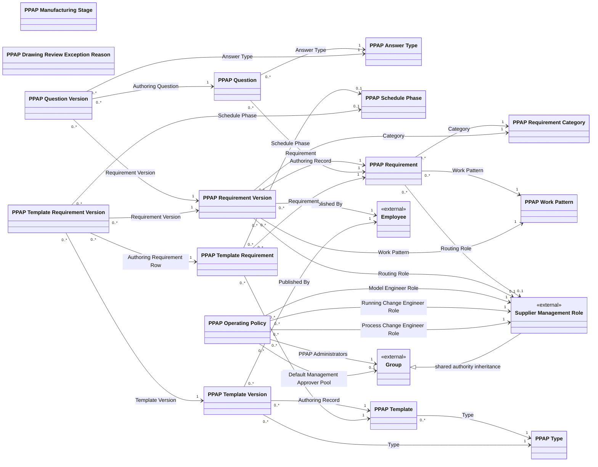
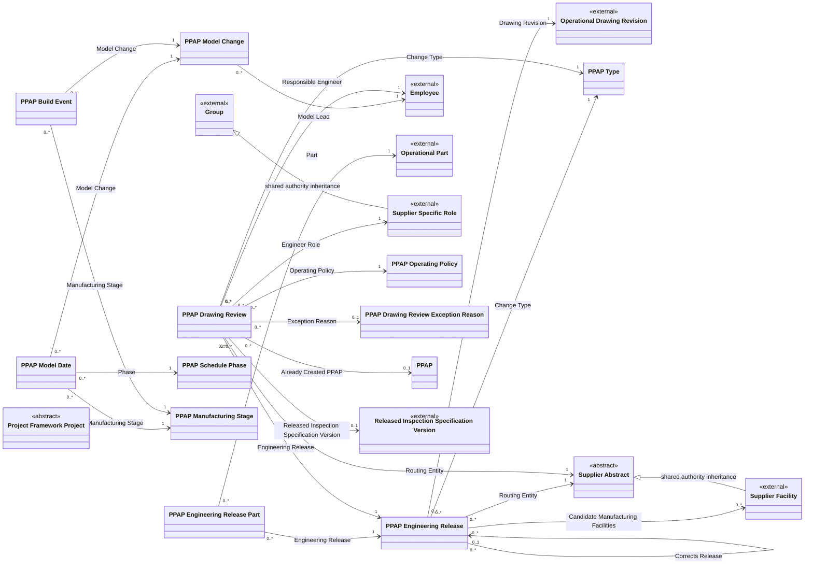
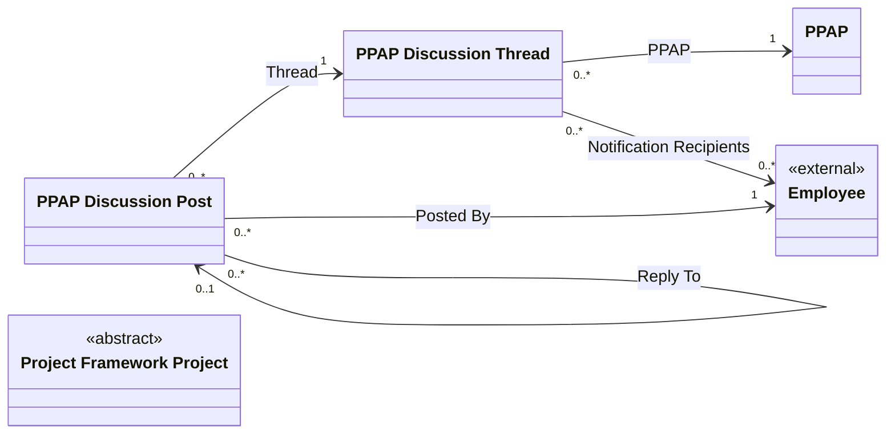

# PPAP target — logical object model

**Proposed target · 17 November 2026.** Field tables are canonical; diagrams summarize identity, direct inheritance and every active designed association. Solid arrows point from declaring field to its target. An inverse grid is navigation over that same reference, not another stored edge. Catalogue arrows do not enable inverse navigation. Existing shared objects are boundary nodes with their own authority; their undisclosed inheritance is not invented.

[Technical specification](ppap-target-technical-specification.md) · [Complete field contract](ppap-target-field-contract.md) · [Object inventory](ppap-target-object-inventory.csv)

## 1. Core approval and evidence

```mermaid
classDiagram
direction LR
class ppap["PPAP"]
class ppap_part["PPAP Part"]
class depot["PPAP Shipping Depot"]
class element["PPAP Element"]
class answer["PPAP Answer"]
class evidence["PPAP Evidence Snapshot"]
class evidence_answer["PPAP Evidence Answer"]
class result_link["PPAP Inspection Result Link"]
class pilot_link["PPAP Pilot Program Link"]
class project["Project Framework Project"]
<<abstract>> project
<<external>> project
class employee["Employee"]
<<external>> employee
class settings["APQP Settings"]
<<external>> settings
class integrated_task["Integrated Task"]
<<external>> integrated_task
class apqp["APQP"]
<<external>> apqp
class ppap_type["PPAP Type"]
class facility["Supplier Facility"]
<<external>> facility
class drawing["Operational Drawing Revision"]
<<external>> drawing
class release["PPAP Engineering Release"]
class review["PPAP Drawing Review"]
class pcr["MOC PCR"]
<<external>> pcr
class visibility["Shared Record Visibility Classification"]
<<external>> visibility
class model["PPAP Model Change"]
class stage["PPAP Manufacturing Stage"]
class template["PPAP Template"]
class template_version["PPAP Template Version"]
class policy["PPAP Operating Policy"]
class supplier_abstract["Supplier Abstract"]
<<abstract>> supplier_abstract
<<external>> supplier_abstract
class supplier_role["Supplier Specific Role"]
<<external>> supplier_role
class group["Group"]
<<external>> group
class part["Operational Part"]
<<external>> part
class release_part["PPAP Engineering Release Part"]
class requirement_version["PPAP Requirement Version"]
class template_line_version["PPAP Template Requirement Version"]
class work_pattern["PPAP Work Pattern"]
class phase["PPAP Schedule Phase"]
class question_version["PPAP Question Version"]
class inspection["Inspection Result"]
<<external>> inspection
class build_event["PPAP Build Event"]
class pilot["Pilot Part Program"]
<<external>> pilot
project <|-- ppap : inherits
ppap "0..*" --> "0..1" employee : Project Owner
ppap "0..*" --> "1" settings : Settings
ppap "0..*" --> "0..1" integrated_task : Task
ppap "0..*" --> "1" ppap_type : Type
ppap "0..*" --> "0..1" facility : Manufacturing Facility
ppap "0..*" --> "0..1" drawing : Drawing Revision
ppap "0..*" --> "0..1" release : Engineering Release
ppap "0..*" --> "0..1" review : Drawing Review
ppap "0..*" --> "0..1" pcr : Originating PCR
ppap "0..*" --> "0..1" ppap : Replaces PPAP
ppap "0..*" --> "1" visibility : Visibility Classification
ppap "0..*" --> "0..1" model : Model Change
ppap "0..*" --> "0..1" stage : Manufacturing Stage
ppap "0..*" --> "0..1" template : Template
ppap "0..*" --> "0..1" template_version : Template Version
ppap "0..*" --> "1" policy : Operating Policy
ppap "0..*" --> "0..1" supplier_abstract : Engineer Routing Entity
ppap "0..*" --> "0..1" supplier_role : Engineer Role
ppap "0..*" --> "0..1" group : Management Approver Pool
ppap "0..*" --> "0..1" employee : Final Management Approver
ppap "0..*" --> "0..1" employee : Issued By
ppap "0..*" --> "0..1" employee : Scope Confirmed By
ppap "0..*" --> "0..1" employee : Cancelled By
ppap "0..*" --> "0..1" employee : Approved By
ppap_part "0..*" --> "1" ppap : PPAP
ppap_part "0..*" --> "1" part : Part
ppap_part "0..*" --> "0..1" release_part : Source Release Part
depot "0..*" --> "1" ppap : PPAP
depot "0..*" --> "1" facility : Shipping Depot
element "0..*" --> "1" ppap : PPAP
element "0..*" --> "1" requirement_version : Requirement Version
element "0..*" --> "0..1" template_line_version : Template Requirement Version
element "0..*" --> "1" work_pattern : Work Pattern
element "0..*" --> "0..1" supplier_abstract : Routing Entity
element "0..*" --> "0..1" supplier_role : Assigned Role
element "0..*" --> "0..1" group : Assigned Team
element "0..*" --> "0..1" employee : Assigned Person
element "0..*" --> "0..1" phase : Schedule Phase
element "0..*" --> "0..1" evidence : Current Submission
element "0..*" --> "0..1" evidence : Latest Approved Snapshot
answer "0..*" --> "1" element : Element
answer "0..*" --> "1" question_version : Question Version
evidence "0..*" --> "1" element : Element
evidence "0..*" --> "0..1" evidence : Reused From
evidence "0..*" --> "1" employee : Submitted By
evidence "0..*" --> "0..1" employee : Approved By
evidence_answer "0..*" --> "1" evidence : Evidence Snapshot
evidence_answer "0..*" --> "1" question_version : Question Version
result_link "0..*" --> "1" element : Element
result_link "0..*" --> "1" inspection : Inspection Result
result_link "0..*" --> "0..1" evidence : Evidence Snapshot
pilot_link "0..*" --> "1" ppap : PPAP
pilot_link "0..*" --> "1" build_event : Build Event
pilot_link "0..*" --> "1" pilot : Pilot Program
apqp "0..*" --> "0..1" ppap : PPAPAbstract existing declaring field
supplier_abstract <|-- facility : shared authority inheritance
group <|-- supplier_role : shared authority inheritance
```

## 2. Governed configuration

## 3. Operational intake and schedules

## 4. Secured discussion

## Identifier mapping and object responsibility

| Diagram ID | Exact logical display name | Evidence / boundary |
|---|---|---|
| `project` | Project Framework Project | Extracted / Unresolved binding; external |
| `employee` | Employee | Extracted / Unresolved binding; external |
| `group` | Group | Extracted / Unresolved binding; external |
| `facility` | Supplier Facility | Extracted / Unresolved binding; external |
| `supplier_abstract` | Supplier Abstract | Extracted / Unresolved binding; external |
| `supplier_role` | Supplier Specific Role | Proposed shared contract / Unresolved native tenant binding; external |
| `management_role` | Supplier Management Role | Proposed shared contract / Unresolved native tenant binding; external |
| `visibility` | Shared Record Visibility Classification | Proposed shared contract / Unresolved native tenant binding; external |
| `part` | Operational Part | Proposed shared contract / Unresolved native tenant binding; external |
| `drawing` | Operational Drawing Revision | Proposed shared contract / Unresolved native tenant binding; external |
| `pcr` | MOC PCR | Proposed shared contract / Unresolved native tenant binding; external |
| `inspection` | Inspection Result | Proposed shared contract / Unresolved native tenant binding; external |
| `inspection_specification_version` | Released Inspection Specification Version | Proposed shared contract / Unresolved native tenant binding; external |
| `pilot` | Pilot Part Program | Proposed shared contract / Unresolved native tenant binding; external |
| `integrated_task` | Integrated Task | Extracted / Unresolved binding; external |
| `apqp` | APQP | Extracted / Unresolved binding; external |
| `settings` | APQP Settings | Extracted / Unresolved binding; external |
| `ppap_type` | PPAP Type | Proposed; catalogue |
| `work_pattern` | PPAP Work Pattern | Proposed; catalogue |
| `answer_type` | PPAP Answer Type | Proposed; catalogue |
| `requirement_category` | PPAP Requirement Category | Proposed; catalogue |
| `phase` | PPAP Schedule Phase | Proposed; catalogue |
| `stage` | PPAP Manufacturing Stage | Proposed; catalogue |
| `no_ppap_reason` | PPAP Drawing Review Exception Reason | Proposed; catalogue |
| `ppap` | PPAP | Extracted identity / Proposed target changes; operation |
| `requirement` | PPAP Requirement | Proposed; configuration |
| `requirement_version` | PPAP Requirement Version | Proposed; configuration |
| `question` | PPAP Question | Proposed; configuration |
| `question_version` | PPAP Question Version | Proposed; configuration |
| `template` | PPAP Template | Proposed; configuration |
| `template_version` | PPAP Template Version | Proposed; configuration |
| `template_line` | PPAP Template Requirement | Proposed; configuration |
| `template_line_version` | PPAP Template Requirement Version | Proposed; configuration |
| `policy` | PPAP Operating Policy | Proposed; configuration |
| `model` | PPAP Model Change | Proposed; schedule |
| `model_date` | PPAP Model Date | Proposed; schedule |
| `build_event` | PPAP Build Event | Proposed; schedule |
| `release` | PPAP Engineering Release | Proposed; intake |
| `release_part` | PPAP Engineering Release Part | Proposed; intake |
| `review` | PPAP Drawing Review | Proposed; intake |
| `ppap_part` | PPAP Part | Proposed; operation |
| `depot` | PPAP Shipping Depot | Proposed; operation |
| `element` | PPAP Element | Proposed; operation |
| `answer` | PPAP Answer | Proposed; operation |
| `evidence` | PPAP Evidence Snapshot | Proposed; operation |
| `evidence_answer` | PPAP Evidence Answer | Proposed; operation |
| `result_link` | PPAP Inspection Result Link | Proposed; operation |
| `pilot_link` | PPAP Pilot Program Link | Proposed; operation |
| `thread` | PPAP Discussion Thread | Proposed; discussion |
| `post` | PPAP Discussion Post | Proposed; discussion |
