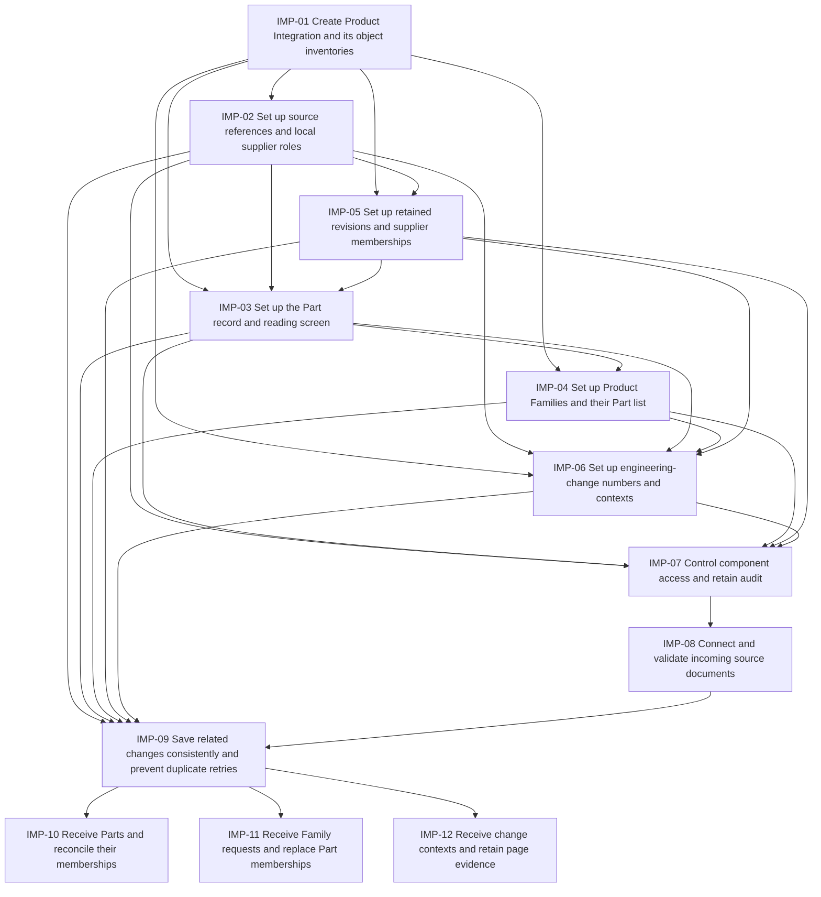

# Product Integration implementation plan

Draft for configuration planning • 2026-11-17. Governing source: [Technical specification, 1–10](product-management-api-technical-specification.md). Findings describe a proposed local build and supplied examples, not a configured or verified tenant. Native methods and producer decisions remain external inputs.

## Scope and planning basis

Configure the standalone Phase 2 Product Integration application defined by the technical specification revised on 2026-11-17, with all eleven integration objects and one tab containing a separate direct menu item for each object inventory. The complete specification, dictionary, object-model document, logical diagram, and all three JSON examples were read.

An object is a type of record. M:1 stores one selected local record; M:N uses native maps for multiple records on both sides. An inverse 1:M grid is a read-only list over another record’s declaring link, with no second stored relationship. The importer means the authorized receive service. An upsert creates only when the source key is new and otherwise updates that same record. Descriptor means a received ID, label, and activity value. A scope is one engineering-change context; a tuple is its ordered set of reference keys. PMAPI-PART, PMAPI-FAMILY, and PMAPI-ECN are proposed service-operation labels, not executable endpoint names or workflow actions. NULL means no value; source activity and latest-feed membership are independent.

The build contains eleven new types, 68 individually declared fields/grids, fourteen declaring associations, and four reverse lists. Field tasks own declarations/defaults/presentation; IMP-07 owns permissions/audit, IMP-08 receiving entry/evidence, IMP-09 consistent saving/key enforcement, and IMP-10 through IMP-12 source population. Lifecycle wording in field rows states the contract consumed by those receiving assignments. New internal names and metadata IDs are allocated through native configuration; no invented identifiers or expressions are supplied.

Reuse native identity, security infrastructure, audit, relationship storage, timestamps, and processing context. Leave existing business objects and package baselines unchanged. Earlier composite-master, inspection, and ECS ADR ideas do not expand this isolated specification. No migration/backfill, tenant-verification assignment, deployment, formal testing workstream, training, documentation workstream, schedule, or estimate is included. Superseded design ideas do not authorize tenant deletion.

Existing Administrators full control is user-confirmed context: permission checks are already disabled for that group. IMP-07 configures Part Integration - Admin Security Group object Rights and Everyone Create/Edit/Delete Audit Trail settings; it does not recreate or change Administrators access.

## Task summary

| Task Number | Task Category | Task Name | Objective and Detailed Scope | Recommended Implementer |
|---|---|---|---|---|
| IMP-01 | Application and records | Create Product Integration and its object inventories | **Objective:** Give all eleven integration objects their own Product Integration application with direct access to each inventory from one tab.  **Detailed scope:** Create the Product Integration application, exactly one tab named Product Integration, eleven new application-owned record types, and a separate direct inventory menu item for each type. Allocate collision-free native identifiers; configure no business inheritance or existing-object connection. | Associate Consultant |
| IMP-02 | Reference records and catalogues | Set up source references and local supplier roles | **Objective:** Reuse local source descriptors and offer a controlled supplier-role list.  **Detailed scope:** Configure Program Reference, Supplier Reference, Part Flag, Part Tag, and Supplier Relationship Role fields and screens. Add the three local role entries and separate imported labels from catalogue administration. | Senior Associate Consultant |
| IMP-03 | Part records and forms | Set up the Part record and reading screen | **Objective:** Show received Part facts and local links without ordinary-user source edits.  **Detailed scope:** Configure twenty Part fields/lists and their presentation/default rules. Use native Programs/Tags links and read-only supplier/revision lists on the Part screen. | Senior Associate Consultant |
| IMP-04 | Family records and forms | Set up Product Families and their Part list | **Objective:** Display a family and its Parts while distinguishing standalone requests from descriptors.  **Detailed scope:** Configure seven Family fields/lists and its screen, including conditional external identity and evidence. Show members through the single family reference on Part. | Senior Associate Consultant |
| IMP-05 | Part associations and forms | Set up retained revisions and supplier memberships | **Objective:** Keep revision history and mapped roles separate from source membership.  **Detailed scope:** Configure five revision fields and three supplier-membership fields, with reading and local Role-mapping screens. Keep revisions attached to their Part and allow one optional local role on an existing membership. | Senior Associate Consultant |
| IMP-06 | Engineering-change records and forms | Set up engineering-change numbers and contexts | **Objective:** Keep a change number and its distinct contexts without inferring approval or release.  **Detailed scope:** Configure five Number fields/lists and nine Scope fields with screens. Allow null Part/Revision, retain context-level text/evidence, and keep all six context references local. | Senior Associate Consultant |
| IMP-07 | Permissions and audit | Control component access and retain audit | **Objective:** Give integration administrators the specified object rights and enable Create, Edit, and Delete audit coverage across all eleven integration objects.  **Detailed scope:** Set up Part Integration - Admin Security Group and grant it Create, View, Edit, and Delete via Rights on every Product Integration object. Enable Audit Trail for Everyone on each object's Create, Edit, and Delete permissions. Reuse the existing Administrators full-control access and retain the separate service, ordinary-reader, local-maintenance, and evidence-retention rules. | Senior Consultant |
| IMP-08 | Receive service and evidence | Connect and validate incoming source documents | **Objective:** Reject malformed or untrusted messages before component records change.  **Detailed scope:** Configure proposed receive-service entry bindings, strict JSON parsing, trusted sources, common value checks, capacity checks, and native execution evidence for all three feeds. | Consultant |
| IMP-09 | Native persistence and concurrency | Save related changes consistently and prevent duplicate retries | **Objective:** Keep accepted changes complete and repeatable after failure or simultaneous receipt.  **Detailed scope:** Configure compound identity, null-equal Scope matching, protected concurrent updates, whole-operation saving, native staging, and retained Family create-request mapping. Save each Part/Family as one unit and each ECN row with its descriptors as one unit. | Senior Consultant |
| IMP-10 | Part receive mapping | Receive Parts and reconcile their memberships | **Objective:** Align each Part with source facts while retaining revisions and locally mapped supplier roles.  **Detailed scope:** Configure Part mappings, defaults, membership replacement, exact revision reconciliation, role retention, and raw-only unknown structures through the shared receiving/saving mechanisms. | Senior Consultant |
| IMP-11 | Family receive mapping | Receive Family requests and replace Part memberships | **Objective:** Change the intended Family without duplicate retries or accidental reassignment.  **Detailed scope:** Configure trusted create/update identity, create-only defaults, selected-ID resolution, complete family-membership replacement, and standalone evidence retention. | Senior Consultant |
| IMP-12 | Engineering-change receive mapping | Receive change contexts and retain page evidence | **Objective:** Keep accepted contexts distinct and preserve records omitted from later pages.  **Detailed scope:** Configure envelope checks, exact descriptor casing, scope identity, nullable Part/Revision, per-scope text, per-row saving, and confirmed page processing. Retain and defer unresolved rows. | Senior Consultant |

## External inputs and constraints

These are supplied information/decisions outside the build graph, not discovery assignments. Only their named consuming settings wait for them.

- **IN-01 — Native field and raw-document storage:** The technical team must supply supported text limits, Unicode long text of 65,536 characters, Decimal(19,6), localization, exact source-key comparison, and native text/document storage up to 1 MiB UTF-8. Affected field definitions and overflow checks wait for those settings; no silent truncation, rounding, or assumed JSON scalar is allowed.

- **IN-02 — Trusted feed entry and ownership:** Supply authenticated connector entry/response bindings, credentials, trusted Source System namespaces, field authority, and delivery order. The specification supplies no executable endpoint, schedule, source version, or timestamp. Receive bindings and competing producers wait for these inputs. Reference sharing requires an explicitly shared namespace; stale-write and chronological guarantees remain unverified.

- **IN-03 — Consistent native saving and retries:** The technical team must supply persistence calls, compound uniqueness, null-equal matching, locks and lock order, transactional batch/rollback, native staging, and retained Family create-request mapping. IMP-09 and exposed receive writes wait for these methods. If transactional saving is unavailable, hold operations in supported native staging until consistent execution is established.

- **IN-04 — Security, audit, and evidence retention:** The administrative group and object-rights policy are supplied: existing Administrators has full control with permission checks disabled; Part Integration - Admin Security Group receives Create, View, Edit, and Delete via Rights on all eleven objects; Everyone has Audit Trail enabled for Create, Edit, and Delete on every object. Supply only the remaining native field/association/document/search/export/navigation bindings and approved evidence-retention settings needed for other permission duties and prior messages/failures. Named group policy and audit operations are not missing decisions. Actual group membership administration is external.

- **IN-05 — Family request and membership contract:** Supply Family command entry, native-ID or trusted external-ID update context, stable create key, and a populated selectedPartNumbersIds example. Confirm same-source Part External ID strings, one family per Part, and standalone-create activity TRUE. The supplied body has no ID/activity. IMP-11 cannot complete executable matching, defaults, or membership replacement before these confirmations.

- **IN-06 — Change-context identity and paging:** Confirm the six-reference scope key or supply a stable row ID, repeated-row cardinality, scope ownership of Description/Comment, correction/removal rules, non-null Part/Revision shapes/keys, and page parameters, count meaning, snapshot consistency, and delivery behavior. IMP-12 defers unconfirmed non-null or missing-context rows and waits for the relevant contract before final row matching and page retrieval.

- **IN-07 — Unconfirmed Part values and translated labels:** Supply non-null futurePartName, lsPartNumber, lePartNumber, unitCost, notes contracts; LS/LE meanings; currency, unit basis, precision, negative-cost policy; and populated partClassification, singular program, customers, measures, facilities shapes. Approved flag translations/full catalogue are needed only for translated display. Known null/empty data remains receivable and retained; unknown structures authorize no new projections or guessed links.

## Detailed configuration tasks

### IMP-01 — Create Product Integration and its object inventories

**Task ID:** IMP-01

**Title:** Create Product Integration and its object inventories

**Category:** Application and records

**Objective:** Give all eleven integration objects their own Product Integration application with direct access to each inventory from one tab.

**Detailed scope:** Create the Product Integration application, exactly one tab named Product Integration, eleven new application-owned record types, and a separate direct inventory menu item for each type. Allocate collision-free native identifiers; configure no business inheritance or existing-object connection.

**Deliverable:** A new Product Integration application owning all eleven record types, with one Product Integration tab and eleven direct inventory menu items.

**Work needed first:** None

**What is waiting:** Ready: allocate new identifiers through native configuration; no external input prevents object creation.

**Recommended implementer role:** Associate Consultant

**Recommended reviewer/approver role:** Product build manager — Senior Consultant (a separate person)

**Why this role is recommended:** Application, tab, inventory menu, and object creation use established configuration patterns; one coherent assignment establishes the owner and access point for every new type.

**Build instructions:**

1. Create a new application named Product Integration, then add exactly one tab named Product Integration. Allocate collision-free application and tab identifiers through native configuration.
2. Create the eleven new record types in Product Integration: BOMECS Part API Recod, Program Reference, Supplier Reference, Part Revision Reference, Product Family, Part Flag, Part Tag, Part Supplier Relationship, Supplier Relationship Role, Engineering Change Number, Engineering Change Scope. Allocate new internal identities and preserve BOMECS Part API Recod exactly; do not select existing same-named objects.
3. On the Product Integration tab, create eleven separate direct inventory menu items named BOMECS Part API Recod, Program Reference, Supplier Reference, Part Revision Reference, Product Family, Part Flag, Part Tag, Part Supplier Relationship, Supplier Relationship Role, Engineering Change Number, Engineering Change Scope. Bind each menu item to the inventory of its same-named new object in Product Integration. Create no additional tab or Reference Data submenu.
4. Set no explicit business inheritance. Use native identity/audit infrastructure without duplicate custom fields. Add no business target, lookup, matching, synchronization, or writeback outside these eleven types and no grids on existing forms.

**How to check the result:**

- All eleven new record types are owned by the new Product Integration application, with collision-free native identities and the exact specified display names.
- Product Integration has exactly one tab named Product Integration and eleven direct inventory menu items, one for each specified object. Each item opens its same-named object inventory; there is no second tab or Reference Data submenu.
- No new type has explicit business inheritance or a configured relationship, lookup, matching rule, synchronization, or writeback to an existing business object.

**Information needed for this task:** None

**Specification references:** [Technical specification, 1–4](product-management-api-technical-specification.md) [Technical specification, 8](product-management-api-technical-specification.md)

**Assumptions and open questions:** Product Integration is the user-requested standalone application. Its single tab uses the same display name. This is a proposed build, not a move of existing tenant objects or data.

### IMP-02 — Set up source references and local supplier roles

**Task ID:** IMP-02

**Title:** Set up source references and local supplier roles

**Category:** Reference records and catalogues

**Objective:** Reuse local source descriptors and offer a controlled supplier-role list.

**Detailed scope:** Configure Program Reference, Supplier Reference, Part Flag, Part Tag, and Supplier Relationship Role fields and screens. Add the three local role entries and separate imported labels from catalogue administration.

**Deliverable:** Five reference definitions/screens and three local role entries.

**Work needed first:** IMP-01

**What is waiting:** Partly waiting: configure known fields, screens, and role entries; finish unsupported native settings and leave unapproved translations unset.

**Recommended implementer role:** Senior Associate Consultant

**Recommended reviewer/approver role:** Product build manager — Senior Consultant (a separate person)

**Why this role is recommended:** Exact source identity, immutable codes, and catalogue localization need independent configuration judgment.

What the earlier tasks provide: IMP-01 — Five new reference types and allocated metadata identities.

**Fields and features to set up:**

| Field or feature | What to set up |
|---|---|
| Program Reference.Source System | Create this field/list on Program Reference. Type: Text, up to 100 characters. Required. Default or source timing: Connector namespace; must match receiving Part or Engineering Change Number.Source System. Who supplies or sees it: Importer supplied; immutable. Behavior: Unique with External ID; sharing across feeds requires the same verified namespace. Source population is owned by IMP-10 and IMP-12. IMP-07 owns enforced permissions/audit and IMP-09 receive-time key enforcement. Allocate a new internal field identifier; none is supplied. |
| Program Reference.External ID | Create this field/list on Program Reference. Type: Text, up to 100 characters. Required. Default or source timing: None. Who supplies or sees it: Importer from Part `programs[*].id` or change row `program.Id`; immutable. Behavior: Upsert by source + ID; exact path casing per feed. Source population is owned by IMP-10 and IMP-12. IMP-07 owns enforced permissions/audit and IMP-09 receive-time key enforcement. Allocate a new internal field identifier; none is supplied. |
| Program Reference.Name | Create this field/list on Program Reference. Type: Text, up to 255 characters. Required. Default or source timing: None. Who supplies or sees it: Importer from Part `programs[*].name` or change row `program.Name`; read only to users. Behavior: Descriptor only; renamed program retains identity. Source population is owned by IMP-10 and IMP-12. IMP-07 owns enforced permissions/audit and IMP-09 receive-time key enforcement. Allocate a new internal field identifier; none is supplied. |
| Program Reference.Active? | Create this field/list on Program Reference. Type: Yes/No. Required. Default or source timing: None. Who supplies or sees it: Importer from Part `programs[*].status` or change row `program.Status`; read only to users. Behavior: Preserve inactive references; no cascade to parts or changes. Source population is owned by IMP-10 and IMP-12. IMP-07 owns enforced permissions/audit and IMP-09 receive-time key enforcement. Allocate a new internal field identifier; none is supplied. |
| Supplier Reference.Source System | Create this field/list on Supplier Reference. Type: Text, up to 100 characters. Required. Default or source timing: Connector namespace; must match receiving Part or Engineering Change Number.Source System. Who supplies or sees it: Importer supplied; immutable. Behavior: Unique with External ID; sharing across feeds requires the same verified namespace. Source population is owned by IMP-10 and IMP-12. IMP-07 owns enforced permissions/audit and IMP-09 receive-time key enforcement. Allocate a new internal field identifier; none is supplied. |
| Supplier Reference.External ID | Create this field/list on Supplier Reference. Type: Text, up to 100 characters. Required. Default or source timing: None. Who supplies or sees it: Importer from Part `suppliers[*].id` or change row `supplier.id`; immutable. Behavior: Source key; not assumed to be an Intelex supplier ID. Source population is owned by IMP-10 and IMP-12. IMP-07 owns enforced permissions/audit and IMP-09 receive-time key enforcement. Allocate a new internal field identifier; none is supplied. |
| Supplier Reference.Name | Create this field/list on Supplier Reference. Type: Text, up to 255 characters. Required. Default or source timing: None. Who supplies or sees it: Importer from Part `suppliers[*].name` or change row `supplier.name`; read only to users. Behavior: Local descriptor only; no matching, relationship, or writeback to an existing supplier master. Source population is owned by IMP-10 and IMP-12. IMP-07 owns enforced permissions/audit and IMP-09 receive-time key enforcement. Allocate a new internal field identifier; none is supplied. |
| Supplier Reference.Active? | Create this field/list on Supplier Reference. Type: Yes/No. Required. Default or source timing: None. Who supplies or sees it: Importer from Part `suppliers[*].status` or change row `supplier.status`; read only to users. Behavior: Preserve source status within this component; no existing supplier eligibility is read or changed. Source population is owned by IMP-10 and IMP-12. IMP-07 owns enforced permissions/audit and IMP-09 receive-time key enforcement. Allocate a new internal field identifier; none is supplied. |
| Part Flag.Source System | Create this field/list on Part Flag. Type: Text, up to 100 characters. Required. Default or source timing: Receiving part's Source System. Who supplies or sees it: Importer supplied; immutable. Behavior: Unique with Code. Source population is owned by IMP-10. IMP-07 owns enforced permissions/audit and IMP-09 receive-time key enforcement. Allocate a new internal field identifier; none is supplied. |
| Part Flag.Code | Create this field/list on Part Flag. Type: Text, up to 100 characters, stable and non-localizable. Required. Default or source timing: None. Who supplies or sees it: Importer from `Flag.id`; immutable. Behavior: Preserve `"2"` as text; not a UUID or Boolean. Source population is owned by IMP-10. IMP-07 owns enforced permissions/audit and IMP-09 receive-time key enforcement. Allocate a new internal field identifier; none is supplied. |
| Part Flag.Name | Create this field/list on Part Flag. Type: Text, up to 255 characters; localizable catalogue display field. Required. Default or source timing: None. Who supplies or sees it: Importer supplies exact source label from `Flag.name`; approved translations managed by catalogue administrator. Behavior: Retain resource key in the source locale; do not infer a translated label. Value maintenance is owned by IMP-10 for the literal source label and the catalogue administrator for approved translations. IMP-07 owns enforced permissions/audit and IMP-09 receive-time key enforcement. Allocate a new internal field identifier; none is supplied. |
| Part Flag.Active? | Create this field/list on Part Flag. Type: Yes/No. Required. Default or source timing: None. Who supplies or sees it: Importer from `Flag.status`; read only to users. Behavior: Inactive values retained; exclude from future manual selections. Source population is owned by IMP-10. IMP-07 owns enforced permissions/audit and IMP-09 receive-time key enforcement. Allocate a new internal field identifier; none is supplied. |
| Part Flag.Sort | Create this field/list on Part Flag. Type: Number allowing decimals (Float). Optional. Default or source timing: NULL. Who supplies or sees it: Catalogue administrator editable; not supplied by API. Behavior: Presentation only; never participates in source identity. Value maintenance is owned by the catalogue administrator only; the Part API supplies no Sort. IMP-07 owns enforced permissions/audit and IMP-09 receive-time key enforcement. Allocate a new internal field identifier; none is supplied. |
| Part Tag.Source System | Create this field/list on Part Tag. Type: Text, up to 100 characters. Required. Default or source timing: Receiving part's Source System. Who supplies or sees it: Importer supplied; immutable. Behavior: Unique with Value. Source population is owned by IMP-10. IMP-07 owns enforced permissions/audit and IMP-09 receive-time key enforcement. Allocate a new internal field identifier; none is supplied. |
| Part Tag.Value | Create this field/list on Part Tag. Type: Text, up to 100 characters. Required. Default or source timing: None. Who supplies or sees it: Importer from `tags[*]`; immutable. Behavior: Preserve exact text; deduplicate identical values; reject null/blank elements. Source population is owned by IMP-10. IMP-07 owns enforced permissions/audit and IMP-09 receive-time key enforcement. Allocate a new internal field identifier; none is supplied. |
| Supplier Relationship Role.Code | Create this field/list on Supplier Relationship Role. Type: Text, up to 100 characters, stable and non-localizable. Required. Default or source timing: None. Who supplies or sees it: Catalogue administrator sets; immutable after first use. Behavior: Unique; automation compares Code. Source population is owned by the catalogue administrator. IMP-07 owns enforced permissions/audit and IMP-09 receive-time key enforcement. Allocate a new internal field identifier; none is supplied. |
| Supplier Relationship Role.Name | Create this field/list on Supplier Relationship Role. Type: Text, up to 255 characters; localizable. Required. Default or source timing: None. Who supplies or sees it: Catalogue administrator editable. Behavior: Display label only. Source population is owned by the catalogue administrator. IMP-07 owns enforced permissions/audit and IMP-09 receive-time key enforcement. Allocate a new internal field identifier; none is supplied. |
| Supplier Relationship Role.Active? | Create this field/list on Supplier Relationship Role. Type: Yes/No. Required. Default or source timing: TRUE. Who supplies or sees it: Catalogue administrator editable. Behavior: False prevents new assignments; existing references remain valid. Source population is owned by the catalogue administrator. IMP-07 owns enforced permissions/audit and IMP-09 receive-time key enforcement. Allocate a new internal field identifier; none is supplied. |
| Supplier Relationship Role.Sort | Create this field/list on Supplier Relationship Role. Type: Number allowing decimals (Float). Optional. Default or source timing: NULL. Who supplies or sees it: Catalogue administrator editable. Behavior: Presentation ordering only. Source population is owned by the catalogue administrator. IMP-07 owns enforced permissions/audit and IMP-09 receive-time key enforcement. Allocate a new internal field identifier; none is supplied. |

**Build instructions:**

1. Create reference screens showing all fields below, with source facts read only. IMP-07 supplies actual permissions for catalogue edits.
2. Add Supplier Relationship Role entries with Code / Name / Active? / Sort: MANUFACTURING / Manufacturing / TRUE / 10; ASSEMBLY / Assembly / TRUE / 20; SEQUENCING / Sequencing / TRUE / 30. Do not default supplier memberships to any role.
3. Configure localizable catalogue Name and non-localizable codes. Retain [ISOQuest].[PartNumber].Flag.Buy literally in its source locale; add only approved translations. Enable no catalogue-side consumer grids and seed no source descriptor examples.

**How to check the result:**

- Three local roles have the exact specified codes, names, activity, and order, without a membership default.
- Flag Code "2" stays text and its source resource-key label remains literal.

**Information needed for this task:** IN-01: Native field limits, exact comparison, Float, and localization settings are needed to finish reference definitions. IN-07: Approved translations are needed only for translated flag labels; literal source-label receipt can proceed.

**Specification references:** [Technical specification, 5.2–5.3](product-management-api-technical-specification.md) [Technical specification, 5.6–5.7](product-management-api-technical-specification.md) [Technical specification, 5.9](product-management-api-technical-specification.md) [Technical specification, 7](product-management-api-technical-specification.md)

**Assumptions and open questions:** Source descriptor examples are received data, not catalogue seeds.

### IMP-03 — Set up the Part record and reading screen

**Task ID:** IMP-03

**Title:** Set up the Part record and reading screen

**Category:** Part records and forms

**Objective:** Show received Part facts and local links without ordinary-user source edits.

**Detailed scope:** Configure twenty Part fields/lists and their presentation/default rules. Use native Programs/Tags links and read-only supplier/revision lists on the Part screen.

**Deliverable:** Part field definitions, declaring links, and reading screen.

**Work needed first:** IMP-01, IMP-02, IMP-05

**What is waiting:** Partly waiting: create known fields, links, and screen; finish provisional types and document binding when supported settings/contracts arrive.

**Recommended implementer role:** Senior Associate Consultant

**Recommended reviewer/approver role:** Product build manager — Senior Consultant (a separate person)

**Why this role is recommended:** Optional fields, reverse lists, and conditional defaults need careful configuration; source reconciliation is assigned separately.

What the earlier tasks provide: IMP-01 — New Part and Family record type identities used by declaring relationships. IMP-02 — Program Reference, Part Flag, and Part Tag definitions used by Part links. IMP-05 — The declaring Part Revision Reference.Part and Part Supplier Relationship.Part links required to create the read-only Part reverse lists.

**Fields and features to set up:**

| Field or feature | What to set up |
|---|---|
| BOMECS Part API Recod.Source System | Create this field/list on BOMECS Part API Recod. Type: Text, up to 100 characters. Required. Default or source timing: Connector source namespace. Who supplies or sees it: Importer supplied; read only after creation. Behavior: Immutable; unique with External ID. Source population is owned by IMP-10. IMP-07 owns enforced permissions/audit and IMP-09 receive-time key enforcement. Allocate a new internal field identifier; none is supplied. |
| BOMECS Part API Recod.External ID | Create this field/list on BOMECS Part API Recod. Type: Text, up to 100 characters. Required. Default or source timing: None. Who supplies or sees it: Importer from `$.id`; read only after creation. Behavior: Immutable; source-scoped upsert key. Source population is owned by IMP-10. IMP-07 owns enforced permissions/audit and IMP-09 receive-time key enforcement. Allocate a new internal field identifier; none is supplied. |
| BOMECS Part API Recod.Part Number | Create this field/list on BOMECS Part API Recod. Type: Text, up to 100 characters. Required. Default or source timing: None. Who supplies or sees it: Importer from `$.partNumber`; read only to users. Behavior: Nonblank; not assumed globally unique; changed value does not create a new source identity. Source population is owned by IMP-10. IMP-07 owns enforced permissions/audit and IMP-09 receive-time key enforcement. Allocate a new internal field identifier; none is supplied. |
| BOMECS Part API Recod.Part Name | Create this field/list on BOMECS Part API Recod. Type: Text, up to 255 characters. Optional. Default or source timing: NULL. Who supplies or sees it: Importer from `$.partName`; read only to users. Behavior: Preserve source spaces; explicit null clears. Source population is owned by IMP-10. IMP-07 owns enforced permissions/audit and IMP-09 receive-time key enforcement. Allocate a new internal field identifier; none is supplied. |
| BOMECS Part API Recod.Future Part Name | Create this field/list on BOMECS Part API Recod. Type: Text, up to 255 characters; provisional type. Optional. Default or source timing: NULL. Who supplies or sees it: Importer from `$.futurePartName`; read only to users. Behavior: Explicit null clears; confirm non-null contract. Source population is owned by IMP-10. IMP-07 owns enforced permissions/audit and IMP-09 receive-time key enforcement. Allocate a new internal field identifier; none is supplied. |
| BOMECS Part API Recod.LS Part Number | Create this field/list on BOMECS Part API Recod. Type: Text, up to 100 characters; provisional type. Optional. Default or source timing: NULL. Who supplies or sees it: Importer from `$.lsPartNumber`; read only to users. Behavior: Explicit null clears; no inferred relationship to another part. Source population is owned by IMP-10. IMP-07 owns enforced permissions/audit and IMP-09 receive-time key enforcement. Allocate a new internal field identifier; none is supplied. |
| BOMECS Part API Recod.LE Part Number | Create this field/list on BOMECS Part API Recod. Type: Text, up to 100 characters; provisional type. Optional. Default or source timing: NULL. Who supplies or sees it: Importer from `$.lePartNumber`; read only to users. Behavior: Explicit null clears; no inferred relationship to another part. Source population is owned by IMP-10. IMP-07 owns enforced permissions/audit and IMP-09 receive-time key enforcement. Allocate a new internal field identifier; none is supplied. |
| BOMECS Part API Recod.Unit Cost | Create this field/list on BOMECS Part API Recod. Type: Decimal, precision 19, scale 6; provisional type. Optional. Default or source timing: NULL. Who supplies or sees it: Importer from `$.unitCost`; read only to users. Behavior: Exact numeric conversion only; confirm currency, unit basis, precision, and negative-value policy before business use. Source population is owned by IMP-10. IMP-07 owns enforced permissions/audit and IMP-09 receive-time key enforcement. Allocate a new internal field identifier; none is supplied. |
| BOMECS Part API Recod.Drawing Number | Create this field/list on BOMECS Part API Recod. Type: Text, up to 100 characters. Optional. Default or source timing: NULL. Who supplies or sees it: Importer from `$.drawingNumber`; read only to users. Behavior: No automatic Drawing object lookup by name. Source population is owned by IMP-10. IMP-07 owns enforced permissions/audit and IMP-09 receive-time key enforcement. Allocate a new internal field identifier; none is supplied. |
| BOMECS Part API Recod.Active? | Create this field/list on BOMECS Part API Recod. Type: Yes/No. Required. Default or source timing: None. Who supplies or sees it: Importer from `$.status`; read only to users. Behavior: False excludes the part from new manual component assignments; retain its data and existing links; no external application effect. Source population is owned by IMP-10. IMP-07 owns enforced permissions/audit and IMP-09 receive-time key enforcement. Allocate a new internal field identifier; none is supplied. |
| BOMECS Part API Recod.Name | Create this field/list on BOMECS Part API Recod. Type: Text, up to 512 characters; configured display field. Required. Default or source timing: Import `$.name`; on creation only, use Part Number if name is absent or null. Who supplies or sees it: Importer populated; read only to users. Behavior: Stored label, not a formula or match key; explicit null on update rejected. Source population is owned by IMP-10. IMP-07 owns enforced permissions/audit and IMP-09 receive-time key enforcement. Allocate a new internal field identifier; none is supplied. |
| BOMECS Part API Recod.Programs | Create this field/list on BOMECS Part API Recod. Type: Native many-to-many link (M:N) to Program Reference; inverse disabled. Optional. Default or source timing: Empty collection on creation. Who supplies or sees it: Importer from `$.programs`; inactive source references allowed for fidelity. Behavior: Replace source-owned links when property is present; empty array clears; no program deletion. Source population is owned by IMP-10. IMP-07 owns enforced permissions/audit and IMP-09 receive-time key enforcement. Allocate a new internal field identifier; none is supplied. |
| BOMECS Part API Recod.Flag | Create this field/list on BOMECS Part API Recod. Type: Single-reference link (M:1) to Part Flag, 0..1 per part; inverse disabled. Optional. Default or source timing: NULL. Who supplies or sees it: Importer from `$.Flag`; no manual selector; inactive source values accepted. Behavior: Resolve Source System + Code; explicit null clears; never parse resource key into identity. Source population is owned by IMP-10. IMP-07 owns enforced permissions/audit and IMP-09 receive-time key enforcement. Allocate a new internal field identifier; none is supplied. |
| BOMECS Part API Recod.Supplier Relationships | Create this field/list on BOMECS Part API Recod. Type: Read-only related-record list (inverse 1:M) grid from Part Supplier Relationship.Part. Optional. Default or source timing: None. Who supplies or sees it: Read only; displays importer-maintained associations. Behavior: Navigation only; no duplicate stored relationship. Source population is owned by IMP-10. IMP-07 owns enforced permissions/audit and IMP-09 receive-time key enforcement. Allocate a new internal field identifier; none is supplied. |
| BOMECS Part API Recod.Revisions | Create this field/list on BOMECS Part API Recod. Type: Read-only related-record list (inverse 1:M) grid from Part Revision Reference.Part. Optional. Default or source timing: None. Who supplies or sees it: Read only; default filter Included in Latest Part Feed?=TRUE; authorized readers may view retained rows. Behavior: Navigation only; no duplicate stored relationship; array replacement updates feed membership flags, preserving records and ECN references. Source population is owned by IMP-10. IMP-07 owns enforced permissions/audit and IMP-09 receive-time key enforcement. Allocate a new internal field identifier; none is supplied. |
| BOMECS Part API Recod.Tags | Create this field/list on BOMECS Part API Recod. Type: Native many-to-many link (M:N) to Part Tag; inverse disabled. Optional. Default or source timing: Empty collection on creation. Who supplies or sees it: Importer from `$.tags`; read only to users. Behavior: Resolve source + exact Value; replace source-owned links on present array. Source population is owned by IMP-10. IMP-07 owns enforced permissions/audit and IMP-09 receive-time key enforcement. Allocate a new internal field identifier; none is supplied. |
| BOMECS Part API Recod.Notes | Create this field/list on BOMECS Part API Recod. Type: Plain Unicode long text, proposed limit 65,536 characters; provisional format. Optional. Default or source timing: NULL. Who supplies or sees it: Importer from `$.notes`; read only to users. Behavior: Explicit null clears; treat as text and escape when displayed. Source population is owned by IMP-10. IMP-07 owns enforced permissions/audit and IMP-09 receive-time key enforcement. Allocate a new internal field identifier; none is supplied. |
| BOMECS Part API Recod.Product Family | Create this field/list on BOMECS Part API Recod. Type: Single-reference link (M:1) to Product Family, 0..1 per part; inverse Part Numbers. Optional. Default or source timing: NULL. Who supplies or sees it: Importer from `$.productFamily`, or family assignment command from `selectedPartNumbersIds`; read only to ordinary users; inactive source references allowed. Behavior: Explicit null clears; enforce same-source scope; inverse updates automatically; no independent M:N storage; same name as Drawing Number does not merge identities. Value maintenance is owned by IMP-10 for the Part feed and IMP-11 for standalone Family membership commands. IMP-07 owns enforced permissions/audit and IMP-09 receive-time key enforcement. Allocate a new internal field identifier; none is supplied. |
| BOMECS Part API Recod.Include All Facilities? | Create this field/list on BOMECS Part API Recod. Type: Yes/No. Required. Default or source timing: None. Who supplies or sees it: Importer from `$.includeAllFacilities`; read only to users. Behavior: Preserve supplied true/false; no permission grants or invented facility associations. Source population is owned by IMP-10. IMP-07 owns enforced permissions/audit and IMP-09 receive-time key enforcement. Allocate a new internal field identifier; none is supplied. |
| BOMECS Part API Recod.Raw Payload | Create this field/list on BOMECS Part API Recod. Type: Native Unicode long-text/document storage for complete JSON, proposed limit 1 MiB UTF-8; supported binding waits for IN-01. Required. Default or source timing: Complete validated request document. Who supplies or sees it: Importer supplied; restricted to authorized integration/technical readers. Behavior: Updated on each accepted receive; preserve all unknown properties and string contents; native retention preserves prior messages. Source population is owned by IMP-10. IMP-07 owns enforced permissions/audit and IMP-09 receive-time key enforcement. Allocate a new internal field identifier; none is supplied. |

**Build instructions:**

1. Build the Part screen with identity/descriptive fields, Programs, Tags, Flag, Product Family, Include All Facilities?, and supplier/revision lists. Source facts are read only; Raw Payload uses the technical presentation enforced by IMP-07.
2. Configure native Programs/Tags many-to-many maps with inverses disabled. Flag and Product Family allow at most one target; Product Family alone provides the Part Numbers inverse.
3. After IMP-05 provides the declaring fields, show Supplier Relationships through Part Supplier Relationship.Part and Revisions through Part Revision Reference.Part. Default Revisions to Included in Latest Part Feed?=TRUE and let authorized readers inspect retained rows without membership editing. Store no duplicate relationship.
4. Use stored Name as the display label, never a formula/match key. Add no projected Part Classification, singular Program, Customers, Measures, or Facilities fields; unknown structures remain in Raw Payload.

**How to check the result:**

- The twenty Part fields/lists appear with read-only source facts and restricted raw evidence.
- Included revisions appear by default; authorized readers can inspect retained rows without editing membership.
- Drawing Number stays text and Product Family stores one optional local link.

**Information needed for this task:** IN-01: Supported Decimal(19,6), text/long-text limits, and 1 MiB document binding are needed to finish Part fields. IN-05: One optional family per Part is proposed; confirm it before enabling Family membership commands. IN-07: Future/LS/LE names, cost, and notes have proposed types; unsupported non-null values wait for producer definitions.

**Specification references:** [Technical specification, 5.1](product-management-api-technical-specification.md) [Technical specification, 6.2](product-management-api-technical-specification.md) [Technical specification, 7](product-management-api-technical-specification.md)

**Assumptions and open questions:** IMP-07 owns enforced access, IMP-09 key enforcement, and IMP-10 source population.

### IMP-04 — Set up Product Families and their Part list

**Task ID:** IMP-04

**Title:** Set up Product Families and their Part list

**Category:** Family records and forms

**Objective:** Display a family and its Parts while distinguishing standalone requests from descriptors.

**Detailed scope:** Configure seven Family fields/lists and its screen, including conditional external identity and evidence. Show members through the single family reference on Part.

**Deliverable:** Family fields, screen, and read-only Part Numbers list.

**Work needed first:** IMP-01, IMP-03

**What is waiting:** Partly waiting: configure known fields/list/screen; finish native storage and command-dependent defaults after supplied settings and Family confirmation.

**Recommended implementer role:** Senior Associate Consultant

**Recommended reviewer/approver role:** Product build manager — Senior Consultant (a separate person)

**Why this role is recommended:** Conditional identity/evidence needs judgment, while command matching belongs to the receive task.

What the earlier tasks provide: IMP-01 — The new Product Family type identity. IMP-03 — The declaring Part.Product Family relationship used by the reverse list.

**Fields and features to set up:**

| Field or feature | What to set up |
|---|---|
| Product Family.Source System | Create this field/list on Product Family. Type: Text, up to 100 characters. Required. Default or source timing: Connector namespace; equals receiving Part or Engineering Change Number.Source System for nested descriptors. Who supplies or sees it: Importer supplied; immutable. Behavior: External ID uniqueness is scoped to this source when populated. Source population is owned by IMP-10, IMP-11, and IMP-12. IMP-07 owns enforced permissions/audit and IMP-09 receive-time key enforcement. Allocate a new internal field identifier; none is supplied. |
| Product Family.External ID | Create this field/list on Product Family. Type: Text, up to 100 characters. Conditionally required under the rules below. Default or source timing: NULL for standalone creation without source identity; None for a nested descriptor requiring `productFamily.id`. Who supplies or sees it: Importer maps nested Part/change ID or verified request/response context; may populate a null value once, then immutable. Behavior: Required for nested descriptor resolution; optional for standalone create/update by native ID; retain any assigned ID on standalone updates; unique with Source System when non-null; never derive from Name. Source population is owned by IMP-10, IMP-11, and IMP-12. IMP-07 owns enforced permissions/audit and IMP-09 receive-time key enforcement. Allocate a new internal field identifier; none is supplied. |
| Product Family.Name | Create this field/list on Product Family. Type: Text, up to 255 characters. Required. Default or source timing: None. Who supplies or sees it: Importer from standalone `$.name`, Part `$.productFamily.name`, or change row `productFamily.name`; read only to ordinary users. Behavior: Nonblank; required on create; omission preserves on update; null rejected; renaming retains identity. Source population is owned by IMP-10, IMP-11, and IMP-12. IMP-07 owns enforced permissions/audit and IMP-09 receive-time key enforcement. Allocate a new internal field identifier; none is supplied. |
| Product Family.Notes | Create this field/list on Product Family. Type: Plain Unicode long text, proposed limit 65,536 characters; provisional format. Optional. Default or source timing: NULL. Who supplies or sees it: Importer from standalone `$.notes`; read only to ordinary users. Behavior: Explicit null clears; omission preserves; neither nested descriptor clears Notes; escape when displayed. Value maintenance is owned by IMP-11 only; nested descriptors preserve this value. IMP-07 owns enforced permissions/audit and IMP-09 receive-time key enforcement. Allocate a new internal field identifier; none is supplied. |
| Product Family.Active? | Create this field/list on Product Family. Type: Yes/No. Required. Default or source timing: Proposed TRUE only on standalone create; otherwise Part/change descriptor `productFamily.status` or existing value. Who supplies or sees it: Importer supplied; read only to ordinary users. Behavior: Standalone update preserves activity; nested descriptor requires explicit Boolean status; false retains membership/history and prevents new manual operational use; no cascade. Source population is owned by IMP-10, IMP-11, and IMP-12. IMP-07 owns enforced permissions/audit and IMP-09 receive-time key enforcement. Allocate a new internal field identifier; none is supplied. |
| Product Family.Part Numbers | Create this field/list on Product Family. Type: Read-only related-record list (inverse 1:M) grid from BOMECS Part API Recod.Product Family; each part has 0..1 family. Optional. Default or source timing: Empty membership on standalone create. Who supplies or sees it: Read-only navigation; importer processes `selectedPartNumbersIds` by updating the declaring Part field. Behavior: No duplicate stored relationship; present array replaces this family's source-owned links; `[]` clears links, omission preserves; null invalid; prevalidate all IDs and family conflicts. Value maintenance is owned by IMP-10 and IMP-11 through Part.Product Family; IMP-12 does not change Part membership. IMP-07 owns enforced permissions/audit and IMP-09 receive-time key enforcement. Allocate a new internal field identifier; none is supplied. |
| Product Family.Raw Payload | Create this field/list on Product Family. Type: Native Unicode long-text/document storage for complete JSON, proposed limit 1 MiB UTF-8; supported binding waits for IN-01. Conditionally required under the rules below. Default or source timing: NULL if first created only from a nested descriptor. Who supplies or sees it: Importer from complete standalone family body; restricted to authorized integration/technical readers. Behavior: Required when receiving a standalone family request; latest accepted standalone body retained; descriptors do not overwrite it and remain in Part.Raw Payload or Engineering Change Scope.Raw Payload. Value maintenance is owned by IMP-11 only; nested descriptors retain their evidence in the Part or Scope instead. IMP-07 owns enforced permissions/audit and IMP-09 receive-time key enforcement. Allocate a new internal field identifier; none is supplied. |

**Build instructions:**

1. Build the Family screen with identity, Name, Notes, Active?, and read-only Part Numbers. Restrict Raw Payload through IMP-07.
2. Configure Part Numbers only as inverse navigation over BOMECS Part API Recod.Product Family, with no second stored collection or ordinary-user assignment control.
3. Require External ID for nested descriptor resolution; permit NULL for standalone creation/update by native ID. Allow one verified NULL-to-ID assignment, then make the ID immutable. IMP-11 owns request-dependent activity/evidence checks; a generic TRUE default must not override nested status.

**How to check the result:**

- Descriptor-created families may lack standalone Raw Payload; standalone requests require it.
- The Part Numbers list uses only the declaring Part field, and an assigned external identity cannot change.

**Information needed for this task:** IN-01: Supported native long-text/document limits and conditional evidence storage are needed for Family definitions; IMP-09 owns source-key uniqueness enforcement. IN-05: Create-only TRUE activity and one-family cardinality require confirmation before command execution.

**Specification references:** [Technical specification, 5.5](product-management-api-technical-specification.md) [Technical specification, 6.3](product-management-api-technical-specification.md) [Technical specification, 7](product-management-api-technical-specification.md)

**Assumptions and open questions:** Name is not identity; descriptors are not standalone commands.

### IMP-05 — Set up retained revisions and supplier memberships

**Task ID:** IMP-05

**Title:** Set up retained revisions and supplier memberships

**Category:** Part associations and forms

**Objective:** Keep revision history and mapped roles separate from source membership.

**Detailed scope:** Configure five revision fields and three supplier-membership fields, with reading and local Role-mapping screens. Keep revisions attached to their Part and allow one optional local role on an existing membership.

**Deliverable:** Revision and supplier-membership definitions/screens.

**Work needed first:** IMP-01, IMP-02

**What is waiting:** Partly waiting: configure the eight fields and screens; finish unsupported field settings when supplied.

**Recommended implementer role:** Senior Associate Consultant

**Recommended reviewer/approver role:** Product build manager — Senior Consultant (a separate person)

**Why this role is recommended:** Bounded conditional selectors need judgment; receive reconciliation and permissions have separate owners.

What the earlier tasks provide: IMP-01 — New Part, revision, and supplier-membership record type identities for the declaring Part links. IMP-02 — Supplier Reference and local Role definitions/entries used by supplier memberships.

**Fields and features to set up:**

| Field or feature | What to set up |
|---|---|
| Part Revision Reference.Part | Create this field/list on Part Revision Reference. Type: Single-reference link (M:1) to BOMECS Part API Recod, exactly 1; inverse Revisions. Required. Default or source timing: Receiving BOMECS Part API Recod. Who supplies or sees it: Importer assigned; immutable; target must belong to the current source. Behavior: No orphan revision records; source namespace follows Part. Source population is owned by IMP-10. IMP-07 owns enforced permissions/audit and IMP-09 receive-time key enforcement. Allocate a new internal field identifier; none is supplied. |
| Part Revision Reference.External ID | Create this field/list on Part Revision Reference. Type: Text, up to 100 characters. Required. Default or source timing: None. Who supplies or sees it: Importer from `partNumberRevLevels[*].id`; immutable. Behavior: Unique with Part; do not manufacture an ID from a string label. Source population is owned by IMP-10. IMP-07 owns enforced permissions/audit and IMP-09 receive-time key enforcement. Allocate a new internal field identifier; none is supplied. |
| Part Revision Reference.Name | Create this field/list on Part Revision Reference. Type: Text, up to 255 characters. Required. Default or source timing: None. Who supplies or sees it: Importer from `partNumberRevLevels[*].name`; read only to users. Behavior: Compare exactly with `revLevels` labels when both arrays are supplied. Source population is owned by IMP-10. IMP-07 owns enforced permissions/audit and IMP-09 receive-time key enforcement. Allocate a new internal field identifier; none is supplied. |
| Part Revision Reference.Active? | Create this field/list on Part Revision Reference. Type: Yes/No. Required. Default or source timing: None. Who supplies or sees it: Importer from `partNumberRevLevels[*].status`; read only to users. Behavior: Not a current-revision indicator; retain historical references. Source population is owned by IMP-10. IMP-07 owns enforced permissions/audit and IMP-09 receive-time key enforcement. Allocate a new internal field identifier; none is supplied. |
| Part Revision Reference.Included in Latest Part Feed? | Create this field/list on Part Revision Reference. Type: Yes/No. Required. Default or source timing: TRUE when first received in the identified revision array. Who supplies or sees it: Importer maintained; visible read only to authorized readers. Behavior: For a present `partNumberRevLevels` array set TRUE for listed IDs and FALSE for retained IDs omitted from it; array omission preserves; reappearance reuses identity; never changes source Active? or deletes scope references. Source population is owned by IMP-10. IMP-07 owns enforced permissions/audit and IMP-09 receive-time key enforcement. Allocate a new internal field identifier; none is supplied. |
| Part Supplier Relationship.Part | Create this field/list on Part Supplier Relationship. Type: Single-reference link (M:1) to BOMECS Part API Recod, exactly 1; inverse Supplier Relationships. Required. Default or source timing: Receiving BOMECS Part API Recod. Who supplies or sees it: Importer assigned; immutable. Behavior: Association scoped to one source part. Source population is owned by IMP-10. IMP-07 owns enforced permissions/audit and IMP-09 receive-time key enforcement. Allocate a new internal field identifier; none is supplied. |
| Part Supplier Relationship.Supplier | Create this field/list on Part Supplier Relationship. Type: Single-reference link (M:1) to Supplier Reference, exactly 1; inverse disabled. Required. Default or source timing: None. Who supplies or sees it: Importer resolves `suppliers[*].id`; immutable; Source System must match Part. Behavior: Validate source scope; no association by name. Source population is owned by IMP-10. IMP-07 owns enforced permissions/audit and IMP-09 receive-time key enforcement. Allocate a new internal field identifier; none is supplied. |
| Part Supplier Relationship.Role | Create this field/list on Part Supplier Relationship. Type: Single-reference link (M:1) to Supplier Relationship Role, 0..1; inverse disabled. Optional. Default or source timing: NULL. Who supplies or sees it: Authorized integration mapper may assign; new selection filter Active?=TRUE; existing inactive role retained read only. Behavior: API array does not supply a role; never default Manufacturing; assignment updates existing association after uniqueness check. Value maintenance is owned by the authorized local relationship mapper; source receipt never supplies or defaults Role. IMP-07 owns enforced permissions/audit and IMP-09 receive-time key enforcement. Allocate a new internal field identifier; none is supplied. |

**Build instructions:**

1. Create revision and supplier-membership screens. Keep revision Part/External ID and membership Part/Supplier immutable; source Name/Active?/Included in Latest Part Feed? remain read only.
2. Offer a local mapper Role editor only on an existing membership. Filter new choices to Supplier Relationship Role.Active?=TRUE; retain inactive assigned roles read only. IMP-07 prevents creation of source membership by the mapper.
3. Configure the declaring Part links used by the Part reverse lists without extra stored relationships. IMP-10 owns revision inclusion and supplier membership reconciliation, including role retention.

**How to check the result:**

- Revision activity and feed inclusion are independent, with one immutable Part and source External ID.
- Role defaults NULL, offers active local choices, and retains an existing inactive role read only.

**Information needed for this task:** IN-01: Supported field limits and exact comparison are needed; IMP-09 consumes these fields to enforce uniqueness.

**Specification references:** [Technical specification, 5.4](product-management-api-technical-specification.md) [Technical specification, 5.8](product-management-api-technical-specification.md) [Technical specification, 6.2](product-management-api-technical-specification.md) [Technical specification, 7](product-management-api-technical-specification.md)

**Assumptions and open questions:** Source arrays contain no Role; neither revision activity nor feed membership selects a current engineering revision.

### IMP-06 — Set up engineering-change numbers and contexts

**Task ID:** IMP-06

**Title:** Set up engineering-change numbers and contexts

**Category:** Engineering-change records and forms

**Objective:** Keep a change number and its distinct contexts without inferring approval or release.

**Detailed scope:** Configure five Number fields/lists and nine Scope fields with screens. Allow null Part/Revision, retain context-level text/evidence, and keep all six context references local.

**Deliverable:** Number and Scope definitions/screens with inverse Scopes navigation.

**Work needed first:** IMP-01, IMP-02, IMP-03, IMP-04, IMP-05

**What is waiting:** Partly waiting: configure known fields/screens including nullable context; final producer-dependent bindings wait for contracts and methods.

**Recommended implementer role:** Senior Associate Consultant

**Recommended reviewer/approver role:** Product build manager — Senior Consultant (a separate person)

**Why this role is recommended:** Conditional relationships are bounded setup; specialist receiving tasks own context matching and consistent saving.

What the earlier tasks provide: IMP-01 — New Number and Scope identities. IMP-02 — Local Program/Supplier reference fields. IMP-03 — Part fields used by optional context references. IMP-04 — Family identity and fields. IMP-05 — Retained revision identity and its Part relationship.

**Fields and features to set up:**

| Field or feature | What to set up |
|---|---|
| Engineering Change Number.Source System | Create this field/list on Engineering Change Number. Type: Text, up to 100 characters. Required. Default or source timing: Connector source namespace. Who supplies or sees it: Importer supplied; immutable; restricted staging access. Behavior: Unique with External ID; namespace must be verified before shared-reference reuse. Source population is owned by IMP-12. IMP-07 owns enforced permissions/audit and IMP-09 receive-time key enforcement. Allocate a new internal field identifier; none is supplied. |
| Engineering Change Number.External ID | Create this field/list on Engineering Change Number. Type: Text, up to 100 characters. Required. Default or source timing: None. Who supplies or sees it: Importer from `data[*].engineeringChangeNumber.id`; immutable. Behavior: Source-scoped number identity; does not identify the complete context row. Source population is owned by IMP-12. IMP-07 owns enforced permissions/audit and IMP-09 receive-time key enforcement. Allocate a new internal field identifier; none is supplied. |
| Engineering Change Number.Name | Create this field/list on Engineering Change Number. Type: Text, up to 255 characters. Required. Default or source timing: None. Who supplies or sees it: Importer from `data[*].engineeringChangeNumber.name`; read only to ordinary users. Behavior: Nonblank label; retain punctuation; do not parse segments into revision, drawing, program, or chronological order. Source population is owned by IMP-12. IMP-07 owns enforced permissions/audit and IMP-09 receive-time key enforcement. Allocate a new internal field identifier; none is supplied. |
| Engineering Change Number.Active? | Create this field/list on Engineering Change Number. Type: Yes/No. Required. Default or source timing: None. Who supplies or sees it: Importer from `data[*].engineeringChangeNumber.status`; read only to ordinary users. Behavior: False prevents new manual operational selection; retains scopes/history; no release, approval, or workflow effect. Source population is owned by IMP-12. IMP-07 owns enforced permissions/audit and IMP-09 receive-time key enforcement. Allocate a new internal field identifier; none is supplied. |
| Engineering Change Number.Scopes | Create this field/list on Engineering Change Number. Type: Read-only related-record list (inverse 1:M) grid from Engineering Change Scope.Engineering Change Number. Optional. Default or source timing: None. Who supplies or sees it: Read-only navigation for authorized staging users. Behavior: Navigation only; no duplicate stored relationship; importer maintains context rows. Source population is owned by IMP-12. IMP-07 owns enforced permissions/audit and IMP-09 receive-time key enforcement. Allocate a new internal field identifier; none is supplied. |
| Engineering Change Scope.Engineering Change Number | Create this field/list on Engineering Change Scope. Type: Single-reference link (M:1) to Engineering Change Number, exactly 1; inverse Scopes. Required. Default or source timing: None. Who supplies or sees it: Importer resolves source + `engineeringChangeNumber.id`; read only to users; inactive source numbers importable. Behavior: Required scope anchor and source namespace; key component; changing the key needs source correction mapping. Source population is owned by IMP-12. IMP-07 owns enforced permissions/audit and IMP-09 receive-time key enforcement. Allocate a new internal field identifier; none is supplied. |
| Engineering Change Scope.Supplier | Create this field/list on Engineering Change Scope. Type: Single-reference link (M:1) to Supplier Reference, 0..1 per scope; inverse disabled. Optional. Default or source timing: NULL. Who supplies or sees it: Importer from row `supplier`; read only to users; inactive source references importable. Behavior: Require same source; no Part Supplier Relationship or role is generated; key component. Source population is owned by IMP-12. IMP-07 owns enforced permissions/audit and IMP-09 receive-time key enforcement. Allocate a new internal field identifier; none is supplied. |
| Engineering Change Scope.Part | Create this field/list on Engineering Change Scope. Type: Single-reference link (M:1) to BOMECS Part API Recod, 0..1 per scope; inverse disabled. Conditionally required under the rules below. Default or source timing: NULL. Who supplies or sees it: Importer from row `partNumber` after non-null wire mapping is confirmed; read only to users. Behavior: Null allowed when Revision is null; required when Revision is populated; retain Part when Revision becomes null unless Part is explicitly cleared; require same source; never infer from family members or Name; key component. Source population is owned by IMP-12. IMP-07 owns enforced permissions/audit and IMP-09 receive-time key enforcement. Allocate a new internal field identifier; none is supplied. |
| Engineering Change Scope.Revision | Create this field/list on Engineering Change Scope. Type: Single-reference link (M:1) to Part Revision Reference, 0..1 per scope; inverse disabled. Optional. Default or source timing: NULL. Who supplies or sees it: Importer from row `partNumberRevLevel` after non-null wire mapping is confirmed; read only to users. Behavior: When populated require Part and enforce Revision.Part=Part; retained revisions with Included in Latest Part Feed?=FALSE remain valid targets; null does not choose a current revision; key component. Source population is owned by IMP-12. IMP-07 owns enforced permissions/audit and IMP-09 receive-time key enforcement. Allocate a new internal field identifier; none is supplied. |
| Engineering Change Scope.Product Family | Create this field/list on Engineering Change Scope. Type: Single-reference link (M:1) to Product Family, 0..1 per scope; inverse disabled. Optional. Default or source timing: NULL. Who supplies or sees it: Importer resolves row `productFamily.id`; read only to users; inactive source references importable. Behavior: Require same source; context only, no family-membership mutation; key component. Source population is owned by IMP-12. IMP-07 owns enforced permissions/audit and IMP-09 receive-time key enforcement. Allocate a new internal field identifier; none is supplied. |
| Engineering Change Scope.Program | Create this field/list on Engineering Change Scope. Type: Single-reference link (M:1) to Program Reference, 0..1 per scope; inverse disabled. Optional. Default or source timing: NULL. Who supplies or sees it: Importer resolves row `program.Id`; read only to users; inactive source references importable. Behavior: Exact capitalized descriptor keys; require same source; does not mutate Part.Programs; key component. Source population is owned by IMP-12. IMP-07 owns enforced permissions/audit and IMP-09 receive-time key enforcement. Allocate a new internal field identifier; none is supplied. |
| Engineering Change Scope.Description | Create this field/list on Engineering Change Scope. Type: Plain Unicode long text, proposed limit 65,536 characters. Optional. Default or source timing: NULL. Who supplies or sees it: Importer from row `description`; read only to ordinary users. Behavior: Store exact wording, spacing, and punctuation per scope; explicit null clears; omission preserves on an identified update; escape when displayed. Source population is owned by IMP-12. IMP-07 owns enforced permissions/audit and IMP-09 receive-time key enforcement. Allocate a new internal field identifier; none is supplied. |
| Engineering Change Scope.Comment | Create this field/list on Engineering Change Scope. Type: Plain Unicode long text, proposed limit 65,536 characters; provisional non-null format. Optional. Default or source timing: NULL. Who supplies or sees it: Importer from row `comment`; read only to ordinary users. Behavior: Explicit null clears; omission preserves on an identified update; retain as scope-level text pending ownership confirmation; escape when displayed. Source population is owned by IMP-12. IMP-07 owns enforced permissions/audit and IMP-09 receive-time key enforcement. Allocate a new internal field identifier; none is supplied. |
| Engineering Change Scope.Raw Payload | Create this field/list on Engineering Change Scope. Type: Native Unicode long-text/document storage for complete JSON, proposed limit 1 MiB UTF-8; supported binding waits for IN-01. Required. Default or source timing: Complete validated `data[*]` row. Who supplies or sees it: Importer supplied; restricted to authorized staging/technical readers. Behavior: Latest accepted row retained, including original property casing and nulls; full envelope retained separately through native integration evidence. Source population is owned by IMP-12. IMP-07 owns enforced permissions/audit and IMP-09 receive-time key enforcement. Allocate a new internal field identifier; none is supplied. |

**Build instructions:**

1. Build the Number screen with identity, Name, Active?, and read-only Scopes over Scope.Engineering Change Number; store no second relationship.
2. Build a Scope screen with six context references, Description, and Comment; source fields stay read only and Raw Payload is restricted through IMP-07.
3. Configure Part required when Revision is populated and require Revision.Part=Part. Retained revisions remain valid when Included in Latest Part Feed?=FALSE. Null Part/Revision is allowed; IMP-12 owns receive-time validation and deferral.
4. Display scope Description/Comment as separate optional escaped text. Add no counts, State field, approval, ECS matching, PPAP, or inspection trigger.

**How to check the result:**

- One Number shows several Scopes with independent text.
- Null Part/Revision is valid; a populated Revision requires its matching Part, including retained revisions.
- All targets stay local; no response-count fields or workflow status are introduced.

**Information needed for this task:** IN-01: Native long-text/document and type/comparison settings are needed to complete these fields. IN-06: Scope identity, text ownership, and future non-null Part/Revision mapping remain proposed; nullable field setup can proceed.

**Specification references:** [Technical specification, 5.10–5.11](product-management-api-technical-specification.md) [Technical specification, 6.4](product-management-api-technical-specification.md) [Technical specification, 7](product-management-api-technical-specification.md)

**Assumptions and open questions:** A received number is not a released ECS or workflow record.

### IMP-07 — Control component access and retain audit

**Task ID:** IMP-07

**Title:** Control component access and retain audit

**Category:** Permissions and audit

**Objective:** Give integration administrators the specified object rights and enable Create, Edit, and Delete audit coverage across all eleven integration objects.

**Detailed scope:** Set up Part Integration - Admin Security Group and grant it Create, View, Edit, and Delete via Rights on every Product Integration object. Enable Audit Trail for Everyone on each object's Create, Edit, and Delete permissions. Reuse the existing Administrators full-control access and retain the separate service, ordinary-reader, local-maintenance, and evidence-retention rules.

**Deliverable:** The named integration administration group, four Rights grants on each of eleven objects, and Everyone Audit Trail enabled for Create, Edit, and Delete on every object, with the supporting access and retention configuration.

**Work needed first:** IMP-02, IMP-03, IMP-04, IMP-05, IMP-06

**What is waiting:** Partly waiting: the named group setup, four object Rights grants, and three Everyone Audit Trail settings can proceed after the earlier object definitions exist. Only the remaining document, association, search/export, navigation, and evidence-retention bindings wait for IN-04.

**Recommended implementer role:** Senior Consultant

**Recommended reviewer/approver role:** Product build manager — Senior Consultant (a separate person)

**Why this role is recommended:** Object rights, Everyone audit settings, restricted source evidence, and lower-privilege access must work together without accidentally denying the administrative grants or broadening service and reader access.

What the earlier tasks provide: IMP-02 — Reference/catalogue fields and editable settings. IMP-03 — Part fields, raw evidence, and Programs/Tags maps. IMP-04 — Family fields and Part Numbers navigation. IMP-05 — Revision and supplier-membership fields, including Role editing. IMP-06 — Number/Scope fields, row evidence, and Scopes navigation.

**Fields and features to set up:**

| Field or feature | What to set up |
|---|---|
| Part Integration - Admin Security Group | Create a Group with the exact Name Part Integration - Admin Security Group if absent; reuse the exact existing group if present. Configure the group record, without assigning users or duplicating a same-named group. |
| Administrative Create right | For Part Integration - Admin Security Group, grant the Create permission via Rights on every one of the eleven objects named in the first build instruction. |
| Administrative View right | For Part Integration - Admin Security Group, grant the View permission via Rights on every one of the eleven objects named in the first build instruction. |
| Administrative Edit right | For Part Integration - Admin Security Group, grant the Edit permission via Rights on every one of the eleven objects named in the first build instruction. |
| Administrative Delete right | For Part Integration - Admin Security Group, grant the Delete permission via Rights on every one of the eleven objects named in the first build instruction, including both catalogues and retained revision/reference types. Native reference integrity remains applicable; do not remove the Delete right because a service is separately prohibited from deleting a record. |
| Everyone Create Audit Trail | On every one of the eleven objects, enable Audit Trail for the Create permission for the existing Everyone group. This is an audit setting, not a grant of Create access to Everyone. |
| Everyone Edit Audit Trail | On every one of the eleven objects, enable Audit Trail for the Edit permission for the existing Everyone group. This is an audit setting, not a grant of Edit access to Everyone. |
| Everyone Delete Audit Trail | On every one of the eleven objects, enable Audit Trail for the Delete permission for the existing Everyone group. This is an audit setting, not a grant of Delete access to Everyone. |
| Integration service | Allow create/update only on the eleven local types and declared fields/maps. Allow supplier-membership removal only through validated source withdrawal and Programs/Tags unlinking only through specified membership changes. Prohibit deletion of retained revisions and reference masters; protect immutable source keys except one verified NULL-to-ID assignment on Family.External ID. |
| Component reader | Allow reading normalized records and approved internal navigation; deny source-field edits and Raw Payload/source-document access across forms, direct URLs, search, exports, and relationship navigation. |
| Technical reader without administrative membership | Allow authorized Raw Payload, native diagnostics, and configuration inspection for the technical-reading duty. That duty alone provides no source-edit override. This limited reading duty is separate from Administrators and Part Integration - Admin Security Group full object administration. |
| Catalogue administrator | Allow local Supplier Relationship Role.Code/Name/Active?/Sort maintenance, with Code immutable after first use. Allow Part Flag.Sort and approved Name translations; protect imported flag identity/activity. |
| Local relationship mapper | Allow Role updates only on existing Part Supplier Relationships with active local role choices; deny membership creation and Part/Supplier edits. Retain existing inactive assigned roles read only. |
| Audit evidence and retention | Retain native audit for changed values, relevant associations, local role/catalogue changes, and receive outcomes alongside the explicit Everyone Create/Edit/Delete object audit settings. Bind prior accepted messages and failures to restricted native retention. Raw Payload alone holds only the latest accepted message. |
| Inactive values and administrative removal | Retain authorized reading via existing links after deactivation without broadening access. Prevent new manual inactive assignments where selectors are allowed, while receiving inactive source facts. Add no deletion workflow; permitted administrative removal obeys native reference integrity and retention. |

**Build instructions:**

1. Apply the named administrative Rights and Everyone Audit Trail settings to every Product Integration object: BOMECS Part API Recod, Program Reference, Supplier Reference, Part Revision Reference, Product Family, Part Flag, Part Tag, Part Supplier Relationship, Supplier Relationship Role, Engineering Change Number, Engineering Change Scope. The object list includes all catalogues, references, associations, and source-record types; no object is exempt.
2. Set up or reuse Part Integration - Admin Security Group, then grant its Create, View, Edit, and Delete permissions via Rights on each of those eleven objects. The result is four grants per object, 44 in total. Use Rights for this group rather than disabling its permission checks.
3. For the existing Everyone group, enable Audit Trail on each object's Create, Edit, and Delete permissions, for 33 enabled object-operation settings. Everyone is the audit audience; do not grant it Create, View, Edit, or Delete access as part of this audit change. No View audit change is assigned.
4. Apply the separate service allowlist, ordinary-reader restrictions, technical-reading access, and local-maintenance rules through native field, association, document, navigation, search, and export settings. These lower-privilege duties do not replace or deny the specified administrative object Rights. Do not assign the receiving service to an administrative group or expand its write/delete allowlist as a side effect of the administrative grants.
5. Bind prior accepted source evidence, failure diagnostics, and relevant association changes to restricted native retention. Display native audit/execution timestamps through supported user time zones while preserving server instants; add no duplicate audit or Date/Time fields.

**How to check the result:**

- Part Integration - Admin Security Group exists once and has Create, View, Edit, and Delete granted via Rights on each of the eleven named objects: 44 required object Rights grants, with no omitted reference or catalogue object.
- For Everyone, Audit Trail is enabled for Create, Edit, and Delete on each of the eleven objects: 33 required enabled settings. These settings add no Everyone object-access grant.
- A user with only the named administration group receives the four object permissions through Rights rather than a new permission-check bypass. Existing native reference integrity remains in effect for Delete.
- A lower-privilege ordinary reader cannot edit source facts or obtain Raw Payload via forms, URLs, search, exports, related documents, or navigation. Its restrictions do not narrow the named administrative object grants.
- For lower-privilege local mappers, inactive new Role selection and source-membership creation remain prevented. Changed values, withdrawn memberships, local role changes, prior accepted messages, and failed receipts retain the specified native evidence.

**Information needed for this task:** IN-04: The group names, four administrative Rights grants, and three Everyone Audit Trail operations are known. Supply only the remaining native bindings and retention settings for restricted evidence and non-administrative duties; they do not block the stated group/object/audit configuration.

**Specification references:** [Technical specification, 7](product-management-api-technical-specification.md) [Technical specification, 6.1](product-management-api-technical-specification.md)

**Assumptions and open questions:** User-confirmed existing behavior: Administrators already has full control because its Intelex permission checks are disabled; no new Administrators grant or permission-check setting is assigned. Everyone is the existing audit audience. Actual user/group membership administration remains external. Ordinary-reader and local-maintenance restrictions describe lower-privilege duties, not limits on the named administrative object Rights.

### IMP-08 — Connect and validate incoming source documents

**Task ID:** IMP-08

**Title:** Connect and validate incoming source documents

**Category:** Receive service and evidence

**Objective:** Reject malformed or untrusted messages before component records change.

**Detailed scope:** Configure proposed receive-service entry bindings, strict JSON parsing, trusted sources, common value checks, capacity checks, and native execution evidence for all three feeds.

**Deliverable:** Shared validated receiving entry and evidence bindings.

**Work needed first:** IMP-07

**What is waiting:** Waiting to complete entry configuration until supported methods, trusted sources, storage, and evidence bindings are supplied.

**Recommended implementer role:** Consultant

**Recommended reviewer/approver role:** Product build manager — Senior Consultant (a separate person)

**Why this role is recommended:** Authenticated web-service entry, field authority, and failure evidence require integration judgment; consistent saving is a specialist assignment.

What the earlier tasks provide: IMP-07 — Enforced service allowlist and restricted source/evidence permissions with native audit/retention.

**Build instructions:**

1. Bind PMAPI-PART, PMAPI-FAMILY, and PMAPI-ECN to supplied authenticated connector/native execution methods. Derive Source System from trusted configuration, enforce the component allowlist, and share descriptors across feeds only with an explicitly shared namespace. Set no polling schedule.
2. Parse strict JSON before normalized changes. Reject duplicate keys, invalid syntax, wrong types in properties with confirmed mappings, excessive sizes, and required-value nulls. Retain unknown properties and explicitly unconfirmed raw-only structures without inventing normalized mappings. Preserve exact strings/spaces, nulls, and key casing. Never normalize identifiers, truncate, or silently round costs.
3. On update preserve omitted scalar values and clear only nullable explicit nulls. Required nulls fail except the Part create-only Name fallback. Validate populated descriptor string ID/Name and Boolean status using each feed exact casing; conflicting descriptors for one source/entity ID in one receive unit fail before mutation.
4. Retain complete Part requests, standalone Family bodies, and Scope rows in their Raw Payload fields up to 1 MiB UTF-8 through supported Unicode text/document storage. If text capacity is insufficient use the supplied native document binding. Reject overflow before changes and retain diagnostics. Keep full ECN envelopes and earlier accepted messages as native integration evidence.
5. Bind native receive outcomes and audit identity to each unit. Raw Payload represents the latest accepted message/row, not a reconstructed source snapshot. Pass only validated changes to IMP-09; no entry bypasses its saving protection.

**How to check the result:**

- Malformed/duplicate-key JSON, wrong types in confirmed mappings, required nulls, and overflow fail before business values change and retain diagnostics; unknown and explicitly raw-only structures remain retained.
- Exact spaces/casing and unknown properties remain in evidence; request bodies cannot choose arbitrary sources.
- Earlier accepted messages survive later Raw Payload replacement; ECN envelopes remain native evidence, not business fields.

**Information needed for this task:** IN-01: Supported raw-document/text binding and capacities are needed for complete requests/rows and overflow rejection. IN-02: Actual entry methods, credentials, trusted namespaces, authority, and delivery order are required to connect the feeds. IN-04: Native diagnostic, prior-message retention, and technical-only document bindings are required.

**Specification references:** [Technical specification, 6.1](product-management-api-technical-specification.md) [Technical specification, 7](product-management-api-technical-specification.md)

**Assumptions and open questions:** PMAPI-PART, PMAPI-FAMILY, and PMAPI-ECN are proposed receive-operation labels, not known endpoint URLs or workflow actions.

### IMP-09 — Save related changes consistently and prevent duplicate retries

**Task ID:** IMP-09

**Title:** Save related changes consistently and prevent duplicate retries

**Category:** Native persistence and concurrency

**Objective:** Keep accepted changes complete and repeatable after failure or simultaneous receipt.

**Detailed scope:** Configure compound identity, null-equal Scope matching, protected concurrent updates, whole-operation saving, native staging, and retained Family create-request mapping. Save each Part/Family as one unit and each ECN row with its descriptors as one unit.

**Deliverable:** A consistent native saving mechanism consumed by all three receive operations.

**Work needed first:** IMP-02, IMP-03, IMP-04, IMP-05, IMP-06, IMP-08

**What is waiting:** Waiting: normalized writes cannot be enabled until native consistency, locking, and request/row identity methods are supplied.

**Recommended implementer role:** Senior Consultant

**Recommended reviewer/approver role:** Product build manager — Senior Consultant (a separate person)

**Why this role is recommended:** Nullable keys, locks, rollback, and retries can leave lasting inconsistencies; these controls require advanced platform judgment.

What the earlier tasks provide: IMP-02 — Local reference keys and catalogue fields. IMP-03 — Part identity, fields, and maps. IMP-04 — Family identity, optional source ID, and membership relationship. IMP-05 — Revision identity and Part + Supplier memberships. IMP-06 — Number identity and six Scope context fields. IMP-08 — Validated receiving units and native evidence/diagnostic bindings.

**Build instructions:**

1. Enforce unique Source System + External ID for Part, Program Reference, Supplier Reference, and Engineering Change Number. Enforce that key on Family only when External ID is populated; Source System + Code on Part Flag; Source System + Value on Part Tag; Code on Supplier Relationship Role; Part + External ID on revisions; Part + Supplier on memberships. Use supplied exact source-identifier comparison. Never match by Name or treat UUID-shaped source IDs as native IDs.
2. Match Scope by (Engineering Change Number, Supplier, Part, Revision, Product Family, Program), comparing nulls equally, subject to confirmed source row identity. Text is not a key. Changed key context creates another scope until a supplied correction maps the old one; distinct occurrences must not be silently merged if the producer needs a row ID.
3. Serialize updates to source identity, membership sets, and affected reusable references through the supplied native locking method/order. Recheck uniqueness under the same protection. Replay must reuse identity without duplicate links or records.
4. Validate all Part or Family changes before any write and save fields, descriptors, links, inclusion flags, and latest evidence together. Use a native transaction for each Part/Family unit and each ECN row plus descriptors. Retain per-row outcomes. Failure leaves previous values intact and permits retry.
5. If supported transactions are unavailable, hold operations in supported native integration staging until consistent execution is supplied. Expose no partial result and invent no visibility field or error workflow.
6. Store a native Family create-request mapping with the create operation: same stable key/body returns the same created Family; same key with different body conflicts. Body or Name alone never supplies retry identity.
7. Prevent competing producers from writing shared fields until namespaces, authority, and delivery order are agreed. Do not claim stale-write detection or engineering chronology when source version/timestamps are absent.

**How to check the result:**

- Accepted units replay without duplicate records, revision identities, memberships, or Scopes.
- Mid-save failure exposes no partial Part/Family or ECN-row values and permits retry; unsupported execution remains staged.
- Concurrent changes recheck keys/membership under the protecting locks, including null-equal scopes.
- Family request-key replay returns its created Family; a different body conflicts without another Family.

**Information needed for this task:** IN-03: Supported keys, null matching, locks/order, transaction/rollback, staging, and retained request mapping are mandatory before normalized writes. IN-02: Field authority and delivery order are needed before competing producers can write shared fields. IN-05: Stable Family create-key and update context are required for request mapping. IN-06: Confirm the scope tuple or supply a stable source row identity before final Scope matching.

**Specification references:** [Technical specification, 3](product-management-api-technical-specification.md) [Technical specification, 5.5](product-management-api-technical-specification.md) [Technical specification, 5.11](product-management-api-technical-specification.md) [Technical specification, 6.1](product-management-api-technical-specification.md) [Technical specification, 6.3–6.4](product-management-api-technical-specification.md)

**Assumptions and open questions:** Key rechecks, locking, commit/rollback, and retries remain one specialist outcome because they must share the same protecting mechanism; no estimate is published.

### IMP-10 — Receive Parts and reconcile their memberships

**Task ID:** IMP-10

**Title:** Receive Parts and reconcile their memberships

**Category:** Part receive mapping

**Objective:** Align each Part with source facts while retaining revisions and locally mapped supplier roles.

**Detailed scope:** Configure Part mappings, defaults, membership replacement, exact revision reconciliation, role retention, and raw-only unknown structures through the shared receiving/saving mechanisms.

**Deliverable:** A Part receive operation confined to component-local records and links.

**Work needed first:** IMP-09

**What is waiting:** Partly waiting: configure known mappings after IMP-09; defer unsupported non-null projections and competing-source behavior until producer input is available.

**Recommended implementer role:** Senior Consultant

**Recommended reviewer/approver role:** Product build manager — Senior Consultant (a separate person)

**Why this role is recommended:** Revision retention, role preservation, several membership sets, and one consistent save must agree during changes and retries.

What the earlier tasks provide: IMP-09 — Validated entry, component field definitions, exact identity matching, safe saving/locks, and retained receive outcomes.

**Build instructions:**

1. Match Part by trusted Source System + id. On create require nonblank id/partNumber and Boolean status/includeAllFacilities. Map id to External ID, partNumber to Part Number, partName to Part Name, futurePartName to Future Part Name, lsPartNumber to LS Part Number, lePartNumber to LE Part Number, unitCost to Unit Cost, drawingNumber to Drawing Number, status to Active?, notes to Notes, and includeAllFacilities to Include All Facilities?. Set stored Name from name, falling back to Part Number only on create when absent/null. Null update Name fails; omitted scalars preserve and permitted nulls clear. Preserve spaces/leading zeros.
2. Map programs[*].id/name/status to Program Reference.External ID/Name/Active? and Programs; suppliers[*].id/name/status to Supplier Reference and Part/Supplier membership; Flag.id/name/status to Part Flag.Code/Name/Active? and Flag; productFamily.id/name/status to Family.External ID/Name/Active? and Product Family; tags[*] to Part Tag.Value and Tags. Use exact uppercase Flag and text Code "2", trusted source keys, and no name matching.
3. Present programs/suppliers/partNumberRevLevels/tags arrays replace only that Part membership set. Empty arrays clear, null arrays fail, omission preserves on update and starts empty on creation. Reject blank/null tags and deduplicate identical exact tags. Explicit null Flag/Family clears. Retain reusable descriptors after unlinking. Nested family descriptors update Name/Active? only, preserving Notes, standalone Raw Payload, and other Parts memberships.
4. Match identified revisions by Part + partNumberRevLevels[*].id and import name/status. For a present array set Included in Latest Part Feed? TRUE on listed IDs and FALSE on absent retained IDs; empty means all FALSE, omission preserves, and reappearance reuses identity. Never delete retained revisions or clear Scope.Revision.
5. When revLevels accompanies identified revisions, compare distinct strings exactly to distinct revision Names. Reject duplicate identified IDs, ambiguous duplicate names, or conflicting sets before any changes. Strings-only revLevels stays raw and creates no identity, membership change, or current revision.
6. Match supplier membership by Part + Supplier before considering Role. Preserve Role on retained membership; replay cannot create another NULL-role row. New membership has Role=NULL. Remove only withdrawn local memberships with audit; never delete Supplier Reference or default Manufacturing.
7. Retain partClassification, singular program, customers, measures, and facilities raw-only. Defer unsupported non-null future/LS/LE names, cost, and notes projections until their contracts arrive, preserving source evidence. Cost requires exact Decimal(19,6) conversion without rounding and confirmed currency/unit/negative policy before business use. Drawing Number stays text; Include All Facilities? grants no access or facility relationship.
8. Pass the fully checked fields, descriptors, memberships, revision inclusion, and complete Part.Raw Payload through IMP-09 as one unit; all checks precede any consequential save.

**How to check the result:**

- The Part sample yields one Part, program, supplier membership, identified revision, flag, tag, and family; trailing Part Name space, null cost, false facility flag, and string flag code survive.
- Supplier replay keeps a mapped Role without another association; withdrawal removes only membership.
- Omitted retained revisions become excluded without losing identity/Scope references and reappear with the same identity.
- Revision conflicts or null arrays reject the entire Part change; omissions preserve and allowed nulls clear.

**Information needed for this task:** IN-07: Unknown non-null shapes and cost meaning need definitions; known null/empty data can be retained without new projections. IN-02: Trusted Part entry/namespace and descriptor authority must be supplied before executable receipt.

**Specification references:** [Technical specification, 5.1–5.8](product-management-api-technical-specification.md) [Technical specification, 6.2](product-management-api-technical-specification.md) [Technical specification, 9](product-management-api-technical-specification.md) [API mappings](part-api-data-dictionary.md) [Part example](part-api-payload.example.json)

**Assumptions and open questions:** The receiving task owns algorithms; earlier field tasks own declarations/screens.

### IMP-11 — Receive Family requests and replace Part memberships

**Task ID:** IMP-11

**Title:** Receive Family requests and replace Part memberships

**Category:** Family receive mapping

**Objective:** Change the intended Family without duplicate retries or accidental reassignment.

**Detailed scope:** Configure trusted create/update identity, create-only defaults, selected-ID resolution, complete family-membership replacement, and standalone evidence retention.

**Deliverable:** A Family command with consistent local membership changes.

**Work needed first:** IMP-09

**What is waiting:** Waiting to complete executable Family matching/defaults/membership until the producer supplies and confirms the missing command context.

**Recommended implementer role:** Senior Consultant

**Recommended reviewer/approver role:** Product build manager — Senior Consultant (a separate person)

**Why this role is recommended:** The body lacks an ID; trusted request identity and full membership checks prevent duplicates and unintended reassignment.

What the earlier tasks provide: IMP-09 — Validated entry, Part/Family fields, conditional Family identity, safe membership saving, and retained create-request mapping.

**Build instructions:**

1. On standalone create obtain trusted Source System, require nonblank name, allocate native identity, initialize Notes=NULL and membership empty, and use confirmed Active? TRUE only on that path. External ID stays NULL unless verified context supplies it. Retain the complete body and use IMP-09 stable create-request mapping/conflict behavior.
2. On update require native Family ID or trusted Source System + populated External ID. Never match by Name. Preserve omitted Name/Notes and existing activity/identity; reject null Name and clear explicit null Notes. Permit one verified NULL-to-ID assignment, then keep identity immutable.
3. Resolve the whole present selectedPartNumbersIds set using the confirmed same-source Part External ID strings before mutation. Reject unknown/cross-source Parts or Parts in another Family unless an explicit reassignment mapping exists. Create no Parts. Omission preserves membership, null fails, and [] clears only this Family links.
4. Update Part.Product Family for the complete replacement and save all links plus latest standalone Family.Raw Payload together through IMP-09. Part Numbers remains reverse navigation; delete no Parts and store no extra collection. A valid Part receive may change its own Family link.
5. Keep nested descriptors limited to external-ID resolution and Name/Active? updates. They must not overwrite Notes, standalone Raw Payload, or other memberships. Attach to a standalone Family only through verified external-ID mapping, never name equality.

**How to check the result:**

- The supplied body creates 85132SL550 with null Notes, empty members, confirmed TRUE activity, and no invented external ID; the same create key reuses that Family.
- An identified update clears Notes/memberships while retaining identity/activity and all Parts.
- Unknown/conflicting selected Parts reject all changes; nested descriptors preserve standalone evidence and other memberships.

**Information needed for this task:** IN-05: Verified target/create-key context, populated selected-ID meaning, one-family cardinality, and create-only activity default are required to finish the command.

**Specification references:** [Technical specification, 5.5](product-management-api-technical-specification.md) [Technical specification, 6.3](product-management-api-technical-specification.md) [Technical specification, 9](product-management-api-technical-specification.md) [API mappings](part-api-data-dictionary.md) [Family example](product-family-api-payload.example.json)

**Assumptions and open questions:** A same-name descriptor cannot automatically merge with a standalone Family.

### IMP-12 — Receive change contexts and retain page evidence

**Task ID:** IMP-12

**Title:** Receive change contexts and retain page evidence

**Category:** Engineering-change receive mapping

**Objective:** Keep accepted contexts distinct and preserve records omitted from later pages.

**Detailed scope:** Configure envelope checks, exact descriptor casing, scope identity, nullable Part/Revision, per-scope text, per-row saving, and confirmed page processing. Retain and defer unresolved rows.

**Deliverable:** An engineering-change response operation with repeatable row updates and native page evidence.

**Work needed first:** IMP-09

**What is waiting:** Partly waiting: configure known null-context mappings and omission-safe handling after IMP-09; defer unresolved rows and finish paging/identity after the relevant contract.

**Recommended implementer role:** Senior Consultant

**Recommended reviewer/approver role:** Product build manager — Senior Consultant (a separate person)

**Why this role is recommended:** Nullable identity, feed-specific casing, per-row recovery, and page omission need advanced integration judgment.

What the earlier tasks provide: IMP-09 — Validated entry/evidence, local Number/Scope/reference fields, null-aware identity matching, and consistent per-row saving/retry results.

**Build instructions:**

1. Require data as an array and recordsTotal/totalPages as proposed nonnegative 32-bit integers, 0 through 2147483647. Retain the complete envelope natively. Bind page requests only to supplied parameter/count/snapshot rules. Counts are not business fields or assumed unique change counts.
2. Map engineeringChangeNumber.id/name/status to Number.External ID/Name/Active?; supplier.id/name/status to Supplier Reference; productFamily.id/name/status to Family; program.Id/Name/Status to Program Reference. Use trusted source keys and exact casing, never global case-insensitive matching. Conflicting same-source/entity descriptors within a receive unit fail before mutation.
3. Require engineeringChangeNumber, supplier, partNumber, partNumberRevLevel, productFamily, and program context properties, allowing explicit null for nullable references. Defer missing-context rows until delta identity is agreed. Match the confirmed (Number, Supplier, Part, Revision, Product Family, Program) tuple with null equality, or the supplied replacement stable row key. Identical repeats may converge; conflicting same-tuple rows fail reconciliation.
4. Accept supplied null Part/Revision with no placeholders or family-member inference. For unconfirmed non-null shapes retain response evidence and defer the entire normalized row. After mapping is supplied, require same-source Part, require Part with Revision, and enforce Revision.Part=Part. Retained excluded revisions remain valid; no activity/inclusion flag chooses a current revision.
5. Map description/comment to separate Scope text fields, preserving wording, spacing, and punctuation. Explicit null clears, omission preserves on identified update. Keep complete accepted row Raw Payload. Text correction updates the same scope; changed key context creates another until correction/removal rules identify the old one. Retain Part when Revision clears unless Part is explicitly cleared.
6. Save each validated row plus descriptors through IMP-09 with a per-row result. Missing mappings/context stay pending in native evidence/staging rather than becoming null links or partial business values.
7. Keep scopes absent from pages unchanged, even with empty data or decreasing counts. Context Supplier/Family/Program must not change Part memberships, Role, Family, or Programs. Nested Family descriptors preserve standalone Notes/evidence/memberships. Preserve Number labels without deriving release, ECS, revision sequence, approval, PPAP, or inspection meaning.

**How to check the result:**

- The ECN sample creates one Number and Scope with local supplier/family/program, null Part/Revision/Comment, exact description, and retained envelope counts; Program keys are Id/Name/Status.
- Replay creates no duplicate; distinct confirmed contexts retain separate Scopes. Empty/partial pages and falling counts delete nothing.
- Missing context/unconfirmed non-null shapes retain evidence and defer the row; a mismatched Part/Revision rejects without partial writes.
- Scope descriptors change no Part membership/Role or existing application record.

**Information needed for this task:** IN-06: Row identity/cardinality, text ownership, non-null Part/Revision shapes, correction semantics, and page parameters/count/snapshot rules are needed for final execution. IN-02: Trusted ECN entry/namespace and shared-descriptor authority are needed for executable receipt.

**Specification references:** [Technical specification, 5.10–5.11](product-management-api-technical-specification.md) [Technical specification, 6.4](product-management-api-technical-specification.md) [Technical specification, 9](product-management-api-technical-specification.md) [API mappings](part-api-data-dictionary.md) [Engineering-change example](engineering-change-numbers-api-payload.example.json)

**Assumptions and open questions:** No polling schedule or deletion by omission is authorized. A stable source row ID replaces the provisional tuple if required to distinguish occurrences.

## Work that depends on earlier tasks

Each arrow means the later task needs the earlier task’s named configuration output. These are technical prerequisites, not staffing, approval, duration, or release dates. External inputs have no graph nodes. Object identities exist before fields; declaring field identities support reverse lists without waiting for source-record population.

## Who covers each part of the build

Every addition has one owner below. All 68 field/grid rows are individually covered; source population is assigned separately from declaration. There is no verified existing-field modification or tenant deletion.

| Part of the build | Responsible task | What happens |
|---|---|---|
| BOMECS Part API Recod.Source System | IMP-03 | Add: Create this field/list and its stated declaration, default, relationship, and presentation settings; source population belongs to IMP-10. |
| BOMECS Part API Recod.External ID | IMP-03 | Add: Create this field/list and its stated declaration, default, relationship, and presentation settings; source population belongs to IMP-10. |
| BOMECS Part API Recod.Part Number | IMP-03 | Add: Create this field/list and its stated declaration, default, relationship, and presentation settings; source population belongs to IMP-10. |
| BOMECS Part API Recod.Part Name | IMP-03 | Add: Create this field/list and its stated declaration, default, relationship, and presentation settings; source population belongs to IMP-10. |
| BOMECS Part API Recod.Future Part Name | IMP-03 | Add: Create this field/list and its stated declaration, default, relationship, and presentation settings; source population belongs to IMP-10. |
| BOMECS Part API Recod.LS Part Number | IMP-03 | Add: Create this field/list and its stated declaration, default, relationship, and presentation settings; source population belongs to IMP-10. |
| BOMECS Part API Recod.LE Part Number | IMP-03 | Add: Create this field/list and its stated declaration, default, relationship, and presentation settings; source population belongs to IMP-10. |
| BOMECS Part API Recod.Unit Cost | IMP-03 | Add: Create this field/list and its stated declaration, default, relationship, and presentation settings; source population belongs to IMP-10. |
| BOMECS Part API Recod.Drawing Number | IMP-03 | Add: Create this field/list and its stated declaration, default, relationship, and presentation settings; source population belongs to IMP-10. |
| BOMECS Part API Recod.Active? | IMP-03 | Add: Create this field/list and its stated declaration, default, relationship, and presentation settings; source population belongs to IMP-10. |
| BOMECS Part API Recod.Name | IMP-03 | Add: Create this field/list and its stated declaration, default, relationship, and presentation settings; source population belongs to IMP-10. |
| BOMECS Part API Recod.Programs | IMP-03 | Add: Create this field/list and its stated declaration, default, relationship, and presentation settings; source population belongs to IMP-10. |
| BOMECS Part API Recod.Flag | IMP-03 | Add: Create this field/list and its stated declaration, default, relationship, and presentation settings; source population belongs to IMP-10. |
| BOMECS Part API Recod.Supplier Relationships | IMP-03 | Add: Create this field/list and its stated declaration, default, relationship, and presentation settings; source population belongs to IMP-10. |
| BOMECS Part API Recod.Revisions | IMP-03 | Add: Create this field/list and its stated declaration, default, relationship, and presentation settings; source population belongs to IMP-10. |
| BOMECS Part API Recod.Tags | IMP-03 | Add: Create this field/list and its stated declaration, default, relationship, and presentation settings; source population belongs to IMP-10. |
| BOMECS Part API Recod.Notes | IMP-03 | Add: Create this field/list and its stated declaration, default, relationship, and presentation settings; source population belongs to IMP-10. |
| BOMECS Part API Recod.Product Family | IMP-03 | Add: Create the optional local Family relationship and its presentation/default settings; IMP-10 and IMP-11 update the declaring link, and IMP-12 never changes it. |
| BOMECS Part API Recod.Include All Facilities? | IMP-03 | Add: Create this field/list and its stated declaration, default, relationship, and presentation settings; source population belongs to IMP-10. |
| BOMECS Part API Recod.Raw Payload | IMP-03 | Add: Create this field/list and its stated declaration, default, relationship, and presentation settings; source population belongs to IMP-10. |
| Program Reference.Source System | IMP-02 | Add: Create this field/list and its stated declaration, default, relationship, and presentation settings; source population belongs to IMP-10 and IMP-12. |
| Program Reference.External ID | IMP-02 | Add: Create this field/list and its stated declaration, default, relationship, and presentation settings; source population belongs to IMP-10 and IMP-12. |
| Program Reference.Name | IMP-02 | Add: Create this field/list and its stated declaration, default, relationship, and presentation settings; source population belongs to IMP-10 and IMP-12. |
| Program Reference.Active? | IMP-02 | Add: Create this field/list and its stated declaration, default, relationship, and presentation settings; source population belongs to IMP-10 and IMP-12. |
| Supplier Reference.Source System | IMP-02 | Add: Create this field/list and its stated declaration, default, relationship, and presentation settings; source population belongs to IMP-10 and IMP-12. |
| Supplier Reference.External ID | IMP-02 | Add: Create this field/list and its stated declaration, default, relationship, and presentation settings; source population belongs to IMP-10 and IMP-12. |
| Supplier Reference.Name | IMP-02 | Add: Create this field/list and its stated declaration, default, relationship, and presentation settings; source population belongs to IMP-10 and IMP-12. |
| Supplier Reference.Active? | IMP-02 | Add: Create this field/list and its stated declaration, default, relationship, and presentation settings; source population belongs to IMP-10 and IMP-12. |
| Part Revision Reference.Part | IMP-05 | Add: Create this field/list and its stated declaration, default, relationship, and presentation settings; source population belongs to IMP-10. |
| Part Revision Reference.External ID | IMP-05 | Add: Create this field/list and its stated declaration, default, relationship, and presentation settings; source population belongs to IMP-10. |
| Part Revision Reference.Name | IMP-05 | Add: Create this field/list and its stated declaration, default, relationship, and presentation settings; source population belongs to IMP-10. |
| Part Revision Reference.Active? | IMP-05 | Add: Create this field/list and its stated declaration, default, relationship, and presentation settings; source population belongs to IMP-10. |
| Part Revision Reference.Included in Latest Part Feed? | IMP-05 | Add: Create this field/list and its stated declaration, default, relationship, and presentation settings; source population belongs to IMP-10. |
| Product Family.Source System | IMP-04 | Add: Create this field/list and its stated declaration, default, relationship, and presentation settings; source population belongs to IMP-10, IMP-11, and IMP-12. |
| Product Family.External ID | IMP-04 | Add: Create this field/list and its stated declaration, default, relationship, and presentation settings; source population belongs to IMP-10, IMP-11, and IMP-12. |
| Product Family.Name | IMP-04 | Add: Create this field/list and its stated declaration, default, relationship, and presentation settings; source population belongs to IMP-10, IMP-11, and IMP-12. |
| Product Family.Notes | IMP-04 | Add: Create this field/list and its stated declaration, default, relationship, and presentation settings; value maintenance belongs to IMP-11 only; nested descriptors preserve this value. |
| Product Family.Active? | IMP-04 | Add: Create this field/list and its stated declaration, default, relationship, and presentation settings; source population belongs to IMP-10, IMP-11, and IMP-12. |
| Product Family.Part Numbers | IMP-04 | Add: Create this field/list and its stated declaration, default, relationship, and presentation settings; value maintenance belongs to IMP-10 and IMP-11 through Part.Product Family; IMP-12 does not change Part membership. |
| Product Family.Raw Payload | IMP-04 | Add: Create this field/list and its stated declaration, default, relationship, and presentation settings; value maintenance belongs to IMP-11 only; nested descriptors retain their evidence in the Part or Scope instead. |
| Part Flag.Source System | IMP-02 | Add: Create this field/list and its stated declaration, default, relationship, and presentation settings; source population belongs to IMP-10. |
| Part Flag.Code | IMP-02 | Add: Create this field/list and its stated declaration, default, relationship, and presentation settings; source population belongs to IMP-10. |
| Part Flag.Name | IMP-02 | Add: Create this field/list and its stated declaration, default, relationship, and presentation settings; value maintenance belongs to IMP-10 for the literal source label and the catalogue administrator for approved translations. |
| Part Flag.Active? | IMP-02 | Add: Create this field/list and its stated declaration, default, relationship, and presentation settings; source population belongs to IMP-10. |
| Part Flag.Sort | IMP-02 | Add: Create this field/list and its stated declaration, default, relationship, and presentation settings; value maintenance belongs to the catalogue administrator only; the Part API supplies no Sort. |
| Part Tag.Source System | IMP-02 | Add: Create this field/list and its stated declaration, default, relationship, and presentation settings; source population belongs to IMP-10. |
| Part Tag.Value | IMP-02 | Add: Create this field/list and its stated declaration, default, relationship, and presentation settings; source population belongs to IMP-10. |
| Part Supplier Relationship.Part | IMP-05 | Add: Create this field/list and its stated declaration, default, relationship, and presentation settings; source population belongs to IMP-10. |
| Part Supplier Relationship.Supplier | IMP-05 | Add: Create this field/list and its stated declaration, default, relationship, and presentation settings; source population belongs to IMP-10. |
| Part Supplier Relationship.Role | IMP-05 | Add: Create this field/list and its stated declaration, default, relationship, and presentation settings; value maintenance belongs to the authorized local relationship mapper; source receipt never supplies or defaults Role. |
| Supplier Relationship Role.Code | IMP-02 | Add: Create this field/list and its stated declaration, default, relationship, and presentation settings; source population belongs to the catalogue administrator. |
| Supplier Relationship Role.Name | IMP-02 | Add: Create this field/list and its stated declaration, default, relationship, and presentation settings; source population belongs to the catalogue administrator. |
| Supplier Relationship Role.Active? | IMP-02 | Add: Create this field/list and its stated declaration, default, relationship, and presentation settings; source population belongs to the catalogue administrator. |
| Supplier Relationship Role.Sort | IMP-02 | Add: Create this field/list and its stated declaration, default, relationship, and presentation settings; source population belongs to the catalogue administrator. |
| Engineering Change Number.Source System | IMP-06 | Add: Create this field/list and its stated declaration, default, relationship, and presentation settings; source population belongs to IMP-12. |
| Engineering Change Number.External ID | IMP-06 | Add: Create this field/list and its stated declaration, default, relationship, and presentation settings; source population belongs to IMP-12. |
| Engineering Change Number.Name | IMP-06 | Add: Create this field/list and its stated declaration, default, relationship, and presentation settings; source population belongs to IMP-12. |
| Engineering Change Number.Active? | IMP-06 | Add: Create this field/list and its stated declaration, default, relationship, and presentation settings; source population belongs to IMP-12. |
| Engineering Change Number.Scopes | IMP-06 | Add: Create this field/list and its stated declaration, default, relationship, and presentation settings; source population belongs to IMP-12. |
| Engineering Change Scope.Engineering Change Number | IMP-06 | Add: Create this field/list and its stated declaration, default, relationship, and presentation settings; source population belongs to IMP-12. |
| Engineering Change Scope.Supplier | IMP-06 | Add: Create this field/list and its stated declaration, default, relationship, and presentation settings; source population belongs to IMP-12. |
| Engineering Change Scope.Part | IMP-06 | Add: Create this field/list and its stated declaration, default, relationship, and presentation settings; source population belongs to IMP-12. |
| Engineering Change Scope.Revision | IMP-06 | Add: Create this field/list and its stated declaration, default, relationship, and presentation settings; source population belongs to IMP-12. |
| Engineering Change Scope.Product Family | IMP-06 | Add: Create this field/list and its stated declaration, default, relationship, and presentation settings; source population belongs to IMP-12. |
| Engineering Change Scope.Program | IMP-06 | Add: Create this field/list and its stated declaration, default, relationship, and presentation settings; source population belongs to IMP-12. |
| Engineering Change Scope.Description | IMP-06 | Add: Create this field/list and its stated declaration, default, relationship, and presentation settings; source population belongs to IMP-12. |
| Engineering Change Scope.Comment | IMP-06 | Add: Create this field/list and its stated declaration, default, relationship, and presentation settings; source population belongs to IMP-12. |
| Engineering Change Scope.Raw Payload | IMP-06 | Add: Create this field/list and its stated declaration, default, relationship, and presentation settings; source population belongs to IMP-12. |
| BOMECS Part API Recod record type | IMP-01 | Add: Create a new local record type with native identity and no business inheritance. |
| Program Reference record type | IMP-01 | Add: Create a new local record type with native identity and no business inheritance. |
| Supplier Reference record type | IMP-01 | Add: Create a new local record type with native identity and no business inheritance. |
| Part Revision Reference record type | IMP-01 | Add: Create a new local record type with native identity and no business inheritance. |
| Product Family record type | IMP-01 | Add: Create a new local record type with native identity and no business inheritance. |
| Part Flag record type | IMP-01 | Add: Create a new local record type with native identity and no business inheritance. |
| Part Tag record type | IMP-01 | Add: Create a new local record type with native identity and no business inheritance. |
| Part Supplier Relationship record type | IMP-01 | Add: Create a new local record type with native identity and no business inheritance. |
| Supplier Relationship Role record type | IMP-01 | Add: Create a new local record type with native identity and no business inheritance. |
| Engineering Change Number record type | IMP-01 | Add: Create a new local record type with native identity and no business inheritance. |
| Engineering Change Scope record type | IMP-01 | Add: Create a new local record type with native identity and no business inheritance. |
| Product Integration tab and inventory menu | IMP-01 | Add: Create exactly one Product Integration tab and eleven direct inventory menu items, one per application-owned object, without a Reference Data submenu. |
| Reference screens and local role entries | IMP-02 | Add: Create five reference screens and three exact local role entries. |
| Part screen | IMP-03 | Add: Create read-only source presentation and included/retained revision views. |
| Family screen | IMP-04 | Add: Create Family presentation and read-only reverse Part navigation. |
| Revision and supplier Role screens | IMP-05 | Add: Create retained revision presentation and active Role mapping for existing memberships. |
| Number and Scope screens | IMP-06 | Add: Create context reading screens and reverse Scopes navigation. |
| Supporting access and evidence retention | IMP-07 | Add: Apply service, ordinary-reader, technical-reading, and local-maintenance access plus restricted prior-message/failure/association retention; administrative object Rights and Everyone object audit settings have separate coverage below. |
| Trusted receiving and common validation | IMP-08 | Add: Connect authenticated feeds, strict JSON/value/capacity checks, and latest/retained source evidence. |
| Consistent saving and retry identity | IMP-09 | Add: Enforce keys, null-equal Scope matching, locks, transaction/rollback or staging, and retained Family create-request mapping. |
| Part source mapping and reconciliation | IMP-10 | Add: Map all 24 properties and reconcile links, retained revisions, roles, and raw-only unknown structures. |
| Standalone Family mapping and replacement | IMP-11 | Add: Use trusted request identity and replace only the identified Family memberships after full selected-ID validation. |
| Engineering-change context/page mapping | IMP-12 | Add: Map three envelope properties, eight row properties, twelve descriptor fields, and omission-safe per-row processing. |
| New Product Integration application ownership | IMP-01 | Add: Create the standalone Product Integration application before its objects; make it the owner of all eleven integration types instead of reusing Product Management. |
| Native identity, maps, timestamps, and processing context | Reuse | Reuse: Reuse native services; assign only declared local maps and permission/audit bindings, with no platform processing-context permission setup or duplicate identity/audit fields. |
| Supplied examples and source descriptor population | External | External: Examples demonstrate receiving behavior; no historical population, business-record load, or source-reference seeding is assigned. |
| Producer contracts and native capability results | External | External: The seven external-input items constrain their consuming settings; they are not build tasks or graph nodes. |
| Actual user/group membership administration | External | External: Named administrative groups and Everyone audit policy are supplied. Creating or reusing the named Group and configuring Rights/audit belong to IMP-07; actual user membership administration remains external. |
| Migration, deployment, formal testing, training, and documentation | External | External: No backfill, rollout, formal test workstream, training, schedule, estimate, or documentation assignment is created. Configuration result checks remain within each task. |
| Existing-object mapping, promotion, and enrichment | Not applicable | Not applicable: The governing isolated design supersedes earlier ideas; no existing object is changed or deleted and no canonical promotion is assigned. |
| Workflow, publication, versions, schedules, and notifications | Not applicable | Not applicable: No stages, State field, publish/version framework, Event Service, polling schedule, reminder, notification, ECS, PPAP, or inspection side effect is specified. |
| Existing Administrators full control | Reuse | Reuse: User confirms full control is already in place because Administrators accesses Intelex with permission checks disabled. Assign no new grant, group creation, or permission-check change. |
| Part Integration - Admin Security Group | IMP-07 | Add: Set up the exact named administration group if absent; otherwise reuse the exact existing group. User membership administration is external. |
| Part Integration - Admin Security Group — Create Rights on all eleven objects | IMP-07 | Add: Grant Create via Rights to the named group on all eleven Product Integration objects, without omitting catalogues or reference records. |
| Part Integration - Admin Security Group — View Rights on all eleven objects | IMP-07 | Add: Grant View via Rights to the named group on all eleven Product Integration objects, without omitting catalogues or reference records. |
| Part Integration - Admin Security Group — Edit Rights on all eleven objects | IMP-07 | Add: Grant Edit via Rights to the named group on all eleven Product Integration objects, without omitting catalogues or reference records. |
| Part Integration - Admin Security Group — Delete Rights on all eleven objects | IMP-07 | Add: Grant Delete via Rights to the named group on all eleven Product Integration objects, without omitting catalogues or reference records. |
| Everyone — Create Audit Trail on all eleven objects | IMP-07 | Add: Enable the Create permission Audit Trail setting for Everyone on every Product Integration object; this does not grant Everyone Create access. |
| Everyone — Edit Audit Trail on all eleven objects | IMP-07 | Add: Enable the Edit permission Audit Trail setting for Everyone on every Product Integration object; this does not grant Everyone Edit access. |
| Everyone — Delete Audit Trail on all eleven objects | IMP-07 | Add: Enable the Delete permission Audit Trail setting for Everyone on every Product Integration object; this does not grant Everyone Delete access. |

The product build manager is the separate reviewer for every assignment. Minimum capable roles reflect each complete outcome; reviewer/staffing preferences add no dependency. This plan has no retired IDs. The application/navigation revision changed IMP-01. This permission refinement changes IMP-07 and shared input IN-04; the other eleven task records remain unchanged from the preceding plan snapshot. Validation reports cover these exact planning artifacts, not an executed import, security test, tenant build, or deployment.
