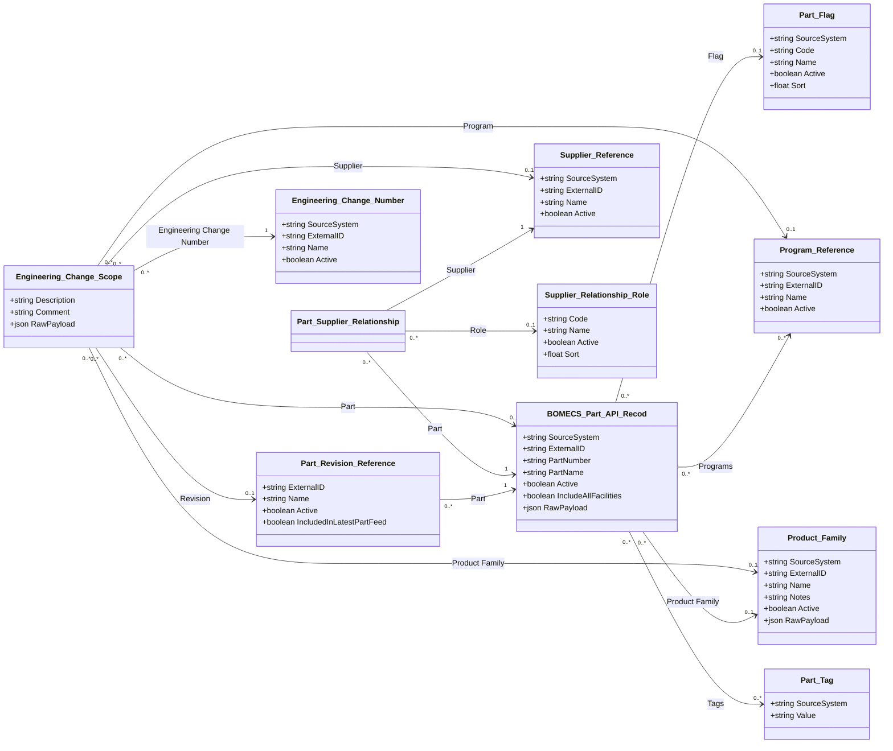

# Product Integration object model

Status: Proposed logical design  
Date: 2026-11-17\
Application: Product Integration\
Tab: Product Integration\
Authority: [Technical specification](product-management-api-technical-specification.md)  
Companion: [API data dictionary](part-api-data-dictionary.md)

## 1 Component scope

The standalone Product Integration application owns eleven new integration objects for the supplied Part, Product Family, and Engineering Change Numbers payloads. All business relationships stay within this component. The object name **BOMECS Part API Recod** retains the exact user-requested spelling.

Program Reference, Supplier Reference, Product Family, Part Flag, and Supplier Relationship Role are new component-local definitions. No existing application object, catalogue, inheritance base, master record, workflow, or operational process is connected. Native identity, security, audit, localization, and relationship storage remain platform services.

The current target supersedes the earlier reuse/promotion suggestions. The existing package baseline remains unchanged. The technical specification is the sole field-configuration authority; this overview summarizes its structure.

Configure exactly one tab named **Product Integration**, with a separate direct inventory menu item for every object below. Use the displayed object name for its menu item. There is no Reference Data submenu or second tab; the complete menu-to-inventory mapping is in technical specification section 3.

## 2 Object inventory

All entries are Proposed; native internal names and metadata IDs are allocated during configuration.

| Object | Responsibility | Identity / uniqueness | Inheritance parent | Declared field / grid rows |
|---|---|---|---|---:|
| BOMECS Part API Recod | Source Part attributes, associations, and complete received document | Source System + External ID | None | 20 |
| Program Reference | Reusable local source program descriptor | Source System + External ID | None | 4 |
| Supplier Reference | Reusable local source supplier descriptor | Source System + External ID | None | 4 |
| Part Revision Reference | Retained part-scoped revision identity, activity, and latest-feed membership | Part + External ID | None | 5 |
| Product Family | Local family master, Notes, and inverse part membership | Native identity; Source System + External ID unique when non-null | None | 7 |
| Part Flag | Source-controlled local catalogue; text Code preserves Flag.id | Source System + Code | None | 5 |
| Part Tag | Reusable exact source tag value | Source System + Value | None | 2 |
| Part Supplier Relationship | Source part/supplier membership with one optional local Role | Part + Supplier | None | 3 |
| Supplier Relationship Role | Component-owned governed role catalogue | Code | None | 4 |
| Engineering Change Number | Source number identity and activity with scope navigation | Source System + External ID | None | 5 |
| Engineering Change Scope | Attributed engineering-change context and source-row evidence | Number + Supplier + Part + Revision + Family + Program, with null equality | None | 9 |

## 3 Proposed logical diagram

All multiplicities are proposed target rules; exact inverse configuration and conditional behavior appear in the technical specification. Native M:N maps implement Programs and Tags without extra user-managed business objects.

Mermaid identifiers replace spaces with underscores. Active means Active?; IncludedInLatestPartFeed means Included in Latest Part Feed?. There are no inheritance edges or existing-object relationship targets.

## 4 Important relationship rules

- Product Family.Part Numbers is the inverse of BOMECS Part API Recod.Product Family. It is one stored optional family reference per part, with many parts per family. The standalone selected-ID array is an assignment command over that relationship.
- Part Supplier Relationship owns one optional Role from the new local Supplier Relationship Role catalogue. Source supplier membership never implies Manufacturing.
- Part Revision Reference remains attached to its Part when omitted from the latest identified array. Included in Latest Part Feed? distinguishes current source membership from retained records and source Active?. Engineering Change Scope may continue referencing a retained revision.
- Engineering Change Number identifies a source number; Engineering Change Scope preserves a context tuple and its Description/Comment. Null Part/Revision values are valid; a populated Revision requires its matching Part.
- ECN page metadata remains native integration evidence. Empty or partial pages do not remove previously received scopes.

## 5 Assumptions and implementation references

Source namespaces, family selected-ID semantics, family request identity, ECN scope identity and text ownership, non-null change Part/Revision shapes, and native persistence/storage behavior remain the explicit decisions in [technical specification section 10](product-management-api-technical-specification.md#10-validation-findings-and-remaining-configuration-decisions). None introduces an existing-object connection.

The current model has 68 canonical field/grid rows, including four inverse grids. The technical specification defines all requirements, fields, receive operations, application views, permissions, acceptance scenarios, change impact, and validation results.
