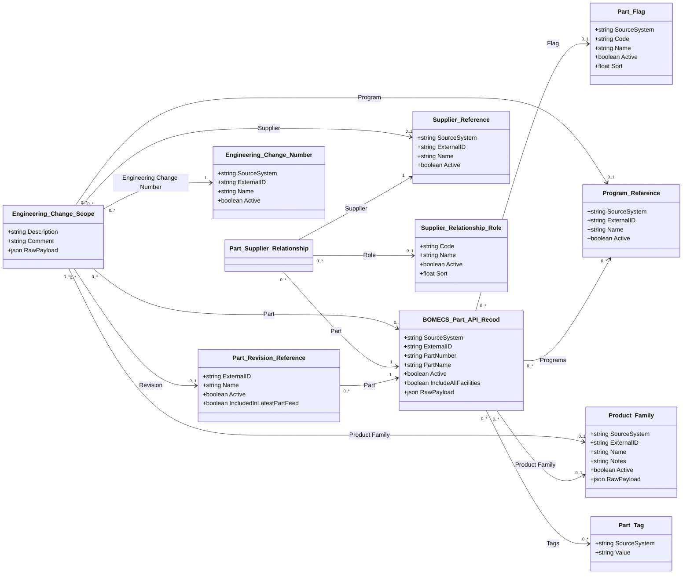

# Product Integration technical specification

Status: Proposed logical configuration design  
Date: 2026-11-17\
Application: Product Integration\
Tab: Product Integration\
Companions: [Object model](part-api-object-model.md) and [API data dictionary](part-api-data-dictionary.md)

## 1 Purpose and application boundary

Create a standalone application named **Product Integration** to receive Part, Product Family, and Engineering Change Numbers data. This application owns all eleven integration objects and their internal relationships. Configure exactly one application tab, also named **Product Integration**, with a separate direct menu item for each object inventory. Preserve the exact user-specified object name **BOMECS Part API Recod**.

All configured business relationships terminate at objects defined in this specification. Program Reference, Supplier Reference, Product Family, and Supplier Relationship Role are component-local objects. There are no relationships, inheritance links, lookups, automatic matching, synchronization, or writebacks to existing Product Management, Supplier Management, PPAP, Drawing, ECS, Location, or other application business objects. Product Integration is a new application, separate from existing Product Management and other applications. Its single tab exposes only the eleven local object inventories; it does not connect their records to existing business records.

Use native identity, security, audit, localization, relationship maps, and integration execution evidence as platform services. Those services do not introduce a modeled business connection to an existing application object. No business workflow, publishing/version framework, Event Service, reminder, or notification process is required for this component.

This is a target technical specification based on the three supplied payloads and the agreed logical model. No tenant configuration or physical database schema is asserted. Object metadata IDs, internal identifiers, storage capabilities, transactional execution, and API endpoint configuration must be verified during configuration. The existing `.ipack` baseline and existing application objects remain unchanged.

**Specification authority:** section 5 owns the field-level implementation contract. The data dictionary owns the external property-to-field mapping and links to these field sections. The object-model document is a structural overview. This avoids competing field definitions.

## 2 Evidence and requirements

### 2.1 Evidence classification

| Evidence | Classification | Use |
|---|---|---|
| [Part example](part-api-payload.example.json) | Directly supplied definition | 24 properties, source descriptors, identified revisions, nullable values, and empty arrays |
| [Product Family example](product-family-api-payload.example.json) | Directly supplied definition | Name, Notes, and selected part IDs; no family ID or activity in this body |
| [Engineering Change Numbers example](engineering-change-numbers-api-payload.example.json) | Directly supplied definition | Three response-envelope properties, eight row properties, and exact descriptor casing |
| User naming instruction | Required target decision | BOMECS Part API Recod is the exact display name, including its spelling |
| User application and isolation instruction | Required target decision | Own all eleven objects in the new Product Integration application, with one tab and eleven direct inventory menu items; no connections to existing business objects |
| Object structures, field sizes, defaults, keys, and lifecycle rules below | Proposed | Configuration choices needed to receive and maintain the supplied data |
| Family member-ID namespace, non-null change Part/Revision DTOs, scope identity, and source ordering | Unresolved | Retain source evidence and use the restrictions in sections 6 and 10 until the producer contract resolves them |

No new package extraction is needed to define this isolated target. Earlier repository baseline findings are background evidence only; they do not supply inherited fields, mandatory Location/Category/Owner relationships, or connection targets for these new objects.

### 2.2 Requirements interpretation

| Requirement | Current interpretation |
|---|---|
| API-01 | Receive all 24 Part properties, retaining unconfirmed structures in Raw Payload |
| API-02 | Support multiple programs, suppliers, identified revisions, tags, and family members through internal relationships |
| API-03 | Match source identities and retry deterministically; distinguish number identity from change-scope identity |
| API-04 | Distinguish omitted properties, explicit null, empty arrays, and unconfirmed wire shapes |
| API-05 | Reconcile revision labels and identified revision objects without duplicating revisions |
| API-06, refined | Preserve the supplied business meaning within the isolated component; canonical promotion and existing-object mapping are outside this scope |
| API-07 | Receive standalone Product Family Name, Notes, and selected part IDs |
| API-08 | Maintain one stored optional family reference per part and one family-side inverse grid |
| API-09 | Support family create/update bodies without inventing an ID or status property |
| API-10 | Receive the Engineering Change Numbers envelope, row fields, and case-sensitive descriptors |
| API-11 | Preserve multiple contexts for one change number without overwriting another scope |
| API-12 | Accept null change Part/Revision and avoid inferred parts, supplier roles, or release status |
| API-13 | Process pages with response retention and retry rules; never delete by page omission |
| PMAPI-14 | Preserve BOMECS Part API Recod consistently across the complete implementation contract |
| PMAPI-15 | House all eleven objects, forms, views, catalogues, and internal associations in Product Integration; expose each object inventory as a separate menu item on its only tab |
| PMAPI-16 | Configure no connection or inheritance to pre-existing application business objects |
| PMAPI-17 | Give every directly declared field and inverse grid one canonical implementation row |
| PMAPI-18 | Preserve revision records referenced by Engineering Change Scope when current Part-feed membership changes |

### 2.3 Superseded assumptions

The 2026-11-17 application and navigation direction supersedes the earlier Product Management / API Data ownership and primary-list/Reference Data navigation. The target is now the standalone Product Integration application with one tab and eleven direct inventory menu items. This is a target-design revision, not a tenant move or data migration.

PMAPI-15 and PMAPI-16 supersede earlier suggestions to reuse existing application masters, reuse an existing supplier-role catalogue, map native Item required fields, or promote intake records into canonical objects as part of this build. The internal object relationships remain in scope. Earlier ADR references do not create dependencies or workflow triggers for this component.

PMAPI-18 refines API-05: removing a revision from the latest incoming collection must not delete a record used by Engineering Change Scope. The proposed Included in Latest Part Feed? field records current source membership independently of source Active?. It is not a current-engineering-revision selector.

## 3 Application structure and object inventory

Create the **Product Integration** application before creating its objects. Add exactly one tab named **Product Integration**. On that tab, add the eleven direct inventory menu items below, one per object, using the displayed object names. Do not create a second tab or a Reference Data submenu. Every inventory targets its own new object in Product Integration.

| Menu item | Object inventory |
|---|---|
| BOMECS Part API Recod | BOMECS Part API Recod |
| Program Reference | Program Reference |
| Supplier Reference | Supplier Reference |
| Part Revision Reference | Part Revision Reference |
| Product Family | Product Family |
| Part Flag | Part Flag |
| Part Tag | Part Tag |
| Part Supplier Relationship | Part Supplier Relationship |
| Supplier Relationship Role | Supplier Relationship Role |
| Engineering Change Number | Engineering Change Number |
| Engineering Change Scope | Engineering Change Scope |

 Native configuration metadata must allocate collision-free internal names during the build; no existing object may be selected merely because its display name matches one below.

All inventory entries are proposed new component-local objects. Native record identity and audit fields are platform-managed. No custom identity or audit fields are added to duplicate them. Every object has no proposed explicit business inheritance; any unavoidable platform infrastructure metadata must be verified without introducing an existing domain-object dependency.

| Object | Responsibility | Identity / uniqueness | Inheritance parent | Declared field / grid rows |
|---|---|---|---|---:|
| BOMECS Part API Recod | Source Part attributes, associations, and complete received document | Source System + External ID | None | 20 |
| Program Reference | Reusable local source program descriptor | Source System + External ID | None | 4 |
| Supplier Reference | Reusable local source supplier descriptor | Source System + External ID | None | 4 |
| Part Revision Reference | Retained part-scoped revision identity, activity, and latest-feed membership | Part + External ID | None | 5 |
| Product Family | Local family master, Notes, and inverse part membership | Native identity; Source System + External ID unique when non-null | None | 7 |
| Part Flag | Source-controlled local catalogue; text Code preserves Flag.id | Source System + Code | None | 5 |
| Part Tag | Reusable exact source tag value | Source System + Value | None | 2 |
| Part Supplier Relationship | Source part/supplier membership with one optional local Role | Part + Supplier | None | 3 |
| Supplier Relationship Role | Component-owned governed role catalogue | Code | None | 4 |
| Engineering Change Number | Source number identity and activity with scope navigation | Source System + External ID | None | 5 |
| Engineering Change Scope | Attributed engineering-change context and source-row evidence | Number + Supplier + Part + Revision + Family + Program, with null equality | None | 9 |

Programs and Tags use native M:N relationship storage between new component objects. Their map metadata is not an additional user-managed business object. Part Supplier Relationship is explicit because the association owns Role. Engineering Change Scope is explicit because the context association owns Description, Comment, and row evidence.

The diagrams show no external relationship target. Source System and External ID are scalar source keys, not foreign keys to an existing integration, supplier, part, or program object.

## 4 Complete proposed logical model

Multiplicities are proposed target rules. Field rows in section 5 are authoritative, including inverse configuration and conditional requiredness. Mermaid identifiers replace spaces with underscores; Active corresponds to Active?, and IncludedInLatestPartFeed corresponds to Included in Latest Part Feed?. There are no inheritance edges.

## 5 Canonical field implementation contract

`Y` means required in the persisted normalized record; `N` means optional; `Conditional` means the row identifies when a value is required. This does not mean every property is required in a partial-update body. `None` means no default exists; `NULL` means intentionally initialized without a value. Text lengths and decimal precision are proposed. Do not truncate, normalize identifier spelling, strip source spaces, or silently round costs.

**Importer** means the dedicated authorized receive service executing operations PMAPI-PART, PMAPI-FAMILY, and PMAPI-ECN from section 6. It populates source fields through configured native persistence APIs; no executable Intelex expressions or fictitious endpoint names are specified. Human access is for Administrators and Part Integration - Admin Security Group. These groups maintain the expressly editable local catalogue fields and supplier Role. Importer-owned source controls, immutable keys, and inverse lists retain their data behavior; they do not define additional access audiences or reduce the groups' object Rights.

All internal references must remain in the declaring record's Source System, except Supplier Relationship Role, which is a component-local governed catalogue without a source namespace. Source-owned relationships have no direct human selector; their links are maintained by the receive operation as data behavior. Inactive source references may be imported to preserve the received facts. Active?=FALSE prevents new manual assignments within this component where a selector is authorized; existing references remain valid. There is no downstream application behavior.

**Raw JSON storage:** retain the complete parsed JSON document or row in native Unicode long-text/document storage, with a proposed maximum of 1 MiB UTF-8 per retained document. Native capacity and the exact binding must be verified before build completion. Do not claim that a native JSON scalar type exists. If a supported text field cannot retain the complete allowed content, select native document storage for the same logical field and verify field-level access. The full ECN response envelope is native integration evidence; it is not another business object. Reject overflow before mutation and retain failure evidence through the receive service.

No custom Date/Time fields are proposed. Native audit and execution timestamps must preserve server instants and display through supported user time zones. No publication copies or version fields apply; the stored records are source-aligned mutable data with native audit history. Human field access, including Raw Payload, is for Administrators and Part Integration - Admin Security Group. Source-owned controls remain read only on receiving screens as data behavior; do not require a separate technical-reader membership or exclude either administration group from source evidence. Conditional requiredness does not hide a field unless its row explicitly says so.

### 5.1 BOMECS Part API Recod

Inheritance parent: None. Directly declared fields and inverse grids:

| Field | Type / relationship | Req | Default / calculation | Editability and visibility | Automation / lifecycle |
|---|---|---:|---|---|---|
| Source System | Text, max 100 | Y | Connector source namespace | Importer supplied; immutable after creation; human access for Administrators and Part Integration - Admin Security Group | Immutable; unique with External ID |
| External ID | Text, max 100 | Y | None | Importer from `$.id`; immutable after creation; human access for Administrators and Part Integration - Admin Security Group | Immutable; source-scoped upsert key |
| Part Number | Text, max 100 | Y | None | Importer from `$.partNumber`; read-only source control; human access for Administrators and Part Integration - Admin Security Group | Nonblank; not assumed globally unique; changed value does not create a new source identity |
| Part Name | Text, max 255 | N | NULL | Importer from `$.partName`; read-only source control; human access for Administrators and Part Integration - Admin Security Group | Preserve source spaces; explicit null clears |
| Future Part Name | Text, max 255; provisional type | N | NULL | Importer from `$.futurePartName`; read-only source control; human access for Administrators and Part Integration - Admin Security Group | Explicit null clears; confirm non-null contract |
| LS Part Number | Text, max 100; provisional type | N | NULL | Importer from `$.lsPartNumber`; read-only source control; human access for Administrators and Part Integration - Admin Security Group | Explicit null clears; no inferred relationship to another part |
| LE Part Number | Text, max 100; provisional type | N | NULL | Importer from `$.lePartNumber`; read-only source control; human access for Administrators and Part Integration - Admin Security Group | Explicit null clears; no inferred relationship to another part |
| Unit Cost | Decimal, precision 19, scale 6; provisional type | N | NULL | Importer from `$.unitCost`; read-only source control; human access for Administrators and Part Integration - Admin Security Group | Exact numeric conversion only; confirm currency, unit basis, precision, and negative-value policy before business use |
| Drawing Number | Text, max 100 | N | NULL | Importer from `$.drawingNumber`; read-only source control; human access for Administrators and Part Integration - Admin Security Group | No automatic Drawing object lookup by name |
| Active? | Yes/No | Y | None | Importer from `$.status`; read-only source control; human access for Administrators and Part Integration - Admin Security Group | False excludes the part from new manual component assignments; retain its data and existing links; no external application effect |
| Name | Text, max 512; configured display field | Y | Import `$.name`; on creation only, use Part Number if name is absent or null | Importer populated; read-only source control; human access for Administrators and Part Integration - Admin Security Group | Stored label, not a formula or match key; explicit null on update rejected |
| Programs | M:N to Program Reference; inverse disabled | N | Empty collection on creation | Importer from `$.programs`; inactive source references allowed for fidelity; human access for Administrators and Part Integration - Admin Security Group | Replace source-owned links when property is present; empty array clears; no program deletion |
| Flag | M:1 to Part Flag, 0..1 per part; inverse disabled | N | NULL | Importer from `$.Flag`; no manual selector; inactive source values accepted; human access for Administrators and Part Integration - Admin Security Group | Resolve Source System + Code; explicit null clears; never parse resource key into identity |
| Supplier Relationships | Inverse 1:M grid from Part Supplier Relationship.Part | N | None | Read only; displays importer-maintained associations; human access for Administrators and Part Integration - Admin Security Group | Navigation only; no duplicate stored relationship |
| Revisions | Inverse 1:M grid from Part Revision Reference.Part | N | None | Read only; default filter Included in Latest Part Feed?=TRUE; Administrators and Part Integration - Admin Security Group may view retained rows | Navigation only; no duplicate stored relationship; array replacement updates feed membership flags, preserving records and ECN references |
| Tags | M:N to Part Tag; inverse disabled | N | Empty collection on creation | Importer from `$.tags`; read-only source control; human access for Administrators and Part Integration - Admin Security Group | Resolve source + exact Value; replace source-owned links on present array |
| Notes | Plain Unicode long text, proposed max 65,536 characters; provisional format | N | NULL | Importer from `$.notes`; read-only source control; human access for Administrators and Part Integration - Admin Security Group | Explicit null clears; treat as text and escape when displayed |
| Product Family | M:1 to Product Family, 0..1 per part; inverse Part Numbers | N | NULL | Importer from `$.productFamily`, or family assignment command from `selectedPartNumbersIds`; read-only source control; inactive source references allowed; human access for Administrators and Part Integration - Admin Security Group | Explicit null clears; enforce same-source scope; inverse updates automatically; no independent M:N storage; same name as Drawing Number does not merge identities |
| Include All Facilities? | Yes/No | Y | None | Importer from `$.includeAllFacilities`; read-only source control; human access for Administrators and Part Integration - Admin Security Group | Preserve supplied true/false; no permission grants or invented facility associations |
| Raw Payload | Raw JSON storage as defined in section 5 | Y | Complete validated request document | Importer supplied; restricted to Administrators and Part Integration - Admin Security Group | Updated on each accepted receive; preserve all unknown properties and string contents; native retention preserves prior messages |

There are no separate projected fields for Part Classification, singular Program, Customers, Measures, or Facilities in this draft. Their typed definitions require non-null or non-empty evidence; Raw Payload is their current storage contract.

### 5.2 Program Reference

Inheritance parent: None. Directly declared fields:

| Field | Type / relationship | Req | Default / calculation | Editability and visibility | Automation / lifecycle |
|---|---|---:|---|---|---|
| Source System | Text, max 100 | Y | Connector namespace; must match receiving Part or Engineering Change Number.Source System | Importer supplied; immutable; human access for Administrators and Part Integration - Admin Security Group | Unique with External ID; sharing across feeds requires the same verified namespace |
| External ID | Text, max 100 | Y | None | Importer from Part `programs[*].id` or change row `program.Id`; immutable; human access for Administrators and Part Integration - Admin Security Group | Upsert by source + ID; exact path casing per feed |
| Name | Text, max 255 | Y | None | Importer from Part `programs[*].name` or change row `program.Name`; read-only source control; human access for Administrators and Part Integration - Admin Security Group | Descriptor only; renamed program retains identity |
| Active? | Yes/No | Y | None | Importer from Part `programs[*].status` or change row `program.Status`; read-only source control; human access for Administrators and Part Integration - Admin Security Group | Preserve inactive references; no cascade to parts or changes |

Sample record: external ID `e383a96a-4b62-41d1-8c70-af250144eb20`, Name `DA9`, Active? true. This is an imported example, not configuration seed data.

### 5.3 Supplier Reference

Inheritance parent: None. Directly declared fields:

| Field | Type / relationship | Req | Default / calculation | Editability and visibility | Automation / lifecycle |
|---|---|---:|---|---|---|
| Source System | Text, max 100 | Y | Connector namespace; must match receiving Part or Engineering Change Number.Source System | Importer supplied; immutable; human access for Administrators and Part Integration - Admin Security Group | Unique with External ID; sharing across feeds requires the same verified namespace |
| External ID | Text, max 100 | Y | None | Importer from Part `suppliers[*].id` or change row `supplier.id`; immutable; human access for Administrators and Part Integration - Admin Security Group | Source key; not assumed to be an Intelex supplier ID |
| Name | Text, max 255 | Y | None | Importer from Part `suppliers[*].name` or change row `supplier.name`; read-only source control; human access for Administrators and Part Integration - Admin Security Group | Local descriptor only; no matching, relationship, or writeback to an existing supplier master |
| Active? | Yes/No | Y | None | Importer from Part `suppliers[*].status` or change row `supplier.status`; read-only source control; human access for Administrators and Part Integration - Admin Security Group | Preserve source status within this component; no existing supplier eligibility is read or changed |

Sample record: external ID `d61a1d08-3295-4f7b-8b98-b01300df14bd`, Name `Heartland Automotive, LLC`, Active? true. This is a local source descriptor; it is not a link to an existing supplier company or facility.

### 5.4 Part Revision Reference

Inheritance parent: None. Directly declared fields:

| Field | Type / relationship | Req | Default / calculation | Editability and visibility | Automation / lifecycle |
|---|---|---:|---|---|---|
| Part | M:1 to BOMECS Part API Recod, exactly 1; inverse Revisions | Y | Receiving BOMECS Part API Recod | Importer assigned; immutable; target must belong to the current source; human access for Administrators and Part Integration - Admin Security Group | No orphan revision records; source namespace follows Part |
| External ID | Text, max 100 | Y | None | Importer from `partNumberRevLevels[*].id`; immutable; human access for Administrators and Part Integration - Admin Security Group | Unique with Part; do not manufacture an ID from a string label |
| Name | Text, max 255 | Y | None | Importer from `partNumberRevLevels[*].name`; read-only source control; human access for Administrators and Part Integration - Admin Security Group | Compare exactly with `revLevels` labels when both arrays are supplied |
| Active? | Yes/No | Y | None | Importer from `partNumberRevLevels[*].status`; read-only source control; human access for Administrators and Part Integration - Admin Security Group | Not a current-revision indicator; retain historical references |
| Included in Latest Part Feed? | Yes/No | Y | TRUE when first received in the identified revision array | Importer maintained; visible read only to Administrators and Part Integration - Admin Security Group | For a present `partNumberRevLevels` array set TRUE for listed IDs and FALSE for retained IDs omitted from it; array omission preserves; reappearance reuses identity; never changes source Active? or deletes scope references |

Sample record: external ID `f2a19293-7d51-48c8-8e9e-b4ca0085337d`, Name `P2460-0.0`, Active? true, Included in Latest Part Feed? true. A present array omitting this ID sets its inclusion flag FALSE while preserving the record, its Part reference, and every Engineering Change Scope.Revision reference. This membership flag is separate from source activity and does not designate a current engineering revision.

### 5.5 Product Family

Inheritance parent: None. This business master receives nested Part/engineering-change descriptors and the standalone family body. Native record identity is generated by persistence; it is not an extra custom source-ID field. Directly declared fields and inverse grid:

| Field | Type / relationship | Req | Default / calculation | Editability and visibility | Automation / lifecycle |
|---|---|---:|---|---|---|
| Source System | Text, max 100 | Y | Connector namespace; equals receiving Part or Engineering Change Number.Source System for nested descriptors | Importer supplied; immutable; human access for Administrators and Part Integration - Admin Security Group | External ID uniqueness is scoped to this source when populated |
| External ID | Text, max 100 | Conditional | NULL for standalone creation without source identity; None for a nested descriptor requiring `productFamily.id` | Importer maps nested Part/change ID or verified request/response context; may populate a null value once, then immutable; human access for Administrators and Part Integration - Admin Security Group | Required for nested descriptor resolution; optional for standalone create/update by native ID; retain any assigned ID on standalone updates; unique with Source System when non-null; never derive from Name |
| Name | Text, max 255 | Y | None | Importer from standalone `$.name`, Part `$.productFamily.name`, or change row `productFamily.name`; read-only source control; human access for Administrators and Part Integration - Admin Security Group | Nonblank; required on create; omission preserves on update; null rejected; renaming retains identity |
| Notes | Plain Unicode long text, proposed max 65,536 characters; provisional format | N | NULL | Importer from standalone `$.notes`; read-only source control; human access for Administrators and Part Integration - Admin Security Group | Explicit null clears; omission preserves; neither nested descriptor clears Notes; escape when displayed |
| Active? | Yes/No | Y | Proposed TRUE only on standalone create; otherwise Part/change descriptor `productFamily.status` or existing value | Importer supplied; read-only source control; human access for Administrators and Part Integration - Admin Security Group | Standalone update preserves activity; nested descriptor requires explicit Boolean status; false retains membership/history and prevents new manual operational use; no cascade |
| Part Numbers | Inverse 1:M grid from BOMECS Part API Recod.Product Family; each part has 0..1 family | N | Empty membership on standalone create | Read-only navigation; importer processes `selectedPartNumbersIds` by updating the declaring Part field; human access for Administrators and Part Integration - Admin Security Group | No duplicate stored relationship; present array replaces this family's source-owned links; `[]` clears links, omission preserves; null invalid; prevalidate all IDs and family conflicts |
| Raw Payload | Raw JSON storage as defined in section 5 | Conditional | NULL if first created only from a nested descriptor | Importer from complete standalone family body; restricted to Administrators and Part Integration - Admin Security Group | Required when receiving a standalone family request; latest accepted standalone body retained; descriptors do not overwrite it and remain in Part.Raw Payload or Engineering Change Scope.Raw Payload |

The Part sample resolves a family with External ID `0cd34a52-452e-4a2a-81fd-b0130113de3b`, Name `94203SL00A`, and Active? true. The standalone sample instead supplies Name `85132SL550`, Notes null, and no selected parts. It does not establish the same family identity.

Selected IDs provisionally refer to BOMECS Part API Recod.External ID in the same Source System, not Part Number labels or generated target IDs. A non-empty example is needed to confirm this mapping. Resolve every selected ID before mutation. Reject missing or cross-source parts and assignments to parts currently linked to another family; no part records are created from an ID list. A present empty array on an identified update clears only that family's memberships, leaving the part records intact.

Standalone creates require transport/integration idempotency context for safe retries. Standalone updates require a native family ID or an already resolved source ID in request context; the body alone cannot identify an existing family. The same Name does not authorize an automatic merge. Native uniqueness and retention must support optional external IDs and creation-request mapping before implementation.

### 5.6 Part Flag

Inheritance parent: None. Directly declared fields:

| Field | Type / relationship | Req | Default / calculation | Editability and visibility | Automation / lifecycle |
|---|---|---:|---|---|---|
| Source System | Text, max 100 | Y | Receiving part's Source System | Importer supplied; immutable; human access for Administrators and Part Integration - Admin Security Group | Unique with Code |
| Code | Text, max 100, stable and non-localizable | Y | None | Importer from `Flag.id`; immutable; human access for Administrators and Part Integration - Admin Security Group | Preserve `"2"` as text; not a UUID or Boolean |
| Name | Text, max 255; localizable catalogue display field | Y | None | Importer supplies exact source label from `Flag.name`; approved translations managed by Administrators and Part Integration - Admin Security Group | Retain resource key in the source locale; do not infer a translated label |
| Active? | Yes/No | Y | None | Importer from `Flag.status`; read-only source control; human access for Administrators and Part Integration - Admin Security Group | Inactive values retained; exclude from future manual selections |
| Sort | Float | N | NULL | Administrators and Part Integration - Admin Security Group editable; not supplied by API | Presentation only; never participates in source identity |

Sample imported Code is `2`; Name is `[ISOQuest].[PartNumber].Flag.Buy`; Active? is true. The text suggests a Buy flag, but the full source catalogue and approved display labels require confirmation. No manually seeded flag record is required to import this source-supplied value.

### 5.7 Part Tag

Inheritance parent: None. Directly declared fields:

| Field | Type / relationship | Req | Default / calculation | Editability and visibility | Automation / lifecycle |
|---|---|---:|---|---|---|
| Source System | Text, max 100 | Y | Receiving part's Source System | Importer supplied; immutable; human access for Administrators and Part Integration - Admin Security Group | Unique with Value |
| Value | Text, max 100 | Y | None | Importer from `tags[*]`; immutable; human access for Administrators and Part Integration - Admin Security Group | Preserve exact text; deduplicate identical values; reject null/blank elements |

Sample Value: `942C`. A changed tag value is a different tag; replacing a part's tag links does not delete shared values. No source ID or status is invented.

### 5.8 Part Supplier Relationship

Inheritance parent: None. Directly declared fields:

| Field | Type / relationship | Req | Default / calculation | Editability and visibility | Automation / lifecycle |
|---|---|---:|---|---|---|
| Part | M:1 to BOMECS Part API Recod, exactly 1; inverse Supplier Relationships | Y | Receiving BOMECS Part API Recod | Importer assigned; immutable; human access for Administrators and Part Integration - Admin Security Group | Association scoped to one source part |
| Supplier | M:1 to Supplier Reference, exactly 1; inverse disabled | Y | None | Importer resolves `suppliers[*].id`; immutable; Source System must match Part; human access for Administrators and Part Integration - Admin Security Group | Validate source scope; no association by name |
| Role | M:1 to Supplier Relationship Role, 0..1; inverse disabled | N | NULL | Administrators and Part Integration - Admin Security Group may assign; new selection filter Active?=TRUE; existing inactive role retained read only | API array does not supply a role; never default Manufacturing; assignment updates existing association after uniqueness check |

The receiving operation locates the one source membership by Part + Supplier before considering Role, so replaying a supplier array cannot create a second unassigned link after Role has been mapped. This component supports one optional local role assignment per source membership. Removing source membership removes only this local association and is audited; Supplier Reference remains. No canonical supplier or other existing object is linked.

### 5.9 Supplier Relationship Role

Inheritance parent: None. Create this governed catalogue within Product Integration. It has no inheritance or relationship to an existing role catalogue. Directly declared fields:

| Field | Type / relationship | Req | Default / calculation | Editability and visibility | Automation / lifecycle |
|---|---|---:|---|---|---|
| Code | Text, max 100, stable and non-localizable | Y | None | Administrators and Part Integration - Admin Security Group sets; immutable after first use | Unique; automation compares Code |
| Name | Text, max 255; localizable | Y | None | Administrators and Part Integration - Admin Security Group editable | Display label only |
| Active? | Yes/No | Y | TRUE | Administrators and Part Integration - Admin Security Group editable | False prevents new assignments; existing references remain valid |
| Sort | Float | N | NULL | Administrators and Part Integration - Admin Security Group editable | Presentation ordering only |

Initial values:

| Code | Name | Active? | Sort |
|---|---|---|---:|
| `MANUFACTURING` | Manufacturing | TRUE | 10 |
| `ASSEMBLY` | Assembly | TRUE | 20 |
| `SEQUENCING` | Sequencing | TRUE | 30 |

These proposed local seed values retain the previously drafted role vocabulary. They are not received in the payload and must not be mapped to an existing catalogue in this build. No default role is assigned to the sample supplier.

### 5.10 Engineering Change Number

Inheritance parent: None. This source-aligned business identity represents the number supplied by the API; it is not automatically a released ECS or a workflow record. Directly declared fields and inverse grid:

| Field | Type / relationship | Req | Default / calculation | Editability and visibility | Automation / lifecycle |
|---|---|---:|---|---|---|
| Source System | Text, max 100 | Y | Connector source namespace | Importer supplied; immutable; human access for Administrators and Part Integration - Admin Security Group | Unique with External ID; namespace must be verified before shared-reference reuse |
| External ID | Text, max 100 | Y | None | Importer from `data[*].engineeringChangeNumber.id`; immutable; human access for Administrators and Part Integration - Admin Security Group | Source-scoped number identity; does not identify the complete context row |
| Name | Text, max 255 | Y | None | Importer from `data[*].engineeringChangeNumber.name`; read-only source control; human access for Administrators and Part Integration - Admin Security Group | Nonblank label; retain punctuation; do not parse segments into revision, drawing, program, or chronological order |
| Active? | Yes/No | Y | None | Importer from `data[*].engineeringChangeNumber.status`; read-only source control; human access for Administrators and Part Integration - Admin Security Group | False prevents new manual operational selection; retains scopes/history; no release, approval, or workflow effect |
| Scopes | Inverse 1:M grid from Engineering Change Scope.Engineering Change Number | N | None | Read-only navigation for Administrators and Part Integration - Admin Security Group | Navigation only; no duplicate stored relationship; importer maintains context rows |

Sample: External ID `e98e2611-c94a-4b45-8b4f-b4d40083e905`, Name `CH2-S1397-1.0-26118SL01B`, Active? true. Multiple contexts may reference this one number under the proposed model.

### 5.11 Engineering Change Scope

Inheritance parent: None. One context row from `data` is a proposed scope association with its own text and source evidence. Directly declared fields:

| Field | Type / relationship | Req | Default / calculation | Editability and visibility | Automation / lifecycle |
|---|---|---:|---|---|---|
| Engineering Change Number | M:1 to Engineering Change Number, exactly 1; inverse Scopes | Y | None | Importer resolves source + `engineeringChangeNumber.id`; read-only source control; inactive source numbers importable; human access for Administrators and Part Integration - Admin Security Group | Required scope anchor and source namespace; key component; changing the key needs source correction mapping |
| Supplier | M:1 to Supplier Reference, 0..1 per scope; inverse disabled | N | NULL | Importer from row `supplier`; read-only source control; inactive source references importable; human access for Administrators and Part Integration - Admin Security Group | Require same source; no Part Supplier Relationship or role is generated; key component |
| Part | M:1 to BOMECS Part API Recod, 0..1 per scope; inverse disabled | Conditional | NULL | Importer from row `partNumber` after non-null wire mapping is confirmed; read-only source control; human access for Administrators and Part Integration - Admin Security Group | Null allowed when Revision is null; required when Revision is populated; retain Part when Revision becomes null unless Part is explicitly cleared; require same source; never infer from family members or Name; key component |
| Revision | M:1 to Part Revision Reference, 0..1 per scope; inverse disabled | N | NULL | Importer from row `partNumberRevLevel` after non-null wire mapping is confirmed; read-only source control; human access for Administrators and Part Integration - Admin Security Group | When populated require Part and enforce Revision.Part=Part; retained revisions with Included in Latest Part Feed?=FALSE remain valid targets; null does not choose a current revision; key component |
| Product Family | M:1 to Product Family, 0..1 per scope; inverse disabled | N | NULL | Importer resolves row `productFamily.id`; read-only source control; inactive source references importable; human access for Administrators and Part Integration - Admin Security Group | Require same source; context only, no family-membership mutation; key component |
| Program | M:1 to Program Reference, 0..1 per scope; inverse disabled | N | NULL | Importer resolves row `program.Id`; read-only source control; inactive source references importable; human access for Administrators and Part Integration - Admin Security Group | Exact capitalized descriptor keys; require same source; does not mutate Part.Programs; key component |
| Description | Plain Unicode long text, proposed max 65,536 characters | N | NULL | Importer from row `description`; read-only source control; human access for Administrators and Part Integration - Admin Security Group | Store exact wording, spacing, and punctuation per scope; explicit null clears; omission preserves on an identified update; escape when displayed |
| Comment | Plain Unicode long text, proposed max 65,536 characters; provisional non-null format | N | NULL | Importer from row `comment`; read-only source control; human access for Administrators and Part Integration - Admin Security Group | Explicit null clears; omission preserves on an identified update; retain as scope-level text pending ownership confirmation; escape when displayed |
| Raw Payload | Raw JSON storage as defined in section 5 | Y | Complete validated `data[*]` row | Importer supplied; restricted to Administrators and Part Integration - Admin Security Group | Latest accepted row retained, including original property casing and nulls; full envelope retained separately through native integration evidence |

Use the tuple `(Engineering Change Number, Supplier, Part, Revision, Product Family, Program)` as the proposed scope key, comparing null components equally. This draft requires all six context properties in a received row, allowing explicit null for nullable references; defer a row with an omitted context property until delta identity is agreed. Native uniqueness must enforce null equality; do not rely on database null uniqueness behavior without verification. Text is not part of the key, so a text correction updates the same scope. Changes to key components produce a different scope until authoritative correction/removal rules identify the old one. A stable source row ID should replace this provisional key if supplied by the producer.

The sample scope has supplier External ID `2b6b2310-add4-45d1-a457-b01300de4259`, family External ID `a85f9226-0dec-4069-9ddb-b4360083d852`, and program External ID `622556c7-f15a-4297-b8c1-af250144e37e`. Part, Revision, and Comment are null. Description is the supplied harness wire-size change text. No part or revision placeholder is created.

Only null wire values are currently confirmed for `partNumber` and `partNumberRevLevel`. A non-null unconfirmed shape is retained in native response evidence and that row's normalized projection is deferred until the mapping is agreed; do not silently discard context by storing a null link. Scope/number cardinality and whether Description/Comment belong to the scope or number remain producer-contract decisions.

## 6 Receive operations and synchronization

These are receive-service operations, not user workflow actions or invented Intelex API endpoints. They run when the connector submits the relevant payload or processes a retrieved response. No polling schedule is established by this specification.

### 6.1 Common receive rules

1. Authenticate the service, enforce the component object/field allowlist, and derive Source System from trusted connector configuration. Do not let the body select an arbitrary source namespace.
2. Parse strict JSON, rejecting duplicate keys and invalid syntax. The saved Part example removes only the original final trailing comma. Retain exact string values, nulls, Boolean types, and original key casing. Unknown properties remain in retained JSON.
3. Validate sizes, required persisted values, source identities, descriptor consistency, relationships, and conditional rules before any normalized mutation. On update, omitted scalar properties preserve the existing value; explicit null clears nullable values. Null for a required value is rejected, subject to the explicitly documented create-time Name fallback.
4. Resolve local records by their compound keys. A UUID-shaped source ID is not a native Intelex record ID. Never match by display Name or by similarity to an existing business master. Reuse is limited to records of these newly defined objects.
5. For an individual Part or Family operation, validate the entire change set and commit it together. For an ECN response, use one validated context row plus descriptor updates as the unit of work and retain per-row results. Use a verified native transactional batch where available. If that capability is unavailable, hold the operation in native integration staging until an execution design can provide consistent persistence; do not expose partial results or invent an unverified visibility mechanism. Transaction/rollback design is an implementation gate.
6. Serialize operations on their source identity, membership sets, and affected reference records. Recheck uniqueness under the same locking mechanism used for persistence. Use null-aware scope-key comparison. Failed writes leave the operation retryable, without duplicate business records or a custom error workflow.
7. Retain native execution diagnostics and audit identity, changed values, relationship changes, and receive outcome. A Raw Payload field represents the latest accepted message/row; it is not a reconstructed full source snapshot. Native retention must preserve earlier accepted evidence when source history is required.
8. No source version or modification timestamp is supplied. Do not claim stale-write detection or chronological engineering order. Confirm source delivery order and field authority before enabling competing producers. The three payloads may share local references only when their source namespaces are explicitly the same.

### 6.2 PMAPI-PART

On creation require nonblank source `id`, nonblank `partNumber`, Boolean `status`, and Boolean `includeAllFacilities`. Populate Name from the supplied `name`, or use Part Number only on creation when Name is absent/null. Incoming populated descriptors require string ID/Name and Boolean activity with the paths in the dictionary.

Process programs, suppliers, identified revisions, tags, Flag, and Product Family inside the validated operation. A present association array replaces that source part's corresponding membership; `[]` clears membership; null arrays are invalid; omission preserves on update and initializes empty on creation. Do not delete reusable Program, Supplier, Tag, Flag, or Family records because a link is removed.

For `partNumberRevLevels`, upsert each identified revision by Part + External ID, import its Name/Active?, and set Included in Latest Part Feed?=TRUE. Set the flag FALSE on previously retained revisions absent from the present array. An empty array sets all that part's retained revision membership flags FALSE. Do not delete revision records or clear Engineering Change Scope.Revision. If the identified array is omitted, leave revision membership unchanged. A reappearing ID reuses its existing record and becomes included again.

When `revLevels` is also present, its distinct strings must equal the distinct incoming revision Names with exact comparison. Reject duplicate identified IDs, ambiguous duplicate names, or conflicting sets before applying changes. A strings-only `revLevels` message does not manufacture IDs, replace revision membership, or designate a current revision; retain the strings in Raw Payload.

Upsert one Part Supplier Relationship per Part + Supplier. Incoming supplier membership does not supply Role. Retain an existing mapped Role for a retained association; a retry must not create an additional null-role association. Removing membership removes only this component-local association, with native audit. It never deletes Supplier Reference. An explicit Role assignment is a separate edit by Administrators or Part Integration - Admin Security Group, with the active-catalogue filter and audit specified in section 5.

Preserve `partClassification`, singular `program`, `customers`, `measures`, and `facilities` in Raw Payload until their non-null/non-empty contracts are supplied. LS/LE definitions, notes format, monetary precision/currency/unit basis, and future name semantics remain provisional. `includeAllFacilities` is source applicability data only; it grants no location access and creates no Facility relationship. Drawing Number remains text.

### 6.3 PMAPI-FAMILY

The standalone Name/Notes/selected-ID body is provisionally treated as a create/update command shape. On create, persistence allocates native identity; Source System comes from configuration; External ID may remain null until verified request/response context supplies it. Name is required. Active? defaults TRUE only for this creation path. On update, identify the existing local family by native record ID or Source System + populated External ID in trusted request context; do not locate it by Name. Omitted Name/Notes/activity preserves existing values, and explicit null Notes clears it.

Family-create retry safety requires a stable request idempotency key and a native retained request-to-created-record mapping. The same key/body resolves to the same created family; the same key with a different body is a conflict. The body alone cannot establish retry identity. A later nested descriptor may attach to a standalone family only through a verified mapping of its external ID; name equality is insufficient.

Provisionally interpret populated `selectedPartNumbersIds` as string External IDs of local BOMECS Part API Recod records in the same Source System. Resolve the complete set first; reject unknown IDs, cross-source records, and parts already assigned to another family unless an explicit reassignment mapping is provided. Do not create parts from the ID list. An identified Family update with a present array replaces only that family's membership by updating each Part.Product Family. Empty array clears links, omission preserves, and null is invalid. Part Numbers is navigation over those stored references; it is not a separately stored M:N collection.

The current design permits many parts per family and at most one family per part. A valid Part receive operation may change its own family reference, after which the inverse grid reflects that change. Store the standalone body in Product Family.Raw Payload. Part/ECN family descriptors update the identified Name/Active? only and do not overwrite family Notes, standalone Raw Payload, or membership of other parts.

### 6.4 PMAPI-ECN

Require response `data` as an array and proposed nonnegative 32-bit integers `recordsTotal` and `totalPages`. Keep the envelope in native integration retention. Page request parameters, count meaning, and source snapshot consistency remain producer-contract decisions. Counts are not business-object fields, and page omission is never a deletion instruction.

For each row, resolve Engineering Change Number by Source System + `engineeringChangeNumber.id`; import lowercase `name/status`. Resolve Supplier and Product Family using lowercase descriptor keys. Resolve Program using capitalized `Id/Name/Status`. Do not enable global case-insensitive property matching. Conflicting descriptors for the same source/entity ID within a receive unit fail validation rather than depend on iteration order.

Use the proposed scope tuple `(Engineering Change Number, Supplier, Part, Revision, Product Family, Program)`, comparing null components equally. Require all six context properties in the source row, allowing explicit null for nullable context. If context is omitted, defer projection until delta identity is known. Identical repeated rows can converge on the same scope; conflicting rows with the same tuple fail reconciliation. Description and Comment are stored per scope and are not key components.

The supplied Part/Revision wire values are null. A future non-null shape must be confirmed before projection; retain unresolved rows in native response evidence and defer their normalized mutation. Once mapping is agreed, Revision requires Part and must belong to it. Resolve against retained local revisions, including those no longer in the latest Part feed; neither Active? nor membership flag is a current-revision selector.

A scope's Supplier, Family, and Program do not modify Part supplier links, Role, Part.Product Family, or Part.Programs. Retain the change-number label as supplied; do not parse segments into a drawing revision, change level, program identity, or chronological sequence. Activity does not establish release, approval, ECS equivalence, PPAP need, or inspection work.

Rows absent from a page and empty `data` leave existing scopes unchanged. A changed scope-key tuple creates another scope until authoritative source correction/removal rules identify the old one. Confirm a stable row ID if separate occurrences can share the same tuple; the proposed tuple must not silently merge them. No business record is deleted because `recordsTotal` decreases or a poll returns no rows.

## 7 Forms, views, security, and audit

| Surface or principal | Configuration |
|---|---|
| Product Integration application / Product Integration tab | Exactly one tab with eleven separate direct inventory menu items, one for each object listed in section 3; no Reference Data submenu or grids on existing business-object forms |
| Part form | Identity and descriptive source fields; Programs, Tags, Flag, and Family; read-only supplier-association and revision grids |
| Revision grid | Revisions is the inverse of Part Revision Reference.Part; default filter Included in Latest Part Feed?=TRUE; Administrators and Part Integration - Admin Security Group can inspect retained rows without changing membership |
| Product Family form | Name, Notes, activity, identity, and read-only Part Numbers grid; assignments performed by the receive operation |
| Change Number form | Identity, Name, activity, and Scopes inverse grid |
| Change Scope form | Internal context relationships, Description, Comment; no existing master-object selector or navigation target |
| Integration service | Create/update only these component objects; remove Part Supplier Relationship records only for validated source-membership removal and unlink native M:N associations as specified; prohibit deletion of retained revisions and reference masters; restrict source-key mutation |

Human access throughout the application is for Administrators and Part Integration - Admin Security Group. This includes all inventories, forms, editable local catalogue fields, supplier Role editing, retained records, Raw Payload, source documents, and native receive evidence. Do not introduce separate component-reader, technical-reader, catalogue-administrator, or mapper access audiences. Everyone is used for audit settings only. The integration service remains a separately authenticated receive path with its existing write/delete allowlist.

**Administrative groups:**

- **Administrators (existing):** User-confirmed full control over all eleven objects is already in place because this group accesses Intelex with permission checks disabled. Reuse that existing behavior; no Administrators group creation, extra Rights grants, or permission-check configuration is assigned.
- **Part Integration - Admin Security Group:** Set up this exact named group if absent, or reuse its exact existing match. Grant **Use via Rights** separately on the **Product Integration application**, its sole **Product Integration tab**, and **all eleven inventory menu items** on that tab. Grant **Create, View, Edit, and Delete via Rights** on every Product Integration object, including all catalogues and references. Use Rights for this group; no permission-check bypass is requested. Group membership administration remains external.

| Target | Part Integration - Admin Security Group: Rights |
|---|---|
| Product Integration application | Use |
| Product Integration tab (the sole tab) | Use |
| Inventory menu — BOMECS Part API Recod | Use |
| Inventory menu — Program Reference | Use |
| Inventory menu — Supplier Reference | Use |
| Inventory menu — Part Revision Reference | Use |
| Inventory menu — Product Family | Use |
| Inventory menu — Part Flag | Use |
| Inventory menu — Part Tag | Use |
| Inventory menu — Part Supplier Relationship | Use |
| Inventory menu — Supplier Relationship Role | Use |
| Inventory menu — Engineering Change Number | Use |
| Inventory menu — Engineering Change Scope | Use |

**Everyone audit settings:** For the existing **Everyone** group, enable **Audit Trail** for each object's **Create, Edit, and Delete** permissions. Apply all three settings to all eleven objects, for 33 enabled object-operation settings. These are audit settings, not Create/View/Edit/Delete access grants to Everyone. No View audit change is assigned.

| Object | Part Integration - Admin Security Group: Rights | Everyone: Audit Trail enabled for |
|---|---|---|
| BOMECS Part API Recod | Create, View, Edit, Delete | Create, Edit, Delete |
| Program Reference | Create, View, Edit, Delete | Create, Edit, Delete |
| Supplier Reference | Create, View, Edit, Delete | Create, Edit, Delete |
| Part Revision Reference | Create, View, Edit, Delete | Create, Edit, Delete |
| Product Family | Create, View, Edit, Delete | Create, Edit, Delete |
| Part Flag | Create, View, Edit, Delete | Create, Edit, Delete |
| Part Tag | Create, View, Edit, Delete | Create, Edit, Delete |
| Part Supplier Relationship | Create, View, Edit, Delete | Create, Edit, Delete |
| Supplier Relationship Role | Create, View, Edit, Delete | Create, Edit, Delete |
| Engineering Change Number | Create, View, Edit, Delete | Create, Edit, Delete |
| Engineering Change Scope | Create, View, Edit, Delete | Create, Edit, Delete |

The named administration group has thirteen Use Rights grants (one application, one tab, and eleven separate inventory menu items) and 44 object Rights grants, for 57 required Rights grants in total. Each menu item requires its own Use grant; application Use, tab Use, and linked-object permissions do not substitute for it. Keep native reference integrity applicable to administrative deletion; the service-only deletion restrictions do not remove this group's Delete right. Retain native audit of relevant association changes and restricted evidence of prior accepted messages/failures. Audit/execution timestamps remain native server instants displayed through supported user time zones. Inactive records retain authorized existing links without broadening access. Apply the same two administration groups through direct URLs, search, exports, source documents, and relationship navigation. Neither group requires an additional reader membership to inspect evidence. Source-owned field controls, inverse grids, active-value filters, immutable-key checks, reference integrity, and retention remain data/lifecycle behavior, not further group-access restrictions.

Source labels are imported literally. Catalogue Name fields support localization; stable codes remain non-localizable. The Part Flag source label is a resource key and must not be silently translated into an assumed enum value. Render imported text as text with the appropriate output escaping.

No data migration, canonical-master enrichment, inherited field modification, or existing workflow change is part of this specification. Administrative removal of any component record must obey native reference integrity and retention; there is no user-facing deletion workflow. No workflow stages, custom lifecycle State field, publish action, scheduled generation, or notification side effect is specified.

## 8 Change summary and impact

| Change ID | Action | Element | Previous target assumption | Proposed target | Requirement | Rationale | Confidence |
|---|---|---|---|---|---|---|---|
| PMAPI-C01 | Modify target design | Application ownership and inventory navigation | Product Management / API Data with primary inventories and Reference Data | New Product Integration application owns all eleven objects; exactly one Product Integration tab has eleven direct inventory menu items | PMAPI-15 | User application and single-tab direction, 2026-11-17 | High |
| PMAPI-C02 | Remove from scope | Existing-object mappings and promotion | Possible master reuse and later canonical promotion dependencies | Zero configured business relationships or inheritance to existing objects | API-06, PMAPI-16 | Explicit isolation direction | High |
| PMAPI-C03 | No structural change | BOMECS Part API Recod name | Exact user-requested name already applied | Preserve exact spelling in every artifact | PMAPI-14 | Stable terminology | High |
| PMAPI-C04 | Modify | Supplier Relationship Role | Potential reuse of an existing governed catalogue | New local catalogue with its own seed values | PMAPI-15, PMAPI-16 | Avoid an existing-object dependency | High |
| PMAPI-C05 | Add | Part Revision Reference.Included in Latest Part Feed? | Array omission could remove a revision record needed by an ECN scope | Retain revision identity and vary current membership separately | API-05, PMAPI-18 | Maintain internal referential integrity | High |
| PMAPI-C06 | Modify | Documentation authority | Full field contract housed in the draft dictionary | Section 5 is canonical; dictionary maps API properties and links to it | PMAPI-17 | One implementation authority | High |

The configuration impact is confined to the new Product Integration application, its single tab and eleven direct inventory menu items, and native permissions needed to administer it. No existing object, base object, field, inverse grid, report, workflow, or physical table is altered. There is no inheritance propagation to existing descendants. Platform-managed M:N maps connect only local objects.

Changing the revision membership behavior preserves existing internal change references while keeping the latest incoming revision list inspectable. If pilot data already exists, initialize the marker from the latest accepted identified revision array for each part; do not infer it from Active? or names. If that evidence is unavailable, leave the initial load/reconciliation pending rather than guessing. This is conditional guidance, not a claim that records have been created or require migration.

## 9 Requirements traceability and acceptance

Statuses below describe the logical specification; they do not report a live tenant implementation.

| Requirement | Affected model elements | Design response | Status |
|---|---|---|---|
| API-01 | Part fields and Raw Payload; dictionary section 1.1 | Map all supplied properties; preserve unconfirmed structures | Satisfied |
| API-02 | Programs, Tags, Supplier Relationships, Revisions, family Part Numbers | Use local native M:N associations, attributed membership, and inverse grids | Satisfied |
| API-03 | Source keys, scope tuple, receive locking and family request context | Keys defined; source row/idempotency/version evidence still needs confirmation | Partially satisfied |
| API-04 | Raw Payload and section 6 merge rules | Distinguish omitted/null/empty; retain unconfirmed values | Satisfied |
| API-05 | Revision identity, label reconciliation, and inclusion flag | One revision per source ID within Part; membership changes retain scope references | Satisfied |
| API-06 | Sections 1 and 3 application boundary | Refined for a self-contained component with no canonical promotion dependency | Satisfied |
| API-07 | Product Family Name, Notes, Part Numbers, Raw Payload | Receive the three-property standalone family body | Satisfied |
| API-08 | Part.Product Family and family inverse | Single stored optional M:1; proposed one-family cardinality needs producer confirmation | Requires confirmation |
| API-09 | Conditional family External ID and create/update rules | No invented body ID/status; request identity and default activity remain proposed | Partially satisfied |
| API-10 | ECN source mappings and shared local descriptors | Map all envelope/row/descriptor fields with exact program casing | Satisfied |
| API-11 | Engineering Change Number and Scope | Separate number identity and context; source row key/text ownership remain unconfirmed | Partially satisfied |
| API-12 | Scope Part/Revision and source-status interpretation | Receive null context without inferred part/revision/release; non-null DTOs unresolved | Partially satisfied |
| API-13 | ECN native response retention and per-row operations | No deletion by page omission; endpoint paging contract still unconfirmed | Partially satisfied |
| PMAPI-14 | Part object, diagram, field tables, dictionary | Preserve exact BOMECS Part API Recod spelling | Satisfied |
| PMAPI-15 | Product Integration application, eleven objects, and one-tab inventory navigation | Own every integration object in Product Integration and provide eleven direct inventory menu items on its only tab | Satisfied |
| PMAPI-16 | All relationship targets, selectors, catalogues, and inheritance declarations | Zero configured connections to existing business objects | Satisfied |
| PMAPI-17 | Section 5 and dictionary links | One canonical row per field/grid, one numbered subsection per object | Satisfied |
| PMAPI-18 | Part Revision Reference.Included in Latest Part Feed? | Retain revision records and their ECN references after source-list omission | Satisfied |

| Acceptance ID | Scenario | Expected result |
|---|---|---|
| PMAPI-A01 | Import the saved Part example into an empty component | One part; one program, supplier, family, flag, tag, supplier association, and identified revision; source spaces, null cost, false facility flag, and string Flag ID preserved |
| PMAPI-A02 | Replay the same Part receive operation | No duplicate source records or membership links |
| PMAPI-A03 | Send omitted, null, and empty properties on an identified update | Preserve omissions, clear permitted nulls, clear present membership arrays; reject null arrays and required-value nulls |
| PMAPI-A04 | Send conflicting revision label/object sets | Reject the complete normalized Part change before mutation |
| PMAPI-A05 | Omit a retained revision from a present identified array, while an ECN scope references it | Included flag becomes FALSE; record and ECN reference remain valid; reappearance reuses the record and sets TRUE |
| PMAPI-A06 | Create the supplied family body with a stable request key | New family named 85132SL550 with null Notes, empty Part Numbers, proposed TRUE activity, and no invented external ID; replay uses the same record |
| PMAPI-A07 | Apply the family body to an identified existing family | Clear Notes and memberships; retain family identity and activity; no part deletion |
| PMAPI-A08 | Send unknown or conflicting selected part IDs | Reject before changing any family membership |
| PMAPI-A09 | Import the saved ECN response | One change number and one scope; supplier/family/program local references; null Part/Revision/Comment; exact program casing and description preserved; counts retained as response metadata |
| PMAPI-A10 | Replay ECN page or receive empty/partial pages | No duplicate scopes; absent scopes remain unchanged |
| PMAPI-A11 | Receive the same change number with two distinct context tuples | One number, two independently preserved scopes |
| PMAPI-A12 | Receive conflicting duplicate scope tuples or an unconfirmed non-null Part/Revision DTO | Reconcile/defer as specified before normalized row mutation; retain source evidence |
| PMAPI-A13 | Attempt cross-source links or a revision from a different Part | Reject invalid association; no partial update |
| PMAPI-A14 | Inspect every relationship target, configured selector, inverse, and inheritance edge | All business targets belong to the eleven local objects; no existing-object lookup or connector writeback |
| PMAPI-A15 | Exercise forms, direct URLs, search, export, Raw Payload, and retained-evidence access with each administrative group | Administrators and Part Integration - Admin Security Group can inspect all application data/evidence; no separate reader group is required, and source-controlled data rules remain distinct from permissions |
| PMAPI-A16 | Fail persistence mid-operation and retry | Verified transaction/staging strategy prevents exposed partial state and duplicate records; native diagnostics retain the failure |
| PMAPI-A17 | Inspect application ownership and navigation | All eleven objects belong to Product Integration; its only tab is Product Integration and contains eleven direct inventory menu items, one per object, without a Reference Data submenu |
| PMAPI-A18 | Inspect named-group app/tab entry and object Rights | Part Integration - Admin Security Group has Use via Rights on application, sole tab, and all eleven inventory menu items, plus Create, View, Edit, and Delete on all eleven objects: 57 Rights grants; Administrators full control is reused |
| PMAPI-A19 | Inspect Everyone audit settings on every object | Audit Trail is enabled for Everyone on Create, Edit, and Delete on all eleven objects (33 enabled settings), without granting Everyone object access |

## 10 Validation findings and remaining configuration decisions

### 10.1 Document reconciliation

| Check | Result |
|---|---|
| Object inventory to field sections | 11 objects; 11 matching numbered field subsections |
| Application and inventory navigation | Product Integration owns all 11 objects; exactly 1 tab and 11 direct inventory menu items |
| Field and grid contract | 68 individually declared rows, including 4 inverse grids; no combined field rows |
| Mermaid associations | 14 declaring associations; all targets resolve to the eleven local objects |
| Existing business-object targets | 0; no explicit business inheritance |
| Source mapping coverage | 24 Part properties; 3 standalone Family properties; 3 ECN envelope and 8 row properties, including 12 nested ECN descriptor fields |
| Catalogue consumers | Part.Flag and Supplier Relationship.Role have inverses disabled; no catalogue-side consumer grids |
| Revision removal integrity | Membership changes use the inclusion flag; retained revisions remain valid scope targets |
| Artifact consistency | Model overview and data dictionary reference this specification; original JSON examples remain unchanged |

There are no inheritance cycles, shared-base modifications, duplicate declared fields, executable formulas, custom workflow-state fields, or catalogue-side consumer grids. Both catalogue-targeting M:1 relationships have inverses disabled. The four inverse grids are navigation over the existing declaring fields, rather than duplicate stored relationships. Native M:N storage covers only Programs and Tags.

The required revision Part link and optional ECN Part/Revision constraints accept the supplied null-part ECN sample. Removing current revision membership preserves records referenced by scopes. Product Family's conditional External ID and Raw Payload rules distinguish descriptor reception from standalone creation. The isolated design avoids the required Location, Item Category, and Owner fields of existing application objects by not inheriting or connecting to those objects.

### 10.2 Producer and tenant decisions

| Decision | Effect and current handling |
|---|---|
| Source namespaces, field ownership, and ordering | Configure trusted namespaces and authority per feed; source timestamps/versions are absent, so stale-write guarantees remain unverified |
| Family command endpoint, target identity, and idempotency key | Body has no ID; use verified request/response context and native request mapping; name-based update matching is prohibited |
| Family selected-ID format and cardinality | External Part ID strings and one-family-per-part are proposed; confirm a populated array and producer contract |
| Change scope row identity and text ownership | Compound key and scope-level Description/Comment are proposed; confirm repeated-row cardinality, a stable row ID, and correction/deletion semantics |
| Non-null change Part/Revision DTOs | Null sample is supported; defer unconfirmed non-null projection until wire shapes and source keys are supplied |
| Part null-only/empty structures | Preserve unknown fields in Raw Payload; confirm LS/LE meanings, non-null text/cost formats, currency/unit basis, and non-empty collection shapes before business projection |
| ECN pagination | Confirm page parameters, count interpretation, snapshot consistency, and delivery behavior; omission does not delete records |
| Native storage and types | Verify long-text/document capacity, Decimal(19,6), character limits, localization, and source-identifier case comparison; no silent truncation/rounding |
| Native uniqueness and transactions | Verify composite-key enforcement, null-aware scope matching, locks, rollback, native staging, and create-request mapping before enabling production writes |
| Native audit, retention, and permissions | Application/tab/inventory-menu Use, named group object Rights, and Everyone Create/Edit/Delete Audit Trail policy are supplied in section 7; only the remaining native bindings for prior evidence, association audit, document access for the two named administration groups, and retention require supplied settings; no custom audit object is proposed |
| Configuration metadata | Allocate unique new application, tab, menu, object, and field identifiers within Product Integration; do not reuse an existing object by name |

These decisions do not prevent a reviewable logical technical specification or receipt of the supplied examples under the stated assumptions. They remain implementation prerequisites where the tenant or producer contract must determine executable behavior. No tenant build, import execution, security test, or deployment is claimed here.
