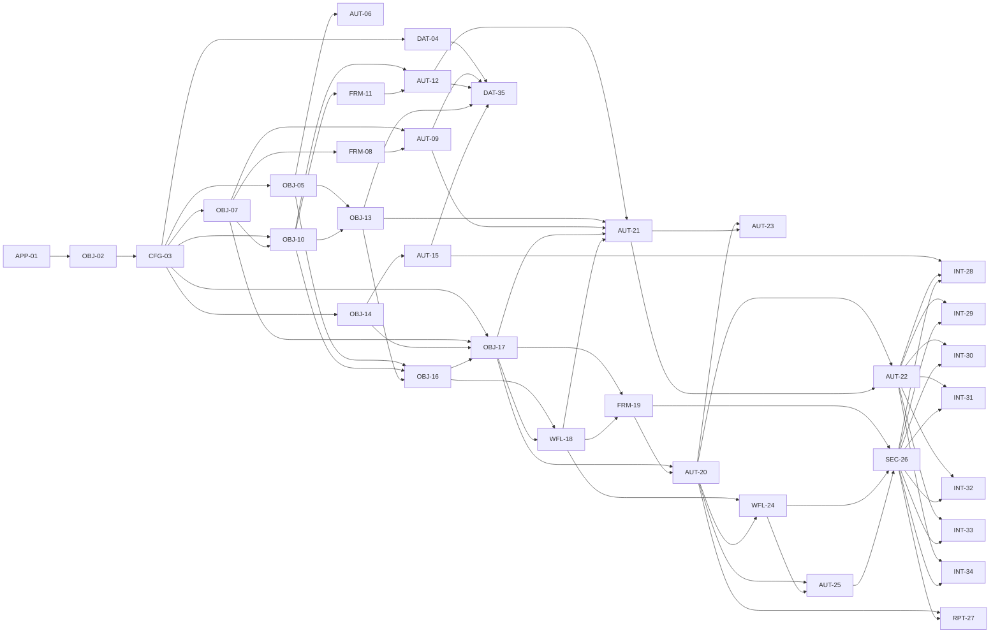

# Supplier Scorecard technical implementation plan

## Scope and planning basis

This plan converts the [Supplier Scorecard technical specification](supplier-scorecard-technical-specification.md), dated 2026-10-20, into assignable Intelex configuration work. It covers the proposed Supplier Scorecard application, catalogue inheritance, supplier-master extensions, authoring and immutable version objects, operational scorecards, workflows, security, automation, reports, initial configuration, and approved source integrations.

The plan preserves Supplier Relationship Management as the supplier master and reuses its `Supplier Abstract`, Parent Company, Facility, Group, Employee, supplier-role, status-capability, and Supplier Survey components. All target components remain proposed until configured and validated in the target tenant. Logical names in the specification are not treated as verified Intelex system names or stable metadata identifiers.

The plan excludes discovery, tenant verification, prototypes, historical migration/backfill, parallel-run reconciliation, formal testing, deployment, training, documentation, and project governance. Implementation-level checks needed to prove that a configured component works remain within the applicable task.

## Task summary

| Task Number | Task Category | Task Name | Objective and Detailed Scope | Recommended Implementer |
|---|---|---|---|---|
| APP-01 | Application configuration | Create the Supplier Scorecard Application | **Objective:** Establish the application container and navigation for Supplier Scorecard configuration and operations.  **Detailed scope:** Create the Supplier Scorecard application, application-level settings, navigation areas, and placeholders for administration, contribution, review, published results, and reporting. Do not modify the OOTB SRM application or workflows. | Associate Consultant |
| OBJ-02 | Object configuration | Create the Scorecard Catalogue Objects | **Objective:** Establish the inherited catalogue family required by all governed scorecard selections.  **Detailed scope:** Create non-instantiable `Supplier Scorecard Abstract Catalog Record` and its twelve direct children: Supplier Commodity, NAICS Classification, KPI Category, KPI Aggregation Method, KPI Value Type, KPI Contribution Source, KPI Collection Method, KPI Initialization Method, Safety Benchmark Metric, Scorecard Cadence, KPI Value Origin, and Publication Exception Treatment. | Senior Associate Consultant |
| CFG-03 | Catalogue configuration | Configure the Scorecard Catalogues | **Objective:** Make each catalogue usable as a governed Code-based selection source.  **Detailed scope:** Configure inherited `Code`, `Name`, `Active?`, and `Sort`; add `Description` to KPI Aggregation Method and `Frequency` to Scorecard Cadence; configure child administration forms, active-record filters, audit, and basic permissions. Do not expose inverse consumer grids. | Senior Associate Consultant |
| DAT-04 | Initial configuration | Load the Scorecard Catalogue Records | **Objective:** Provide the approved catalogue values required by downstream configuration and automation.  **Detailed scope:** Load the specification-defined records for value type, contribution source, collection method, initialization method, safety metric, cadence, value origin, and publication exception treatment, plus approved commodity, NAICS, KPI category, and aggregation-method records. Preserve stable Codes and approved recurrence expressions. | Associate Consultant |
| OBJ-05 | Shared object configuration | Update Supplier Abstract for Scorecards | **Objective:** Add scorecard classification and navigation to the authoritative supplier master.  **Detailed scope:** Add `Commodity` and `NAICS Classification` M:1 fields to `Supplier Abstract`, with catalogue inverses disabled, and add inverse grids for `Scorecard Participations` and `Scorecards`. Apply inherited behavior to Parent Company and Facility without creating another supplier object. | Senior Associate Consultant |
| AUT-06 | Action Handler configuration | Configure Commodity Synchronization | **Objective:** Keep Facility Commodity aligned with Parent Company Commodity under the initial no-override policy.  **Detailed scope:** Configure the Facility create/update handler and Parent Company Commodity update handler, including idempotent child updates, audit, failure reporting, and protection against metadata-only retriggers. | Consultant |
| OBJ-07 | Object configuration | Create the KPI Configuration Objects | **Objective:** Provide editable KPI definitions and immutable effective-dated versions.  **Detailed scope:** Create `Supplier Scorecard KPI` and `Supplier Scorecard KPI Version` with all specification fields, relationships, inverse grids, uniqueness rules, conditional requirements, and immutable version behavior. | Senior Associate Consultant |
| FRM-08 | Form configuration | Configure the KPI Administration Forms | **Objective:** Give scorecard administrators a controlled KPI authoring and version-review experience.  **Detailed scope:** Configure KPI authoring and read-only version forms, active catalogue filters, conditional sections for contributor, defaults, query source, and safety benchmark settings, plus the Versions grid and Publish action placement. | Senior Associate Consultant |
| AUT-09 | Action Handler configuration | Configure KPI Publish | **Objective:** Publish one complete, immutable KPI Version without overlap or partial creation.  **Detailed scope:** Configure validation, concurrency control, deterministic version numbering, effective-range overlap prevention, full authoring-to-version field mapping, rollback, administrator authorization, and native execution evidence. | Senior Consultant |
| OBJ-10 | Object configuration | Create the Program Configuration Objects | **Objective:** Provide editable scorecard methodologies and immutable published Program graphs.  **Detailed scope:** Create `Scorecard Program`, `Scorecard Program KPI`, `Scorecard Program Version`, and `Scorecard Program KPI Version` with specified fields, M:1/M:N relationships, inverse grids, uniqueness, effective dating, rollup-source reference, and immutable version behavior. | Senior Associate Consultant |
| FRM-11 | Form configuration | Configure Program and Generation Delay Forms | **Objective:** Support Program authoring, version review, KPI membership, and occurrence-specific generation delays.  **Detailed scope:** Configure Program authoring/version forms and grids; create `Scorecard Program Generation Delay`; configure its contextual New form, calculated display, occurrence fields, audit, Applied Run evidence, and read-only applied state. | Senior Associate Consultant |
| AUT-12 | Action Handler configuration | Configure Program Publish | **Objective:** Publish the complete Program Version, KPI membership, and supplier-recipient roles as one controlled change.  **Detailed scope:** Configure graph validation, cadence and rollup checks, cycle prevention, deterministic version numbering, complete child and M:N copying, overlap prevention, concurrency control, rollback, and immutability. | Senior Consultant |
| OBJ-13 | Object configuration | Create Supplier Scorecard Participation | **Objective:** Govern which exact supplier entities participate in each Program and effective period.  **Detailed scope:** Create `Supplier Scorecard Participation`, its Supplier and Program relationships, active/effective fields, display value, audit, inverse navigation, and prevention of overlapping active ranges for the same Supplier and Program. | Senior Associate Consultant |
| OBJ-14 | Object configuration | Create the Safety Benchmark Objects | **Objective:** Provide effective-dated NAICS and metric benchmarks for safety scoring.  **Detailed scope:** Create `Safety Benchmark` and immutable `Safety Benchmark Version` with catalogue relationships, source evidence, effective ranges, inverse Versions grid, uniqueness, and administration/read-only forms. | Senior Associate Consultant |
| AUT-15 | Action Handler configuration | Configure Safety Benchmark Publish | **Objective:** Publish complete benchmark versions with controlled effective dates.  **Detailed scope:** Configure required-field validation, stable benchmark uniqueness, effective-range checks, deterministic version numbering, full field copying, concurrency control, rollback, authorization, and immutable published records. | Consultant |
| OBJ-16 | Object configuration | Create Run and Scorecard Objects | **Objective:** Establish the operational parent and supplier-period snapshot records.  **Detailed scope:** Create `Supplier Scorecard Run` and `Supplier Scorecard` with all specified scalar fields, supplier/program relationships, snapshots, inverse grids, Source Scorecards M:N, publication metadata, and uniqueness for Program occurrence and Run/Supplier. | Senior Associate Consultant |
| OBJ-17 | Object configuration | Create KPI Value and Contribution Task Objects | **Objective:** Establish operational KPI results and consolidated contributor work records.  **Detailed scope:** Create `Scorecard KPI Value` and `Scorecard Contribution Task` with typed values, points, applicability, confirmation, exception, override, source evidence, catalogue relationships, contributor assignment, inverse grids, and required uniqueness rules. | Senior Associate Consultant |
| WFL-18 | Workflow configuration | Configure the Scorecard Workflow Skeletons | **Objective:** Establish stable stages, statuses, responsibility, due-date fields, and basic transitions for stage-aware configuration.  **Detailed scope:** Configure simple workflows for Supplier Scorecard Run, Supplier Scorecard, and Scorecard Contribution Task using the stages and terminal outcomes in the specification, with basic responsibility and transition actions only. | Associate Consultant |
| FRM-19 | Form configuration | Configure Operational Scorecard Forms | **Objective:** Provide responsive, stage-aware forms for Run coordination, contribution, review, correction, and published viewing.  **Detailed scope:** Configure Run, Scorecard, KPI Value, and Contribution Task forms and grids; typed-value visibility; stage containers; contributor editing; internal-only exception/override controls; source links; read-only publication views; and responsive connected-browser behavior. | Senior Associate Consultant |
| AUT-20 | Action Handler configuration | Configure KPI Value Calculations | **Objective:** Maintain effective points, completeness, provenance, confirmation evidence, and Scorecard totals when KPI values change.  **Detailed scope:** Configure input recalculation, confirmation metadata, publication-exception and override handlers, `Value Origin` assignment, parent total/category recalculation, recursion protection, retry behavior, and `Last Calculated At`. | Senior Consultant |
| AUT-21 | Event Service configuration | Configure Scheduled Scorecard Generation | **Objective:** Generate each due Program occurrence exactly once, including delayed occurrences, supplier snapshots, KPI values, and contribution tasks.  **Detailed scope:** Configure cadence evaluation, period boundaries, Generation Delay gate, Program/KPI version resolution, participation and status checks, rollup selection, retry-safe graph creation by specified uniqueness keys, failure ownership, and transition to Data Entry only after complete generation. | Senior Consultant |
| AUT-22 | Service and action configuration | Configure KPI Initialization and Refresh | **Objective:** Initialize operational KPI values and refresh one governed Query result without losing historical evidence or overrides.  **Detailed scope:** Configure no-default, static-default, and prior-period initialization; query capture metadata; open-period refresh; privileged targeted post-publication refresh; source evidence updates; total recalculation; and safeguards against background refresh of Published Scorecards. | Senior Consultant |
| AUT-23 | Event Service configuration | Configure Entry Cutoff Processing | **Objective:** Apply approved supplier-nonresponse behavior while keeping missing internal input visible and controlled.  **Detailed scope:** Configure the Entry Due At service to set only eligible supplier nonresponses to zero, stamp the governed origin, leave internal gaps unresolved, respect optional values, and preserve retry-safe execution evidence. | Consultant |
| WFL-24 | Workflow configuration | Complete the Scorecard Workflows | **Objective:** Enforce complete data entry, review-window, publication-ready, contribution-completion, return, cancellation, and due-date behavior.  **Detailed scope:** Add full validation, error handling, calculated responsibility and due dates, hidden parent-driven child transitions, Open/Close Review behavior, contribution completion/reopen rules, cancellation cascade, and native reminders. | Senior Consultant |
| AUT-25 | Action Handler configuration | Configure Publication and Notifications | **Objective:** Publish a complete Run safely and notify only authorized internal and supplier recipients without duplicates.  **Detailed scope:** Configure final validation, source-link safety checks, child and parent publication completion, publication stamps, recipient-role resolution, broad review notification, supplier publication notification, rollback or retry-safe partial-failure handling, and notification deduplication. | Senior Consultant |
| SEC-26 | Security configuration | Configure Supplier Scorecard Security | **Objective:** Restrict administration, contribution, aggregate viewing, corrections, publication, and supplier access while preserving source security.  **Detailed scope:** Configure application/object/record/workflow permissions for administrators, coordinators, reviewers, contributors, correction users, internal viewers, and supplier users; enforce supplier-entity scope, parent/child access rules, internal-only fields, read-only published results, and no access expansion from Group assignment. | Senior Consultant |
| RPT-27 | Reporting and view configuration | Configure Scorecard Views and Reports | **Objective:** Provide operational oversight, published detail, profile drilldown, category results, trends, and on-demand authorized ranking.  **Detailed scope:** Configure responsive entry/review/admin/published views, supplier-profile grids, overdue and completeness reports, snapshot-aware KPI reporting, category aggregation, current-measure workspace links, and secured overall/commodity rank calculation without persisted rank fields. | Consultant |
| INT-28 | Integration configuration | Configure Supplier Survey Safety Capture | **Objective:** Capture LTIR, TRIR, and Safety Kaizen results from the authoritative Supplier Survey model with exact benchmark evidence.  **Detailed scope:** Configure supplier/period survey matching, completed-survey selection, NAICS/metric benchmark-version resolution, points calculation, nonresponse handling, Kaizen carry-forward, source references, and safe refresh behavior. | Senior Consultant |
| INT-29 | Integration configuration | Configure the PPM Query KPI | **Objective:** Calculate the approved PPM score from chargeable supplier NCR quantities and consumed parts for the same supplier and period.  **Detailed scope:** Configure the governed source report/query binding, supplier and period mapping, included dispositions, parts-consumption input, aggregation and points logic, empty/failure behavior, correction handling, evidence link, and security-preserving drilldown. | Senior Consultant |
| INT-30 | Integration configuration | Configure the Response Timeliness Query KPI | **Objective:** Score supplier response timeliness without charging internal review delay to the supplier.  **Detailed scope:** Configure the approved response source, supplier and period mapping, supplier submission timestamp, applicable due date, exclusions, scoring logic, correction handling, empty/failure behavior, and source-security-safe evidence link. | Consultant |
| INT-31 | Integration configuration | Configure the Scrap Query KPI | **Objective:** Supply approved scrap results to Scorecards while leaving debit settlement outside Intelex.  **Detailed scope:** Configure the approved scrap source report, supplier and period mapping, aggregation and scoring rules, correction handling, empty/failure behavior, and secure evidence link; do not add debit settlement processing. | Consultant |
| INT-32 | Integration configuration | Configure the Warranty Query KPI | **Objective:** Supply the approved warranty result from its authoritative source to the matching supplier-period KPI Value.  **Detailed scope:** Configure the approved warranty source binding, supplier and period mapping, inclusions, aggregation, points logic, correction timing, empty/failure behavior, evidence link, and source security. | Consultant |
| INT-33 | Integration configuration | Configure the PPAP Query KPI | **Objective:** Supply the approved PPAP result from its authoritative source to the matching supplier-period KPI Value.  **Detailed scope:** Configure the approved PPAP source binding, supplier and period mapping, inclusions, aggregation, points logic, correction timing, empty/failure behavior, evidence link, and source security. | Consultant |
| INT-34 | Integration configuration | Configure the Delivery Query KPI | **Objective:** Supply the approved delivery result from its authoritative source to the matching supplier-period KPI Value.  **Detailed scope:** Configure the approved delivery source binding, supplier and period mapping, inclusions, aggregation, points logic, correction timing, empty/failure behavior, evidence link, and source security. | Consultant |
| DAT-35 | Initial configuration | Configure the Initial Scorecard Configuration | **Objective:** Make the approved direct-entry-first Scorecard configuration available for operational generation.  **Detailed scope:** Create and publish approved safety benchmark, KPI, and Program records; assign KPI membership and recipient roles; create effective-dated supplier Participations; configure required status-capability decisions; and verify that published configuration resolves by the intended period. Query KPIs remain Direct Entry until their integration task is complete. | Senior Associate Consultant |

## External inputs and constraints

These are inputs from design governance, tenant validation, security, integration, and release workstreams. They are not implementation tasks or dependency nodes.

| External input or constraint | Required outcome | Affected tasks |
|---|---|---|
| Catalogue inheritance and uniqueness result | Confirm per-concrete-child uniqueness for inherited `Code`, or provide approved globally unique replacement Codes. | DAT-04 |
| Approved catalogue content | Approve Commodity, NAICS, KPI Category, KPI Aggregation Method, Value Type, and any changes to the specification seed values. | DAT-04, DAT-35 |
| Cadence and calendar configuration | Supply verified recurrence expressions, period-boundary rules, scheduler timezone, business calendar, generation time, entry/review cutoffs, reminders, and escalation behavior. | DAT-04, AUT-21, WFL-24, DAT-35 |
| Approved operating model | Approve or reject ADR-113 parent-periodic/facility-monthly rollup behavior. | AUT-12, AUT-21, DAT-35 |
| Approved exception policy | Approve `SET_TO_ZERO` and `EXCLUDE_FROM_DENOMINATOR`, or provide replacement policy. | DAT-04, AUT-20, AUT-23, WFL-24, AUT-25 |
| Named groups and separation of duties | Name administrator, coordinator, review, correction, contributor, and support groups and approve role separation. | DAT-35, WFL-24, AUT-25, SEC-26 |
| Supplier status capability decisions | Approve status/capability matrix entries and parent-restriction behavior for monthly and, if used, periodic generation. | AUT-21, DAT-35 |
| Tenant capability results | Confirm Group responsibility, M:N version copying, inherited-Code behavior, aggregate recalculation, completed-parent child correction, report/query binding, recurrence rendering, and scheduler interpretation. | CFG-03, AUT-09, AUT-12, AUT-20, AUT-21, AUT-22, AUT-25, RPT-27 |
| Approved KPI catalogue | Supply KPI definitions, categories, maxima, initialization, applicability, missing-value behavior, aggregation, contacts, effective dates, Program membership, requiredness, and participant population. | DAT-35 |
| Security decisions | Approve entity-scope rules, parent/facility access, supplier recipient roles, correction role, field visibility, and source-link expectations. | AUT-25, SEC-26, RPT-27 |
| Ranking rules | Define ties, exclusions, null scores, population count, and interaction with security filtering. | RPT-27 |
| Commodity and NAICS governance | Confirm Commodity override policy, NAICS ownership, missing-code behavior, benchmark sources, and update procedure. | AUT-06, OBJ-14, INT-28, DAT-35 |
| Safety survey/scoring configuration | Provide issued survey identifiers/schedules, supplier/period matching, completion rules, and exact LTIR/TRIR and Kaizen scoring. | INT-28 |
| PPM source contract | Select parts-consumption integration, map chargeable NCR dispositions/quantities, supplier keys, periods, scoring, corrections, and secure drilldown. | INT-29 |
| Response timeliness source contract | Define authoritative source, supplier/period keys, due/submission timestamps, exclusions, scoring, corrections, and secure drilldown. | INT-30 |
| Scrap source contract | Define authoritative source, supplier/period keys, aggregation, scoring, corrections, and secure drilldown. | INT-31 |
| Warranty source contract | Define authoritative source, supplier/period keys, inclusions, aggregation, scoring, corrections, and secure drilldown. | INT-32 |
| PPAP source contract | Define authoritative source, supplier/period keys, inclusions, aggregation, scoring, corrections, and secure drilldown. | INT-33 |
| Delivery source contract | Define authoritative source, supplier/period keys, inclusions, aggregation, scoring, corrections, and secure drilldown. | INT-34 |

## Implementation tasks

### APP-01 — Create the Supplier Scorecard Application

- **Task ID:** APP-01
- **Title:** Create the Supplier Scorecard Application
- **Category:** Application configuration
- **Objective:** Establish the application container and navigation for Supplier Scorecard configuration and operations.
- **Detailed scope:** Create the Supplier Scorecard application, application-level settings, navigation areas, and placeholders for administration, contribution, review, published results, and reporting. Do not modify the OOTB SRM application or workflows.
- **Deliverable:** Configured Supplier Scorecard application shell with role-ready navigation.
- **Strict technical prerequisites:** None
- **Blocked status:** Not blocked.
- **Recommended implementer role:** Associate Consultant
- **Recommended reviewer/approver role:** Senior Consultant
- **Role rationale:** This is bounded application setup using an established Intelex pattern; Senior Consultant review protects the SRM boundary.
- **Acceptance criteria:** The application opens; each planned navigation area is present; no OOTB SRM workflow or object is copied or changed.
- **Specification references:** Sections 1, 3, 5, 16.3
- **Assumptions and open questions:** Application naming follows the specification display name; internal system name remains tenant-generated/verified.

### OBJ-02 — Create the Scorecard Catalogue Objects

- **Task ID:** OBJ-02
- **Title:** Create the Scorecard Catalogue Objects
- **Category:** Object configuration
- **Objective:** Establish the inherited catalogue family required by all governed scorecard selections.
- **Detailed scope:** Create non-instantiable `Supplier Scorecard Abstract Catalog Record` and its twelve direct children: Supplier Commodity, NAICS Classification, KPI Category, KPI Aggregation Method, KPI Value Type, KPI Contribution Source, KPI Collection Method, KPI Initialization Method, Safety Benchmark Metric, Scorecard Cadence, KPI Value Origin, and Publication Exception Treatment.
- **Deliverable:** Abstract catalogue parent and twelve correctly inherited concrete child objects.
- **Strict technical prerequisites:** APP-01
- **Blocked status:** Blocked until APP-01 is complete.
- **Recommended implementer role:** Senior Associate Consultant
- **Recommended reviewer/approver role:** Senior Consultant
- **Role rationale:** The object work is routine, but inheritance and non-instantiable behavior require independent configuration judgment.
- **Acceptance criteria:** Exactly twelve direct children inherit from the abstract parent; the parent cannot be instantiated or selected; no multiple parent or cycle exists.
- **Specification references:** Sections 4.2, 5, 7.1, 21.1
- **Assumptions and open questions:** None.

### CFG-03 — Configure the Scorecard Catalogues

- **Task ID:** CFG-03
- **Title:** Configure the Scorecard Catalogues
- **Category:** Catalogue configuration
- **Objective:** Make each catalogue usable as a governed Code-based selection source.
- **Detailed scope:** Configure inherited `Code`, `Name`, `Active?`, and `Sort`; add `Description` to KPI Aggregation Method and `Frequency` to Scorecard Cadence; configure child administration forms, active-record filters, audit, and basic permissions. Do not expose inverse consumer grids.
- **Deliverable:** Configured catalogue fields, forms, filters, audit, and permissions.
- **Strict technical prerequisites:** OBJ-02
- **Blocked status:** Blocked until OBJ-02 is complete; tenant capability results may block final constraint and recurrence configuration.
- **Recommended implementer role:** Senior Associate Consultant
- **Recommended reviewer/approver role:** Senior Consultant
- **Role rationale:** Inherited fields, recurrence presentation, and inverse suppression exceed simple catalogue setup.
- **Acceptance criteria:** Common fields exist only on the parent; child-specific fields exist only where specified; active filters work; catalogue M:1 inverses and consumer grids are absent.
- **Specification references:** Sections 6, 7, 16.1, 21.1
- **Assumptions and open questions:** Exact uniqueness constraint and recurrence storage follow externally supplied tenant results.

### DAT-04 — Load the Scorecard Catalogue Records

- **Task ID:** DAT-04
- **Title:** Load the Scorecard Catalogue Records
- **Category:** Initial configuration
- **Objective:** Provide the approved catalogue values required by downstream configuration and automation.
- **Detailed scope:** Load the specification-defined records for value type, contribution source, collection method, initialization method, safety metric, cadence, value origin, and publication exception treatment, plus approved commodity, NAICS, KPI category, and aggregation-method records. Preserve stable Codes and approved recurrence expressions.
- **Deliverable:** Approved, audited records in every concrete catalogue.
- **Strict technical prerequisites:** CFG-03
- **Blocked status:** Blocked by CFG-03 and by approved catalogue content, recurrence expressions, and inherited-Code uniqueness outcome.
- **Recommended implementer role:** Associate Consultant
- **Recommended reviewer/approver role:** Senior Consultant
- **Role rationale:** Record loading is bounded once governance and platform constraints are supplied.
- **Acceptance criteria:** Every approved record is present once on the correct concrete child; Codes are stable; inactive filtering works; cadence Frequency values are valid.
- **Specification references:** Sections 7.2–7.13, 20.2, 21.2
- **Assumptions and open questions:** No unapproved catalogue values are invented.

### OBJ-05 — Update Supplier Abstract for Scorecards

- **Task ID:** OBJ-05
- **Title:** Update Supplier Abstract for Scorecards
- **Category:** Shared object configuration
- **Objective:** Add scorecard classification and navigation to the authoritative supplier master.
- **Detailed scope:** Add `Commodity` and `NAICS Classification` M:1 fields to `Supplier Abstract`, with catalogue inverses disabled, and add inverse grids for `Scorecard Participations` and `Scorecards`. Apply inherited behavior to Parent Company and Facility without creating another supplier object.
- **Deliverable:** Supplier Abstract extensions and inherited Parent Company/Facility presentation.
- **Strict technical prerequisites:** CFG-03
- **Blocked status:** Blocked until CFG-03 is complete.
- **Recommended implementer role:** Senior Associate Consultant
- **Recommended reviewer/approver role:** Senior Consultant
- **Role rationale:** The fields are straightforward, but changes to an authoritative inherited object require careful cross-application configuration.
- **Acceptance criteria:** Both catalogue fields are inherited by Parent Company and Facility; catalogue inverses remain disabled; navigation grids use the owned child relationships.
- **Specification references:** Sections 3.1, 4.1, 10.2, 20.1
- **Assumptions and open questions:** Existing `Type of Supplier Entity` is reused and not duplicated.

### AUT-06 — Configure Commodity Synchronization

- **Task ID:** AUT-06
- **Title:** Configure Commodity Synchronization
- **Category:** Action Handler configuration
- **Objective:** Keep Facility Commodity aligned with Parent Company Commodity under the initial no-override policy.
- **Detailed scope:** Configure the Facility create/update handler and Parent Company Commodity update handler, including idempotent child updates, audit, failure reporting, and protection against metadata-only retriggers.
- **Deliverable:** Two working Commodity synchronization handlers with controlled failure behavior.
- **Strict technical prerequisites:** OBJ-05
- **Blocked status:** Blocked by OBJ-05 and the approved Commodity override policy.
- **Recommended implementer role:** Consultant
- **Recommended reviewer/approver role:** Senior Consultant
- **Role rationale:** Cross-object child updates, idempotency, and partial failure reporting require Consultant-level automation judgment.
- **Acceptance criteria:** Facility creation/parent change copies Commodity; Parent Company changes update related Facilities once; failures are reported without recursive updates.
- **Specification references:** Section 10.2
- **Assumptions and open questions:** Initial release does not permit Facility override.

### OBJ-07 — Create the KPI Configuration Objects

- **Task ID:** OBJ-07
- **Title:** Create the KPI Configuration Objects
- **Category:** Object configuration
- **Objective:** Provide editable KPI definitions and immutable effective-dated versions.
- **Detailed scope:** Create `Supplier Scorecard KPI` and `Supplier Scorecard KPI Version` with all specification fields, relationships, inverse grids, uniqueness rules, conditional requirements, and immutable version behavior.
- **Deliverable:** Complete KPI authoring/version object and field configuration.
- **Strict technical prerequisites:** CFG-03
- **Blocked status:** Blocked until CFG-03 is complete.
- **Recommended implementer role:** Senior Associate Consultant
- **Recommended reviewer/approver role:** Senior Consultant
- **Role rationale:** Numerous conditional relationships and immutable version fields require independent configuration judgment but not advanced automation.
- **Acceptance criteria:** Every Section 8.1/8.2 field exists with correct ownership, relationship, requirement, editability, and inverse behavior; version records are read only.
- **Specification references:** Sections 4.3, 8.1, 8.2
- **Assumptions and open questions:** Exact executable expressions are deferred to their automation tasks.

### FRM-08 — Configure the KPI Administration Forms

- **Task ID:** FRM-08
- **Title:** Configure the KPI Administration Forms
- **Category:** Form configuration
- **Objective:** Give scorecard administrators a controlled KPI authoring and version-review experience.
- **Detailed scope:** Configure KPI authoring and read-only version forms, active catalogue filters, conditional sections for contributor, defaults, query source, and safety benchmark settings, plus the Versions grid and Publish action placement.
- **Deliverable:** Usable KPI authoring and immutable-version forms.
- **Strict technical prerequisites:** OBJ-07
- **Blocked status:** Blocked until OBJ-07 is complete.
- **Recommended implementer role:** Senior Associate Consultant
- **Recommended reviewer/approver role:** Senior Consultant
- **Role rationale:** The layout is sizeable and includes interdependent show/hide/clear/required behavior.
- **Acceptance criteria:** Only relevant fields appear for each governed Code combination; hidden conditional fields clear as specified; published versions cannot be edited.
- **Specification references:** Sections 8.1, 8.2, 16.1
- **Assumptions and open questions:** None.

### AUT-09 — Configure KPI Publish

- **Task ID:** AUT-09
- **Title:** Configure KPI Publish
- **Category:** Action Handler configuration
- **Objective:** Publish one complete, immutable KPI Version without overlap or partial creation.
- **Detailed scope:** Configure validation, concurrency control, deterministic version numbering, effective-range overlap prevention, full authoring-to-version field mapping, rollback, administrator authorization, and native execution evidence.
- **Deliverable:** Controlled KPI Publish action.
- **Strict technical prerequisites:** OBJ-07, FRM-08
- **Blocked status:** Blocked by OBJ-07 and FRM-08; final mechanism depends on tenant capability results.
- **Recommended implementer role:** Senior Consultant
- **Recommended reviewer/approver role:** Principal Consultant
- **Role rationale:** Concurrency, atomicity, rollback, and immutable effective dating are consequential cross-record automation.
- **Acceptance criteria:** One action creates exactly one complete version; invalid or overlapping data creates none; concurrent attempts cannot duplicate version numbers.
- **Specification references:** Section 8.3; Sections 21.1–21.2
- **Assumptions and open questions:** None.

### OBJ-10 — Create the Program Configuration Objects

- **Task ID:** OBJ-10
- **Title:** Create the Program Configuration Objects
- **Category:** Object configuration
- **Objective:** Provide editable scorecard methodologies and immutable published Program graphs.
- **Detailed scope:** Create `Scorecard Program`, `Scorecard Program KPI`, `Scorecard Program Version`, and `Scorecard Program KPI Version` with specified fields, M:1/M:N relationships, inverse grids, uniqueness, effective dating, rollup-source reference, and immutable version behavior.
- **Deliverable:** Complete Program authoring/version object and field configuration.
- **Strict technical prerequisites:** CFG-03, OBJ-07
- **Blocked status:** Blocked until CFG-03 and OBJ-07 are complete.
- **Recommended implementer role:** Senior Associate Consultant
- **Recommended reviewer/approver role:** Senior Consultant
- **Role rationale:** The graph is larger than routine object setup and mixes child and M:N version content.
- **Acceptance criteria:** All Section 9.1–9.4 fields and relationships exist; `Entity Level` and `Recurrence Definition` do not; version records and children are read only.
- **Specification references:** Sections 4.3, 9.1–9.4, 21.1
- **Assumptions and open questions:** None.

### FRM-11 — Configure Program and Generation Delay Forms

- **Task ID:** FRM-11
- **Title:** Configure Program and Generation Delay Forms
- **Category:** Form configuration
- **Objective:** Support Program authoring, version review, KPI membership, and occurrence-specific generation delays.
- **Detailed scope:** Configure Program authoring/version forms and grids; create `Scorecard Program Generation Delay`; configure its contextual New form, calculated display, occurrence fields, audit, Applied Run evidence, and read-only applied state.
- **Deliverable:** Program/version administration forms and Generation Delay object/form/grid.
- **Strict technical prerequisites:** OBJ-10
- **Blocked status:** Blocked until OBJ-10 is complete; valid occurrence selection depends on approved cadence rules.
- **Recommended implementer role:** Senior Associate Consultant
- **Recommended reviewer/approver role:** Senior Consultant
- **Role rationale:** This combines a larger administration form with contextual child creation and lifecycle-dependent editability.
- **Acceptance criteria:** Program grids expose membership, versions, and delays; Program defaults/locks on new Delay; invalid dates, duplicate occurrence, and applied edits are prevented.
- **Specification references:** Sections 9.1, 9.5, 9.6, 16.1
- **Assumptions and open questions:** Exact display formulas and occurrence picker implementation use verified tenant syntax.

### AUT-12 — Configure Program Publish

- **Task ID:** AUT-12
- **Title:** Configure Program Publish
- **Category:** Action Handler configuration
- **Objective:** Publish the complete Program Version, KPI membership, and supplier-recipient roles as one controlled change.
- **Detailed scope:** Configure graph validation, cadence and rollup checks, cycle prevention, deterministic version numbering, complete child and M:N copying, overlap prevention, concurrency control, rollback, and immutability.
- **Deliverable:** Controlled Program Publish action.
- **Strict technical prerequisites:** OBJ-10, FRM-11
- **Blocked status:** Blocked by OBJ-10 and FRM-11; tenant M:N-copy result and approved rollup operating model may also block completion.
- **Recommended implementer role:** Senior Consultant
- **Recommended reviewer/approver role:** Principal Consultant
- **Role rationale:** Atomic multi-record/M:N publication, cycle checks, and high rework risk require senior technical authority.
- **Acceptance criteria:** A valid action creates one complete Program graph; invalid membership, cadence, routing, overlap, or rollup creates no partial version.
- **Specification references:** Sections 9.5, 21.1–21.2
- **Assumptions and open questions:** Rollup validation is enabled only if ADR-113 behavior is approved.

### OBJ-13 — Create Supplier Scorecard Participation

- **Task ID:** OBJ-13
- **Title:** Create Supplier Scorecard Participation
- **Category:** Object configuration
- **Objective:** Govern which exact supplier entities participate in each Program and effective period.
- **Detailed scope:** Create `Supplier Scorecard Participation`, its Supplier and Program relationships, active/effective fields, display value, audit, inverse navigation, and prevention of overlapping active ranges for the same Supplier and Program.
- **Deliverable:** Participation object, forms, relationships, audit, and range control.
- **Strict technical prerequisites:** OBJ-05, OBJ-10
- **Blocked status:** Blocked until OBJ-05 and OBJ-10 are complete.
- **Recommended implementer role:** Senior Associate Consultant
- **Recommended reviewer/approver role:** Senior Consultant
- **Role rationale:** Effective-range control and authoritative supplier relationships require more judgment than a basic child object.
- **Acceptance criteria:** Parent Company or Facility can be selected without Program entity filtering; duplicate/overlapping ranges are blocked; status Deny cannot be overridden.
- **Specification references:** Sections 10.1, 10.3
- **Assumptions and open questions:** Capability records are supplied by the authoritative Supplier Status design.

### OBJ-14 — Create the Safety Benchmark Objects

- **Task ID:** OBJ-14
- **Title:** Create the Safety Benchmark Objects
- **Category:** Object configuration
- **Objective:** Provide effective-dated NAICS and metric benchmarks for safety scoring.
- **Detailed scope:** Create `Safety Benchmark` and immutable `Safety Benchmark Version` with catalogue relationships, source evidence, effective ranges, inverse Versions grid, uniqueness, and administration/read-only forms.
- **Deliverable:** Complete benchmark authoring/version configuration.
- **Strict technical prerequisites:** CFG-03
- **Blocked status:** Blocked until CFG-03 is complete; initial records depend on approved NAICS and benchmark governance.
- **Recommended implementer role:** Senior Associate Consultant
- **Recommended reviewer/approver role:** Senior Consultant
- **Role rationale:** Effective dating and governed catalogue combinations require independent configuration judgment.
- **Acceptance criteria:** One stable benchmark exists per NAICS/Metric; version fields are immutable; catalogue inverses remain disabled.
- **Specification references:** Sections 4.5, 11.1, 11.2
- **Assumptions and open questions:** None.

### AUT-15 — Configure Safety Benchmark Publish

- **Task ID:** AUT-15
- **Title:** Configure Safety Benchmark Publish
- **Category:** Action Handler configuration
- **Objective:** Publish complete benchmark versions with controlled effective dates.
- **Detailed scope:** Configure required-field validation, stable benchmark uniqueness, effective-range checks, deterministic version numbering, full field copying, concurrency control, rollback, authorization, and immutable published records.
- **Deliverable:** Controlled Safety Benchmark Publish action.
- **Strict technical prerequisites:** OBJ-14
- **Blocked status:** Blocked until OBJ-14 is complete.
- **Recommended implementer role:** Consultant
- **Recommended reviewer/approver role:** Senior Consultant
- **Role rationale:** This is moderately complex publish automation using the already established version pattern.
- **Acceptance criteria:** Valid publication creates one complete version; overlaps or missing data create none; published data cannot be edited.
- **Specification references:** Section 11.2; Section 21.2
- **Assumptions and open questions:** None.

### OBJ-16 — Create Run and Scorecard Objects

- **Task ID:** OBJ-16
- **Title:** Create Run and Scorecard Objects
- **Category:** Object configuration
- **Objective:** Establish the operational parent and supplier-period snapshot records.
- **Detailed scope:** Create `Supplier Scorecard Run` and `Supplier Scorecard` with all specified scalar fields, supplier/program relationships, snapshots, inverse grids, Source Scorecards M:N, publication metadata, and uniqueness for Program occurrence and Run/Supplier.
- **Deliverable:** Complete Run and Scorecard object/field/relationship configuration.
- **Strict technical prerequisites:** OBJ-05, OBJ-10, OBJ-13
- **Blocked status:** Blocked until OBJ-05, OBJ-10, and OBJ-13 are complete.
- **Recommended implementer role:** Senior Associate Consultant
- **Recommended reviewer/approver role:** Senior Consultant
- **Role rationale:** Snapshot and rollup relationships make this more consequential than routine object creation.
- **Acceptance criteria:** Every Section 12.1/12.2 field exists; uniqueness is enforceable; ranks are not persisted; owned inverse grids do not duplicate relationships.
- **Specification references:** Sections 4.4, 12.1, 12.2
- **Assumptions and open questions:** Total calculations are configured in AUT-20.

### OBJ-17 — Create KPI Value and Contribution Task Objects

- **Task ID:** OBJ-17
- **Title:** Create KPI Value and Contribution Task Objects
- **Category:** Object configuration
- **Objective:** Establish operational KPI results and consolidated contributor work records.
- **Detailed scope:** Create `Scorecard KPI Value` and `Scorecard Contribution Task` with typed values, points, applicability, confirmation, exception, override, source evidence, catalogue relationships, contributor assignment, inverse grids, and required uniqueness rules.
- **Deliverable:** Complete KPI Value and Contribution Task object/field configuration.
- **Strict technical prerequisites:** CFG-03, OBJ-07, OBJ-14, OBJ-16
- **Blocked status:** Blocked until CFG-03, OBJ-07, OBJ-14, and OBJ-16 are complete.
- **Recommended implementer role:** Senior Associate Consultant
- **Recommended reviewer/approver role:** Senior Consultant
- **Role rationale:** The configuration is field-heavy and security-sensitive but automation is handled separately.
- **Acceptance criteria:** Every Section 12.3/12.4 field exists with correct ownership, editability, inverse suppression, and unique keys; no custom status field is added.
- **Specification references:** Sections 4.4, 12.3, 12.4
- **Assumptions and open questions:** Executable calculation syntax is not set in this task.

### WFL-18 — Configure the Scorecard Workflow Skeletons

- **Task ID:** WFL-18
- **Title:** Configure the Scorecard Workflow Skeletons
- **Category:** Workflow configuration
- **Objective:** Establish stable stages, statuses, responsibility, due-date fields, and basic transitions for stage-aware configuration.
- **Detailed scope:** Configure simple workflows for Supplier Scorecard Run, Supplier Scorecard, and Scorecard Contribution Task using the stages and terminal outcomes in the specification, with basic responsibility and transition actions only.
- **Deliverable:** Three workflow skeletons with stable stage system names.
- **Strict technical prerequisites:** OBJ-16, OBJ-17
- **Blocked status:** Blocked until OBJ-16 and OBJ-17 are complete.
- **Recommended implementer role:** Associate Consultant
- **Recommended reviewer/approver role:** Senior Consultant
- **Role rationale:** First-pass stages and straightforward responsibility are an established configuration pattern.
- **Acceptance criteria:** Stages/outcomes exactly match Section 14; native stage/status is authoritative; no custom workflow-state field exists.
- **Specification references:** Sections 14.1–14.3
- **Assumptions and open questions:** Full validation and calculated behavior are deferred to WFL-24.

### FRM-19 — Configure Operational Scorecard Forms

- **Task ID:** FRM-19
- **Title:** Configure Operational Scorecard Forms
- **Category:** Form configuration
- **Objective:** Provide responsive, stage-aware forms for Run coordination, contribution, review, correction, and published viewing.
- **Detailed scope:** Configure Run, Scorecard, KPI Value, and Contribution Task forms and grids; typed-value visibility; stage containers; contributor editing; internal-only exception/override controls; source links; read-only publication views; and responsive connected-browser behavior.
- **Deliverable:** Complete responsive operational form set.
- **Strict technical prerequisites:** OBJ-17, WFL-18
- **Blocked status:** Blocked until OBJ-17 and WFL-18 are complete.
- **Recommended implementer role:** Senior Associate Consultant
- **Recommended reviewer/approver role:** Senior Consultant
- **Role rationale:** Multiple large stage-aware forms and sensitive conditional controls require independent judgment.
- **Acceptance criteria:** Only the matching typed field appears; stage/edit rules work; supplier views exclude internal rationale and controls; published views are read only.
- **Specification references:** Sections 12, 14, 16.3
- **Assumptions and open questions:** No native-mobile/offline forms are configured.

### AUT-20 — Configure KPI Value Calculations

- **Task ID:** AUT-20
- **Title:** Configure KPI Value Calculations
- **Category:** Action Handler configuration
- **Objective:** Maintain effective points, completeness, provenance, confirmation evidence, and Scorecard totals when KPI values change.
- **Detailed scope:** Configure input recalculation, confirmation metadata, publication-exception and override handlers, `Value Origin` assignment, parent total/category recalculation, recursion protection, retry behavior, and `Last Calculated At`.
- **Deliverable:** Verified KPI Value and parent-total calculation handlers.
- **Strict technical prerequisites:** OBJ-17, FRM-19
- **Blocked status:** Blocked by OBJ-17 and FRM-19; final mechanism depends on approved exception policy and tenant calculation results.
- **Recommended implementer role:** Senior Consultant
- **Recommended reviewer/approver role:** Principal Consultant
- **Role rationale:** Cross-grid totals, recursion, retry, privileged changes, and scoring consequences require senior authority.
- **Acceptance criteria:** All specified input combinations produce correct effective points/maxima, origin, completeness, metadata, totals, null-denominator behavior, and no recursive loop.
- **Specification references:** Sections 12.2–12.3, 14.4, 15.2–15.4
- **Assumptions and open questions:** Approved scoring ranges and exception policy are external inputs.

### AUT-21 — Configure Scheduled Scorecard Generation

- **Task ID:** AUT-21
- **Title:** Configure Scheduled Scorecard Generation
- **Category:** Event Service configuration
- **Objective:** Generate each due Program occurrence exactly once, including delayed occurrences, supplier snapshots, KPI values, and contribution tasks.
- **Detailed scope:** Configure cadence evaluation, period boundaries, Generation Delay gate, Program/KPI version resolution, participation and status checks, rollup selection, retry-safe graph creation by specified uniqueness keys, failure ownership, and transition to Data Entry only after complete generation.
- **Deliverable:** Scheduled generation service with retry-safe occurrence processing.
- **Strict technical prerequisites:** AUT-09, AUT-12, OBJ-13, OBJ-17, WFL-18
- **Blocked status:** Blocked by all prerequisites and by approved cadence/calendar, operating-model, status-capability, and tenant scheduler results.
- **Recommended implementer role:** Senior Consultant
- **Recommended reviewer/approver role:** Principal Consultant
- **Role rationale:** Multi-stage generation, delay gating, idempotency, version resolution, rollups, and failure recovery are advanced automation.
- **Acceptance criteria:** Repeated execution creates no duplicates; delayed occurrences preserve the original anchor; missing versions/capability denials create no unauthorized Scorecard; partial work resumes safely.
- **Specification references:** Sections 9.6, 10.3, 13.1, 13.5, 21.2
- **Assumptions and open questions:** Parent rollup is configured only when externally approved.

### AUT-22 — Configure KPI Initialization and Refresh

- **Task ID:** AUT-22
- **Title:** Configure KPI Initialization and Refresh
- **Category:** Service and action configuration
- **Objective:** Initialize operational KPI values and refresh one governed Query result without losing historical evidence or overrides.
- **Detailed scope:** Configure no-default, static-default, and prior-period initialization; query capture metadata; open-period refresh; privileged targeted post-publication refresh; source evidence updates; total recalculation; and safeguards against background refresh of Published Scorecards.
- **Deliverable:** Initialization component and targeted Refresh KPI Result action.
- **Strict technical prerequisites:** AUT-20, AUT-21
- **Blocked status:** Blocked by AUT-20 and AUT-21; post-publication behavior depends on the completed-parent capability result.
- **Recommended implementer role:** Senior Consultant
- **Recommended reviewer/approver role:** Principal Consultant
- **Role rationale:** Historical carry-forward, privileged completed-record correction, and evidence preservation are high-consequence automation.
- **Acceptance criteria:** Each initialization Code behaves as specified; prior override rationale is not copied; refresh affects one KPI only, preserves override, recalculates totals, and cannot be selected by background jobs after publication.
- **Specification references:** Sections 13.2, 13.3, 15.3
- **Assumptions and open questions:** Source-specific calculations are added by INT-28–INT-34.

### AUT-23 — Configure Entry Cutoff Processing

- **Task ID:** AUT-23
- **Title:** Configure Entry Cutoff Processing
- **Category:** Event Service configuration
- **Objective:** Apply approved supplier-nonresponse behavior while keeping missing internal input visible and controlled.
- **Detailed scope:** Configure the Entry Due At service to set only eligible supplier nonresponses to zero, stamp the governed origin, leave internal gaps unresolved, respect optional values, and preserve retry-safe execution evidence.
- **Deliverable:** Scheduled entry-cutoff service.
- **Strict technical prerequisites:** AUT-20, AUT-21
- **Blocked status:** Blocked by AUT-20 and AUT-21 and by approved exception/nonresponse policy.
- **Recommended implementer role:** Consultant
- **Recommended reviewer/approver role:** Senior Consultant
- **Role rationale:** The service is bounded but changes scoring outcomes and must distinguish supplier from internal responsibility.
- **Acceptance criteria:** Only configured supplier nonresponses become zero; internal gaps remain incomplete; repeat execution is safe; optional blanks remain distinguishable.
- **Specification references:** Sections 13.4, 15.1
- **Assumptions and open questions:** None.

### WFL-24 — Complete the Scorecard Workflows

- **Task ID:** WFL-24
- **Title:** Complete the Scorecard Workflows
- **Category:** Workflow configuration
- **Objective:** Enforce complete data entry, review-window, publication-ready, contribution-completion, return, cancellation, and due-date behavior.
- **Detailed scope:** Add full validation, error handling, calculated responsibility and due dates, hidden parent-driven child transitions, Open/Close Review behavior, contribution completion/reopen rules, cancellation cascade, and native reminders.
- **Deliverable:** Completed Run, Scorecard, and Contribution Task workflows.
- **Strict technical prerequisites:** WFL-18, AUT-20
- **Blocked status:** Blocked by WFL-18 and AUT-20 and by named groups, calendar, reminder, and exception-policy inputs.
- **Recommended implementer role:** Senior Consultant
- **Recommended reviewer/approver role:** Principal Consultant
- **Role rationale:** Coordinated parent/child workflow, error recovery, and cancellation consequences require senior authority.
- **Acceptance criteria:** Review opens only when data is complete/excepted; one window is maintained; contribution completion validates linked values; cancellation is retry-safe and stops reminders.
- **Specification references:** Sections 14.1–14.3, 15.1
- **Assumptions and open questions:** Silence at review deadline remains consent; no review-response object is added.

### AUT-25 — Configure Publication and Notifications

- **Task ID:** AUT-25
- **Title:** Configure Publication and Notifications
- **Category:** Action Handler configuration
- **Objective:** Publish a complete Run safely and notify only authorized internal and supplier recipients without duplicates.
- **Detailed scope:** Configure final validation, source-link safety checks, child and parent publication completion, publication stamps, recipient-role resolution, broad review notification, supplier publication notification, rollback or retry-safe partial-failure handling, and notification deduplication.
- **Deliverable:** Publish Scorecards action and specified notification behavior.
- **Strict technical prerequisites:** AUT-20, WFL-24
- **Blocked status:** Blocked by AUT-20 and WFL-24 and by approved exception policy, recipient/security decisions, and tenant notification/transaction results.
- **Recommended implementer role:** Senior Consultant
- **Recommended reviewer/approver role:** Principal Consultant
- **Role rationale:** Atomic multi-record publication and external recipient resolution carry substantial security and recovery consequences.
- **Acceptance criteria:** All required validation passes before publication; partial failure is rolled back or resumes safely; unresolved required recipients hold only the affected publication; notifications are not duplicated.
- **Specification references:** Sections 14.1, 16.2, 21.2
- **Assumptions and open questions:** No supplier acknowledgement or dispute workflow is configured.

### SEC-26 — Configure Supplier Scorecard Security

- **Task ID:** SEC-26
- **Title:** Configure Supplier Scorecard Security
- **Category:** Security configuration
- **Objective:** Restrict administration, contribution, aggregate viewing, corrections, publication, and supplier access while preserving source security.
- **Detailed scope:** Configure application/object/record/workflow permissions for administrators, coordinators, reviewers, contributors, correction users, internal viewers, and supplier users; enforce supplier-entity scope, parent/child access rules, internal-only fields, read-only published results, and no access expansion from Group assignment.
- **Deliverable:** Complete scorecard security configuration across all surfaces.
- **Strict technical prerequisites:** FRM-19, WFL-24, AUT-25
- **Blocked status:** Blocked by FRM-19, WFL-24, and AUT-25 and by approved groups, entity-scope, correction-role, and recipient decisions.
- **Recommended implementer role:** Senior Consultant
- **Recommended reviewer/approver role:** Principal Consultant
- **Role rationale:** Nuanced cross-object, workflow, source, parent/facility, and supplier security requires senior technical authority.
- **Acceptance criteria:** Contributors see only assigned/authorized values; Facility users cannot see siblings; parent-authorized access follows policy; suppliers see published results only; source links never grant source access.
- **Specification references:** Sections 16.1–16.2; Section 21.1
- **Assumptions and open questions:** Formal penetration/security testing is outside this plan.

### RPT-27 — Configure Scorecard Views and Reports

- **Task ID:** RPT-27
- **Title:** Configure Scorecard Views and Reports
- **Category:** Reporting and view configuration
- **Objective:** Provide operational oversight, published detail, profile drilldown, category results, trends, and on-demand authorized ranking.
- **Detailed scope:** Configure responsive entry/review/admin/published views, supplier-profile grids, overdue and completeness reports, snapshot-aware KPI reporting, category aggregation, current-measure workspace links, and secured overall/commodity rank calculation without persisted rank fields.
- **Deliverable:** Native operational and published reports/views with profile navigation and on-demand ranks.
- **Strict technical prerequisites:** AUT-20, SEC-26
- **Blocked status:** Blocked by AUT-20 and SEC-26 and by approved ranking rules and tenant report/query results.
- **Recommended implementer role:** Consultant
- **Recommended reviewer/approver role:** Senior Consultant
- **Role rationale:** Cross-object reporting and secured query ranking require broader technical judgment but not bespoke UI architecture.
- **Acceptance criteria:** Reports distinguish all value origins/states; ranks use only authorized published peers; profile drilldown performs without loading all history; no Power BI dataset is created.
- **Specification references:** Sections 15.4–15.5, 16.3
- **Assumptions and open questions:** Power BI and normalized staging remain unapproved and out of scope.

### INT-28 — Configure Supplier Survey Safety Capture

- **Task ID:** INT-28
- **Title:** Configure Supplier Survey Safety Capture
- **Category:** Integration configuration
- **Objective:** Capture LTIR, TRIR, and Safety Kaizen results from the authoritative Supplier Survey model with exact benchmark evidence.
- **Detailed scope:** Configure supplier/period survey matching, completed-survey selection, NAICS/metric benchmark-version resolution, points calculation, nonresponse handling, Kaizen carry-forward, source references, and safe refresh behavior.
- **Deliverable:** Governed safety Query KPI bindings and carry-forward behavior.
- **Strict technical prerequisites:** AUT-15, AUT-22, SEC-26
- **Blocked status:** Blocked by AUT-15, AUT-22, and SEC-26 and by approved survey identifiers/schedules, safety scoring, NAICS, and benchmark governance.
- **Recommended implementer role:** Senior Consultant
- **Recommended reviewer/approver role:** Principal Consultant
- **Role rationale:** Cross-component effective dating, scoring, evidence, and nonresponse handling are consequential.
- **Acceptance criteria:** Exact completed survey and benchmark version are stored; missing NAICS/benchmark is reported rather than guessed; Kaizen carry-forward follows the approved period rule.
- **Specification references:** Sections 11, 13.4, 17
- **Assumptions and open questions:** Supplier Survey implementation is supplied by its authoritative specification.

### INT-29 — Configure the PPM Query KPI

- **Task ID:** INT-29
- **Title:** Configure the PPM Query KPI
- **Category:** Integration configuration
- **Objective:** Calculate the approved PPM score from chargeable supplier NCR quantities and consumed parts for the same supplier and period.
- **Detailed scope:** Configure the governed source report/query binding, supplier and period mapping, included dispositions, parts-consumption input, aggregation and points logic, empty/failure behavior, correction handling, evidence link, and security-preserving drilldown.
- **Deliverable:** One governed PPM Query KPI source integration.
- **Strict technical prerequisites:** AUT-22, SEC-26
- **Blocked status:** Blocked by AUT-22 and SEC-26 and by the complete PPM source contract.
- **Recommended implementer role:** Senior Consultant
- **Recommended reviewer/approver role:** Principal Consultant
- **Role rationale:** Multi-source calculation and supplier-period reconciliation have substantial architectural and scoring consequences.
- **Acceptance criteria:** Numerator/denominator use approved sources and period; missing/failure states are explicit; correction and refresh are safe; drilldown reapplies source security.
- **Specification references:** Sections 17, 22.11
- **Assumptions and open questions:** Parts-consumption transfer method is externally supplied.

### INT-30 — Configure the Response Timeliness Query KPI

- **Task ID:** INT-30
- **Title:** Configure the Response Timeliness Query KPI
- **Category:** Integration configuration
- **Objective:** Score supplier response timeliness without charging internal review delay to the supplier.
- **Detailed scope:** Configure the approved response source, supplier and period mapping, supplier submission timestamp, applicable due date, exclusions, scoring logic, correction handling, empty/failure behavior, and source-security-safe evidence link.
- **Deliverable:** One governed response-timeliness Query KPI integration.
- **Strict technical prerequisites:** AUT-22, SEC-26
- **Blocked status:** Blocked by AUT-22 and SEC-26 and by the complete response-timeliness source contract.
- **Recommended implementer role:** Consultant
- **Recommended reviewer/approver role:** Senior Consultant
- **Role rationale:** This is a bounded report-fed source once its business contract is supplied.
- **Acceptance criteria:** Scoring uses supplier submission and applicable due date only; internal review time is excluded; correction, failure, and evidence behavior match the source contract.
- **Specification references:** Section 17
- **Assumptions and open questions:** None.

### INT-31 — Configure the Scrap Query KPI

- **Task ID:** INT-31
- **Title:** Configure the Scrap Query KPI
- **Category:** Integration configuration
- **Objective:** Supply approved scrap results to Scorecards while leaving debit settlement outside Intelex.
- **Detailed scope:** Configure the approved scrap source report, supplier and period mapping, aggregation and scoring rules, correction handling, empty/failure behavior, and secure evidence link; do not add debit settlement processing.
- **Deliverable:** One governed Scrap Query KPI integration.
- **Strict technical prerequisites:** AUT-22, SEC-26
- **Blocked status:** Blocked by AUT-22 and SEC-26 and by the complete Scrap source contract.
- **Recommended implementer role:** Consultant
- **Recommended reviewer/approver role:** Senior Consultant
- **Role rationale:** This is a bounded source integration once the authoritative mapping and rules are supplied.
- **Acceptance criteria:** Correct supplier-period scrap result is captured; debit processing is absent; correction/failure behavior is explicit; source security is preserved.
- **Specification references:** Sections 2 (SC-023), 17
- **Assumptions and open questions:** None.

### INT-32 — Configure the Warranty Query KPI

- **Task ID:** INT-32
- **Title:** Configure the Warranty Query KPI
- **Category:** Integration configuration
- **Objective:** Supply the approved warranty result from its authoritative source to the matching supplier-period KPI Value.
- **Detailed scope:** Configure the approved warranty source binding, supplier and period mapping, inclusions, aggregation, points logic, correction timing, empty/failure behavior, evidence link, and source security.
- **Deliverable:** One governed Warranty Query KPI integration.
- **Strict technical prerequisites:** AUT-22, SEC-26
- **Blocked status:** Blocked by AUT-22 and SEC-26 and by the complete Warranty source contract.
- **Recommended implementer role:** Consultant
- **Recommended reviewer/approver role:** Senior Consultant
- **Role rationale:** This is a bounded source integration once its contract is supplied.
- **Acceptance criteria:** The approved result maps to the correct supplier/period; refresh and correction follow policy; failures are explicit; drilldown preserves source authorization.
- **Specification references:** Section 17
- **Assumptions and open questions:** None.

### INT-33 — Configure the PPAP Query KPI

- **Task ID:** INT-33
- **Title:** Configure the PPAP Query KPI
- **Category:** Integration configuration
- **Objective:** Supply the approved PPAP result from its authoritative source to the matching supplier-period KPI Value.
- **Detailed scope:** Configure the approved PPAP source binding, supplier and period mapping, inclusions, aggregation, points logic, correction timing, empty/failure behavior, evidence link, and source security.
- **Deliverable:** One governed PPAP Query KPI integration.
- **Strict technical prerequisites:** AUT-22, SEC-26
- **Blocked status:** Blocked by AUT-22 and SEC-26 and by the complete PPAP source contract.
- **Recommended implementer role:** Consultant
- **Recommended reviewer/approver role:** Senior Consultant
- **Role rationale:** This is a bounded cross-application source integration once its contract is supplied.
- **Acceptance criteria:** The approved result maps to the correct supplier/period; refresh and correction follow policy; failures are explicit; drilldown preserves PPAP security.
- **Specification references:** Section 17
- **Assumptions and open questions:** None.

### INT-34 — Configure the Delivery Query KPI

- **Task ID:** INT-34
- **Title:** Configure the Delivery Query KPI
- **Category:** Integration configuration
- **Objective:** Supply the approved delivery result from its authoritative source to the matching supplier-period KPI Value.
- **Detailed scope:** Configure the approved delivery source binding, supplier and period mapping, inclusions, aggregation, points logic, correction timing, empty/failure behavior, evidence link, and source security.
- **Deliverable:** One governed Delivery Query KPI integration.
- **Strict technical prerequisites:** AUT-22, SEC-26
- **Blocked status:** Blocked by AUT-22 and SEC-26 and by the complete Delivery source contract.
- **Recommended implementer role:** Consultant
- **Recommended reviewer/approver role:** Senior Consultant
- **Role rationale:** This is a bounded source integration once its contract is supplied.
- **Acceptance criteria:** The approved result maps to the correct supplier/period; refresh and correction follow policy; failures are explicit; drilldown preserves source authorization.
- **Specification references:** Section 17
- **Assumptions and open questions:** None.

### DAT-35 — Configure the Initial Scorecard Configuration

- **Task ID:** DAT-35
- **Title:** Configure the Initial Scorecard Configuration
- **Category:** Initial configuration
- **Objective:** Make the approved direct-entry-first Scorecard configuration available for operational generation.
- **Detailed scope:** Create and publish approved safety benchmark, KPI, and Program records; assign KPI membership and recipient roles; create effective-dated supplier Participations; configure required status-capability decisions; and verify that published configuration resolves by the intended period. Query KPIs remain Direct Entry until their integration task is complete.
- **Deliverable:** Published initial benchmark/KPI/Program versions, Participations, routing, and capability configuration.
- **Strict technical prerequisites:** DAT-04, AUT-09, AUT-12, OBJ-13, AUT-15
- **Blocked status:** Blocked by all prerequisites and by the approved KPI catalogue, participant population, groups, status decisions, cadence/calendar, Commodity/NAICS governance, and operating model.
- **Recommended implementer role:** Senior Associate Consultant
- **Recommended reviewer/approver role:** Senior Consultant
- **Role rationale:** This is controlled configuration-record setup using completed publish mechanisms; review protects the approved design baseline.
- **Acceptance criteria:** Approved KPIs and Program publish without overlap; each intended supplier has one valid Participation; routing resolves; Direct Entry remains the default until each Query integration is ready.
- **Specification references:** Sections 8–10, 20.2–20.3, 22.1–22.8
- **Assumptions and open questions:** Historical spreadsheet import is excluded and would require a separate migration plan.

## Strict technical dependency diagram

## Assumptions and exclusions

- The separately preserved OOTB SRM baseline remains authoritative and is reused, not rebuilt.
- The Supplier Status, Supplier Management Role, Supplier Specific Role, Group, Employee, Supplier Survey, Parent Company, Facility, and supplier hierarchy components are available from their authoritative configurations.
- Logical names in the specification are not deployable internal names; implementation uses verified tenant-generated system names without embedding invented identifiers.
- The initial operating model is direct-entry first. A KPI changes to `QUERY` only after its source-specific integration task and external source contract are complete.
- Native audit, workflow history, execution logs, notification logs, and reminders are used. No custom audit, event, review-response, publication-history, dispute, or reminder-rule object is added.
- Historical scorecard migration, scalar legacy-field dependency removal, parallel-period reconciliation, formal security testing, deployment, and release enablement are outside this implementation plan.
- Power BI, a normalized external staging dataset, native-mobile/offline forms, supplier acknowledgement, formal dispute workflow, persisted ranks, and debit settlement are excluded because the specification does not approve them.
- If additional Query KPIs are approved beyond Safety, PPM, Response Timeliness, Scrap, Warranty, PPAP, and Delivery, each receives a separate source-integration task using the same task pattern before its Collection Method changes from Direct Entry.

## Specification coverage

| Specification component | Plan treatment |
|---|---|
| Supplier Scorecard application | APP-01 |
| Abstract catalogue and twelve children | OBJ-02, CFG-03, DAT-04 |
| Supplier Abstract Commodity/NAICS and navigation | OBJ-05, AUT-06 |
| KPI authoring, versioning, forms, Publish | OBJ-07, FRM-08, AUT-09 |
| Program authoring, membership, versions, Publish | OBJ-10, FRM-11, AUT-12 |
| Generation Delay | FRM-11, AUT-21 |
| Participation and status capability | OBJ-13, AUT-21, DAT-35 |
| Safety Benchmark authoring/versioning | OBJ-14, AUT-15 |
| Run and Scorecard | OBJ-16 |
| KPI Value and Contribution Task | OBJ-17 |
| Workflow skeletons and stage-aware forms | WFL-18, FRM-19 |
| KPI calculations, applicability, exceptions, overrides, totals | AUT-20 |
| Scheduled generation, initialization, refresh, cutoff | AUT-21, AUT-22, AUT-23 |
| Full workflows, review, cancellation, reminders | WFL-24 |
| Publication and notifications | AUT-25 |
| Security and source-security boundary | SEC-26 |
| Browser views, profile drilldown, reports, ranking | RPT-27 |
| Supplier Survey safety capture | INT-28 |
| PPM and named source KPI integrations | INT-29–INT-34 |
| Initial KPI, Program, Participation, routing, capability records | DAT-35 |
| OOTB score-like fields | Deliberately not written; dependency inventory, migration, and later deprecation are excluded workstreams |
| Parent/facility OOTB workflows | Deliberately reused unchanged |
| Historical migration and parallel reconciliation | Explicitly excluded |
| Power BI and normalized staging | Explicitly not applicable until separately approved |

