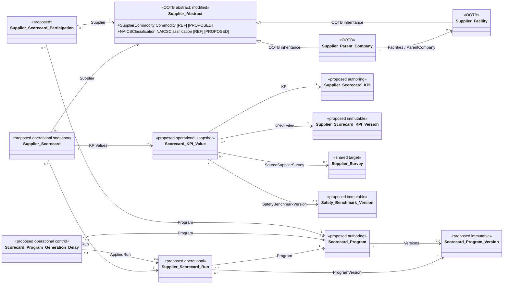
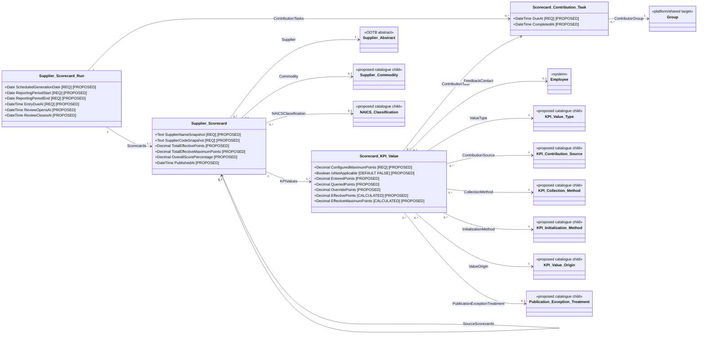
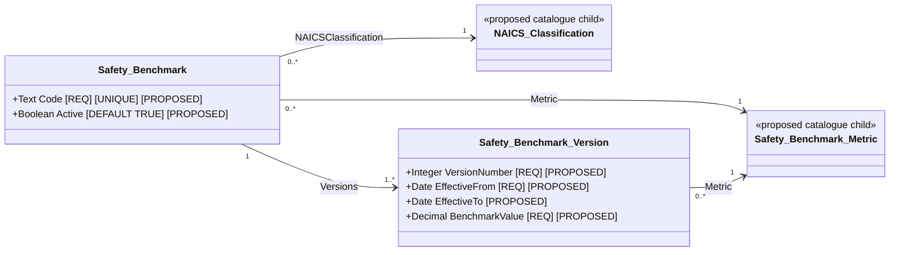

# Supplier Scorecard technical specification

| Property | Value |
|---|---|
| Mode | Target design layered over the separately preserved OOTB SRM baseline |
| Application | Supplier Scorecard, integrated with Supplier Relationship Management |
| As of | 2026-10-20 |
| Status | Technical design for review; configuration has not been implemented |
| Baseline authority | [OOTB SRM logical model](../../ootb-srm-baseline-model/README.md), its field/relationship/inheritance registers, and the six [OOTB SRM workflow documents](../../ootb-srm-baseline-workflows/) extracted from SIA OOTB SRM Export 1.0.0.0 |
| Primary requirements | ADR-058, ADR-086, and ADR-111 through ADR-116 |
| Supporting SRM requirements | ADR-063, ADR-076, ADR-078, ADR-079, ADR-083, and ADR-084 |
| Related target specifications | [Supplier Management Role](supplier-management-role-logical-model.md), [Supplier Status Updates](supplier-status-updates-logical-model.md), [Supplier Surveys](supplier-surveys-technical-specification.md), and [Supplier Tasks](supplier-tasks-technical-specification.md) |
| Supersedes | The Supplier Scorecard section of `../../entity-relationship-diagram.md` as the detailed scorecard design authority |

## 1. Findings and architectural consequences

The OOTB SRM package contains the supplier master and hierarchy needed by Supplier Scorecard, but it does not contain a versioned KPI catalogue, period scorecard records, scorecard contribution orchestration, publication controls, or safety benchmarks. The target therefore adds a specialist Supplier Scorecard configuration while retaining SRM as the authoritative supplier master.

The following boundaries are fundamental:

1. **Supplier identity is reused, not copied.** Every scorecard relates to one existing `Supplier Abstract` record. Parent Company and Facility remain direct descendants of Supplier Abstract, and their separate parent-child record relationship remains intact.
2. **The OOTB supplier workflows remain supplier workflows.** The Parent Company and Facility workflows continue to govern supplier evaluation submission and deactivation. They are not extended into monthly scorecard workflows.
3. **Existing scalar score fields are not the scorecard record.** OOTB `Score`, `Last Score Date`, `Facility Score`, `Average Goods & Service Score`, and `Latest Parent Company Demerits` cannot preserve KPI versions, source results, overrides, applicability, or reporting periods. They are not authoritative in the target.
4. **Configuration is authored, then published.** Editable KPI and Scorecard Program records publish immutable versions. Operational scorecards retain the exact versions used for their reporting period.
5. **A scorecard is a historical operational snapshot.** It preserves supplier identity, hierarchy, commodity, NAICS classification, program version, KPI versions, entered or queried results, overrides, and publication evidence for one period.
6. **Native evidence is preferred.** Native workflow history, audit, execution logs, notification logs, and reminder capabilities provide process evidence. No custom audit, event, publication, dispute, review-response, or reminder-rule object is added.
7. **Contribution work is scorecard-specific.** One Scorecard Contribution Task groups manual KPI values for a Run and contributor group across the applicable supplier population. The design does not create one task per supplier/KPI and does not depend on the proposed generic Supplier Task component.
8. **Review is a window, not hundreds of approvals.** The Scorecard Run owns review-open and review-close timestamps. One broad internal notification is sent, silence at the deadline is consent, and no individual Scorecard Review object is created.
9. **Published scorecards are read only to ordinary users.** A privileged targeted refresh or override may correct one KPI value without automatically recalculating unrelated historical source data.
10. **Source security remains authoritative.** Aggregate scorecard results are secured by scorecard authorization and supplier scope. Opening source transactions re-applies the source application's security.
11. **A generation delay belongs to the stable Program.** An occurrence-specific child record can defer Run creation while users finish and publish configuration; it does not require republishing the Program and does not move the recurrence anchor for later periods.
12. **Selection domains are governed records, not embedded lists.** KPI, Program, benchmark, provenance, and exception selections use M:1 catalogue relationships. Automation evaluates stable catalogue Codes while localizable Names remain presentation labels.
13. **Scorecard catalogues share one abstract definition.** `Supplier Scorecard Abstract Catalog Record` declares Code, Name, Active?, and Sort once. Every catalogue object owned by this specification inherits those fields and declares only its domain-specific additions. The externally owned Recurrence Definition remains outside this scorecard-specific hierarchy.

All new objects, fields, relationships, workflow behavior, and automation below are **Proposed** unless identified as **Extracted**, **Required**, or **Unresolved**. Logical names are not confirmed Intelex internal names, stable metadata identifiers, or physical table names.

## 2. Requirements interpretation and assumptions

| ID | Source | Interpreted requirement | Classification |
|---|---|---|---|
| SC-001 | ADR-058 | Generate period scorecards from a governed, versioned KPI library and preserve the exact KPI definitions used | Required |
| SC-002 | ADR-058 | Support direct-entry and governed-query KPIs in one operational model | Required |
| SC-003 | ADR-058 | Launch with direct entry and convert KPIs to queries only after source data, period context, and scoring logic are validated | Required |
| SC-004 | ADR-058 | Refresh query KPIs while open; after publication permit only deliberate targeted refresh | Required |
| SC-005 | ADR-058, ADR-115 | Preserve queried, overridden, and effective points; restrict overrides and require rationale, actor, and timestamp | Required |
| SC-006 | ADR-058 | Do not import external data directly into scorecard KPI values; a normalized staging dataset remains a deferred option | Required |
| SC-007 | ADR-086 | Generate the preceding-period scorecards on a configured schedule and consolidate manual work by contributor group | Required |
| SC-008 | ADR-086 | Track incomplete and overdue contribution work; supplier nonresponse and missing internal data have different cutoff behavior | Required |
| SC-009 | ADR-086 | Use one time-boxed internal review window, one broad notification, and silence as consent | Required |
| SC-010 | ADR-086 | Publish read-only supplier results without acknowledgement or a formal dispute workflow | Required |
| SC-011 | ADR-111 | Configure initialization as no default, static default, or prior-period effective points | Required |
| SC-012 | ADR-111 | Treat Not Applicable explicitly, set effective maximum points to zero, and never interpret blank as Not Applicable | Required |
| SC-013 | ADR-112 | Use monthly Supplier Surveys for LTIR/TRIR and semiannual Supplier Surveys plus internal scoring for Safety Kaizen | Required |
| SC-014 | ADR-112 | Use effective-dated, versioned safety benchmarks by NAICS classification and metric | Required |
| SC-015 | ADR-113 | Support facility/depot monthly scorecards and parent-company periodic assessment without duplicate parent monthly entry | Proposed ADR; Requires confirmation |
| SC-016 | ADR-114 | Snapshot commodity at scorecard creation and calculate overall and commodity rank on demand | Required |
| SC-017 | ADR-115 | Authorize complete aggregate scorecard access within supplier scope while preserving source-record security on drilldown | Required |
| SC-018 | ADR-115 | Restrict KPI setup, participation, benchmark maintenance, publishing, versioning, and overrides to Supplier Scorecard Application Administrators or system administrators | Required |
| SC-019 | ADR-116 | Use responsive connected-browser views and supplier-profile drilldown; do not build native-mobile/offline forms | Required |
| SC-020 | ADR-076, ADR-078 | Reuse the exact Supplier Abstract hierarchy and supplier-entity access scope | Required |
| SC-021 | ADR-079; Status target | Recheck status capability before generating scorecards; retain historical access after eligibility ends | Required |
| SC-022 | ADR-083 | Expose selected current scorecard measures and drill-through from the Intelex supplier workspace | Required |
| SC-023 | ADR-063 | Permit governed scrap data to supply a KPI without moving debit settlement into Intelex | Required |
| SC-024 | Design assumption | An authorized publication exception for missing internal data must explicitly select the Publication Exception Treatment with Code `SET_TO_ZERO` or `EXCLUDE_FROM_DENOMINATOR`; it cannot silently invent a result | Proposed |
| SC-025 | Design assumption | Category and overall totals are stored and recalculated by an Action Handler/service because executable cross-grid formula support has not been verified | Proposed/Unresolved mechanism |
| SC-026 | Design assumption | Contributor assignment uses an internal platform Group because one contribution task spans many suppliers; assignment never broadens the contributor's supplier or application access | Proposed |
| SC-027 | User clarification | An authorized user can create a Generation Delay from a grid on the stable Scorecard Program, identify one scheduled occurrence, and defer its Run generation until a specified date without changing Program versioning or the recurrence anchor | Required |
| SC-028 | User clarification | Model every defined selection list as an M:1 relationship to a governed catalogue object; define and seed each previously inline value set using standard catalogue composition | Required |
| SC-029 | User clarification | M:1 relationships whose target is a catalogue object must not activate an inverse relationship or expose a target-side inverse grid | Required |
| SC-030 | User clarification | All Supplier Scorecard catalogue objects inherit from one abstract `Supplier Scorecard Abstract Catalog Record` containing Code, Name, Active?, and Sort; child catalogues declare only additional fields | Required |

ADR-113 remains proposed. This specification supports its monthly-facility/periodic-parent pattern but does not make that pattern mandatory. Scorecard Program configuration selects the exact entity level and cadence so implementation can begin at another approved level without redesigning the object model.

## 3. Baseline and target boundary

### 3.1 Extracted baseline retained

| Baseline element | Target use |
|---|---|
| `SupplierMgmt_SupAbstractObject` / Supplier Abstract | Authoritative supplier identity referenced by participation and scorecards |
| `SupplierMgmt_ParentCompnyObject` / Supplier Parent Company | Parent supplier identity and aggregation context |
| `SupplierMgmt_FacilityObject` / Supplier Facility | Facility/depot operational scoring context |
| Parent Company `Facilities` ↔ Facility `ParentCompany` | Existing hierarchy used for parent navigation and governed rollup selection |
| Supplier Contact, Employee, Subject, Group concepts | Recipient, actor, contributor, feedback-contact, and administrator identities |
| Public Profile | Supplier-context navigation; detailed scorecard history is presented through related views |
| Workflow Instance and Workflow Stage concepts | Native process state and history; no custom State or Workflow field is introduced |
| Supplier Evaluation | Retained for the OOTB supplier-evaluation purpose; not converted into KPI values |
| Parent Company and Facility workflows | Retained for evaluation submission/deactivation until separately revised by the lifecycle-status target |

### 3.2 Target treatment of OOTB score-like fields

| Existing field | Treatment |
|---|---|
| Supplier Abstract.Score | Do not write from the scorecard application; deprecate from scorecard reporting after dependency inventory |
| Supplier Abstract.Last Score Date | Do not use as authoritative publication evidence; the new scorecard retains its own reporting period and publication timestamp |
| Facility.Facility Score | Do not write from the scorecard application; replace user navigation with related Scorecards and current-result reporting |
| Facility.Average Goods & Service Score | Retain until dependency inventory proves it unused; do not use as the target category-result authority |
| Parent Company.Latest Parent Company Demerits | Retain until dependency inventory proves it unused; do not treat it as a fiscal-year scorecard |

No baseline object or workflow is silently removed. Deprecation means removal from new scorecard forms, reports, integrations, and calculations after dependency and migration review.

### 3.3 Existing target-design dependencies

- `Supplier Management Role`, `Supplier Specific Role`, and their inherited Group behavior remain authoritative for supplier-scoped roles. Scorecard contribution tasks use internal platform Groups because they consolidate values across suppliers.
- `Supplier Status`, `Process Capability`, and `Status Capability Rule` remain authoritative for lifecycle eligibility. This specification adds required capability seed decisions but does not duplicate the status model.
- `Recurrence Definition` remains authoritative in the Supplier Surveys specification. Scorecard Program references it rather than creating another recurrence object.
- `Supplier Survey` and its checklist/answer model remain authoritative for monthly safety submissions and semiannual Safety Kaizen evidence.
- The generic Supplier Task component is not required for scorecard contribution work. ADR-103's scorecard applicability question remains open.

## 4. Target logical model

Associations drawn from a consuming object to a catalogue show only the source-owned M:1 reference. They do not indicate an activated inverse relationship: every catalogue-targeting M:1 in these diagrams has its inverse option disabled, and no catalogue-side consumer grid is configured.

### 4.1 High-level integration view

### 4.2 Supplier Scorecard catalogue inheritance

```mermaid
classDiagram
direction TB

class Supplier_Scorecard_Abstract_Catalog_Record {
  <<proposed abstract>>
  +Text Code [REQ] [UNIQUE] [PROPOSED]
  +Text Name [REQ] [PROPOSED]
  +Boolean Active [DEFAULT TRUE] [PROPOSED]
  +Float Sort [PROPOSED]
}
class Supplier_Commodity { <<proposed catalogue child>> }
class NAICS_Classification { <<proposed catalogue child>> }
class KPI_Category { <<proposed catalogue child>> }
class KPI_Aggregation_Method {
  <<proposed catalogue child>>
  +LongText Description [REQ] [PROPOSED]
}
class KPI_Value_Type { <<proposed catalogue child>> }
class KPI_Contribution_Source { <<proposed catalogue child>> }
class KPI_Collection_Method { <<proposed catalogue child>> }
class KPI_Initialization_Method { <<proposed catalogue child>> }
class Safety_Benchmark_Metric { <<proposed catalogue child>> }
class Scorecard_Entity_Level { <<proposed catalogue child>> }
class Scorecard_Cadence { <<proposed catalogue child>> }
class KPI_Value_Origin { <<proposed catalogue child>> }
class Publication_Exception_Treatment { <<proposed catalogue child>> }

Supplier_Scorecard_Abstract_Catalog_Record <|-- Supplier_Commodity : inherits
Supplier_Scorecard_Abstract_Catalog_Record <|-- NAICS_Classification : inherits
Supplier_Scorecard_Abstract_Catalog_Record <|-- KPI_Category : inherits
Supplier_Scorecard_Abstract_Catalog_Record <|-- KPI_Aggregation_Method : inherits
Supplier_Scorecard_Abstract_Catalog_Record <|-- KPI_Value_Type : inherits
Supplier_Scorecard_Abstract_Catalog_Record <|-- KPI_Contribution_Source : inherits
Supplier_Scorecard_Abstract_Catalog_Record <|-- KPI_Collection_Method : inherits
Supplier_Scorecard_Abstract_Catalog_Record <|-- KPI_Initialization_Method : inherits
Supplier_Scorecard_Abstract_Catalog_Record <|-- Safety_Benchmark_Metric : inherits
Supplier_Scorecard_Abstract_Catalog_Record <|-- Scorecard_Entity_Level : inherits
Supplier_Scorecard_Abstract_Catalog_Record <|-- Scorecard_Cadence : inherits
Supplier_Scorecard_Abstract_Catalog_Record <|-- KPI_Value_Origin : inherits
Supplier_Scorecard_Abstract_Catalog_Record <|-- Publication_Exception_Treatment : inherits
```

The abstract object is not selectable and must not be instantiated directly. Each child is a distinct relationship target and catalogue administration surface. The shared Recurrence Definition is governed by its authoritative specification and does not inherit from this Supplier Scorecard-specific base.

### 4.3 Published configuration

```mermaid
classDiagram
direction LR

class KPI_Category { <<proposed catalogue child>> }
class KPI_Aggregation_Method {
  <<proposed catalogue child>>
  +LongText Description [REQ] [PROPOSED]
}
class KPI_Value_Type { <<proposed catalogue child>> }
class KPI_Contribution_Source { <<proposed catalogue child>> }
class KPI_Collection_Method { <<proposed catalogue child>> }
class KPI_Initialization_Method { <<proposed catalogue child>> }
class Safety_Benchmark_Metric { <<proposed catalogue child>> }
class Scorecard_Entity_Level { <<proposed catalogue child>> }
class Scorecard_Cadence { <<proposed catalogue child>> }
class Supplier_Scorecard_KPI {
  +Text Code [REQ] [UNIQUE] [PROPOSED]
  +Text Name [REQ] [PROPOSED]
  +Boolean Active [DEFAULT TRUE] [PROPOSED]
}
class Supplier_Scorecard_KPI_Version {
  +Integer VersionNumber [REQ] [PROPOSED]
  +Date EffectiveFrom [REQ] [PROPOSED]
  +Date EffectiveTo [PROPOSED]
  +Decimal MaximumPoints [REQ] [PROPOSED]
}
class Scorecard_Program {
  +Text Code [REQ] [UNIQUE] [PROPOSED]
  +Text Name [REQ] [PROPOSED]
  +Boolean Active [DEFAULT TRUE] [PROPOSED]
}
class Scorecard_Program_Generation_Delay {
  +Date ScheduledGenerationDate [REQ] [PROPOSED]
  +Date DelayUntil [REQ] [PROPOSED]
  +Text Reason [REQ] [PROPOSED]
}
class Scorecard_Program_KPI {
  +Float DisplayOrder [REQ] [PROPOSED]
  +Boolean RequiredForPublication [DEFAULT TRUE] [PROPOSED]
}
class Scorecard_Program_Version {
  +Integer VersionNumber [REQ] [PROPOSED]
  +Date EffectiveFrom [REQ] [PROPOSED]
  +Date EffectiveTo [PROPOSED]
}
class Scorecard_Program_KPI_Version {
  +Float DisplayOrder [REQ] [PROPOSED]
  +Boolean RequiredForPublication [PROPOSED]
}
class Recurrence_Definition { <<shared target>> }
class Group { <<platform/shared target>> }
class Supplier_Management_Role { <<shared target>> }

Supplier_Scorecard_KPI "1" --> "0..*" Supplier_Scorecard_KPI_Version : Versions
Supplier_Scorecard_KPI "0..*" --> "1" KPI_Category : Category
Supplier_Scorecard_KPI "0..*" --> "1" KPI_Aggregation_Method : AggregationMethod
Supplier_Scorecard_KPI "0..*" --> "1" KPI_Value_Type : ValueType
Supplier_Scorecard_KPI "0..*" --> "1" KPI_Contribution_Source : ContributionSource
Supplier_Scorecard_KPI "0..*" --> "1" KPI_Collection_Method : CollectionMethod
Supplier_Scorecard_KPI "0..*" --> "1" KPI_Initialization_Method : InitializationMethod
Supplier_Scorecard_KPI "0..*" --> "0..1" Safety_Benchmark_Metric : SafetyBenchmarkMetric
Supplier_Scorecard_KPI "0..*" --> "0..1" Group : ContributorGroup
Supplier_Scorecard_KPI_Version "0..*" --> "1" KPI_Value_Type : ValueType
Supplier_Scorecard_KPI_Version "0..*" --> "1" KPI_Contribution_Source : ContributionSource
Supplier_Scorecard_KPI_Version "0..*" --> "1" KPI_Collection_Method : CollectionMethod
Supplier_Scorecard_KPI_Version "0..*" --> "1" KPI_Initialization_Method : InitializationMethod
Supplier_Scorecard_KPI_Version "0..*" --> "0..1" Safety_Benchmark_Metric : SafetyBenchmarkMetric

Scorecard_Program "1" --> "1..*" Scorecard_Program_KPI : ProgramKPIs
Scorecard_Program "0..*" --> "1" Scorecard_Entity_Level : EntityLevel
Scorecard_Program "0..*" --> "1" Scorecard_Cadence : Cadence
Scorecard_Program "1" --> "0..*" Scorecard_Program_Generation_Delay : GenerationDelays
Scorecard_Program_KPI "0..*" --> "1" Supplier_Scorecard_KPI : KPI
Scorecard_Program "1" --> "0..*" Scorecard_Program_Version : Versions
Scorecard_Program_Version "1" --> "1..*" Scorecard_Program_KPI_Version : ProgramKPIVersions
Scorecard_Program_Version "0..*" --> "1" Scorecard_Entity_Level : EntityLevel
Scorecard_Program_Version "0..*" --> "1" Scorecard_Cadence : Cadence
Scorecard_Program_KPI_Version "0..*" --> "1" Supplier_Scorecard_KPI : KPI
Scorecard_Program_Version "0..*" --> "1" Recurrence_Definition : RecurrenceDefinition
Scorecard_Program_Version "0..*" --> "1" Group : CoordinatorGroup
Scorecard_Program_Version "0..*" --> "1" Group : ReviewGroup
Scorecard_Program_Version "0..*" --> "0..*" Supplier_Management_Role : SupplierRecipientRoles
```

Program KPI Version deliberately references the stable KPI authoring record rather than one KPI Version. At scorecard generation, the reporting period resolves the exact non-overlapping KPI Version whose effective range contains the period end. This allows a KPI definition to change without republishing an otherwise unchanged Program.

### 4.4 Operational scorecard and contribution model

The Scorecard self-relationship is a native M:N relationship used only when a periodic parent assessment freezes the exact child scorecards included in a rollup. It has no business attributes and therefore does not require a custom junction record.

### 4.5 Safety benchmark configuration

## 5. Object inventory

| Object | State | Parent | Responsibility | Workflow/lifecycle |
|---|---|---|---|---|
| Supplier Scorecard Abstract Catalog Record | New abstract catalogue base | None | Declares the common Code, Name, Active?, and Sort fields for scorecard-owned catalogue objects | Abstract and non-instantiable; no forms, workflow, records, or direct relationships |
| Supplier Commodity | New catalogue child | Supplier Scorecard Abstract Catalog Record | Governed commodity classification used for period peer groups | No workflow; audited administration |
| NAICS Classification | New catalogue child | Supplier Scorecard Abstract Catalog Record | Governed NAICS identity used by supplier profiles and safety benchmarks | No workflow; audited administration |
| KPI Category | New catalogue child | Supplier Scorecard Abstract Catalog Record | Stable grouping and display order for KPI values | No workflow; audited administration |
| KPI Aggregation Method | New catalogue child | Supplier Scorecard Abstract Catalog Record | Governed set of supported parent/period rollup algorithms; directly declares Description | No workflow; audited administration |
| KPI Value Type | New catalogue child | Supplier Scorecard Abstract Catalog Record | Governed typed-value presentation and validation domain | No workflow; audited administration |
| KPI Contribution Source | New catalogue child | Supplier Scorecard Abstract Catalog Record | Governed business-source classification for KPI contributions | No workflow; audited administration |
| KPI Collection Method | New catalogue child | Supplier Scorecard Abstract Catalog Record | Governed mechanism used to collect a KPI value | No workflow; audited administration |
| KPI Initialization Method | New catalogue child | Supplier Scorecard Abstract Catalog Record | Governed method used to initialize a new period value | No workflow; audited administration |
| Safety Benchmark Metric | New catalogue child | Supplier Scorecard Abstract Catalog Record | Governed safety metric identity shared by KPIs and benchmark records | No workflow; audited administration |
| Scorecard Entity Level | New catalogue child | Supplier Scorecard Abstract Catalog Record | Governed supplier hierarchy level at which a Program operates | No workflow; audited administration |
| Scorecard Cadence | New catalogue child | Supplier Scorecard Abstract Catalog Record | Governed reporting cadence for a Program | No workflow; audited administration |
| KPI Value Origin | New catalogue child | Supplier Scorecard Abstract Catalog Record | Governed provenance classification for an operational KPI result | No workflow; audited administration |
| Publication Exception Treatment | New catalogue child | Supplier Scorecard Abstract Catalog Record | Governed scoring treatment for a publication exception | No workflow; audited administration |
| Supplier Scorecard KPI | New authoring object | None | Editable stable KPI identity and next publishable definition | Publish action creates immutable version |
| Supplier Scorecard KPI Version | New immutable version | None | Exact KPI definition effective for a date range | Created only by Publish; read only thereafter |
| Scorecard Program | New authoring object | None | Stable methodology, cadence, entity level, routing, schedule, and KPI membership | Publish action creates a complete version graph |
| Scorecard Program Generation Delay | New operational control | None | Defers one scheduled Program occurrence until a specified date without changing recurrence or version configuration | No workflow; created from Program.Generation Delays grid; audited and read only after application |
| Scorecard Program KPI | New authoring child | None | Includes a stable KPI in one Program with order and requiredness | Editable through Program authoring only |
| Scorecard Program Version | New immutable version | None | Exact Program configuration effective for a date range | Created only by Publish; read only thereafter |
| Scorecard Program KPI Version | New immutable version child | None | Frozen copy of one Program KPI membership row | Created atomically with Program Version |
| Supplier Scorecard Participation | New governed configuration | None | Activates one exact supplier entity for one Program and date range | No workflow; admin-only audited maintenance |
| Safety Benchmark | New authoring object | None | Stable NAICS/metric benchmark identity | Publish action creates immutable version |
| Safety Benchmark Version | New immutable version | None | Effective-dated reference value used by safety scoring | Created only by Publish; read only thereafter |
| Supplier Scorecard Run | New operational parent | None | Coordinates one Program Version and reporting period across suppliers | Preparing → Data Entry → Internal Review → Publication Ready; Published/Cancelled termination |
| Supplier Scorecard | New operational snapshot | None | One supplier/program/period result and publication record | Data Entry → Internal Review → Publication Ready; Published/Cancelled termination |
| Scorecard KPI Value | New operational child | None | One instantiated KPI Version, its captured result, applicability, exception, override, and source evidence | No object workflow; governed by parent stage and privileged actions |
| Scorecard Contribution Task | New operational work record | None | Consolidates internal direct-entry KPI values for one Run and contributor group | Assigned; Completed/Cancelled termination |

No new object inherits Supplier Abstract. Supplier Parent Company and Supplier Facility retain their extracted direct inheritance from Supplier Abstract. The new catalogue inheritance family is separate and rooted only at Supplier Scorecard Abstract Catalog Record.

## 6. Field conventions

- `Text` lengths are 100 characters for stable codes and 255 characters for ordinary names unless otherwise stated.
- All Date/Time fields enable timezone capture.
- All Yes/No fields use checkbox presentation and compare to `TRUE` or `FALSE` in verified expressions.
- Relationship cardinality is stated from the declaring field. Parent grids are inverse views of the child-side relationship and do not create duplicate storage.
- `Display Field` is the configured calculated record label. Exact concatenation syntax must be verified in the target tenant and is not presented here as deployable formula syntax.
- A field described as a snapshot is populated once by a default-value expression or generation service and then remains read only.
- Published version objects are immutable. Configuration changes require a new version.
- Catalogue relationships used by rules are evaluated by stable `Code`, never by localizable `Name`. Inactive catalogue records remain valid on historical/version records but are excluded from new selections.
- For every M:1 relationship whose target is a catalogue object, the Intelex inverse-relationship option is disabled. Catalogue forms do not expose consumer grids; reporting that needs usage analysis queries the declaring source relationship directly.
- Supplier Scorecard-owned catalogue children inherit Code, Name, Active?, and Sort directly from Supplier Scorecard Abstract Catalog Record and must not redeclare or shadow those fields. Only child-specific additions are declared locally.
- Calculations below are declarative logic. Executable Intelex expressions must be verified during build.

## 7. Catalogue objects

### 7.1 Supplier Scorecard Abstract Catalog Record

This proposed abstract object is the direct parent of every Supplier Scorecard-owned catalogue in Sections 7.2 through 7.14. It cannot be instantiated, selected by an M:1 field, or exposed as an administration form. Its fields are inherited by each concrete child and are not redeclared on those children.

| Field | Type / relationship | Req | Default / calculation | Editability and visibility | Automation / lifecycle |
|---|---|---:|---|---|---|
| Code | Text, max 100, non-localizable | Y | None; intended unique within each concrete child object; exact inherited uniqueness scope requires tenant validation | Administrator editable before first use; thereafter stable | Stable integration, reporting, and automation key; rules never branch on Name |
| Name | Text, max 255, localizable | Y | None; display field on each concrete child | Administrator editable on the concrete child | Business-facing label; changes do not change Code-based behavior or stored code snapshots |
| Active? | Yes/No | Y | `TRUE` | Administrator editable on the concrete child | Inactive records remain valid for version and operational history but are excluded from new selections |
| Sort | Float | N | `NULL` | Administrator editable on the concrete child | Orders selection and presentation within the concrete child catalogue |

The intended business key is `(concrete catalogue type, Code)`, because the same Code can legitimately appear in different catalogues. Confirm that the target tenant can enforce uniqueness at the concrete-child scope for an inherited field. If the platform instead enforces uniqueness across the entire inheritance family, the implementation must use approved globally distinct codes or a validated child-scoped uniqueness mechanism before seed data is loaded. The parent has no records and therefore no values of its own. M:1 fields continue to target the appropriate concrete child and keep their inverse relationship disabled.

Seed-data tables below repeat the inherited field columns so they can be used directly for configuration and import. They do not imply that the fields are redeclared on the child object.

### 7.2 Supplier Commodity

**Parent:** Supplier Scorecard Abstract Catalog Record  
**Directly declared fields:** None. Code, Name, Active?, and Sort are inherited. Historical Scorecards retain Commodity code/name snapshots, so later inherited Name changes do not rewrite published history.

### 7.3 NAICS Classification

**Parent:** Supplier Scorecard Abstract Catalog Record  
**Directly declared fields:** None. Code, Name, Active?, and Sort are inherited. Historical Scorecards retain NAICS code/name snapshots.

### 7.4 KPI Category

**Parent:** Supplier Scorecard Abstract Catalog Record  
**Directly declared fields:** None. Code, Name, Active?, and Sort are inherited. Inherited Sort supplies the default category presentation order.

### 7.5 KPI Aggregation Method

**Parent:** Supplier Scorecard Abstract Catalog Record  
**Inherited fields:** Code, Name, Active?, and Sort.

| Directly declared field | Type / relationship | Req | Default / calculation | Editability and visibility | Automation / lifecycle |
|---|---|---:|---|---|---|
| Description | Long Text | Y | None | Administrator editable | Plain-language algorithm and valid source value types |

Initial method codes and exact algorithms are release configuration, not universal platform rules. At minimum, the approved set must address sum, average, weighted average, latest applicable value, and no rollup where those behaviors are required. Unsupported methods must block Publish.

### 7.6 KPI Value Type

**Parent:** Supplier Scorecard Abstract Catalog Record  
**Directly declared fields:** None. Code, Name, Active?, and Sort are inherited.

Initial values:

| Code | Name | Active? | Sort |
|---|---|---:|---:|
| `NUMBER` | Number | `TRUE` | 10 |
| `PERCENTAGE` | Percentage | `TRUE` | 20 |
| `CURRENCY` | Currency | `TRUE` | 30 |
| `DATE` | Date | `TRUE` | 40 |
| `YES_NO` | Yes/No | `TRUE` | 50 |
| `TEXT` | Text | `TRUE` | 60 |

### 7.7 KPI Contribution Source

**Parent:** Supplier Scorecard Abstract Catalog Record  
**Directly declared fields:** None. Code, Name, Active?, and Sort are inherited.

Initial values:

| Code | Name | Active? | Sort |
|---|---|---:|---:|
| `INTERNAL` | Internal | `TRUE` | 10 |
| `SUPPLIER` | Supplier | `TRUE` | 20 |
| `AUTOMATED` | Automated | `TRUE` | 30 |

### 7.8 KPI Collection Method

**Parent:** Supplier Scorecard Abstract Catalog Record  
**Directly declared fields:** None. Code, Name, Active?, and Sort are inherited.

Initial values:

| Code | Name | Active? | Sort |
|---|---|---:|---:|
| `DIRECT_ENTRY` | Direct Entry | `TRUE` | 10 |
| `QUERY` | Query | `TRUE` | 20 |

### 7.9 KPI Initialization Method

**Parent:** Supplier Scorecard Abstract Catalog Record  
**Directly declared fields:** None. Code, Name, Active?, and Sort are inherited.

Initial values:

| Code | Name | Active? | Sort |
|---|---|---:|---:|
| `NO_DEFAULT` | No Default | `TRUE` | 10 |
| `STATIC_DEFAULT` | Static Default | `TRUE` | 20 |
| `PRIOR_PERIOD` | Prior Period | `TRUE` | 30 |

### 7.10 Safety Benchmark Metric

**Parent:** Supplier Scorecard Abstract Catalog Record  
**Directly declared fields:** None. Code, Name, Active?, and Sort are inherited.

Initial values:

| Code | Name | Active? | Sort |
|---|---|---:|---:|
| `LTIR` | LTIR | `TRUE` | 10 |
| `TRIR` | TRIR | `TRUE` | 20 |

### 7.11 Scorecard Entity Level

**Parent:** Supplier Scorecard Abstract Catalog Record  
**Directly declared fields:** None. Code, Name, Active?, and Sort are inherited.

Initial values:

| Code | Name | Active? | Sort |
|---|---|---:|---:|
| `SUPPLIER_PARENT_COMPANY` | Supplier Parent Company | `TRUE` | 10 |
| `SUPPLIER_FACILITY` | Supplier Facility | `TRUE` | 20 |

### 7.12 Scorecard Cadence

**Parent:** Supplier Scorecard Abstract Catalog Record  
**Directly declared fields:** None. Code, Name, Active?, and Sort are inherited.

Initial values:

| Code | Name | Active? | Sort |
|---|---|---:|---:|
| `MONTHLY` | Monthly | `TRUE` | 10 |
| `FISCAL_YEAR` | Fiscal Year | `TRUE` | 20 |

Adding a cadence record alone does not implement its scheduler semantics. Program Publish must reject any active cadence whose Code has no approved period-boundary and recurrence mapping.

### 7.13 KPI Value Origin

**Parent:** Supplier Scorecard Abstract Catalog Record  
**Directly declared fields:** None. Code, Name, Active?, and Sort are inherited.

Initial values:

| Code | Name | Active? | Sort |
|---|---|---:|---:|
| `NO_VALUE` | No Value | `TRUE` | 10 |
| `STATIC_DEFAULT` | Static Default | `TRUE` | 20 |
| `PRIOR_PERIOD` | Prior Period | `TRUE` | 30 |
| `DIRECT_ENTRY` | Direct Entry | `TRUE` | 40 |
| `QUERY` | Query | `TRUE` | 50 |
| `SUPPLIER_NONRESPONSE_ZERO` | Supplier Nonresponse Zero | `TRUE` | 60 |
| `ADMINISTRATOR_OVERRIDE` | Administrator Override | `TRUE` | 70 |
| `NOT_APPLICABLE` | Not Applicable | `TRUE` | 80 |
| `PUBLICATION_EXCEPTION` | Publication Exception | `TRUE` | 90 |

### 7.14 Publication Exception Treatment

**Parent:** Supplier Scorecard Abstract Catalog Record  
**Directly declared fields:** None. Code, Name, Active?, and Sort are inherited.

Initial values:

| Code | Name | Active? | Sort |
|---|---|---:|---:|
| `SET_TO_ZERO` | Set to Zero | `TRUE` | 10 |
| `EXCLUDE_FROM_DENOMINATOR` | Exclude from Denominator | `TRUE` | 20 |

## 8. KPI configuration and versioning

### 8.1 Supplier Scorecard KPI — authoring object

| Field | Type / relationship | Req | Default / calculation | Editability and visibility | Automation / lifecycle |
|---|---|---:|---|---|---|
| Code | Text, max 100 | Y | None; unique | Scorecard administrator editable; stable after first Publish | Non-localizable reporting/integration key |
| Name | Text, max 255 | Y | None; display field | Scorecard administrator editable | Copied to Version |
| Description | Long Text | Y | None | Scorecard administrator editable | Copied to Version |
| Active? | Yes/No | Y | `TRUE` | Scorecard administrator editable | Prevents new program selection/generation but does not invalidate history |
| Category | M:1 to KPI Category; inverse disabled | Y | None; filter `Active?=TRUE` for new selection | Scorecard administrator editable | Copied to Version |
| Value Type | M:1 to KPI Value Type; inverse disabled | Y | None; filter `Active?=TRUE` for new selection | Scorecard administrator editable | Controls which `Value -` field appears; rules evaluate KPI Value Type.Code |
| Contribution Source | M:1 to KPI Contribution Source; inverse disabled | Y | None; filter `Active?=TRUE` for new selection | Scorecard administrator editable | Separates business source from collection mechanism; rules evaluate Code |
| Collection Method | M:1 to KPI Collection Method; inverse disabled | Y | `DIRECT_ENTRY` catalogue record | Scorecard administrator editable; filter `Active?=TRUE` for new selection | Query makes source configuration conditionally required; rules evaluate Code |
| Contributor Group | M:1 to platform Group | Conditional | `NULL` | Visible and required only when Contribution Source.Code=`INTERNAL` and Collection Method.Code=`DIRECT_ENTRY` | Copied to Version; group membership is evaluated at action time |
| Feedback Contact | M:1 to Employee | Y | None | Scorecard administrator editable | Copied to Version and operational value; exposed on published detail |
| Maximum Points | Decimal | Y | None; must be greater than or equal to zero | Scorecard administrator editable | Copied to Version and KPI Value |
| Initialization Method | M:1 to KPI Initialization Method; inverse disabled | Y | `NO_DEFAULT` catalogue record | Scorecard administrator editable; filter `Active?=TRUE` for new selection | Copied to Version; rules evaluate Code |
| Static Default Points | Decimal | Conditional | `NULL` | Visible/required only when Initialization Method.Code=`STATIC_DEFAULT`; otherwise hidden and cleared | Must be within zero and Maximum Points unless approved scoring allows negative values |
| May Be Not Applicable? | Yes/No | Y | `FALSE` | Scorecard administrator editable | Copied to Version |
| Supplier Nonresponse Sets Zero? | Yes/No | Y | `FALSE` | Editable only when Contribution Source.Code=`SUPPLIER`; otherwise hidden and forced `FALSE` | Drives cutoff service; copied to Version |
| Aggregation Method | M:1 to KPI Aggregation Method; inverse disabled | Y | None | Scorecard administrator editable; filter active methods | Copied to Version |
| Source Application | Text, max 255 | Conditional | `NULL` | Visible/required when Collection Method.Code=`QUERY`; hidden and cleared for `DIRECT_ENTRY` | Business name of authoritative source |
| Source Report Reference | Text, max 255 | Conditional | `NULL` | Visible/required when Collection Method.Code=`QUERY` | Exact report/query binding mechanism is tenant-specific and unresolved |
| Source Calculation Description | Long Text | Conditional | `NULL` | Visible/required when Collection Method.Code=`QUERY` | Declarative source filters, period boundary, supplier matching, aggregation, and points logic; not executable formula text |
| Safety Benchmark Metric | M:1 to Safety Benchmark Metric; inverse disabled | N | `NULL`; filter `Active?=TRUE` for new selection | Visible for safety benchmark KPIs; clear when not used | Causes generation/query capture to resolve a Safety Benchmark Version by Metric.Code |
| Effective From | Date | Y | None | Scorecard administrator editable for the next Publish | Copied to Version; inclusive |
| Effective To | Date | N | `NULL` | Scorecard administrator editable for the next Publish | Copied to Version; inclusive; blank means open-ended |
| Versions | Inverse 1:M grid from KPI Version.KPI | N | None | Read only | Navigation only; no duplicate stored relationship |

Value Type is required by ADR-058, but its initial values were not supplied. Section 7 defines a proposed governed catalogue and seed values. They must be confirmed against the first KPI catalogue before configuration is locked.

### 8.2 Supplier Scorecard KPI Version — immutable object

| Field | Type / relationship | Req | Default / calculation | Editability and visibility | Automation / lifecycle |
|---|---|---:|---|---|---|
| KPI | M:1 to Supplier Scorecard KPI; inverse `Versions` 1:M | Y | Source authoring KPI | Read only | Set by Publish |
| Version Number | Integer | Y | One greater than maximum Version Number in KPI.Versions; first is 1 | Read only | Assigned atomically; uniqueness `(KPI, Version Number)` |
| Name | Text, max 255 | Y | Copy KPI.Name | Read only | Publish mapping |
| Description | Long Text | Y | Copy KPI.Description | Read only | Publish mapping |
| Category | M:1 to KPI Category; inverse disabled | Y | Copy KPI.Category | Read only | Publish mapping |
| Value Type | M:1 to KPI Value Type; inverse disabled | Y | Copy KPI.Value Type | Read only | Publish mapping preserves the exact catalogue record |
| Contribution Source | M:1 to KPI Contribution Source; inverse disabled | Y | Copy KPI.Contribution Source | Read only | Publish mapping preserves the exact catalogue record |
| Collection Method | M:1 to KPI Collection Method; inverse disabled | Y | Copy KPI.Collection Method | Read only | Publish mapping preserves the exact catalogue record |
| Contributor Group | M:1 to Group | Conditional | Copy KPI.Contributor Group | Read only | Publish mapping |
| Feedback Contact | M:1 to Employee | Y | Copy KPI.Feedback Contact | Read only | Publish mapping |
| Maximum Points | Decimal | Y | Copy KPI.Maximum Points | Read only | Publish mapping |
| Initialization Method | M:1 to KPI Initialization Method; inverse disabled | Y | Copy KPI.Initialization Method | Read only | Publish mapping preserves the exact catalogue record |
| Static Default Points | Decimal | Conditional | Copy KPI.Static Default Points | Read only | Publish mapping |
| May Be Not Applicable? | Yes/No | Y | Copy KPI.May Be Not Applicable? | Read only | Publish mapping |
| Supplier Nonresponse Sets Zero? | Yes/No | Y | Copy KPI.Supplier Nonresponse Sets Zero? | Read only | Publish mapping |
| Aggregation Method | M:1 to KPI Aggregation Method; inverse disabled | Y | Copy KPI.Aggregation Method | Read only | Publish mapping |
| Source Application | Text | Conditional | Copy KPI.Source Application | Read only | Publish mapping |
| Source Report Reference | Text | Conditional | Copy KPI.Source Report Reference | Read only | Publish mapping |
| Source Calculation Description | Long Text | Conditional | Copy KPI.Source Calculation Description | Read only | Publish mapping |
| Safety Benchmark Metric | M:1 to Safety Benchmark Metric; inverse disabled | N | Copy KPI.Safety Benchmark Metric | Read only | Publish mapping preserves the exact catalogue record |
| Effective From | Date | Y | Copy KPI.Effective From | Read only | Publish mapping |
| Effective To | Date | N | Copy KPI.Effective To | Read only | Publish mapping |
| Published At | Date/Time with timezone | Y | Current server timestamp | Read only | Set by Publish |
| Published By | M:1 to Employee | Y | Authenticated actor | Read only | Set by Publish |

### 8.3 KPI Publish action

Publish is available only to Supplier Scorecard Application Administrators and system administrators. It must:

1. validate required and conditional fields;
2. validate Effective To is null or not earlier than Effective From;
3. validate no existing KPI Version for the same KPI has an overlapping effective range;
4. validate the collection method, contributor, source, default, applicability, and aggregation combinations;
5. validate any static default against the scoring range;
6. lock against concurrent Publish;
7. create exactly one complete KPI Version using the mapping above;
8. assign Version Number deterministically; and
9. roll back the entire operation if any mapped value cannot be created.

KPI Version records cannot be edited, deleted, imported over, or re-dated after Publish. Correction requires a new version with a reviewed effective range.

## 9. Scorecard Program configuration and versioning

### 9.1 Scorecard Program — authoring object

| Field | Type / relationship | Req | Default / calculation | Editability and visibility | Automation / lifecycle |
|---|---|---:|---|---|---|
| Code | Text, max 100 | Y | None; unique | Scorecard administrator editable; stable after first Publish | Stable reporting/integration key |
| Name | Text, max 255 | Y | None; display field | Scorecard administrator editable | Copied to Version |
| Description | Long Text | N | `NULL` | Scorecard administrator editable | Copied to Version |
| Active? | Yes/No | Y | `TRUE` | Scorecard administrator editable | Prevents new participation/generation without invalidating history |
| Entity Level | M:1 to Scorecard Entity Level; inverse disabled | Y | None; filter `Active?=TRUE` for new selection | Scorecard administrator editable | Validated by Entity Level.Code against Supplier Abstract.Type of Supplier Entity during participation and generation |
| Cadence | M:1 to Scorecard Cadence; inverse disabled | Y | `MONTHLY` catalogue record; filter `Active?=TRUE` for new selection | Scorecard administrator editable | Initial values reflect current ADRs; future cadence is added as governed catalogue configuration plus supported scheduler logic |
| Recurrence Definition | M:1 to shared Recurrence Definition catalogue; inverse disabled | Y | None; filter to Scorecard-supported active values | Scorecard administrator editable | Supplies schedule expression; exact Event Service interpretation must be verified |
| Entry Window Days | Integer | Y | None; greater than or equal to zero | Scorecard administrator editable | Run service calculates Entry Due At from Generation At |
| Review Window Days | Integer | Y | None; greater than zero | Scorecard administrator editable | Run service calculates Review Closes At when review opens |
| Coordinator Group | M:1 to Group | Y | None | Scorecard administrator editable | Owns the Run stages and exception follow-up; does not expand record access |
| Review Group | M:1 to Group | Y | None | Scorecard administrator editable | Receives one internal review notification |
| Supplier Recipient Roles | M:N to Supplier Management Role | Y | None | Scorecard administrator editable | Publish copies the stable role references to Program Version; operational notification resolves exact supplier roles |
| Rollup Source Program | M:1 self-reference to Scorecard Program | Conditional | `NULL` | Visible/required for a parent periodic program that derives child results; hidden and cleared otherwise | Must have a compatible child entity level and cadence |
| Effective From | Date | Y | None | Scorecard administrator editable for next Publish | Copied to Version |
| Effective To | Date | N | `NULL` | Scorecard administrator editable for next Publish | Copied to Version |
| Program KPIs | Inverse 1:M grid from Scorecard Program KPI.Program | Y | None | Authoring grid editable by scorecard administrators | At least one active row required to Publish |
| Versions | Inverse 1:M grid from Scorecard Program Version.Program | N | None | Read only | Navigation only |
| Generation Delays | Inverse 1:M grid from Scorecard Program Generation Delay.Program | N | None | Scorecard administrators may initiate a new Generation Delay form from this grid; existing applied rows are read only | Operational control outside the published version graph |

### 9.2 Scorecard Program KPI — authoring child

| Field | Type / relationship | Req | Default / calculation | Editability and visibility | Automation / lifecycle |
|---|---|---:|---|---|---|
| Program | M:1 to Scorecard Program; inverse `Program KPIs` 1:M | Y | Parent context | Read only after creation | Declaring relationship; unique pair `(Program, KPI)` |
| KPI | M:1 to Supplier Scorecard KPI | Y | None; filter `Active?=TRUE` | Scorecard administrator editable until Program Publish | Stable authoring identity; exact KPI Version resolves at operational generation |
| Display Order | Float | Y | None | Scorecard administrator editable | Copied to Program KPI Version |
| Required for Publication? | Yes/No | Y | `TRUE` | Scorecard administrator editable | Copied to Program KPI Version; drives publication validation |

### 9.3 Scorecard Program Version — immutable object

| Field | Type / relationship | Req | Default / calculation | Editability and visibility | Automation / lifecycle |
|---|---|---:|---|---|---|
| Program | M:1 to Scorecard Program; inverse `Versions` 1:M | Y | Source Program | Read only | Set by Publish |
| Version Number | Integer | Y | One greater than maximum Version Number in Program.Versions; first is 1 | Read only | Atomic uniqueness `(Program, Version Number)` |
| Name | Text | Y | Copy Program.Name | Read only | Publish mapping |
| Description | Long Text | N | Copy Program.Description | Read only | Publish mapping |
| Entity Level | M:1 to Scorecard Entity Level; inverse disabled | Y | Copy Program.Entity Level | Read only | Publish mapping preserves the exact catalogue record |
| Cadence | M:1 to Scorecard Cadence; inverse disabled | Y | Copy Program.Cadence | Read only | Publish mapping preserves the exact catalogue record |
| Recurrence Definition | M:1 to Recurrence Definition catalogue; inverse disabled | Y | Copy Program.Recurrence Definition | Read only | Publish mapping |
| Entry Window Days | Integer | Y | Copy Program.Entry Window Days | Read only | Publish mapping |
| Review Window Days | Integer | Y | Copy Program.Review Window Days | Read only | Publish mapping |
| Coordinator Group | M:1 to Group | Y | Copy Program.Coordinator Group | Read only | Publish mapping |
| Review Group | M:1 to Group | Y | Copy Program.Review Group | Read only | Publish mapping |
| Supplier Recipient Roles | M:N to Supplier Management Role | Y | Copy all Program.Supplier Recipient Roles | Read only | Publish must copy the complete relationship set atomically |
| Rollup Source Program | M:1 to Scorecard Program | Conditional | Copy Program.Rollup Source Program | Read only | Publish mapping |
| Effective From | Date | Y | Copy Program.Effective From | Read only | Publish mapping |
| Effective To | Date | N | Copy Program.Effective To | Read only | Publish mapping |
| Published At | Date/Time with timezone | Y | Current server timestamp | Read only | Set by Publish |
| Published By | M:1 to Employee | Y | Authenticated actor | Read only | Set by Publish |
| Program KPI Versions | Inverse 1:M grid from Scorecard Program KPI Version.Program Version | Y | Generated set | Read only | Complete child graph created by Publish |

### 9.4 Scorecard Program KPI Version — immutable child

| Field | Type / relationship | Req | Default / calculation | Editability and visibility | Automation / lifecycle |
|---|---|---:|---|---|---|
| Program Version | M:1 to Scorecard Program Version; inverse `Program KPI Versions` 1:M | Y | Newly published Program Version | Read only | Declaring relationship |
| Source Program KPI | M:1 to Scorecard Program KPI | Y | Source authoring row | Read only | Provides traceability |
| KPI | M:1 to Supplier Scorecard KPI | Y | Copy Source Program KPI.KPI | Read only | Exact KPI Version resolves at scorecard generation |
| Display Order | Float | Y | Copy Source Program KPI.Display Order | Read only | Publish mapping |
| Required for Publication? | Yes/No | Y | Copy Source Program KPI.Required for Publication? | Read only | Publish mapping |

### 9.5 Program Publish action

Program Publish must validate the complete authoring graph, create the Program Version and every Program KPI Version in one logical transaction, and copy the full Supplier Recipient Roles set. It must block:

- an empty Program KPI grid;
- duplicate KPI membership;
- missing or inactive configuration targets;
- overlapping Program Version effective ranges;
- an unsupported cadence/recurrence combination;
- an entity-level conflict with Rollup Source Program;
- a rollup cycle; or
- missing coordinator, reviewer, or supplier recipient routing.

Failure must leave no partial Program Version. Published versions and their child rows are immutable.

### 9.6 Scorecard Program Generation Delay — operational control

A Generation Delay applies to one scheduled occurrence of the stable Program. It is deliberately not copied into Program Version: users must be able to delay generation while a new version is still being authored and before that version can be published.

| Field | Type / relationship | Req | Default / calculation | Editability and visibility | Automation / lifecycle |
|---|---|---:|---|---|---|
| Display Field | Calculated Text | Y | Program.Name plus Scheduled Generation Date; exact syntax unresolved | Read only | Configured display value |
| Program | M:1 to Scorecard Program; inverse `Generation Delays` 1:M | Y | Default from the Program grid context | Read only from creation | Declaring relationship; the New action is initiated from the Program.Generation Delays grid |
| Scheduled Generation Date | Date | Y | User selects the original recurrence occurrence being delayed | Scorecard administrator editable until an Applied Run exists | Must be a valid occurrence for Program.Recurrence Definition and must not already have a Run |
| Delay Until | Date | Y | None | Scorecard administrator editable until an Applied Run exists | Must be later than Scheduled Generation Date; generation may occur on the first scheduler execution on or after this date |
| Reason | Long Text | Y | None | Scorecard administrator editable until an Applied Run exists; internal only | Native object audit preserves creation and changes |
| Applied Run | M:1 to Supplier Scorecard Run; inverse `Generation Delay` 0..1 | N | `NULL` | Read only | Generation service sets after the unique delayed Run is created successfully |
| Applied At | Date/Time with timezone | N | `NULL` | Read only | Generation service stamps when Applied Run is set |

Enforce uniqueness on `(Program, Scheduled Generation Date)`. The form blocks creation when a Run already exists for that Program occurrence. Before Applied Run is populated, an administrator may extend or shorten Delay Until; native audit history preserves the original and revised dates. Setting Delay Until to the current or next permitted generation date provides early release without a separate workflow or custom status field.

The Generation Delays grid shows Scheduled Generation Date, Delay Until, Reason, Created By/At, Applied Run, and Applied At. Platform-provided Created By/At fields are used rather than duplicating custom actor/timestamp fields. Applied records are immutable and cannot be deleted through ordinary administration.

The delay does not itself select or reserve a Program Version. On or after Delay Until, generation still resolves the Version whose effective range covers the reporting period. If the previous Version remains intentionally effective for that period, it may be used; if the revised Version is required, the Program Version effective ranges must make that requirement explicit. When no Version covers the period, generation remains blocked and reported rather than falling back by publication recency.

## 10. Participation and supplier-master changes

### 10.1 Supplier Scorecard Participation

| Field | Type / relationship | Req | Default / calculation | Editability and visibility | Automation / lifecycle |
|---|---|---:|---|---|---|
| Display Field | Calculated Text | Y | `Supplier.Name + " - " + Program.Name`; exact syntax unresolved | Read only | Configured display value |
| Supplier | M:1 to Supplier Abstract; inverse `Scorecard Participations` 1:M | Y | Supplier context | Scorecard administrator editable only on creation; then read only | Must match Program.Entity Level at generation |
| Program | M:1 to Scorecard Program; inverse `Participations` 1:M | Y | None; filter `Active?=TRUE` | Scorecard administrator editable only on creation; then read only | Stable Program identity; generation resolves effective Program Version |
| Active? | Yes/No | Y | `TRUE` | Scorecard administrator editable | Inactive stops future generation only |
| Effective From | Date | Y | None | Scorecard administrator editable | Inclusive participation start |
| Effective To | Date | N | `NULL` | Scorecard administrator editable | Inclusive participation end |
| Notes | Long Text | N | `NULL` | Scorecard administrator editable; internal only | Configuration rationale; audit enabled |

Enforce non-overlapping active participation ranges for the same `(Supplier, Program)` pair. Participation cannot override a Deny from the status-capability matrix.

### 10.2 Supplier Abstract — proposed shared changes

These fields are declared once on Supplier Abstract and inherited by Supplier Parent Company and Supplier Facility.

| Field | Type / relationship | Req | Default / calculation | Editability and visibility | Automation / lifecycle |
|---|---|---:|---|---|---|
| Commodity | M:1 to Supplier Commodity; inverse disabled | N globally; conditionally required for ranked participants | `NULL` on parent; Facility defaults from Parent Company.Commodity | Authorized supplier-master maintainers; Facility read only in initial release | Parent change synchronizes participating child facilities while facility override remains unapproved; scorecards snapshot the value at creation |
| NAICS Classification | M:1 to NAICS Classification; inverse disabled | N globally; conditionally required for benchmarked safety KPIs | `NULL` | Authorized supplier-master maintainers | Scorecards snapshot the value at creation; missing classification blocks only benchmark-dependent capture unless an authorized publication exception is used |
| Scorecard Participations | Inverse 1:M grid | N | Derived from Participation.Supplier | Read only to ordinary users | Navigation only |
| Scorecards | Inverse 1:M grid | N | Derived from Supplier Scorecard.Supplier | Read only | Supplier profile/history navigation; no duplicate relationship |

`Type of Supplier Entity`, already proposed in the Supplier Surveys target specification, is reused for entity-level validation. This specification does not create another discriminator.

Initial release policy inherits Commodity from Parent Company to Facility and keeps the facility field read only. ADR-114's pending facility-override decision can later change editability without changing the field or historical scorecard snapshots.

Commodity synchronization uses two explicit Action Handlers in the initial release:

1. A Facility Create/Update handler watches `Parent Company`. When the relationship is populated, it copies `Parent Company.Commodity` to the inherited Facility.Commodity field. It does not use runtime type inspection; the concrete Facility form/handler supplies the entity context.
2. A Parent Company Update handler watches `Commodity`. When it changes, it updates Commodity on each related Facility because facility override is not initially permitted. The handler is idempotent, records ordinary object audit history, reports partial child-update failures to SRM administration, and does not retrigger itself from metadata-only changes.

If facility-level override is later approved, these handlers and field permissions require a coordinated revision. The design must then distinguish inherited from overridden Commodity explicitly rather than silently continuing to overwrite facility choices.

### 10.3 Status capability integration

Add or confirm these Process Capability decisions in the Supplier Status target:

- `GENERATE_MONTHLY_SUPPLIER_SCORECARD` — initially Allow for Active, Deny for Service Parts Only and Inactive, subject to final matrix approval.
- `GENERATE_PERIODIC_PARENT_ASSESSMENT` — required only if ADR-113 is approved; seed decisions require business confirmation.

The scheduled generator rechecks the applicable capability immediately before creating each Scorecard. A parent restriction applies to a facility under the status target. Historical Scorecards remain visible under ordinary security even when generation becomes ineligible.

## 11. Safety benchmark configuration

### 11.1 Safety Benchmark — authoring object

| Field | Type / relationship | Req | Default / calculation | Editability and visibility | Automation / lifecycle |
|---|---|---:|---|---|---|
| Code | Text, max 100 | Y | None; unique | Scorecard administrator editable; stable after first Publish | Recommended deterministic pattern based on NAICS and Metric |
| Name | Text, max 255 | Y | None; display field | Scorecard administrator editable | Business label |
| Active? | Yes/No | Y | `TRUE` | Scorecard administrator editable | Prevents new selection/publish; history retained |
| NAICS Classification | M:1 to NAICS Classification; inverse disabled | Y | None; active selection only | Scorecard administrator editable | Stable after first Publish |
| Metric | M:1 to Safety Benchmark Metric; inverse disabled | Y | None; filter `Active?=TRUE` for new selection | Scorecard administrator editable | Stable after first Publish; rules evaluate Metric.Code |
| Benchmark Value | Decimal | Y | None; greater than or equal to zero | Scorecard administrator editable for next Publish | Copied to Version |
| Source | Long Text | Y | None | Scorecard administrator editable | Citation/provenance copied to Version |
| Effective From | Date | Y | None | Scorecard administrator editable | Copied to Version |
| Effective To | Date | N | `NULL` | Scorecard administrator editable | Copied to Version |
| Versions | Inverse 1:M grid from Safety Benchmark Version.Benchmark | N | None | Read only | Navigation only |

Enforce one Safety Benchmark authoring record per `(NAICS Classification, Metric)`. Updated values are new versions, not new benchmark identities.

### 11.2 Safety Benchmark Version

| Field | Type / relationship | Req | Default / calculation | Editability and visibility | Automation / lifecycle |
|---|---|---:|---|---|---|
| Benchmark | M:1 to Safety Benchmark; inverse `Versions` 1:M | Y | Source Benchmark | Read only | Set by Publish |
| Version Number | Integer | Y | Max related version + 1; first is 1 | Read only | Atomic uniqueness `(Benchmark, Version Number)` |
| NAICS Classification | M:1 to NAICS Classification; inverse disabled | Y | Copy Benchmark.NAICS Classification | Read only | Publish mapping |
| Metric | M:1 to Safety Benchmark Metric; inverse disabled | Y | Copy Benchmark.Metric | Read only | Publish mapping preserves the exact catalogue record |
| Benchmark Value | Decimal | Y | Copy Benchmark.Benchmark Value | Read only | Publish mapping |
| Source | Long Text | Y | Copy Benchmark.Source | Read only | Publish mapping |
| Effective From | Date | Y | Copy Benchmark.Effective From | Read only | Publish mapping |
| Effective To | Date | N | Copy Benchmark.Effective To | Read only | Publish mapping |
| Published At | Date/Time with timezone | Y | Current server timestamp | Read only | Set by Publish |
| Published By | M:1 to Employee | Y | Authenticated actor | Read only | Set by Publish |

Benchmark Publish validates non-overlapping effective ranges for the stable Benchmark. At KPI capture, select the Version whose range contains the Scorecard.Reporting Period End. When none contains the date, ADR-112 permits the latest Version with Effective From before the period end. Missing benchmark or NAICS classification is reported as an owned exception; it never silently selects another industry.

## 12. Operational objects

### 12.1 Supplier Scorecard Run

| Field | Type / relationship | Req | Default / calculation | Editability and visibility | Automation / lifecycle |
|---|---|---:|---|---|---|
| Display Field | Calculated Text | Y | Program Version.Name plus Reporting Period End; exact syntax unresolved | Read only | Configured display value |
| Program | M:1 to Scorecard Program; inverse `Runs` 1:M | Y | Stable Program that produced the scheduled occurrence | Read only | Supports occurrence uniqueness independently of the resolved Version |
| Program Version | M:1 to Scorecard Program Version; inverse `Runs` 1:M | Y | Resolved from Program and reporting period | Read only after creation | Exact immutable configuration used by this occurrence |
| Scheduled Generation Date | Date | Y | Original due occurrence calculated from Program recurrence | Read only | Preserves the recurrence anchor even when actual generation is delayed; uniqueness `(Program, Scheduled Generation Date)` |
| Reporting Period Start | Date | Y | Calculated by scheduler from recurrence/cadence | Read only | Stored period boundary |
| Reporting Period End | Date | Y | Calculated by scheduler | Read only | Stored period boundary; end must not precede start |
| Generated At | Date/Time with timezone | Y | Current server timestamp | Read only | Set on Run creation |
| Entry Due At | Date/Time with timezone | Y | Generated At plus Program Version.Entry Window Days in configured business calendar | Read only | Exact calendar and time-of-day require deployment configuration |
| Review Opens At | Date/Time with timezone | N | `NULL` until required compilation completes | Read only | Set by Open Review action |
| Review Closes At | Date/Time with timezone | N | Review Opens At plus Program Version.Review Window Days | Read only | Set by Open Review action |
| Published At | Date/Time with timezone | N | `NULL` | Read only | Set only after all child publication succeeds |
| Published By | M:1 to Employee | N | `NULL` | Read only | Authenticated actor or governed system account |
| Owner Group | M:1 to Group | Y | Program Version.Coordinator Group | Read only | Native workflow responsibility uses current eligible members |
| Scorecards | Inverse 1:M grid from Supplier Scorecard.Run | N | Generated children | Read only | Navigation and completion reporting |
| Contribution Tasks | Inverse 1:M grid from Scorecard Contribution Task.Run | N | Generated children | Read only | Navigation and overdue reporting |
| Generation Delay | Inverse 0..1 relationship from Scorecard Program Generation Delay.Applied Run | N | `NULL` unless the occurrence was delayed | Read only | Navigation/evidence only; no duplicate stored relationship |

No custom State or Workflow field is declared. Current state is the native workflow stage/status.

### 12.2 Supplier Scorecard

| Field | Type / relationship | Req | Default / calculation | Editability and visibility | Automation / lifecycle |
|---|---|---:|---|---|---|
| Display Field | Calculated Text | Y | Supplier Name Snapshot plus Reporting Period End; exact syntax unresolved | Read only | Configured display value |
| Run | M:1 to Supplier Scorecard Run; inverse `Scorecards` 1:M | Y | Generating Run | Read only | Uniqueness `(Run, Supplier)` |
| Program Version | M:1 to Scorecard Program Version | Y | Copy Run.Program Version | Read only | Denormalized immutable reporting reference |
| Supplier | M:1 to Supplier Abstract; inverse `Scorecards` 1:M | Y | Participation.Supplier | Read only | Exact scored entity |
| Parent Company | M:1 to Supplier Parent Company | Y | For a Facility, snapshot current Facility.Parent Company; for a Parent Company Scorecard, copy the scored Supplier itself | Read only | Historical hierarchy context and consistent parent-level reporting |
| Supplier Name Snapshot | Text, max 255 | Y | Copy Supplier.Name at creation | Read only | Historical display evidence |
| Supplier Code Snapshot | Text, max 100 | Y | Copy Supplier.Supplier ID at creation | Read only | Historical supplier/depot code evidence |
| Commodity | M:1 to Supplier Commodity; inverse disabled | N | Copy Supplier.Commodity | Read only | Historical peer-group relationship |
| Commodity Code Snapshot | Text, max 100 | N | Copy Commodity.Code | Read only | Preserves historical code even if catalogue display changes |
| Commodity Name Snapshot | Text, max 255 | N | Copy Commodity.Name | Read only | Preserves historical presentation |
| NAICS Classification | M:1 to NAICS Classification; inverse disabled | N | Copy Supplier.NAICS Classification | Read only | Historical safety-benchmark context |
| NAICS Code Snapshot | Text, max 100 | N | Copy NAICS Classification.Code | Read only | Historical evidence |
| NAICS Name Snapshot | Text, max 255 | N | Copy NAICS Classification.Name | Read only | Historical presentation |
| Reporting Period Start | Date | Y | Copy Run.Reporting Period Start | Read only | Stored snapshot |
| Reporting Period End | Date | Y | Copy Run.Reporting Period End | Read only | Stored snapshot |
| Total Configured Maximum Points | Decimal | Y | Sum child Configured Maximum Points | Read only | Recalculated by parent-total handler |
| Total Effective Maximum Points | Decimal | Y | Sum child Effective Maximum Points | Read only | Recalculated by parent-total handler |
| Total Effective Points | Decimal | N | Sum non-null child Effective Points | Read only | Recalculated by parent-total handler |
| Overall Score Percentage | Decimal | N | `Total Effective Points / Total Effective Maximum Points * 100`; return `NULL` when denominator is zero | Read only | Recalculated by parent-total handler; executable expression unresolved |
| Last Calculated At | Date/Time with timezone | N | Current server timestamp after successful recalculation | Read only | Parent-total handler metadata |
| Published At | Date/Time with timezone | N | `NULL` | Read only | Set by publication batch |
| Published By | M:1 to Employee | N | `NULL` | Read only | Set by publication batch |
| KPI Values | Inverse 1:M grid from Scorecard KPI Value.Scorecard | Y | Generated children | Editable only through child permissions and stage rules | At least one generated row |
| Source Scorecards | M:N self relationship | N | Empty except parent rollup scorecards | Read only after generation | Stores exact monthly/facility source snapshots used for a periodic parent assessment |
| Rolled Up Into | Inverse M:N self grid | N | Derived | Read only | Navigation only |

Overall and commodity ranks are intentionally not fields. They are calculated on demand from authorized published scorecards for the same Program/period and, for commodity rank, the same Commodity snapshot.

### 12.3 Scorecard KPI Value

| Field | Type / relationship | Req | Default / calculation | Editability and visibility | Automation / lifecycle |
|---|---|---:|---|---|---|
| Display Field | Calculated Text | Y | Scorecard.Display Field plus KPI Version.Name; exact syntax unresolved | Read only | Configured display value |
| Scorecard | M:1 to Supplier Scorecard; inverse `KPI Values` 1:M | Y | Parent Scorecard | Read only | Declaring relationship |
| Program KPI Version | M:1 to Scorecard Program KPI Version | Y | Generating membership row | Read only | Uniqueness `(Scorecard, Program KPI Version)` |
| KPI | M:1 to Supplier Scorecard KPI | Y | Program KPI Version.KPI | Read only | Stable identity |
| KPI Version | M:1 to Supplier Scorecard KPI Version | Y | Version effective on Scorecard.Reporting Period End | Read only | Exact historical definition |
| Category | M:1 to KPI Category; inverse disabled | Y | Copy KPI Version.Category | Read only | Snapshot relationship |
| Category Name Snapshot | Text, max 255 | Y | Copy Category.Name | Read only | Historical presentation |
| Display Order | Float | Y | Copy Program KPI Version.Display Order | Read only | Entry/published ordering |
| Required for Publication? | Yes/No | Y | Copy Program KPI Version.Required for Publication? | Read only | Publication validation |
| Value Type | M:1 to KPI Value Type; inverse disabled | Y | Copy KPI Version.Value Type | Read only | Controls typed-value field visibility by Value Type.Code |
| Contribution Source | M:1 to KPI Contribution Source; inverse disabled | Y | Copy KPI Version.Contribution Source | Read only | Operational catalogue snapshot |
| Collection Method | M:1 to KPI Collection Method; inverse disabled | Y | Copy KPI Version.Collection Method | Read only | Operational catalogue snapshot |
| Contributor Group | M:1 to Group | N | Copy KPI Version.Contributor Group | Read only | Used only for internal direct-entry assignment |
| Feedback Contact | M:1 to Employee | Y | Copy KPI Version.Feedback Contact | Read only | Published mail/contact link |
| Initialization Method | M:1 to KPI Initialization Method; inverse disabled | Y | Copy KPI Version.Initialization Method | Read only | Operational catalogue snapshot |
| May Be Not Applicable? | Yes/No | Y | Copy KPI Version.May Be Not Applicable? | Read only | Controls applicability action |
| Supplier Nonresponse Sets Zero? | Yes/No | Y | Copy KPI Version.Supplier Nonresponse Sets Zero? | Read only | Cutoff behavior |
| Aggregation Method | M:1 to KPI Aggregation Method; inverse disabled | Y | Copy KPI Version.Aggregation Method | Read only | Rollup behavior |
| Configured Maximum Points | Decimal | Y | Copy KPI Version.Maximum Points | Read only | Historical maximum |
| Is Not Applicable? | Yes/No | Y | `FALSE` | Editable only when May Be Not Applicable?=`TRUE`, during Data Entry/Internal Review, by authorized contributor/coordinator | When `TRUE`, point/value controls become read only; prior values are retained for audit but ignored |
| Effective Maximum Points | Decimal | Y | Zero when Not Applicable or Publication Exception Treatment.Code=`EXCLUDE_FROM_DENOMINATOR`; otherwise Configured Maximum Points | Read only | Recalculated on controlling-field changes |
| Value - Number | Decimal | N | Initialization/query/direct entry | Visible when Value Type.Code is `NUMBER`, `PERCENTAGE`, or `CURRENCY` | Contributor editable only when Collection Method.Code=`DIRECT_ENTRY` and the scorecard is open; query service writes when Code=`QUERY` |
| Value - Text | Long Text | N | Initialization/query/direct entry | Visible when Value Type.Code=`TEXT` | Same stage/method rules |
| Value - Date | Date | N | Initialization/query/direct entry | Visible when Value Type.Code=`DATE` | Same stage/method rules |
| Value - Yes/No | Yes/No, nullable | N | `NULL` | Visible when Value Type.Code=`YES_NO` | Same stage/method rules; null remains distinct from `FALSE` |
| Entered Points | Decimal | N | Static default, prior-period carry-forward, direct entry, or nonresponse-zero service | Editable by assigned contributor only when Collection Method.Code=`DIRECT_ENTRY` and the scorecard is open | Must obey approved scoring range; disabled while Not Applicable |
| Queried Points | Decimal | N | Query result | Read only to ordinary users | Query service or targeted Refresh action writes this field |
| Override Points | Decimal | N | `NULL` | Hidden/read only except Supplier Scorecard Application Administrators and system administrators | Must be null while Not Applicable; requires Override Rationale |
| Effective Points | Decimal | N | `NULL` when Not Applicable or exception exclusion; zero for exception-zero; otherwise Override Points when populated; otherwise Queried Points when populated; otherwise Entered Points | Read only | Declarative calculation; expression must be verified |
| Value Origin | M:1 to KPI Value Origin; inverse disabled | Y | `NO_VALUE` catalogue record; thereafter set by generation/handlers | Read only | Recomputed/stamped by selecting the catalogue record with the governed Code; not manually selectable |
| Entry Confirmed? | Yes/No | Y | `FALSE`; Query values may be set `TRUE` by successful capture | Contributor editable only while open for Direct Entry | A defaulted manual value remains incomplete until confirmed |
| Confirmed By | M:1 to Employee | N | Authenticated actor | Read only | Update Action Handler stamps when Entry Confirmed? changes to `TRUE` |
| Confirmed At | Date/Time with timezone | N | Current server timestamp | Read only | Same handler; cleared if confirmation is reopened while scorecard is open |
| Input Complete? | Yes/No calculated/stored | Y | True for Not Applicable, accepted query capture, confirmed direct entry, or approved publication exception | Read only | Recalculated on watched fields; exact mechanism validated in tenant |
| Last Query Refresh At | Date/Time with timezone | N | `NULL` | Read only | Query capture/Refresh action stamps timestamp |
| Last Query Refresh By | M:1 to Employee | N | Governed system account or authenticated actor | Read only | Query capture/Refresh action |
| Source Supplier Survey | M:1 to shared Supplier Survey | N | Matching issued/completed survey when source is safety survey | Read only | Query capture stores exact source survey where applicable |
| Safety Benchmark Version | M:1 to Safety Benchmark Version | N | Applicable effective version | Read only | Required for configured LTIR/TRIR benchmark scoring |
| Source Evidence Link | URL | N | Governed source report/drilldown URL | Read only | Must reapply source-application authentication and security |
| Contribution Task | M:1 to Scorecard Contribution Task; inverse `KPI Values` 1:M | N | Generated when Contribution Source.Code=`INTERNAL` and Collection Method.Code=`DIRECT_ENTRY`; otherwise null | Read only | One value belongs to at most one contribution task |
| Publication Exception? | Yes/No | Y | `FALSE` | Scorecard administrators only; visible when a required value is incomplete | Requires treatment, rationale, actor, and timestamp |
| Publication Exception Treatment | M:1 to Publication Exception Treatment; inverse disabled | Conditional | `NULL`; filter `Active?=TRUE` for selection | Required only when Publication Exception?=`TRUE`; administrator only | Proposed policy SC-024; clear when exception is removed; rules evaluate Code |
| Publication Exception Rationale | Long Text | Conditional | `NULL` | Required only when Publication Exception?=`TRUE`; internal only | Audit enabled |
| Publication Exception By | M:1 to Employee | N | Authenticated administrator | Read only | Exception Action Handler |
| Publication Exception At | Date/Time with timezone | N | Current server timestamp | Read only | Exception Action Handler |
| Override Rationale | Long Text | Conditional | `NULL` | Required when Override Points is populated; administrator only; never supplier-visible | Override Action Handler validates |
| Overridden By | M:1 to Employee | N | Authenticated administrator | Read only | Override Action Handler |
| Overridden At | Date/Time with timezone | N | Current server timestamp | Read only | Override Action Handler |

Only the field matching Value Type.Code is visible. When Value Type changes in a future KPI Version, existing KPI Value records retain their original version and typed-field visibility. Selecting Not Applicable does not erase prior entered or queried evidence; it disables those controls and removes the KPI from scoring until cleared while the scorecard remains open.

### 12.4 Scorecard Contribution Task

| Field | Type / relationship | Req | Default / calculation | Editability and visibility | Automation / lifecycle |
|---|---|---:|---|---|---|
| Display Field | Calculated Text | Y | Run.Display Field plus Contributor Group.Name; exact syntax unresolved | Read only | Configured display value |
| Run | M:1 to Supplier Scorecard Run; inverse `Contribution Tasks` 1:M | Y | Generating Run | Read only | Uniqueness `(Run, Contributor Group)` |
| Contributor Group | M:1 to Group | Y | KPI Version contributor assignment | Read only | Native workflow responsibility uses current eligible members |
| Due At | Date/Time with timezone | Y | Copy Run.Entry Due At | Read only | Native due date/reminders |
| Completed At | Date/Time with timezone | N | `NULL` | Read only | Complete Contribution action |
| Completed By | M:1 to Employee | N | `NULL` | Read only | Complete Contribution action |
| KPI Values | Inverse 1:M grid from Scorecard KPI Value.Contribution Task | Y | Generated assignment set | Grid permits authorized value editing; task fields remain read only | Consolidates values across suppliers and KPIs for this group |

No custom status field is declared. Overdue state is derived from the Assigned workflow stage, Due At, and current time.

## 13. Generation, initialization, and query capture

### 13.1 Scheduled Run generation

An Event Service or scheduled batch evaluates active Scorecard Programs. Its exact cadence follows the related Recurrence Definition and configured scheduler timezone. For each due stable Program occurrence:

1. calculate and retain the original Scheduled Generation Date and its reporting-period boundaries from the Program recurrence and cadence;
2. look for the unique Generation Delay for `(Program, Scheduled Generation Date)`;
3. when a delay exists and the local scheduler date is earlier than Delay Until, create no Run, record the skipped execution in native service evidence, and leave the occurrence due for reevaluation;
4. on or after Delay Until—or immediately when no delay exists—resolve the Program Version effective on the reporting period end;
5. if no applicable published Program Version exists, create no Run, report the owned configuration exception to the Program coordinator, and retry on the next scheduled service execution rather than silently using an older version;
6. create or reuse the unique Run for Program and Scheduled Generation Date, storing both the stable Program and exact resolved Program Version;
7. select active Participations whose effective range includes the period end;
8. recheck the status capability and parent restriction for each supplier immediately before creation;
9. validate participation entity type against Program Version.Entity Level;
10. create one unique Scorecard per eligible participation;
11. snapshot supplier name/code, parent context, Commodity, NAICS Classification, and period;
12. create one KPI Value for every Program KPI Version;
13. resolve the exact KPI Version effective on the reporting period end;
14. initialize each KPI Value;
15. create one Contribution Task per unique internal Direct Entry Contributor Group and link all applicable values;
16. transition the complete Run and child graph into Data Entry only after generation succeeds; and
17. when a Generation Delay was used, set its Applied Run and Applied At only after successful Run creation.

Generated At records the actual delayed creation timestamp. Entry Due At is calculated from that actual timestamp, so the delay buys the requested contribution time. Scheduled Generation Date remains the original recurrence occurrence, and the recurrence engine continues to calculate later years from its original anchor rather than from Generated At or Delay Until.

Generation is retry-safe. Required uniqueness keys are:

- Generation Delay: `(Program, Scheduled Generation Date)`;
- Run: `(Program, Scheduled Generation Date)`;
- Scorecard: `(Run, Supplier)`;
- KPI Value: `(Scorecard, Program KPI Version)`; and
- Contribution Task: `(Run, Contributor Group)`.

A retry queries these keys and continues missing work without duplicating completed children. Failures before Data Entry remain owned by the Run in Preparing with native execution diagnostics; no Exception stage or custom event object is created.

### 13.2 KPI initialization

For each KPI Value:

- Initialization Method.Code=`NO_DEFAULT` leaves Entered Points and typed value null and Entry Confirmed? false.
- Initialization Method.Code=`STATIC_DEFAULT` copies KPI Version.Static Default Points to Entered Points, assigns Value Origin.Code=`STATIC_DEFAULT`, and leaves Entry Confirmed? false for Collection Method.Code=`DIRECT_ENTRY` values.
- Initialization Method.Code=`PRIOR_PERIOD` finds the latest earlier published Scorecard for the same Supplier, Program, and stable KPI; copies its Effective Points to Entered Points; and assigns Value Origin.Code=`PRIOR_PERIOD`. Direct-entry values remain unconfirmed. A query KPI may treat the carry-forward as complete only when its published source rule explicitly establishes that the previously reviewed result remains effective for the current period, as with Safety Kaizen. If no eligible prior value exists, leave blank and report the missing carry-forward source.
- For a Query KPI, generation then executes the governed source binding when the source is applicable for that period. A successful result writes the applicable typed value and Queried Points, records evidence metadata, and sets Entry Confirmed? true. When no current query result exists, an expressly permitted initialized fallback remains available through Entered Points; otherwise the input remains incomplete.

Carry-forward never copies Override Rationale or treats a prior override as a new current-period override. It carries the prior Effective Points as the new period's initial Entered Points, preserving the current period's independent audit history.

### 13.3 Query refresh

During Data Entry and Internal Review, the scheduled query process may refresh query KPI Values. After Published termination, no background process may select the Scorecard.

The targeted `Refresh KPI Result` action:

- operates on one KPI Value only;
- revalidates actor permission and supplier scope;
- re-executes the stored KPI Version source configuration for the same supplier and period;
- updates the typed source value, Queried Points, source survey/benchmark/link where applicable, and refresh metadata;
- does not clear an administrator Override Points value;
- recalculates Effective Points and parent totals; and
- writes native audit/execution evidence.

Ordinary authorized contributors may execute the action while the Scorecard is open. After publication, access is limited to the approved internal correction role or application administrators. Tenant support for changing a child of a workflow-completed parent through a privileged action must be proven before release.

### 13.4 Safety capture

- Monthly LTIR/TRIR KPIs query the completed Supplier Survey for the same supplier and reporting period.
- The value resolves the exact Safety Benchmark Version by the Scorecard's NAICS snapshot, metric, and period end.
- The KPI Version source description defines the points rule; executable scoring logic must be verified and tested.
- Semiannual Safety Kaizen is reviewed and scored in the Supplier Survey process. The resulting score is carried forward through the KPI Initialization Method with Code `PRIOR_PERIOD` until the next applicable assessment.
- Survey nonresponse follows the KPI's Supplier Nonresponse Sets Zero? rule at cutoff; it is not treated as Not Applicable.

### 13.5 Parent rollup generation

When a Program Version has Rollup Source Program:

1. select published source Scorecards for child facilities under the exact parent and approved source periods;
2. store those records in Source Scorecards;
3. group source KPI Values by stable KPI;
4. apply the KPI Version's governed Aggregation Method;
5. write the rolled result as the parent KPI Value's Queried Points and source evidence; and
6. keep direct-entry or independently queried parent-period KPIs separate.

Do not create duplicate parent monthly values for KPIs already captured at facilities. Do not reopen historical facility scorecards to distribute a later parent result.

## 14. Workflow and automation contract

### 14.1 Supplier Scorecard Run workflow

| Stage | Responsible person | Due date | Entry | Exit |
|---|---|---|---|---|
| Preparing | Current eligible Program Version.Coordinator Group members | None | Scheduled Run creation | Hidden `Open Data Entry` after complete generation; `Cancel Run` by administrator |
| Data Entry | Current eligible Coordinator Group members | Entry Due At | Successful generation | `Open Internal Review` after validation; remain for incomplete internal data |
| Internal Review | Current eligible Coordinator Group members | Review Closes At | Required compilation complete | Hidden or administrator `Close Review` after deadline |
| Publication Ready | Current eligible Coordinator Group members | None | Review closes | `Publish Scorecards`; `Return to Review` before publication when correction is required |

Terminal outcomes are `Published` and `Cancelled`; they are not ordinary stages.

Key action behavior:

- `Open Data Entry` is invoked only by the generation service after idempotent child creation succeeds.
- `Open Internal Review` validates every required KPI Value is Input Complete or has an authorized Publication Exception. It stamps the review window and sends one notification to Review Group.
- `Close Review` is available only at or after Review Closes At. It does not require individual approvals or review records.
- `Publish Scorecards` revalidates values, permissions, totals, supplier recipients, and source-security-safe links; completes every child Scorecard as Published; stamps publication evidence; then completes the Run. Partial publication must roll back or remain retry-safe without duplicate notifications.
- `Cancel Run` cancels open child Contribution Tasks and Scorecards, preserves entered data/audit history, stops reminders, and terminates the Run only after the cascade succeeds.

### 14.2 Supplier Scorecard workflow

| Stage | Responsible person | Due date | Entry | Exit |
|---|---|---|---|---|
| Data Entry | Current eligible Run.Owner Group members | Run.Entry Due At | Generated child | Hidden transition from Run to Internal Review |
| Internal Review | Current eligible Run.Owner Group members | Run.Review Closes At | Run opens review | Hidden transition from Run to Publication Ready |
| Publication Ready | Supplier Scorecard Application Administrator group or governed system publication account | None | Run closes review | Hidden publication completion; hidden return to Internal Review before publication |

Terminal outcomes are `Published` and `Cancelled`. Suppliers do not execute workflow actions and do not acknowledge publication.

### 14.3 Scorecard Contribution Task workflow

| Stage | Responsible person | Due date | Entry | Exit |
|---|---|---|---|---|
| Assigned | Current eligible Contributor Group members | Due At | Generated task | `Complete Contribution` → Completed; parent cancellation → Cancelled |

`Complete Contribution` validates that each linked required KPI Value is Input Complete or has an authorized Publication Exception, stamps Completed By/At, and completes the workflow. Administrators may reopen the task only while the parent Run remains in Data Entry. Native reminders apply while Assigned and stop on Completed or Cancelled.

### 14.4 KPI Value Action Handlers

| Handler/action | Trigger/watched fields | Behavior |
|---|---|---|
| Input recalculation | Is Not Applicable?, typed `Value -` fields, Entered Points, Queried Points, Entry Confirmed?, Publication Exception?, Publication Exception Treatment, Override Points | Recalculate Effective Maximum Points, Effective Points, Value Origin, and Input Complete?; invoke parent-total recalculation without recursive self-trigger |
| Confirmation metadata | Entry Confirmed? | When changed to true, stamp actor/time; when reopened while parent is open, clear stamps |
| Query metadata | Refresh/query capture | Stamp Last Query Refresh By/At and preserve execution evidence |
| Publication exception | Publication Exception?, Treatment, Rationale | Require complete fields, stamp actor/time, and prevent ordinary contributors from setting them |
| Override | Override Points, Override Rationale | Require administrator, non-null rationale, and applicable scoring range; stamp actor/time; do not overwrite Queried Points |
| Parent totals | Child Effective Points/Effective Maximum Points/Configured Maximum Points changes | Recalculate Scorecard totals and Last Calculated At; define recursion guard and retry behavior |

## 15. Cutoff, publication, correction, and scoring rules

### 15.1 Entry cutoff

At Entry Due At, a scheduled service evaluates open KPI Values:

- For values whose Contribution Source.Code=`SUPPLIER` and Supplier Nonresponse Sets Zero?=`TRUE`, set Entered Points or the applicable query outcome to zero as defined by the KPI, assign Value Origin.Code=`SUPPLIER_NONRESPONSE_ZERO`, and mark the input complete.
- Do not convert missing internally owned values to zero automatically.
- Hold the Run in Data Entry until each required internal value is completed or a Scorecard administrator records a Publication Exception with treatment and rationale.
- Optional incomplete KPI Values may remain blank only when Required for Publication?=`FALSE`; reports must distinguish optional blank from Not Applicable.

### 15.2 Applicability and denominator

- Is Not Applicable? may be selected only when the KPI Version permits it.
- While true, point and typed-value controls are disabled, Effective Maximum Points is zero, Effective Points is null, and the KPI is excluded from category and overall denominators.
- No comment is required solely for Not Applicable.
- Blank never means Not Applicable.
- Publication Exception Treatment.Code=`EXCLUDE_FROM_DENOMINATOR` uses the same denominator effect but remains visibly distinct from business Not Applicable.
- Publication Exception Treatment.Code=`SET_TO_ZERO` retains Configured Maximum Points in the denominator and sets Effective Points to zero.

### 15.3 Override behavior

Override Points changes the awarded outcome but does not replace Queried Points. Published reporting displays queried/base, override, and effective values distinctly. Suppliers see the effective result and approved explanatory content, not the internal override rationale or administrative controls.

### 15.4 Totals and category results

- Category configured/effective maximum and effective points are aggregated from KPI Values grouped by Category.
- Overall totals are stored on Scorecard for ranking and responsive-page performance.
- If Total Effective Maximum Points is zero, Overall Score Percentage is null.
- Category results may be calculated by governed reports/views rather than a custom Category Result object because they have no independent lifecycle.
- Any corrected KPI Value recalculates its parent Scorecard totals. It does not update other Scorecards.

### 15.5 Ranking

The detailed Scorecard view calculates:

- overall rank among authorized, published Scorecards for the same Program and reporting period; and
- commodity rank using the same population further filtered by Commodity snapshot.

Rank is not persisted. Initial implementation must define tie handling, excluded suppliers, null scores, population count, and security-filter behavior. Native reporting is preferred when it can return the correct result reliably; otherwise use a secured page-load query. A future rank-trend requirement may justify stored rank snapshots through a separate approved revision.

## 16. Permissions, security, notifications, and user experience

### 16.1 Permission contract

| Surface | Principal | Proposed permission and condition |
|---|---|---|
| KPI, Program, participation, catalogue, and benchmark configuration | Supplier Scorecard Application Administrator; system administrator | Create/edit/publish within assigned administration scope; published versions read only |
| Program Generation Delay form/grid | Supplier Scorecard Application Administrator; system administrator | Create or revise an unapplied occurrence-specific delay from the Program grid; applied records read only and not ordinarily deletable |
| Run | Coordinator Group | View and execute allowed run actions; no configuration or override access |
| Contribution Task and linked manual KPI Values | Current Contributor Group members | View/edit only values assigned to their task and otherwise authorized by application/entity scope; Complete Contribution while Assigned |
| Aggregate internal Scorecard | Authorized internal Supplier Scorecard users | Complete aggregate view within supplier-entity scope, independent of source new-model/mass-production classification |
| Source evidence/drilldown | Same user | Source application rechecks its own entity, role, classification, stage, attachment, export, and direct-URL security |
| Published supplier Scorecard | Authorized supplier users | Read-only effective results for related supplier companies/facilities after Published termination; no source access beyond separate authorization |
| Refresh query result while open | Authorized contributor/coordinator | One KPI Value within existing scope; no override permission |
| Refresh after publication | Approved internal correction role; administrators | One selected KPI Value only; audit/execution evidence required |
| Override or publication exception | Supplier Scorecard Application Administrator; system administrator | Internal-only controls with rationale and actor/time evidence |
| Native imports | System administrator only | Never exposed as a general contributor mechanism; direct import into governed KPI Values prohibited |

Parent-company access may include child facilities under ADR-078. Facility access does not include siblings. Group assignment never expands supplier scope. Test forms, direct URLs, exports, search, child grids, attachments, source links, and relationship navigation.

### 16.2 Notifications

| Trigger | Recipient logic | Content/behavior |
|---|---|---|
| Contribution Task created | Current eligible Contributor Group members | One task link; do not send one message per KPI/supplier |
| Native task reminder | Current eligible Contributor Group members | While Assigned; cadence configured through native reminders |
| Internal review opens | Program Version.Review Group | One notification linking to consolidated review entry point |
| Publication succeeds | Current eligible members of exact-supplier Supplier Specific Roles corresponding to Program Version.Supplier Recipient Roles | Read-only Scorecard link; no acknowledgement request |
| Generation/query/publication failure | Run.Owner Group and governed support administrators | Diagnostic reference without sensitive source content |

Recipient resolution rechecks current membership, account eligibility, supplier scope, and application permission at send/action time. If a required supplier recipient role does not resolve, publication for that Scorecard is held and reported; no arbitrary contact is selected.

### 16.3 Browser views and reporting

- Provide responsive connected-browser entry, review, administrator, and read-only detail views.
- Do not configure native-mobile/offline scorecard execution.
- Supplier company/facility profiles show current and historical related Scorecards with period, program, entity, overall result, and publication date filters.
- The Intelex supplier workspace may show selected current measures and links, using progressive disclosure and performance-tested queries.
- Published detail shows grouped KPI values, maximum and awarded points, category/overall totals, feedback contacts, rolling trends, and on-demand ranks.
- Reports distinguish snapshot values from live source data and entered, queried, overridden, effective, Not Applicable, and exception outcomes.
- Use native operational reports by default. An authenticated Power BI dataset is optional only after a confirmed visualization requirement; it must not duplicate data-entry logic.

## 17. Source integration contract

Each Query KPI Version must identify and validate:

- authoritative source application/dataset;
- exact supplier matching key and entity level;
- reporting-period start/end treatment and timezone;
- included/excluded record types and dispositions;
- aggregation and scoring logic;
- source correction timing;
- source security-safe evidence link; and
- query failure/empty-result behavior.

Specific constraints include:

- PPM combines chargeable supplier NCR disposition quantities with consumed parts for the same supplier and period. The SIA SQL parts-consumption integration method and schedule remain unresolved.
- Response timeliness uses supplier submission timestamp and applicable due date; internal review delay must not penalize the supplier.
- Scrap may supply operational scorecard data, but final debit reporting and settlement remain external.
- Warranty, PPAP, delivery, and other sources require separate validated mappings before conversion from Direct Entry to Query.
- A future bulk dataset must use a dedicated normalized staging design with one governed row per supplier, reporting period, KPI, and value. That staging object is deliberately not included because ADR-058 did not approve its implementation.

## 18. Change summary

| Change ID | Action | Element | Baseline / earlier concept | Proposed target | Requirement | Confidence |
|---|---|---|---|---|---|---|
| SC-C01 | Reuse | Supplier Abstract hierarchy | OOTB supplier base, company/facility inheritance, separate hierarchy | Authoritative scorecard supplier context; no duplicate supplier master | SC-020 | High |
| SC-C02 | Modify | Supplier Abstract | No governed Commodity/NAICS references in extracted baseline | Add Commodity and NAICS Classification M:1 relationships with their inverse options disabled | SC-013, SC-016, SC-029 | High design; migration mapping unresolved |
| SC-C03 | Deprecate from scorecard use | OOTB score-like fields | Scalar Score/Facility Score/Last Score Date/demerits | Do not write from target; retain until dependency review and migration | SC-001 | High |
| SC-C04 | Add | KPI authoring/version family | No versioned KPI model | Editable KPI plus immutable effective-dated versions | SC-001–SC-005, SC-011–SC-012 | High |
| SC-C05 | Add | Scorecard Program/version family | No governed methodology/schedule/KPI membership | Editable Program, publishable complete version graph, configurable entity level/cadence | SC-007, SC-015 | High |
| SC-C06 | Add | Participation | No supplier/program participation model | Effective-dated exact-supplier participation controlled by administrators and status capability | SC-018, SC-021 | High |
| SC-C07 | Add | Run, Scorecard, KPI Value | No period scorecard records | Retry-safe generated period graph and immutable publication history | SC-001, SC-007–SC-010 | High |
| SC-C08 | Add | Contribution Task | Earlier conceptual model attached a task to one Scorecard | One Run/group task consolidates KPI Values across suppliers | SC-007–SC-008 | High |
| SC-C09 | Remove from target | Review and Publication business objects in earlier ERD | Separate Scorecard Review/Publication concepts | Use Run review timestamps, workflow history, publication metadata, notification logs | SC-009–SC-010 | High |
| SC-C10 | Add | Safety Benchmark authoring/version family | No benchmark model | Immutable effective-dated NAICS/metric versions | SC-013–SC-014 | High |
| SC-C11 | Add | Query refresh/override fields and actions | No distinction among source, override, effective outcome | Preserve queried, overridden, effective points and governed corrections | SC-004–SC-005 | High |
| SC-C12 | No structural change | Source applications/security | Source data lives in specialist applications | Query governed data; source drilldown re-applies source security | SC-017, SC-023 | High |
| SC-C13 | No structural change | OOTB Parent/Facility workflows | Recurring evaluation/deactivation workflows | Do not repurpose for scorecard lifecycle | Baseline boundary | High |
| SC-C14 | Defer | Bulk staging dataset | Earlier option discussed | No staging object until operating model is approved | SC-006 | High |
| SC-C15 | Add | Scorecard Program Generation Delay | Program recurrence generated a due occurrence without a user-controlled delay record | New child form from Program.Generation Delays defers one scheduled occurrence until Delay Until without changing the recurrence anchor | SC-027 | High |
| SC-C16 | Modify | Supplier Scorecard Run identity | Run uniqueness used Program Version and reporting period | Store stable Program and Scheduled Generation Date; enforce one Run per stable Program occurrence while retaining exact Program Version used | SC-027 | High |
| SC-C17 | Add/modify | Selection catalogues and former list fields | Value Type and eight other selection domains were described as dropdown/choice fields with some values embedded inline | Add nine standard catalogue objects, seed the stated values, and replace each authoring, version, benchmark, Program, and operational field with an M:1 relationship governed by stable Code | SC-028 | High |
| SC-C18 | Refine | Catalogue-targeting M:1 relationships | Earlier target wording named inverse grids for several catalogue references, implying that the Intelex inverse option was enabled | Keep each source-owned M:1 reference but disable its inverse relationship; configure no catalogue-side consumer grids | SC-029 | High |
| SC-C19 | Add/reparent | Supplier Scorecard catalogue inheritance | Thirteen independent catalogue objects each defined or implied the same Code, Name, Active?, and Sort fields | Add non-instantiable Supplier Scorecard Abstract Catalog Record; reparent all thirteen scorecard-owned catalogues; retain Description directly on KPI Aggregation Method | SC-030 | High |

## 19. Requirement traceability

| Requirement | Affected elements | Design response | Status |
|---|---|---|---|
| SC-001 | KPI/Program versions; Scorecard/KPI Value | Immutable effective configuration and period snapshots | Satisfied at design level |
| SC-002 | KPI, KPI Value | Direct Entry and Query use one typed operational object | Satisfied |
| SC-003 | KPI.Collection Method | Defaults to Direct Entry; controlled later version converts to Query | Satisfied |
| SC-004 | KPI Value actions/selection | Open refresh plus privileged targeted post-publication refresh | Partially satisfied; tenant completed-parent behavior must be proven |
| SC-005 | KPI Value override fields/security | Separate Queried, Override, Effective points with internal rationale evidence | Satisfied |
| SC-006 | Source integration | Direct imports prohibited; staging deferred | Satisfied |
| SC-007 | Run generation, Contribution Task | Scheduled preceding-period graph and one task per Run/group | Satisfied |
| SC-008 | Input Complete, cutoff, exceptions | Different supplier/internal missing rules and overdue reporting | Satisfied with proposed exception treatment |
| SC-009 | Run workflow | One review window and notification; no review records | Satisfied |
| SC-010 | Publication and supplier view | Read-only published result, no acknowledgement/dispute workflow | Satisfied |
| SC-011 | KPI initialization | No Default, Static Default, Prior Period | Satisfied |
| SC-012 | KPI Value applicability | Explicit Not Applicable and denominator behavior | Satisfied |
| SC-013 | Supplier Survey integration | Monthly safety query and Kaizen carry-forward | Satisfied at design level; survey schedules/content remain configuration |
| SC-014 | Safety Benchmark versions | Effective-dated NAICS/metric version selection | Satisfied |
| SC-015 | Program entity/cadence, rollup | Supports facility monthly and parent periodic without duplicate entry | Requires confirmation because ADR-113 remains proposed |
| SC-016 | Commodity snapshot/ranking | Shared supplier Commodity, Scorecard snapshot, on-demand rank | Satisfied; tie/exclusion behavior unresolved |
| SC-017 | Security contract | Aggregate authorization separated from source drilldown authorization | Satisfied at design level; runtime penetration testing required |
| SC-018 | Admin permission contract | Configuration/publishing/versioning/override restricted | Satisfied; group membership must be named |
| SC-019 | Views/reporting | Responsive browser and profile drilldown; no native mobile | Satisfied at design level |
| SC-020 | Supplier hierarchy/scope | Reuses exact Supplier Abstract and company/facility relationships | Satisfied |
| SC-021 | Status capability | Scheduled recheck and historical retention | Partially satisfied; final capability matrix approval required |
| SC-022 | Workspace/profile | Selected measures and drill-through views | Satisfied at design level |
| SC-023 | Scrap integration | Query source only; settlement remains external | Satisfied |
| SC-024 | Publication exception | Explicit Set to Zero/Exclude treatment | Requires confirmation; proposed design choice |
| SC-025 | Totals | Stored parent totals maintained by handler/service | Requires tenant mechanism validation |
| SC-026 | Contributor Group | Cross-supplier Group assignment without access expansion | Satisfied at design level; target group model verification required |
| SC-027 | Program.Generation Delays, generation service, Run identity | Child delay form, occurrence-specific hold, deferred retry, original recurrence anchor, and applied-Run evidence | Satisfied at design level |
| SC-028 | Catalogue objects; KPI, KPI Version, Program, Program Version, Safety Benchmark, Safety Benchmark Version, KPI Value | All former dropdown/choice domains are governed M:1 relationships; inline values are normalized into matching seed-data tables; rules use stable Code rather than localizable Name | Satisfied at design level |
| SC-029 | Every M:1 field targeting a catalogue object | Field contracts explicitly state `inverse disabled`; catalogue forms expose no inverse consumer grid; diagrams are source-to-target associations only | Satisfied at design level |
| SC-030 | Supplier Scorecard Abstract Catalog Record and thirteen catalogue children | Common fields are declared once on the abstract parent; every concrete scorecard catalogue inherits them; KPI Aggregation Method alone retains its additional Description field | Satisfied at design level |

## 20. Impact analysis, migration, and implementation sequence

### 20.1 Cross-component impact

- **SRM supplier forms:** add Commodity, NAICS Classification, related Participations, and related Scorecards. Facility Commodity is initially inherited/read only.
- **Supplier status:** add/confirm scorecard-generation capabilities and test parent restriction behavior.
- **Supplier roles:** ensure supplier publication recipient roles exist for each exact supplier entity; no parent-role fallback is assumed.
- **Supplier Surveys:** configure monthly LTIR/TRIR and semiannual Safety Kaizen campaigns; expose exact completed survey references to scorecard capture.
- **Source applications:** publish governed reports with supplier/period parameters and preserve source security.
- **Portal/workspace:** add selected current measures and profile drilldown without loading all KPI history on the landing page.
- **Reporting:** replace use of scalar OOTB score fields with Scorecard/KPI Value datasets after reconciliation.
- **Integrations:** map supplier/depot codes, reporting periods, source corrections, and consumed-parts data; never write external rows directly into KPI Values.
- **Configuration governance:** configure the abstract catalogue parent first, create the thirteen concrete catalogue children beneath it, seed approved Code records only on those children, and update forms, imports, reports, and rules to resolve concrete relationships by Code.
- **Relationship configuration:** leave the Intelex inverse-relationship option disabled on every catalogue-targeting M:1 field. Do not add consumer grids to catalogue forms; usage reporting must originate from the consuming object.
- **Shared recurrence boundary:** do not reparent the externally governed Recurrence Definition under the Supplier Scorecard abstract catalogue; its ownership and inherited model remain unchanged.

### 20.2 Migration

1. Inventory every current dependency on OOTB Score, Last Score Date, Facility Score, Average Goods & Service Score, and Latest Parent Company Demerits.
2. Configure Supplier Scorecard Abstract Catalog Record, then create every scorecard-owned catalogue as its direct child. Declare Description only on KPI Aggregation Method; do not duplicate Code, Name, Active?, or Sort on any child.
3. Configure and migrate governed Commodity and NAICS Classification values; review facility inheritance and exceptions.
4. Configure application groups, source reports, recipient roles, status capabilities, and all approved catalogue seed values; load records into the concrete child catalogues, map any pre-existing textual selections by Code, and confirm every catalogue-targeting M:1 has its inverse option disabled.
5. Build KPI and Program authoring/versioning and validate Publish atomicity before operational generation.
6. Configure the Program.Generation Delays grid, contextual New form, audit, occurrence validation, and scheduler delay gate.
7. Load and publish the initial KPI catalogue, direct-entry first.
8. Configure Participations only after entity level, status eligibility, contributor routing, and recipient routing are validated.
9. Decide whether historical spreadsheet scorecards will be imported as published operational snapshots. If approved, use a controlled migration process that creates Run, Scorecard, and KPI Value records with explicit source provenance; do not backfill OOTB scalar score fields.
10. Run at least one parallel period against the current spreadsheet process and reconcile every supplier/category/KPI total.
11. Enable supplier publication only after entity-scope, facility access, source links, and recipient resolution pass security testing.
12. Deprecate legacy score fields from new reports/forms only after reconciliation and dependency removal.

### 20.3 Recommended implementation sequence

1. Supplier Scorecard Abstract Catalog Record, its thirteen concrete catalogue children, seed data, and Supplier Abstract catalogue relationships.
2. KPI authoring/versioning and Publish.
3. Program authoring/versioning, KPI membership, and Publish.
4. Generation Delay form, Program grid, and scheduled-occurrence gate.
5. Participation and status-capability adapter.
6. Run/Scorecard/KPI Value generation and uniqueness controls.
7. Contribution Task workflow and consolidated entry views.
8. Run/Scorecard workflow, review, publication, and notifications.
9. Totals, category reporting, responsive supplier views, and on-demand ranking.
10. Supplier Survey safety integration and benchmark versioning.
11. Source integrations one KPI at a time, beginning only after direct-entry results reconcile.

## 21. Validation findings and acceptance scenarios

### 21.1 Design validation

| Check | Result / required execution |
|---|---|
| Baseline preservation | OOTB model/workflow artifacts remain unchanged; target is a separate specification |
| Inheritance | Supplier Abstract → Parent Company/Facility is retained. Supplier Scorecard Abstract Catalog Record directly parents exactly thirteen concrete scorecard catalogues; no child redeclares the inherited fields, no multiple parent exists, and no inheritance cycle is introduced |
| Relationship ownership | Every 1:M grid is the inverse of one child M:1 field; no duplicate stored parent grid |
| Catalogue normalization | No dropdown, governed-dropdown, or choice field remains; each selection domain is an M:1 relationship to a standard Code/Name/Active?/Sort catalogue and rules branch on Code |
| Catalogue inverse suppression | Every field-table row targeting a catalogue states `inverse disabled`; no catalogue object defines or exposes a consumer-side inverse grid |
| Catalogue field ownership | Code, Name, Active?, and Sort are declared only on Supplier Scorecard Abstract Catalog Record; KPI Aggregation Method declares only Description; every other concrete catalogue declares no local fields |
| Inherited Code uniqueness | Validate that inherited Code uniqueness can be enforced per concrete catalogue child. Seed data cannot be loaded until repeated cross-catalogue codes are proven valid or replaced with approved globally distinct codes |
| M:N use | Supplier Recipient Roles and Source Scorecards require simultaneous multi-selection and no business attributes; native M:N is appropriate |
| Version mirroring | KPI and Program publishable fields are mapped to immutable versions; Program Publish copies all child membership and recipient roles |
| Version atomicity | KPI, Program, and Benchmark Publish require locking, deterministic version numbering, non-overlapping effective ranges, and rollback |
| Formula vocabulary | No unverified executable Intelex formula is asserted; total/effective/display logic is declarative and requires tenant validation |
| Workflow state | No custom State or Workflow field is introduced |
| Native evidence | No custom event, audit, reminder, review-response, dispute, or publication-history object is introduced |
| Uniqueness | Explicit keys defined for versions, participation ranges, Generation Delays, stable Program occurrences/Runs, scorecards, KPI values, contribution tasks, benchmarks, and program membership |
| Retry safety | Run generation and publication must resume by uniqueness keys without duplicate records or notifications |
| Shared-object authority | Recurrence, Supplier Survey, role, status, and supplier hierarchy remain defined in their authoritative specifications |
| Security boundary | Aggregate scorecard access never grants source-record access; direct URL/export/attachment tests are required |
| Historical evidence | Supplier, hierarchy, commodity, NAICS, configuration versions, source results, overrides, and publication metadata are preserved |
| Legacy compatibility | OOTB score fields are not deleted; deprecation waits for dependency and migration analysis |

### 21.2 Acceptance scenarios

| Scenario | Expected result |
|---|---|
| Publish KPI | Complete immutable KPI Version created with next version number; overlapping effective dates or incomplete conditional configuration block without partial record |
| Catalogue-backed selection | New selections show only active catalogue records; published and historical records retain inactive references; changing a localizable Name does not alter behavior because rules resolve stable Code |
| Catalogue relationship configuration | A consuming record can select one catalogue record through its M:1 field, while the catalogue record exposes no inverse field or consumer grid; source-object queries still support usage reporting |
| Catalogue inheritance | A record created in each concrete catalogue exposes inherited Code, Name, Active?, and Sort; the abstract parent cannot be instantiated or selected; KPI Aggregation Method additionally exposes Description |
| Publish Program | Program Version, all Program KPI Versions, and all recipient-role links are created atomically |
| Create Generation Delay from Program | New form defaults and locks Program, accepts one valid future Scheduled Generation Date, requires a later Delay Until and Reason, and rejects a duplicate or an occurrence with an existing Run |
| Delayed occurrence before Delay Until | Scheduler creates no Run or Scorecards, preserves the occurrence for retry, and does not alter the Program recurrence anchor |
| Delayed occurrence on or after Delay Until | Scheduler resolves the Program Version by reporting period, creates exactly one Run with original Scheduled Generation Date and actual Generated At, then links the Delay to that Run |
| Delay expires without applicable Program Version | No Run is created; coordinator receives an owned configuration exception; later retries can succeed after publication without duplicating the occurrence |
| Revise pending delay | Administrator changes Delay Until before application; native audit preserves the change; applied Delay is read only |
| Generate monthly Run twice | Second execution finds the existing Run/Scorecards/values/tasks and creates no duplicates |
| Ineligible supplier | Capability denial prevents a new Scorecard but does not change historical Scorecards |
| Facility generation | Supplier type matches Program entity level; parent context, Commodity, and NAICS are snapshotted |
| Static default | Points initialize but manual KPI remains incomplete until contributor confirmation |
| Prior-period default | Latest earlier published effective points are copied as current Entered Points; old override rationale is not copied |
| Not Applicable | Entry controls disable, values remain preserved but ignored, effective maximum becomes zero, no comment required |
| Supplier nonresponse | At cutoff, only configured supplier nonresponse KPIs become zero; missing internal values remain unresolved |
| Internal exception | Administrator selects Set to Zero or Exclude, supplies rationale, and actor/time are recorded |
| Complete contribution | Task completes only when all linked required values are complete or excepted |
| Open review | One Review Group notification is sent; no individual review records or approval tasks are created |
| Publish | All required validations pass, child Scorecards complete as Published, supplier notifications resolve exact roles, and ordinary users see read-only results |
| Query refresh while open | One KPI's queried/raw evidence updates, override remains, effective points/totals recalculate |
| Query refresh after publication | Only privileged targeted action can update one KPI; no background refresh selects the Scorecard |
| Override | Queried Points remain visible; Override Points becomes effective; internal rationale and actor/time are retained and supplier-hidden |
| Safety query | Exact Supplier Survey and effective Safety Benchmark Version are stored; missing NAICS/benchmark is reported rather than guessed |
| Parent rollup | Exact child Source Scorecards are frozen and aggregation follows the KPI method; no child record is reopened |
| Ranking | View returns current overall/commodity ranks from published authorized population without persisting rank |
| Source drilldown | User without source-record permission cannot open restricted detail even when aggregate score is visible |
| Facility-scoped supplier user | User sees only related facility Scorecards, not sibling facilities; parent-authorized user sees permitted children |
| Cancellation | Open children cancel, reminders stop, audit/history remains, and partial cascade failure is retryable |

These are design acceptance scenarios, not claims of successful tenant testing.

## 22. Unresolved decisions and release conditions

The following decisions do not prevent the logical model from being reviewed, but they prevent production release of the affected behavior:

1. Approve or reject ADR-113's facility-monthly/parent-periodic operating model.
2. Approve the first KPI catalogue, Value Types, categories, maximum points, initialization, applicability, missing-value behavior, aggregation methods, feedback contacts, and effective dates.
3. Approve SC-024's publication-exception treatments or replace them with a different explicit policy.
4. Name the Supplier Scorecard Application Administrator, coordinator, review, correction, and contributor groups and separation-of-duty rules.
5. Approve monthly generation, entry cutoff, review cutoff, publication schedule, scheduler timezone, business calendar, reminders, and escalation behavior.
6. Approve overall/commodity ranking tie, exclusion, null, and population-count rules.
7. Confirm whether a Facility may override Parent Company Commodity; initial design keeps it inherited and read only.
8. Define NAICS ownership, missing-code handling, benchmark source, benchmark update procedure, and exact LTIR/TRIR scoring rules.
9. Validate Group responsibility, M:N version-copy behavior, aggregate recalculation, privileged post-publication child updates, and report/query binding in the target Intelex tenant.
10. Confirm that inherited Code uniqueness is enforceable per concrete catalogue child, or approve globally distinct replacement codes before loading seed data.
11. Select the parts-consumption integration method and map chargeable NCR quantities for PPM.
12. Define every source KPI's supplier/period mapping and correction behavior before changing it from Direct Entry to Query.
13. Confirm whether any Power BI deliverable or normalized external staging dataset is actually required; neither is approved by this specification.

## 23. Revision record

2026-10-20 — Initial Supplier Scorecard target technical specification. It translates ADR-058, ADR-086, ADR-111 through ADR-116, and supporting SRM decisions into a versioned configuration and operational model layered over the preserved OOTB SRM baseline. It replaces the earlier conceptual Scorecard ERD as the detailed design authority but does not change ADR statuses or claim implementation.

2026-10-20 — Added Scorecard Program Generation Delay following user clarification. The new audited child form is initiated from the stable Program.Generation Delays grid, defers one original recurrence occurrence until Delay Until, leaves Program Version authoring and the recurrence anchor unchanged, and records the applied Run after successful generation. Run uniqueness is refined to stable Program plus Scheduled Generation Date.

2026-10-20 — Normalized all specified selection fields into governed M:1 catalogue relationships following user clarification. Added nine standard catalogue objects and seed-data tables, propagated the relationships through authoring, immutable versions, benchmarks, Programs, and operational KPI values, and required automation to evaluate stable catalogue Codes rather than localizable Names.

2026-10-20 — Refined catalogue relationship configuration following user clarification. All M:1 fields targeting catalogue objects now explicitly disable the Intelex inverse relationship; earlier proposed catalogue-side inverse names and grids are superseded. Parent-child and operational inverse grids remain enabled only where the specification explicitly requires navigation.

2026-10-20 — Added Supplier Scorecard catalogue inheritance following user clarification. Supplier Scorecard Abstract Catalog Record now owns Code, Name, Active?, and Sort; all thirteen scorecard-owned catalogue objects inherit those fields without redeclaration, while KPI Aggregation Method retains its directly declared Description. The shared Recurrence Definition remains outside this scorecard-specific inheritance family.
