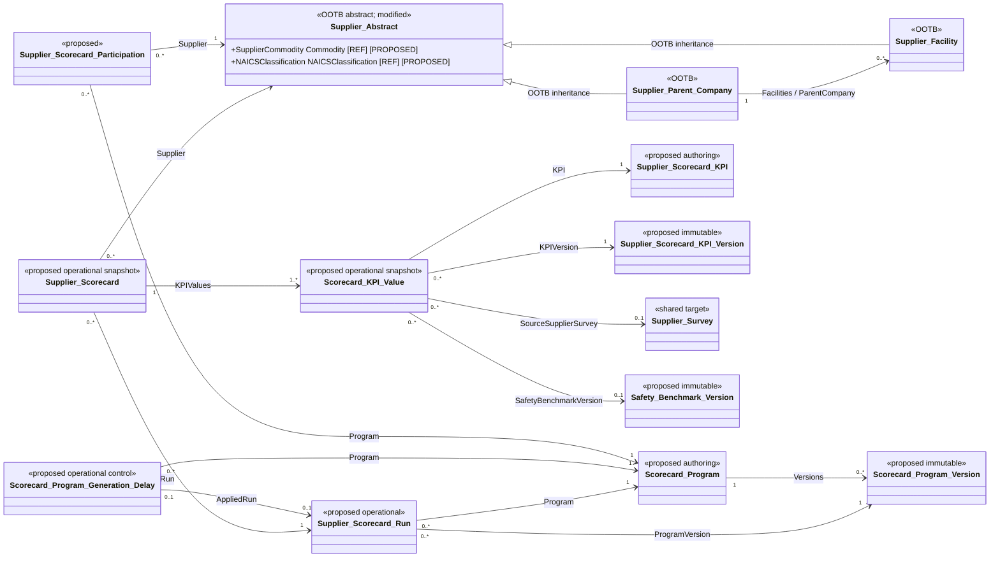
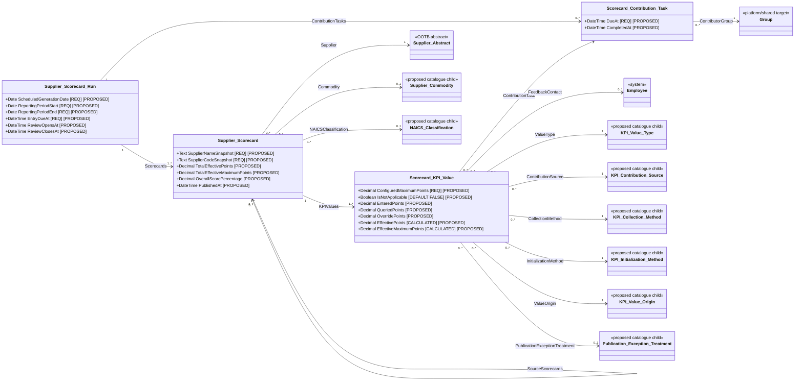
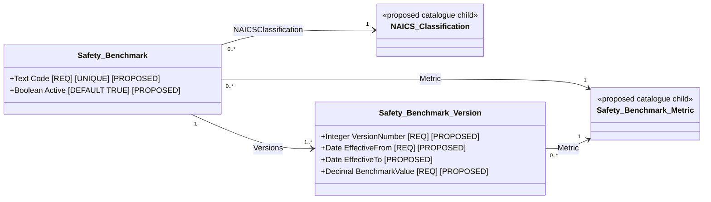
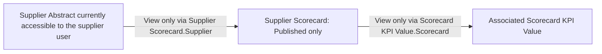

# Supplier Scorecard technical specification

| Property | Value |
|---|---|
| Mode | Target design layered over the separately preserved OOTB SRM baseline |
| Application | Supplier Scorecard, integrated with Supplier Relationship Management |
| As of | 2026-11-16 |
| Status | Technical design for review; configuration has not been implemented |
| Baseline authority | [OOTB SRM logical model](../../ootb-srm-baseline-model/README.md), its field/relationship/inheritance registers, and the six [OOTB SRM workflow documents](../../ootb-srm-baseline-workflows/) extracted from SIA OOTB SRM Export 1.0.0.0 |
| Primary requirements | ADR-058, ADR-086, and ADR-111 through ADR-116 |
| Supporting SRM requirements | ADR-063, ADR-076, ADR-078, ADR-079, ADR-083, and ADR-084 |
| Related target specifications | [Supplier Management Role](supplier-management-role-logical-model.md), [Supplier Status Updates](supplier-status-updates-logical-model.md), [Supplier Surveys](supplier-surveys-technical-specification.md), and [Supplier Tasks](supplier-tasks-technical-specification.md) |
| Supersedes | The Supplier Scorecard section of `../../entity-relationship-diagram.md` as the detailed scorecard design authority |

## 1. Findings and architectural consequences

The OOTB SRM package contains the supplier master and hierarchy needed by Supplier Scorecard, but it does not contain a versioned KPI catalogue, period scorecard records, scorecard contribution orchestration, publication controls, or safety benchmarks. The target therefore adds a specialist Supplier Scorecard configuration while retaining SRM as the authoritative supplier master.

The following boundaries are fundamental:

1. **Supplier identity is reused, not copied.** Every scorecard relates to one existing `Supplier Abstract` record. Parent Company and Facility remain direct descendants of Supplier Abstract, and their separate Facility.ParentCompany relationship and inverse Parent Company.Facilities grid remain intact.
2. **The OOTB supplier workflows remain supplier workflows.** The Parent Company and Facility workflows continue to govern supplier evaluation submission and deactivation. They are not extended into monthly scorecard workflows.
3. **Existing scalar score fields are not the scorecard record.** OOTB `Score`, `Last Score Date`, `Facility Score`, `Average Goods & Service Score`, and `Latest Parent Company Demerits` cannot preserve KPI versions, source results, overrides, applicability, or reporting periods. They are not authoritative in the target.
4. **Configuration is authored, then published.** Editable KPI and Scorecard Program records publish immutable versions. Operational scorecards retain the exact versions used for their reporting period.
5. **A scorecard is a historical operational snapshot.** It preserves supplier identity, hierarchy, commodity, NAICS classification, program version, KPI versions, entered or queried results, overrides, and publication evidence for one period.
6. **Native evidence is preferred.** Native workflow history, audit, execution logs, notification logs, and reminder capabilities provide process evidence. No custom audit, event, publication, dispute, review-response, or reminder-rule object is added.
7. **Contribution work is scorecard-specific.** One Scorecard Contribution Task groups manual KPI values for a Run and contributor group across the applicable supplier population. The design does not create one task per supplier/KPI and does not depend on the proposed generic Supplier Task component.
8. **Review is a window, not hundreds of approvals.** The Scorecard Run owns review-open and review-close timestamps. One broad internal notification is sent, silence at the deadline is consent, and no individual Scorecard Review object is created.
9. **Published scorecards are read only to ordinary users.** A privileged targeted refresh or override may correct one KPI value without automatically recalculating unrelated historical source data.
10. **Source security remains authoritative.** Aggregate scorecard results are secured by scorecard authorization and supplier scope. Opening source transactions re-applies the source application's security.
11. **A generation delay belongs to the stable Program.** An occurrence-specific child record can defer Run creation while users finish and publish configuration; it does not require republishing the Program and does not move the recurrence anchor for later periods.
12. **Selection domains are governed records, not embedded lists.** KPI, Program, benchmark, provenance, and exception selections use M:1 catalogue relationships. Automation evaluates stable catalogue Codes while localizable Names remain presentation labels.
13. **Scorecard catalogues share one abstract definition.** `Supplier Scorecard Abstract Catalog Record` declares Code, Name, Active?, and Sort once. Every catalogue object owned by this specification inherits those fields and declares only its domain-specific additions.
14. **Participation determines entity scope; Cadence owns recurrence.** A Program is not restricted to a supplier subtype. Each Participation selects the exact Supplier Abstract record to score. Scorecard Cadence contains the recurrence expression used by the scheduler, so Program and Program Version do not reference the shared Recurrence Definition.
15. **Generation timing is an explicit lag from the reporting schedule.** Cadence.Frequency generates reporting-period occurrences from Effective From. Generation Lag Time and its governed increment shift each occurrence to its Scheduled Generation Date. Schedule Anchor is the calculated first generation occurrence, and a Generation Delay changes only actual creation timing.
16. **A generation delay is created once for the next ungenerated reporting cycle.** The controlled New action calculates and stores that cycle's period boundaries and Scheduled Generation Date. Administrators revise the same unapplied record when its Delay Until changes; they cannot create a second delay for the same Program cycle or pre-stage a delay for a later cycle.
17. **Application navigation follows three internal user categories.** Supplier Scorecards serves internal SIA data consumers, Program Administration serves program administrators, and Program Development is restricted to members of the Administrators group. Business classifications remain program-admin maintained; catalogues that directly govern configuration behavior are Administrators-maintained. Tab access does not expand record scope or action permissions.
18. **Application Use, catalogue Rights, and record access are separate grants.** Three dedicated native security groups define supplier, viewer, and application-admin access. Suppliers receive no application/tab Use, receive catalogue View via Rights, and inherit View only to published Scorecards and their KPI Values from accessible Supplier Abstract records. Internal View or Create/Edit/Delete grants remain subject to existing field, workflow, generated-record, and immutable-version protections.

All new objects, fields, relationships, workflow behavior, and automation below are **Proposed** unless identified as **Extracted**, **Required**, or **Unresolved**. Logical names are not confirmed Intelex internal names, stable metadata identifiers, or physical table names.

## 2. Requirements interpretation and assumptions

| ID | Source | Interpreted requirement | Classification |
|---|---|---|---|
| SC-001 | ADR-058 | Generate period scorecards from a governed, versioned KPI library and preserve the exact KPI definitions used | Required |
| SC-002 | ADR-058 | Support direct-entry and governed-query KPIs in one operational model | Required |
| SC-003 | ADR-058 | Launch with direct entry and convert KPIs to queries only after source data, period context, and scoring logic are validated | Required |
| SC-004 | ADR-058 | Refresh query KPIs while open; after publication permit only deliberate targeted refresh | Required |
| SC-005 | ADR-058, ADR-115 | Preserve queried, overridden, and effective points; restrict overrides and require rationale, actor, and timestamp | Required |
| SC-006 | ADR-058 | Do not import external data directly into scorecard KPI values; a normalized staging dataset remains a deferred option | Required |
| SC-007 | ADR-086 | Generate the preceding-period scorecards on a configured schedule and consolidate manual work by contributor group | Required |
| SC-008 | ADR-086 | Track incomplete and overdue contribution work; supplier nonresponse and missing internal data have different cutoff behavior | Required |
| SC-009 | ADR-086 | Use one time-boxed internal review window, one broad notification, and silence as consent | Required |
| SC-010 | ADR-086 | Publish read-only supplier results without acknowledgement or a formal dispute workflow | Required |
| SC-011 | ADR-111 | Configure initialization as no default, static default, or prior-period effective points | Required |
| SC-012 | ADR-111 | Treat Not Applicable explicitly, set effective maximum points to zero, and never interpret blank as Not Applicable | Required |
| SC-013 | ADR-112 | Use monthly Supplier Surveys for LTIR/TRIR and semiannual Supplier Surveys plus internal scoring for Safety Kaizen | Required |
| SC-014 | ADR-112 | Use effective-dated, versioned safety benchmarks by NAICS classification and metric | Required |
| SC-015 | ADR-113 | Support facility/depot monthly scorecards and Supplier Parent Company periodic assessment without duplicate company monthly entry | Proposed ADR; Requires confirmation |
| SC-016 | ADR-114 | Snapshot commodity at scorecard creation and calculate overall and commodity rank on demand | Required |
| SC-017 | ADR-115 | Authorize complete aggregate scorecard access within supplier scope while preserving source-record security on drilldown | Required |
| SC-018 | ADR-115; refined by SC-036, SC-038, and SC-040 | Restrict KPI setup, participation, benchmark maintenance, publishing, versioning, and overrides to the named Application Admin group or members of Administrators; catalogue Rights, maintenance, object grants, and lifecycle protections follow the more specific Section 16.1 contract | Required |
| SC-019 | ADR-116 | Use responsive connected-browser views and supplier-profile drilldown; do not build native-mobile/offline forms | Required |
| SC-020 | ADR-076, ADR-078 | Reuse the exact Supplier Abstract hierarchy and supplier-entity access scope | Required |
| SC-021 | ADR-079; Status target | Recheck status capability before generating scorecards; retain historical access after eligibility ends | Required |
| SC-022 | ADR-083 | Expose selected current scorecard measures and drill-through from the Intelex supplier workspace | Required |
| SC-023 | ADR-063 | Permit governed scrap data to supply a KPI without moving debit settlement into Intelex | Required |
| SC-024 | Design assumption | An authorized publication exception for missing internal data must explicitly select the Publication Exception Treatment with Code `SET_TO_ZERO` or `EXCLUDE_FROM_DENOMINATOR`; it cannot silently invent a result | Proposed |
| SC-025 | Design assumption | Category and overall totals are stored and recalculated by an Action Handler/service because executable cross-grid formula support has not been verified | Proposed/Unresolved mechanism |
| SC-026 | Design assumption | Contributor assignment uses an internal platform Group because one contribution task spans many suppliers; assignment never broadens the contributor's supplier or application access | Proposed |
| SC-027 | User clarification; refined by SC-034 | An authorized user can create a Generation Delay from a grid on the stable Scorecard Program and defer one reporting cycle's Run generation until a specified date without changing Program versioning or the recurrence anchor | Required |
| SC-028 | User clarification | Model every defined selection list as an M:1 relationship to a governed catalogue object; define and seed each previously inline value set using standard catalogue composition | Required |
| SC-029 | User clarification | M:1 relationships whose target is a catalogue object must not activate an inverse relationship or expose a target-side inverse grid | Required |
| SC-030 | User clarification; refined by SC-031 | All Supplier Scorecard catalogue objects inherit from one abstract `Supplier Scorecard Abstract Catalog Record` containing Code, Name, Active?, and Sort; child catalogues declare only additional fields | Required |
| SC-031 | User clarification | Remove Scorecard Program.Entity Level and Scorecard Program.Recurrence Definition; exact entity scope comes from Supplier Scorecard Participation.Supplier, and Scorecard Cadence directly stores the recurrence expression | Required |
| SC-032 | User clarification, 2026-10-23 | Reserve parent terminology for inheritance, preserve exact Parent object/field names, and use concise object-specific wording for associations and Commodity value synchronization | Required |
| SC-033 | User clarification, 2026-11-04 | Configure a numeric Generation Lag Time and an M:1 Generation Lag Time Increment with exact Code `d` or `M`; calculate Schedule Anchor with `DATEADD`, and apply the same lag independently to every cadence-generated reporting occurrence | Required |
| SC-034 | User clarification, 2026-11-04 | Generation Delay creation targets only the next ungenerated reporting cycle, system-stamps its reporting boundaries and Scheduled Generation Date, permits revision of that one unapplied record, and prevents a second delay for the same Program cycle | Required |
| SC-035 | User-approved navigation model, 2026-11-16 | Configure exactly three application tabs, Supplier Scorecards, Program Administration, and Program Development, with the ordered menu groupings and individual menu items in Section 16.4; omit My Contribution Tasks | Required |
| SC-036 | User-approved navigation and access model, 2026-11-16; refines SC-018 and is refined by SC-038 through SC-040 | Restrict Program Administration to the named Application Admin group and Administrators; restrict Program Development and maintenance of its ten technical catalogues to members of Administrators only; retain application-admin maintenance of the three business classification catalogues; separate application/tab Use, catalogue View via Rights, and object/record permissions as specified in Section 16.1 | Required |
| SC-037 | User-approved tab defaults, 2026-11-16 | Default Supplier Scorecards to Scorecard Overview; default Program Administration and Program Development to a blank view until a menu item is selected | Required |
| SC-038 | User-approved security groups and grants, 2026-11-16 | Create the dedicated native groups Supplier Scorecard App - Supplier User Security Group, Supplier Scorecard App - Viewers Security Group, and Supplier Scorecard App - Application Admin Security Group; grant all three View to all thirteen concrete catalogues via Rights; grant application/tab Use only as listed in Section 16.1; retain the existing Administrators group for development access | Required |
| SC-039 | User-approved supplier access and clarification, 2026-11-16 | Give the dedicated supplier group no application/tab Use and no broad non-catalogue View; inherit View only through Supplier Scorecard.Supplier to the accessible Supplier Abstract, then through Scorecard KPI Value.Scorecard to the authorized Scorecard; require the associated Supplier Scorecard to have Published termination for access to either supplier-visible record type and support supplier-context access without application Use | Required |
| SC-040 | User-approved object permissions and lifecycle clarification, 2026-11-16 | Grant the named Viewers group View to all fourteen non-catalogue scorecard object types; grant the named Application Admin group View/Create/Edit/Delete to those types and the three business classification catalogues, but only View via Rights to the ten technical catalogues; retain all existing immutable-version, generated-record, field, action, applied-delay, and deletion restrictions | Required |

ADR-113 remains proposed. This specification supports its monthly Facility / periodic Supplier Parent Company pattern but does not make that pattern mandatory. Scorecard Cadence defines timing, while each Supplier Scorecard Participation selects the exact Supplier Parent Company or Supplier Facility record to which the Program applies.

## 3. Baseline and target boundary

### 3.1 Extracted baseline retained

| Baseline element | Target use |
|---|---|
| `SupplierMgmt_SupAbstractObject` / Supplier Abstract | Authoritative supplier identity referenced by participation and scorecards |
| `SupplierMgmt_ParentCompnyObject` / Supplier Parent Company | Company supplier identity and aggregation context |
| `SupplierMgmt_FacilityObject` / Supplier Facility | Facility/depot operational scoring context |
| Parent Company `Facilities` ↔ Facility `ParentCompany` | Existing hierarchy used for company/facility navigation and governed rollup selection |
| Supplier Contact, Employee, Subject, Group concepts | Recipient, actor, contributor, feedback-contact, and administrator identities |
| Public Profile | Supplier-context navigation; detailed scorecard history is presented through related views |
| Workflow Instance and Workflow Stage concepts | Native process state and history; no custom State or Workflow field is introduced |
| Supplier Evaluation | Retained for the OOTB supplier-evaluation purpose; not converted into KPI values |
| Parent Company and Facility workflows | Retained for evaluation submission/deactivation until separately revised by the lifecycle-status target |

### 3.2 Target treatment of OOTB score-like fields

| Existing field | Treatment |
|---|---|
| Supplier Abstract.Score | Do not write from the scorecard application; deprecate from scorecard reporting after dependency inventory |
| Supplier Abstract.Last Score Date | Do not use as authoritative publication evidence; the new scorecard retains its own reporting period and publication timestamp |
| Facility.Facility Score | Do not write from the scorecard application; replace user navigation with related Scorecards and current-result reporting |
| Facility.Average Goods & Service Score | Retain until dependency inventory proves it unused; do not use as the target category-result authority |
| Parent Company.Latest Parent Company Demerits | Retain until dependency inventory proves it unused; do not treat it as a fiscal-year scorecard |

No baseline object or workflow is silently removed. Deprecation means removal from new scorecard forms, reports, integrations, and calculations after dependency and migration review.

### 3.3 Existing target-design dependencies

- `Supplier Management Role`, `Supplier Specific Role`, and their inherited Group behavior remain authoritative for supplier-scoped roles. Scorecard contribution tasks use internal platform Groups because they consolidate values across suppliers.
- `Supplier Status`, `Process Capability`, and `Status Capability Rule` remain authoritative for lifecycle eligibility. This specification adds required capability seed decisions but does not duplicate the status model.
- `Recurrence Definition` remains authoritative for Supplier Surveys and Supplier Tasks. Supplier Scorecard no longer consumes it; Scorecard Cadence owns the scorecard-specific recurrence expression.
- `Supplier Survey` and its checklist/answer model remain authoritative for monthly safety submissions and semiannual Safety Kaizen evidence.
- The generic Supplier Task component is not required for scorecard contribution work. ADR-103's scorecard applicability question remains open.

## 4. Target logical model

Associations drawn from a consuming object to a catalogue show only the source-owned M:1 reference. They do not indicate an activated inverse relationship: every catalogue-targeting M:1 in these diagrams has its inverse option disabled, and no catalogue-side consumer grid is configured.

### 4.1 High-level integration view

### 4.2 Supplier Scorecard catalogue inheritance

```mermaid
classDiagram
direction TB

class Supplier_Scorecard_Abstract_Catalog_Record {
  <<proposed abstract>>
  +Text Code [REQ] [UNIQUE] [PROPOSED]
  +Text Name [REQ] [PROPOSED]
  +Boolean Active [DEFAULT TRUE] [PROPOSED]
  +Float Sort [PROPOSED]
}
class Supplier_Commodity { <<proposed catalogue child>> }
class NAICS_Classification { <<proposed catalogue child>> }
class KPI_Category { <<proposed catalogue child>> }
class KPI_Aggregation_Method {
  <<proposed catalogue child>>
  +LongText Description [REQ] [PROPOSED]
}
class KPI_Value_Type { <<proposed catalogue child>> }
class KPI_Contribution_Source { <<proposed catalogue child>> }
class KPI_Collection_Method { <<proposed catalogue child>> }
class KPI_Initialization_Method { <<proposed catalogue child>> }
class Safety_Benchmark_Metric { <<proposed catalogue child>> }
class Scorecard_Cadence {
  <<proposed catalogue child>>
  +Text Frequency [REQ] [PROPOSED]
}
class Generation_Lag_Time_Increment { <<proposed catalogue child>> }
class KPI_Value_Origin { <<proposed catalogue child>> }
class Publication_Exception_Treatment { <<proposed catalogue child>> }

Supplier_Scorecard_Abstract_Catalog_Record <|-- Supplier_Commodity : inherits
Supplier_Scorecard_Abstract_Catalog_Record <|-- NAICS_Classification : inherits
Supplier_Scorecard_Abstract_Catalog_Record <|-- KPI_Category : inherits
Supplier_Scorecard_Abstract_Catalog_Record <|-- KPI_Aggregation_Method : inherits
Supplier_Scorecard_Abstract_Catalog_Record <|-- KPI_Value_Type : inherits
Supplier_Scorecard_Abstract_Catalog_Record <|-- KPI_Contribution_Source : inherits
Supplier_Scorecard_Abstract_Catalog_Record <|-- KPI_Collection_Method : inherits
Supplier_Scorecard_Abstract_Catalog_Record <|-- KPI_Initialization_Method : inherits
Supplier_Scorecard_Abstract_Catalog_Record <|-- Safety_Benchmark_Metric : inherits
Supplier_Scorecard_Abstract_Catalog_Record <|-- Scorecard_Cadence : inherits
Supplier_Scorecard_Abstract_Catalog_Record <|-- Generation_Lag_Time_Increment : inherits
Supplier_Scorecard_Abstract_Catalog_Record <|-- KPI_Value_Origin : inherits
Supplier_Scorecard_Abstract_Catalog_Record <|-- Publication_Exception_Treatment : inherits
```

The abstract object is not selectable and must not be instantiated directly. Each child is a distinct relationship target and catalogue administration surface. Supplier Scorecard does not use the separately governed shared Recurrence Definition.

### 4.3 Published configuration

```mermaid
classDiagram
direction LR

class KPI_Category { <<proposed catalogue child>> }
class KPI_Aggregation_Method {
  <<proposed catalogue child>>
  +LongText Description [REQ] [PROPOSED]
}
class KPI_Value_Type { <<proposed catalogue child>> }
class KPI_Contribution_Source { <<proposed catalogue child>> }
class KPI_Collection_Method { <<proposed catalogue child>> }
class KPI_Initialization_Method { <<proposed catalogue child>> }
class Safety_Benchmark_Metric { <<proposed catalogue child>> }
class Scorecard_Cadence {
  <<proposed catalogue child>>
  +Text Frequency [REQ] [PROPOSED]
}
class Generation_Lag_Time_Increment { <<proposed catalogue child>> }
class Supplier_Scorecard_KPI {
  +Text Code [REQ] [UNIQUE] [PROPOSED]
  +Text Name [REQ] [PROPOSED]
  +Boolean Active [DEFAULT TRUE] [PROPOSED]
}
class Supplier_Scorecard_KPI_Version {
  +Integer VersionNumber [REQ] [PROPOSED]
  +Date EffectiveFrom [REQ] [PROPOSED]
  +Date EffectiveTo [PROPOSED]
  +Decimal MaximumPoints [REQ] [PROPOSED]
}
class Scorecard_Program {
  +Text Code [REQ] [UNIQUE] [PROPOSED]
  +Text Name [REQ] [PROPOSED]
  +Boolean Active [DEFAULT TRUE] [PROPOSED]
  +Integer GenerationLagTime [REQ] [PROPOSED]
  +Date ScheduleAnchor [CALCULATED] [REQ] [PROPOSED]
}
class Scorecard_Program_Generation_Delay {
  +Date ReportingPeriodStart [REQ] [PROPOSED]
  +Date ReportingPeriodEnd [REQ] [PROPOSED]
  +Date ScheduledGenerationDate [REQ] [PROPOSED]
  +Date DelayUntil [REQ] [PROPOSED]
  +Text Reason [REQ] [PROPOSED]
}
class Scorecard_Program_KPI {
  +Float DisplayOrder [REQ] [PROPOSED]
  +Boolean RequiredForPublication [DEFAULT TRUE] [PROPOSED]
}
class Scorecard_Program_Version {
  +Integer VersionNumber [REQ] [PROPOSED]
  +Date EffectiveFrom [REQ] [PROPOSED]
  +Date EffectiveTo [PROPOSED]
  +Integer GenerationLagTime [REQ] [PROPOSED]
  +Date ScheduleAnchor [REQ] [PROPOSED]
}
class Scorecard_Program_KPI_Version {
  +Float DisplayOrder [REQ] [PROPOSED]
  +Boolean RequiredForPublication [PROPOSED]
}
class Group { <<platform/shared target>> }
class Supplier_Management_Role { <<shared target>> }

Supplier_Scorecard_KPI "1" --> "0..*" Supplier_Scorecard_KPI_Version : Versions
Supplier_Scorecard_KPI "0..*" --> "1" KPI_Category : Category
Supplier_Scorecard_KPI "0..*" --> "1" KPI_Aggregation_Method : AggregationMethod
Supplier_Scorecard_KPI "0..*" --> "1" KPI_Value_Type : ValueType
Supplier_Scorecard_KPI "0..*" --> "1" KPI_Contribution_Source : ContributionSource
Supplier_Scorecard_KPI "0..*" --> "1" KPI_Collection_Method : CollectionMethod
Supplier_Scorecard_KPI "0..*" --> "1" KPI_Initialization_Method : InitializationMethod
Supplier_Scorecard_KPI "0..*" --> "0..1" Safety_Benchmark_Metric : SafetyBenchmarkMetric
Supplier_Scorecard_KPI "0..*" --> "0..1" Group : ContributorGroup
Supplier_Scorecard_KPI_Version "0..*" --> "1" KPI_Value_Type : ValueType
Supplier_Scorecard_KPI_Version "0..*" --> "1" KPI_Contribution_Source : ContributionSource
Supplier_Scorecard_KPI_Version "0..*" --> "1" KPI_Collection_Method : CollectionMethod
Supplier_Scorecard_KPI_Version "0..*" --> "1" KPI_Initialization_Method : InitializationMethod
Supplier_Scorecard_KPI_Version "0..*" --> "0..1" Safety_Benchmark_Metric : SafetyBenchmarkMetric

Scorecard_Program "1" --> "1..*" Scorecard_Program_KPI : ProgramKPIs
Scorecard_Program "0..*" --> "1" Scorecard_Cadence : Cadence
Scorecard_Program "0..*" --> "1" Generation_Lag_Time_Increment : GenerationLagTimeIncrement
Scorecard_Program "1" --> "0..*" Scorecard_Program_Generation_Delay : GenerationDelays
Scorecard_Program_KPI "0..*" --> "1" Supplier_Scorecard_KPI : KPI
Scorecard_Program "1" --> "0..*" Scorecard_Program_Version : Versions
Scorecard_Program_Version "1" --> "1..*" Scorecard_Program_KPI_Version : ProgramKPIVersions
Scorecard_Program_Version "0..*" --> "1" Scorecard_Cadence : Cadence
Scorecard_Program_Version "0..*" --> "1" Generation_Lag_Time_Increment : GenerationLagTimeIncrement
Scorecard_Program_KPI_Version "0..*" --> "1" Supplier_Scorecard_KPI : KPI
Scorecard_Program_Version "0..*" --> "1" Group : CoordinatorGroup
Scorecard_Program_Version "0..*" --> "1" Group : ReviewGroup
Scorecard_Program_Version "0..*" --> "0..*" Supplier_Management_Role : SupplierRecipientRoles
```

Program KPI Version deliberately references the stable KPI authoring record rather than one KPI Version. At scorecard generation, the reporting period resolves the exact non-overlapping KPI Version whose effective range contains the period end. This allows a KPI definition to change without republishing an otherwise unchanged Program.

### 4.4 Operational scorecard and contribution model

The Scorecard self-relationship is a native M:N relationship used only when a periodic Supplier Parent Company assessment freezes the exact source Scorecards included in a rollup. It has no business attributes and therefore does not require a custom junction record.

### 4.5 Safety benchmark configuration

### 4.6 Supplier record permission flow

This proposed diagram shows View authorization flowing through existing record relationships. It is not object inheritance and adds no relationship, field, or custom workflow. For either supplier-visible record type, the associated Supplier Scorecard must have native Published termination.

Membership of Supplier Scorecard App - Supplier User Security Group is required. Catalogue View via Rights and supplier-context links do not grant application/tab Use or wider record access. Section 16.1 defines the exact grants and unresolved native bindings.

## 5. Object inventory

| Object | State | Inheritance parent | Responsibility | Workflow/lifecycle |
|---|---|---|---|---|
| Supplier Scorecard Abstract Catalog Record | New abstract catalogue base | None | Declares the common Code, Name, Active?, and Sort fields for scorecard-owned catalogue objects | Abstract and non-instantiable; no forms, workflow, records, or direct relationships |
| Supplier Commodity | New catalogue child | Supplier Scorecard Abstract Catalog Record | Governed commodity classification used for period peer groups | No workflow; audited administration |
| NAICS Classification | New catalogue child | Supplier Scorecard Abstract Catalog Record | Governed NAICS identity used by supplier profiles and safety benchmarks | No workflow; audited administration |
| KPI Category | New catalogue child | Supplier Scorecard Abstract Catalog Record | Stable grouping and display order for KPI values | No workflow; audited administration |
| KPI Aggregation Method | New catalogue child | Supplier Scorecard Abstract Catalog Record | Governed set of supported company/period rollup algorithms; directly declares Description | No workflow; audited administration |
| KPI Value Type | New catalogue child | Supplier Scorecard Abstract Catalog Record | Governed typed-value presentation and validation domain | No workflow; audited administration |
| KPI Contribution Source | New catalogue child | Supplier Scorecard Abstract Catalog Record | Governed business-source classification for KPI contributions | No workflow; audited administration |
| KPI Collection Method | New catalogue child | Supplier Scorecard Abstract Catalog Record | Governed mechanism used to collect a KPI value | No workflow; audited administration |
| KPI Initialization Method | New catalogue child | Supplier Scorecard Abstract Catalog Record | Governed method used to initialize a new period value | No workflow; audited administration |
| Safety Benchmark Metric | New catalogue child | Supplier Scorecard Abstract Catalog Record | Governed safety metric identity shared by KPIs and benchmark records | No workflow; audited administration |
| Scorecard Cadence | New catalogue child | Supplier Scorecard Abstract Catalog Record | Governed reporting cadence and recurrence expression for a Program; directly declares Frequency | No workflow; audited administration |
| Generation Lag Time Increment | New catalogue child | Supplier Scorecard Abstract Catalog Record | Governed `DATEADD` interval used to shift reporting occurrences to scheduled generation dates | No workflow; audited administration |
| KPI Value Origin | New catalogue child | Supplier Scorecard Abstract Catalog Record | Governed provenance classification for an operational KPI result | No workflow; audited administration |
| Publication Exception Treatment | New catalogue child | Supplier Scorecard Abstract Catalog Record | Governed scoring treatment for a publication exception | No workflow; audited administration |
| Supplier Scorecard KPI | New authoring object | None | Editable stable KPI identity and next publishable definition | Publish action creates immutable version |
| Supplier Scorecard KPI Version | New immutable version | None | Exact KPI definition effective for a date range | Created only by Publish; read only thereafter |
| Scorecard Program | New authoring object | None | Stable methodology, cadence, routing, schedule, and KPI membership | Publish action creates a complete version graph |
| Scorecard Program Generation Delay | New operational control | None | Defers one scheduled Program occurrence until a specified date without changing recurrence or version configuration | No workflow; created from Program.Generation Delays grid; audited and read only after application |
| Scorecard Program KPI | New authoring membership | None | Includes a stable KPI in one Program with order and requiredness | Editable through Program authoring only |
| Scorecard Program Version | New immutable version | None | Exact Program configuration effective for a date range | Created only by Publish; read only thereafter |
| Scorecard Program KPI Version | New immutable membership version | None | Frozen copy of one Program KPI membership row | Created atomically with Program Version |
| Supplier Scorecard Participation | New governed configuration | None | Activates one exact supplier entity for one Program and date range | No workflow; admin-only audited maintenance |
| Safety Benchmark | New authoring object | None | Stable NAICS/metric benchmark identity | Publish action creates immutable version |
| Safety Benchmark Version | New immutable version | None | Effective-dated reference value used by safety scoring | Created only by Publish; read only thereafter |
| Supplier Scorecard Run | New operational coordinator | None | Coordinates one Program Version and reporting period across suppliers | Preparing → Data Entry → Internal Review → Publication Ready; Published/Cancelled termination |
| Supplier Scorecard | New operational snapshot | None | One supplier/program/period result and publication record | Data Entry → Internal Review → Publication Ready; Published/Cancelled termination |
| Scorecard KPI Value | New operational detail record | None | One instantiated KPI Version, its captured result, applicability, exception, override, and source evidence | No object workflow; governed by the related Scorecard stage and privileged actions |
| Scorecard Contribution Task | New operational work record | None | Consolidates internal direct-entry KPI values for one Run and contributor group | Assigned; Completed/Cancelled termination |

No new object inherits Supplier Abstract. Supplier Parent Company and Supplier Facility retain their extracted direct inheritance from Supplier Abstract. The new catalogue inheritance family is separate and rooted only at Supplier Scorecard Abstract Catalog Record.

## 6. Field conventions

- `Text` lengths are 100 characters for stable codes and 255 characters for ordinary names unless otherwise stated.
- All Date/Time fields enable timezone capture.
- All Yes/No fields use checkbox presentation and compare to `TRUE` or `FALSE` in verified expressions.
- Relationship cardinality is stated from the declaring field. Inverse grids navigate the declaring M:1 relationship; they do not create duplicate storage. Reserve parent terminology for inheritance; preserve exact object and field names containing Parent.
- `Display Field` is the configured calculated record label. Exact concatenation syntax must be verified in the target tenant and is not presented here as deployable formula syntax.
- A field described as a snapshot is populated once by a default-value expression or generation service and then remains read only.
- Published version objects are immutable. Configuration changes require a new version.
- Catalogue relationships used by rules are evaluated by stable `Code`, never by localizable `Name`. Inactive catalogue records remain valid on historical/version records but are excluded from new selections.
- For every M:1 relationship whose target is a catalogue object, the Intelex inverse-relationship option is disabled. Catalogue forms do not expose consumer grids; reporting that needs usage analysis queries the declaring source relationship directly.
- Supplier Scorecard-owned catalogue children inherit Code, Name, Active?, and Sort directly from Supplier Scorecard Abstract Catalog Record and must not redeclare or shadow those fields. Only child-specific additions are declared locally.
- Calculations below are declarative logic. Executable Intelex expressions must be verified during build.
- **Scorecard administrator** and **Application Admin group** mean members of Supplier Scorecard App - Application Admin Security Group, with existing Administrators authorized where stated. **Viewers group** means Supplier Scorecard App - Viewers Security Group. **Supplier group** means the new Supplier Scorecard App - Supplier User Security Group; it does not mean an existing general Supplier User group. These are native Group records, not object inheritance parents.

## 7. Catalogue objects

Catalogue maintenance follows the concrete child's governance in Section 16.1. Supplier Commodity, NAICS Classification, and KPI Category are business classifications maintained by the Supplier Scorecard App - Application Admin Security Group or members of Administrators. The ten other concrete catalogues, exposed under Program Development in Section 16.4.3, are maintained only by members of Administrators. Authorized users retain lookup/read access needed by consuming records. This refines the earlier blanket catalogue-maintenance permission without changing catalogue inheritance, fields, seed values, or selection behavior.

All three dedicated groups in Section 16.1 receive View to all thirteen concrete catalogues through their Rights. Catalogue Rights do not grant application/tab Use, maintenance, supplier-record access, or access to non-catalogue configuration records. Business-classification Create/Edit/Delete for the Application Admin group is additional to that catalogue View grant.

### 7.1 Supplier Scorecard Abstract Catalog Record

This proposed abstract object is the direct parent of every Supplier Scorecard-owned catalogue in Sections 7.2 through 7.14. It cannot be instantiated, selected by an M:1 field, or exposed as an administration form. Its fields are inherited by each concrete child and are not redeclared on those children.

| Field | Type / relationship | Req | Default / calculation | Editability and visibility | Automation / lifecycle |
|---|---|---:|---|---|---|
| Code | Text, max 100, non-localizable | Y | None; intended unique within each concrete child object; exact inherited uniqueness scope requires tenant validation | Concrete-child catalogue maintainer defined in Section 16.1 may edit before first use; thereafter stable | Stable integration, reporting, and automation key; rules never branch on Name |
| Name | Text, max 255, localizable | Y | None; display field on each concrete child | Editable by the concrete-child catalogue maintainer defined in Section 16.1 | Business-facing label; changes do not change Code-based behavior or stored code snapshots |
| Active? | Yes/No | Y | `TRUE` | Editable by the concrete-child catalogue maintainer defined in Section 16.1 | Inactive records remain valid for version and operational history but are excluded from new selections |
| Sort | Float | N | `NULL` | Editable by the concrete-child catalogue maintainer defined in Section 16.1 | Orders selection and presentation within the concrete child catalogue |

The intended business key is `(concrete catalogue type, Code)`, because the same Code can legitimately appear in different catalogues. Confirm that the target tenant can enforce uniqueness at the concrete-child scope for an inherited field. If the platform instead enforces uniqueness across the entire inheritance family, the implementation must use approved globally distinct codes or a validated child-scoped uniqueness mechanism before seed data is loaded. The parent has no records and therefore no values of its own. M:1 fields continue to target the appropriate concrete child and keep their inverse relationship disabled.

Seed-data tables below repeat the inherited field columns so they can be used directly for configuration and import. They do not imply that the fields are redeclared on the child object.

### 7.2 Supplier Commodity

**Inheritance parent:** Supplier Scorecard Abstract Catalog Record

**Directly declared fields:** None. Code, Name, Active?, and Sort are inherited. Historical Scorecards retain Commodity code/name snapshots, so later inherited Name changes do not rewrite published history.

### 7.3 NAICS Classification

**Inheritance parent:** Supplier Scorecard Abstract Catalog Record

**Directly declared fields:** None. Code, Name, Active?, and Sort are inherited. Historical Scorecards retain NAICS code/name snapshots.

### 7.4 KPI Category

**Inheritance parent:** Supplier Scorecard Abstract Catalog Record

**Directly declared fields:** None. Code, Name, Active?, and Sort are inherited. Inherited Sort supplies the default category presentation order.

### 7.5 KPI Aggregation Method

**Inheritance parent:** Supplier Scorecard Abstract Catalog Record

**Inherited fields:** Code, Name, Active?, and Sort.

**Directly declared fields:** Description.

| Field | Type / relationship | Req | Default / calculation | Editability and visibility | Automation / lifecycle |
|---|---|---:|---|---|---|
| Description | Long Text | Y | None | Editable only by members of Administrators | Plain-language algorithm and valid source value types |

Initial method codes and exact algorithms are release configuration, not universal platform rules. At minimum, the approved set must address sum, average, weighted average, latest applicable value, and no rollup where those behaviors are required. Unsupported methods must block Publish.

### 7.6 KPI Value Type

**Inheritance parent:** Supplier Scorecard Abstract Catalog Record

**Directly declared fields:** None. Code, Name, Active?, and Sort are inherited.

Initial values:

| Code | Name | Active? | Sort |
|---|---|---:|---:|
| `NUMBER` | Number | `TRUE` | 10 |
| `PERCENTAGE` | Percentage | `TRUE` | 20 |
| `CURRENCY` | Currency | `TRUE` | 30 |
| `DATE` | Date | `TRUE` | 40 |
| `YES_NO` | Yes/No | `TRUE` | 50 |
| `TEXT` | Text | `TRUE` | 60 |

### 7.7 KPI Contribution Source

**Inheritance parent:** Supplier Scorecard Abstract Catalog Record

**Directly declared fields:** None. Code, Name, Active?, and Sort are inherited.

Initial values:

| Code | Name | Active? | Sort |
|---|---|---:|---:|
| `INTERNAL` | Internal | `TRUE` | 10 |
| `SUPPLIER` | Supplier | `TRUE` | 20 |
| `AUTOMATED` | Automated | `TRUE` | 30 |

### 7.8 KPI Collection Method

**Inheritance parent:** Supplier Scorecard Abstract Catalog Record

**Directly declared fields:** None. Code, Name, Active?, and Sort are inherited.

Initial values:

| Code | Name | Active? | Sort |
|---|---|---:|---:|
| `DIRECT_ENTRY` | Direct Entry | `TRUE` | 10 |
| `QUERY` | Query | `TRUE` | 20 |

### 7.9 KPI Initialization Method

**Inheritance parent:** Supplier Scorecard Abstract Catalog Record

**Directly declared fields:** None. Code, Name, Active?, and Sort are inherited.

Initial values:

| Code | Name | Active? | Sort |
|---|---|---:|---:|
| `NO_DEFAULT` | No Default | `TRUE` | 10 |
| `STATIC_DEFAULT` | Static Default | `TRUE` | 20 |
| `PRIOR_PERIOD` | Prior Period | `TRUE` | 30 |

### 7.10 Safety Benchmark Metric

**Inheritance parent:** Supplier Scorecard Abstract Catalog Record

**Directly declared fields:** None. Code, Name, Active?, and Sort are inherited.

Initial values:

| Code | Name | Active? | Sort |
|---|---|---:|---:|
| `LTIR` | LTIR | `TRUE` | 10 |
| `TRIR` | TRIR | `TRUE` | 20 |

### 7.11 Scorecard Cadence

**Inheritance parent:** Supplier Scorecard Abstract Catalog Record

**Inherited fields:** Code, Name, Active?, and Sort.

**Directly declared fields:** Frequency.

| Field | Type / relationship | Req | Default / calculation | Editability and visibility | Automation / lifecycle |
|---|---|---:|---|---|---|
| Frequency | Text with `displayas="recurrence"` | Y | None | Editable only by members of Administrators before the Cadence is referenced by a published Program Version; thereafter stable | Recurrence expression interpreted by the scorecard scheduler; create a new Cadence record for a materially different schedule; exact platform storage and evaluation require tenant validation |

Initial values:

| Code | Name | Active? | Sort | Frequency |
|---|---|---:|---:|---|
| `MONTHLY` | Monthly | `TRUE` | 10 | Monthly |
| `FISCAL_YEAR` | Fiscal Year | `TRUE` | 20 | Annually |

Adding a cadence record alone does not implement reporting-period boundary semantics. Program Publish must reject an active Cadence whose Frequency is blank or invalid, and release validation must confirm the mapping from Cadence.Code to reporting-period start/end behavior.

### 7.12 Generation Lag Time Increment

**Inheritance parent:** Supplier Scorecard Abstract Catalog Record

**Directly declared fields:** None. Code, Name, Active?, and Sort are inherited.

Initial values:

| Code | Name | Active? | Sort |
|---|---|---:|---:|
| `d` | Days | `TRUE` | 10 |
| `M` | Months | `TRUE` | 20 |

The Code values are case-sensitive and are the only supported interval arguments for the Program Schedule Anchor `DATEADD` calculation. Automation evaluates the exact Code rather than the localizable Name. Program Publish rejects any other value.

### 7.13 KPI Value Origin

**Inheritance parent:** Supplier Scorecard Abstract Catalog Record

**Directly declared fields:** None. Code, Name, Active?, and Sort are inherited.

Initial values:

| Code | Name | Active? | Sort |
|---|---|---:|---:|
| `NO_VALUE` | No Value | `TRUE` | 10 |
| `STATIC_DEFAULT` | Static Default | `TRUE` | 20 |
| `PRIOR_PERIOD` | Prior Period | `TRUE` | 30 |
| `DIRECT_ENTRY` | Direct Entry | `TRUE` | 40 |
| `QUERY` | Query | `TRUE` | 50 |
| `SUPPLIER_NONRESPONSE_ZERO` | Supplier Nonresponse Zero | `TRUE` | 60 |
| `ADMINISTRATOR_OVERRIDE` | Administrator Override | `TRUE` | 70 |
| `NOT_APPLICABLE` | Not Applicable | `TRUE` | 80 |
| `PUBLICATION_EXCEPTION` | Publication Exception | `TRUE` | 90 |

### 7.14 Publication Exception Treatment

**Inheritance parent:** Supplier Scorecard Abstract Catalog Record

**Directly declared fields:** None. Code, Name, Active?, and Sort are inherited.

Initial values:

| Code | Name | Active? | Sort |
|---|---|---:|---:|
| `SET_TO_ZERO` | Set to Zero | `TRUE` | 10 |
| `EXCLUDE_FROM_DENOMINATOR` | Exclude from Denominator | `TRUE` | 20 |

## 8. KPI configuration and versioning

### 8.1 Supplier Scorecard KPI — authoring object

| Field | Type / relationship | Req | Default / calculation | Editability and visibility | Automation / lifecycle |
|---|---|---:|---|---|---|
| Code | Text, max 100 | Y | None; unique | Scorecard administrator editable; stable after first Publish | Non-localizable reporting/integration key |
| Name | Text, max 255 | Y | None; display field | Scorecard administrator editable | Copied to Version |
| Description | Long Text | Y | None | Scorecard administrator editable | Copied to Version |
| Active? | Yes/No | Y | `TRUE` | Scorecard administrator editable | Prevents new program selection/generation but does not invalidate history |
| Category | M:1 to KPI Category; inverse disabled | Y | None; filter `Active?=TRUE` for new selection | Scorecard administrator editable | Copied to Version |
| Value Type | M:1 to KPI Value Type; inverse disabled | Y | None; filter `Active?=TRUE` for new selection | Scorecard administrator editable | Controls which `Value -` field appears; rules evaluate KPI Value Type.Code |
| Contribution Source | M:1 to KPI Contribution Source; inverse disabled | Y | None; filter `Active?=TRUE` for new selection | Scorecard administrator editable | Separates business source from collection mechanism; rules evaluate Code |
| Collection Method | M:1 to KPI Collection Method; inverse disabled | Y | `DIRECT_ENTRY` catalogue record | Scorecard administrator editable; filter `Active?=TRUE` for new selection | Query makes source configuration conditionally required; rules evaluate Code |
| Contributor Group | M:1 to platform Group | Conditional | `NULL` | Visible and required only when Contribution Source.Code=`INTERNAL` and Collection Method.Code=`DIRECT_ENTRY` | Copied to Version; group membership is evaluated at action time |
| Feedback Contact | M:1 to Employee | Y | None | Scorecard administrator editable | Copied to Version and operational value; exposed on published detail |
| Maximum Points | Decimal | Y | None; must be greater than or equal to zero | Scorecard administrator editable | Copied to Version and KPI Value |
| Initialization Method | M:1 to KPI Initialization Method; inverse disabled | Y | `NO_DEFAULT` catalogue record | Scorecard administrator editable; filter `Active?=TRUE` for new selection | Copied to Version; rules evaluate Code |
| Static Default Points | Decimal | Conditional | `NULL` | Visible/required only when Initialization Method.Code=`STATIC_DEFAULT`; otherwise hidden and cleared | Must be within zero and Maximum Points unless approved scoring allows negative values |
| May Be Not Applicable? | Yes/No | Y | `FALSE` | Scorecard administrator editable | Copied to Version |
| Supplier Nonresponse Sets Zero? | Yes/No | Y | `FALSE` | Editable only when Contribution Source.Code=`SUPPLIER`; otherwise hidden and forced `FALSE` | Drives cutoff service; copied to Version |
| Aggregation Method | M:1 to KPI Aggregation Method; inverse disabled | Y | None | Scorecard administrator editable; filter active methods | Copied to Version |
| Source Application | Text, max 255 | Conditional | `NULL` | Visible/required when Collection Method.Code=`QUERY`; hidden and cleared for `DIRECT_ENTRY` | Business name of authoritative source |
| Source Report Reference | Text, max 255 | Conditional | `NULL` | Visible/required when Collection Method.Code=`QUERY` | Exact report/query binding mechanism is tenant-specific and unresolved |
| Source Calculation Description | Long Text | Conditional | `NULL` | Visible/required when Collection Method.Code=`QUERY` | Declarative source filters, period boundary, supplier matching, aggregation, and points logic; not executable formula text |
| Safety Benchmark Metric | M:1 to Safety Benchmark Metric; inverse disabled | N | `NULL`; filter `Active?=TRUE` for new selection | Visible for safety benchmark KPIs; clear when not used | Causes generation/query capture to resolve a Safety Benchmark Version by Metric.Code |
| Effective From | Date | Y | None | Scorecard administrator editable for the next Publish | Copied to Version; inclusive |
| Effective To | Date | N | `NULL` | Scorecard administrator editable for the next Publish | Copied to Version; inclusive; blank means open-ended |
| Versions | Inverse 1:M grid from KPI Version.KPI | N | None | Read only | Navigation only; no duplicate stored relationship |

Value Type is required by ADR-058, but its initial values were not supplied. Section 7 defines a proposed governed catalogue and seed values. They must be confirmed against the first KPI catalogue before configuration is locked.

### 8.2 Supplier Scorecard KPI Version — immutable object

| Field | Type / relationship | Req | Default / calculation | Editability and visibility | Automation / lifecycle |
|---|---|---:|---|---|---|
| KPI | M:1 to Supplier Scorecard KPI; inverse `Versions` 1:M | Y | Source authoring KPI | Read only | Set by Publish |
| Version Number | Integer | Y | One greater than maximum Version Number in KPI.Versions; first is 1 | Read only | Assigned atomically; uniqueness `(KPI, Version Number)` |
| Name | Text, max 255 | Y | Copy KPI.Name | Read only | Publish mapping |
| Description | Long Text | Y | Copy KPI.Description | Read only | Publish mapping |
| Category | M:1 to KPI Category; inverse disabled | Y | Copy KPI.Category | Read only | Publish mapping |
| Value Type | M:1 to KPI Value Type; inverse disabled | Y | Copy KPI.Value Type | Read only | Publish mapping preserves the exact catalogue record |
| Contribution Source | M:1 to KPI Contribution Source; inverse disabled | Y | Copy KPI.Contribution Source | Read only | Publish mapping preserves the exact catalogue record |
| Collection Method | M:1 to KPI Collection Method; inverse disabled | Y | Copy KPI.Collection Method | Read only | Publish mapping preserves the exact catalogue record |
| Contributor Group | M:1 to Group | Conditional | Copy KPI.Contributor Group | Read only | Publish mapping |
| Feedback Contact | M:1 to Employee | Y | Copy KPI.Feedback Contact | Read only | Publish mapping |
| Maximum Points | Decimal | Y | Copy KPI.Maximum Points | Read only | Publish mapping |
| Initialization Method | M:1 to KPI Initialization Method; inverse disabled | Y | Copy KPI.Initialization Method | Read only | Publish mapping preserves the exact catalogue record |
| Static Default Points | Decimal | Conditional | Copy KPI.Static Default Points | Read only | Publish mapping |
| May Be Not Applicable? | Yes/No | Y | Copy KPI.May Be Not Applicable? | Read only | Publish mapping |
| Supplier Nonresponse Sets Zero? | Yes/No | Y | Copy KPI.Supplier Nonresponse Sets Zero? | Read only | Publish mapping |
| Aggregation Method | M:1 to KPI Aggregation Method; inverse disabled | Y | Copy KPI.Aggregation Method | Read only | Publish mapping |
| Source Application | Text | Conditional | Copy KPI.Source Application | Read only | Publish mapping |
| Source Report Reference | Text | Conditional | Copy KPI.Source Report Reference | Read only | Publish mapping |
| Source Calculation Description | Long Text | Conditional | Copy KPI.Source Calculation Description | Read only | Publish mapping |
| Safety Benchmark Metric | M:1 to Safety Benchmark Metric; inverse disabled | N | Copy KPI.Safety Benchmark Metric | Read only | Publish mapping preserves the exact catalogue record |
| Effective From | Date | Y | Copy KPI.Effective From | Read only | Publish mapping |
| Effective To | Date | N | Copy KPI.Effective To | Read only | Publish mapping |
| Published At | Date/Time with timezone | Y | Current server timestamp | Read only | Set by Publish |
| Published By | M:1 to Employee | Y | Authenticated actor | Read only | Set by Publish |

### 8.3 KPI Publish action

Publish is available only to Application Admin group and members of Administrators. It must:

1. validate required and conditional fields;
2. validate Effective To is null or not earlier than Effective From;
3. validate no existing KPI Version for the same KPI has an overlapping effective range;
4. validate the collection method, contributor, source, default, applicability, and aggregation combinations;
5. validate any static default against the scoring range;
6. lock against concurrent Publish;
7. create exactly one complete KPI Version using the mapping above;
8. assign Version Number deterministically; and
9. roll back the entire operation if any mapped value cannot be created.

KPI Version records cannot be edited, deleted, imported over, or re-dated after Publish. Correction requires a new version with a reviewed effective range.

## 9. Scorecard Program configuration and versioning

### 9.1 Scorecard Program — authoring object

| Field | Type / relationship | Req | Default / calculation | Editability and visibility | Automation / lifecycle |
|---|---|---:|---|---|---|
| Code | Text, max 100 | Y | None; unique | Scorecard administrator editable; stable after first Publish | Stable reporting/integration key |
| Name | Text, max 255 | Y | None; display field | Scorecard administrator editable | Copied to Version |
| Description | Long Text | N | `NULL` | Scorecard administrator editable | Copied to Version |
| Active? | Yes/No | Y | `TRUE` | Scorecard administrator editable | Prevents new participation/generation without invalidating history |
| Cadence | M:1 to Scorecard Cadence; inverse disabled | Y | `MONTHLY` catalogue record; filter `Active?=TRUE` for new selection | Scorecard administrator editable | Supplies both the recurrence expression and reporting-period basis; copied to Version |
| Entry Window Days | Integer | Y | None; greater than or equal to zero | Scorecard administrator editable | Run service calculates Entry Due At from Generation At |
| Review Window Days | Integer | Y | None; greater than zero | Scorecard administrator editable | Run service calculates Review Closes At when review opens |
| Coordinator Group | M:1 to Group | Y | None | Scorecard administrator editable | Owns the Run stages and exception follow-up; does not expand record access |
| Review Group | M:1 to Group | Y | None | Scorecard administrator editable | Receives one internal review notification |
| Supplier Recipient Roles | M:N to Supplier Management Role | Y | None | Scorecard administrator editable | Publish copies the stable role references to Program Version; operational notification resolves exact supplier roles |
| Rollup Source Program | M:1 self-reference to Scorecard Program | Conditional | `NULL` | Visible/required for a periodic Program that derives child results; hidden and cleared otherwise | Source Program must have a compatible cadence; destination/source entity compatibility is validated from their Participations during generation |
| Effective From | Date | Y | None | Scorecard administrator editable for next Publish | Copied to Version |
| Effective To | Date | N | `NULL` | Scorecard administrator editable for next Publish | Copied to Version |
| Generation Lag Time | Integer | Y | `0`; must be greater than or equal to zero | Scorecard administrator editable for next Publish | Number of selected increments applied independently to each reporting occurrence; copied to Version |
| Generation Lag Time Increment | M:1 to Generation Lag Time Increment; inverse disabled | Y | None; filter `Active?=TRUE` and Code in (`d`, `M`) | Scorecard administrator editable for next Publish | Supplies the exact case-sensitive `DATEADD` interval Code; copied to Version |
| Schedule Anchor | Date, calculated | Y | `DATEADD(Generation Lag Time Increment.Code, Generation Lag Time, Effective From)` | Read only | First scheduled generation occurrence; recalculates while authoring inputs change and is copied to Version at Publish; exact tenant formula syntax must be validated |
| Program KPIs | Inverse 1:M grid from Scorecard Program KPI.Program | Y | None | Authoring grid editable by scorecard administrators | At least one active row required to Publish |
| Versions | Inverse 1:M grid from Scorecard Program Version.Program | N | None | Read only | Navigation only |
| Generation Delays | Inverse 1:M grid from Scorecard Program Generation Delay.Program | N | None | Scorecard administrators may initiate a new Generation Delay form from this grid; existing applied rows are read only | Operational control outside the published version graph |

### 9.2 Scorecard Program KPI — authoring membership

| Field | Type / relationship | Req | Default / calculation | Editability and visibility | Automation / lifecycle |
|---|---|---:|---|---|---|
| Program | M:1 to Scorecard Program; inverse `Program KPIs` 1:M | Y | Creating Program | Read only after creation | Declaring relationship; unique pair `(Program, KPI)` |
| KPI | M:1 to Supplier Scorecard KPI | Y | None; filter `Active?=TRUE` | Scorecard administrator editable until Program Publish | Stable authoring identity; exact KPI Version resolves at operational generation |
| Display Order | Float | Y | None | Scorecard administrator editable | Copied to Program KPI Version |
| Required for Publication? | Yes/No | Y | `TRUE` | Scorecard administrator editable | Copied to Program KPI Version; drives publication validation |

### 9.3 Scorecard Program Version — immutable object

| Field | Type / relationship | Req | Default / calculation | Editability and visibility | Automation / lifecycle |
|---|---|---:|---|---|---|
| Program | M:1 to Scorecard Program; inverse `Versions` 1:M | Y | Source Program | Read only | Set by Publish |
| Version Number | Integer | Y | One greater than maximum Version Number in Program.Versions; first is 1 | Read only | Atomic uniqueness `(Program, Version Number)` |
| Name | Text | Y | Copy Program.Name | Read only | Publish mapping |
| Description | Long Text | N | Copy Program.Description | Read only | Publish mapping |
| Cadence | M:1 to Scorecard Cadence; inverse disabled | Y | Copy Program.Cadence | Read only | Publish mapping preserves the exact catalogue record |
| Entry Window Days | Integer | Y | Copy Program.Entry Window Days | Read only | Publish mapping |
| Review Window Days | Integer | Y | Copy Program.Review Window Days | Read only | Publish mapping |
| Coordinator Group | M:1 to Group | Y | Copy Program.Coordinator Group | Read only | Publish mapping |
| Review Group | M:1 to Group | Y | Copy Program.Review Group | Read only | Publish mapping |
| Supplier Recipient Roles | M:N to Supplier Management Role | Y | Copy all Program.Supplier Recipient Roles | Read only | Publish must copy the complete relationship set atomically |
| Rollup Source Program | M:1 to Scorecard Program | Conditional | Copy Program.Rollup Source Program | Read only | Publish mapping |
| Effective From | Date | Y | Copy Program.Effective From | Read only | Publish mapping |
| Effective To | Date | N | Copy Program.Effective To | Read only | Publish mapping |
| Generation Lag Time | Integer | Y | Copy Program.Generation Lag Time | Read only | Immutable generation-offset value used for every reporting occurrence in the Version's effective range |
| Generation Lag Time Increment | M:1 to Generation Lag Time Increment; inverse disabled | Y | Copy Program.Generation Lag Time Increment | Read only | Publish mapping preserves the exact catalogue record and case-sensitive Code `d` or `M` |
| Schedule Anchor | Date | Y | Copy calculated Program.Schedule Anchor | Read only | Immutable first scheduled generation occurrence for this Version |
| Published At | Date/Time with timezone | Y | Current server timestamp | Read only | Set by Publish |
| Published By | M:1 to Employee | Y | Authenticated actor | Read only | Set by Publish |
| Program KPI Versions | Inverse 1:M grid from Scorecard Program KPI Version.Program Version | Y | Generated set | Read only | Complete child graph created by Publish |

### 9.4 Scorecard Program KPI Version — immutable membership version

| Field | Type / relationship | Req | Default / calculation | Editability and visibility | Automation / lifecycle |
|---|---|---:|---|---|---|
| Program Version | M:1 to Scorecard Program Version; inverse `Program KPI Versions` 1:M | Y | Newly published Program Version | Read only | Declaring relationship |
| Source Program KPI | M:1 to Scorecard Program KPI | Y | Source authoring row | Read only | Provides traceability |
| KPI | M:1 to Supplier Scorecard KPI | Y | Copy Source Program KPI.KPI | Read only | Exact KPI Version resolves at scorecard generation |
| Display Order | Float | Y | Copy Source Program KPI.Display Order | Read only | Publish mapping |
| Required for Publication? | Yes/No | Y | Copy Source Program KPI.Required for Publication? | Read only | Publish mapping |

### 9.5 Program Publish action

Program Publish must validate the complete authoring graph, create the Program Version and every Program KPI Version in one logical transaction, and copy the full Supplier Recipient Roles set. It must block:

- an empty Program KPI grid;
- duplicate KPI membership;
- missing or inactive configuration targets;
- overlapping Program Version effective ranges;
- a missing, inactive, or invalid Cadence/Frequency configuration;
- a negative Generation Lag Time, a missing/inactive Generation Lag Time Increment, or an increment whose exact Code is not `d` or `M`;
- a Schedule Anchor that does not equal `DATEADD(Generation Lag Time Increment.Code, Generation Lag Time, Effective From)`;
- a cadence conflict with Rollup Source Program;
- a rollup cycle; or
- missing coordinator, reviewer, or supplier recipient routing.

Publish copies the Generation Lag Time, Generation Lag Time Increment, and calculated Schedule Anchor into the immutable Program Version. A Program Version's Effective To limits the reporting occurrences it governs, not their lagged generation dates; the final valid occurrence may therefore be generated after Effective To. Failure must leave no partial Program Version. Published versions and their child rows are immutable.

### 9.6 Scorecard Program Generation Delay — operational control

A Generation Delay applies to exactly one reporting cycle of the stable Program. It is deliberately not copied into Program Version: users must be able to delay the next generation while a new version is still being authored and before that version can be published. Delay creation is sequential: the controlled New action targets only the earliest reporting cycle that does not already have a Run. It cannot pre-stage a delay for a later cycle while an earlier cycle remains ungenerated.

| Field | Type / relationship | Req | Default / calculation | Editability and visibility | Automation / lifecycle |
|---|---|---:|---|---|---|
| Display Field | Calculated Text | Y | Program.Name plus Scheduled Generation Date; exact syntax unresolved | Read only | Configured display value |
| Program | M:1 to Scorecard Program; inverse `Generation Delays` 1:M | Y | Default from the Program grid context | Read only from creation | Declaring relationship; the New action is initiated from the Program.Generation Delays grid |
| Reporting Period Start | Date | Y | Controlled New action calculates the next ungenerated reporting cycle from the Program's published Cadence and effective schedule | Read only from creation | Stored cycle identity; must match the period later stored on the Run |
| Reporting Period End | Date | Y | Controlled New action calculates the boundary from Cadence.Code | Read only from creation | Stored cycle identity; must not precede Reporting Period Start |
| Scheduled Generation Date | Date | Y | Controlled New action applies the published Generation Lag Time and exact Increment Code to the next reporting occurrence | Read only from creation | Stored original due date for this cycle; must match the date later stored on the Run |
| Delay Until | Date | Y | None | Scorecard administrator editable until an Applied Run exists | Must be later than Scheduled Generation Date; generation may occur on the first scheduler execution on or after this date |
| Reason | Long Text | Y | None | Scorecard administrator editable until an Applied Run exists; internal only | Native object audit preserves creation and changes |
| Applied Run | M:1 to Supplier Scorecard Run; inverse `Generation Delay` 0..1 | N | `NULL` | Read only | Generation service sets after the unique delayed Run is created successfully |
| Applied At | Date/Time with timezone | N | `NULL` | Read only | Generation service stamps when Applied Run is set |

The controlled `New Delay for Next Generation` action must calculate the earliest reporting cycle without a Run, reject creation when that cycle already has a Generation Delay, and populate Program, Reporting Period Start, Reporting Period End, and Scheduled Generation Date atomically before the form accepts Delay Until and Reason. The user cannot select another cycle or edit the stored cycle fields. Enforce uniqueness on `(Program, Reporting Period Start, Reporting Period End)` and retain `(Program, Scheduled Generation Date)` as a secondary safeguard. A concurrent Run or duplicate Delay causes the complete creation to fail without a partial record.

Before Applied Run is populated, an administrator may extend or shorten Delay Until and revise Reason on the existing record; native audit history preserves the original and revised values. The administrator cannot create a second record for that reporting cycle. Setting Delay Until to the current or next permitted generation date provides early release without a separate workflow or custom status field.

The Generation Delays grid shows Reporting Period Start, Reporting Period End, Scheduled Generation Date, Delay Until, Reason, Created By/At, Applied Run, and Applied At. Platform-provided Created By/At fields are used rather than duplicating custom actor/timestamp fields. Applied records are immutable and cannot be deleted through ordinary administration. After the related Run succeeds, the next reporting cycle becomes eligible for its own Generation Delay record.

The delay does not itself select or reserve a Program Version. On or after Delay Until, generation still resolves the Version whose effective range covers the reporting period. If the previous Version remains intentionally effective for that period, it may be used; if the revised Version is required, the Program Version effective ranges must make that requirement explicit. When no Version covers the period, generation remains blocked and reported rather than falling back by publication recency.

## 10. Participation and supplier-master changes

### 10.1 Supplier Scorecard Participation

| Field | Type / relationship | Req | Default / calculation | Editability and visibility | Automation / lifecycle |
|---|---|---:|---|---|---|
| Display Field | Calculated Text | Y | `Supplier.Name + " - " + Program.Name`; exact syntax unresolved | Read only | Configured display value |
| Supplier | M:1 to Supplier Abstract; inverse `Scorecard Participations` 1:M | Y | Supplier context | Scorecard administrator editable only on creation; then read only | Exact entity to be scored; may be a Supplier Parent Company or Supplier Facility without a Program-level entity restriction |
| Program | M:1 to Scorecard Program; inverse `Participations` 1:M | Y | None; filter `Active?=TRUE` | Scorecard administrator editable only on creation; then read only | Stable Program identity; generation resolves effective Program Version |
| Active? | Yes/No | Y | `TRUE` | Scorecard administrator editable | Inactive stops future generation only |
| Effective From | Date | Y | None | Scorecard administrator editable | Inclusive participation start |
| Effective To | Date | N | `NULL` | Scorecard administrator editable | Inclusive participation end |
| Notes | Long Text | N | `NULL` | Scorecard administrator editable; internal only | Configuration rationale; audit enabled |

Enforce non-overlapping active participation ranges for the same `(Supplier, Program)` pair. Participation cannot override a Deny from the status-capability matrix.

### 10.2 Supplier Abstract — proposed shared changes

These fields are declared once on Supplier Abstract and inherited by Supplier Parent Company and Supplier Facility.

| Field | Type / relationship | Req | Default / calculation | Editability and visibility | Automation / lifecycle |
|---|---|---:|---|---|---|
| Commodity | M:1 to Supplier Commodity; inverse disabled | Conditional | `NULL` on Supplier Parent Company; Facility copies related Parent Company.Commodity | Authorized supplier-master maintainers; required for ranked participants, otherwise optional; Facility read only in initial release | Parent Company.Commodity changes synchronize related Facilities through the handlers below while facility override remains unapproved; scorecards snapshot the value at creation |
| NAICS Classification | M:1 to NAICS Classification; inverse disabled | Conditional | `NULL` | Authorized supplier-master maintainers; required for benchmarked safety KPIs, otherwise optional | Scorecards snapshot the value at creation; missing classification blocks only benchmark-dependent capture unless an authorized publication exception is used |
| Scorecard Participations | Inverse 1:M grid | N | Derived from Participation.Supplier | Read only to ordinary users | Navigation only |
| Scorecards | Inverse 1:M grid | N | Derived from Supplier Scorecard.Supplier | Read only; Supplier group sees only related Scorecards with Published termination and current inherited View | Supplier profile/history navigation; no duplicate relationship; Section 16.1 governs View-only record permission inheritance and publication filtering |

`Type of Supplier Entity`, already proposed in the Supplier Surveys target specification, is reused for rollup participation-subtype validation and reporting. It does not restrict ordinary Program participation, and this specification does not create another discriminator.

Supplier Facility inherits the Commodity field definition from Supplier Abstract. Initial release Action Handlers copy and synchronize its value from the related Supplier Parent Company and keep the Facility field read only. ADR-114's pending facility-override decision can later change editability without changing the field or historical scorecard snapshots.

Commodity synchronization uses two explicit Action Handlers in the initial release:

1. A Facility Create/Update handler watches `Parent Company`. When the relationship is populated, it copies `Parent Company.Commodity` to the inherited Facility.Commodity field. It does not use runtime type inspection; the concrete Facility form/handler supplies the entity context.
2. A Parent Company Update handler watches `Commodity`. When it changes, it updates Commodity on each related Facility because facility override is not initially permitted. The handler is idempotent, records ordinary object audit history, reports partial Facility-update failures to SRM administration, and does not retrigger itself from metadata-only changes.

If facility-level override is later approved, these handlers and field permissions require a coordinated revision. The design must then distinguish company-synchronized from overridden Commodity values explicitly rather than silently continuing to overwrite facility choices.

### 10.3 Status capability integration

Add or confirm these Process Capability decisions in the Supplier Status target:

- `GENERATE_MONTHLY_SUPPLIER_SCORECARD` — initially Allow for Active, Deny for Service Parts Only and Inactive, subject to final matrix approval.
- `GENERATE_PERIODIC_PARENT_ASSESSMENT` — required only if ADR-113 is approved; seed decisions require business confirmation.

The scheduled generator rechecks the applicable capability immediately before creating each Scorecard. A Supplier Parent Company restriction applies to a related Facility under the status target. Historical Scorecards remain visible under ordinary security even when generation becomes ineligible.

## 11. Safety benchmark configuration

### 11.1 Safety Benchmark — authoring object

| Field | Type / relationship | Req | Default / calculation | Editability and visibility | Automation / lifecycle |
|---|---|---:|---|---|---|
| Code | Text, max 100 | Y | None; unique | Scorecard administrator editable; stable after first Publish | Recommended deterministic pattern based on NAICS and Metric |
| Name | Text, max 255 | Y | None; display field | Scorecard administrator editable | Business label |
| Active? | Yes/No | Y | `TRUE` | Scorecard administrator editable | Prevents new selection/publish; history retained |
| NAICS Classification | M:1 to NAICS Classification; inverse disabled | Y | None; active selection only | Scorecard administrator editable | Stable after first Publish |
| Metric | M:1 to Safety Benchmark Metric; inverse disabled | Y | None; filter `Active?=TRUE` for new selection | Scorecard administrator editable | Stable after first Publish; rules evaluate Metric.Code |
| Benchmark Value | Decimal | Y | None; greater than or equal to zero | Scorecard administrator editable for next Publish | Copied to Version |
| Source | Long Text | Y | None | Scorecard administrator editable | Citation/provenance copied to Version |
| Effective From | Date | Y | None | Scorecard administrator editable | Copied to Version |
| Effective To | Date | N | `NULL` | Scorecard administrator editable | Copied to Version |
| Versions | Inverse 1:M grid from Safety Benchmark Version.Benchmark | N | None | Read only | Navigation only |

Enforce one Safety Benchmark authoring record per `(NAICS Classification, Metric)`. Updated values are new versions, not new benchmark identities.

### 11.2 Safety Benchmark Version

| Field | Type / relationship | Req | Default / calculation | Editability and visibility | Automation / lifecycle |
|---|---|---:|---|---|---|
| Benchmark | M:1 to Safety Benchmark; inverse `Versions` 1:M | Y | Source Benchmark | Read only | Set by Publish |
| Version Number | Integer | Y | Max related version + 1; first is 1 | Read only | Atomic uniqueness `(Benchmark, Version Number)` |
| NAICS Classification | M:1 to NAICS Classification; inverse disabled | Y | Copy Benchmark.NAICS Classification | Read only | Publish mapping |
| Metric | M:1 to Safety Benchmark Metric; inverse disabled | Y | Copy Benchmark.Metric | Read only | Publish mapping preserves the exact catalogue record |
| Benchmark Value | Decimal | Y | Copy Benchmark.Benchmark Value | Read only | Publish mapping |
| Source | Long Text | Y | Copy Benchmark.Source | Read only | Publish mapping |
| Effective From | Date | Y | Copy Benchmark.Effective From | Read only | Publish mapping |
| Effective To | Date | N | Copy Benchmark.Effective To | Read only | Publish mapping |
| Published At | Date/Time with timezone | Y | Current server timestamp | Read only | Set by Publish |
| Published By | M:1 to Employee | Y | Authenticated actor | Read only | Set by Publish |

Benchmark Publish validates non-overlapping effective ranges for the stable Benchmark. At KPI capture, select the Version whose range contains the Scorecard.Reporting Period End. When none contains the date, ADR-112 permits the latest Version with Effective From before the period end. Missing benchmark or NAICS classification is reported as an owned exception; it never silently selects another industry.

## 12. Operational objects

### 12.1 Supplier Scorecard Run

| Field | Type / relationship | Req | Default / calculation | Editability and visibility | Automation / lifecycle |
|---|---|---:|---|---|---|
| Display Field | Calculated Text | Y | Program Version.Name plus Reporting Period End; exact syntax unresolved | Read only | Configured display value |
| Program | M:1 to Scorecard Program; inverse `Runs` 1:M | Y | Stable Program that produced the scheduled occurrence | Read only | Supports occurrence uniqueness independently of the resolved Version |
| Program Version | M:1 to Scorecard Program Version; inverse `Runs` 1:M | Y | Resolved from Program and reporting period | Read only after creation | Exact immutable configuration used by this occurrence |
| Scheduled Generation Date | Date | Y | Original due occurrence calculated by applying Program Version.Generation Lag Time and Increment to the cadence-generated reporting occurrence | Read only | Preserves the published generation schedule even when actual generation is delayed; uniqueness `(Program, Scheduled Generation Date)` |
| Reporting Period Start | Date | Y | Calculated by scheduler from Program Version.Cadence | Read only | Stored period boundary |
| Reporting Period End | Date | Y | Calculated by scheduler | Read only | Stored period boundary; end must not precede start |
| Generated At | Date/Time with timezone | Y | Current server timestamp | Read only | Set on Run creation |
| Entry Due At | Date/Time with timezone | Y | Generated At plus Program Version.Entry Window Days in configured business calendar | Read only | Exact calendar and time-of-day require deployment configuration |
| Review Opens At | Date/Time with timezone | N | `NULL` until required compilation completes | Read only | Set by Open Review action |
| Review Closes At | Date/Time with timezone | N | Review Opens At plus Program Version.Review Window Days | Read only | Set by Open Review action |
| Published At | Date/Time with timezone | N | `NULL` | Read only | Set only after all child publication succeeds |
| Published By | M:1 to Employee | N | `NULL` | Read only | Authenticated actor or governed system account |
| Owner Group | M:1 to Group | Y | Program Version.Coordinator Group | Read only | Native workflow responsibility uses current eligible members |
| Scorecards | Inverse 1:M grid from Supplier Scorecard.Run | N | Generated children | Read only | Navigation and completion reporting |
| Contribution Tasks | Inverse 1:M grid from Scorecard Contribution Task.Run | N | Generated children | Read only | Navigation and overdue reporting |
| Generation Delay | Inverse 0..1 relationship from Scorecard Program Generation Delay.Applied Run | N | `NULL` unless the occurrence was delayed | Read only | Navigation/evidence only; no duplicate stored relationship |

No custom State or Workflow field is declared. Current state is the native workflow stage/status.

### 12.2 Supplier Scorecard

| Field | Type / relationship | Req | Default / calculation | Editability and visibility | Automation / lifecycle |
|---|---|---:|---|---|---|
| Display Field | Calculated Text | Y | Supplier Name Snapshot plus Reporting Period End; exact syntax unresolved | Read only | Configured display value |
| Run | M:1 to Supplier Scorecard Run; inverse `Scorecards` 1:M | Y | Generating Run | Read only | Uniqueness `(Run, Supplier)` |
| Program Version | M:1 to Scorecard Program Version | Y | Copy Run.Program Version | Read only | Denormalized immutable reporting reference |
| Supplier | M:1 to Supplier Abstract; inverse `Scorecards` 1:M | Y | Participation.Supplier | Read only; Supplier group View derives only from current View to this exact Supplier and requires this Scorecard's Published termination | Exact scored entity; use this declaring relationship for View-only record permission inheritance; no Create/Edit/Delete propagation; native inheritance binding and publication filtering require tenant validation |
| Parent Company | M:1 to Supplier Parent Company | Y | For a Facility, snapshot current Facility.Parent Company; for a Parent Company Scorecard, copy the scored Supplier itself | Read only | Historical hierarchy context and consistent Supplier Parent Company reporting |
| Supplier Name Snapshot | Text, max 255 | Y | Copy Supplier.Name at creation | Read only | Historical display evidence |
| Supplier Code Snapshot | Text, max 100 | Y | Copy Supplier.Supplier ID at creation | Read only | Historical supplier/depot code evidence |
| Commodity | M:1 to Supplier Commodity; inverse disabled | N | Copy Supplier.Commodity | Read only | Historical peer-group relationship |
| Commodity Code Snapshot | Text, max 100 | N | Copy Commodity.Code | Read only | Preserves historical code even if catalogue display changes |
| Commodity Name Snapshot | Text, max 255 | N | Copy Commodity.Name | Read only | Preserves historical presentation |
| NAICS Classification | M:1 to NAICS Classification; inverse disabled | N | Copy Supplier.NAICS Classification | Read only | Historical safety-benchmark context |
| NAICS Code Snapshot | Text, max 100 | N | Copy NAICS Classification.Code | Read only | Historical evidence |
| NAICS Name Snapshot | Text, max 255 | N | Copy NAICS Classification.Name | Read only | Historical presentation |
| Reporting Period Start | Date | Y | Copy Run.Reporting Period Start | Read only | Stored snapshot |
| Reporting Period End | Date | Y | Copy Run.Reporting Period End | Read only | Stored snapshot |
| Total Configured Maximum Points | Decimal | Y | Sum KPI Values.Configured Maximum Points | Read only | Recalculated by Scorecard totals recalculation handler |
| Total Effective Maximum Points | Decimal | Y | Sum KPI Values.Effective Maximum Points | Read only | Recalculated by Scorecard totals recalculation handler |
| Total Effective Points | Decimal | N | Sum non-null KPI Values.Effective Points | Read only | Recalculated by Scorecard totals recalculation handler |
| Overall Score Percentage | Decimal | N | `Total Effective Points / Total Effective Maximum Points * 100`; return `NULL` when denominator is zero | Read only | Recalculated by Scorecard totals recalculation handler; executable expression unresolved |
| Last Calculated At | Date/Time with timezone | N | Current server timestamp after successful recalculation | Read only | Scorecard totals recalculation handler metadata |
| Published At | Date/Time with timezone | N | `NULL` | Read only | Set by publication batch |
| Published By | M:1 to Employee | N | `NULL` | Read only | Set by publication batch |
| KPI Values | Inverse 1:M grid from Scorecard KPI Value.Scorecard | Y | Generated children | Editable only through child permissions and stage rules | At least one generated row |
| Source Scorecards | M:N self relationship | N | Empty except Supplier Parent Company rollup Scorecards | Read only after generation | Stores exact monthly/facility source snapshots used for a periodic Supplier Parent Company assessment |
| Rolled Up Into | Inverse M:N self grid | N | Derived | Read only | Navigation only |

Overall and commodity ranks are intentionally not fields. They are calculated on demand from authorized published scorecards for the same Program/period and, for commodity rank, the same Commodity snapshot.

### 12.3 Scorecard KPI Value

| Field | Type / relationship | Req | Default / calculation | Editability and visibility | Automation / lifecycle |
|---|---|---:|---|---|---|
| Display Field | Calculated Text | Y | Scorecard.Display Field plus KPI Version.Name; exact syntax unresolved | Read only | Configured display value |
| Scorecard | M:1 to Supplier Scorecard; inverse `KPI Values` 1:M | Y | Generating Scorecard | Read only; Supplier group View derives only from authorized View of this related Published Scorecard, including direct KPI Value access | Declaring relationship; use View-only record permission inheritance through Scorecard; no new Supplier relationship or KPI Value workflow; native child filtering requires tenant validation |
| Program KPI Version | M:1 to Scorecard Program KPI Version | Y | Generating membership row | Read only | Uniqueness `(Scorecard, Program KPI Version)` |
| KPI | M:1 to Supplier Scorecard KPI | Y | Program KPI Version.KPI | Read only | Stable identity |
| KPI Version | M:1 to Supplier Scorecard KPI Version | Y | Version effective on Scorecard.Reporting Period End | Read only | Exact historical definition |
| Category | M:1 to KPI Category; inverse disabled | Y | Copy KPI Version.Category | Read only | Snapshot relationship |
| Category Name Snapshot | Text, max 255 | Y | Copy Category.Name | Read only | Historical presentation |
| Display Order | Float | Y | Copy Program KPI Version.Display Order | Read only | Entry/published ordering |
| Required for Publication? | Yes/No | Y | Copy Program KPI Version.Required for Publication? | Read only | Publication validation |
| Value Type | M:1 to KPI Value Type; inverse disabled | Y | Copy KPI Version.Value Type | Read only | Controls typed-value field visibility by Value Type.Code |
| Contribution Source | M:1 to KPI Contribution Source; inverse disabled | Y | Copy KPI Version.Contribution Source | Read only | Operational catalogue snapshot |
| Collection Method | M:1 to KPI Collection Method; inverse disabled | Y | Copy KPI Version.Collection Method | Read only | Operational catalogue snapshot |
| Contributor Group | M:1 to Group | N | Copy KPI Version.Contributor Group | Read only | Used only for internal direct-entry assignment |
| Feedback Contact | M:1 to Employee | Y | Copy KPI Version.Feedback Contact | Read only | Published mail/contact link |
| Initialization Method | M:1 to KPI Initialization Method; inverse disabled | Y | Copy KPI Version.Initialization Method | Read only | Operational catalogue snapshot |
| May Be Not Applicable? | Yes/No | Y | Copy KPI Version.May Be Not Applicable? | Read only | Controls applicability action |
| Supplier Nonresponse Sets Zero? | Yes/No | Y | Copy KPI Version.Supplier Nonresponse Sets Zero? | Read only | Cutoff behavior |
| Aggregation Method | M:1 to KPI Aggregation Method; inverse disabled | Y | Copy KPI Version.Aggregation Method | Read only | Rollup behavior |
| Configured Maximum Points | Decimal | Y | Copy KPI Version.Maximum Points | Read only | Historical maximum |
| Is Not Applicable? | Yes/No | Y | `FALSE` | Editable only when May Be Not Applicable?=`TRUE`, during Data Entry/Internal Review, by authorized contributor/coordinator | When `TRUE`, point/value controls become read only; prior values are retained for audit but ignored |
| Effective Maximum Points | Decimal | Y | Zero when Not Applicable or Publication Exception Treatment.Code=`EXCLUDE_FROM_DENOMINATOR`; otherwise Configured Maximum Points | Read only | Recalculated on controlling-field changes |
| Value - Number | Decimal | N | Initialization/query/direct entry | Visible when Value Type.Code is `NUMBER`, `PERCENTAGE`, or `CURRENCY` | Contributor editable only when Collection Method.Code=`DIRECT_ENTRY` and the scorecard is open; query service writes when Code=`QUERY` |
| Value - Text | Long Text | N | Initialization/query/direct entry | Visible when Value Type.Code=`TEXT` | Same stage/method rules |
| Value - Date | Date | N | Initialization/query/direct entry | Visible when Value Type.Code=`DATE` | Same stage/method rules |
| Value - Yes/No | Yes/No, nullable | N | `NULL` | Visible when Value Type.Code=`YES_NO` | Same stage/method rules; null remains distinct from `FALSE` |
| Entered Points | Decimal | N | Static default, prior-period carry-forward, direct entry, or nonresponse-zero service | Editable by assigned contributor only when Collection Method.Code=`DIRECT_ENTRY` and the scorecard is open | Must obey approved scoring range; disabled while Not Applicable |
| Queried Points | Decimal | N | Query result | Read only to ordinary users | Query service or targeted Refresh action writes this field |
| Override Points | Decimal | N | `NULL` | Hidden/read only except Application Admin group and members of Administrators | Must be null while Not Applicable; requires Override Rationale |
| Effective Points | Decimal | N | `NULL` when Not Applicable or exception exclusion; zero for exception-zero; otherwise Override Points when populated; otherwise Queried Points when populated; otherwise Entered Points | Read only | Declarative calculation; expression must be verified |
| Value Origin | M:1 to KPI Value Origin; inverse disabled | Y | `NO_VALUE` catalogue record; thereafter set by generation/handlers | Read only | Recomputed/stamped by selecting the catalogue record with the governed Code; not manually selectable |
| Entry Confirmed? | Yes/No | Y | `FALSE`; Query values may be set `TRUE` by successful capture | Contributor editable only while open for Direct Entry | A defaulted manual value remains incomplete until confirmed |
| Confirmed By | M:1 to Employee | N | Authenticated actor | Read only | Update Action Handler stamps when Entry Confirmed? changes to `TRUE` |
| Confirmed At | Date/Time with timezone | N | Current server timestamp | Read only | Same handler; cleared if confirmation is reopened while scorecard is open |
| Input Complete? | Yes/No calculated/stored | Y | True for Not Applicable, accepted query capture, confirmed direct entry, or approved publication exception | Read only | Recalculated on watched fields; exact mechanism validated in tenant |
| Last Query Refresh At | Date/Time with timezone | N | `NULL` | Read only | Query capture/Refresh action stamps timestamp |
| Last Query Refresh By | M:1 to Employee | N | Governed system account or authenticated actor | Read only | Query capture/Refresh action |
| Source Supplier Survey | M:1 to shared Supplier Survey | N | Matching issued/completed survey when source is safety survey | Read only | Query capture stores exact source survey where applicable |
| Safety Benchmark Version | M:1 to Safety Benchmark Version | N | Applicable effective version | Read only | Required for configured LTIR/TRIR benchmark scoring |
| Source Evidence Link | URL | N | Governed source report/drilldown URL | Read only | Must reapply source-application authentication and security |
| Contribution Task | M:1 to Scorecard Contribution Task; inverse `KPI Values` 1:M | N | Generated when Contribution Source.Code=`INTERNAL` and Collection Method.Code=`DIRECT_ENTRY`; otherwise null | Read only | One value belongs to at most one contribution task |
| Publication Exception? | Yes/No | Y | `FALSE` | Scorecard administrators only; visible when a required value is incomplete | Requires treatment, rationale, actor, and timestamp |
| Publication Exception Treatment | M:1 to Publication Exception Treatment; inverse disabled | Conditional | `NULL`; filter `Active?=TRUE` for selection | Required only when Publication Exception?=`TRUE`; administrator only | Proposed policy SC-024; clear when exception is removed; rules evaluate Code |
| Publication Exception Rationale | Long Text | Conditional | `NULL` | Required only when Publication Exception?=`TRUE`; internal only | Audit enabled |
| Publication Exception By | M:1 to Employee | N | Authenticated administrator | Read only | Exception Action Handler |
| Publication Exception At | Date/Time with timezone | N | Current server timestamp | Read only | Exception Action Handler |
| Override Rationale | Long Text | Conditional | `NULL` | Required when Override Points is populated; administrator only; never supplier-visible | Override Action Handler validates |
| Overridden By | M:1 to Employee | N | Authenticated administrator | Read only | Override Action Handler |
| Overridden At | Date/Time with timezone | N | Current server timestamp | Read only | Override Action Handler |

Only the field matching Value Type.Code is visible. When Value Type changes in a future KPI Version, existing KPI Value records retain their original version and typed-field visibility. Selecting Not Applicable does not erase prior entered or queried evidence; it disables those controls and removes the KPI from scoring until cleared while the scorecard remains open.

### 12.4 Scorecard Contribution Task

| Field | Type / relationship | Req | Default / calculation | Editability and visibility | Automation / lifecycle |
|---|---|---:|---|---|---|
| Display Field | Calculated Text | Y | Run.Display Field plus Contributor Group.Name; exact syntax unresolved | Read only | Configured display value |
| Run | M:1 to Supplier Scorecard Run; inverse `Contribution Tasks` 1:M | Y | Generating Run | Read only | Uniqueness `(Run, Contributor Group)` |
| Contributor Group | M:1 to Group | Y | KPI Version contributor assignment | Read only | Native workflow responsibility uses current eligible members |
| Due At | Date/Time with timezone | Y | Copy Run.Entry Due At | Read only | Native due date/reminders |
| Completed At | Date/Time with timezone | N | `NULL` | Read only | Complete Contribution action |
| Completed By | M:1 to Employee | N | `NULL` | Read only | Complete Contribution action |
| KPI Values | Inverse 1:M grid from Scorecard KPI Value.Contribution Task | Y | Generated assignment set | Grid permits authorized value editing; task fields remain read only | Consolidates values across suppliers and KPIs for this group |

No custom status field is declared. Overdue state is derived from the Assigned workflow stage, Due At, and current time.

## 13. Generation, initialization, and query capture

### 13.1 Scheduled Run generation

An Event Service or scheduled batch evaluates active Scorecard Programs in the configured scheduler timezone. For each applicable published Program Version, Cadence.Frequency generates reporting occurrences from Effective From. Each reporting occurrence is shifted independently by `DATEADD(Generation Lag Time Increment.Code, Generation Lag Time, Reporting Occurrence Date)` to produce its Scheduled Generation Date. Schedule Anchor is the first such result and provides a visible, immutable Version-level reference; unpublished authoring edits do not change the live schedule.

1. generate the reporting occurrence and its reporting-period boundaries from Program Version.Effective From, Effective To, Cadence.Frequency, and Cadence.Code;
2. calculate and retain the original Scheduled Generation Date by applying the Program Version's Generation Lag Time and exact increment Code `d` or `M` to that reporting occurrence;
3. look for the unique Generation Delay for `(Program, Reporting Period Start, Reporting Period End)` and verify that its stored Scheduled Generation Date matches the calculated date;
4. when a delay exists and the local scheduler date is earlier than Delay Until, create no Run for that cycle or any later cycle of the same Program, record the skipped execution in native service evidence, and leave the occurrence due for reevaluation;
5. on or after Delay Until—or immediately when no delay exists—resolve the Program Version effective on the reporting period end;
6. if no applicable published Program Version exists, create no Run, report the owned configuration exception to the Program coordinator, and retry on the next scheduled service execution rather than silently using an older version;
7. create or reuse the unique Run for Program and Scheduled Generation Date, storing both the stable Program and exact resolved Program Version;
8. select active Participations whose effective range includes the period end;
9. recheck the status capability and Supplier Parent Company restriction for each supplier immediately before creation;
10. use Participation.Supplier as the exact entity to score, without applying a Program-level entity-type filter;
11. for a rollup Program, require the destination Participation.Supplier to be the applicable Supplier Parent Company and select source Scorecards only from related Facility Participations of Rollup Source Program;
12. create one unique Scorecard per eligible participation;
13. snapshot supplier name/code, Parent Company context, Commodity, NAICS Classification, and period;
14. create one KPI Value for every Program KPI Version;
15. resolve the exact KPI Version effective on the reporting period end;
16. initialize each KPI Value;
17. create one Contribution Task per unique internal Direct Entry Contributor Group and link all applicable values;
18. transition the complete Run and child graph into Data Entry only after generation succeeds; and
19. when a Generation Delay was used, set its Applied Run and Applied At only after successful Run creation.

Generated At records the actual delayed creation timestamp. Entry Due At is calculated from that actual timestamp, so the delay buys the requested contribution time. Scheduled Generation Date remains the original lagged occurrence. Cadence continues to generate later reporting occurrences from the published Effective From, and the generation service applies the published lag to each occurrence independently; neither Generated At nor Delay Until shifts later occurrences.

Generation is retry-safe. Required uniqueness keys are:

- Generation Delay reporting cycle: `(Program, Reporting Period Start, Reporting Period End)`;
- Generation Delay scheduled-date safeguard: `(Program, Scheduled Generation Date)`;
- Run: `(Program, Scheduled Generation Date)`;
- Scorecard: `(Run, Supplier)`;
- KPI Value: `(Scorecard, Program KPI Version)`; and
- Contribution Task: `(Run, Contributor Group)`.

A retry queries these keys and continues missing work without duplicating completed children. Failures before Data Entry remain owned by the Run in Preparing with native execution diagnostics; no Exception stage or custom event object is created.

### 13.2 KPI initialization

For each KPI Value:

- Initialization Method.Code=`NO_DEFAULT` leaves Entered Points and typed value null and Entry Confirmed? false.
- Initialization Method.Code=`STATIC_DEFAULT` copies KPI Version.Static Default Points to Entered Points, assigns Value Origin.Code=`STATIC_DEFAULT`, and leaves Entry Confirmed? false for Collection Method.Code=`DIRECT_ENTRY` values.
- Initialization Method.Code=`PRIOR_PERIOD` finds the latest earlier published Scorecard for the same Supplier, Program, and stable KPI; copies its Effective Points to Entered Points; and assigns Value Origin.Code=`PRIOR_PERIOD`. Direct-entry values remain unconfirmed. A query KPI may treat the carry-forward as complete only when its published source rule explicitly establishes that the previously reviewed result remains effective for the current period, as with Safety Kaizen. If no eligible prior value exists, leave blank and report the missing carry-forward source.
- For a Query KPI, generation then executes the governed source binding when the source is applicable for that period. A successful result writes the applicable typed value and Queried Points, records evidence metadata, and sets Entry Confirmed? true. When no current query result exists, an expressly permitted initialized fallback remains available through Entered Points; otherwise the input remains incomplete.

Carry-forward never copies Override Rationale or treats a prior override as a new current-period override. It carries the prior Effective Points as the new period's initial Entered Points, preserving the current period's independent audit history.

### 13.3 Query refresh

During Data Entry and Internal Review, the scheduled query process may refresh query KPI Values. After Published termination, no background process may select the Scorecard.

The targeted `Refresh KPI Result` action:

- operates on one KPI Value only;
- revalidates actor permission and supplier scope;
- re-executes the stored KPI Version source configuration for the same supplier and period;
- updates the typed source value, Queried Points, source survey/benchmark/link where applicable, and refresh metadata;
- does not clear an administrator Override Points value;
- recalculates Effective Points and Scorecard totals; and
- writes native audit/execution evidence.

Ordinary authorized contributors may execute the action while the Scorecard is open. After publication, access is limited to the approved internal correction role or application administrators. Tenant support for changing a KPI Value on a Published Scorecard through a privileged action must be proven before release.

### 13.4 Safety capture

- Monthly LTIR/TRIR KPIs query the completed Supplier Survey for the same supplier and reporting period.
- The value resolves the exact Safety Benchmark Version by the Scorecard's NAICS snapshot, metric, and period end.
- The KPI Version source description defines the points rule; executable scoring logic must be verified and tested.
- Semiannual Safety Kaizen is reviewed and scored in the Supplier Survey process. The resulting score is carried forward through the KPI Initialization Method with Code `PRIOR_PERIOD` until the next applicable assessment.
- Survey nonresponse follows the KPI's Supplier Nonresponse Sets Zero? rule at cutoff; it is not treated as Not Applicable.

### 13.5 Supplier Parent Company rollup generation

When a Program Version has Rollup Source Program:

1. select published source Scorecards for Facilities related to the exact Supplier Parent Company and approved source periods;
2. store those records in Source Scorecards;
3. group source KPI Values by stable KPI;
4. apply the KPI Version's governed Aggregation Method;
5. write the rolled result as the destination Scorecard KPI Value's Queried Points and source evidence; and
6. keep direct-entry or independently queried Supplier Parent Company KPIs for the period separate.

Do not create duplicate Supplier Parent Company monthly values for KPIs already captured at facilities. Do not reopen historical facility scorecards to distribute a later Supplier Parent Company result.

## 14. Workflow and automation contract

### 14.1 Supplier Scorecard Run workflow

| Stage | Responsible person | Due date | Entry | Exit |
|---|---|---|---|---|
| Preparing | Current eligible Program Version.Coordinator Group members | None | Scheduled Run creation | Hidden `Open Data Entry` after complete generation; `Cancel Run` by administrator |
| Data Entry | Current eligible Coordinator Group members | Entry Due At | Successful generation | `Open Internal Review` after validation; remain for incomplete internal data |
| Internal Review | Current eligible Coordinator Group members | Review Closes At | Required compilation complete | Hidden or administrator `Close Review` after deadline |
| Publication Ready | Current eligible Coordinator Group members | None | Review closes | `Publish Scorecards`; `Return to Review` before publication when correction is required |

Terminal outcomes are `Published` and `Cancelled`; they are not ordinary stages.

Key action behavior:

- `Open Data Entry` is invoked only by the generation service after idempotent child creation succeeds.
- `Open Internal Review` validates every required KPI Value is Input Complete or has an authorized Publication Exception. It stamps the review window and sends one notification to Review Group.
- `Close Review` is available only at or after Review Closes At. It does not require individual approvals or review records.
- `Publish Scorecards` revalidates values, permissions, totals, supplier recipients, and source-security-safe links; completes every child Scorecard as Published; stamps publication evidence; then completes the Run. Partial publication must roll back or remain retry-safe without duplicate notifications.
- `Cancel Run` cancels open child Contribution Tasks and Scorecards, preserves entered data/audit history, stops reminders, and terminates the Run only after the cascade succeeds.

### 14.2 Supplier Scorecard workflow

| Stage | Responsible person | Due date | Entry | Exit |
|---|---|---|---|---|
| Data Entry | Current eligible Run.Owner Group members | Run.Entry Due At | Generated child | Hidden transition from Run to Internal Review |
| Internal Review | Current eligible Run.Owner Group members | Run.Review Closes At | Run opens review | Hidden transition from Run to Publication Ready |
| Publication Ready | Supplier Scorecard App - Application Admin Security Group or governed system publication account | None | Run closes review | Hidden publication completion; hidden return to Internal Review before publication |

Terminal outcomes are `Published` and `Cancelled`. Suppliers do not execute workflow actions and do not acknowledge publication.

### 14.3 Scorecard Contribution Task workflow

| Stage | Responsible person | Due date | Entry | Exit |
|---|---|---|---|---|
| Assigned | Current eligible Contributor Group members | Due At | Generated task | `Complete Contribution` → Completed; Run cancellation → Cancelled |

`Complete Contribution` validates that each linked required KPI Value is Input Complete or has an authorized Publication Exception, stamps Completed By/At, and completes the workflow. Administrators may reopen the task only while the related Run remains in Data Entry. Native reminders apply while Assigned and stop on Completed or Cancelled.

### 14.4 KPI Value Action Handlers

| Handler/action | Trigger/watched fields | Behavior |
|---|---|---|
| Input recalculation | Is Not Applicable?, typed `Value -` fields, Entered Points, Queried Points, Entry Confirmed?, Publication Exception?, Publication Exception Treatment, Override Points | Recalculate Effective Maximum Points, Effective Points, Value Origin, and Input Complete?; invoke Scorecard totals recalculation without recursive self-trigger |
| Confirmation metadata | Entry Confirmed? | When changed to true, stamp actor/time; when reopened while the related Scorecard is open, clear stamps |
| Query metadata | Refresh/query capture | Stamp Last Query Refresh By/At and preserve execution evidence |
| Publication exception | Publication Exception?, Treatment, Rationale | Require complete fields, stamp actor/time, and prevent ordinary contributors from setting them |
| Override | Override Points, Override Rationale | Require administrator, non-null rationale, and applicable scoring range; stamp actor/time; do not overwrite Queried Points |
| Scorecard totals recalculation | Related KPI Value Effective Points/Effective Maximum Points/Configured Maximum Points changes | Recalculate totals and Last Calculated At on KPI Value.Scorecard using its KPI Values grid; define recursion guard and retry behavior |

## 15. Cutoff, publication, correction, and scoring rules

### 15.1 Entry cutoff

At Entry Due At, a scheduled service evaluates open KPI Values:

- For values whose Contribution Source.Code=`SUPPLIER` and Supplier Nonresponse Sets Zero?=`TRUE`, set Entered Points or the applicable query outcome to zero as defined by the KPI, assign Value Origin.Code=`SUPPLIER_NONRESPONSE_ZERO`, and mark the input complete.
- Do not convert missing internally owned values to zero automatically.
- Hold the Run in Data Entry until each required internal value is completed or a Scorecard administrator records a Publication Exception with treatment and rationale.
- Optional incomplete KPI Values may remain blank only when Required for Publication?=`FALSE`; reports must distinguish optional blank from Not Applicable.

### 15.2 Applicability and denominator

- Is Not Applicable? may be selected only when the KPI Version permits it.
- While true, point and typed-value controls are disabled, Effective Maximum Points is zero, Effective Points is null, and the KPI is excluded from category and overall denominators.
- No comment is required solely for Not Applicable.
- Blank never means Not Applicable.
- Publication Exception Treatment.Code=`EXCLUDE_FROM_DENOMINATOR` uses the same denominator effect but remains visibly distinct from business Not Applicable.
- Publication Exception Treatment.Code=`SET_TO_ZERO` retains Configured Maximum Points in the denominator and sets Effective Points to zero.

### 15.3 Override behavior

Override Points changes the awarded outcome but does not replace Queried Points. Published reporting displays queried/base, override, and effective values distinctly. Suppliers see the effective result and approved explanatory content, not the internal override rationale or administrative controls.

### 15.4 Totals and category results

- Category configured/effective maximum and effective points are aggregated from KPI Values grouped by Category.
- Overall totals are stored on Scorecard for ranking and responsive-page performance.
- If Total Effective Maximum Points is zero, Overall Score Percentage is null.
- Category results may be calculated by governed reports/views rather than a custom Category Result object because they have no independent lifecycle.
- Any corrected KPI Value recalculates its related Scorecard totals. It does not update other Scorecards.

### 15.5 Ranking

The detailed Scorecard view calculates:

- overall rank among authorized, published Scorecards for the same Program and reporting period; and
- commodity rank using the same population further filtered by Commodity snapshot.

Rank is not persisted. Initial implementation must define tie handling, excluded suppliers, null scores, population count, and security-filter behavior. Native reporting is preferred when it can return the correct result reliably; otherwise use a secured page-load query. A future rank-trend requirement may justify stored rank snapshots through a separate approved revision.

## 16. Permissions, security, notifications, and user experience

### 16.1 Permission contract

#### 16.1.1 Dedicated groups and permission layers

Create the following dedicated native Group records using these exact names. Reuse an exact matching target Group if it already exists rather than creating a duplicate; the specification does not claim that any has been configured. Do not rename or repurpose an existing general Supplier User group. These are platform Group records, not new business object types or new inheritance subclasses.

| Exact Group name | Shorthand used below | Purpose |
|---|---|---|
| Supplier Scorecard App - Supplier User Security Group | Supplier group | Supplier-context View of authorized published results without Supplier Scorecard application or tab Use |
| Supplier Scorecard App - Viewers Security Group | Viewers group | Internal application navigation and View of scorecard application objects |
| Supplier Scorecard App - Application Admin Security Group | Application Admin group | Internal program administration with the permitted object-maintenance rights |

The existing Administrators group remains the development and system-administration principal; do not create another development security group. Group membership is governed separately from configuring the grants. Supplier identities must not acquire application/tab Use through another group. Internal users may receive the combined permissions of their approved group memberships, but membership never bypasses record, field, lifecycle, or action restrictions.

Application Use, Application tab Use, catalogue View via Group Rights, and object/record permissions are separate settings. No application or tab Use is implied by catalogue View or inherited record View.

| Application / Application tab | Supplier group | Viewers group | Application Admin group | Existing Administrators |
|---|---|---|---|---|
| Supplier Scorecard application | No Use grant | Use | Use | Retain authorized Use |
| Supplier Scorecards tab | No Use grant | Use | Use | Retain authorized Use |
| Program Administration tab | No Use grant | No Use grant | Use | Use |
| Program Development tab | No Use grant | No Use grant | No Use grant | Use only for members of Administrators |

#### 16.1.2 Catalogue Rights and maintenance

Grant all three dedicated groups View to every one of the thirteen concrete scorecard catalogue objects through their Rights. This includes the ten technical catalogues even though ordinary viewers and application admins cannot use Program Development. Rights-based View permits the authorized lookup/read use of those catalogues; it does not grant catalogue maintenance or application/tab Use. Existing inactive references on version and historical records remain readable; new selections retain their specified active-value filters. The abstract catalogue base remains non-instantiable with no ordinary form, records, or menu.

| Concrete catalogue set | Supplier group | Viewers group | Application Admin group | Existing Administrators |
|---|---|---|---|---|
| Supplier Commodity; NAICS Classification; KPI Category | View via Rights | View via Rights | View via Rights, plus Create/Edit/Delete maintenance permissions | Retain authorized maintenance |
| KPI Aggregation Method; KPI Value Type; KPI Contribution Source; KPI Collection Method; KPI Initialization Method; Safety Benchmark Metric; Scorecard Cadence; Generation Lag Time Increment; KPI Value Origin; Publication Exception Treatment | View via Rights | View via Rights | View via Rights; no Create/Edit/Delete grant | Maintain supported catalogue records |

Apply maintenance restrictions to the owning object, forms, inherited Code/Name/Active?/Sort fields, and directly declared Description or Frequency fields as appropriate. Enforce the same allowed editors on direct URLs, APIs, and import/update paths. Preserve stable-Code rules, used-Cadence Frequency immutability, supported-Code validation, audit, and historical-reference protections. Creating a catalogue record does not implement a new algorithm or processing path.

#### 16.1.3 Non-catalogue object grants

The following fourteen object types are the remaining Supplier Scorecard application objects after the thirteen concrete catalogues and their abstract base are excluded. Viewers receive View on every type. Application Admin receives View, Create, Edit, and Delete on every type, subject to Section 16.1.5. The supplier group receives no broad View grant on these types; only the two stated record-inheritance paths provide supplier View. Existing Administrators retain their authorized administration permissions subject to the same designed lifecycle protections.

| Object type | Supplier group | Viewers group | Application Admin group |
|---|---|---|---|
| Supplier Scorecard KPI | No grant | View | View/Create/Edit/Delete, subject to protections |
| Supplier Scorecard KPI Version | No grant | View | View/Create/Edit/Delete, subject to protections |
| Scorecard Program | No grant | View | View/Create/Edit/Delete, subject to protections |
| Scorecard Program KPI | No grant | View | View/Create/Edit/Delete, subject to protections |
| Scorecard Program Version | No grant | View | View/Create/Edit/Delete, subject to protections |
| Scorecard Program KPI Version | No grant | View | View/Create/Edit/Delete, subject to protections |
| Scorecard Program Generation Delay | No grant | View | View/Create/Edit/Delete, subject to protections |
| Supplier Scorecard Participation | No grant | View | View/Create/Edit/Delete, subject to protections |
| Safety Benchmark | No grant | View | View/Create/Edit/Delete, subject to protections |
| Safety Benchmark Version | No grant | View | View/Create/Edit/Delete, subject to protections |
| Supplier Scorecard Run | No grant | View | View/Create/Edit/Delete, subject to protections |
| Supplier Scorecard | View only through Supplier, with its Published termination required | View | View/Create/Edit/Delete, subject to protections |
| Scorecard KPI Value | View only through Scorecard, with that Scorecard's Published termination required | View | View/Create/Edit/Delete, subject to protections |
| Scorecard Contribution Task | No grant | View | View/Create/Edit/Delete, subject to protections |

These grants do not change source-application security or automatically authorize an operational action. The Viewers grant adds no Create, Edit, Delete, contribution-completion, review, override, correction, or publication capability by itself.

#### 16.1.4 Supplier record permission inheritance

Configure record permission inheritance for View only through the existing Supplier Scorecard.Supplier M:1 relationship to Supplier Abstract. For the supplier group, a Scorecard can be viewed only when the user currently has View to that exact Supplier Abstract record and the Scorecard has reached native Published termination. The supplier group also inherits View only through Scorecard KPI Value.Scorecard to that authorized published Scorecard. KPI Value has no workflow of its own: its publication gate is the associated Scorecard's termination, not a new field or workflow on KPI Value.

Recheck current supplier access and Published status on both Scorecard and direct KPI Value access, including profile grids, direct URLs, search, exports, attachments, and relationship navigation. Loss of the source Supplier Abstract access must remove the derived View; do not retain a separate broad or permanently copied supplier grant. Permission inheritance must not propagate Create/Edit/Delete or bypass the publication condition. Do not derive supplier access through the cross-supplier Run, Parent Company snapshot, Source Scorecards, Rolled Up Into, or catalogue Rights, and do not add a redundant Supplier relationship to KPI Value.

Supplier Parent Company access may include related Facilities under ADR-078; Facility access does not include siblings. That source supplier authorization determines the scored entity scope. Internal-only override/exception rationales and administrative controls remain protected, and opening source evidence always reapplies the source application's security.

Supplier company/facility profile links and authorized publication links must open the published Scorecard and its permitted KPI details without Supplier Scorecard application or tab Use. Do not add Use as a workaround. The target tenant's supported native relationship inheritance setting, View-only mask, current-access behavior, Published gate on direct child paths, and access without app/tab Use are unresolved implementation bindings that must be supplied and validated before enabling affected supplier access.

#### 16.1.5 Lifecycle protections and operational actions

View/Create/Edit/Delete is an object-level grant, not permission to bypass the field contract, current stage, immutable versions, generated-record ownership, or controlled actions. Published KPI, Program, Program KPI, and Safety Benchmark versions remain created by their Publish mechanisms and read only thereafter; direct creation, editing, deletion, import overwrite, and re-dating cannot circumvent those mechanisms. Generated Runs, Scorecards, KPI Values, membership versions, and Contribution Tasks remain governed by their specified generation and workflow behavior. Program KPI membership is maintained through Program authoring. Generation Delay creation remains the controlled next-cycle action, and applied delays remain immutable and not ordinarily deletable. Published operational corrections remain targeted privileged actions; the object grant does not authorize an unrestricted historical rewrite or graph deletion.

| Operation / surface | Authorized principal and condition |
|---|---|
| Run operational actions | Current eligible Coordinator Group members and administrators only where the existing action contract permits; Viewers can View the Run without receiving those actions |
| Contribution entry and completion | Current eligible Contributor Group members for assigned manual KPI Values, subject to existing record and stage access; Complete Contribution only while Assigned |
| Internal review | Users authorized for the applicable reporting cycle; Supplier Scorecards tab Use or object View alone does not grant review authorization |
| Query refresh while open | Authorized contributor/coordinator within existing supplier and stage scope; no override right follows from refresh |
| Query refresh after publication | Approved internal correction role or authorized administrators; one selected KPI Value, with native audit/execution evidence |
| Override or publication exception | Application Admin group or members of Administrators, subject to the field/action contract, rationale, and actor/time evidence; internal-only controls |
| Native imports | Members of Administrators only; direct import into governed KPI Values remains prohibited; technical-catalogue import/update paths do not grant maintenance to the Application Admin group |
| Source evidence/drilldown | The source application rechecks entity, role, classification, stage, attachment, export, and direct-URL permissions |

This current contract refines SC-018/SC-036 and supersedes the earlier generic application-administrator group and blanket permission wording. It preserves the three approved tabs, nine groupings, 24 menus, and default views. It does not rename an existing general Supplier User group, alter inheritance of business object types, or grant suppliers access to Runs, configuration/version records, Participation, or Contribution Tasks.

### 16.2 Notifications

| Trigger | Recipient logic | Content/behavior |
|---|---|---|
| Contribution Task created | Current eligible Contributor Group members | One task link; do not send one message per KPI/supplier |
| Native task reminder | Current eligible Contributor Group members | While Assigned; cadence configured through native reminders |
| Internal review opens | Program Version.Review Group | One notification linking to consolidated review entry point |
| Publication succeeds | Current eligible members of exact-supplier Supplier Specific Roles corresponding to Program Version.Supplier Recipient Roles, with Supplier group membership and authorized inherited View of the Published Scorecard | Supplier-context read-only Scorecard link without application/tab Use; no acknowledgement request |
| Generation/query/publication failure | Run.Owner Group and governed support administrators | Diagnostic reference without sensitive source content |

Recipient resolution rechecks current membership, account eligibility, and the appropriate record/action authorization. Internal application actions retain their applicable Use and action checks. Supplier recipients must belong to Supplier Scorecard App - Supplier User Security Group and have current View to the exact related Supplier Abstract; they are not required or granted Supplier Scorecard application/tab Use. Before publication, validate the recipient's supplier authorization and eligibility for the intended Published result without exposing the draft; after Published termination and before notification dispatch, recheck actual inherited Scorecard View. If a required eligible supplier recipient role does not resolve, publication for that Scorecard is held and reported; no arbitrary contact is selected.

### 16.3 Browser views and reporting

- Provide responsive connected-browser entry, review, administrator, and read-only detail views.
- Do not configure native-mobile/offline scorecard execution.
- Supplier company/facility profiles show current and historical related Scorecards with period, program, entity, overall result, and publication date filters.
- For the Supplier group, profile grids and links expose only currently authorized Published Scorecards and associated KPI Values through record permission inheritance, without application/tab Use; internal-only rationale and source-record security remain enforced.
- The Intelex supplier workspace may show selected current measures and links, using progressive disclosure and performance-tested queries.
- Published detail shows grouped KPI values, maximum and awarded points, category/overall totals, feedback contacts, rolling trends, and on-demand ranks.
- Reports distinguish snapshot values from live source data and entered, queried, overridden, effective, Not Applicable, and exception outcomes.
- Use native operational reports by default. An authenticated Power BI dataset is optional only after a confirmed visualization requirement; it must not duplicate data-entry logic.
- Configure the application tabs, menu grouping headers, individual menu destinations, and default views exactly as defined in Section 16.4; supplier profiles remain the principal supplier-specific history navigation anchor.

### 16.4 Application > Application tab > Menu structure

This is the approved target navigation model under SC-035 through SC-037. Configure Application as **Supplier Scorecard**, with exactly the following three Application tab entries in the order shown. Configure each tab's Menu grouping headers and individual menu items in the order listed in Sections 16.4.1 through 16.4.3. Grouping headers organize the menu; individual menu items open the specified views or concrete object inventories. These are logical view labels, not verified tenant metadata identifiers.

| Application tab | Intended users and access | Default view |
|---|---|---|
| Supplier Scorecards | Supplier Scorecard App - Viewers Security Group, Supplier Scorecard App - Application Admin Security Group, and authorized existing Administrators; application and tab Use required | Scorecard Overview |
| Program Administration | Supplier Scorecard App - Application Admin Security Group and members of Administrators | Blank view |
| Program Development | Members of Administrators only | Blank view |

Opening Supplier Scorecards displays Scorecard Overview. Opening either administration or development tab displays a blank content area until a menu item is selected; no dashboard, inventory, or record opens automatically. Supplier publication links and supplier-profile access remain governed by their existing permissions and do not introduce a fourth application tab.

Supplier Scorecard App - Supplier User Security Group receives no Use permission to this application or any of its three tabs. Catalogue View through Rights and inherited View of published records support supplier-context links only; they do not expose this application navigation.

#### 16.4.1 Supplier Scorecards

| Menu grouping header | Menu item | View / destination and behavior |
|---|---|---|
| Performance & History | Scorecard Overview | Native dashboard/report views summarizing current results, reporting-cycle status, and contribution completion; this tab's default view |
| Performance & History | Supplier Scorecards | Supplier Scorecard inventory with supplier, program, reporting-period, and publication-status filters; access follows record and stage permissions |
| Performance & History | Supplier Scorecard History | Supplier company/facility profiles and their related current and historical Supplier Scorecards |
| Reporting Progress & Review | Contribution Progress | Read-only progress reporting over Scorecard Contribution Task and related Runs, showing assigned, completed, and overdue work within authorized scope |
| Reporting Progress & Review | Scorecards in Review | Consolidated review view of applicable Runs and Scorecards; visible only to users authorized to review the applicable reporting cycle |

There is no My Contribution Tasks menu item. Contribution Progress provides monitoring, and this navigation change does not alter existing contribution-task assignment, notification links, entry permissions, or completion behavior.

#### 16.4.2 Program Administration

| Menu grouping header | Menu item | View / destination and behavior |
|---|---|---|
| Program & Scoring Setup | Scorecard Programs | Scorecard Program authoring inventory; maintain KPI membership, schedules, recipient roles, and publication settings; access Versions and Generation Delays through the Program's existing grids |
| Program & Scoring Setup | KPI Library | Supplier Scorecard KPI authoring inventory; maintain definitions, scoring settings, collection methods, applicability, and effective dates; access immutable Versions through the KPI record |
| Program & Scoring Setup | Supplier Participation | Supplier Scorecard Participation inventory for exact supplier/program assignments and effective periods |
| Program & Scoring Setup | Safety Benchmarks | Safety Benchmark authoring inventory and related immutable Versions; maintain and publish effective-dated values |
| Program Operations & Data Review | Scorecard Runs | Supplier Scorecard Run inventory for monitoring and authorized operational actions; existing coordinator and workflow action checks remain applicable |
| Program Operations & Data Review | Reported KPI Data | Governed Scorecard KPI Value review/reporting view for reported values, provenance, queried/base, overridden and effective points, and publication exceptions; use native record audit and workflow history; privileged actions retain their existing controls |
| Business Classifications | Supplier Commodities | Supplier Commodity catalogue maintenance |
| Business Classifications | NAICS Classifications | NAICS Classification catalogue maintenance |
| Business Classifications | KPI Categories | KPI Category catalogue maintenance |

Scorecard Program KPI membership is edited only through Program authoring. Generation Delay creation remains the controlled action from Program.Generation Delays for the next ungenerated cycle; this menu does not introduce a standalone creation path. Published configuration versions remain read only. Reported KPI Data uses existing operational records and native evidence rather than a new audit object.

#### 16.4.3 Program Development

| Menu grouping header | Menu item | Concrete catalogue / configuration dependency |
|---|---|---|
| Scoring & Value Definitions | KPI Aggregation Methods | KPI Aggregation Method: supported rollup and aggregation algorithms |
| Scoring & Value Definitions | KPI Value Types | KPI Value Type: typed-value fields, presentation, and validation |
| Scoring & Value Definitions | Safety Benchmark Metrics | Safety Benchmark Metric: KPI-to-benchmark metric matching |
| Data Collection & Initialization | KPI Contribution Sources | KPI Contribution Source: internal, supplier, and automated contribution handling |
| Data Collection & Initialization | KPI Collection Methods | KPI Collection Method: direct-entry and query processing |
| Data Collection & Initialization | KPI Initialization Methods | KPI Initialization Method: default and prior-period initialization |
| Scheduling | Scorecard Cadences | Scorecard Cadence: scheduler recurrence and reporting-period behavior |
| Scheduling | Generation Lag Time Increments | Generation Lag Time Increment: supported date-calculation intervals, with exact case-sensitive Codes `d` and `M` |
| Result Provenance & Exceptions | KPI Value Origins | KPI Value Origin: system-assigned provenance classifications |
| Result Provenance & Exceptions | Publication Exception Treatments | Publication Exception Treatment: zero-point and denominator-exclusion behavior |

These ten menu items maintain records in existing concrete catalogues. A new Code requires corresponding supported configuration behavior; catalogue maintenance alone does not implement a new algorithm, value type, recurrence interpretation, or processing path. Supplier Scorecard Abstract Catalog Record remains non-instantiable and has no menu item or administration form. Native application configuration, views, and permissions implement this navigation; no business object, field, relationship, inheritance edge, workflow, or calculation is added by this revision.

## 17. Source integration contract

Each Query KPI Version must identify and validate:

- authoritative source application/dataset;
- exact supplier matching key and participation-supplier subtype handling;
- reporting-period start/end treatment and timezone;
- included/excluded record types and dispositions;
- aggregation and scoring logic;
- source correction timing;
- source security-safe evidence link; and
- query failure/empty-result behavior.

Specific constraints include:

- PPM combines chargeable supplier NCR disposition quantities with consumed parts for the same supplier and period. The SIA SQL parts-consumption integration method and schedule remain unresolved.
- Response timeliness uses supplier submission timestamp and applicable due date; internal review delay must not penalize the supplier.
- Scrap may supply operational scorecard data, but final debit reporting and settlement remain external.
- Warranty, PPAP, delivery, and other sources require separate validated mappings before conversion from Direct Entry to Query.
- A future bulk dataset must use a dedicated normalized staging design with one governed row per supplier, reporting period, KPI, and value. That staging object is deliberately not included because ADR-058 did not approve its implementation.

## 18. Change summary

| Change ID | Action | Element | Baseline / earlier concept | Proposed target | Requirement | Confidence |
|---|---|---|---|---|---|---|
| SC-C01 | Reuse | Supplier Abstract hierarchy | OOTB supplier base, company/facility inheritance, separate hierarchy | Authoritative scorecard supplier context; no duplicate supplier master | SC-020 | High |
| SC-C02 | Modify | Supplier Abstract | No governed Commodity/NAICS references in extracted baseline | Add Commodity and NAICS Classification M:1 relationships with their inverse options disabled | SC-013, SC-016, SC-029 | High design; migration mapping unresolved |
| SC-C03 | Deprecate from scorecard use | OOTB score-like fields | Scalar Score/Facility Score/Last Score Date/demerits | Do not write from target; retain until dependency review and migration | SC-001 | High |
| SC-C04 | Add | KPI authoring/version family | No versioned KPI model | Editable KPI plus immutable effective-dated versions | SC-001–SC-005, SC-011–SC-012 | High |
| SC-C05 | Add | Scorecard Program/version family | No governed methodology/schedule/KPI membership | Editable Program, publishable complete version graph, configurable cadence, and supplier scope supplied by Participation | SC-007, SC-015, SC-031 | High |
| SC-C06 | Add | Participation | No supplier/program participation model | Effective-dated exact-supplier participation controlled by administrators and status capability | SC-018, SC-021 | High |
| SC-C07 | Add | Run, Scorecard, KPI Value | No period scorecard records | Retry-safe generated period graph and immutable publication history | SC-001, SC-007–SC-010 | High |
| SC-C08 | Add | Contribution Task | Earlier conceptual model attached a task to one Scorecard | One Run/group task consolidates KPI Values across suppliers | SC-007–SC-008 | High |
| SC-C09 | Remove from target | Review and Publication business objects in earlier ERD | Separate Scorecard Review/Publication concepts | Use Run review timestamps, workflow history, publication metadata, notification logs | SC-009–SC-010 | High |
| SC-C10 | Add | Safety Benchmark authoring/version family | No benchmark model | Immutable effective-dated NAICS/metric versions | SC-013–SC-014 | High |
| SC-C11 | Add | Query refresh/override fields and actions | No distinction among source, override, effective outcome | Preserve queried, overridden, effective points and governed corrections | SC-004–SC-005 | High |
| SC-C12 | No structural change | Source applications/security | Source data lives in specialist applications | Query governed data; source drilldown re-applies source security | SC-017, SC-023 | High |
| SC-C13 | No structural change | OOTB Parent Company/Facility workflows | Recurring evaluation/deactivation workflows | Do not repurpose for scorecard lifecycle | Baseline boundary | High |
| SC-C14 | Defer | Bulk staging dataset | Earlier option discussed | No staging object until operating model is approved | SC-006 | High |
| SC-C15 | Add | Scorecard Program Generation Delay | Program recurrence generated a due occurrence without a user-controlled delay record | Controlled New action stamps the next ungenerated cycle and original Scheduled Generation Date; one editable-until-applied Delay per Program cycle defers generation without changing later schedule dates | SC-027, SC-034 | High |
| SC-C16 | Modify | Supplier Scorecard Run identity | Run uniqueness used Program Version and reporting period | Store stable Program and Scheduled Generation Date; enforce one Run per stable Program occurrence while retaining exact Program Version used | SC-027 | High |
| SC-C17 | Add/modify | Selection catalogues and former list fields | Value Type and eight other selection domains were described as dropdown/choice fields with some values embedded inline | Add nine standard catalogue objects, seed the stated values, and replace each authoring, version, benchmark, Program, and operational field with an M:1 relationship governed by stable Code | SC-028 | High |
| SC-C18 | Refine | Catalogue-targeting M:1 relationships | Earlier target wording named inverse grids for several catalogue references, implying that the Intelex inverse option was enabled | Keep each source-owned M:1 reference but disable its inverse relationship; configure no catalogue-side consumer grids | SC-029 | High |
| SC-C19 | Add/reparent | Supplier Scorecard catalogue inheritance | Twelve independent catalogue objects each defined or implied the same Code, Name, Active?, and Sort fields | Add non-instantiable Supplier Scorecard Abstract Catalog Record; reparent all twelve then-current scorecard-owned catalogues; retain Description directly on KPI Aggregation Method | SC-030 | High |
| SC-C20 | Remove/modify | Program entity scope and recurrence | Program and Program Version stored Entity Level and Recurrence Definition; Scorecard Entity Level existed only to support that field | Remove both fields from Program and Version; remove the orphaned Scorecard Entity Level catalogue; make Participation.Supplier authoritative for exact entity scope; add Frequency directly to Scorecard Cadence | SC-031 | High |
| SC-C21 | No structural change | Inheritance and relationship terminology | Parent wording also described operational associations and copied Commodity values | Label inheritance parents explicitly; name related Programs, Runs, Scorecards, and Supplier Parent Company records; distinguish inherited fields from synchronized values | SC-032 | High |
| SC-C22 | Add/modify | Program generation scheduling | Cadence Frequency identified recurrence but no explicit operand or configurable generation offset existed | Add governed Generation Lag Time Increment Codes `d` and `M`; add Program/Version lag fields and calculated Schedule Anchor; generate reporting occurrences from Effective From and apply the lag independently to each occurrence | SC-033 | High |
| SC-C23 | Add | Application tabs, menu groupings, menu items, and default views | Browser/reporting requirements did not define the Application > Application tab > Menu structure | Add the approved three tabs, nine grouping headers, and 24 menu items; default Supplier Scorecards to Scorecard Overview and the other two tabs to blank views; omit My Contribution Tasks | SC-035, SC-037 | High; user approved |
| SC-C24 | Refine | Catalogue maintenance and tab permissions | Application administrators and members of Administrators had a blanket catalogue-configuration grant | Keep three business classifications under program administration; restrict the ten technical catalogues and Program Development tab to members of Administrators only; preserve authorized lookup access, supplier scope, and existing action checks | SC-018, SC-036 | High; user approved |
| SC-C25 | Add/refine | Native security groups, application/tab Use, and catalogue Rights | Earlier target used generic internal-viewer/application-administrator/supplier principals without separate grant layers | Define the three exact dedicated native Group names, grant each View to all thirteen concrete catalogues via Rights, apply the explicit internal Use matrix, and give the Supplier group no application/tab Use | SC-038 | High; user approved; native bindings require validation |
| SC-C26 | Modify | Supplier Scorecard.Supplier and Scorecard KPI Value.Scorecard permission behavior | Supplier-scoped publication access was required but its record-permission source was not defined | Inherit View only from the exact accessible Supplier Abstract to the Published Scorecard, then to its KPI Values; gate both record types by the associated Scorecard's Published termination; preserve current access and supplier-context links without Use | SC-039 | High design; native binding unresolved |
| SC-C27 | Refine | Internal object grants and lifecycle restrictions | Administration and internal viewing were described by surface and actor without an explicit fourteen-object grant inventory | Give Viewers View to all fourteen non-catalogue types and Application Admin View/Create/Edit/Delete to them and the three business classifications, retaining immutable-version, generated-record, field, action, and deletion protections; technical catalogues remain View-only for that group | SC-040 | High; user approved |

## 19. Requirement traceability

| Requirement | Affected elements | Design response | Status |
|---|---|---|---|
| SC-001 | KPI/Program versions; Scorecard/KPI Value | Immutable effective configuration and period snapshots | Satisfied at design level |
| SC-002 | KPI, KPI Value | Direct Entry and Query use one typed operational object | Satisfied |
| SC-003 | KPI.Collection Method | Defaults to Direct Entry; controlled later version converts to Query | Satisfied |
| SC-004 | KPI Value actions/selection | Open refresh plus privileged targeted post-publication refresh | Partially satisfied; tenant Published Scorecard correction behavior must be proven |
| SC-005 | KPI Value override fields/security | Separate Queried, Override, Effective points with internal rationale evidence | Satisfied |
| SC-006 | Source integration | Direct imports prohibited; staging deferred | Satisfied |
| SC-007 | Run generation, Contribution Task | Scheduled preceding-period graph and one task per Run/group | Satisfied |
| SC-008 | Input Complete, cutoff, exceptions | Different supplier/internal missing rules and overdue reporting | Satisfied with proposed exception treatment |
| SC-009 | Run workflow | One review window and notification; no review records | Satisfied |
| SC-010 | Publication and supplier view | Read-only published result, no acknowledgement/dispute workflow | Satisfied |
| SC-011 | KPI initialization | No Default, Static Default, Prior Period | Satisfied |
| SC-012 | KPI Value applicability | Explicit Not Applicable and denominator behavior | Satisfied |
| SC-013 | Supplier Survey integration | Monthly safety query and Kaizen carry-forward | Satisfied at design level; survey schedules/content remain configuration |
| SC-014 | Safety Benchmark versions | Effective-dated NAICS/metric version selection | Satisfied |
| SC-015 | Program Cadence, Participation supplier scope, rollup | Supports Facility monthly and Supplier Parent Company periodic assessments through exact Participations without a Program-level entity restriction or duplicate entry | Requires confirmation because ADR-113 remains proposed |
| SC-016 | Commodity snapshot/ranking | Shared supplier Commodity, Scorecard snapshot, on-demand rank | Satisfied; tie/exclusion behavior unresolved |
| SC-017 | Security contract | Aggregate authorization separated from source drilldown authorization | Satisfied at design level; runtime penetration testing required |
| SC-018 | Admin permission contract | Named Application Admin group and existing Administrators retain the stated administration actions; SC-036 and SC-038 through SC-040 refine group identities, Rights/Use/object grants, and lifecycle limits | Satisfied at design level; eligible membership remains to be assigned |
| SC-019 | Views/reporting | Responsive browser and profile drilldown; no native mobile | Satisfied at design level |
| SC-020 | Supplier hierarchy/scope | Reuses exact Supplier Abstract and company/facility relationships | Satisfied |
| SC-021 | Status capability | Scheduled recheck and historical retention | Partially satisfied; final capability matrix approval required |
| SC-022 | Workspace/profile | Selected measures and drill-through views | Satisfied at design level |
| SC-023 | Scrap integration | Query source only; settlement remains external | Satisfied |
| SC-024 | Publication exception | Explicit Set to Zero/Exclude treatment | Requires confirmation; proposed design choice |
| SC-025 | Totals | Stored Scorecard totals maintained by handler/service | Requires tenant mechanism validation |
| SC-026 | Contributor Group | Cross-supplier Group assignment without access expansion | Satisfied at design level; target group model verification required |
| SC-027 | Program.Generation Delays, generation service, Run identity | Child delay form, cycle-specific hold, deferred retry, original generation schedule, and applied-Run evidence | Satisfied at design level |
| SC-028 | Catalogue objects; KPI, KPI Version, Program, Program Version, Safety Benchmark, Safety Benchmark Version, KPI Value | All former dropdown/choice domains are governed M:1 relationships; inline values are normalized into matching seed-data tables; rules use stable Code rather than localizable Name | Satisfied at design level |
| SC-029 | Every M:1 field targeting a catalogue object | Field contracts explicitly state `inverse disabled`; catalogue forms expose no inverse consumer grid; diagrams are source-to-target associations only | Satisfied at design level |
| SC-030 | Supplier Scorecard Abstract Catalog Record and catalogue children | Satisfied as refined by SC-031 and extended by SC-033: common fields are declared once on the abstract parent; thirteen concrete scorecard catalogues inherit them; KPI Aggregation Method adds Description and Scorecard Cadence adds Frequency | Satisfied at design level |
| SC-031 | Scorecard Program, Program Version, Participation, Scorecard Cadence, generation service | Entity Level and Recurrence Definition are absent from Program/Version; Participation.Supplier is the exact scored entity; Cadence.Frequency drives occurrence scheduling; orphaned Scorecard Entity Level is removed | Satisfied at design level; recurrence rendering and scheduler interpretation require tenant validation |
| SC-032 | Inventory, field conventions, relationship defaults, Commodity synchronization, rollup, workflow, totals, security, and validation | Inheritance parents are explicit; association wording names the related object; Commodity field inheritance is separated from value synchronization | Satisfied at design level |
| SC-033 | Generation Lag Time Increment, Program, Program Version, Generation Delay, Run, generation service | Exact Codes `d` and `M`, calculated Schedule Anchor, immutable published lag, lagged occurrence validation, and generation after Effective To for an in-range reporting period | Satisfied at design level; exact `DATEADD` formula syntax requires tenant validation |
| SC-034 | Program.Generation Delays controlled New action, cycle fields, uniqueness, generation service | Only the next ungenerated cycle can be stamped; reporting boundaries and Scheduled Generation Date are read-only snapshots; duplicate cycle delays and later-cycle pre-staging are blocked; the existing unapplied record remains editable | Satisfied at design level; transactional defaulting/action syntax requires tenant validation |
| SC-035 | Application tabs and menus; Section 16.4 | Exactly three tabs, nine grouping headers, and 24 ordered menu items with explicit view/object destinations; My Contribution Tasks is omitted | Satisfied |
| SC-036 | Permission contract; catalogue field editability; Sections 7 and 16.4 | Refined by SC-038 through SC-040: the named Application Admin group or Administrators can use Program Administration and maintain its three business classifications; only Administrators can use Program Development or maintain its ten technical catalogues; catalogue View via Rights is independent | Satisfied at design level |
| SC-037 | Application tab default views; Section 16.4 | Supplier Scorecards opens Scorecard Overview; Program Administration and Program Development open blank content areas until a menu item is selected | Satisfied |
| SC-038 | Native Group records; Section 16.1.1-16.1.3; application/tab menus | Three exact dedicated group names, separate Use matrix, thirteen-catalogue View via Rights, retained existing Administrators, and no supplier application/tab Use | Satisfied at design level; target group creation/bindings and membership remain configuration work |
| SC-039 | Supplier Abstract.Scorecards; Supplier Scorecard.Supplier; Scorecard KPI Value.Scorecard; Sections 4.6 and 16.1.4; notifications/profile links | Current View-only inheritance through the two existing M:1 fields, associated Scorecard Published gate on both supplier-visible types, no propagation through Run or snapshots, no new field/object, and supplier links without Use | Satisfied at design level; native inheritance/filter/link behavior requires tenant validation |
| SC-040 | Fourteen-object permission inventory; catalogue field editability; Section 16.1.5 | Viewers View all fourteen non-catalogue types; Application Admin receives their base View/Create/Edit/Delete and business-classification maintenance while ten technical catalogues remain View-only; existing lifecycle/action/field protections take precedence | Satisfied at design level; grants do not claim tenant implementation |

## 20. Impact analysis, migration, and implementation sequence

### 20.1 Cross-component impact

- **SRM supplier forms:** add Commodity, NAICS Classification, related Participations, and related Scorecards. Facility Commodity values are initially synchronized from the related Supplier Parent Company and read only.
- **Supplier status:** add/confirm scorecard-generation capabilities and test Supplier Parent Company restriction behavior.
- **Supplier roles:** ensure supplier publication recipient roles exist for each exact supplier entity; no Supplier Parent Company role fallback is assumed.
- **Supplier Surveys:** configure monthly LTIR/TRIR and semiannual Safety Kaizen campaigns; expose exact completed survey references to scorecard capture.
- **Source applications:** publish governed reports with supplier/period parameters and preserve source security.
- **Portal/workspace:** add selected current measures and profile drilldown without loading all KPI history on the landing page.
- **Reporting:** replace use of scalar OOTB score fields with Scorecard/KPI Value datasets after reconciliation.
- **Integrations:** map supplier/depot codes, reporting periods, source corrections, and consumed-parts data; never write external rows directly into KPI Values.
- **Configuration governance:** configure the abstract catalogue parent first, create the thirteen concrete catalogue children beneath it, seed approved Code records only on those children, and update forms, imports, reports, and rules to resolve concrete relationships by Code.
- **Application navigation and access:** configure Section 16.4's three tabs, nine menu grouping headers, 24 menu items, and explicit default views. Maintain business classifications through Program Administration; restrict technical catalogue maintenance to members of Administrators across menus, forms, direct URLs, APIs, and import/update paths while retaining authorized lookup access. Existing supplier profiles, contribution links, workflow actions, and native audit remain in use; no shared object or baseline is changed.
- **Relationship configuration:** leave the Intelex inverse-relationship option disabled on every catalogue-targeting M:1 field. Do not add consumer grids to catalogue forms; usage reporting must originate from the consuming object.
- **Shared recurrence boundary:** remove the Supplier Scorecard dependency on the externally governed Recurrence Definition. Supplier Surveys and Supplier Tasks retain their existing use and ownership of that object.
- **Security groups and record inheritance:** create the three exact dedicated native Group records from Section 16.1.1 and configure Use, catalogue Rights, object permissions, and supplier View inheritance separately. Reuse Supplier Scorecard.Supplier and Scorecard KPI Value.Scorecard; do not modify Supplier Abstract's existing supplier authorization or add a new Supplier field on KPI Value. Keep Published filtering on supplier profiles/direct child paths and supplier notification links independent of app/tab Use. Other specifications and the 35 original implementation-task records are not renamed or rewritten by this security revision; separate AMD amendment tasks own its implementation changes.

### 20.2 Migration

1. Inventory every current dependency on OOTB Score, Last Score Date, Facility Score, Average Goods & Service Score, and Latest Parent Company Demerits.
2. Configure Supplier Scorecard Abstract Catalog Record, then create every scorecard-owned catalogue as its direct child. Declare Description on KPI Aggregation Method and Frequency on Scorecard Cadence; create Generation Lag Time Increment with exact Codes `d` and `M`; do not duplicate Code, Name, Active?, or Sort on any child.
3. If an earlier target build exists, map each Program's recurrence choice into its selected Scorecard Cadence.Frequency. Where Programs sharing a Cadence require different schedules, create separately coded Cadence records before migration. Then remove Program/Version Entity Level and Recurrence Definition and remove Scorecard Entity Level records/configuration.
4. Configure and migrate governed Commodity and NAICS Classification values; review Facility Commodity synchronization and exceptions.
5. Configure the exact dedicated native groups, application/tab Use, catalogue View via Rights, fourteen-object permissions, supplier View-only relationship inheritance, and Published filtering from Section 16.1; configure source reports, recipient roles, status capabilities, and approved catalogue seed values. Load concrete catalogue records, map pre-existing textual selections by Code, and keep all catalogue-targeting M:1 inverses disabled. Apply the three-business/ten-technical maintenance split. If an earlier target build exists, reconcile its grants to this approved matrix without renaming a general Supplier User group; retain historical references and supplier-context links without Use. Configure the tabs/groupings/menus/defaults in Section 16.4. My Contribution Tasks is omitted from the target; remove an earlier-build entry only if it actually exists, without removing task assignment or notification links.
6. Build KPI and Program authoring/versioning, Generation Lag fields, calculated Schedule Anchor, and immutable Publish mappings; validate Publish atomicity before operational generation.
7. Configure the Program.Generation Delays grid, controlled `New Delay for Next Generation` action, atomic next-cycle stamping, audit, dual uniqueness constraints, and scheduler delay gate.
8. Load and publish the initial KPI catalogue, direct-entry first.
9. Configure Participations only after exact supplier identity/subtype, status eligibility, contributor routing, and recipient routing are validated.
10. Decide whether historical spreadsheet scorecards will be imported as published operational snapshots. If approved, use a controlled migration process that creates Run, Scorecard, and KPI Value records with explicit source provenance; do not backfill OOTB scalar score fields.
11. Run at least one parallel period against the current spreadsheet process and reconcile every supplier/category/KPI total.
12. Enable supplier publication only after entity-scope, facility access, source links, and recipient resolution pass security testing.
13. Deprecate legacy score fields from new reports/forms only after reconciliation and dependency removal.

### 20.3 Recommended implementation sequence

1. Supplier Scorecard Abstract Catalog Record, its thirteen concrete catalogue children, Scorecard Cadence recurrence configuration, Generation Lag Time Increment seed data, and Supplier Abstract catalogue relationships.
2. KPI authoring/versioning and Publish.
3. Program authoring/versioning, KPI membership, and Publish.
4. Generation Delay form, Program grid, and scheduled-occurrence gate.
5. Participation and status-capability adapter.
6. Run/Scorecard/KPI Value generation and uniqueness controls.
7. Contribution Task workflow and consolidated entry views.
8. Run/Scorecard workflow, review, publication, and notifications.
9. Totals, category reporting, responsive supplier views, on-demand ranking, and the approved application tabs, menu groupings, menu destinations, and default views; configure the three dedicated groups and apply Use/Rights/object/record grants before exposing their navigation. Keep supplier profile/publication links available only for inherited Published View without application/tab Use. Catalogue maintenance consumes the created groups; final menu bindings consume the completed access and catalogue rules.
10. Supplier Survey safety integration and benchmark versioning.
11. Source integrations one KPI at a time, beginning only after direct-entry results reconcile.

## 21. Validation findings and acceptance scenarios

### 21.1 Design validation

| Check | Result / required execution |
|---|---|
| Baseline preservation | OOTB model/workflow artifacts remain unchanged; target is a separate specification |
| Inheritance | Supplier Abstract → Parent Company/Facility is retained. Supplier Scorecard Abstract Catalog Record directly parents exactly thirteen concrete scorecard catalogues; no child redeclares the inherited fields, no multiple parent exists, and no inheritance cycle is introduced |
| Structural terminology | Parent terminology denotes inheritance except in exact business object/field names and stable codes; operational associations name the related object; Commodity value copying is documented separately from field inheritance |
| Relationship ownership | Every 1:M grid is the inverse of one declaring M:1 field; no duplicate stored relationship |
| Catalogue normalization | No dropdown, governed-dropdown, or choice field remains; each selection domain is an M:1 relationship to a standard Code/Name/Active?/Sort catalogue and rules branch on Code |
| Catalogue inverse suppression | Every field-table row targeting a catalogue states `inverse disabled`; no catalogue object defines or exposes a consumer-side inverse grid |
| Catalogue field ownership | Code, Name, Active?, and Sort are declared only on Supplier Scorecard Abstract Catalog Record; KPI Aggregation Method declares Description, Scorecard Cadence declares Frequency, and every other concrete catalogue, including Generation Lag Time Increment, declares no local fields |
| Removed Program fields | Entity Level and Recurrence Definition are absent from Scorecard Program, Scorecard Program Version, diagrams, Publish mappings, generation rules, forms, and reports; Scorecard Entity Level has no remaining current-target dependency |
| Cadence immutability | Frequency becomes stable when its Cadence is first referenced by a published Program Version; unpublished Program edits do not change live scheduling, and a materially different recurrence requires a new Cadence record |
| Generation lag | Program Schedule Anchor calculates with `DATEADD` from Effective From, Generation Lag Time, and the exact increment Code `d` or `M`; Publish freezes all three scheduling values in Program Version, and each reporting occurrence receives the lag independently |
| Inherited Code uniqueness | Validate that inherited Code uniqueness can be enforced per concrete catalogue child. Seed data cannot be loaded until repeated cross-catalogue codes are proven valid or replaced with approved globally distinct codes |
| M:N use | Supplier Recipient Roles and Source Scorecards require simultaneous multi-selection and no business attributes; native M:N is appropriate |
| Version mirroring | KPI and Program publishable fields are mapped to immutable versions; Program Publish copies all child membership and recipient roles |
| Version atomicity | KPI, Program, and Benchmark Publish require locking, deterministic version numbering, non-overlapping effective ranges, and rollback |
| Formula vocabulary | The required Schedule Anchor logic is expressed as `DATEADD` with exact interval Codes `d` and `M`, while deployable tenant syntax remains subject to validation; total/effective/display logic is declarative and also requires tenant validation |
| Workflow state | No custom State or Workflow field is introduced |
| Native evidence | No custom event, audit, reminder, review-response, dispute, or publication-history object is introduced |
| Uniqueness | Explicit keys defined for versions, participation ranges, Generation Delays, stable Program occurrences/Runs, scorecards, KPI values, contribution tasks, benchmarks, and program membership |
| Retry safety | Run generation and publication must resume by uniqueness keys without duplicate records or notifications |
| Shared-object authority | Recurrence, Supplier Survey, role, status, and supplier hierarchy remain defined in their authoritative specifications |
| Security boundary | Aggregate scorecard access never grants source-record access; direct URL/export/attachment tests are required |
| Application navigation | Section 16.4 defines exactly three tabs, nine grouping headers, and 24 menu items mapped to existing objects or native views; no My Contribution Tasks menu item is configured |
| Tab defaults | Supplier Scorecards defaults to Scorecard Overview; Program Administration and Program Development default to blank content areas until a menu item is selected |
| Catalogue maintenance boundary | Three business classification catalogues use program-admin maintenance; ten technical catalogues and Program Development require membership of Administrators; authorized lookup access is retained and direct-access enforcement requires tenant testing |
| Navigation revision field-contract reconciliation | All 28 new-object inventory entries retain their individual numbered field-contract subsections, plus the shared Supplier Abstract subsection; no fields, grids, relationships, inheritance edges, formulas, Publish mappings, workflows, or seed records are added or removed. Catalogue editability is reconciled with Section 16.1; Commodity and NAICS requiredness use canonical Conditional cells with their existing conditions preserved in visibility rules |
| Dedicated security groups and layers | Three exact native Group records are specified; application/tab Use, catalogue View via Rights, and fourteen-object permissions are separately enumerated; the abstract catalogue base adds no record or menu |
| Supplier permission flow | View derives through Supplier Scorecard.Supplier and Scorecard KPI Value.Scorecard only; the associated Scorecard's native Published termination gates both types; there is no new workflow or flag on KPI Value and no new inheritance edge between business object types |
| Lifecycle precedence | Application Admin object-level View/Create/Edit/Delete remains subject to immutable versions, controlled creation/generation, field rules, stage/action checks, applied-delay immutability, and existing deletion protections |
| Supplier access without Use | Native relationship View-only inheritance/current-access behavior, direct child Published filtering, and authorized supplier links without application/tab Use are unresolved tenant bindings; the design does not claim they have been executed or verified |
| Historical evidence | Supplier, hierarchy, commodity, NAICS, configuration versions, source results, overrides, and publication metadata are preserved |
| Legacy compatibility | OOTB score fields are not deleted; deprecation waits for dependency and migration analysis |

### 21.2 Acceptance scenarios

| Scenario | Expected result |
|---|---|
| Publish KPI | Complete immutable KPI Version created with next version number; overlapping effective dates or incomplete conditional configuration block without partial record |
| Catalogue-backed selection | New selections show only active catalogue records; published and historical records retain inactive references; changing a localizable Name does not alter behavior because rules resolve stable Code |
| Catalogue relationship configuration | A consuming record can select one catalogue record through its M:1 field, while the catalogue record exposes no inverse field or consumer grid; source-object queries still support usage reporting |
| Catalogue inheritance | A record created in each concrete catalogue exposes inherited Code, Name, Active?, and Sort; the abstract parent cannot be instantiated or selected; KPI Aggregation Method additionally exposes Description and Scorecard Cadence exposes Frequency |
| Configure generation lag | Selecting increment Code `M`, Generation Lag Time 1, and Effective From 2026-01-01 calculates Schedule Anchor 2026-02-01; Publish copies the lag, increment relationship, and anchor to the immutable Version |
| Generate lagged monthly occurrences | A Monthly Version effective 2026-01-01 through 2026-12-31 with a one-`M` lag schedules January for 2026-02-01 through December for 2027-01-01; the last generation remains valid after Effective To because its reporting period is in range |
| Cadence-owned scheduling | Program exposes Cadence but no Recurrence Definition; selecting Monthly uses the Monthly Frequency, selecting Fiscal Year uses the Annually Frequency, and invalid/blank recurrence expressions block Program Publish or generation |
| Revise a used Cadence | Frequency cannot be changed after the Cadence is referenced by a published Program Version; a member of Administrators creates a new active Cadence, and an authorized program administrator selects it and republishes the affected Program |
| Publish Program | Program Version, all Program KPI Versions, and all recipient-role links are created atomically |
| Create Generation Delay from Program | Controlled New action finds the earliest reporting cycle without a Run, atomically stores and locks its period boundaries and Scheduled Generation Date, requires a later Delay Until and Reason, and rejects an existing Delay or concurrent Run for that cycle |
| Attempt to pre-stage a later delay | While an earlier Program cycle remains ungenerated, the controlled New action cannot select or create a Delay for a later reporting cycle |
| Revise the same cycle delay | Administrator changes Delay Until or Reason on the existing unapplied record; schedule fields remain locked, audit preserves the revisions, and a second Delay for the cycle is rejected |
| Delayed occurrence before Delay Until | Scheduler creates no Run or Scorecards, preserves the occurrence for retry, and does not alter later cadence-generated, lagged occurrences |
| Delayed occurrence on or after Delay Until | Scheduler resolves the Program Version by reporting period, creates exactly one Run with original Scheduled Generation Date and actual Generated At, then links the Delay to that Run |
| Delay expires without applicable Program Version | No Run is created; coordinator receives an owned configuration exception; later retries can succeed after publication without duplicating the occurrence |
| Revise pending delay | Administrator changes Delay Until or Reason on the existing cycle record before application; native audit preserves the change; applied Delay is read only |
| Generate monthly Run twice | Second execution finds the existing Run/Scorecards/values/tasks and creates no duplicates |
| Ineligible supplier | Capability denial prevents a new Scorecard but does not change historical Scorecards |
| Participation-scoped generation | Each eligible Participation generates for its exact Supplier record, whether Parent Company or Facility; Parent Company context, Commodity, and NAICS are snapshotted without a Program entity-level filter |
| Static default | Points initialize but manual KPI remains incomplete until contributor confirmation |
| Prior-period default | Latest earlier published effective points are copied as current Entered Points; old override rationale is not copied |
| Not Applicable | Entry controls disable, values remain preserved but ignored, effective maximum becomes zero, no comment required |
| Supplier nonresponse | At cutoff, only configured supplier nonresponse KPIs become zero; missing internal values remain unresolved |
| Internal exception | Administrator selects Set to Zero or Exclude, supplies rationale, and actor/time are recorded |
| Complete contribution | Task completes only when all linked required values are complete or excepted |
| Open review | One Review Group notification is sent; no individual review records or approval tasks are created |
| Publish | All required validations pass, child Scorecards complete as Published, supplier notifications resolve exact roles, and ordinary users see read-only results |
| Query refresh while open | One KPI's queried/raw evidence updates, override remains, effective points/totals recalculate |
| Query refresh after publication | Only privileged targeted action can update one KPI; no background refresh selects the Scorecard |
| Override | Queried Points remain visible; Override Points becomes effective; internal rationale and actor/time are retained and supplier-hidden |
| Safety query | Exact Supplier Survey and effective Safety Benchmark Version are stored; missing NAICS/benchmark is reported rather than guessed |
| Supplier Parent Company rollup | Exact Source Scorecards are frozen and aggregation follows the KPI method; no source Scorecard is reopened |
| Ranking | View returns current overall/commodity ranks from published authorized population without persisting rank |
| Source drilldown | User without source-record permission cannot open restricted detail even when aggregate score is visible |
| Facility-scoped supplier user | User sees only related facility Scorecards, not sibling facilities; Supplier Parent Company-authorized user sees permitted related Facilities |
| Cancellation | Open children cancel, reminders stop, audit/history remains, and partial cascade failure is retryable |
| Open Supplier Scorecards | Authorized internal SIA user opens the tab and sees Scorecard Overview by default, with Performance & History and Reporting Progress & Review groupings and the applicable menu items from the five-item definition; Scorecards in Review additionally requires review authorization; no My Contribution Tasks entry appears |
| Open administration or development tab | Authorized user opens Program Administration or Program Development and sees a blank content area until selecting a menu item; no default dashboard, inventory, or record opens |
| Program administration menu | Application-admin group member sees the three approved groupings and nine menu items; Program membership, Versions, and Generation Delays use their existing record grids and controlled actions |
| Review menu visibility | Scorecards in Review appears only for users authorized to review the applicable reporting cycle; access to the Supplier Scorecards tab alone does not grant review actions or unpublished-record access |
| Application-admin catalogue maintenance | Application-admin user without Administrators membership can maintain Supplier Commodity, NAICS Classification, and KPI Category and select supported technical values on consuming forms, but cannot access Program Development or maintain its technical catalogues through forms, direct URLs, APIs, or import/update paths |
| Developer catalogue maintenance | Member of Administrators sees Program Development's four groupings and ten catalogue menus; stable Codes, supported behavior, used-Cadence immutability, catalogue inverse suppression, and historical references remain enforced; abstract catalogue base has no menu or administration form |
| Reported data inspection | Reported KPI Data exposes authorized Scorecard KPI Values and native audit/workflow evidence; overrides, publication exceptions, source links, and operational actions retain their existing role, stage, and supplier-scope checks |
| Create dedicated groups | The exact three names in Section 16.1.1 resolve to separate native Group records without duplicate creation or repurposing an existing general Supplier User group; existing Administrators remains the development principal |
| Catalogue Rights for all three groups | Each dedicated group has View through Rights to each of the thirteen concrete catalogues; that View grants no application/tab Use or maintenance; Application Admin additionally maintains the three business classifications and cannot maintain the ten technical catalogues |
| Viewer grants | A Viewers group member can use the application and Supplier Scorecards tab and View all fourteen non-catalogue types, subject to existing record/field restrictions; that membership alone provides no Program Administration/Program Development Use or Create/Edit/Delete/action capability |
| Application Admin grants | An Application Admin group member can use the application, Supplier Scorecards and Program Administration tabs, and has base View/Create/Edit/Delete on fourteen non-catalogue types; technical catalogue maintenance and Program Development Use remain unavailable without Administrators membership |
| Supplier publication gate | A Supplier group member with current View to Supplier A can view only Supplier A's Published Scorecards and associated KPI Values; unpublished Scorecards, direct unpublished KPI Value URLs, unauthorized suppliers, and non-catalogue configuration/Run/task records remain unavailable |
| Supplier access revocation | Removing the current Supplier Abstract View removes derived Scorecard and KPI Value View; no copied broad permission, Run relationship, Parent Company snapshot, or Source Scorecards link retains the access |
| Supplier links and notifications | An eligible Supplier group member opens the authorized Published Scorecard and KPI details from a supplier profile or publication link without application/tab Use; direct navigation does not expose internal rationale or bypass source security; recipient resolution does not require supplier app Use |
| CRUD respects protected records | Application Admin base Create/Edit/Delete cannot directly create or rewrite published configuration versions, bypass generated-record/controlled Delay creation, edit applied delays, delete protected historical graphs, or replace targeted published corrections with unrestricted editing |

These are design acceptance scenarios, not claims of successful tenant testing.

## 22. Unresolved decisions and release conditions

The following decisions do not prevent the logical model from being reviewed, but they prevent production release of the affected behavior:

1. Approve or reject ADR-113's monthly Facility / periodic Supplier Parent Company operating model.
2. Approve the first KPI catalogue, Value Types, categories, maximum points, initialization, applicability, missing-value behavior, aggregation methods, feedback contacts, and effective dates.
3. Approve SC-024's publication-exception treatments or replace them with a different explicit policy.
4. Supply eligible membership for Supplier Scorecard App - Supplier User Security Group, Supplier Scorecard App - Viewers Security Group, and Supplier Scorecard App - Application Admin Security Group, and name the coordinator, review, correction, and contributor groups and separation-of-duty rules. The dedicated names are decided and their native Group records are configuration outputs, not missing identifiers to invent. Retain existing Administrators for development and validate the distinct Use/Rights/object/record grants.
5. Approve Scorecard Cadence Frequency expressions, reporting-period boundary mappings, Generation Lag Time rules, supported exact increment Codes `d` and `M`, monthly generation, entry cutoff, review cutoff, publication schedule, scheduler timezone, business calendar, reminders, and escalation behavior; validate the exact tenant `DATEADD` syntax.
6. Approve overall/commodity ranking tie, exclusion, null, and population-count rules.
7. Confirm whether a Facility may override Parent Company Commodity; initial design keeps the value company-synchronized and read only.
8. Confirm responsibility for assigning supplier NAICS values, missing-code handling, benchmark source, benchmark update procedure, and exact LTIR/TRIR scoring rules. NAICS catalogue maintenance belongs to program administration under Section 16.1.
9. Validate Group responsibility, M:N version-copy behavior, aggregate recalculation, privileged post-publication child updates, and report/query binding in the target Intelex tenant.
10. Confirm that inherited Code uniqueness is enforceable per concrete catalogue child, or approve globally distinct replacement codes before loading seed data.
11. Select the parts-consumption integration method and map chargeable NCR quantities for PPM.
12. Define every source KPI's supplier/period mapping and correction behavior before changing it from Direct Entry to Query.
13. Confirm whether any Power BI deliverable or normalized external staging dataset is actually required; neither is approved by this specification.
14. Supply and validate the target tenant's supported native relationship permission-inheritance binding, View-only mask, current-access propagation/revocation, associated Scorecard Published gate on direct KPI Value access, and supplier-context record links without application/tab Use. Package metadata does not establish these runtime details. Block only the affected supplier access/filter/link settings; do not substitute application Use or a broad object View grant.

## 23. Revision record

2026-10-20 — Initial Supplier Scorecard target technical specification. It translates ADR-058, ADR-086, ADR-111 through ADR-116, and supporting SRM decisions into a versioned configuration and operational model layered over the preserved OOTB SRM baseline. It replaces the earlier conceptual Scorecard ERD as the detailed design authority but does not change ADR statuses or claim implementation.

2026-10-20 — Added Scorecard Program Generation Delay following user clarification. The new audited child form is initiated from the stable Program.Generation Delays grid, defers one original recurrence occurrence until Delay Until, leaves Program Version authoring and the recurrence anchor unchanged, and records the applied Run after successful generation. Run uniqueness is refined to stable Program plus Scheduled Generation Date.

2026-10-20 — Normalized all specified selection fields into governed M:1 catalogue relationships following user clarification. Added nine standard catalogue objects and seed-data tables, propagated the relationships through authoring, immutable versions, benchmarks, Programs, and operational KPI values, and required automation to evaluate stable catalogue Codes rather than localizable Names.

2026-10-20 — Refined catalogue relationship configuration following user clarification. All M:1 fields targeting catalogue objects now explicitly disable the Intelex inverse relationship; earlier proposed catalogue-side inverse names and grids are superseded. Company/Facility and operational inverse grids remain enabled only where the specification explicitly requires navigation.

2026-10-20 — Added Supplier Scorecard catalogue inheritance following user clarification. Supplier Scorecard Abstract Catalog Record now owns Code, Name, Active?, and Sort; all twelve then-defined scorecard-owned catalogue objects inherit those fields without redeclaration, while KPI Aggregation Method retains its directly declared Description. The shared Recurrence Definition remains outside this scorecard-specific inheritance family.

2026-10-20 — Removed Program-level entity scope and recurrence configuration following user clarification. Scorecard Program and Program Version no longer contain Entity Level or Recurrence Definition; Supplier Scorecard Participation.Supplier supplies the exact scored entity, Scorecard Entity Level is removed as orphaned configuration, and Scorecard Cadence now directly declares the recurrence-expression Frequency used by generation.

2026-10-23 — Clarified inheritance and relationship terminology under SC-032. Supersedes earlier use of parent for operational associations and inheritance for Commodity value copying. Inventory and catalogue labels now identify inheritance parents; concise defaults use Creating Program and Generating Scorecard; workflow, totals, rollup, security, and validation wording names the related object. Supplier Parent Company and existing Parent field names/codes are retained. Commodity synchronization follows the existing Action Handler scope of each related Facility. No object, field, relationship, inheritance edge, or baseline is changed.

2026-11-04 — Added configurable Program generation lag under SC-033. Generation Lag Time and the governed Generation Lag Time Increment Codes `d` and `M` calculate Schedule Anchor with `DATEADD`; Publish freezes the lag, increment, and anchor in Program Version. Cadence generates reporting occurrences from Effective From, the lag is applied independently to each occurrence, and a final in-range reporting period may generate after Effective To.

2026-11-04 — Refined Generation Delay creation under SC-034. The controlled New action now targets only the next ungenerated Program cycle, atomically stores read-only Reporting Period Start, Reporting Period End, and Scheduled Generation Date, and enforces one Delay per Program cycle. Administrators revise Delay Until and Reason on the existing unapplied record; applied records remain immutable, and later cycles cannot be pre-staged while an earlier cycle is ungenerated.

2026-11-16 — Added the user-approved Application > Application tab > Menu model under SC-035 through SC-037: Supplier Scorecards (two groupings, five menu items, Scorecard Overview default), Program Administration (three groupings, nine menu items, blank default), and Program Development (four groupings, ten menu items, blank default). My Contribution Tasks is excluded. Refined the earlier blanket catalogue-maintenance permission: application administrators retain the three business classifications, while only members of Administrators may access Program Development and maintain its ten technical catalogues; authorized lookup access and existing supplier/action security remain. Reconciled catalogue field editability, requirements, permissions, reporting/navigation, change summary, traceability, impacts, implementation/migration guidance, validation, acceptance scenarios, and release conditions. Normalized Commodity and NAICS requiredness cells to Conditional while preserving their existing conditions. The OOTB baseline and target object/field structure, formulas, workflows, version mappings, and seed data remain unchanged; this is a specification revision, not evidence of tenant implementation.

2026-11-16 — Refined security under SC-038 through SC-040 following user approval. Added the exact dedicated native Group names Supplier Scorecard App - Supplier User Security Group, Supplier Scorecard App - Viewers Security Group, and Supplier Scorecard App - Application Admin Security Group; earlier Supplier User wording meant the new dedicated supplier group, not an instruction to change a general Supplier User group. Separated application/tab Use, catalogue View via Rights, and object/record grants. Defined View-only supplier permission inheritance through the existing Supplier and Scorecard relationships, gated by the associated Scorecard's Published termination and current supplier access, with supplier-context links requiring no app/tab Use. Enumerated Viewers View and Application Admin base View/Create/Edit/Delete across all fourteen non-catalogue types, retained editable business classifications and Administrators-only technical maintenance, and preserved all field/lifecycle/action/deletion protections. Reconciled field rows, permission-flow diagram, notifications, profile views, requirements/traceability, impacts, implementation guidance, validation and release conditions. No business object, field, association, object-inheritance edge, formula, workflow, version-copy mapping, or seed value is added or removed; the original 35 implementation task records remain unchanged and separate AMD tasks carry the implementation amendment. Native inheritance/filter/link bindings remain unresolved until tenant validation.

2026-11-16 — Standardized the dedicated supplier group name to Supplier Scorecard App - Supplier User Security Group throughout this specification and its amendment artifacts. This is a naming correction only; Use, Rights, object/record grants, supplier inheritance, publication/lifecycle rules, group-creation ownership, and task dependencies are unchanged.
