# Supplier Surveys technical specification

| Property | Value |
|---|---|
| Mode | Proposed target configuration layered over the preserved OOTB SRM baseline |
| As of | 2026-10-15 |
| Scope | Reusable supplier information campaigns, recurring launches, shared checklists, supplier requests and responses, profile confirmation, review, reminders, reporting, and supplier access |
| Primary requirements | ADR-080, ADR-079, ADR-006 and the agreed solution overview |
| Status | Technical design for review; configuration has not been implemented |
| Baseline | [OOTB logical model](../../ootb-srm-baseline-model/README.md), field/relationship/inheritance registers, and the six [OOTB workflows](../../ootb-srm-baseline-workflows/) derived from SIA OOTB SRM Export 1.0.0.0 |
| Related target designs | [Supplier Management Role](supplier-management-role-logical-model.md), [Supplier Profile Template](supplier-profile-template-logical-model.md), [User Access Request](user-access-request-logical-model.md), [Supplier Tasks component](supplier-tasks-technical-specification.md), and [Supplier Contact Request workflow](../workflow_diagram/supplier-contact-request-workflow.md) |

## 1. Solution overview and evidence boundaries

SIA configures a campaign describing the checklist, eligible audience, responsible supplier role, schedule, deadlines, reminders, and optional profile review. Each launch creates an auditable campaign run and one request per eligible supplier entity. Suppliers answer through Intelex. Ordinary survey checklists complete on valid submission; profile corrections follow the configured review policy and update the governed supplier records when accepted.

The first business use case is the twice-yearly shutdown survey. Periodic facility/contact/role confirmation uses the same campaign and request mechanism. The exact shutdown checklist and business calendar have not been supplied and are not invented in this specification.

**Extracted** means supported by the existing baseline documentation and registers. **Required** means stated by an ADR or the agreed overview. **Proposed** means a new design choice made here. **Unresolved** means platform behavior or business policy needs verification. Every new object, field, relationship, state, and operation below is Proposed unless explicitly described otherwise. Logical names are not confirmed Intelex internal names, metadata identifiers, database keys, or physical table names.

ADR-079 is accepted. ADR-006 and ADR-080 remain proposed. Agreement on this technical approach does not silently change their repository status. This document supersedes the campaign portion of the earlier [conceptual ERD](../../entity-relationship-diagram.md) for detailed survey design; the older ERD remains available as historical design context.

Primary source decisions: [ADR-080 — reusable information campaigns](../../adrs/ADR-080-use-reusable-campaigns-for-supplier-information-requests.md), [ADR-079 — lifecycle eligibility](../../adrs/ADR-079-govern-supplier-eligibility-through-auditable-lifecycle-statuses.md), and [ADR-006 — profile confirmation](../../adrs/ADR-006-allow-supplier-self-service-maintenance-of-external-roles-with-periodic-confirmation.md). Supporting ADRs are identified by requirement in §2 and are available in the [SRM ADR directory](../../adrs/).

### Baseline assessment

| Extracted baseline | Target treatment and consequence |
|---|---|
| Supplier Parent Company and Supplier Facility inherit Supplier Abstract and have a separate parent/facility relationship | Reference Supplier Abstract for requests and rules; retain both inheritance and hierarchy |
| Supplier Contact has an Employee reference and OOTB supplier M:N associations | Reuse contact identity and authenticated-user bridge; apply the later ownership target described below |
| Supplier Evaluation captures evaluation description, rating, date, evaluator, and comments | Retain for evaluations; shared supplier checklist answers use their own question structure and work-item lifecycle |
| Parent Company and Facility workflows perform evaluation submission and deactivation | Survey issuance does not complete, restart, or repurpose those workflows |
| Six exported workflows contain no campaign/request survey lifecycle | New campaign scheduling, request workflow, notifications, and views are required |
| OOTB supplier status expressions refer to Active, InActive, and Suspended; complete lookup values are not exported | ADR-079 lifecycle rollout is a dependency. Do not infer accepted status semantics from old expressions or change those workflows implicitly |

### Alignment with existing target specifications

1. Use Supplier Management Role as the library and Supplier Specific Role as the operational Group descendant. Members remain inherited from Group. Do not introduce a second role-membership structure.
2. Resolve a standard role using the exact `(Supplier Abstract, Supplier Management Role)` pair. No parent-role fallback is permitted. This is distinct from parent-company access to child-facility records.
3. Initial campaign routing accepts only standard library-related roles. Supporting standalone Supplier Specific Roles later requires a direct-reference or other explicit disambiguation rule because those roles have no Supplier Management Role relationship.
4. Supplier Profile Template supplies existing role placeholders. Survey issuance neither applies a new template nor reruns template generation. No Supplier Profile Template Assignment Eligible status field exists.
5. The User Access Request target defines Supplier Contact.Owning Supplier Entity as authoritative and the OOTB contact M:N as a derived projection. Profile review must respect this ownership. The broader ADR-078 multiple-facility association model is not fully reconciled with this later single-owner target; additional access relationships require a shared security decision, not a survey-specific workaround.
6. New contacts follow Supplier Contact Request. A survey cannot activate accounts, change supplier ownership, or bypass account authorization. Existing self-service maintenance can continue subject to its own permissions; changes encountered during a survey are detected before applying corrections.
7. Checklist, Checklist Version, Checklist Question, Checklist Question Version, Checklist Choice List, Checklist Choice, Checklist Question Choice, Checklist Question Choice Version, and Supplier Question Answer are shared by both Supplier Survey and templated Supplier Task. Neither component creates an independent checklist catalogue or answer model.

## 2. Requirements and design assumptions

| ID | Source | Requirement or design assumption |
|---|---|---|
| SS-01 | ADR-080; shared checklist decision | Reuse versioned checklist configuration and operational answers for one-time and recurring information requests; allow the same published checklist versions and answer model to be used by templated Supplier Tasks |
| SS-02 | ADR-079, ADR-080 | Select suppliers using governed attributes and lifecycle capability rules |
| SS-03 | ADR-003, ADR-080; role target | Resolve authenticated recipients from the exact supplier's standard operational role |
| SS-04 | ADR-080; agreed overview | Preserve the issued audience and create traceable requests, including routing exceptions |
| SS-05 | ADR-080 | Support deadlines, reminders, escalation visibility, and overdue/completion reporting |
| SS-06 | ADR-006, ADR-080 | Show maintained profile data, require affirmative review, and commit accepted corrections |
| SS-07 | ADR-076, ADR-078, ADR-084 | Respect entity scope and applicable record confidentiality across forms, children, reports, and attachments |
| SS-08 | ADR-083 | Expose assigned work through the Intelex workspace within the retained SIA portal arrangement |
| SS-09 | Agreed overview | Default to notify all eligible members and first authorized response; preserve actor identity |
| SS-10 | Proposed | Freeze published checklist/question versions and run configuration; preserve immutable submission revisions |
| SS-11 | Proposed | Use explicit run/request uniqueness, retry-safe issuance, and delivery deduplication |
| SS-12 | Proposed | Route missing recipients, concurrency conflicts, and processing failures to owned exception work |
| SS-13 | Proposed | Initially require SIA review for all survey-proposed profile corrections; no-change confirmations complete immediately |
| SS-14 | Proposed | Ordinary survey submission completes without mandatory SIA approval; internal review remains available through reporting |
| SS-15 | User clarification | Supplier Question Answer uses named Text, Float, File, and Date fields plus M:1 `Answer - Choice` and M:N `Answer - Choices` relationships to the published choice instances for its Question Version |
| SS-16 | User clarification | Questions use Guidance, require a reusable Choice List for Choice/Choices answer types, generate question-scoped choices on save, and carry scoring and color metadata on choices |
| SS-17 | User clarification | Checklist Publish creates one immutable Checklist Question Choice Version from each current Checklist Question Choice for the corresponding Checklist Question Version |

SS-13 is a conservative initial policy, configurable at campaign level. ADRs leave the exact review boundary open. The initial recipient behavior is fixed to SS-09; all-member response and individual-assignee modes are future extensions requiring additional completion semantics.

## 3. Target logical model

Only direct business inheritance is shown. Checklist configuration and operational answers are shared by Supplier Survey and templated Supplier Task. Survey Response Revision remains survey-specific because campaign submission and profile correction have a distinct workflow. Platform root identity and audit fields are inherited where available and are not redeclared as physical keys.

```mermaid
classDiagram
direction LR
class Supplier_Abstract
class Supplier_Parent_Company
class Supplier_Facility
class Supplier_Contact
class Employee
class Supplier_Status
class Supplier_Management_Role
class Supplier_Specific_Role
class Group
class Checklist {
  +Text Name
  +Text Instructions
  +Boolean Active
}
class Checklist_Version {
  +Integer VersionNumber
  +Boolean Active
}
class Checklist_Question {
  +Text Code
  +Text QuestionText
  +Text Guidance
  +Number DisplayOrder
  +Choice AnswerType
  +ChecklistChoiceList ChoiceList
  +Boolean Required
  +Float Minimum
  +Float Maximum
  +Number MaximumAnswerTextLength
}
class Checklist_Question_Version {
  +Text Guidance
  +Choice AnswerType
  +ChecklistChoiceList ChoiceList
  +Boolean Required
}
class Checklist_Choice_List
class Checklist_Choice {
  +Boolean IsNotApplicable
  +Float Points
  +Float MaxPoints
  +Float Weight
}
class Checklist_Question_Choice {
  +Boolean IsNotApplicable
  +Float Points
  +Float MaxPoints
  +Float Weight
}
class Checklist_Question_Choice_Version {
  +Boolean IsNotApplicable
  +Float Points
  +Float MaxPoints
  +Float Weight
}
class Color
class Survey_Campaign {
  +Text Name
  +Text Description
  +Checklist Checklist
  +Choice ScheduleMode
  +Boolean Active
}
class Campaign_Audience_Rule
class Survey_Status_Eligibility
class Campaign_Run {
  +DateTime ScheduledOccurrence
  +Choice State
  +Text ConfigurationSnapshot
}
class Campaign_Audience_Entry
class Abstract_Supplier_Task {
  <<shared target abstract>>
}
class Supplier_Survey {
  <<shared target descendant>>
}
class Survey_Response_Revision
class Supplier_Question_Answer {
  +Text AnswerText
  +Float AnswerFloat
  +File AnswerFile
  +Date AnswerDate
  +Boolean AnswerBoolean
}
class Profile_Review_Snapshot
class Profile_Change_Proposal
class Profile_Change_Member
class Survey_Event
Supplier_Abstract <|-- Supplier_Parent_Company
Supplier_Abstract <|-- Supplier_Facility
Supplier_Facility "0..*" --> "1" Supplier_Parent_Company : ParentCompany
Group <|-- Supplier_Management_Role : existing target
Group <|-- Supplier_Specific_Role : existing target
Supplier_Specific_Role "0..*" --> "1" Supplier_Abstract : Supplier
Supplier_Specific_Role "0..*" --> "1" Supplier_Management_Role : LibraryRole
Checklist "1" --> "0..*" Checklist_Version : Versions_grid
Checklist "1" --> "0..*" Checklist_Question : Questions_grid
Checklist_Question "1" --> "0..*" Checklist_Question_Version : Versions_grid
Checklist_Version "1" --> "0..*" Checklist_Question_Version : QuestionVersions_grid
Checklist_Question_Version "0..*" --> "1" Checklist_Version : Version
Checklist_Question_Version "0..*" --> "1" Checklist_Question : Question
Checklist_Question "0..*" --> "0..1" Checklist_Choice_List : ChoiceList_required_for_Choice_or_Choices
Checklist_Question_Version "0..*" --> "0..1" Checklist_Choice_List : ChoiceList_required_for_Choice_or_Choices
Checklist_Choice_List "1" --> "0..*" Checklist_Choice : Choices
Checklist_Question "1" --> "0..*" Checklist_Question_Choice : GeneratedChoices_grid
Checklist_Question_Choice "0..*" --> "1" Checklist_Choice_List : ChoiceList
Checklist_Question_Version "1" --> "0..*" Checklist_Question_Choice_Version : PublishedChoices_grid
Checklist_Question_Choice "1" --> "0..*" Checklist_Question_Choice_Version : PublishedVersions_grid
Checklist_Choice "0..*" --> "0..1" Color : BackgroundColor
Checklist_Choice "0..*" --> "0..1" Color : TextColor
Checklist_Question_Choice "0..*" --> "0..1" Color : BackgroundColor
Checklist_Question_Choice "0..*" --> "0..1" Color : TextColor
Checklist_Question_Choice_Version "0..*" --> "0..1" Color : BackgroundColor
Checklist_Question_Choice_Version "0..*" --> "0..1" Color : TextColor
Survey_Campaign "0..*" --> "1" Checklist : Checklist
Survey_Campaign "0..*" --> "0..1" Supplier_Management_Role : RecipientRole_required_before_run
Campaign_Audience_Rule "0..*" --> "1" Survey_Campaign : Campaign
Survey_Status_Eligibility "0..*" --> "1" Supplier_Status : Status
Campaign_Run "0..*" --> "1" Survey_Campaign : Campaign
Campaign_Run "0..*" --> "1" Checklist_Version : IssuedChecklistVersion
Campaign_Audience_Entry "0..*" --> "1" Campaign_Run : Run
Campaign_Audience_Entry "0..*" --> "1" Supplier_Abstract : Supplier
Abstract_Supplier_Task <|-- Supplier_Survey
Abstract_Supplier_Task "0..*" --> "1" Supplier_Abstract : Supplier
Abstract_Supplier_Task "0..*" --> "0..1" Supplier_Specific_Role : AssignedRole
Supplier_Survey "0..1" --> "1" Campaign_Audience_Entry : AudienceEntry
Supplier_Survey "0..*" --> "1" Campaign_Run : CampaignRun
Abstract_Supplier_Task "0..*" --> "0..1" Checklist_Version : ChecklistVersion
Survey_Response_Revision "0..*" --> "1" Supplier_Survey : Survey
Supplier_Question_Answer "0..*" --> "1" Abstract_Supplier_Task : WorkItem
Supplier_Question_Answer "0..*" --> "0..1" Survey_Response_Revision : SurveyRevision
Supplier_Question_Answer "0..*" --> "1" Checklist_Question_Version : QuestionVersion
Supplier_Question_Answer "0..*" --> "0..1" Checklist_Question_Choice_Version : Answer - Choice
Supplier_Question_Answer "0..*" --> "0..*" Checklist_Question_Choice_Version : Answer - Choices
Profile_Review_Snapshot "0..*" --> "1" Survey_Response_Revision : Revision
Profile_Change_Proposal "0..*" --> "1" Profile_Review_Snapshot : BaselineSnapshot
Profile_Change_Member "0..*" --> "1" Profile_Change_Proposal : Proposal
Profile_Change_Member "0..*" --> "1" Employee : Member
Survey_Event "0..*" --> "1" Campaign_Run : Run
Survey_Event "0..*" --> "0..1" Supplier_Survey : Survey
```



Cardinalities for new elements are proposed logical constraints. The baseline parent/facility multiplicity follows the baseline register's inference. Auxiliary actor, review-role, workflow, and target references are specified below. `Answer - Choice` is the M:1 single-choice relationship and `Answer - Choices` is the M:N multiple-choice relationship; the latter uses platform relationship/map metadata rather than a separate business answer object. Profile Change Member is an explicit junction for proposed membership additions/removals. Actual Intelex relationship/map identifiers remain build-time metadata.

## 4. Field conventions

All new record objects use platform identity, Created By, Date Created, Modified By, and Date Modified where available. Operational objects have a system-generated Record No. display identifier. Configuration objects use Name, except questions/choices, which display Code and label, and rules, which display a calculated description. Do not declare a second Id if the platform provides one.

In the tables, **Y** is required at creation, **C** is conditionally required at the named transition, and **N** permits null. Ref means a logical M:1 relationship unless explicitly described otherwise. A blank default is null, not a guessed business value. Names/codes use Text(255) unless noted; descriptions and snapshots use long text with platform capacity to be validated. Dates with times are stored consistently in UTC and rendered using the campaign timezone. Business durations use calendar days initially; business-day calendars are not assumed.

Checklist and Checklist Question authoring records remain editable to prepare the next publication. Publish-generated Checklist Version and Checklist Question Version records and issued operational snapshots are immutable. Other configuration follows its stated draft/active lifecycle. Runtime fields are system-maintained except where an authorized action is specified. Platform audit tracks updates; Survey Event captures business actions, state transitions, and notification outcomes. If standard audit is insufficient for an immutable event history, configure the explicit event records described here.

## 5. New configuration objects and fields

### 5.1 Checklist

Reusable authoring record and identity for a checklist. This is shared configuration used by Supplier Surveys and templated Supplier Tasks. It has no business workflow. Its relationship grids are inverse navigation over the child-side M:1 fields; they do not create duplicate relationships.

| Field | Type | Required | Default / behavior |
|---|---|---|---|
| Name | Text | Y | Administrator; display name |
| Description | Text | N | Business purpose |
| Instructions | Text | N | Administrator-authored supplier instructions; copied to a new Checklist Version by default-value expression when Publish runs |
| Active? | Boolean | Y | Yes; controls new selection, preserves historical references |
| Sort | Integer | N | Dropdown order |
| Checklist Versions | 1:M relationship grid to Checklist Version | N | Inverse of Checklist Version.Checklist; displays all published snapshots for this Checklist |
| Checklist Questions | 1:M relationship grid to Checklist Question | N | Inverse of Checklist Question.Checklist; authoring grid used to maintain the current question configuration |

### 5.2 Checklist Version

| Field | Type | Required | Default / behavior |
|---|---|---|---|
| Checklist | Ref Checklist | Y | Parent context; child side of Checklist.Checklist Versions |
| Version Number | Positive integer | Y | Next number within Checklist; unique pair |
| Name | Calculated text | Y | Checklist name plus version; display name |
| Active? | Boolean | Y | System maintained; True only when this is the most recently published version for its Checklist, otherwise False |
| Instructions | Text | N | Defaults from Checklist.Instructions at publication and preserves the supplier instructions for this immutable version |
| Checklist Question Versions | 1:M relationship grid to Checklist Question Version | N | Inverse of Checklist Question Version.Checklist Version; populated by Publish |
| Published By | Ref Employee |  | Set by Publish |
| Published On | Datetime |  | Set by Publish |

Publish validates the Checklist, its current Checklist Questions, and every related Checklist Question Choice. It creates the next immutable Checklist Version, defaults its Instructions from Checklist.Instructions, and creates one Checklist Question Version for every related Checklist Question. Each new question-version scalar and Choice List field is populated automatically from the corresponding Checklist Question field by default-value expression. For each new Checklist Question Version, Publish then creates one Checklist Question Choice Version for every current Checklist Question Choice belonging to its source Checklist Question and defaults all choice fields from that source record. The new Checklist Version is set Active? = True and every older version for the same Checklist is set Active? = False as one publication operation. Version, question-version, and choice-version creation plus active-flag changes are atomic and retry-safe. Changes are made on the Checklist, Checklist Question, or Checklist Question Choice authoring records and require another Publish; prior versions, prepared/issued survey runs, and generated supplier tasks remain unchanged. Profile-only versions may have zero questions, but run preparation then requires Campaign.Profile Review Enabled? = Yes.

### 5.3a Checklist Question

| Field | Type | Required | Default / behavior |
|---|---|---|---|
| Checklist | Ref Checklist | Y | Parent; child side of Checklist.Checklist Questions |
| Code | Text | Y | Max 150 char, unique within Checklist |
| Question Text | Text | Y | Supplier-facing label; source for the same field on a published Question Version |
| Guidance | Text | N | Optional supplier guidance |
| Display Order | Number | Y | Unique within Checklist |
| Answer Type | Choice | Y | Text, Float, File, Date, Yes/No, Choice, Choices |
| Choice List | Ref Checklist Choice List | C | Visible and required only when Answer Type is Choice or Choices; otherwise hidden and null |
| Required? | Boolean | Y | Yes; administrator may change before the next publication |
| Minimum / Maximum | Float | N | Float validation only; minimum must not exceed maximum |
| Maximum Answer Text Length (in Characters) | Number | N | Text validation, bounded by 4000, non-negative |
| Checklist Question Versions | 1:M relationship grid to Checklist Question Version | N | Inverse of Checklist Question Version.Checklist Question; displays every published snapshot of this question |
| Checklist Question Choices | 1:M relationship grid to Checklist Question Choice | N | Generated from all Checklist Choices in the selected Choice List on initial save |

Checklist Question is the editable authoring source and mirrors the scalar configuration fields of Checklist Question Version. On initial save of a Choice or Choices question, the system creates one Checklist Question Choice for every Checklist Choice in the selected Choice List. Generation is retry-safe and must not duplicate rows. After generated rows exist, Choice List is locked. A user may change it only after manually deleting every existing Checklist Question Choice for that question; saving the permitted replacement then generates a fresh set from the newly selected list. Initial scope uses a flat ordered checklist. Conditional branching, repeating answer groups, and scoring aggregation require a later extension if the actual shutdown checklist needs them. Yes/No answers are nullable so unanswered and No remain distinct.

### 5.3b Checklist Question Version

| Field                                      | Type               | Required | Default / behavior                                           |
| ------------------------------------------ | ------------------ | -------- | ------------------------------------------------------------ |
| Checklist Version                          | Ref Checklist Version | Y     | Parent; set by Publish and shown in the parent's relationship grid |
| Checklist Question                         | Ref Checklist Question | Y    | Stable question identity; set by Publish; must belong to the same Checklist as Checklist Version |
| Code                                       | Text               | Y        | Defaults from Checklist Question.Code; unique within Version |
| Question Text                              | Text               | Y        | Defaults from Checklist Question.Question Text               |
| Guidance                                   | Text               | N        | Defaults from Checklist Question.Guidance                    |
| Display Order                              | Number             | Y        | Defaults from Checklist Question.Display Order; unique within Version |
| Answer Type                                | Choice             | Y        | Defaults from Checklist Question.Answer Type                 |
| Choice List                                | Ref Checklist Choice List | C   | Defaults from Checklist Question.Choice List; required only when Answer Type is Choice or Choices |
| Required?                                  | Boolean            | Y        | Defaults from Checklist Question.Required?                   |
| Minimum / Maximum                          | Float              | N        | Default from the corresponding Checklist Question fields     |
| Maximum Answer Text Length (in Characters) | Number             | N        | Defaults from the corresponding Checklist Question field     |
| Checklist Question Choice Versions         | 1:M relationship grid to Checklist Question Choice Version | N | Published choice instances created for this Question Version |

Publish creates Checklist Question Version records; administrators do not maintain their mirrored scalar or Choice List fields independently. Default-value expressions populate every mirrored field from the referenced Checklist Question, and publication validation must fail if any required source value is absent or any expression cannot be evaluated. Published question versions are immutable.

### 5.4a Checklist Choice List

| Field | Type | Required | Default / behavior |
|---|---|---|---|
| Code | Text | Y | Unique reusable list code |
| Label | Text | Y | Administrative display name |
| Description | Text | N |  |
| Choices | 1:M relationship grid to Checklist Choice | N | Reusable values copied into Checklist Question Choice when a question is initially saved |

Choice Lists are reusable authoring configuration. Changes to a list do not silently update already generated Checklist Question Choice rows. Administrators must deliberately delete a question's generated rows before changing its selected Choice List and regenerating from the replacement.

### 5.4b Checklist Choice

| Field | Type | Required | Default / behavior |
|---|---|---|---|
| Choice List | Ref Checklist Choice List | Y | Parent |
| Code | Text | Y | Unique within Choice List |
| Label | Text | Y | Display value |
| Display Order | Number | Y | Unique within Choice List |
| Is Not Applicable | Boolean | Y | No |
| Points | Float | N | Scoring value |
| Max Points | Calculated float | N | Equals Points unless Is Not Applicable = Yes; no calculated value when not applicable |
| Weight | Float | N | Optional weighting value |
| Background Color | Ref existing Color | N | Optional display background color |
| Text Color | Ref existing Color | N | Optional display text color |

### 5.4c Checklist Question Choice

Question-scoped generated copy of a Checklist Choice. These rows allow a question to retain its generated values independently of later changes to the reusable Choice List.

| Field | Type | Required | Default / behavior |
|---|---|---|---|
| Checklist Question | Ref Checklist Question | Y | Parent; appears in Checklist Question.Checklist Question Choices |
| Choice List | Ref Checklist Choice List | Y | Copied from Checklist Choice.Choice List |
| Code | Text | Y | Copied from Checklist Choice.Code; unique within Checklist Question |
| Label | Text | Y | Copied from Checklist Choice.Label |
| Display Order | Number | Y | Copied from Checklist Choice.Display Order; unique within Checklist Question |
| Is Not Applicable | Boolean | Y | Copied from Checklist Choice.Is Not Applicable |
| Points | Float | N | Copied from Checklist Choice.Points |
| Max Points | Calculated float | N | Equals Points unless Is Not Applicable = Yes; no calculated value when not applicable |
| Weight | Float | N | Copied from Checklist Choice.Weight |
| Background Color | Ref existing Color | N | Copied from Checklist Choice.Background Color |
| Text Color | Ref existing Color | N | Copied from Checklist Choice.Text Color |
| Checklist Question Choice Versions | 1:M relationship grid to Checklist Question Choice Version | N | Inverse history of published instances created from this authoring choice |

### 5.4d Checklist Question Choice Version

Immutable published instance of one Checklist Question Choice for one Checklist Question Version. Publish creates these records; administrators do not maintain them directly. Supplier answers select these versioned records so labels, order, scoring, applicability, weighting, and colors remain aligned with the issued Question Version.

| Field | Type | Required | Default / behavior |
|---|---|---|---|
| Checklist Question Version | Ref Checklist Question Version | Y | Parent created by the same Publish operation; unique with Checklist Question Choice |
| Checklist Question Choice | Ref Checklist Question Choice | Y | Authoring source |
| Choice List | Ref Checklist Choice List | Y | Defaults from Checklist Question Choice.Choice List |
| Code | Text | Y | Defaults from Checklist Question Choice.Code; unique within Checklist Question Version |
| Label | Text | Y | Defaults from Checklist Question Choice.Label |
| Display Order | Number | Y | Defaults from Checklist Question Choice.Display Order; unique within Checklist Question Version |
| Is Not Applicable | Boolean | Y | Defaults from Checklist Question Choice.Is Not Applicable |
| Points | Float | N | Defaults from Checklist Question Choice.Points |
| Max Points | Calculated float | N | Equals Points unless Is Not Applicable = Yes; no calculated value when not applicable |
| Weight | Float | N | Defaults from Checklist Question Choice.Weight |
| Background Color | Ref existing Color | N | Defaults from Checklist Question Choice.Background Color |
| Text Color | Ref existing Color | N | Defaults from Checklist Question Choice.Text Color |

Checklist Question Choice Version records are immutable. Publication validation requires at least one source Checklist Question Choice for every Choice or Choices question and rejects duplicate Codes or Display Orders within the resulting Checklist Question Version.

### 5.5 Survey Campaign

| Field | Type | Required | Default / behavior |
|---|---|---|---|
| Name | Text | Y | Administrator; display name |
| Description | Long text | N | Optional administrative description |
| Active? | Boolean | Y | Yes; inactive campaigns cannot create or schedule new runs |
| Checklist | Ref Checklist | Y | M:1 dropdown to the stable Checklist authoring record; run preparation resolves its current Active? = True Checklist Version |
| Target Entity Level | Choice | Y | Parent Company or Facility/Depot; one level per campaign |
| Recipient Role | Ref Supplier Management Role | C | Supplier Users classification; standard role only; required before run preparation |
| Internal Owner | Ref Employee | C | Active SIA campaign owner required before run preparation; handles unresolved routing |
| Review Role / Escalation Role | Ref Supplier Management Role each | C | Internal Users, standard roles; required when corresponding feature enabled |
| Schedule Mode | Choice | Y | Manual, Once, Recurring; default Manual |
| First Launch At | Datetime with timezone | C | Required for Once/Recurring |
| Recurrence Definition | Frequency | C | Required for Recurring; logical type mapped to supported scheduler during build |
| Response Days | Positive integer | C | Required before run preparation; no business deadline invented |
| Profile Review Enabled? | Boolean | Y | No |
| Profile Change Policy | Choice | C | Review All when enabled; initial supported policy |
| Visibility Classification | Ref Visibility Classification | C | Required if survey security matrix mandates; shared metadata unresolved |

Run preparation validates that the campaign is Active? = Yes, routing roles and audience configuration are valid, the selected Checklist has exactly one Active? = True Checklist Version, and schedule and notification rules are complete. Future edits affect future runs only. Setting Active? = No prevents new manual or scheduled runs while existing requests and run history continue unchanged.

### 5.6 Survey Campaign Audience Rule

Each row belongs to one campaign. Rules in the same group are ANDed; groups are ORed. Lifecycle eligibility is always an additional mandatory condition. Filters are restricted to governed attributes; arbitrary executable expressions are prohibited.

| Field | Type | Required | Default / behavior |
|---|---|---|---|
| Campaign | Ref Survey Campaign | Y | Parent |
| Group Number / Order | Positive integers | Y | Unique order within campaign/group |
| Attribute | Choice | Y | Supplier, Parent Company, Supplier Category, Supplier Type, Facility Type |
| Operator | Choice | Y | Equals or Not Equals |
| Supplier Value | Ref Supplier Abstract | C | For Supplier attribute |
| Parent Company Value | Ref Supplier Parent Company | C | For Parent Company attribute |
| Category Value | Ref OOTB Supplier Category | C | For Supplier Category |
| Supplier Type Value | Ref OOTB Supplier Type | C | For Supplier Type |
| Facility Type Value | Ref OOTB Facility Type | C | For Facility Type |

Exactly one operand appropriate to Attribute is populated. Invalid attribute/entity-level combinations block run preparation. No rules means all entities at the selected level, subject to lifecycle eligibility; the administrator must see the resulting preview count before launch. Null source values do not satisfy Equals or Not Equals. Explicit inclusions are still constrained by lifecycle eligibility and never override security.

### 5.7 Survey Status Eligibility

This is the survey slice of ADR-079's capability matrix. If a shared cross-application capability object has already been implemented, map these properties to that object and omit this standalone survey slice. There must be one authority, not two competing matrices.

| Field | Type | Required | Default / behavior |
|---|---|---|---|
| Supplier Status | Ref replacement Supplier Status | Y | Governed status record from the target Supplier Status configuration object |
| Allow New Requests? | Boolean | Y | No until deliberately configured |
| Existing Request Policy | Choice | Y | Continue or Withdraw; initially Withdraw unless approved otherwise |

Missing rules deny new requests and are reported as configuration exceptions. Eligibility applies consistently to all Survey Campaigns because Campaign no longer carries Purpose. Initially deny Inactive all new operational requests and confirm the governed treatment of Service Parts Only before rollout. Inactive existing work must be withdrawn with history retained. Status lookup names are labels, not executable conditions. Audited status transitions themselves remain a shared ADR-079 dependency; survey code may not edit status directly.

Survey reminders and escalations use native Intelex platform functionality. No Campaign Reminder Rule business object is configured. Native reminder configuration must stop when the request leaves the applicable open stage, respect due-date changes, resolve currently authorized recipients, and retain available platform delivery/audit evidence.

## 6. New operational objects and fields

### 6.1 Campaign Run

A separate run preserves each recurrence. Reusing a previous run would incorrectly combine different survey periods.

| Field | Type | Required | Default / behavior |
|---|---|---|---|
| Campaign | Ref Survey Campaign | Y | Initiation context |
| Occurrence Key | Text | Y | Unique with Campaign; scheduler occurrence or manual operation token |
| Scheduled Occurrence | Datetime | Y | Intended launch time |
| State | Choice | Y | Preparing, Ready, Issuing, Open, Exception, Closed, Cancelled |
| Issued Checklist Version | Ref Checklist Version | Y | Frozen campaign checklist |
| Configuration Snapshot | Structured long text | Y | Canonical snapshot of Checklist and resolved version, audience rules, roles, owner, classification, deadlines, timezone, eligibility rules, and relevant native Intelex reminder configuration identifiers |
| Snapshot Schema Version | Integer | Y | 1 initially; supports later interpretation |
| Launched At / Closed At | Datetime each | N | Set by successful launch / closure |
| Launched By | Ref Employee | N | Actor; automated initiation identified through event metadata |
| Owner | Ref Employee | Y | Copied from campaign; explicit reassignment is audited |
| Last Error | Long text | N | Internal diagnostic summary |

Snapshot fields are structured configuration data, not executable code. References in the snapshot use stable record identifiers plus readable labels. Run creation must fail if the complete snapshot cannot be stored. Counts are derived from audience entries and requests; do not maintain competing manually editable totals.

### 6.2 Campaign Audience Entry

One entry per candidate supplier per run records selection, exclusion, and eligibility evidence. This makes excluded suppliers visible without assigning supplier work.

| Field | Type | Required | Default / behavior |
|---|---|---|---|
| Campaign Run / Supplier | Ref Campaign Run / Supplier Abstract | Y | Unique pair |
| Selection Outcome | Choice | Y | Included, Excluded, Configuration Exception |
| Selection Reason | Text | Y | Matched rule group or exclusion/configuration reason |
| Attribute Snapshot | Text | Y | Evaluated identity, parent, status, and relevant filter values |
| Evaluated At | Datetime | Y | Selection time |

Candidate population is all supplier records at the campaign's selected entity level. Excluded entries have no request. Included entries have at most one request, even if role resolution fails. Preparation is internal and resumable; a run becomes Ready only when the population and snapshot are complete. Once issuance starts, selection evidence is locked.

### 6.3 Supplier Survey

`Supplier Survey` is the survey-specific descendant of `Abstract Supplier Task` defined in the [Supplier Tasks component specification](supplier-tasks-technical-specification.md). Supplier, assigned/review roles, internal owner, Checklist Version, workflow state, issue and due dates, completion metadata, source, classification, exception, and closure fields are inherited and are not redeclared here. Checklist Version is required for Supplier Survey and copied from Campaign Run.Issued Checklist Version.

| Field | Type | Required | Default / behavior |
|---|---|---|---|
| Audience Entry | Ref Campaign Audience Entry | Y | Unique: at most one survey per entry |
| Campaign Run | Ref Campaign Run | Y | Immutable; must equal Audience Entry.Run |
| Profile Review Enabled Snapshot | Boolean | Y | Frozen campaign behavior |
| Profile Change Policy Snapshot | Choice | C | Required when profile review is enabled |
| Response Revision Number | Calculated positive integer | N | Latest related revision; revisions remain authoritative |

Current draft and latest submitted revisions are derived through ordered child revision numbers. There is no separate manually maintained Completed? flag. Overdue is derived for issued, nonterminal requests with Due At earlier than now. Reports distinguish supplier response lateness from SIA review time. Due-date changes require a reason event and notification; the original due date remains in the event history.

### 6.4 Survey Response Revision

| Field | Type | Required | Default / behavior |
|---|---|---|---|
| Survey | Ref Supplier Survey | Y | Parent |
| Revision Number | Positive integer | Y | Unique within Survey |
| State | Choice | Y | Draft, Submitted, Returned, Accepted |
| Submitted By | Ref Employee | C | Authenticated actor at Submit |
| Responding Contact | Ref Supplier Contact | C | Contact corresponding to actor and authorized supplier context |
| Submitted At | Datetime | C | Server timestamp |
| Profile Confirmed? | Nullable Boolean | C | Must be Yes for profile-enabled submission |
| Profile Confirmed At | Datetime | C | Timestamp of affirmative action |
| Declaration | Long text | C | Frozen confirmation wording at submission |
| Reviewed By / Reviewed At | Ref Employee / datetime | N | Internal review actor/time |
| Review Comments | Long text | C | Required on Return; optional acceptance explanation |

One Draft revision per request. Submitted answers and profile snapshots are immutable. Return marks the submitted revision Returned and creates a new Draft copying answers and refreshing profile data. Completed requests are not overwritten; a new follow-up request/run captures later changes.

### 6.5 Supplier Question Answer

This operational object is shared with templated Supplier Tasks. `Work Item` points to the abstract parent so one answer model serves both concrete descendants. The Survey Response Revision relationship is populated only for Supplier Survey answers.

| Object / field | Type | Required | Default / behavior |
|---|---|---|---|
| Answer.Work Item | Ref Abstract Supplier Task | Y | Parent Supplier Survey or Supplier Task |
| Answer.Survey Response Revision | Ref Survey Response Revision | C | Required for Supplier Survey; prohibited for Supplier Task; revision must belong to Work Item |
| Answer.Response Iteration | Positive integer | Y | For surveys equals Revision Number; for tasks identifies the current or prior correction set |
| Answer.Question Version | Ref Checklist Question Version | Y | Must belong to Work Item.Checklist Version; unique with Work Item and Response Iteration |
| Answer - Text | Text / long text | N | Populated only for Text questions; maximum length comes from Question Version |
| Answer - Float | Float/decimal | N | Populated only for Float questions; `0` is valid and minimum/maximum validation applies |
| Answer - File | File | N | Populated only for File questions; governed platform file controls apply |
| Answer - Date | Date | N | Populated only for Date questions |
| Answer - Boolean | Nullable Boolean | N | Populated only for Yes/No questions; No is a valid supplied answer |
| Answer - Choice | Ref Checklist Question Choice Version | N | M:1 Choice relationship; published choice must belong to Answer.Question Version |
| Answer - Choices | M:N Checklist Question Choice Version | N | Choices relationship; every published choice must belong to Answer.Question Version; duplicate pairs prohibited |
| Answer.Responded By | Ref Employee | N | Last saving actor while the owning work item is supplier-editable |
| Answer.Responded At | Datetime | N | Last save server time |

Exactly one answer mechanism corresponding to the question may be populated. A required Choice question requires `Answer - Choice`; a required Choices question requires one or more values in `Answer - Choices`; the two relationships are mutually exclusive. An optional unanswered question may have no value. Survey submission validates the answer set matching its draft Survey Response Revision. Task submission validates the current Response Iteration. `Answer - File` is governed checklist evidence and must use approved file security, malware scanning, size, retention, and immutability controls.

### 6.6 Profile Review Snapshot

One row represents one maintained record shown for review. The snapshot is server-generated; suppliers cannot alter baseline evidence.

| Field | Type | Required | Default / behavior |
|---|---|---|---|
| Revision | Ref Survey Response Revision | Y | Parent |
| Target Kind | Choice | Y | Supplier, Contact, Role |
| Supplier Target | Ref Supplier Abstract | C | Exactly one typed target |
| Contact Target | Ref Supplier Contact | C | Exactly one typed target |
| Role Target | Ref Supplier Specific Role | C | Exactly one typed target |
| Displayed Values | Structured long text | Y | Allowlisted field labels/values and membership identifiers actually shown |
| Baseline Concurrency Token | Text | Y | Row version or stable content fingerprint; mechanism to validate |
| Captured At | Datetime | Y | Snapshot generation time |

Initial scope shows the exact target supplier, its owned contacts, and its external operational roles. A facility survey does not expose unrelated parent or sibling contact details. Parent roll-up survey content needs an explicitly approved scope rule before expansion. Internal role membership is not supplier-editable through profile confirmation.

The form retrieves current values on review. If they changed since the draft snapshot, refresh before confirmation. At submission recheck tokens; stale data blocks submission with an instruction to review the refreshed profile. Preserve submitted snapshots permanently even after master records change.

### 6.7 Profile Change Proposal and Profile Change Member

| Object / field | Type | Required | Default / behavior |
|---|---|---|---|
| Proposal.Baseline Snapshot | Ref Profile Review Snapshot | Y | Target and baseline values derive from this row |
| Proposal.Change Type | Choice | Y | Update Allowed Field, Change Role Members, Request New Contact |
| Proposal.Field Key | Governed choice | C | Required for Update Allowed Field; no arbitrary property-path execution |
| Proposal.Proposed Text | Long text | C | Field correction; cast and validate against the allowed target field |
| Proposal.State | Choice | Y | Proposed, Approved, Rejected, Applying, Applied, Conflict, Failed |
| Proposal.Decision By / Decision At | Ref Employee / datetime | N | Review audit |
| Proposal.Decision Reason | Long text | C | Required on rejection/conflict resolution |
| Proposal.Applied At | Datetime | N | Set only after confirmed master update |
| Proposal.Application Key | Text | Y | Stable unique operation token for retry |
| Proposal.Error | Long text | N | Internal diagnostic |
| Proposal.Supplier Contact Request | Ref Supplier Contact Request | C | For Request New Contact; retain approved contact-creation linkage |
| Change Member.Proposal | Ref Profile Change Proposal | Y | Change Role Members proposals only |
| Change Member.Member | Ref Employee | Y | Existing eligible user |
| Change Member.Operation | Choice | Y | Add or Remove; unique Proposal/Member pair |

Initial allowlist: supplier phone/address information and contact phone/position. Contact email, ownership, supplier identifiers, lifecycle status, access rights, account flags, and library-role configuration require their governed maintenance processes. Final field mappings and allowed address components must be confirmed against target metadata. Role changes apply explicit additions/removals after revalidation, never replace the whole group from a stale list.

New-contact requests are initiated through the existing Supplier Contact Request workflow and linked here. The survey cannot claim that a contact or account exists merely because access was requested. Such a proposal remains pending until the linked request succeeds; its cancellation/rejection returns the survey for correction or explicit disposition. Automated initiation and completion callbacks require target-platform validation.

### 6.8 Survey Event

| Field | Type | Required | Default / behavior |
|---|---|---|---|
| Run | Ref Campaign Run | Y | Context |
| Survey | Ref Supplier Survey | N | Required for survey-level events; must belong to same run |
| Event Type | Choice | Y | Launch, Issue, Submit, Return, Accept, Apply, Retry, Extend Due, Withdraw, Cancel, Close No Response, Notify, Exception, Close Run |
| Occurred At | Datetime | Y | Server time |
| Actor | Ref Employee | N | Required for human actions; blank for scheduler/service events |
| Origin | Choice | Y | User, Scheduler, Automation |
| Correlation Key | Text | Y | Stable action/delivery token |
| Recipient | Ref Employee | N | One row per notification recipient |
| Platform Reminder Key | Text | N | Native Intelex reminder configuration identifier when exposed by the platform |
| Scheduled At / Sent At | Datetime | N | Delivery lifecycle |
| Outcome | Choice | Y | Pending, Succeeded, Failed, Suppressed |
| Details | Structured long text | N | Prior/new states or due dates, reason, recipient eligibility evidence, provider result |

Where native Intelex reminders expose a stable configuration key, notification uniqueness is `(Request, Platform Reminder Key, Schedule Generation, Recipient)`; assignment/submission notifications use their business event token. Business events are append-only. Delivery outcome updates are restricted to the platform dispatcher with audit enabled. Transport acceptance is not proof the supplier read the email.

## 7. Existing-object changes and relationship register

No new supplier master scalar fields are needed for surveys. Add reverse related-record navigation from Supplier Abstract to requests and audience entries, and from Supplier Contact to submitted revisions where useful. These are inverse views of child references, not duplicate stored links. Supplier Parent Company and Supplier Facility inherit the common navigation; test both descendants.

Existing role/contact/template modifications described by other target specifications are dependencies, not additional changes made by this document. The survey status capability slice relates to the replacement Supplier Status object; it does not add a Supplier Status scalar flag and applies one governed survey eligibility policy across campaigns.

| Source / declaring field | Target | Cardinality and requiredness | Evidence |
|---|---|---|---|
| Checklist Version.Checklist; Checklist Question.Checklist | Checklist | Each child → exactly 1 Checklist; Checklist exposes inverse 1:M Checklist Versions and Checklist Questions relationship grids | Proposed |
| Checklist Question Version.Checklist Version; Checklist Question Version.Checklist Question | Checklist Version; Checklist Question | Each version record → exactly 1 of each parent; both parents expose inverse 1:M Checklist Question Versions relationship grids | Proposed |
| Checklist Question.Choice List; Checklist Question Version.Choice List | Checklist Choice List | Each 0..1 generally and exactly 1 when Answer Type is Choice or Choices | Required/Proposed |
| Checklist Choice.Choice List | Checklist Choice List | Each Choice → exactly 1 list; list exposes inverse 1:M Choices grid | Proposed |
| Checklist Question Choice.Checklist Question | Checklist Question | Each generated choice → exactly 1 question; question exposes inverse 1:M Checklist Question Choices grid | Required/Proposed |
| Checklist Question Choice.Choice List | Checklist Choice List | Exactly 1; copied from the source Checklist Choice | Required/Proposed |
| Checklist Question Choice Version.Question Version; Checklist Question Choice Version.Question Choice | Checklist Question Version; Checklist Question Choice | Each published choice → exactly 1 of each; unique pair; both parents expose inverse 1:M grids | Required/Proposed |
| Checklist Question Choice Version.Choice List | Checklist Choice List | Exactly 1; defaults from its source question choice | Required/Proposed |
| Checklist Choice.Background Color/Text Color; Checklist Question Choice.Background Color/Text Color; Checklist Question Choice Version.Background Color/Text Color | Existing Color | Each 0..1 | Required/Proposed |
| Campaign.Checklist | Checklist | Exactly 1; selected through an M:1 dropdown | Required/Proposed |
| Campaign.Recipient Role, Review Role, Escalation Role | Supplier Management Role | Recipient required before run preparation; review/escalation conditionally required in §5.5 | Proposed; consumes existing target |
| Campaign.Internal Owner; Run.Owner | Employee | Campaign required before run preparation; Run exactly 1 | Proposed |
| Audience Rule.Campaign | Campaign | Exactly 1 | Proposed |
| Audience Rule typed operand references | Supplier Abstract, Parent Company, Category, Supplier Type, Facility Type | Each 0..1; exactly one appropriate operand | Proposed; existing target types |
| Eligibility.Supplier Status | Supplier Status | Exactly 1 and unique | Proposed |
| Run.Campaign; Run.Issued Checklist Version | Campaign; Checklist Version | Each exactly 1 | Proposed |
| Audience Entry.Run; Audience Entry.Supplier | Run; Supplier Abstract | Each exactly 1; unique pair | Proposed |
| Supplier Survey.Audience Entry, Campaign Run | Audience Entry; Campaign Run | Each exactly 1; Audience Entry inverse 0..1 | Proposed |
| Abstract Supplier Task.Checklist Version | Checklist Version | 0..1 physically; required for Supplier Survey and templated checklist task | Shared target dependency |
| Abstract Supplier Task.Supplier | Supplier Abstract | Exactly 1; integrity match with entry | Shared target dependency |
| Abstract Supplier Task.Assigned Role, Review Role | Supplier Specific Role | Each 0..1; stage-conditional | Shared target dependency |
| Abstract Supplier Task.Workflow | Workflow Instance | 0..1; platform maintained | Shared target dependency |
| Revision.Survey | Supplier Survey | Exactly 1 | Proposed |
| Supplier Question Answer.Work Item; Question Version | Abstract Supplier Task; Checklist Question Version | Each exactly 1 | Proposed shared model |
| Supplier Question Answer.Survey Response Revision | Survey Response Revision | Exactly 1 for Supplier Survey; null for Supplier Task | Required/Proposed |
| Supplier Question Answer.Answer - Choice | Checklist Question Choice Version | M:1; 0..1 generally, required for required Choice question | Required/Proposed |
| Supplier Question Answer.Answer - Choices | Checklist Question Choice Version | M:N; one or more required for required Choices question | Required/Proposed |
| Snapshot.Revision | Response Revision | Exactly 1 | Proposed |
| Snapshot.Supplier/Contact/Role Target | Respective typed target | Each 0..1; exactly one per snapshot | Proposed |
| Proposal.Baseline Snapshot | Profile Review Snapshot | Exactly 1 | Proposed |
| Proposal.Supplier Contact Request | Existing target Supplier Contact Request | 0..1, conditional | Proposed |
| Change Member.Proposal; Change Member.Member | Proposal; Employee | Each exactly 1; junction unique pair | Proposed |
| Event.Run; Event.Survey; Event.Recipient | Run; Supplier Survey; Employee | Exactly 1 / 0..1 / 0..1 | Proposed |
| Submitted/Reviewed/Published/Decision/Actor fields | Employee | 0..1 until associated human action; then required | Proposed |
| Revision.Responding Contact | Supplier Contact | 0..1 in draft; 1 for supplier submission | Proposed |
| Campaign.Visibility Classification | Shared classification | 0..1; conditional by security matrix | Proposed; physical shared model unresolved |

## 8. Scheduling, selection, and issuance

1. Validate Campaign.Active? = Yes. Resolve Campaign.Checklist to exactly one Checklist Version with Active? = True; missing or multiple active versions block preparation as a configuration exception. Create or retrieve the run using its unique occurrence key. A scheduler retry returns the same run and its already resolved version.
2. Store the resolved version as Campaign Run.Issued Checklist Version, copy effective configuration into the run, and evaluate the candidate population. Store an audience entry for each candidate. Complete interrupted preparation idempotently before marking Ready.
3. Present included, excluded, and exception counts. An authorized launch begins issuance. Scheduled launches execute the same preflight without a human preview approval step; invalid configuration enters Exception.
4. For every Included entry, create or retrieve its unique request. Recheck current lifecycle eligibility. If status changed, retain the original selection evidence and withdraw the request with a reason before issue where required.
5. Resolve the exact supplier operational role and eligible active members. No role, duplicate role, or no eligible authenticated member leaves the request in Exception under Run.Owner. Other suppliers can still be issued.
6. Start the request workflow, set issue/deadline timestamps, and enqueue one issue notification per eligible member. A request is not considered issued until the workflow assignment and security context are valid. Retry resumes partial processing without duplicate requests.
7. Set the run Open after issuance has processed its population. Outstanding request exceptions remain visible. A run-level failure concerns processing itself and uses run Exception.

Membership is live for authorization, while recipient events preserve who was notified. A replaced member may act only after current membership, account activity, supplier scope, and classification checks pass. If the platform snapshots individuals instead of assigning the group dynamically, controlled reassignment automation is required and must be verified before release.

Status transitions trigger eligibility reevaluation on open requests. Continue is permitted only by the applicable capability rule. Withdraw stops further supplier actions/reminders while retaining responses and audit history. Reactivation does not resurrect a withdrawn request; a new campaign run may issue new work. No survey action regenerates profile templates.

## 9. Request workflow

All stages/actions below are Proposed. Due-date evaluation and native Group recipient behavior require platform verification. The diagram uses native Mermaid `swimlane-beta`, requiring a compatible renderer (11.16.0 or later).

```mermaid
swimlane-beta LR
  accTitle: Supplier survey request workflow
  accDescr: Requests are prepared and assigned, suppliers submit answers, profile corrections are reviewed and applied, and exceptions retain owned recovery paths.
  subgraph system[Intelex automation]
    preparing[Preparing]
    route{Routing valid?}
    type{Corrections proposed?}
    applying[Applying Changes]
    applied{All accepted changes applied?}
    completed([Completed])
    withdrawn([Withdrawn])
    cancelled([Cancelled])
    noresponse([Closed No Response])
  end
  subgraph supplier[Supplier role members]
    assigned[Assigned]
  end
  subgraph sia[SIA authorized owners and reviewers]
    review[Review]
    exception[Exception]
  end
  preparing --> route
  route -->|Valid: issue| assigned
  route -->|Missing or invalid route| exception
  assigned -->|Submit valid answers and affirmation| type
  type -->|No| completed
  type -->|Yes: resolve internal review role| review
  review -->|Return with reason| assigned
  review -->|Approve corrections| applying
  applying --> applied
  applied -->|Yes| completed
  applied -->|Conflict or failure| exception
  exception -->|Retry initial routing| preparing
  exception -->|Restore supplier assignment| assigned
  exception -->|Restore reviewer assignment| review
  exception -->|Retry accepted changes| applying
  assigned -->|Authorized close after deadline| noresponse
  preparing -->|Cancel with reason| cancelled
  assigned -->|Cancel with reason| cancelled
  review -->|Cancel with reason| cancelled
  exception -->|Cancel after partial-change reconciliation| cancelled
  assigned -->|Eligibility withdrawn| withdrawn
  review -->|Eligibility withdrawn| withdrawn
  preparing -->|Eligibility withdrawn| withdrawn
```

### Stage details

| Stage | Owner | Due-date logic | Entry and exits |
|---|---|---|---|
| Preparing | Run.Owner; automation performs issue | None | Initial; issue → Assigned, failure → Exception, cancel → Cancelled, ineligible → Withdrawn |
| Assigned | Assigned Role, current eligible Members | Inherited Due At | Issue or return; valid submit → Completed or Review; routing failure → Exception; cancel, withdraw, or authorized no-response closure |
| Review | Review Role, current eligible internal Members | No review SLA assumed; report elapsed review time | Submitted corrections; return → Assigned, approve → Applying Changes, route failure → Exception, cancel/withdraw |
| Applying Changes | Run.Owner accountable; automation executes | None | Approved revision; successful apply → Completed, failure → Exception |
| Exception | Run.Owner | No exception SLA assumed; report age | Retains intended resume state; Retry → Preparing/Assigned/Review/Applying Changes; cancel/withdraw after reconciliation |
| Completed | Terminal | None | Valid ordinary/no-change response or successfully applied corrections |
| Cancelled | Terminal | None | Authorized cancellation with reason |
| Withdrawn | Terminal | None | Supplier no longer eligible under capability rule |
| Closed No Response | Terminal | None | Explicit owner decision after deadline; not a completed response |

Applying Changes is a short controlled processing phase. Cancellation/withdrawal during processing is queued until the operation reaches a safe boundary, then reconciles applied changes and enters Exception or Withdrawn. The diagram omits these administrative cross-cutting edges for readability; this table and the action contract govern them.

### Ordered actions and validation

| Stage / order | Action and actor | Ordered behavior | Outcome / notification |
|---|---|---|---|
| Preparing / 1 | Issue — automation | Validate run/eligibility → resolve group → secure record → set timestamps → assign workflow → enqueue notifications | Assigned; N1. Failure preserves record in Exception |
| Assigned / 1 | Save Draft — eligible supplier member | Check current authorization and editable revision → validate supplied types → save draft | Remains Assigned; no completion notification |
| Assigned / 2 | Submit — eligible supplier member | Lock submission → validate required Supplier Question Answers for the draft revision, exact question version, typed field/relationship exclusivity, current role/scope, profile tokens and affirmation → record actor/time → freeze revision and answer iteration → resolve review route if changes → transition | Completed with N3 if no corrections; Review with N2 otherwise; missing review route → Exception with submitted revision intact |
| Review / 1 | Approve — eligible internal reviewer | Validate proposals and unchanged master tokens → capture decision/actor → mark approved → transition and invoke application | Applying Changes; application failure → Exception |
| Review / 2 | Return — eligible internal reviewer | Require reason → freeze return decision → create new draft/rebaseline profile → preserve due date unless explicitly extended → transition | Assigned; N4 |
| Applying Changes / 1 | Apply — automation | Check current eligibility and tokens → apply approved allowlisted operations using application keys → verify writes → mark proposals Applied → complete revision/request | Completed; N3; partial failure → Exception/N6 |
| Exception / 1 | Retry — Run.Owner/support | Require defect correction → revalidate eligibility/authorization → resume recorded processing state; reuse prior operation keys | Intended stage; no duplicate masters, responses, or notifications |
| Assigned / 3 | Extend Due — Run.Owner | Require reason and later date → record previous date → set new date/increment generation → allow native Intelex reminders to recalculate from the new due date | Assigned; N5 |
| Assigned / 4 | Close No Response — Run.Owner | Require overdue request with no submitted revision and reason → stop reminders → terminal transition | Closed No Response; N7 |
| Nonterminal / 90 | Cancel — authorized internal owner | Require reason; reconcile any applied profile operations first → stop pending delivery → terminal transition | Cancelled; N7 where already issued |
| Nonterminal / 91 | Withdraw — status automation/authorized owner | Verify capability rule → reconcile processing → retain evidence → stop actions/reminders | Withdrawn; N7 where already issued |

Submission validation failure keeps the editable draft and displays the question-specific error or changed-profile instruction. Validation precedes completion. Concurrent submissions are serialized; only one submitted revision succeeds, and the second user sees that the request has already been submitted.

For the initial Review All policy, a reviewer returns the revision if any proposed correction is unacceptable; this avoids ambiguous partial acceptance. Already applied changes after a technical failure are retained and identified; retry applies only remaining accepted operations. Conflict resolution requires renewed review or a new supplier revision, never an unconditional overwrite.

## 10. Notifications, permissions, and reporting

### Notification contract

Template names below are proposed logical names. Each requires a configured platform template and confirmed recipient expressions; an existing similarly named OOTB template is not proof of a trigger.

| ID | Trigger | Proposed template | Recipients / condition |
|---|---|---|---|
| N1 | Successful issue | Supplier information request assigned | All current eligible Assigned Role members; authenticated link |
| N2 | Submission with corrections enters Review | Supplier profile corrections require review | All eligible Review Role members; first authorized review acts |
| N3 | Request completes | Supplier information request completed | Submitting individual if still authorized; completion remains visible in supplier workspace |
| N4 | Review returns request | Supplier information request needs correction | Current eligible Assigned Role members |
| N5 | Deadline extension | Supplier information request due date changed | Current eligible Assigned Role members |
| N6 | Processing/routing exception | Supplier information request exception | Run.Owner; approved escalation role when resolvable |
| N7 | Cancellation, withdrawal, no-response closure | Supplier information request closed | Current eligible supplier members when previously issued; internal owner |
| N8 | Native Intelex reminder becomes due | Platform-configured reminder/escalation template | Current eligible assigned or escalation role members, or Run.Owner |

N8 supplier reminders are implemented with native Intelex functionality and apply only while awaiting supplier response; they stop on submission, withdrawal, cancellation, or terminal closure. Internal review aging is visible on dashboards; no review SLA notification is invented. Revalidate scope before each email and omit sensitive answer/profile content. If no recipient resolves, log failure and notify Run.Owner; never select an arbitrary person. Retry delivery with the same correlation key where the platform supports it; test provider deduplication boundaries because exact-once external email cannot be presumed.

### Permission exceptions and security standard

Comparison standard: ADR-078 entity scope, ADR-084 applicable classification, and existing target role eligibility. OOTB stage ACL numeric enums and empty permission rows are insufficient evidence of runtime grants. New permissions must be explicitly configured and tested.

| Scope | Principal | Proposed permission beyond basic authorized read |
|---|---|---|
| Checklist/version/questions/choices and campaign/rules | SRM campaign administrators | Checklist and question authoring, publication, campaign Active? maintenance, and launch; generated version snapshots are read only |
| Run/audience entries/global counts | Authorized internal owners | Manage assigned campaigns; supplier users cannot browse other suppliers or audience entries |
| Supplier Survey and current Supplier Question Answer iteration | Current eligible Assigned Role members within entity/classification scope | Edit answers and propose allowed corrections only while Assigned |
| Submitted revisions/snapshots/events | Authorized readers of associated request | Read only; internal diagnostic fields hidden externally |
| Review and proposal decisions | Current eligible Review Role members | Approve or return; no authority to expand supplier access |
| Application of changes | Controlled automation identity | Narrow allowlisted master updates after approved decision |
| Exception and administrative closure | Run.Owner and scoped support administrators | Retry, reconcile, cancel, extend, close no response; all actions audited |

Child records enforce the owning Abstract Supplier Task's supplier/classification boundary, including direct URLs, exports, search, and `Answer - File`. The same Supplier Question Answer object must evaluate the concrete parent's workflow state before allowing edits. Parent campaign/run access is not granted just because a supplier can read one survey. A technical Location value, if required by the platform, must not become the supplier isolation boundary. Actual Location Bound settings remain platform verification items.

The initial shared classification implementation is not defined by the inspected OOTB model. Restricted campaigns may launch only after their classification permissions are configured; ordinary campaigns use the approved ordinary-survey security policy. Configuration snapshots and candidate lists are internal-only.

### Operational views and calculations

- Campaign run dashboard: candidate, excluded, selected, issued, routing exception, awaiting supplier, submitted awaiting review, completed, overdue, withdrawn, cancelled, and closed-no-response counts, each linking to its filtered records.
- Supplier workspace: authorized open requests and due dates; completed-response history. The upstream SIA portal retains its Intelex navigation link.
- SIA supplier record: related requests, profile confirmations, and outstanding role/contact issues.
- Shutdown analysis: answers by question code/version and facility/company; no combining differently worded versions without an approved mapping.
- Completion rate: Completed divided by Included requests, with Cancelled/Withdrawn exclusions explicitly reported and a gross Included count retained. Closed No Response and routing exceptions never count as Completed.
- Response timeliness: first successful submission versus original due date, plus revised-date reporting. Internal review age is measured separately.

Closing a run requires all Included entries to have terminal requests and no unresolved issuance failure. Closed No Response is an explicit disposition; merely passing a deadline does not auto-complete or auto-close requests. A run can close with non-response or cancellation outcomes, which remain visible in the summary.

## 11. Change summary and traceability

| Change | Action | Baseline / earlier target | Proposed result | Requirements |
|---|---|---|---|---|
| SS-C01 | Add/Modify | No exported shared checklist structure; earlier target named the root Checklist Definition and maintained version state | Checklist authoring root with inverse version/question grids; Publish-generated immutable checklist, question, and question-choice versions; Guidance and conditional Choice List; question-scoped choices with scoring/color metadata; system-maintained single-active-version flag | SS-01, SS-10, SS-16, SS-17 |
| SS-C02 | Add/Modify | No exported campaign scheduling structure; earlier target used Name/Description together, State, Purpose, a Checklist Version reference, and a custom Campaign Reminder Rule | Campaign with separate required Name and optional Description, Active? default Yes, stable Checklist dropdown, typed audience filters, native Intelex reminders, and universal survey status eligibility; each run resolves the active Checklist Version | SS-01, SS-02, SS-05 |
| SS-C03 | Add | Earlier conceptual campaign had no distinct recurrence run | Campaign Run and Audience Entry preserve each occurrence and candidate decision | SS-04, SS-10, SS-11 |
| SS-C04 | Add/Reparent/Merge/Modify | No exported survey request workflow; earlier target separated survey and task answers and used a selected-choice junction | Supplier Survey descendant, survey response revisions, and shared Supplier Question Answer with typed `Answer - …`, M:1 `Answer - Choice`, and M:N `Answer - Choices` | SS-03, SS-04, SS-09, SS-15, shared answer decision |
| SS-C05 | Add | Conceptual profile change proposals only | Typed profile snapshots, change proposals, membership junction, governed contact-request linkage | SS-06, SS-12, SS-13 |
| SS-C06 | Add | Existing platform audit/notification infrastructure | Business/delivery events, deduplication rules, workflow and notification configuration | SS-05, SS-11, SS-12 |
| SS-C07 | Modify views | Supplier Abstract shared by company/facility | Related survey navigation and workspace lists, inherited by both supplier descendants | SS-07, SS-08 |
| SS-C08 | Reuse | Existing target Supplier Specific Role and Members | Exact-entity group routing, live authorization and actor audit | SS-03, SS-09 |
| SS-C09 | Preserve | Other supplier domain workflows | Independent survey lifecycle; shared lifecycle migration handled separately | SS-01, SS-02 |

| Requirement | Design response | Design status |
|---|---|---|
| SS-01 | Shared Checklist/Version → campaign → independent run → work item, with one Supplier Question Answer model reused by surveys and templated tasks | Satisfied at logical design level |
| SS-02 | Status eligibility shared across campaigns plus frozen selection; status-change reevaluation | Partially satisfied; shared audited status-transition implementation and final rules required |
| SS-03 | Exact entity + standard library role; eligible authenticated membership validation | Satisfied at logical level; Group runtime validation required |
| SS-04 | Immutable audience entries and unique supplier request per run | Satisfied at logical level |
| SS-05 | Due dates, native Intelex reminders, events, escalation and drilldown reporting | Requires platform reminder cadence/template configuration |
| SS-06 | Current displayed profile, affirmative action, immutable baseline, approved writeback | Partially satisfied; allowlist, contact workflow integration, and ownership/security reconciliation required |
| SS-07 | Child permission propagation and current entity/classification checks | Requires target security implementation/testing |
| SS-08 | Task views and request history inside Intelex workspace | Satisfied at design level |
| SS-09 | Notify all eligible members, first authorized response, immutable actor identity | Satisfied at design level |
| SS-10 | Publish-generated immutable Checklist and Question Version snapshots, run snapshots, immutable submission revisions, and response iterations on shared answers | Satisfied at design level |
| SS-11 | Occurrence/request/answer uniqueness and operation keys | Requires transactional/concurrency verification |
| SS-12 | Owned exceptions and explicit resume states | Satisfied at design level |
| SS-13, SS-14 | Review all corrections; ordinary/no-change submissions complete | Proposed policy awaiting business review |
| SS-15 | Supplier Question Answer typed fields and choice relationships | Satisfied at logical design level; platform File and M:N relationship behavior requires implementation validation |
| SS-16 | Checklist Question, Question Version, Choice List, Checklist Choice, Checklist Question Choice | Guidance rename, conditional Choice List, guarded generation, mirrored version field, scoring metadata, calculated Max Points, and Color relationships are specified | Satisfied at logical design level; generation and deletion controls require validation |
| SS-17 | Checklist Question Choice Version, Publish | Every current question choice is copied into an immutable published instance belonging to the new Question Version within the atomic Publish transaction | Satisfied at logical design level; transactional and retry behavior requires validation |

## 12. Deployment, migration, and validation

### Implementation sequence

1. Verify the target platform's Group inheritance/assignment behavior, audit metadata, record security, scheduler, notification templates, child creation, uniqueness, and transaction semantics. The inspected export targets platform 6.6.25.1; it does not prove available runtime capabilities in the deployment environment.
2. Establish shared dependencies: governed supplier hierarchy/status transitions, role groups and eligible membership, contact ownership/security, and classification rules where needed.
3. Configure checklist/version publishing, campaign/audience management, and native Intelex reminder functionality. Load the approved shutdown checklist, audience, schedule, role, and reminder policy.
4. Implement run preparation, idempotent issuance, request workflow, answer validation, and reporting. Pilot with representative parent/facility suppliers and missing-recipient cases.
5. Implement profile snapshots, allowlisted changes, approval/writeback, concurrency checking, and linked contact requests. Add profile confirmation campaigns after writeback verification.
6. Transition future survey occurrences from the existing Forms/email process. Import historical survey data only with a separate mapping that preserves original dates, question wording, source identifiers, and provenance; no automatic history migration is assumed.

Pause campaign scheduling to roll back issuance. Preserve issued requests and published versions. Disabling the new feature must not remove existing supplier/profile records or cancel unrelated OOTB workflows. Configuration changes to Supplier Abstract views affect both concrete descendants; regression-test both and existing requirements/contact navigation.

### Validation findings and unresolved choices

| Finding | Result / required resolution |
|---|---|
| Baseline source | Existing extracted documentation/registers used; no new live-environment extraction or runtime verification claimed |
| Relationship integrity | Every proposed reference target is named; validate M:1 `Answer - Choice` versus M:N `Answer - Choices` exclusivity, same-Question-Version membership, duplicate prevention, and platform relationship/map behavior |
| Inheritance | Supplier Survey directly inherits Abstract Supplier Task as defined by the shared Supplier Tasks specification; checklist configuration uses relationships rather than inheritance; no proposed cycle |
| Requiredness | Draft records permit incomplete answers and routes; issue/submit/publish enforce conditional requirements without preventing exception capture |
| Question scope | Actual shutdown checklist may require repeating shutdown periods or conditional questions; add explicit structures only if supplied requirements establish them |
| Role ambiguity | Standard library-related roles only initially; standalone unlinked roles are rejected for campaign routing unless a future design supplies a direct-reference or other explicit selector |
| Contact model conflict | Later single-owner target does not fully implement ADR-078 arbitrary multi-facility associations; resolve centrally before enabling affected users, never broaden survey permissions implicitly |
| Reactivation conflict | Profile Template target explicitly diverges from ADR-079 automatic template reapplication; survey design follows the later target and does not regenerate templates |
| Lifecycle migration | OOTB Suspended/InActive evaluation expressions need coordinated shared lifecycle work; survey eligibility cannot safely infer their mapping |
| Workflow completeness | Initial, completion, return, exception recovery, withdrawal, cancellation, and no-response outcomes defined; admin paths during writeback require transactional implementation |
| Notifications | Trigger/recipient contracts defined; native Intelex reminder/template configuration, delivery behavior, audit evidence, and business cadence require environment validation |
| Native reminder dependency | Confirm Intelex can recalculate reminders after a due-date change, stop them on every terminal/withdrawal path, resolve current eligible recipients, and expose sufficient delivery evidence without a custom Campaign Reminder Rule object |
| Profile writeback | Atomicity or compensating reconciliation needed; partial success cannot be reported as completed; linked contact creation callbacks require verification |
| Concurrent edits | Verify publish locking, one-draft/one-submit constraints, unique run/request creation, baseline tokens, and event deduplication under races |
| Checklist publication atomicity | Verify that Publish creates the Checklist Version, all Checklist Question Versions, and all Checklist Question Choice Versions, evaluates every default-value expression, sets exactly the newest version Active? = True, and deactivates older versions in one recoverable transaction |
| Generated choice lifecycle | Verify initial-save generation is idempotent, Choice List cannot change while any generated Checklist Question Choice exists, deliberate deletion is permission-controlled and audited, and replacement-list save regenerates exactly once |
| Published choice snapshot | Checklist Question Choice Versions provide immutable version-scoped copies; validate uniqueness per `(Checklist Question Version, Checklist Question Choice)` and prohibit modification after Publish |
| Campaign checklist resolution | Validate Campaign stores Checklist rather than Checklist Version, run preparation resolves exactly one Active? = True version, retry preserves the previously resolved run version, and later publication does not alter existing runs |
| Storage/performance | Validate structured snapshot capacity, `Answer - File` controls and volume, candidate population size, batch limits, rule evaluation, report indexes, and security-filtered queries |
| Retention | Retention period remains governed by SIA policy; prohibit ordinary deletion of referenced versions, submitted evidence, and applied decisions |
| ADR status | ADR-006/080 still Proposed; final campaign ownership, calendar, role taxonomy, and profile-review policy remain business configuration choices |

### Acceptance scenarios

| Scenario | Expected result |
|---|---|
| Publish a Checklist | Publish creates the next Checklist Version, one Checklist Question Version per current Checklist Question, and one Checklist Question Choice Version per current choice for each new Question Version; all mirrored fields default from their authoring records |
| Publish a newer Checklist version | The new Checklist Version is Active? = True, every older version for that Checklist is Active? = False, and prior responses and generated tasks remain unchanged |
| Configure a Survey Campaign | Name and Checklist are mandatory; Description is optional; Active? defaults to Yes; no State, Purpose, or Checklist Version field is present |
| Prepare a Campaign Run | The campaign's Checklist resolves to its single Active? = True Checklist Version and that version is stored as Run.Issued Checklist Version |
| Deactivate a Survey Campaign | No new manual or scheduled run can start; existing runs and Supplier Surveys continue unchanged |
| Configure campaign reminders | Native Intelex functionality provides the approved cadence and templates; no Campaign Reminder Rule records or relationships exist |
| Reuse one Checklist in a survey campaign and task template | Campaign Run resolves the Checklist's active version while the task template references that published version; both consumers render the same Question Versions and Choices and persist through Supplier Question Answer |
| Save a new Choice or Choices question | Choice List is visible and mandatory; one Checklist Question Choice is generated per source Checklist Choice without duplicates |
| Change a question's Choice List | Change is blocked while any generated Checklist Question Choice remains; after all are manually deleted, selecting and saving a replacement list generates its values |
| Calculate choice metadata | Max Points equals Points unless Is Not Applicable = Yes; Weight and optional background/text Color relationships are retained on source and generated choices |
| Submit Choice and Choices answers | Choice uses only M:1 `Answer - Choice`; Choices uses only M:N `Answer - Choices`; cross-question choices are rejected |
| Submit Text, Float, File, and Date answers | Each response is stored only in its matching `Answer - …` field and incompatible fields remain empty |
| Run same scheduled occurrence twice | One run and one request per Included supplier; retries resume work |
| Selection rule changes after launch | Historical audience and run settings remain unchanged |
| Supplier status disallows new survey work | Supplier is excluded under the universal survey eligibility rule, with reason; no supplier assignment |
| Missing or ambiguous supplier role | Request retained in owned Exception; other requests continue; no parent-role fallback |
| Role includes notification-only contact | Contact receives no authenticated work assignment |
| Two eligible members submit together | One accepted submission; actor retained; second receives already-submitted feedback |
| Role membership changes after issue | Removed user loses action access; eligible replacement can act; original notification history remains |
| Required Boolean is No / Number is 0 | Both are valid supplied values |
| Answer references another version's question/choice | Save/submit blocked; no cross-version contamination |
| Ordinary survey submits | Completes without mandatory internal approval; response becomes immutable |
| Profile reviewed without changes | Current displayed records and affirmative confirmation retained; request completes |
| Profile changes during draft or approval | Conflict detected; refreshed review required; no stale overwrite |
| Reviewer returns corrections | Prior submission preserved; new editable revision and copied Supplier Question Answer iteration created with refreshed baseline |
| Profile update partially fails | Request enters Exception; applied operations identified; retry does not repeat them |
| Survey proposes new contact | Existing contact-request approval and creation process governs result; survey cannot provision an account |
| Supplier becomes Inactive while request open | Request withdrawn under capability rule; actions/reminders stop; evidence retained |
| Deadline passes without response | Overdue remains visible; no false completion; explicit no-response closure required |
| Due date extended | Old/new dates and reason retained; native Intelex reminders recalculate without duplicate historical sends |
| Facility user opens another supplier's answer URL/export | Access denied, including child records and profile snapshots |
| User has parent access but no facility role | May read only as permitted by security; cannot substitute parent role for facility assignment |
| Run closes with non-response | Terminal outcome retained and excluded from completion numerator |
| Survey feature disabled | Existing SRM supplier, evaluation, document, certification, and role records remain intact |

These are build acceptance criteria, not claims of executed tests. Final internal names, stable IDs, formulas, workflow operations, permissions, and physical constraint mechanisms will be assigned and validated during implementation.
