# Supplier Surveys technical specification

| Property | Value |
|---|---|
| Mode | Proposed target configuration layered over the preserved OOTB SRM baseline |
| As of | 2026-10-19 |
| Scope | Reusable supplier information campaigns, recurring launches, shared checklists, supplier requests and responses, direct governed profile maintenance, confirmation, audit, reminders, reporting, and supplier access |
| Primary requirements | ADR-080, ADR-079, ADR-006 and the agreed solution overview |
| Status | Technical design for review; configuration has not been implemented |
| Baseline | [OOTB logical model](../../ootb-srm-baseline-model/README.md), field/relationship/inheritance registers, and the six [OOTB workflows](../../ootb-srm-baseline-workflows/) derived from SIA OOTB SRM Export 1.0.0.0 |
| Related target designs | [Supplier Management Role](supplier-management-role-logical-model.md), [Supplier Profile Template](supplier-profile-template-logical-model.md), [User Access Request](user-access-request-logical-model.md), [Supplier Tasks component](supplier-tasks-technical-specification.md), and [Supplier Contact Request workflow](../workflow_diagram/supplier-contact-request-workflow.md) |

## 1. Solution overview and evidence boundaries

SIA configures a campaign describing the checklist, eligible audience, responsible supplier role, schedule, deadlines, reminders, and optional supplier profile maintenance. Each launch creates an auditable campaign run and one request per eligible supplier entity. Suppliers answer through Intelex and, when enabled, directly maintain approved profile fields on their owning records. Valid submissions complete without a separate profile-change review or writeback process.

The first business use case is the twice-yearly shutdown survey. Periodic facility/contact/role confirmation uses the same campaign and request mechanism. The exact shutdown checklist and business calendar have not been supplied and are not invented in this specification.

**Extracted** means supported by the existing baseline documentation and registers. **Required** means stated by an ADR or the agreed overview. **Proposed** means a new design choice made here. **Unresolved** means platform behavior or business policy needs verification. Every new object, field, relationship, state, and operation below is Proposed unless explicitly described otherwise. Logical names are not confirmed Intelex internal names, metadata identifiers, database keys, or physical table names.

ADR-079 is accepted. ADR-006 and ADR-080 remain proposed. Agreement on this technical approach does not silently change their repository status. This document supersedes the campaign portion of the earlier [conceptual ERD](../../entity-relationship-diagram.md) for detailed survey design; the older ERD remains available as historical design context.

Primary source decisions: [ADR-080 — reusable information campaigns](../../adrs/ADR-080-use-reusable-campaigns-for-supplier-information-requests.md), [ADR-079 — lifecycle eligibility](../../adrs/ADR-079-govern-supplier-eligibility-through-auditable-lifecycle-statuses.md), and [ADR-006 — profile confirmation](../../adrs/ADR-006-allow-supplier-self-service-maintenance-of-external-roles-with-periodic-confirmation.md). Supporting ADRs are identified by requirement in §2 and are available in the [SRM ADR directory](../../adrs/).

### Baseline assessment

| Extracted baseline | Target treatment and consequence |
|---|---|
| Supplier Parent Company and Supplier Facility inherit Supplier Abstract and have a separate parent/facility relationship | Reference Supplier Abstract for requests and rules; retain both inheritance and hierarchy |
| Supplier Contact has an Employee reference and OOTB supplier M:N associations | Reuse contact identity and authenticated-user bridge; apply the later ownership target described below |
| Supplier Evaluation captures evaluation description, rating, date, evaluator, and comments | Retain for evaluations; shared supplier checklist answers use their own question structure and work-item lifecycle |
| Parent Company and Facility workflows perform evaluation submission and deactivation | Survey issuance does not complete, restart, or repurpose those workflows |
| Six exported workflows contain no campaign/request survey lifecycle | New campaign scheduling, request workflow, notifications, and views are required |
| OOTB supplier status expressions refer to Active, InActive, and Suspended; complete lookup values are not exported | ADR-079 lifecycle rollout is a dependency. Do not infer accepted status semantics from old expressions or change those workflows implicitly |

### Alignment with existing target specifications

1. Use Supplier Management Role as the library and Supplier Specific Role as the operational Group descendant. Members remain inherited from Group. Do not introduce a second role-membership structure.
2. Resolve a standard role using the exact `(Supplier Abstract, Supplier Management Role)` pair. No parent-role fallback is permitted. This is distinct from parent-company access to child-facility records.
3. Initial campaign routing accepts only standard library-related roles. Supporting standalone Supplier Specific Roles later requires a direct-reference or other explicit disambiguation rule because those roles have no Supplier Management Role relationship.
4. Supplier Profile Template supplies existing role placeholders. Survey issuance neither applies a new template nor reruns template generation. No Supplier Profile Template Assignment Eligible status field exists.
5. The User Access Request target defines Supplier Contact.Owning Supplier Entity as authoritative and the OOTB contact M:N as a derived projection. Direct profile maintenance must respect this ownership. The broader ADR-078 multiple-facility association model is not fully reconciled with this later single-owner target; additional access relationships require a shared security decision, not a survey-specific workaround.
6. New contacts follow Supplier Contact Request. A survey cannot activate accounts, change supplier ownership, or bypass account authorization. Approved existing profile fields and relationships are edited directly on their owning objects using the same governed self-service permissions, with native audit trails enabled.
7. Checklist, Checklist Version, Checklist Question, Checklist Question Version, Checklist Choice List, Checklist Choice, Checklist Question Choice, Checklist Question Choice Version, and Supplier Question Answer are shared by both Supplier Survey and templated Supplier Task. Neither component creates an independent checklist catalogue or answer model.

## 2. Requirements and design assumptions

| ID | Source | Requirement or design assumption |
|---|---|---|
| SS-01 | ADR-080; shared checklist decision | Reuse versioned checklist configuration and operational answers for one-time and recurring information requests; allow the same published checklist versions and answer model to be used by templated Supplier Tasks |
| SS-02 | ADR-079, ADR-080; refined by SS-21 | Select suppliers using governed Campaign Audience Rules, including explicit Supplier Status criteria where status eligibility is required |
| SS-03 | ADR-003, ADR-080; role target | Resolve authenticated recipients from the exact supplier's standard operational role |
| SS-04 | ADR-080; agreed overview | Preserve the issued audience and create traceable requests, including routing exceptions |
| SS-05 | ADR-080 | Support deadlines, reminders, escalation visibility, and overdue/completion reporting |
| SS-06 | ADR-006, ADR-080; refined by SS-20 | Show maintained profile data, allow direct edits to approved fields and relationships, and require affirmative confirmation |
| SS-07 | ADR-076, ADR-078, ADR-084 | Respect entity scope and applicable record confidentiality across forms, children, reports, and attachments |
| SS-08 | ADR-083 | Expose assigned work through the Intelex workspace within the retained SIA portal arrangement |
| SS-09 | Agreed overview | Default to notify all eligible members and first authorized response; preserve actor identity |
| SS-10 | Proposed | Freeze published checklist/question versions and run configuration; preserve submitted answers and confirmation evidence on the completed Supplier Survey |
| SS-11 | Proposed | Use explicit run/request uniqueness, retry-safe issuance, and delivery deduplication |
| SS-12 | Proposed | Route missing recipients, concurrency conflicts, and processing failures to owned exception work |
| SS-13 | Superseded by SS-20 | Do not create a separate review path for supplier profile changes made through a survey |
| SS-14 | Proposed; refined by SS-20 | Valid survey submission completes without mandatory SIA approval |
| SS-15 | User clarification | Supplier Question Answer uses named Text, Float, File, and Date fields plus M:1 `Answer - Choice` and M:N `Answer - Choices` relationships to the published choice instances for its Question Version |
| SS-16 | User clarification | Questions use Guidance, require a reusable Choice List for Choice/Choices answer types, generate question-scoped choices on save, and carry scoring and color metadata on choices |
| SS-17 | User clarification | Checklist Publish creates one immutable Checklist Question Choice Version from each current Checklist Question Choice for the corresponding Checklist Question Version |
| SS-18 | User clarification; superseded in part by SS-20 | Survey Campaign retains Escalation Role and, when recurring, selects an active Survey Recurrence Definition through a Frequency relationship; the previously requested Review Role is removed |
| SS-19 | User clarification | Survey Campaign exposes inverse 1:M relationship grids for its Survey Campaign Audience Rules and Campaign Runs |
| SS-20 | User clarification | A profile-change-enabled Supplier Survey allows authorized suppliers to edit approved profile data directly on the relevant objects with audit trails enabled; no Profile Change Policy, Profile Change Proposal, profile-change review, or deferred writeback is used |
| SS-21 | User clarification | Remove Survey Status Eligibility; a campaign defines Supplier Status eligibility through typed Survey Campaign Audience Rules, and no separate survey capability matrix or automatic status-based continuation policy is used |
| SS-22 | User clarification | Revise Campaign Run identity, scheduling, snapshot helpers, workflow-state ownership, and inverse audience-entry grid; introduce governed Selection Outcome records plus calculated and override selection fields on Campaign Audience Entry; assume campaign configuration is clean and do not model a per-entry configuration-error flag or outcome |
| SS-23 | User clarification | Campaign Audience Entry preserves the Supplier identity and every Supplier property used for audience evaluation as read-only values defaulted from the related Supplier when the entry is created |
| SS-24 | User clarification | Supplier Abstract has a required `Type of Supplier Entity` dropdown containing `Supplier Facility` and `Supplier Parent Company`; formulas branch directly on this field and use supported `IF` expressions for blank-value fallback |
| SS-25 | User clarification | Supplier Survey stores submission and profile-confirmation evidence directly; Supplier Question Answers relate only to the work item and use response iteration 1 for surveys, with no intermediate submission child object |
| SS-26 | User clarification | Remove Campaign Audience Entry's matched-group and evaluation-detail helpers; Selection Outcome branches only on `[Helper] Audience Rule Match?`, Selection Reason is populated only for TRUE, Boolean conditions use TRUE/FALSE, and null checks use `ISNULL` |
| SS-27 | User clarification | Supplier Question Answer uses unprefixed Work Item, Response Iteration, Question Version, Responded By, and Responded At field names; an Update Action Handler sets Responded By and timezone-enabled Responded At whenever any `Answer -` field changes |
| SS-28 | User clarification | Do not configure a dedicated survey-event object or related fields; use native workflow history, object audit, execution logs, and platform notification evidence instead |

SS-20 supersedes the earlier proposed Review All policy and the Review Role portion of SS-18. SS-21 supersedes the proposed Survey Status Eligibility object and its global new-request and existing-request policies. The initial recipient behavior remains fixed to SS-09; all-member response and individual-assignee modes are future extensions requiring additional completion semantics.

## 3. Target logical model

Only direct business inheritance is shown. Checklist configuration and operational answers are shared by Supplier Survey and templated Supplier Task. A Supplier Survey stores submission and profile-confirmation evidence directly, without an intermediate submission child. Approved profile changes are written directly to their owning records and rely on those objects' native audit trails. Platform root identity and audit fields are inherited where available and are not redeclared as physical keys.

```mermaid
classDiagram
direction LR
class Supplier_Abstract {
  +Dropdown TypeOfSupplierEntity
}
class Supplier_Parent_Company
class Supplier_Facility
class Supplier_Contact
class Employee
class Supplier_Status
class Supplier_Category
class Supplier_Type
class Facility_Type
class Supplier_Management_Role
class Supplier_Specific_Role
class Group
class Checklist {
  +Text Name
  +Text Instructions
  +Boolean Active
}
class Checklist_Version {
  +Integer VersionNumber
  +Boolean Active
}
class Checklist_Question {
  +Text Code
  +Text QuestionText
  +Text Guidance
  +Number DisplayOrder
  +Choice AnswerType
  +ChecklistChoiceList ChoiceList
  +Boolean Required
  +Float Minimum
  +Float Maximum
  +Number MaximumAnswerTextLength
}
class Checklist_Question_Version {
  +Text Guidance
  +Choice AnswerType
  +ChecklistChoiceList ChoiceList
  +Boolean Required
}
class Checklist_Choice_List
class Checklist_Choice {
  +Boolean IsNotApplicable
  +Float Points
  +Float MaxPoints
  +Float Weight
}
class Checklist_Question_Choice {
  +Boolean IsNotApplicable
  +Float Points
  +Float MaxPoints
  +Float Weight
}
class Checklist_Question_Choice_Version {
  +Boolean IsNotApplicable
  +Float Points
  +Float MaxPoints
  +Float Weight
}
class Color
class Survey_Campaign {
  +Text Name
  +Text Description
  +Checklist Checklist
  +Choice ScheduleMode
  +SurveyRecurrenceDefinition Frequency
  +SurveyCampaignAudienceRule[] AudienceRules
  +CampaignRun[] CampaignRuns
  +Boolean Active
}
class Survey_Recurrence_Definition {
  +Text Name
  +Float Sort
  +Boolean Active
  +Text Frequency
}
class Campaign_Audience_Rule
class Campaign_Run {
  +Text DisplayField
  +DateTime StartDateTime
  +ChecklistVersion ChecklistVersion
  +Text ConfigurationSnapshot
  +CampaignAudienceEntry[] CampaignAudienceEntries
}
class Selection_Outcome {
  +Text Name
  +Boolean Active
  +Float Sort
}
class Campaign_Audience_Entry {
  +SupplierParentCompany ParentCompany
  +SupplierCategory SupplierCategory
  +SupplierType SupplierType
  +FacilityType FacilityType
  +SupplierStatus SupplierStatus
  +SelectionOutcome SelectionOutcome
  +Text SelectionReason
  +SelectionOutcome OverrideSelectionOutcome
  +Text OverrideReason
  +SelectionOutcome SelectionOutcomeCalculated
  +Text SelectionReasonCalculated
  +DateTime EvaluatedAt
}
class Abstract_Supplier_Task {
  <<shared target abstract>>
}
class Supplier_Survey {
  <<shared target descendant>>
  +SupplierContact RespondingContact
  +Boolean ProfileConfirmed
  +DateTime ProfileConfirmedAt
  +LongText Declaration
}
class Supplier_Question_Answer {
  +Text AnswerText
  +Float AnswerFloat
  +File AnswerFile
  +Date AnswerDate
  +Boolean AnswerBoolean
  +Employee RespondedBy
  +DateTimeTZ RespondedAt
}
class Supplier_Task_Event {
  <<shared target operational child>>
}
Supplier_Abstract <|-- Supplier_Parent_Company
Supplier_Abstract <|-- Supplier_Facility
Supplier_Facility "0..*" --> "1" Supplier_Parent_Company : ParentCompany
Group <|-- Supplier_Management_Role : existing target
Group <|-- Supplier_Specific_Role : existing target
Supplier_Specific_Role "0..*" --> "1" Supplier_Abstract : Supplier
Supplier_Specific_Role "0..*" --> "1" Supplier_Management_Role : LibraryRole
Checklist "1" --> "0..*" Checklist_Version : Versions_grid
Checklist "1" --> "0..*" Checklist_Question : Questions_grid
Checklist_Question "1" --> "0..*" Checklist_Question_Version : Versions_grid
Checklist_Version "1" --> "0..*" Checklist_Question_Version : QuestionVersions_grid
Checklist_Question_Version "0..*" --> "1" Checklist_Version : Version
Checklist_Question_Version "0..*" --> "1" Checklist_Question : Question
Checklist_Question "0..*" --> "0..1" Checklist_Choice_List : ChoiceList_required_for_Choice_or_Choices
Checklist_Question_Version "0..*" --> "0..1" Checklist_Choice_List : ChoiceList_required_for_Choice_or_Choices
Checklist_Choice_List "1" --> "0..*" Checklist_Choice : Choices
Checklist_Question "1" --> "0..*" Checklist_Question_Choice : GeneratedChoices_grid
Checklist_Question_Choice "0..*" --> "1" Checklist_Choice_List : ChoiceList
Checklist_Question_Version "1" --> "0..*" Checklist_Question_Choice_Version : PublishedChoices_grid
Checklist_Question_Choice "1" --> "0..*" Checklist_Question_Choice_Version : PublishedVersions_grid
Checklist_Choice "0..*" --> "0..1" Color : BackgroundColor
Checklist_Choice "0..*" --> "0..1" Color : TextColor
Checklist_Question_Choice "0..*" --> "0..1" Color : BackgroundColor
Checklist_Question_Choice "0..*" --> "0..1" Color : TextColor
Checklist_Question_Choice_Version "0..*" --> "0..1" Color : BackgroundColor
Checklist_Question_Choice_Version "0..*" --> "0..1" Color : TextColor
Survey_Campaign "0..*" --> "1" Checklist : Checklist
Survey_Campaign "0..*" --> "0..1" Supplier_Management_Role : RecipientRole_required_before_run
Survey_Campaign "0..*" --> "0..1" Supplier_Management_Role : EscalationRole_required_when_escalation_enabled
Survey_Campaign "0..*" --> "0..1" Survey_Recurrence_Definition : Frequency_required_when_Recurring
Survey_Campaign "1" --> "0..*" Campaign_Audience_Rule : AudienceRules_grid
Survey_Campaign "1" --> "0..*" Campaign_Run : CampaignRuns_grid
Campaign_Audience_Rule "0..*" --> "1" Survey_Campaign : Campaign
Campaign_Audience_Rule "0..*" --> "0..1" Supplier_Status : SupplierStatusValue
Campaign_Run "0..*" --> "1" Survey_Campaign : Campaign
Campaign_Run "0..*" --> "1" Checklist_Version : ChecklistVersion
Campaign_Run "1" --> "0..*" Campaign_Audience_Entry : CampaignAudienceEntries_grid
Campaign_Audience_Entry "0..*" --> "1" Campaign_Run : CampaignRun
Campaign_Audience_Entry "0..*" --> "1" Supplier_Abstract : Supplier
Campaign_Audience_Entry "0..*" --> "0..1" Supplier_Parent_Company : ParentCompany
Campaign_Audience_Entry "0..*" --> "0..1" Supplier_Category : SupplierCategory
Campaign_Audience_Entry "0..*" --> "0..1" Supplier_Type : SupplierType
Campaign_Audience_Entry "0..*" --> "0..1" Facility_Type : FacilityType
Campaign_Audience_Entry "0..*" --> "0..1" Supplier_Status : SupplierStatus
Campaign_Audience_Entry "0..*" --> "1" Selection_Outcome : SelectionOutcome
Campaign_Audience_Entry "0..*" --> "0..1" Selection_Outcome : OverrideSelectionOutcome
Campaign_Audience_Entry "0..*" --> "1" Selection_Outcome : SelectionOutcomeCalculated
Abstract_Supplier_Task <|-- Supplier_Survey
Abstract_Supplier_Task "0..*" --> "1" Supplier_Abstract : Supplier
Abstract_Supplier_Task "0..*" --> "0..1" Supplier_Specific_Role : AssignedRole
Supplier_Survey "0..1" --> "1" Campaign_Audience_Entry : AudienceEntry
Supplier_Survey "0..*" --> "1" Campaign_Run : CampaignRun
Supplier_Survey "0..*" --> "0..1" Supplier_Contact : RespondingContact
Abstract_Supplier_Task "0..*" --> "0..1" Checklist_Version : ChecklistVersion
Supplier_Question_Answer "0..*" --> "1" Abstract_Supplier_Task : WorkItem
Supplier_Question_Answer "0..*" --> "1" Checklist_Question_Version : QuestionVersion
Supplier_Question_Answer "0..*" --> "0..1" Checklist_Question_Choice_Version : Answer - Choice
Supplier_Question_Answer "0..*" --> "0..*" Checklist_Question_Choice_Version : Answer - Choices
Supplier_Question_Answer "0..*" --> "0..1" Employee : RespondedBy
Supplier_Task_Event "0..*" --> "1" Abstract_Supplier_Task : WorkItem
```



Cardinalities for new elements are proposed logical constraints. The baseline parent/facility multiplicity follows the baseline register's inference. Auxiliary actor, workflow, and target references are specified below. `Answer - Choice` is the M:1 single-choice relationship and `Answer - Choices` is the M:N multiple-choice relationship; the latter uses platform relationship/map metadata rather than a separate business answer object. Actual Intelex relationship/map identifiers remain build-time metadata.

## 4. Field conventions

All new record objects use platform identity, Created By, Date Created, Modified By, and Date Modified where available. Operational objects have a system-generated Record No. display identifier. Configuration objects use Name, except questions/choices, which display Code and label, and rules, which display a calculated description. Do not declare a second Id if the platform provides one.

In the tables, **Y** is required at creation, **C** is conditionally required at the named transition, and **N** permits null. Ref means a logical M:1 relationship unless explicitly described otherwise. A blank default is null, not a guessed business value. Names/codes use Text(255) unless noted; descriptions and snapshots use long text with platform capacity to be validated. Dates with times are stored consistently in UTC and rendered using the campaign timezone. Business durations use calendar days initially; business-day calendars are not assumed.

Checklist and Checklist Question authoring records remain editable to prepare the next publication. Publish-generated Checklist Version and Checklist Question Version records and issued operational snapshots are immutable. Other configuration follows its stated draft/active lifecycle. Runtime fields are system-maintained except where an authorized action is specified. Supplier Survey work-item actions use the shared Supplier Task Event defined by the Supplier Tasks specification. Campaign Run evidence uses native workflow history, object audit trails, execution logs, and platform notification logs; no dedicated campaign/survey event object is configured.

## 5. New configuration objects and fields

### 5.1 Checklist

Reusable authoring record and identity for a checklist. This is shared configuration used by Supplier Surveys and templated Supplier Tasks. It has no business workflow. Its relationship grids are inverse navigation over the child-side M:1 fields; they do not create duplicate relationships.

| Field | Type | Required | Default / behavior |
|---|---|---|---|
| Name | Text | Y | Administrator; display name |
| Description | Text | N | Business purpose |
| Instructions | Text | N | Administrator-authored supplier instructions; copied to a new Checklist Version by default-value expression when Publish runs |
| Active? | Boolean | Y | Yes; controls new selection, preserves historical references |
| Sort | Integer | N | Dropdown order |
| Checklist Versions | 1:M relationship grid to Checklist Version | N | Inverse of Checklist Version.Checklist; displays all published snapshots for this Checklist |
| Checklist Questions | 1:M relationship grid to Checklist Question | N | Inverse of Checklist Question.Checklist; authoring grid used to maintain the current question configuration |

### 5.2 Checklist Version

| Field | Type | Required | Default / behavior |
|---|---|---|---|
| Checklist | Ref Checklist | Y | Parent context; child side of Checklist.Checklist Versions |
| Version Number | Positive integer | Y | Next number within Checklist; unique pair |
| Name | Calculated text | Y | Checklist name plus version; display name |
| Active? | Boolean | Y | System maintained; True only when this is the most recently published version for its Checklist, otherwise False |
| Instructions | Text | N | Defaults from Checklist.Instructions at publication and preserves the supplier instructions for this immutable version |
| Checklist Question Versions | 1:M relationship grid to Checklist Question Version | N | Inverse of Checklist Question Version.Checklist Version; populated by Publish |
| Published By | Ref Employee |  | Set by Publish |
| Published On | Datetime |  | Set by Publish |

Publish validates the Checklist, its current Checklist Questions, and every related Checklist Question Choice. It creates the next immutable Checklist Version, defaults its Instructions from Checklist.Instructions, and creates one Checklist Question Version for every related Checklist Question. Each new question-version scalar and Choice List field is populated automatically from the corresponding Checklist Question field by default-value expression. For each new Checklist Question Version, Publish then creates one Checklist Question Choice Version for every current Checklist Question Choice belonging to its source Checklist Question and defaults all choice fields from that source record. The new Checklist Version is set Active? = TRUE and every older version for the same Checklist is set Active? = FALSE as one publication operation. Version, question-version, and choice-version creation plus active-flag changes are atomic and retry-safe. Changes are made on the Checklist, Checklist Question, or Checklist Question Choice authoring records and require another Publish; prior versions, prepared/issued survey runs, and generated supplier tasks remain unchanged. Profile-only versions may have zero questions, but run preparation then requires Campaign.Supplier Profile Change Enabled? = TRUE.

### 5.3a Checklist Question

| Field | Type | Required | Default / behavior |
|---|---|---|---|
| Checklist | Ref Checklist | Y | Parent; child side of Checklist.Checklist Questions |
| Code | Text | Y | Max 150 char, unique within Checklist |
| Question Text | Text | Y | Supplier-facing label; source for the same field on a published Question Version |
| Guidance | Text | N | Optional supplier guidance |
| Display Order | Number | Y | Unique within Checklist |
| Answer Type | Choice | Y | Text, Float, File, Date, Yes/No, Choice, Choices |
| Choice List | Ref Checklist Choice List | C | Visible and required only when Answer Type is Choice or Choices; otherwise hidden and null |
| Required? | Boolean | Y | Yes; administrator may change before the next publication |
| Minimum / Maximum | Float | N | Float validation only; minimum must not exceed maximum |
| Maximum Answer Text Length (in Characters) | Number | N | Text validation, bounded by 4000, non-negative |
| Checklist Question Versions | 1:M relationship grid to Checklist Question Version | N | Inverse of Checklist Question Version.Checklist Question; displays every published snapshot of this question |
| Checklist Question Choices | 1:M relationship grid to Checklist Question Choice | N | Generated from all Checklist Choices in the selected Choice List on initial save |

Checklist Question is the editable authoring source and mirrors the scalar configuration fields of Checklist Question Version. On initial save of a Choice or Choices question, the system creates one Checklist Question Choice for every Checklist Choice in the selected Choice List. Generation is retry-safe and must not duplicate rows. After generated rows exist, Choice List is locked. A user may change it only after manually deleting every existing Checklist Question Choice for that question; saving the permitted replacement then generates a fresh set from the newly selected list. Initial scope uses a flat ordered checklist. Conditional branching, repeating answer groups, and scoring aggregation require a later extension if the actual shutdown checklist needs them. Yes/No answers are nullable so unanswered and No remain distinct.

### 5.3b Checklist Question Version

| Field                                      | Type               | Required | Default / behavior                                           |
| ------------------------------------------ | ------------------ | -------- | ------------------------------------------------------------ |
| Checklist Version                          | Ref Checklist Version | Y     | Parent; set by Publish and shown in the parent's relationship grid |
| Checklist Question                         | Ref Checklist Question | Y    | Stable question identity; set by Publish; must belong to the same Checklist as Checklist Version |
| Code                                       | Text               | Y        | Defaults from Checklist Question.Code; unique within Version |
| Question Text                              | Text               | Y        | Defaults from Checklist Question.Question Text               |
| Guidance                                   | Text               | N        | Defaults from Checklist Question.Guidance                    |
| Display Order                              | Number             | Y        | Defaults from Checklist Question.Display Order; unique within Version |
| Answer Type                                | Choice             | Y        | Defaults from Checklist Question.Answer Type                 |
| Choice List                                | Ref Checklist Choice List | C   | Defaults from Checklist Question.Choice List; required only when Answer Type is Choice or Choices |
| Required?                                  | Boolean            | Y        | Defaults from Checklist Question.Required?                   |
| Minimum / Maximum                          | Float              | N        | Default from the corresponding Checklist Question fields     |
| Maximum Answer Text Length (in Characters) | Number             | N        | Defaults from the corresponding Checklist Question field     |
| Checklist Question Choice Versions         | 1:M relationship grid to Checklist Question Choice Version | N | Published choice instances created for this Question Version |

Publish creates Checklist Question Version records; administrators do not maintain their mirrored scalar or Choice List fields independently. Default-value expressions populate every mirrored field from the referenced Checklist Question, and publication validation must fail if any required source value is absent or any expression cannot be evaluated. Published question versions are immutable.

### 5.4a Checklist Choice List

| Field | Type | Required | Default / behavior |
|---|---|---|---|
| Code | Text | Y | Unique reusable list code |
| Label | Text | Y | Administrative display name |
| Description | Text | N |  |
| Choices | 1:M relationship grid to Checklist Choice | N | Reusable values copied into Checklist Question Choice when a question is initially saved |

Choice Lists are reusable authoring configuration. Changes to a list do not silently update already generated Checklist Question Choice rows. Administrators must deliberately delete a question's generated rows before changing its selected Choice List and regenerating from the replacement.

### 5.4b Checklist Choice

| Field | Type | Required | Default / behavior |
|---|---|---|---|
| Choice List | Ref Checklist Choice List | Y | Parent |
| Code | Text | Y | Unique within Choice List |
| Label | Text | Y | Display value |
| Display Order | Number | Y | Unique within Choice List |
| Is Not Applicable | Boolean | Y | No |
| Points | Float | N | Scoring value |
| Max Points | Calculated float | N | Equals Points unless Is Not Applicable = TRUE; no calculated value when not applicable |
| Weight | Float | N | Optional weighting value |
| Background Color | Ref existing Color | N | Optional display background color |
| Text Color | Ref existing Color | N | Optional display text color |

### 5.4c Checklist Question Choice

Question-scoped generated copy of a Checklist Choice. These rows allow a question to retain its generated values independently of later changes to the reusable Choice List.

| Field | Type | Required | Default / behavior |
|---|---|---|---|
| Checklist Question | Ref Checklist Question | Y | Parent; appears in Checklist Question.Checklist Question Choices |
| Choice List | Ref Checklist Choice List | Y | Copied from Checklist Choice.Choice List |
| Code | Text | Y | Copied from Checklist Choice.Code; unique within Checklist Question |
| Label | Text | Y | Copied from Checklist Choice.Label |
| Display Order | Number | Y | Copied from Checklist Choice.Display Order; unique within Checklist Question |
| Is Not Applicable | Boolean | Y | Copied from Checklist Choice.Is Not Applicable |
| Points | Float | N | Copied from Checklist Choice.Points |
| Max Points | Calculated float | N | Equals Points unless Is Not Applicable = TRUE; no calculated value when not applicable |
| Weight | Float | N | Copied from Checklist Choice.Weight |
| Background Color | Ref existing Color | N | Copied from Checklist Choice.Background Color |
| Text Color | Ref existing Color | N | Copied from Checklist Choice.Text Color |
| Checklist Question Choice Versions | 1:M relationship grid to Checklist Question Choice Version | N | Inverse history of published instances created from this authoring choice |

### 5.4d Checklist Question Choice Version

Immutable published instance of one Checklist Question Choice for one Checklist Question Version. Publish creates these records; administrators do not maintain them directly. Supplier answers select these versioned records so labels, order, scoring, applicability, weighting, and colors remain aligned with the issued Question Version.

| Field | Type | Required | Default / behavior |
|---|---|---|---|
| Checklist Question Version | Ref Checklist Question Version | Y | Parent created by the same Publish operation; unique with Checklist Question Choice |
| Checklist Question Choice | Ref Checklist Question Choice | Y | Authoring source |
| Choice List | Ref Checklist Choice List | Y | Defaults from Checklist Question Choice.Choice List |
| Code | Text | Y | Defaults from Checklist Question Choice.Code; unique within Checklist Question Version |
| Label | Text | Y | Defaults from Checklist Question Choice.Label |
| Display Order | Number | Y | Defaults from Checklist Question Choice.Display Order; unique within Checklist Question Version |
| Is Not Applicable | Boolean | Y | Defaults from Checklist Question Choice.Is Not Applicable |
| Points | Float | N | Defaults from Checklist Question Choice.Points |
| Max Points | Calculated float | N | Equals Points unless Is Not Applicable = TRUE; no calculated value when not applicable |
| Weight | Float | N | Defaults from Checklist Question Choice.Weight |
| Background Color | Ref existing Color | N | Defaults from Checklist Question Choice.Background Color |
| Text Color | Ref existing Color | N | Defaults from Checklist Question Choice.Text Color |

Checklist Question Choice Version records are immutable. Publication validation requires at least one source Checklist Question Choice for every Choice or Choices question and rejects duplicate Codes or Display Orders within the resulting Checklist Question Version.

### 5.5 Survey Campaign

| Field | Type | Required | Default / behavior |
|---|---|---|---|
| Name | Text | Y | Administrator; display name |
| Description | Long text | N | Optional administrative description |
| Active? | Boolean | Y | Yes; inactive campaigns cannot create or schedule new runs |
| Checklist | Ref Checklist | Y | M:1 dropdown to the stable Checklist authoring record; run preparation resolves its current Active? = TRUE Checklist Version |
| Target Entity Level | Choice | Y | Parent Company or Facility/Depot; one level per campaign |
| Recipient Role | Ref Supplier Management Role | C | Supplier Users classification; standard role only; required before run preparation |
| Internal Owner | Ref Employee | C | Active SIA campaign owner required before run preparation; handles unresolved routing |
| Escalation Role | Ref Supplier Management Role | C | Internal Users, standard role; required when native Intelex escalation is enabled |
| Schedule Mode | Choice | Y | Manual, Once, Recurring; default Manual |
| First Launch At | Datetime with timezone | C | Required for Once/Recurring |
| Frequency | Ref Survey Recurrence Definition | C | M:1 dropdown; visible and required only when Schedule Mode = Recurring; hidden and cleared otherwise; selectable records must have Active? = TRUE |
| Response Days | Positive integer | C | Required before run preparation; no business deadline invented |
| Supplier Profile Change Enabled? | Boolean | Y | No; when Yes, authorized supplier users may edit approved profile fields and relationships directly on their owning records while the survey is Assigned |
| Visibility Classification | Ref Visibility Classification | C | Required if survey security matrix mandates; shared metadata unresolved |
| Survey Campaign Audience Rules | 1:M relationship grid to Survey Campaign Audience Rule | N | Inverse, read-only related-record grid of Survey Campaign Audience Rule.Campaign |
| Campaign Runs | 1:M relationship grid to Campaign Run | N | Inverse, read-only related-record grid of Campaign Run.Campaign |
| [Helper] Campaign | Calculated text | Y | `CONCATENATE([Name], " (", [Record ID], ")")` |
| [Helper] Checklist | Calculated text | Y | `CONCATENATE([Checklist].[Name], " (", [Checklist].[Record ID], ")")` |
| [Helper] Active Checklist Version | Calculated text | Y | `JOIN(FILTER([Checklist].[Checklist Versions], [Active?] = TRUE), CONCATENATE([Name], " (", [Record ID], ")"), "")`; run preparation requires exactly one joined row and stores that same record in Campaign Run.Checklist Version |
| [Helper] Target Entity Level | Calculated text | Y | `CONCATENATE([Target Entity Level])` |
| [Helper] Recipient Role | Calculated text | N | When populated: `CONCATENATE([Recipient Role].[Name], " (", [Recipient Role].[Record ID], ")")` |
| [Helper] Internal Owner | Calculated text | N | When populated: `CONCATENATE([Internal Owner].[Display Name], " (", [Internal Owner].[Record ID], ")")` |
| [Helper] Escalation Role | Calculated text | N | When populated: `CONCATENATE([Escalation Role].[Name], " (", [Escalation Role].[Record ID], ")")` |
| [Helper] Visibility Classification | Calculated text | N | When populated: `CONCATENATE([Visibility Classification].[Name], " (", [Visibility Classification].[Record ID], ")")` |
| [Helper] Schedule | Calculated text | Y | `CONCATENATE("Mode=", [Schedule Mode], "<br>First Launch At=", FORMATDATETIME([First Launch At], "yyyy-MM-ddTHH:mm:sszzz"), "<br>Frequency=", [Frequency].[Name], "<br>Frequency Expression=", [Frequency].[Frequency], "<br>Response Days=", [Response Days])`; blank conditional values serialize as blank |
| [Helper] Profile Change | Calculated text | Y | `CONCATENATE("Supplier Profile Change Enabled=", [Supplier Profile Change Enabled?])` |
| [Helper] Audience Rules | Calculated long text | N | `JOIN([Survey Campaign Audience Rules].[[Helper] Rule Snapshot], "<br><br>", [Group Number], [Order])`; rows are sorted by Group Number then Order before joining |

Run preparation validates that the campaign is Active? = TRUE, routing roles and audience configuration are valid, the selected Checklist has exactly one Active? = TRUE Checklist Version, and schedule and notification rules are complete. Future edits affect future runs only. Setting Active? = FALSE prevents new manual or scheduled runs while existing requests and run history continue unchanged.

### 5.6 Survey Recurrence Definition

This administrator-maintained configuration object supplies the governed recurring schedule choices presented by Survey Campaign.Frequency.

| Field | Type | Required | Default / behavior |
|---|---|---|---|
| Name | Text, maximum 255 characters | Y | Display name |
| Sort | Float | Y | Controls dropdown order; lower values appear first |
| Active? | Boolean | Y | Yes; inactive records remain available to history but cannot be newly selected |
| Frequency | Text | Y | Recurrence expression; configure the field with `displayas="recurrence"` |

Seed the object with the following records. For each record, Name and Frequency contain the displayed value, Active? is Yes, and Sort is the listed number.

| Sort | Name | Frequency |
|---:|---|---|
| 1.0 | Monthly | Monthly |
| 2.0 | Quarterly | Quarterly |
| 3.0 | Semi Annually | Semi Annually |
| 4.0 | Annually | Annually |
| 5.0 | Every 2 Years | Every 2 Years |
| 6.0 | Every 5 Years | Every 5 Years |

### 5.7 Survey Campaign Audience Rule

Each row belongs to one campaign. Rules in the same group are ANDed; groups are ORed. Supplier Status eligibility is expressed through these rules rather than through a separate global eligibility object. Filters are restricted to governed attributes; arbitrary executable expressions are prohibited.

| Field | Type | Required | Default / behavior |
|---|---|---|---|
| Campaign | Ref Survey Campaign | Y | Parent |
| Group Number | Positive integer | Y | Identifies an AND group; groups are ORed |
| Order | Positive integer | Y | Unique display/evaluation order within Campaign and Group Number |
| Attribute | Choice | Y | Supplier, Parent Company, Supplier Category, Supplier Type, Facility Type, Supplier Status |
| Operator | Choice | Y | Equals or Not Equals |
| Supplier Value | Ref Supplier Abstract | C | For Supplier attribute |
| Parent Company Value | Ref Supplier Parent Company | C | For Parent Company attribute |
| Category Value | Ref OOTB Supplier Category | C | For Supplier Category |
| Supplier Type Value | Ref OOTB Supplier Type | C | For Supplier Type |
| Facility Type Value | Ref OOTB Facility Type | C | For Facility Type |
| Supplier Status Value | Ref replacement Supplier Status | C | For Supplier Status |
| [Helper] Operand Value | Calculated text | Y | Nested `IF` by Attribute: `IF([Attribute] = "Supplier", CONCATENATE([Supplier Value].[Name], " (", [Supplier Value].[Record ID], ")"), IF([Attribute] = "Parent Company", CONCATENATE([Parent Company Value].[Name], " (", [Parent Company Value].[Record ID], ")"), IF([Attribute] = "Supplier Category", CONCATENATE([Category Value].[Name], " (", [Category Value].[Record ID], ")"), IF([Attribute] = "Supplier Type", CONCATENATE([Supplier Type Value].[Name], " (", [Supplier Type Value].[Record ID], ")"), IF([Attribute] = "Facility Type", CONCATENATE([Facility Type Value].[Name], " (", [Facility Type Value].[Record ID], ")"), CONCATENATE([Supplier Status Value].[Name], " (", [Supplier Status Value].[Record ID], ")"))))))` |
| [Helper] Rule Snapshot | Calculated text | Y | `CONCATENATE("Group=", [Group Number], "<br>Order=", [Order], "<br>Attribute=", [Attribute], "<br>Operator=", [Operator], "<br>Value=", [[Helper] Operand Value])`; the Audience Rules JOIN inserts a blank HTML line between rules |

Exactly one operand appropriate to Attribute is populated. Invalid attribute/entity-level combinations block run preparation. A campaign may use one or more Supplier Status rules and the standard AND-within-group/OR-between-groups semantics to define its eligible statuses. If no Supplier Status rule exists, status does not filter that campaign's audience; there is no hidden global status test. The administrator must see the resulting preview count and applied criteria before launch. Null source values do not satisfy Equals or Not Equals. Audience rules never override record security, and survey code may not edit Supplier Status.

Survey reminders and escalations use native Intelex platform functionality. No Campaign Reminder Rule business object is configured. Native reminder configuration must stop when the request leaves the applicable open stage, respect due-date changes, resolve currently authorized recipients, and retain available platform delivery/audit evidence.

## 6. New operational objects and fields

### 6.1 Campaign Run

A separate run preserves each recurrence. Reusing a previous run would incorrectly combine different survey periods.

| Field | Type | Required | Default / behavior |
|---|---|---|---|
| Campaign | Ref Survey Campaign | Y | Initiation context |
| Display Field | Calculated text | Y | Concatenate Campaign Name, ` - `, and the renamed Scheduled Occurrence field: `CONCATENATE([Campaign].[Name], " - ", FORMATDATETIME([Start Date / Time], "yyyy-MM-ddTHH:mm:sszzz"))` |
| Start Date / Time | Datetime with timezone enabled | Y | Scheduled or manually selected start of this run; unique with Campaign for idempotent creation |
| Checklist Version | Ref Checklist Version | Y | Frozen active version resolved from Campaign.Checklist at run preparation |
| Configuration Snapshot | Structured long text displayed as HTML | Y | Configure the form field with `displayas="html"`. The Preparing action handler evaluates and stores `CONCATENATE("Campaign=", [Campaign].[[Helper] Campaign], "<br>Checklist=", [Campaign].[[Helper] Checklist], "<br>Checklist Version=", [Campaign].[[Helper] Active Checklist Version], "<br>Target Entity Level=", [Campaign].[[Helper] Target Entity Level], "<br>Recipient Role=", [Campaign].[[Helper] Recipient Role], "<br>Internal Owner=", [Campaign].[[Helper] Internal Owner], "<br>Escalation Role=", [Campaign].[[Helper] Escalation Role], "<br>Visibility Classification=", [Campaign].[[Helper] Visibility Classification], "<br>Schedule:<br>", [Campaign].[[Helper] Schedule], "<br>Profile Change=", [Campaign].[[Helper] Profile Change], "<br>Audience Rules:<br>", [Campaign].[[Helper] Audience Rules])`; locked after Preparing |
| Campaign Audience Entries | 1:M relationship grid to Campaign Audience Entry | N | Inverse, read-only related-record grid of Campaign Audience Entry.Campaign Run |
| Launched At / Closed At | Datetime each | N | Set by successful launch / closure |
| Launched By | Ref Employee | N | Human launch actor; automated initiation is identified through native workflow history and scheduler metadata |
| Owner | Ref Employee | Y | Copied from campaign; explicit reassignment is audited |

Campaign Run has no separate State field. Its lifecycle is represented by the Campaign Run workflow stages Preparing, Ready, Issuing, Open, Exception, Closed, and Cancelled. Exception diagnostics use native workflow history, platform execution logs, and object audit rather than a mutable Last Error field or dedicated operational-log object. Configuration Snapshot is materialized and locked when Preparing completes so later Campaign or Audience Rule edits cannot recalculate historical evidence. References include stable record identifiers plus readable labels. Before concatenation, every interpolated text value must be HTML-encoded; only the literal `<br>` elements defined by the formulas may remain as markup. Native Intelex reminder configuration is not included because it is platform configuration rather than a Survey Campaign record field; platform notification logs retain the available delivery evidence. Run creation fails if the complete snapshot cannot be stored. Counts are derived from Campaign Audience Entries and Supplier Surveys; do not maintain competing manually editable totals.

### 6.2 Selection Outcome

Governed outcomes replace the earlier choice values and allow inactive historical values to remain reportable.

| Field | Type | Required | Default / behavior |
|---|---|---|---|
| Name | Text, maximum 255 characters | Y | Unique display value |
| Active | Boolean | Y | Yes; filters manual Override Selection Outcome choices. The required Included and Excluded system records remain active while the feature is enabled. |
| Sort | Float | Y | Controls display order; lower values appear first |

Seed active records in this order: Included (`1.0`) and Excluded (`2.0`). Enforce Name uniqueness; the base calculation resolves exactly one record by the name produced solely from `[Helper] Audience Rule Match?`.

### 6.3 Campaign Audience Entry

One entry per candidate supplier per run records selection, exclusion, and eligibility evidence. This makes excluded suppliers visible without assigning supplier work.

| Field | Type | Required | Default / behavior |
|---|---|---|---|
| Campaign Run | Ref Campaign Run | Y | Parent; unique with Supplier; inverse displayed in Campaign Run.Campaign Audience Entries |
| Supplier | Ref Supplier Abstract | Y | Candidate supplier identity used by the Supplier rule attribute; unique with Campaign Run and read only after creation |
| Type of Supplier Entity | Dropdown | Y | On Create default-value expression: `[Supplier].[Type of Supplier Entity]`; allowed values are `Supplier Facility` and `Supplier Parent Company`; read only after creation |
| Parent Company | Ref Supplier Parent Company | N | On Create default-value expression: `IF([Supplier].[Type of Supplier Entity] = "Supplier Facility", [Supplier].[Parent Company], NULL)`; read only after creation |
| Supplier Category | Ref OOTB Supplier Category | N | On Create default-value expression: `[Supplier].[Supplier Category]`; read only after creation |
| Supplier Type | Ref OOTB Supplier Type | N | On Create default-value expression: `[Supplier].[Supplier Type]`; read only after creation |
| Facility Type | Ref OOTB Facility Type | N | On Create default-value expression: `IF([Supplier].[Type of Supplier Entity] = "Supplier Facility", [Supplier].[Facility Type], NULL)`; read only after creation |
| Supplier Status | Ref replacement Supplier Status | N | On Create default-value expression: `[Supplier].[Supplier Status]`; read only after creation |
| [Helper] Audience Rule Match? | Boolean | Y | Set by the run-preparation action handler from the documented AND-within-group/OR-between-groups evaluation; when the campaign has no rules, set to TRUE |
| Selection Outcome | Calculated M:1 relation to Selection Outcome | Y | `LOOKUP("Selection Outcome", "Name", IF([[Helper] Audience Rule Match?] = TRUE, "Included", "Excluded"))`; the only conditional input is `[Helper] Audience Rule Match?`, and exactly one named outcome must exist |
| Selection Reason | Calculated text | N | `IF([[Helper] Audience Rule Match?] = TRUE, "Included", NULL)` |
| Override Selection Outcome | Ref Selection Outcome | N | Authorized internal override; selectable record must have Active = TRUE and Override Reason becomes required |
| Override Reason | Text | C | Required when Override Selection Outcome is populated; prohibited otherwise |
| Selection Outcome (Calculated) | Calculated M:1 relation to Selection Outcome | Y | `IF(NOT(ISNULL([Override Selection Outcome])), [Override Selection Outcome], [Selection Outcome])` |
| Selection Reason (Calculated) | Calculated text | N | `IF(NOT(ISNULL([Override Selection Outcome])), [Override Reason], [Selection Reason])` |
| Attribute Snapshot | Calculated long text | Y | `CONCATENATE("Supplier=", [Supplier].[Name], "; Type of Supplier Entity=", [Type of Supplier Entity], "; Parent Company=", [Parent Company].[Name], "; Supplier Category=", [Supplier Category].[Name], "; Supplier Type=", [Supplier Type].[Name], "; Facility Type=", [Facility Type].[Name], "; Supplier Status=", [Supplier Status].[Name])`; derived only from the immutable create-time fields above |
| Evaluated At | Datetime with timezone enabled | Y | Set to the current date/time by an action handler on Create and on Update after either Selection Outcome or Override Selection Outcome changes |

The two guarded defaults compare the selected Supplier's inherited `Type of Supplier Entity` value before dereferencing Facility-only Parent Company or Facility Type fields. They therefore do not depend on runtime subtype-inspection functions.

The run-preparation handler creates the Campaign Audience Entry, lets the platform apply every create-time default above, and then evaluates each rule row against the corresponding immutable entry field using the rule's Attribute, Operator, and typed operand. For each Group Number, `GroupMatch = AND(all ordered row results in that group)`. Across groups, `AudienceRuleMatch = OR(all GroupMatch values)`; when the campaign has no rules, AudienceRuleMatch is TRUE. Campaign and rule configuration is assumed to be clean. No matched-group or evaluation-detail helper fields are stored on Campaign Audience Entry.

Candidate population is all supplier records at the campaign's selected entity level. The create-time property fields preserve the initial evaluation evidence and are never refreshed from Supplier. Issuance uses Selection Outcome (Calculated) and reporting displays Selection Reason (Calculated). Excluded entries have no request. Included entries have at most one request, even if role resolution fails. Preparation is internal and resumable; a run enters Ready only when the population and snapshot are complete. Once issuance starts, the base evaluation and overrides are locked. Validate that the platform fires the Evaluated At handler after a calculated relationship changes; if it does not, the run-preparation handler must explicitly stamp Evaluated At after recalculation.

### 6.4 Supplier Survey

`Supplier Survey` is the survey-specific descendant of `Abstract Supplier Task` defined in the [Supplier Tasks component specification](supplier-tasks-technical-specification.md). Supplier, Assigned Role, internal owner, Checklist Version, workflow state, issue and due dates, completion metadata, source, classification, exception, and closure fields are inherited and are not redeclared here. The inherited Review Role is unused by Supplier Survey. Checklist Version is required for Supplier Survey and copied from Campaign Run.Checklist Version.

| Field | Type | Required | Default / behavior |
|---|---|---|---|
| Audience Entry | Ref Campaign Audience Entry | Y | Unique: at most one survey per entry |
| Campaign Run | Ref Campaign Run | Y | Immutable; must equal Audience Entry.Campaign Run |
| Supplier Profile Change Enabled Snapshot | Boolean | Y | Frozen campaign behavior; when TRUE, the survey form exposes governed direct-edit profile controls |
| Responding Contact | Ref Supplier Contact | C | Contact corresponding to the authenticated submitter and authorized supplier context; set at Submit |
| Profile Confirmed? | Nullable Boolean | C | Must equal TRUE at Submit when Supplier Profile Change Enabled Snapshot = TRUE |
| Profile Confirmed At | Datetime | C | Server timestamp captured when the required affirmative confirmation is submitted |
| Declaration | Long text | C | Frozen confirmation wording captured on Supplier Survey at Submit |

There is no separate manually maintained Completed? flag or intermediate submission child. While Assigned, the survey's iteration-1 Supplier Question Answers remain editable. Submit validates and freezes those answers, stores confirmation evidence directly on Supplier Survey, and uses inherited Last Submitted At, Completed At, and Completed By for submission metadata. Completed surveys are not overwritten; a new follow-up request/run captures later responses. Overdue is derived for issued, nonterminal requests with Due At earlier than now. Due-date changes require a reason and notification; native workflow history and audit preserve the original and updated dates.

### 6.5 Supplier Question Answer

This operational object is shared with templated Supplier Tasks. `Work Item` points to the abstract parent so one answer model serves both concrete descendants. No intermediate survey-submission relationship is configured.

| Object / field | Type | Required | Default / behavior |
|---|---|---|---|
| Work Item | Ref Abstract Supplier Task | Y | Parent Supplier Survey or Supplier Task |
| Response Iteration | Positive integer | Y | Always `1` for Supplier Survey; for Supplier Task identifies the current or prior correction set |
| Question Version | Ref Checklist Question Version | Y | Must belong to Work Item.Checklist Version; unique with Work Item and Response Iteration |
| Answer - Text | Text / long text | N | Populated only for Text questions; maximum length comes from Question Version |
| Answer - Float | Float/decimal | N | Populated only for Float questions; `0` is valid and minimum/maximum validation applies |
| Answer - File | File | N | Populated only for File questions; governed platform file controls apply |
| Answer - Date | Date | N | Populated only for Date questions |
| Answer - Boolean | Nullable Boolean | N | Populated only for Yes/No questions; No is a valid supplied answer |
| Answer - Choice | Ref Checklist Question Choice Version | N | M:1 Choice relationship; published choice must belong to Question Version |
| Answer - Choices | M:N Checklist Question Choice Version | N | Choices relationship; every published choice must belong to Question Version; duplicate pairs prohibited |
| Responded By | Ref Employee | N | Read only; on Update, an Action Handler sets this to the authenticated actor when any Answer - Text, Answer - Float, Answer - File, Answer - Date, Answer - Boolean, Answer - Choice, or Answer - Choices field changes |
| Responded At | Datetime with timezone enabled | N | Read only; the same Update Action Handler sets this to the current server date/time when any `Answer -` field changes |

Configure one Action Handler triggered on Update. Its condition is that at least one `Answer -` field changed in the update transaction. The handler sets Responded By and Responded At together; updates limited to metadata or handler-maintained fields do not retrigger it. Confirm that changes to the M:1 Answer - Choice and M:N Answer - Choices relationships invoke the same handler in the deployed platform.

Exactly one answer mechanism corresponding to the question may be populated. A required Choice question requires `Answer - Choice`; a required Choices question requires one or more values in `Answer - Choices`; the two relationships are mutually exclusive. An optional unanswered question may have no value. Survey submission validates the iteration-1 answer set related directly to the Supplier Survey. Task submission validates the current Response Iteration. `Answer - File` is governed checklist evidence and must use approved file security, malware scanning, size, retention, and immutability controls.

### 6.6 Direct supplier profile maintenance and audit

When Supplier Profile Change Enabled? is TRUE, the Assigned survey form exposes secured direct-edit controls for the exact target supplier's approved profile fields and relationships. Changes are saved immediately to the owning Supplier Abstract, Supplier Contact, Supplier Specific Role, or governed membership relationship; they are not staged as survey proposals and do not wait for survey submission or internal approval.

Initial direct-edit allowlist: supplier phone/address information, contact phone/position, and explicit external role-member additions/removals. Contact email, supplier/contact ownership, supplier identifiers, lifecycle status, access rights, account flags, internal role membership, and library-role configuration remain read only and require their governed maintenance processes. New contacts continue through Supplier Contact Request unless a separate approved self-service design explicitly permits direct creation.

Enable the native Intelex audit trail on every directly editable object and relationship. The audit evidence must retain the acting authenticated user, timestamp, changed field or relationship, and previous/new values where supported. Direct profile maintenance uses current record values and normal platform concurrency controls; the survey does not create Profile Review Snapshot, Profile Change Proposal, or Profile Change Member records and does not perform deferred writeback.

Entity ownership and classification security apply to every direct edit, including related-record grids, direct URLs, exports, and relationship membership changes. A facility-scoped user cannot edit parent, sibling, or unrelated supplier data. The Supplier Survey retains the supplier's affirmative profile confirmation and submission evidence, while the master objects' audit trails remain authoritative for the actual changes.

## 7. Existing-object changes

Add the following shared discriminator to Supplier Abstract. Supplier Parent Company and Supplier Facility inherit it. Configure the literal default independently on each concrete descendant's create form or create handler so no subtype calculation is required; make the value read only after creation. Backfill existing records before enabling campaign audience generation.

| Object | Field | Type | Required | Default / behavior |
|---|---|---|---|---|
| Supplier Abstract | Type of Supplier Entity | Dropdown | Y | Allowed values only: `Supplier Facility`, `Supplier Parent Company`. Supplier Facility creation sets `Supplier Facility`; Supplier Parent Company creation sets `Supplier Parent Company`; inherited and read only after creation. |

Add reverse related-record navigation from Supplier Abstract to surveys and audience entries, and from Supplier Contact to submitted Supplier Surveys through Supplier Survey.Responding Contact where useful. These are inverse views of the child references defined in the applicable field tables, not duplicate stored links. Supplier Parent Company and Supplier Facility inherit the common navigation; test both descendants.

Existing role/contact/template modifications described by other target specifications are dependencies, not additional changes made by this document. Survey Campaign Audience Rule relates to the replacement Supplier Status object through its typed Supplier Status Value operand; it does not add a Supplier Status scalar flag or a cross-campaign eligibility policy. Relationship targets, cardinality, conditional requiredness, inverse grids, uniqueness, and source/default behavior are specified directly in the applicable object field tables in §§5–7.

## 8. Scheduling, selection, and issuance

1. Require Campaign.Active? = TRUE. When Schedule Mode = Recurring, use Campaign.Frequency's `displayas="recurrence"` value; for Manual or Once, Campaign.Frequency is null. Resolve the campaign's assumed-clean Checklist configuration to its single Active? = TRUE Checklist Version. Create or retrieve the run using the unique `(Campaign, Start Date / Time)` pair. A scheduler retry returns the same run and its already resolved version.
2. Store the resolved version as Campaign Run.Checklist Version, evaluate and store Configuration Snapshot from the named helper fields, and evaluate the candidate population. Store one Campaign Audience Entry for each candidate through its separate Campaign Run and Supplier fields. Complete interrupted preparation idempotently before transitioning the Campaign Run workflow to Ready.
3. Present Included and Excluded counts using Selection Outcome (Calculated). An authorized launch begins issuance. Scheduled launches execute the same process without a human preview approval step; a processing failure transitions the Campaign Run workflow to Exception.
4. For every effectively Included entry, create or retrieve its unique request. Immediately before issue, reevaluate the campaign's Audience Rules against the related Supplier's current rule-addressable properties, including Supplier Status; do not overwrite the entry's immutable create-time property fields. Refresh the base Selection Outcome and Selection Reason, preserve any authorized override, stamp Evaluated At, and rely on the updated Campaign Audience Entry values plus native audit history as the reevaluation evidence. If the effective outcome is no longer Included, retain the entry and withdraw any already-prepared but unissued request without assigning it to the supplier.
5. Resolve the exact supplier operational role and eligible active members. No role, duplicate role, or no eligible authenticated member leaves the request in Exception under Run.Owner. Other suppliers can still be issued.
6. Start the request workflow, set issue/deadline timestamps, and enqueue one issue notification per eligible member. A request is not considered issued until the workflow assignment and security context are valid. Retry resumes partial processing without duplicate requests.
7. Transition the Campaign Run workflow to Open after issuance has processed its population. Outstanding request exceptions remain visible. A run-level failure concerns processing itself and transitions the run to Exception.

Membership is live for authorization, while platform notification logs preserve who was notified. A replaced member may act only after current membership, account activity, supplier scope, and classification checks pass. If the platform snapshots individuals instead of assigning the group dynamically, controlled reassignment automation is required and must be verified before release.

Audience membership is frozen at issue. A Supplier Status change after issue does not automatically continue or withdraw the request because the removed Survey Status Eligibility object no longer supplies an existing-request policy. An authorized internal owner may still withdraw a request for a documented operational reason; withdrawal stops further supplier actions/reminders while retaining responses and audit history. A later campaign run evaluates the supplier's then-current status against that campaign's Audience Rules. No survey action regenerates profile templates.

### 8.1 Campaign Run workflow

The removed Campaign Run.State choice is replaced by workflow stages. Stage history is the authoritative lifecycle record.

| Workflow stage | Entry / responsibility | Permitted exits |
|---|---|---|
| Preparing | Initial stage; automation resolves Checklist Version, stores Configuration Snapshot, evaluates candidates, and creates Campaign Audience Entries | Ready when complete; Exception on failure; Cancelled by authorized owner |
| Ready | Frozen population awaits manual launch or the scheduled launch action | Issuing; Cancelled |
| Issuing | Automation creates or retrieves surveys for effectively Included entries | Open after all entries are processed; Exception on run-level failure |
| Open | Issuance completed; request-level work and exceptions remain reportable | Closed when every Included request is terminal and no issuance failure remains; Cancelled only under the approved operational policy |
| Exception | Owner-visible run-processing failure; diagnostic evidence is in native workflow/execution logs | Retry returns to the recorded resume stage; Cancelled |
| Closed | Terminal successful/handled completion | None |
| Cancelled | Terminal authorized cancellation | None |

## 9. Request workflow

All stages/actions below are Proposed. Due-date evaluation and native Group recipient behavior require platform verification. The diagram uses native Mermaid `swimlane-beta`, requiring a compatible renderer (11.16.0 or later).

```mermaid
swimlane-beta LR
  accTitle: Supplier survey request workflow
  accDescr: Requests are prepared and assigned, suppliers directly maintain approved profile data with audit trails, valid submissions complete, and exceptions retain owned recovery paths.
  subgraph system[Intelex automation]
    preparing[Preparing]
    route{Routing valid?}
    completed([Completed])
    withdrawn([Withdrawn])
    cancelled([Cancelled])
    noresponse([Closed No Response])
  end
  subgraph supplier[Supplier role members]
    assigned[Assigned]
  end
  subgraph sia[SIA authorized owners]
    exception[Exception]
  end
  preparing --> route
  route -->|Valid: issue| assigned
  route -->|Missing or invalid route| exception
  assigned -->|Submit valid answers and profile confirmation| completed
  exception -->|Retry initial routing| preparing
  exception -->|Restore supplier assignment| assigned
  assigned -->|Authorized close after deadline| noresponse
  preparing -->|Cancel with reason| cancelled
  assigned -->|Cancel with reason| cancelled
  exception -->|Cancel with reason| cancelled
  assigned -->|Authorized withdrawal| withdrawn
  preparing -->|Audience no longer matches before issue| withdrawn
```

### Stage details

| Stage | Owner | Due-date logic | Entry and exits |
|---|---|---|---|
| Preparing | Run.Owner; automation performs issue | None | Initial; issue → Assigned, failure → Exception, cancel → Cancelled, current audience-rule mismatch → Withdrawn |
| Assigned | Assigned Role, current eligible Members | Inherited Due At | Issue; authorized users may edit answers and approved profile fields directly; valid submit → Completed; routing failure → Exception; cancel, withdraw, or authorized no-response closure |
| Exception | Run.Owner | No exception SLA assumed; report age | Retains intended resume state; Retry → Preparing/Assigned; cancel/withdraw |
| Completed | Terminal | None | Valid submitted response and, when enabled, affirmative profile confirmation |
| Cancelled | Terminal | None | Authorized cancellation with reason |
| Withdrawn | Terminal | None | Pre-issue audience-rule mismatch or authorized operational withdrawal; reason retained |
| Closed No Response | Terminal | None | Explicit owner decision after deadline; not a completed response |

### Ordered actions and validation

| Stage / order | Action and actor | Ordered behavior | Outcome / notification |
|---|---|---|---|
| Preparing / 1 | Issue — automation | Validate run and current Audience Rules → resolve group → secure record → set timestamps → assign workflow → enqueue notifications | Assigned; N1. Rule mismatch withdraws the unissued request; other failure preserves it in Exception |
| Assigned / 1 | Save Draft — eligible supplier member | Check current authorization → validate supplied answer types → save the iteration-1 Supplier Question Answers related directly to the survey; approved profile edits are saved directly to their owning audited records | Remains Assigned; no completion notification |
| Assigned / 2 | Submit — eligible supplier member | Lock submission → validate required iteration-1 Supplier Question Answers, exact question version, typed field/relationship exclusivity, current role/scope, and required profile confirmation → set Responding Contact, confirmation fields, inherited Last Submitted At, Completed At, and Completed By → freeze answers and transition | Completed with N3; invalid answers, authorization, or missing confirmation leave the survey Assigned |
| Exception / 1 | Retry — Run.Owner/support | Require defect correction → revalidate Audience Rules and authorization → resume recorded processing state | Intended stage; no duplicate survey, response, or notification |
| Assigned / 3 | Extend Due — Run.Owner | Require reason and later date → record previous date → set new date/increment generation → allow native Intelex reminders to recalculate from the new due date | Assigned; N5 |
| Assigned / 4 | Close No Response — Run.Owner | Require overdue request with no completed submission and a reason → stop reminders → terminal transition | Closed No Response; N7 |
| Nonterminal / 90 | Cancel — authorized internal owner | Require reason → stop pending delivery → terminal transition; previously saved profile edits remain in the owning objects' audit trails | Cancelled; N7 where already issued |
| Nonterminal / 91 | Withdraw — authorized internal owner | Require a documented operational reason → retain evidence → stop actions/reminders; previously saved profile edits are not rolled back | Withdrawn; N7 where already issued |

Submission validation failure keeps the survey and its iteration-1 answers editable and displays the question-specific or profile-confirmation error. Validation precedes completion. Concurrent submissions are serialized; only the first valid completion succeeds, and the second user sees that the survey has already been submitted. Direct profile edits use the owning objects' normal concurrency behavior and are not rolled back when survey submission fails, is cancelled, or is withdrawn.

## 10. Notifications, permissions, and reporting

### Notification contract

Template names below are proposed logical names. Each requires a configured platform template and confirmed recipient expressions; an existing similarly named OOTB template is not proof of a trigger.

| ID | Trigger | Proposed template | Recipients / condition |
|---|---|---|---|
| N1 | Successful issue | Supplier information request assigned | All current eligible Assigned Role members; authenticated link |
| N3 | Request completes | Supplier information request completed | Submitting individual if still authorized; completion remains visible in supplier workspace |
| N5 | Deadline extension | Supplier information request due date changed | Current eligible Assigned Role members |
| N6 | Processing/routing exception | Supplier information request exception | Run.Owner; approved escalation role when resolvable |
| N7 | Cancellation, withdrawal, no-response closure | Supplier information request closed | Current eligible supplier members when previously issued; internal owner |
| N8 | Native Intelex reminder becomes due | Platform-configured reminder/escalation template | Current eligible assigned or escalation role members, or Run.Owner |

N8 supplier reminders are implemented with native Intelex functionality and apply only while awaiting supplier response; they stop on submission, withdrawal, cancellation, or terminal closure. Revalidate scope before each email and omit sensitive answer/profile content. If no recipient resolves, log failure and notify Run.Owner; never select an arbitrary person. Retry delivery with the same correlation key where the platform supports it; test provider deduplication boundaries because exact-once external email cannot be presumed.

### Permission exceptions and security standard

Comparison standard: ADR-078 entity scope, ADR-084 applicable classification, and existing target role eligibility. OOTB stage ACL numeric enums and empty permission rows are insufficient evidence of runtime grants. New permissions must be explicitly configured and tested.

| Scope | Principal | Proposed permission beyond basic authorized read |
|---|---|---|
| Checklist/version/questions/choices and campaign/rules | SRM campaign administrators | Checklist and question authoring, publication, campaign Active? maintenance, and launch; generated version snapshots are read only |
| Run/audience entries/global counts | Authorized internal owners | Manage assigned campaigns; create-time Supplier property snapshots are read only; may set Override Selection Outcome only with Override Reason before issuance; supplier users cannot browse other suppliers or audience entries |
| Supplier Survey and current Supplier Question Answer iteration | Current eligible Assigned Role members within entity/classification scope | Edit answers and submit only while Assigned |
| Approved profile fields and relationships | Current eligible Assigned Role members within the exact supplier scope | Edit directly on owning Supplier Abstract, Supplier Contact, Supplier Specific Role, or membership relationship while the survey is Assigned; native object/relationship audit trails required |
| Completed surveys, submitted answers, shared Supplier Task Events, workflow history, and audit evidence | Authorized readers of associated survey | Read only; internal diagnostic and execution details hidden externally |
| Exception and administrative closure | Run.Owner and scoped support administrators | Retry, cancel, extend, and close no response; all actions audited |

Child records enforce the owning Abstract Supplier Task's supplier/classification boundary, including direct URLs, exports, search, and `Answer - File`. The same Supplier Question Answer object must evaluate the concrete parent's workflow state before allowing edits. Parent campaign/run access is not granted just because a supplier can read one survey. A technical Location value, if required by the platform, must not become the supplier isolation boundary. Actual Location Bound settings remain platform verification items.

The initial shared classification implementation is not defined by the inspected OOTB model. Restricted campaigns may launch only after their classification permissions are configured; ordinary campaigns use the approved ordinary-survey security policy. Configuration snapshots and candidate lists are internal-only.

### Operational views and calculations

- Campaign run dashboard: candidate, excluded, selected, issued, routing exception, awaiting supplier, completed, overdue, withdrawn, cancelled, and closed-no-response counts, each linking to its filtered records.
- Supplier workspace: authorized open requests and due dates; completed-response history. The upstream SIA portal retains its Intelex navigation link.
- SIA supplier record: related requests, profile confirmations, and outstanding role/contact issues.
- Shutdown analysis: answers by question code/version and facility/company; no combining differently worded versions without an approved mapping.
- Completion rate: Completed divided by effectively Included requests using Selection Outcome (Calculated), with Cancelled/Withdrawn exclusions explicitly reported and a gross effectively Included count retained. Closed No Response and routing exceptions never count as Completed.
- Response timeliness: first successful submission versus original due date, plus revised-date reporting.

Closing a run requires all entries whose Selection Outcome (Calculated) is Included to have terminal requests and no unresolved issuance failure. Closed No Response is an explicit disposition; merely passing a deadline does not auto-complete or auto-close requests. A run can close with non-response or cancellation outcomes, which remain visible in the summary.

## 11. Change summary and traceability

| Change | Action | Baseline / earlier target | Proposed result | Requirements |
|---|---|---|---|---|
| SS-C01 | Add/Modify | No exported shared checklist structure; earlier target named the root Checklist Definition and maintained version state | Checklist authoring root with inverse version/question grids; Publish-generated immutable checklist, question, and question-choice versions; Guidance and conditional Choice List; question-scoped choices with scoring/color metadata; system-maintained single-active-version flag | SS-01, SS-10, SS-16, SS-17 |
| SS-C02 | Add/Modify | No exported campaign scheduling structure; earlier target used Name/Description together, State, Purpose, a Checklist Version reference, one combined Review Role / Escalation Role field, a free-form recurrence definition, and a custom Campaign Reminder Rule | Campaign with separate required Name and optional Description, Active? default Yes, stable Checklist dropdown, Escalation Role, conditional Frequency relationship to a governed Survey Recurrence Definition catalogue, inverse Audience Rules and Campaign Runs grids, typed audience filters including Supplier Status, Supplier Profile Change Enabled?, and native Intelex reminders; each run resolves the active Checklist Version | SS-01, SS-02, SS-05, SS-18–SS-21 |
| SS-C03 | Add | Earlier conceptual campaign had no distinct recurrence run | Campaign Run and Audience Entry preserve each occurrence and candidate decision | SS-04, SS-10, SS-11 |
| SS-C04 | Add/Reparent/Merge/Modify | No exported survey request workflow; earlier target separated survey and task answers and used a selected-choice junction | Supplier Survey descendant and shared Supplier Question Answer with typed `Answer - …`, M:1 `Answer - Choice`, and M:N `Answer - Choices` | SS-03, SS-04, SS-09, SS-15, shared answer decision |
| SS-C05 | Remove/Modify | Earlier target introduced Profile Review Snapshot, Profile Change Proposal, Profile Change Member, Review, Applying Changes, and deferred writeback | Remove proposal/snapshot objects and review/writeback stages; suppliers edit approved fields and relationships directly on their owning audited records | SS-06, SS-13, SS-14, SS-20 |
| SS-C06 | Reuse | Shared Supplier Task Event plus platform audit, workflow, execution-log, and notification infrastructure | Use the shared work-item event model for Supplier Survey actions and native evidence for Campaign Run processing without adding a dedicated survey event object | SS-05, SS-11, SS-12, SS-28 |
| SS-C07 | Modify views | Supplier Abstract shared by company/facility | Related survey navigation and workspace lists, inherited by both supplier descendants | SS-07, SS-08 |
| SS-C08 | Reuse | Existing target Supplier Specific Role and Members | Exact-entity group routing, live authorization and actor audit | SS-03, SS-09 |
| SS-C09 | Preserve | Other supplier domain workflows | Independent survey lifecycle; shared lifecycle migration handled separately | SS-01, SS-02 |
| SS-C10 | Remove/Modify | Earlier target introduced Survey Status Eligibility with Allow New Requests? and Existing Request Policy | Remove that object and its automatic continuation/withdrawal policy; define campaign-specific status eligibility through Survey Campaign Audience Rule.Supplier Status Value | SS-02, SS-21 |
| SS-C11 | Modify/Add/Remove | Campaign Run used Occurrence Key, Scheduled Occurrence, State, Issued Checklist Version, Snapshot Schema Version, and Last Error; Campaign Audience Entry combined parent/supplier and used choice-based outcomes | Use Display Field, timezone-aware Start Date / Time, workflow stages, Checklist Version, explicit helper-driven Configuration Snapshot, inverse Campaign Audience Entries grid, governed Selection Outcome records, calculated base/effective selection fields, overrides, and action-handler timestamps; remove obsolete fields | SS-04, SS-10–SS-12, SS-22 |
| SS-C12 | Add/Modify | Campaign Audience Entry retained only a free-text attribute snapshot | Add structured, read-only create-time defaults for Type of Supplier Entity, Parent Company, Supplier Category, Supplier Type, Facility Type, and Supplier Status; Supplier already preserves identity; derive Attribute Snapshot from those fields | SS-02, SS-04, SS-23 |
| SS-C13 | Add | Supplier Abstract lacked an explicit discriminator usable by supported formulas | Add required inherited `Type of Supplier Entity` dropdown; initialize it to the matching literal on each concrete descendant and make it read only after creation | SS-24 |
| SS-C14 | Remove/Modify | An intermediate survey-submission child stored confirmation evidence and Supplier Question Answer referenced it | Eliminate the child object and relationship; store Responding Contact and confirmation evidence directly on Supplier Survey, use inherited submission/completion metadata, and keep survey answers directly under the work item at iteration 1 | SS-10, SS-25 |
| SS-C15 | Remove/Modify | Campaign Audience Entry stored matched-group and evaluation-detail helpers and used unsupported Boolean/null formula syntax | Remove both helpers; calculate the base outcome only from Audience Rule Match?, return a reason only for TRUE, use TRUE/FALSE Boolean literals, and use `ISNULL` for override checks | SS-22, SS-26 |
| SS-C16 | Rename/Modify | Five Supplier Question Answer fields used an unnecessary `Answer.` prefix and response metadata relied on general save behavior | Rename them to Work Item, Response Iteration, Question Version, Responded By, and Responded At; use an Update Action Handler to stamp actor and timezone-aware timestamp when any `Answer -` field changes | SS-15, SS-27 |

| Requirement | Design response | Design status |
|---|---|---|
| SS-01 | Shared Checklist/Version → campaign → independent run → work item, with one Supplier Question Answer model reused by surveys and templated tasks | Satisfied at logical design level |
| SS-02 | Campaign-specific typed audience rules can select Supplier Status; selection and pre-issue reevaluation are preserved as evidence | Satisfied at logical design level; status data and rule evaluation require implementation validation |
| SS-03 | Exact entity + standard library role; eligible authenticated membership validation | Satisfied at logical level; Group runtime validation required |
| SS-04 | Immutable audience entries and unique supplier request per run | Satisfied at logical level |
| SS-05 | Due dates, native Intelex reminders, shared Supplier Task Events, workflow/audit evidence, escalation, and drilldown reporting | Requires platform reminder cadence/template and evidence-retention configuration |
| SS-06 | Current profile data, governed direct editing, native object audit trails, and affirmative confirmation | Partially satisfied; final allowlist, audit configuration, and ownership/security reconciliation require implementation validation |
| SS-07 | Child permission propagation and current entity/classification checks | Requires target security implementation/testing |
| SS-08 | Task views and request history inside Intelex workspace | Satisfied at design level |
| SS-09 | Notify all eligible members, first authorized response, immutable actor identity | Satisfied at design level |
| SS-10 | Publish-generated immutable Checklist and Question Version snapshots, run snapshots, immutable completed Supplier Survey evidence, and frozen submitted answers | Satisfied at design level |
| SS-11 | Occurrence/request/answer uniqueness and operation keys | Requires transactional/concurrency verification |
| SS-12 | Owned exceptions and explicit resume states | Satisfied at design level |
| SS-13, SS-14 | No profile-change review path; every valid survey submission completes directly | Satisfied; earlier Review All policy superseded by SS-20 |
| SS-15 | Supplier Question Answer typed fields and choice relationships | Satisfied at logical design level; platform File and M:N relationship behavior requires implementation validation |
| SS-16 | Checklist Question, Question Version, Choice List, Checklist Choice, and Checklist Question Choice specify the Guidance rename, conditional Choice List, guarded generation, mirrored version field, scoring metadata, calculated Max Points, and Color relationships | Satisfied at logical design level; generation and deletion controls require validation |
| SS-17 | Checklist Question Choice Version and Publish copy every current question choice into an immutable published instance belonging to the new Question Version within the atomic Publish transaction | Satisfied at logical design level; transactional and retry behavior requires validation |
| SS-18 | Survey Campaign retains Escalation Role and conditionally requires Frequency; the obsolete campaign Review Role is removed under SS-20 | Satisfied at logical design level; recurrence rendering and scheduler interpretation require platform validation |
| SS-19 | Survey Campaign.Survey Campaign Audience Rules and Campaign Runs expose inverse 1:M grids backed by the existing child Campaign references | Satisfied at logical design level; related-record grid configuration requires platform validation |
| SS-20 | Supplier Profile Change Enabled?, direct master-object edit permissions, native audit trails, and simplified Supplier Survey workflow | Satisfied at logical design level; field allowlist, relationship auditing, and platform security require implementation validation |
| SS-21 | Survey Status Eligibility is removed; Supplier Status is a typed Campaign Audience Rule criterion, and post-issue status changes have no implicit workflow effect | Satisfied at logical design level; audience evaluation and snapshot behavior require implementation validation |
| SS-22 | Campaign Run and Campaign Audience Entry field lists, formulas, relationship grids, workflow ownership, Selection Outcome catalogue, overrides, and timestamp handler are specified using named field dependencies | Satisfied at logical design level; Intelex relationship-calculation, JOIN ordering, stored snapshot, and action-handler dependency behavior require platform validation |
| SS-23 | Campaign Audience Entry.Supplier plus six structured supplier-property fields preserve the audience-evaluation values through read-only default expressions | Satisfied at logical design level; source relationship names and platform default-expression behavior require implementation validation |
| SS-24 | Supplier Abstract.Type of Supplier Entity is a two-value inherited dropdown initialized by concrete descendant configuration and referenced directly by `IF` expressions before Facility-only relationships are read | Satisfied at logical design level; descendant defaults, backfill, and inherited-field formula access require implementation validation |
| SS-25 | Supplier Survey owns profile-confirmation evidence directly, no intermediate submission child exists, and shared answers relate directly to the work item with iteration 1 for surveys | Satisfied at logical design level; submit-time locking and direct-field audit behavior require implementation validation |
| SS-26 | Campaign Audience Entry retains only Audience Rule Match?; it drives Included/Excluded, Selection Reason is `Included` for TRUE and null otherwise, and override formulas use `ISNULL` | Satisfied at logical design level; calculated M:1 lookup and null-return behavior require implementation validation |
| SS-27 | Supplier Question Answer uses the five unprefixed field names; an Update handler stamps authenticated actor and timezone-aware server time when any `Answer -` field changes | Satisfied at logical design level; multi-field update and M:N relationship-change triggers require implementation validation |
| SS-28 | No dedicated survey event object or relationships are present; Supplier Survey uses shared Supplier Task Event while Campaign Run relies on native workflow history, object audit, execution logs, and notification logs | Satisfied at logical design level; shared-event and native evidence retention/reporting require implementation validation |

## 12. Deployment, migration, and validation

### Implementation sequence

1. Verify the target platform's Group inheritance/assignment behavior, audit metadata, record security, scheduler, notification templates, child creation, uniqueness, and transaction semantics. The inspected export targets platform 6.6.25.1; it does not prove available runtime capabilities in the deployment environment.
2. Establish shared dependencies: add and backfill Supplier Abstract.Type of Supplier Entity, configure the two concrete descendant creation defaults and read-only behavior, then verify governed supplier hierarchy/status transitions, role groups and eligible membership, contact ownership/security, and classification rules where needed.
3. Configure checklist/version publishing, Survey Recurrence Definition and Selection Outcome seed records, campaign/audience management including inverse grids, Campaign and Audience Rule helper calculations, and typed Supplier Status operands, plus native Intelex reminder functionality. Load the approved shutdown checklist, audience including explicit eligible statuses where required, schedule, escalation role, and reminder policy.
4. Implement the Campaign Run workflow, `(Campaign, Start Date / Time)` uniqueness, stored Configuration Snapshot action, Campaign Audience Entry create-time supplier-property defaults/read-only controls, audience evaluation and override calculations, Evaluated At handlers, idempotent issuance, request workflow, answer validation, the Supplier Question Answer Update Action Handler for Responded By/Responded At, shared Supplier Task Event usage for survey work-item actions, native Campaign Run evidence, and reporting. Pilot with representative parent/facility suppliers, null/not-applicable properties, overrides, and missing-recipient cases.
5. Configure the approved direct-edit profile allowlist, exact-supplier permissions, relationship security, and native audit trails on every editable object and relationship. Add profile-change-enabled campaigns only after audit and scope testing succeeds.
6. Transition future survey occurrences from the existing Forms/email process. Import historical survey data only with a separate mapping that preserves original dates, question wording, source identifiers, and provenance; no automatic history migration is assumed.

Pause campaign scheduling to roll back issuance. Preserve issued requests and published versions. Disabling the new feature must not remove existing supplier/profile records or cancel unrelated OOTB workflows. Configuration changes to Supplier Abstract views affect both concrete descendants; regression-test both and existing requirements/contact navigation.

### Validation findings and unresolved choices

| Finding | Result / required resolution |
|---|---|
| Baseline source | Existing extracted documentation/registers used; no new live-environment extraction or runtime verification claimed |
| Relationship integrity | Every proposed reference target is named; validate M:1 `Answer - Choice` versus M:N `Answer - Choices` exclusivity, same-Question-Version membership, duplicate prevention, and platform relationship/map behavior |
| Answer response metadata | Verify the five unprefixed field names; an Update Action Handler must stamp Responded By and timezone-enabled Responded At when any scalar or relationship `Answer -` field changes, must not stamp for metadata-only changes, and must not recursively retrigger itself |
| Inheritance | Supplier Survey directly inherits Abstract Supplier Task as defined by the shared Supplier Tasks specification; checklist configuration uses relationships rather than inheritance; no proposed cycle |
| Requiredness | Draft records permit incomplete answers and routes; issue/submit/publish enforce conditional requirements without preventing exception capture |
| Question scope | Actual shutdown checklist may require repeating shutdown periods or conditional questions; add explicit structures only if supplied requirements establish them |
| Role ambiguity | Standard library-related roles only initially; standalone unlinked roles are rejected for campaign routing unless a future design supplies a direct-reference or other explicit selector |
| Contact model conflict | Later single-owner target does not fully implement ADR-078 arbitrary multi-facility associations; resolve centrally before enabling affected users, never broaden survey permissions implicitly |
| Reactivation conflict | Profile Template target explicitly diverges from ADR-079 automatic template reapplication; survey design follows the later target and does not regenerate templates |
| Supplier Status audience rules | Configure campaign-specific Supplier Status criteria against the governed replacement status object; do not infer mappings from OOTB Suspended/InActive labels and do not apply a hidden global status filter |
| Workflow completeness | Initial, direct completion, exception recovery, withdrawal, cancellation, and no-response outcomes are defined; no Review or Applying Changes stage remains |
| Notifications | Trigger/recipient contracts defined; native Intelex reminder/template configuration, delivery behavior, audit evidence, and business cadence require environment validation |
| Survey event consolidation | Confirm the dedicated survey event object and all its relationships are absent; Supplier Survey work-item actions use shared Supplier Task Event, while Campaign Run processing uses native workflow, audit, execution, and notification evidence |
| Native reminder dependency | Confirm Intelex can recalculate reminders after a due-date change, stop them on every terminal/withdrawal path, resolve current eligible recipients, and expose sufficient delivery evidence without a custom Campaign Reminder Rule object |
| Direct profile maintenance | Verify each allowlisted field and relationship is editable only by an eligible exact-supplier user while Assigned, every edit produces sufficient native audit evidence, and cancellation or failed submission does not imply rollback |
| Concurrent edits | Verify publish locking, one-draft/one-submit constraints, unique run/request creation, native master-record concurrency, action idempotency, and notification deduplication under races |
| Checklist publication atomicity | Verify that Publish creates the Checklist Version, all Checklist Question Versions, and all Checklist Question Choice Versions, evaluates every default-value expression, sets exactly the newest version Active? = TRUE, and deactivates older versions in one recoverable transaction |
| Generated choice lifecycle | Verify initial-save generation is idempotent, Choice List cannot change while any generated Checklist Question Choice exists, deliberate deletion is permission-controlled and audited, and replacement-list save regenerates exactly once |
| Published choice snapshot | Checklist Question Choice Versions provide immutable version-scoped copies; validate uniqueness per `(Checklist Question Version, Checklist Question Choice)` and prohibit modification after Publish |
| Campaign checklist resolution | Validate Campaign stores Checklist rather than Checklist Version, run preparation resolves exactly one Active? = TRUE version, retry preserves the previously resolved run version, and later publication does not alter existing runs |
| Campaign frequency configuration | Validate `displayas="recurrence"` renders and stores each approved Frequency expression, the seeded Sort order is preserved, inactive definitions cannot be newly selected, and the scheduler interprets all six values as intended |
| Conditional campaign fields | Validate Frequency is shown and required only for Schedule Mode = Recurring and is cleared for Manual/Once; validate Escalation Role retains its stated conditional requirement; confirm no campaign Review Role or Profile Change Policy remains |
| Campaign inverse grids | Validate Survey Campaign Audience Rules and Campaign Runs are read-only 1:M grids backed only by the existing child Campaign fields, show no unrelated records, and do not create duplicate stored relationships |
| Campaign status eligibility | Validate Supplier Status appears as an Audience Rule attribute, requires exactly one Supplier Status Value, obeys rule grouping, appears in launch preview evidence, and is reevaluated immediately before issue; confirm no Survey Status Eligibility object or global status policy remains |
| Campaign Run field migration | Migrate Occurrence Key/Scheduled Occurrence/Issued Checklist Version where applicable to Display Field/Start Date / Time/Checklist Version; remove State, Snapshot Schema Version, and Last Error only after native workflow history, execution logging, and audit evidence are verified |
| Campaign Run snapshot | Validate every named `[Helper]` dependency, deterministic Audience Rule JOIN ordering, literal `<br>` line breaks, `displayas="html"` rendering, HTML encoding of all interpolated values, stable identifiers, timezone serialization, maximum field capacity, one-time storage during Preparing, and immutability after Preparing |
| Selection calculation | Validate exactly one Included and Excluded Selection Outcome record; `[Helper] Audience Rule Match? = TRUE` resolves Included and FALSE resolves Excluded; Selection Reason is `Included` only for TRUE and null otherwise; no matched-group/evaluation-detail helpers exist; override formulas use `ISNULL`; verify override precedence, conditional Override Reason, effective outcome usage, and Evaluated At updates |
| Supplier entity discriminator | Validate every Supplier Facility stores `Supplier Facility`, every Supplier Parent Company stores `Supplier Parent Company`, no other dropdown value can be stored, existing records are backfilled, and the inherited value is read only after creation |
| Audience property snapshot | Validate Supplier identity plus Type of Supplier Entity, Parent Company, Supplier Category, Supplier Type, Facility Type, and Supplier Status preserve the evaluated properties; each added field defaults from the related Supplier on Create, permits null where the source is null/not applicable, is read only afterward, and is not refreshed during pre-issue reevaluation |
| Campaign Run workflow | Validate Preparing, Ready, Issuing, Open, Exception, Closed, and Cancelled as workflow stages and confirm no duplicate State field remains |
| Storage/performance | Validate structured snapshot capacity, `Answer - File` controls and volume, candidate population size, batch limits, rule evaluation, report indexes, and security-filtered queries |
| Retention | Retention period remains governed by SIA policy; prohibit ordinary deletion of referenced versions and submitted evidence; retain native master-object audit history according to the approved audit policy |
| ADR status | ADR-006/080 still Proposed; final campaign ownership, calendar, role taxonomy, direct-edit allowlist, and audit-retention policy remain business configuration choices |

### Acceptance scenarios

| Scenario | Expected result |
|---|---|
| Publish a Checklist | Publish creates the next Checklist Version, one Checklist Question Version per current Checklist Question, and one Checklist Question Choice Version per current choice for each new Question Version; all mirrored fields default from their authoring records |
| Publish a newer Checklist version | The new Checklist Version is Active? = TRUE, every older version for that Checklist is Active? = FALSE, and prior responses and generated tasks remain unchanged |
| Configure a Survey Campaign | Name and Checklist are mandatory; Description is optional; Active? defaults to Yes; no State, Purpose, or Checklist Version field is present |
| Open a Survey Campaign | Survey Campaign Audience Rules and Campaign Runs grids show all and only child records whose Campaign field references the open campaign |
| Configure campaign routing | Recipient Role and Escalation Role remain available as specified; no campaign Review Role or Profile Change Policy field exists |
| Configure a recurring Survey Campaign | Frequency appears and is mandatory; its dropdown shows active Survey Recurrence Definitions in Sort order: Monthly, Quarterly, Semi Annually, Annually, Every 2 Years, Every 5 Years |
| Change Schedule Mode from Recurring | For Manual or Once, Frequency is hidden and cleared so a stale recurrence definition cannot drive scheduling |
| Prepare a Campaign Run | Display Field concatenates Campaign Name, ` - `, and timezone-aware Start Date / Time; the campaign's single Active? = TRUE version is stored in Checklist Version; Configuration Snapshot is stored from the named helper fields with HTML-encoded values and renders its literal `<br>` separators as line breaks; workflow advances from Preparing to Ready |
| Open a Campaign Run | Campaign Audience Entries shows all and only entries whose Campaign Run field references the open run |
| Calculate an audience entry | The action handler writes only `[Helper] Audience Rule Match?`; TRUE resolves Included and writes Selection Reason `Included`, while FALSE resolves Excluded and leaves Selection Reason null; effective calculated fields initially match the base fields; Evaluated At is stamped; no matched-group, evaluation-detail, or configuration-error helper exists |
| Create Supplier Facility and Supplier Parent Company records | Their inherited Type of Supplier Entity values default respectively to `Supplier Facility` and `Supplier Parent Company`, contain no other value, and cannot be changed after creation |
| Create an audience entry property snapshot | Supplier is retained as the candidate identity; Type of Supplier Entity, Parent Company, Supplier Category, Supplier Type, Facility Type, and Supplier Status default from that Supplier and become read only; the Facility-only defaults use direct `IF` comparisons to Supplier.Type of Supplier Entity and Attribute Snapshot derives from the preserved fields |
| Change Supplier properties after entry creation | The Campaign Audience Entry property fields remain unchanged as creation evidence; any required pre-issue reevaluation reads current Supplier values, updates selection fields and Evaluated At, and relies on native audit history for change evidence |
| Override an audience entry | An authorized user selects an active Override Selection Outcome and supplies Override Reason; the two effective calculated fields use the override values and Evaluated At is updated |
| Deactivate a Survey Campaign | No new manual or scheduled run can start; existing runs and Supplier Surveys continue unchanged |
| Configure campaign reminders | Native Intelex functionality provides the approved cadence and templates; no Campaign Reminder Rule records or relationships exist |
| Reuse one Checklist in a survey campaign and task template | Campaign Run resolves the Checklist's active version while the task template references that published version; both consumers render the same Question Versions and Choices and persist through Supplier Question Answer |
| Save a new Choice or Choices question | Choice List is visible and mandatory; one Checklist Question Choice is generated per source Checklist Choice without duplicates |
| Change a question's Choice List | Change is blocked while any generated Checklist Question Choice remains; after all are manually deleted, selecting and saving a replacement list generates its values |
| Calculate choice metadata | Max Points equals Points unless Is Not Applicable = TRUE; Weight and optional background/text Color relationships are retained on source and generated choices |
| Submit Choice and Choices answers | Choice uses only M:1 `Answer - Choice`; Choices uses only M:N `Answer - Choices`; cross-question choices are rejected |
| Submit Text, Float, File, and Date answers | Each response is stored only in its matching `Answer - …` field and incompatible fields remain empty |
| Update any Supplier Question Answer value | The Update Action Handler sets Responded By to the authenticated actor and Responded At to the current timezone-aware server timestamp; metadata-only updates do not retrigger it |
| Run same Campaign and Start Date / Time twice | The unique pair returns the existing Campaign Run; one survey exists per effectively Included supplier and retries resume work |
| Selection rule changes after launch | Historical audience and run settings remain unchanged |
| Campaign includes a Supplier Status rule | Only suppliers whose current status satisfies the grouped Audience Rules are Included; excluded entries have a null Selection Reason and receive no assignment |
| Campaign has no Supplier Status rule | Supplier Status does not filter the campaign audience; other Audience Rules and record security still apply |
| Missing or ambiguous supplier role | Request retained in owned Exception; other requests continue; no parent-role fallback |
| Role includes notification-only contact | Contact receives no authenticated work assignment |
| Two eligible members submit together | One accepted submission; actor retained; second receives already-submitted feedback |
| Role membership changes after issue | Removed user loses action access; eligible replacement can act; original notification history remains |
| Required Boolean is FALSE / Number is 0 | Both are valid supplied values |
| Answer references another version's question/choice | Save/submit blocked; no cross-version contamination |
| Ordinary survey submits | Completes without mandatory internal approval; response becomes immutable |
| Confirm profile without changes | Supplier reviews current governed profile data, records affirmative confirmation, and the valid survey completes without internal review |
| Edit profile through an Assigned survey | An eligible exact-supplier user changes an allowlisted field or relationship directly on its owning record; the change is immediately effective and its native audit trail records the actor, time, and prior/new value where supported |
| Attempt a prohibited profile edit | Ownership, identifiers, lifecycle status, access rights, account flags, internal roles, and other non-allowlisted data remain read only or inaccessible |
| Cancel after a direct profile edit | The survey is cancelled but the already saved master-data change remains effective and auditable; no proposal, approval, deferred apply, or automatic rollback occurs |
| Create a new contact during profile maintenance | The existing Supplier Contact Request process governs creation unless a separately approved direct-create design is implemented |
| Supplier Status changes before issue | Audience Rules are reevaluated; a supplier that no longer matches is excluded and any prepared unissued request is withdrawn with evidence retained |
| Supplier Status changes after issue | The issued survey remains in its current workflow stage; no automatic continuation or withdrawal policy is inferred, although an authorized owner may withdraw it with a documented reason |
| Deadline passes without response | Overdue remains visible; no false completion; explicit no-response closure required |
| Due date extended | Old/new dates and reason retained; native Intelex reminders recalculate without duplicate historical sends |
| Inspect survey operational evidence | No dedicated survey event object or relationships exist; Supplier Survey work-item actions use Supplier Task Event and Campaign Run processing evidence is available through native workflow, audit, execution, and notification logs |
| Facility user opens another supplier's answer or profile URL/export | Access denied, including direct-edit profile controls and related records |
| User has parent access but no facility role | May read only as permitted by security; cannot substitute parent role for facility assignment |
| Run closes with non-response | Terminal outcome retained and excluded from completion numerator |
| Survey feature disabled | Existing SRM supplier, evaluation, document, certification, and role records remain intact |

These are build acceptance criteria, not claims of executed tests. Final internal names, stable IDs, formulas, workflow operations, permissions, and physical constraint mechanisms will be assigned and validated during implementation.
