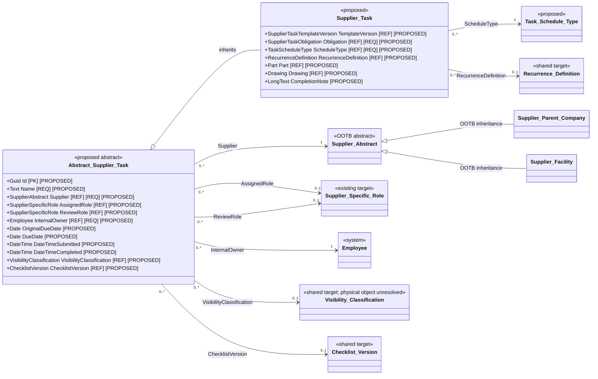

# Supplier Tasks component — solution specification

| Property | Value |
|---|---|
| Mode | Target design layered over the separately preserved OOTB SRM baseline |
| Application | Supplier Relationship Management |
| Component | Supplier Tasks |
| Operational objects | `Abstract Supplier Task`, `Supplier Task` |
| Workflows | Supplier Task |
| As of | 2026-10-19 |
| Primary sources | ADR-002, ADR-003, ADR-004, ADR-005, ADR-006, ADR-007, ADR-076, ADR-077, ADR-078, ADR-079, ADR-080, ADR-081, ADR-083, ADR-084, ADR-085, and ADR-103; user-approved inheritance and scope decisions |

## 1. Executive solution summary

The Supplier Tasks component introduces one abstract operational parent and one concrete task object:

```text
Abstract Supplier Task
└── Supplier Task
```

This is direct Intelex object inheritance. It is not a parent-child record association. Common task fields are declared once on `Abstract Supplier Task` and inherited by `Supplier Task`.

- **Supplier Task** represents a targeted, onboarding, training, access, evidence, checklist, or recurring supplier obligation created for one supplier context.
- **Abstract Supplier Task** provides the reusable task contract: supplier scope, role-based ownership, due dates, visibility, completion metadata, and checklist version.

A targeted request, onboarding rule, or supplier-scoped recurring obligation creates Supplier Task records. The `Supplier Survey` object and its workflow are documented only in the Supplier Surveys technical specification and are outside this document's object inventory, diagrams, field lists, workflow, permissions, reporting, and acceptance criteria.

Every material object, field, relationship, stage, action, and notification introduced by this specification is **Proposed** unless explicitly classified as **Extracted**, **Required**, or **Unresolved**. Logical names are not confirmed internal names, stable metadata identifiers, database keys, or physical table names. This document does not claim that the proposed configuration has been implemented.

## 2. Architectural findings and consequences

1. **Inheritance is the reuse boundary.** Common task data belongs on `Abstract Supplier Task`; task-only data remains on `Supplier Task`.
2. **Workflow is platform managed.** The Supplier Task workflow is configured on the concrete object, but no custom Workflow or State relationship/display field is declared in the logical field model.
3. **Role references remain live.** The work item points to a Supplier Specific Role rather than permanently assigning accountability to the person occupying that role at creation. The individual actor is captured when an action occurs.
4. **Configuration is versioned.** Active and historical tasks retain their selected Template Version, resolved Checklist Version, and task-level control values when template or checklist configuration changes later; no Configuration Snapshot field is used.
5. **Recurrence produces new records.** Every due occurrence is a separate concrete task record. Completed history is never reopened or overwritten to represent a later period.
6. **Supplier activation and task completeness are separate.** Incomplete setup work remains visible and actionable but does not create a second supplier-approval gate.
7. **Lifecycle and security are independent controls.** Supplier status capability rules govern whether new Supplier Tasks may be issued and whether existing tasks continue or are withdrawn. Supplier-entity scope and visibility classification govern who can see each record.
8. **No automatic inheritance of parent-company responsibility is assumed.** A role must resolve for the exact Supplier Abstract referenced by the task unless a future governed routing rule explicitly permits another behavior.
9. **Every initial task creates an obligation.** On initial save of a Supplier Task that does not already have an Obligation, an Action Handler creates and links exactly one Supplier Task Obligation and sets its Initial Task to the saved task. A One Time task uses the shared `One Time` Recurrence Definition and has no next occurrence; a Recurring task uses the selected recurrence and may generate later tasks under the same Obligation.
10. **Checklist configuration is reused.** Templated Supplier Tasks consume the neutral Checklist authoring/version family defined in the Supplier Surveys technical specification. Checklist and Checklist Question are editable authoring records; Publish creates immutable checklist, question, and question-choice version snapshots.
11. **Profile assignments select stable templates, not versions.** A Supplier Profile Task Assignment points to a Supplier Task Template. When supplier creation generates a task, automation stores the related Publish-created version with the greatest Version Number on the new Supplier Task.
12. **Task templates select stable Checklists.** Supplier Task Template and its published versions reference Checklist rather than Checklist Version. Each new Supplier Task resolves and freezes the Checklist's single current Active? = TRUE Checklist Version, so later checklist publication affects only later tasks.

## 3. Requirements interpretation

| Requirement ID | Source | Interpreted requirement | Classification |
|---|---|---|---|
| ST-001 | User-approved architecture; refined by ST-046 | Supplier Task directly inherits from Abstract Supplier Task | Required |
| ST-002 | User-approved architecture; refined by ST-046 | This specification defines only the Supplier Task workflow; Supplier Survey is documented exclusively in the Supplier Surveys technical specification | Required |
| ST-003 | ADR-103 | Reuse assignment, due dates, completion, applicable review, reminders, recurrence, and reporting through a shared task model | Required |
| ST-004 | ADR-103 | Every concrete work item relates to a supplier and resolves an accountable maintained supplier role | Required |
| ST-005 | ADR-103 and user clarification | Supplier Task may require a note, file upload, a governed checklist, or a combination; checklist configuration is available only through a selected task template | Required |
| ST-006 | ADR-103 | A Supplier Task may complete on supplier submission or route to an internal role for review | Required |
| ST-007 | ADR-103; refined by ST-044 | Preserve optional part and drawing context; generic origin/source trace fields are removed | Required |
| ST-008 | ADR-103; refined by ST-044 | Preserve the selected Template Version, Checklist Version, and copied task control values without a Configuration Snapshot field | Required |
| ST-010 | ADR-005, ADR-002, ADR-077 | Governed supplier setup rules may generate Supplier Tasks after supplier creation without delaying supplier activation | Required |
| ST-012 | ADR-003, ADR-004 | Assignment and review use standardized supplier-specific external and internal roles; action history records the individual actor | Required |
| ST-013 | ADR-003, ADR-007, ADR-081 | Only eligible authenticated contacts may perform supplier actions; missing or inactive membership is an owned exception | Required |
| ST-014 | ADR-076, ADR-078 | Work is scoped to the exact supplier company or facility and cannot expand portal access beyond supplier-entity relationships | Required |
| ST-015 | ADR-079 | Supplier status and capability rules govern creation and continuation of Supplier Tasks; history is retained | Required |
| ST-016 | ADR-083; refined by ST-046 | Supplier Tasks appear in the supplier work experience with drill-through to the task record | Required |
| ST-017 | ADR-084 | Visibility classification restricts records within supplier scope and may change without changing workflow ownership | Required |
| ST-018 | ADR-085, ADR-103 | Distinct domain lifecycles and event-driven submissions are not replaced by Supplier Tasks | Required |
| ST-019 | User-approved scope | The excluded baseline requirement objects are outside this document and have no design dependency here | Required |
| ST-020 | User clarification; refined by ST-051 | The same Supplier Task form configures one-time and recurring work; every initial Task automatically creates a related Supplier Task Obligation, and each later recurring occurrence is a separate Supplier Task under that Obligation | Required |
| ST-021 | Design assumption; superseded by ST-053 | Use native workflow history, object audit, execution logs, and platform notification evidence instead of a custom task-event object | Required |
| ST-022 | User clarification | File validation is controlled only by `File Upload Required?`; no configurable minimum file count is used | Required |
| ST-023 | User clarification; refined by ST-046 | Templated Supplier Tasks reuse the neutral checklist configuration and answer family defined by the Supplier Surveys specification rather than maintaining a task-specific checklist catalogue | Required |
| ST-024 | User clarification, refined by ST-027 | Supplier Question Answer provides `Answer - Text`, `Answer - Float`, `Answer - File`, and `Answer - Date`, plus M:1 `Answer - Choice` and M:N `Answer - Choices` relationships to the published Checklist Question Choice Version | Required |
| ST-025 | User clarification; refined by ST-049 | A Supplier Profile Task Assignment selects a Supplier Task Template; supplier-creation generation resolves and stores its Publish-created Supplier Task Template Version with the greatest Version Number | Required |
| ST-026 | User clarification | Checklist Questions use Guidance, conditionally require a Choice List, generate guarded question-scoped choices, and carry scoring and color metadata on choice values | Required |
| ST-027 | User clarification | Checklist Publish creates immutable Checklist Question Choice Version records for every published Checklist Question Choice under each Checklist Question Version | Required |
| ST-037 | User clarification; refined by ST-054 | Supplier Question Answer uses unprefixed Work Item, Question Version, Responded By, and Responded At field names; an Update Action Handler sets Responded By and timezone-enabled Responded At whenever any `Answer -` field changes | Required |
| ST-044 | User clarification | Remove Origin Type, Origin Display, Source Application, Source Record Key, Source Record URL, Configuration Snapshot, Snapshot Schema Version, State, Schedule Generation, Exception Resume State, Exception Result Reason (previously documented as Exception Reason), and Workflow; rename and retype the due/submission/completion fields as specified | Required |
| ST-045 | User clarification | Supplier Task.Schedule Type is an M:1 relationship to Task Schedule Type; Supplier Task.Recurrence Definition is an M:1 relationship to the shared Recurrence Definition object; remove Occurrence Number; task completion flags default from Template Version and are user-editable only when no Task Template is populated | Required |
| ST-046 | User clarification | Rename Survey Recurrence Definition to Recurrence Definition and remove all Supplier Survey object/workflow documentation from this specification | Required |
| ST-047 | User clarification | Remove Period Start and Period End from Supplier Task; recurring work is identified by its linked obligation and scheduling fields rather than task-level period boundaries | Required |
| ST-048 | User clarification; refined by ST-049 | Supplier Task Template carries every retained Supplier Task Template Version configuration field except Template and Version Number, exposes an inverse Versions grid, and has no Reporting Classification or Owner field; Template Version relates to Checklist, and each new task resolves the Checklist's latest active version | Required |
| ST-049 | User clarification | Remove State from Supplier Task Template and Supplier Task Template Version; a Template Version exists only when created by Publish, and the latest published version is the record with the greatest Version Number for that Template | Required |
| ST-050 | User clarification | Supplier Task Template Version.Version Number is assigned automatically as one greater than the maximum Version Number in the related Template.Versions grid; the first version is 1 and no template-level counter helper is used | Required |
| ST-051 | User clarification | Every initial Supplier Task creates and links a Supplier Task Obligation on initial save; the Action Handler sets Initial Task, One Time obligations use the shared One Time Recurrence Definition and a null Next Occurrence At, recurring occurrences reuse the original Obligation, and Generation Exception is removed | Required |
| ST-052 | User clarification | Remove Supplier Profile Task Assignment.Applies to Entity Type; an assignment applies to every supplier entity created from its Supplier Profile Template | Required |
| ST-053 | User clarification | Remove Supplier Task Reminder Rule and Supplier Task Event entirely; task reminders use native Intelex platform functionality and task evidence uses native workflow history, object audit, execution logs, and notification logs | Required |
| ST-054 | User clarification | Remove Supplier Question Answer.Response Iteration and its dependencies; enforce one answer per Work Item and Question Version, and reopen the same audited answer records when a reviewed task is returned | Required |

## 4. Baseline and target boundary

### 4.1 Extracted baseline retained

The verified baseline supplies the following elements used by this target design:

- `SupplierMgmt_SupAbstractObject` as the abstract supplier base;
- `SupplierMgmt_ParentCompnyObject` and `SupplierMgmt_FacilityObject` as direct supplier descendants;
- the separate Parent Company-to-Facility relationship;
- Supplier Contact and its Employee bridge;
- system Subject, Employee, Group, Workflow Instance, and Workflow Stage concepts; and
- the platform workflow, notification, attachment, configurable-view, and My Tasks capabilities.

The baseline contains no extracted generic supplier-task inheritance family or Supplier Task workflow matching this specification. All component objects and workflow behavior below are therefore target configuration.

### 4.2 Existing target-design dependencies

This specification consumes, without redefining:

- Supplier Management Role and Supplier Specific Role from the Supplier Management Role target model;
- Supplier Profile Template from the Supplier Profile Template target model;
- the replacement Supplier Status and capability rules from the Supplier Status Updates target model;
- Supplier Contact ownership and authenticated-user linkage from the User Access Request target model; and
- the shared Checklist configuration family and renamed Recurrence Definition catalogue from the Supplier Surveys target design.

The Supplier Surveys technical specification is authoritative for the Supplier Survey object, its workflow, campaign structures, and survey-specific use of shared objects. This document does not duplicate that content.

## 5. Target logical object model

### 5.1 High-level inheritance and context



`Supplier Task` is the only concrete object documented by this specification. Fields declared on `Abstract Supplier Task` are not redeclared on it. The Supplier Surveys specification separately owns the Supplier Survey model.

### 5.2 Supplier Task configuration and execution

```mermaid
classDiagram
direction LR

class Supplier_Task_Template {
  <<proposed>>
  +Guid Id [PK] [PROPOSED]
  +Text Name [REQ] [PROPOSED]
  +Boolean Active [REQ] [PROPOSED]
  +SupplierTaskTemplateVersion Versions [1:M] [PROPOSED]
  +LongText Instructions [REQ] [PROPOSED]
  +SupplierManagementRole AssignedRole [REF] [REQ] [PROPOSED]
  +Boolean ReviewRequired [PROPOSED]
  +SupplierManagementRole ReviewRole [REF] [PROPOSED]
  +Subject InternalOwner [REF] [REQ] [PROPOSED]
  +Number DefaultResponseDays [PROPOSED]
  +Boolean NoteRequired [PROPOSED]
  +Boolean FileUploadRequired [PROPOSED]
  +Checklist Checklist [REF] [PROPOSED]
}
class Supplier_Task_Template_Version {
  <<proposed>>
  +Guid Id [PK] [PROPOSED]
  +SupplierTaskTemplate Template [REF] [REQ] [PROPOSED]
  +Number VersionNumber [REQ] [PROPOSED]
  +Boolean NoteRequired [REQ] [PROPOSED]
  +Boolean FileUploadRequired [REQ] [PROPOSED]
  +Boolean ReviewRequired [REQ] [PROPOSED]
  +Checklist Checklist [REF] [PROPOSED]
}
class Checklist {
  <<shared target>>
}
class Checklist_Question_Version {
  <<shared target>>
}
class Checklist_Choice {
  <<shared target>>
}
class Supplier_Task_Obligation {
  <<proposed>>
  +Guid Id [PK] [PROPOSED]
  +SupplierTask InitialTask [REF] [REQ] [PROPOSED]
  +SupplierAbstract Supplier [REF] [REQ] [PROPOSED]
  +SupplierTaskTemplateVersion TemplateVersion [REF] [PROPOSED]
  +RecurrenceDefinition RecurrenceDefinition [REF] [REQ] [PROPOSED]
  +Boolean Active [REQ] [PROPOSED]
}
class Supplier_Profile_Task_Assignment {
  <<proposed>>
  +Guid Id [PK] [PROPOSED]
  +SupplierProfileTemplate SupplierProfileTemplate [REF] [REQ] [PROPOSED]
  +SupplierTaskTemplate TaskTemplate [REF] [REQ] [PROPOSED]
  +Number TargetDays [REQ] [PROPOSED]
  +Boolean RequiredForCompleteness [REQ] [PROPOSED]
}
class Abstract_Supplier_Task {
  <<proposed abstract; detailed in 5.1>>
}
class Supplier_Task {
  <<proposed descendant>>
  +TaskScheduleType ScheduleType [REF] [REQ] [PROPOSED]
  +RecurrenceDefinition RecurrenceDefinition [REF] [PROPOSED]
  +Boolean NoteRequired [REQ] [PROPOSED]
  +Boolean FileUploadRequired [REQ] [PROPOSED]
  +Boolean ReviewRequired [REQ] [PROPOSED]
}
class Task_Schedule_Type {
  <<proposed>>
  +Text Name [REQ] [PROPOSED]
  +Boolean Active [REQ] [PROPOSED]
  +Float Sort [REQ] [PROPOSED]
}
class Recurrence_Definition {
  <<shared target>>
  +Text Name [REQ] [PROPOSED]
  +Boolean Active [REQ] [PROPOSED]
  +Float Sort [REQ] [PROPOSED]
  +Text Frequency [PROPOSED]
}
class Supplier_Question_Answer {
  <<proposed>>
  +Guid Id [PK] [PROPOSED]
  +AbstractSupplierTask WorkItem [REF] [REQ] [PROPOSED]
  +ChecklistQuestionVersion QuestionVersion [REF] [REQ] [PROPOSED]
  +Text AnswerText [PROPOSED]
  +Float AnswerFloat [PROPOSED]
  +File AnswerFile [PROPOSED]
  +Date AnswerDate [PROPOSED]
  +Boolean AnswerBoolean [PROPOSED]
  +ChecklistChoice AnswerChoice [REF] [PROPOSED]
  +ChecklistChoice AnswerChoices [M:N] [REF] [PROPOSED]
  +Employee RespondedBy [REF] [PROPOSED]
  +DateTimeTZ RespondedAt [PROPOSED]
}
class Supplier_Profile_Template {
  <<existing target>>
}
class Supplier_Abstract {
  <<OOTB abstract>>
  +Dropdown TypeOfSupplierEntity [REQ] [SHARED TARGET]
}

Supplier_Task_Template_Version "0..*" --> "1" Supplier_Task_Template : Template / Versions
Supplier_Task_Template "0..*" --> "0..1" Checklist : Checklist
Abstract_Supplier_Task <|-- Supplier_Task
Supplier_Task_Template_Version "0..*" --> "0..1" Checklist : Checklist
Supplier_Task_Obligation "0..1" --> "1" Supplier_Task : InitialTask
Supplier_Task_Obligation "0..*" --> "1" Supplier_Abstract : Supplier
Supplier_Task_Obligation "0..*" --> "0..1" Supplier_Task_Template_Version : TemplateVersion
Supplier_Profile_Task_Assignment "0..*" --> "1" Supplier_Profile_Template : SupplierProfileTemplate
Supplier_Profile_Task_Assignment "0..*" --> "1" Supplier_Task_Template : TaskTemplate
Supplier_Task "0..*" --> "0..1" Supplier_Task_Template_Version : TemplateVersion
Supplier_Task "0..*" --> "1" Supplier_Task_Obligation : Obligation
Supplier_Task "0..*" --> "1" Task_Schedule_Type : ScheduleType
Supplier_Task "0..*" --> "0..1" Recurrence_Definition : RecurrenceDefinition
Supplier_Task_Obligation "0..*" --> "1" Recurrence_Definition : RecurrenceDefinition
Abstract_Supplier_Task "0..*" --> "0..1" Checklist_Version : ChecklistVersion
Supplier_Question_Answer "0..*" --> "1" Abstract_Supplier_Task : WorkItem
Supplier_Question_Answer "0..*" --> "1" Checklist_Question_Version : QuestionVersion
Supplier_Question_Answer "0..*" --> "0..1" Checklist_Choice : Answer - Choice
Supplier_Question_Answer "0..*" --> "0..*" Checklist_Choice : Answer - Choices
```



## 6. Object inventory

| Object | Kind | Parent | Responsibility | Classification |
|---|---|---|---|---|
| Abstract Supplier Task | Abstract record | None | Reusable supplier-task identity, scope, ownership, dates, security, checklist, and completion contract | Required/Proposed |
| Supplier Task | Record | Abstract Supplier Task | Targeted and recurring supplier obligations with note, file, or checklist completion | Required/Proposed |
| Task Schedule Type | Configuration | None | Governed active catalogue selected by Supplier Task.Schedule Type | Required/Proposed |
| Recurrence Definition | Shared configuration | None | Governed schedule definitions reused by Supplier Tasks and Survey Campaigns, including a task-obligation-only One Time record | Required/Proposed; authoritative field list in Supplier Surveys specification |
| Supplier Task Template | Configuration | None | Editable authoring record for reusable targeted-task configuration, with an inverse Versions grid | Required/Proposed |
| Supplier Task Template Version | Configuration | Supplier Task Template relationship | Immutable published snapshot of task controls, routing defaults, and selected stable Checklist | Required/Proposed |
| Checklist, Checklist Version, Checklist Question, Checklist Question Version, Checklist Choice List, Checklist Choice, Checklist Question Choice, and Checklist Question Choice Version | Shared configuration family | Relationships defined in Supplier Surveys specification | Governed authoring records, reusable choice libraries, generated question choices, and immutable published question/choice snapshots consumed by templated Supplier Tasks | Existing target revised/shared |
| Supplier Task Obligation | System-managed operational configuration | None | Supplier-scoped obligation created for every initial Supplier Task; One Time obligations retain grouping/history only, while recurring obligations generate later occurrences | Required/Proposed |
| Supplier Profile Task Assignment | Configuration child | Supplier Profile Template relationship | Applies a stable task template to every supplier entity using the related Supplier Profile Template; generation resolves its Publish-created version with the greatest Version Number | Required/Proposed |
| Supplier Question Answer | Operational child | Abstract Supplier Task relationship | Typed Supplier Task answer to one Checklist Question Version, including single- and multiple-choice relationships | Proposed |

## 7. Field specifications

### 7.1 Abstract Supplier Task

These fields are declared once on the abstract parent and inherited by Supplier Task. The Supplier Surveys specification governs any separate reuse by Supplier Survey.

| Field | Type | Required | Default/source | Editability and behavior | Classification |
|---|---|---:|---|---|---|
| Id | Guid identity | Yes | Platform | Read only; logical identity | Proposed |
| Record Number | Auto number | Yes | Platform | Read only; human reference | Proposed |
| Name | Text, maximum 255 | Yes | Generated or entered before issue | Read only after issue; display field | Proposed |
| Supplier | M:1 Supplier Abstract | Yes | Creator/generator | Immutable after workflow starts; exact company or facility security anchor | Required/Proposed |
| Assigned Role | M:1 Supplier Specific Role | Conditional | Resolved for exact Supplier and configured external library role | Required before issue; live group membership controls supplier action eligibility | Required/Proposed |
| Review Role | M:1 Supplier Specific Role | Conditional | Resolved for exact Supplier and configured internal library role | Required before submission when Supplier Task.Review Required? is Yes | Required/Proposed |
| Internal Owner | M:1 Employee | Yes | Template, generator, or creator | Owns Supplier Task Draft/Preparing/Exception administration; must be an active authorized internal user | Proposed |
| Visibility Classification | M:1 shared visibility classification | Conditional | Template or manual configuration | Required where security matrix applies; may change without changing workflow stage or owner | Required/Proposed; physical target unresolved |
| Instructions Snapshot | Long text | Yes | Template or manual configuration | Frozen at issue; plain-language instructions actually shown | Required/Proposed |
| Checklist Version | M:1 shared Checklist Version | Conditional | Resolved from Template Version.Checklist when the task is generated | Require exactly one Active? = TRUE version for the selected Checklist; store that version on the task and never recalculate it; null for non-checklist tasks | Required/Proposed |
| Issued At | Datetime | Conditional | Server time on successful issue | Read only | Proposed |
| Original Due Date | Date | Conditional | Calculated on first issue | Read only and never overwritten | Required/Proposed |
| Due Date | Date | Conditional | First issue or authorized extension | Drives Assigned-stage due date; null only where approved configuration permits no due date | Required/Proposed |
| Date / Time Submitted | Datetime with timezone enabled | No | Server date/time on supplier submission | Read only | Required/Proposed |
| Date / Time Completed | Datetime with timezone enabled | No | Server date/time on terminal completion | Read only | Required/Proposed |
| Completed By | M:1 Employee | No | Authenticated action actor or automation identity | Read only | Proposed |
| Closure Reason | Long text | Conditional | Authorized actor | Required for Supplier Task cancellation, withdrawal, and no-response closure | Proposed |

`Assigned Role` and `Review Role` point to operational Supplier Specific Roles, not library roles and not copied member lists. Workflow identity and current stage are platform-managed and are not duplicated as custom `Workflow` or `State` fields.

### 7.2 Supplier Task

| Field | Type | Required | Default/source | Behavior | Classification |
|---|---|---:|---|---|---|
| Template Version | M:1 Supplier Task Template Version | No | Creator/generator | Required for templated work; null permitted for controlled ad hoc work | Required/Proposed |
| Obligation | M:1 Supplier Task Obligation | Yes after Create | Initial-save Action Handler creates and links one when this field is null; recurrence generator copies the existing Obligation to later occurrences | Required after the create handler completes for every Supplier Task; read only; generated recurring occurrences do not create another Obligation | Required/Proposed |
| Profile Task Assignment | M:1 Supplier Profile Task Assignment | No | Supplier creation generator | Identifies onboarding origin | Proposed |
| Part | M:1 canonical Part | No | Creator or authorized automation | Optional business context; exact target object supplied by Product Management design | Required/Proposed |
| Drawing | M:1 drawing/revision context | No | Creator or authorized automation | Allowed only when Part is populated and the drawing belongs to that part; exact target object unresolved | Required/Proposed |
| Schedule Type | M:1 Task Schedule Type | Yes | User selection on initial task; copied on generated occurrences | Select active records in Sort order; the `Recurring` record enables recurrence fields; read only after issue | Required/Proposed |
| Recurrence Definition | M:1 Recurrence Definition | Conditional | User selection on initial recurring task | Required when Schedule Type.Name = `Recurring`; selectable records must have Active? = TRUE and Name must not equal `One Time`; copied to the system-created obligation and read only after issue | Required/Proposed |
| Recurrence End On | Date | No | User selection on initial recurring task | Optional series boundary; copied to obligation | Proposed |
| Note Required? | Yes/No | Yes | Default expression: `[Template Version].[Note Required?]` when Template Version is populated; otherwise user entry | Read only when Template Version is populated; user editable during ad hoc task setup when Template Version is null; frozen at issue | Required/Proposed |
| File Upload Required? | Yes/No | Yes | Default expression: `[Template Version].[File Upload Required?]` when Template Version is populated; otherwise user entry | Read only when Template Version is populated; user editable during ad hoc task setup when Template Version is null; frozen at issue; when TRUE, at least one native file must exist at submission | Required/Proposed |
| Review Required? | Yes/No | Yes | Default expression: `[Template Version].[Review Required?]` when Template Version is populated; otherwise user entry | Read only when Template Version is populated; user editable during ad hoc task setup when Template Version is null; frozen at issue; if TRUE, Review Role is mandatory before submission | Required/Proposed |
| Completion Note | Long text | Conditional | Supplier actor | Required at submission when Note Required is Yes; supplier editable only in Assigned | Required/Proposed |
| Submitted File Count | Calculated number | Yes | Native attachment query | Read only; used for submission validation | Proposed |
| Review Comments | Long text | No | Reviewer | Required on Return; optional on Approve | Proposed |

When Template Version is populated, Note Required?, File Upload Required?, and Review Required? default from the corresponding Template Version fields and are read only. When Template Version is null, those three fields accept user entry during task setup. An ad hoc Supplier Task may use any combination of the note and file-upload controls. If no Template Version is selected, Checklist Version is hidden, cleared, and unavailable. A checklist may be used only when the selected Template Version supplies a Checklist; users cannot select a separate Checklist or Checklist Version or create checklist questions directly on a live task. Task generation resolves the selected Checklist's single current Active? = TRUE Checklist Version and freezes it on the task. At least one completion control must be enabled before issue.

In this specification, the selected Template Version is the related Task Template configuration available on the live task. Because the corresponding control fields are versioned, the default expressions reference Template Version rather than the stable Supplier Task Template parent.

The initial Supplier Task is also the setup form for its Obligation and any recurrence. On initial save, when Obligation is null, the create Action Handler creates and links exactly one Supplier Task Obligation and sets that Obligation's Initial Task to the saved Supplier Task. Selecting the active Task Schedule Type named `Recurring` reveals Recurrence Definition and the optional end boundary; selecting `One Time` keeps those task fields hidden while the handler assigns the shared Recurrence Definition named `One Time` to the Obligation. Generated later occurrences receive the existing Obligation during creation and do not trigger a new Obligation. Schedule, recurrence, and Obligation fields are read only after issue.

### 7.3 Task Schedule Type

| Field | Type | Required | Default / behavior | Classification |
|---|---|---:|---|---|
| Name | Text, maximum 255 | Yes | Display field; unique | Required/Proposed |
| Active? | Yes/No | Yes | Default Yes; inactive records remain available to history but cannot be newly selected | Required/Proposed |
| Sort | Float | Yes | Controls dropdown order; lower values appear first | Required/Proposed |

Seed active records `One Time` with Sort `1.0` and `Recurring` with Sort `2.0`. Recurrence fields appear only when Schedule Type.Name = `Recurring`.

### 7.4 Supplier Task Template

| Field | Type | Required | Additional Config | Behavior |
|---|---|---:|---|---|
| Name | Text | Y | Maximum 255; display field | Must be unique |
| Description | Text | N |  | Administrative description |
| Active? | Yes/No | N | Default: `Yes`; view settings: checkbox | Inactive templates cannot be selected for new assignments or manual tasks; history remains available |
| Versions | 1:M relationship grid to Supplier Task Template Version | N | Inverse of Supplier Task Template Version.Template | Read-only relationship grid showing every Publish-created version |
| Instructions | Text | Y |  | Editable authoring value copied on Publish |
| Assigned Role | M:1 Supplier Management Role | Y |  | Must be an active standard external role; copied on Publish |
| Review Required? | Yes/No | N | Default: `No`; view settings: checkbox | Editable authoring value copied on Publish |
| Review Role | M:1 Supplier Management Role | N | Shown and mandatory if Review Required? = TRUE; otherwise hidden, non-mandatory, and cleared | Copied on Publish |
| Internal Owner | M:1 Subject | Y |  | Editable authoring value copied on Publish |
| Default Response Days | Number | N |  | Must be positive when populated; copied on Publish |
| Note Required? | Yes/No | N | Default: `No`; view settings: checkbox | Editable authoring value copied on Publish |
| File Upload Required? | Yes/No | N | Default: `No`; view settings: checkbox | Editable authoring value copied on Publish |
| Checklist | M:1 shared Checklist | N | Select the stable Checklist authoring record | Copied on Publish; each generated task resolves the Checklist's current Active? = TRUE Checklist Version |
| Visibility Classification | M:1 Visibility Classification | N |  | Editable authoring value copied on Publish |
| Business Hierarchy | M:1 Business Hierarchy | N |  | Editable authoring value copied on Publish |

**Business Rules**

- Name must be unique

The Template is the editable authoring record. It intentionally carries every field declared on Supplier Task Template Version except the child-side `Template` relationship and system-assigned `Version Number`. `Reporting Classification` and `Owner` are not configured on Supplier Task Template.

### 7.5 Supplier Task Template Version

| Field | Type | Required | Additional Config | Behavior |
|---|---|---:|---|---|
| Template | M:1 Supplier Task Template | Y | Read-Only after Create |  |
| Version Number | Number | Y | Action Handler calculation: `IF(ISNULL(MAX([Template].[Versions].[Version Number])), 1, MAX([Template].[Versions].[Version Number]) + 1)` | Set automatically during Publish; read only and immutable after Create |
| Instructions | Text | Y | Default expression: `[Template].[Instructions]` | Read only after Create |
| Assigned Role | M:1 Supplier Management Role | Y | Default expression: `[Template].[Assigned Role]` | Must be an active standard external role; read only after Create |
| Review Required? | Yes/No | N | Default expression: `[Template].[Review Required?]`; view settings: checkbox | Read only after Create |
| Review Role | M:1 Supplier Management Role | N | Default expression: `[Template].[Review Role]` | Required if Review Required? = TRUE; otherwise null; read only after Create |
| Internal Owner | M:1 Subject | Y | Default expression: `[Template].[Internal Owner]` | Read only after Create |
| Default Response Days | Number | N | Default expression: `[Template].[Default Response Days]` | Read only after Create |
| Note Required? | Yes/No | N | Default expression: `[Template].[Note Required?]`; view settings: checkbox | Read only after Create |
| File Upload Required? | Yes/No | N | Default expression: `[Template].[File Upload Required?]`; view settings: checkbox | Read only after Create |
| Checklist | M:1 shared Checklist | N | Default expression: `[Template].[Checklist]` | Stable Checklist reference; read only after Create |
| Visibility Classification | M:1 Visibility Classification | N | Default expression: `[Template].[Visibility Classification]` | Read only after Create |
| Business Hierarchy | M:1 Business Hierarchy | N | Default expression: `[Template].[Business Hierarchy]` | Read only after Create |

**Business Rules**

- Version Number must be unique within Template
- Default Response Days must be positive

**Action Handlers**

- Publish creates the Supplier Task Template Version from the selected Template. After setting Template and before saving the new Version, the Action Handler calculates Version Number as `IF(ISNULL(MAX([Template].[Versions].[Version Number])), 1, MAX([Template].[Versions].[Version Number]) + 1)` and populates every configuration field through the documented `[Template]` default-value expression. The calculation and child creation must execute atomically for that Template so concurrent Publish requests cannot receive the same Version Number. A retry must return or complete the already-created Version rather than allocate another number.

Publishing validates all conditional fields, role classifications, that any selected Checklist has exactly one Active? = TRUE Checklist Version, at least one enabled completion control, title tokens, and the due-date rule. Supplier Task Template Version records are created only by this Publish action and are immutable; there is no State field. Changes are made on Supplier Task Template and require publishing a new version. Reminders are configured through native Intelex platform functionality rather than a related business object.

At least one of Note Required, File Upload Required, or Checklist must be enabled.

### 7.6 Shared Checklist configuration

Supplier Tasks do not define an independent checklist catalogue. They consume the shared `Checklist`, `Checklist Version`, `Checklist Question`, `Checklist Question Version`, `Checklist Choice List`, `Checklist Choice`, `Checklist Question Choice`, and `Checklist Question Choice Version` objects specified in [Supplier Surveys technical specification](supplier-surveys-technical-specification.md). `Checklist` exposes inverse 1:M grids to its Checklist Versions and Checklist Questions; Checklist Version and Checklist Question each expose an inverse 1:M grid to Checklist Question Versions. Checklist Question also exposes its generated Checklist Question Choices. The child-side M:1 fields implement those grids. `Guidance` is the configured explanatory-text field. Choice/Choices questions require a Choice List on both the authoring Question and its mirrored Question Version. Initial question save copies every source Checklist Choice into a Checklist Question Choice; the Choice List remains locked until all generated rows are manually deleted. Choice metadata includes not-applicable, points, calculated max points, weight, and existing Color references. Publish creates the next Checklist Version, defaults each Checklist Question Version from its Checklist Question, and creates one immutable Checklist Question Choice Version from every current Checklist Question Choice for the corresponding Question Version. Supplier answers select these published choice instances. Supplier Task Template and Supplier Task Template Version select the stable Checklist. When a Supplier Task is generated, automation resolves that Checklist's single current Active? = TRUE Checklist Version, stores it on the task, and never changes that stored version. A later Checklist publication therefore applies to later generated tasks without changing existing tasks or requiring a new Task Template Version.

The Supplier Surveys technical specification remains authoritative for the shared Checklist object's authoring/publishing behavior and for any survey-specific use of that configuration. This specification defines how Supplier Task Template and Supplier Task Template Version reference Checklist, how Supplier Task resolves and freezes the active Checklist Version, and how Supplier Question Answer consumes its published question and choice records.

### 7.7 Supplier Task Obligation

| Field | Type | Required | Behavior | Classification |
|---|---|---:|---|---|
| Name | Text | Yes | Generated from the initial task; display field | Proposed |
| Initial Task | M:1 Supplier Task | Yes | Set by the Action Handler that creates the Obligation on initial save of the first Task; unique and immutable | Required/Proposed |
| Supplier | M:1 Supplier Abstract | Yes | Exact company or facility | Required/Proposed |
| Template Version | M:1 Supplier Task Template Version | No | Copied from Initial Task when present; null for untemplated work | Required/Proposed |
| Assigned Role Override | M:1 Supplier Specific Role | No | Must belong to exact Supplier and match required external classification | Proposed |
| Review Role Override | M:1 Supplier Specific Role | No | Must belong to exact Supplier and be internal | Proposed |
| Part / Drawing | References | No | Same integrity rules as Supplier Task | Required/Proposed |
| Recurrence Definition | M:1 Recurrence Definition | Yes | If Initial Task.Schedule Type.Name = `One Time`, set to the active shared record named `One Time`; otherwise copy Initial Task.Recurrence Definition. The scheduler does not interpret the One Time frequency as a recurring expression | Required/Proposed |
| Schedule Anchor | Datetime with timezone | Conditional | Derived from the initial task's issue and recurrence configuration; required before scheduling a recurring Obligation and may be null for One Time | Required/Proposed |
| Response Days Override | Positive integer | No | Overrides template for future occurrences | Proposed |
| Effective To | Datetime | No | Copied from Initial Task.Recurrence End At; bounds future generation | Proposed |
| Active? | Yes/No | Yes | Defaults to Yes; disabling stops future occurrences only | Proposed |
| Next Occurrence At | Datetime | No | Calculation returns null when Recurrence Definition.Name = `One Time`; otherwise the scheduler calculates and maintains the next occurrence from Schedule Anchor and the recurrence Frequency | Required/Proposed |
| Last Generated At | Datetime | No | Scheduler maintained | Proposed |

Supplier Task Obligation has no ordinary end-user creation form. An after-create Action Handler on Supplier Task runs on initial save when Obligation is null, creates or reuses exactly one Obligation for that initial Task, sets Obligation.Initial Task to the saved Task, copies the applicable setup values, and updates Task.Obligation. The operation is idempotent and must enforce uniqueness of Initial Task so a retry cannot create a second Obligation. A later recurring occurrence is created with the existing Obligation already populated, so the handler does not create another. One Time Obligations remain as the grouping and configuration record for their single Task, with Recurrence Definition = `One Time` and Next Occurrence At = null. Series-management controls may be embedded on the Supplier Task page, while direct obligation access is restricted to administrators and support. For recurring Obligations, occurrence uniqueness is `(Obligation, Scheduled Occurrence)`. A retry returns the existing occurrence or completes its generation; it never creates a duplicate task. Failures use native Action Handler, workflow, and execution-log evidence; no Generation Exception field is configured.

### 7.8 Supplier Profile Task Assignment

| Field | Type | Required | Additional Config |
|---|---|---:|---|
| Name | Text | Y | visible after create<br />calculation: Profile Template.Name + " - " +  Task Template.Name |
| Supplier Profile Template | M:1 Supplier Profile Template | Y |  |
| Task Template | M:1 Supplier Task Template | Y | filter for Active?=TRUE |
| Active? | Yes/No | N | Default: `Yes`<br />view settings: checkbox |
| Required for Completeness? | Yes/No | N | view settings: checkbox<br />Controls completeness reporting only; never supplier activation |
| Frequency | Frequency | Y | OOTB frequency selector to set up as one-time or recurring task |

**Business Rules**

- `(Supplier Profile Template, Task Template)` must be unique
- Each active assignment applies to every Supplier Parent Company and Supplier Facility created with the related Supplier Profile Template; there is no entity-type filter.

At generation time, automation resolves the selected Task Template to its latest published Supplier Task Template Version: the related Version record with the greatest Version Number. Because Version records can be created only by Publish and Version Number is unique within Template, no State or effective-date filter is required. No related Version, or multiple records tied for the greatest Version Number, is a configuration error and enters the recoverable generation-exception path. The resolved version is stored on the generated Supplier Task; the assignment continues to reference only the stable Task Template.

Version resolution occurs when the idempotent generation operation first creates the Supplier Task. A retry after that task exists resumes the same record and retained Template Version. A retry where no task was created again resolves the Publish-created version with the greatest Version Number. Supplier creation succeeds even if task generation fails. Failures must create internally visible native execution evidence with a safe retry key; they must not silently disappear.

An inactive Profile Task Assignment means the task is no longer being generated for a given Supplier Profile.

### 7.9 Supplier Question Answer

| Object / field | Type | Required | Behavior | Classification |
|---|---|---:|---|---|
| Work Item | M:1 Abstract Supplier Task | Yes | Parent work item; this specification defines Supplier Task usage and the Supplier Surveys specification defines any survey usage | Required/Proposed |
| Question Version | M:1 Checklist Question Version | Yes | Must belong to Work Item.Checklist Version; unique with Work Item | Proposed |
| Answer - Text | Text / long text | No | Populated only for Text questions; maximum length comes from Question Version | Required/Proposed |
| Answer - Float | Float/decimal | No | Populated only for Float questions; `0` is valid and minimum/maximum validation applies | Required/Proposed |
| Answer - File | File | No | Populated only for File questions; file storage, malware scanning, size, and retention use approved platform controls | Required/Proposed |
| Answer - Date | Date | No | Populated only for Date questions | Required/Proposed |
| Answer - Boolean | Nullable Boolean | No | Populated only for Yes/No questions; No is a valid supplied answer | Proposed |
| Answer - Choice | M:1 Checklist Question Choice Version | No | Choice answer; selected published choice must belong to Question Version | Required/Proposed |
| Answer - Choices | M:N Checklist Question Choice Version | No | Choices answer; every selected published choice must belong to Question Version; duplicate pairs prohibited | Required/Proposed |
| Responded By | M:1 Employee | No | Read only; on Update, an Action Handler sets this to the authenticated actor when any Answer - Text, Answer - Float, Answer - File, Answer - Date, Answer - Boolean, Answer - Choice, or Answer - Choices field changes | Required/Proposed |
| Responded At | Datetime with timezone enabled | No | Read only; the same Update Action Handler sets this to the current server date/time when any `Answer -` field changes | Required/Proposed |

Configure one Action Handler triggered on Update. Its condition is that at least one `Answer -` field changed in the update transaction. The handler sets Responded By and Responded At together; updates limited to metadata or handler-maintained fields do not retrigger it. Confirm that changes to the M:1 Answer - Choice and M:N Answer - Choices relationships invoke the same handler in the deployed platform.

Exactly one answer mechanism appropriate to the shared Question Version may be populated. A required Choice question requires `Answer - Choice`; a required Choices question requires one or more values in `Answer - Choices`. The two choice relationships are mutually exclusive. The M:N relationship uses platform relationship/map metadata and does not require a separate business answer object. `(Work Item, Question Version)` is unique. Supplier Task answers are editable only in the supplier-editable stage, locked during Review and after termination, and reopened on the same records when Review returns the task. Object audit preserves the prior submitted values; no Response Iteration field or copied correction set is configured.

Supplier Task reminders and escalations use native Intelex platform functionality. No Supplier Task Reminder Rule business object is configured. Native reminder configuration must stop outside applicable open stages, recalculate after an authorized Due Date change, resolve current eligible recipients, and retain available platform delivery/audit evidence. Supplier Task actions rely on native workflow history, object audit, Action Handler/execution logs, and platform notification logs; no Supplier Task Event business object is configured.

## 8. Generation rules

### 8.1 Targeted Supplier Task

1. An authorized internal user selects the exact Supplier Abstract.
2. The user selects a Publish-created Supplier Task Template Version or creates a controlled ad hoc task.
3. On the same Supplier Task form, the user selects an active Task Schedule Type. Selecting `Recurring` reveals the Recurrence Definition and optional end boundary.
4. The user supplies any allowed part, drawing, Due Date, routing, note, and file-upload controls. Checklist configuration appears only when the selected template supplies a checklist.
5. On initial save, the Action Handler idempotently creates and links the Supplier Task Obligation, sets Initial Task to the saved Task, and assigns either the shared `One Time` Recurrence Definition or the Task's selected recurring definition.
6. The system validates supplier lifecycle eligibility, exact-supplier role resolution, portal-action eligibility, classification, completion controls, due date, template/checklist consistency, recurrence, and the linked Obligation. When Template Version.Checklist is populated, it must resolve to exactly one Active? = TRUE Checklist Version.
7. The system stores the selected Template Version, the Checklist Version resolved from Template Version.Checklist, and the task-level completion controls, then starts the Supplier Task workflow. Issue finalizes recurring schedule values; it does not create the Obligation.
8. Validation failure retains Draft or enters Exception; it never creates an apparently assigned task with no eligible actor or a partially configured series.

### 8.2 Supplier creation and onboarding

After a Supplier Abstract is successfully created with a Supplier Profile Template:

1. Evaluate every active Supplier Profile Task Assignment related to the Supplier Profile Template. Each assignment applies to the created supplier entity regardless of whether it is a Supplier Parent Company or Supplier Facility.
2. For each assignment, resolve its selected Task Template to the single Publish-created Supplier Task Template Version with the greatest Version Number using the rule in §7.8. Treat no related version or a greatest-number tie as a recoverable configuration exception.
3. If the resolved Template Version has a Checklist, resolve that Checklist's single current Active? = TRUE Checklist Version. Create the initial Supplier Task using the supplier-created date as the due-date anchor, store the resolved Template Version and resolved Checklist Version on the task, and default the three completion flags from the Template Version.
4. The Supplier Task initial-save Action Handler creates and links the Obligation for both One Time and Recurring schedules. It sets Initial Task and copies the resolved Template Version. For One Time it assigns the shared `One Time` Recurrence Definition and leaves Next Occurrence At null; for Recurring it assigns the Task's Recurrence Definition and calculates the next occurrence when scheduling is finalized.
5. Record a deterministic generation key for each `(Supplier, Profile Task Assignment)` operation.
6. Do not roll back or change supplier lifecycle status if generation fails.
7. Surface each failure to the internal owner with a retry action that cannot duplicate a successful task or obligation.

The `Required for Completeness?` flag affects onboarding reports only. It does not prevent supplier creation or activation.

### 8.3 Recurring Supplier Task

1. The user creates the initial Supplier Task through the standard Supplier Task form and selects the active Task Schedule Type named `Recurring`.
2. The form reveals the M:1 Recurrence Definition and optional end boundary; no separate obligation setup is shown.
3. The initial-save Action Handler has already created and linked the Supplier Task Obligation and set Initial Task. During issue, automation validates and finalizes its recurrence configuration and calculates the next occurrence.
4. The scheduler selects active obligations whose next occurrence is due and within effective bounds.
5. It validates current supplier capability and the effective template version when one exists.
6. It resolves current exact-supplier roles, freezes the occurrence configuration, and creates one later Supplier Task using the unique occurrence key.
7. It advances `Next Occurrence At` only after durable creation; failures are retained in native Action Handler, workflow, or execution-log evidence rather than a Generation Exception field.
8. Later governed series changes affect future occurrences only; completed or already-issued occurrences remain unchanged.

## 9. Supplier Task workflow

### 9.1 Executive flow summary

Supplier Tasks may be created manually, from a profile assignment, or from a recurring Obligation. Manual work begins in Draft; generated work begins in Preparing. The same Supplier Task form selects a governed Task Schedule Type and, for recurring work, a shared Recurrence Definition. The initial-save Action Handler ensures every initial Task has an Obligation before workflow processing; Preparing validates that Obligation plus eligibility and routing before assignment and finalizes recurring scheduling where applicable. The supplier completes the configured note, file, and templated-checklist controls. Submission either completes immediately or routes to the configured internal Review Role. Review may approve or return the task. Technical or routing failures enter Exception; retry always re-enters Preparing and relies on native workflow/execution evidence rather than custom exception-resume or obligation Generation Exception fields. Cancellation, withdrawal, and no-response closure are distinct terminal outcomes.

The diagram uses native Mermaid `swimlane-beta` and requires Mermaid 11.16.0 or later.

```mermaid
swimlane-beta LR
  accTitle: Supplier Task workflow
  accDescr: Internal owners prepare targeted supplier work, supplier role members complete it, optional internal reviewers approve or return it, and exception paths retain recoverable context.

  subgraph owner[Internal owner]
    st_draft["Draft<br/>Status: Draft"]
    st_exception["Exception<br/>Status: Exception"]
  end

  subgraph system[Intelex automation]
    st_preparing["Preparing<br/>Status: Preparing"]
    st_route{"Eligibility and routing valid?"}
    st_review_needed{"Review required?"}
    st_completed([Completed])
    st_cancelled([Cancelled])
    st_withdrawn([Withdrawn])
    st_noresponse([Closed No Response])
  end

  subgraph supplier[Calculated supplier role]
    st_assigned["Assigned<br/>Status: Assigned"]
    st_submit{"Completion valid?"}
  end

  subgraph reviewer[Calculated internal review role]
    st_review["Review<br/>Status: In Review"]
    st_decide{"Review decision"}
  end

  st_draft -->|Issue| st_preparing
  st_preparing --> st_route
  st_route -->|Valid| st_assigned
  st_route -->|Invalid| st_exception
  st_assigned -->|Submit| st_submit
  st_submit -->|Invalid: display error| st_assigned
  st_submit -->|Valid| st_review_needed
  st_review_needed -->|No| st_completed
  st_review_needed -->|Yes| st_review
  st_review --> st_decide
  st_decide -->|Approve| st_completed
  st_decide -->|Return with reason| st_assigned
  st_exception -->|Retry| st_preparing
  st_draft -->|Cancel with reason| st_cancelled
  st_assigned -->|Authorized cancel| st_cancelled
  st_review -->|Authorized cancel| st_cancelled
  st_exception -->|Cancel with reason| st_cancelled
  st_preparing -->|Supplier becomes ineligible| st_withdrawn
  st_assigned -->|Supplier becomes ineligible| st_withdrawn
  st_review -->|Supplier becomes ineligible| st_withdrawn
  st_assigned -->|Authorized overdue closure| st_noresponse
```

### 9.2 Stage details

| Stage ID | Stage name | Status | Responsible-person logic | Due-date logic | Entry condition | Exit paths | Evidence/classification | Source |
|---|---|---|---|---|---|---|---|---|
| `st_draft` | Draft | Draft | Internal Owner; manual creator defaults only if authorized | None | Manual targeted creation | Issue → Preparing; Cancel → Cancelled | Proposed | ST-003–ST-008 |
| `st_preparing` | Preparing | Preparing | Internal Owner accountable; automation performs validation | None | Generated task or Issue | Valid → Assigned; invalid → Exception; ineligible → Withdrawn | Proposed | ST-003, ST-012–ST-015 |
| `st_assigned` | Assigned | Assigned | Current eligible members of Assigned Role for exact Supplier; no named-person fallback | `Due Date`, evaluated on entry and authorized change using date-only semantics | Successful preparation or Return | Submit → Review/Completed; cancel/withdraw/no response terminal paths | Proposed | ST-004–ST-006, ST-012–ST-015 |
| `st_review` | Review | In Review | Current eligible members of Review Role; first authorized response satisfies one review slot | No review SLA invented; elapsed time reported | Valid submission when Review Required is Yes | Approve → Completed; Return → Assigned; cancel/withdraw | Proposed | ST-006, ST-012 |
| `st_exception` | Exception | Exception | Internal Owner; support may assist without becoming business owner | None; exception age reported | Generation, routing, security, or automation failure | Retry → Preparing; Cancel → Cancelled | Proposed | ST-013, ST-021 |
| `st_completed` | Completed | Completed | Terminal | None | Valid no-review submission or approval | None | Proposed | ST-003–ST-006 |
| `st_cancelled` | Cancelled | Cancelled | Terminal | None | Authorized cancellation with reason | None | Proposed | Design assumption |
| `st_withdrawn` | Withdrawn | Withdrawn | Terminal | None | Capability rule removes eligibility | None | Required/Proposed | ST-015 |
| `st_noresponse` | Closed No Response | Closed No Response | Terminal | None | Authorized overdue closure with reason and no valid submission | None | Proposed | ADR-080 pattern |

### 9.3 Workflow actions

| Stage | Sort | Action ID | Action | Actor/availability | Ordered behavior | Validation/error behavior | Result | Notification | Classification/source |
|---|---:|---|---|---|---|---|---|---|---|
| Draft | 1 | `ST-A01` | Issue | Internal Owner | Validate and freeze task inputs → transition Preparing → invoke preparation | Require Supplier, owner, at least one completion control, valid Due Date configuration, active Task Schedule Type, valid Recurrence Definition when recurring, and Template Version whenever a checklist is present | Preparing | None until successful assignment | Proposed; ST-003–ST-008, ST-020, ST-022, ST-044, ST-045 |
| Draft | 90 | `ST-A02` | Cancel | Internal Owner | Require reason → retain it in native workflow/audit history → terminal transition | Block without reason | Cancelled | `ST-N6` where stakeholders were already notified | Proposed |
| Preparing | 1 | `ST-A03` | Prepare and Assign | Automation | Recheck capability → validate the initial-save Obligation → finalize recurring schedule when applicable → resolve exact supplier roles → validate eligible portal actor → calculate dates → create responses/reminders → set Issued At → transition | Missing/invalid Obligation, routing, or other failure writes native workflow/execution diagnostics; no partial duplicate series | Assigned or Exception; ineligible → Withdrawn | `ST-N1`, or `ST-N5` on exception | Proposed; ST-012–ST-015, ST-020, ST-044, ST-045, ST-051 |
| Assigned | 1 | `ST-A04` | Submit | Eligible current Assigned Role member | Lock submission → validate current authorization → validate required note/file presence and the Supplier Question Answers → set Date / Time Submitted → freeze supplier input → branch on Review Required → when FALSE, also set Date / Time Completed and Completed By | Show specific missing note, required file, missing answer, incompatible `Answer - …` field, invalid choice relationship, stale-role, or access error; remain Assigned | Completed when no review; otherwise Review | `ST-N2` to reviewer; `ST-N4` on immediate completion | Required/Proposed; ST-004–ST-006, ST-022–ST-024, ST-044, ST-054 |
| Assigned | 2 | `ST-A05` | Request Due-Date Change | Eligible current Assigned Role member | Require proposed later date and reason → preserve the request through native workflow/object audit → notify Internal Owner | Does not change Due Date automatically | Remains Assigned | `ST-N7` | Proposed; policy unresolved |
| Assigned | 3 | `ST-A06` | Extend Due | Internal Owner | Require later date and reason → set Due Date with native audit preserving prior/new values → let native reminders recalculate | Cannot precede current date or reduce Due Date through this action | Remains Assigned | `ST-N8` | Proposed; ST-044, ST-053 |
| Assigned | 90 | `ST-A07` | Close No Response | Internal Owner | Verify overdue/no submitted response → require reason → stop native reminders → retain native workflow/audit evidence → terminal transition | Block when not overdue or a submission exists | Closed No Response | `ST-N6` | Proposed |
| Review | 1 | `ST-A08` | Approve | Eligible current Review Role member | Validate current authorization → record actor/comments in native workflow/audit history → set Date / Time Completed and Completed By → terminal transition | Block if role/scope changed or underlying submission is not frozen | Completed | `ST-N4` | Required/Proposed; ST-006, ST-012, ST-044, ST-053 |
| Review | 2 | `ST-A09` | Return | Eligible current Review Role member | Require reason → retain native workflow/audit evidence → reopen the existing Supplier Question Answer records → transition | Block without reason | Assigned; due date unchanged unless separately extended | `ST-N3` | Required/Proposed; ST-006, ST-054 |
| Exception | 1 | `ST-A10` | Retry | Internal Owner/support | Require correction → revalidate capability/security/routing → reuse correlation key → transition to Preparing | No duplicate task, responses, or notifications | Preparing | `ST-N1` only if first successful issue | Proposed; ST-021, ST-044 |
| Nonterminal | 90 | `ST-A11` | Cancel | Authorized Internal Owner | Require reason → reconcile pending operations → stop native reminders → retain native workflow/audit evidence → terminal transition | Supplier actor cannot cancel unless future policy explicitly grants it | Cancelled | `ST-N6` if already issued | Proposed |
| Nonterminal | 91 | `ST-A12` | Withdraw | Status automation/authorized owner | Verify capability policy → retain native evidence → stop supplier actions/reminders → terminal transition | Status change alone does not delete record | Withdrawn | `ST-N6` if already issued | Required/Proposed; ST-015, ST-053 |

The Request Due-Date Change action is a proposed convenience based on the broader task interaction. Whether it is included in the first implementation and which internal role approves it remain **Unresolved**.

### 9.4 Supplier Task notifications

| ID | Trigger | Condition | Template name | Recipient logic | Timing | Classification |
|---|---|---|---|---|---|---|
| `ST-N1` | Successful issue | At least one eligible current Assigned Role member | Supplier task assigned — Proposed | Each eligible authenticated Assigned Role member under the approved multi-member policy | After Assigned transition | Proposed |
| `ST-N2` | Valid submission | Review Required is Yes | Supplier task submitted for review — Proposed | Current eligible Review Role members | After Review transition | Proposed |
| `ST-N3` | Return | Required reason captured | Supplier task returned — Proposed | Current eligible Assigned Role members | After Assigned transition | Proposed |
| `ST-N4` | Completion | Immediate completion or approval | Supplier task completed — Proposed | Supplier submitter, Assigned Role according to policy, and Internal Owner | After terminal transition | Proposed |
| `ST-N5` | Exception | Issuance or routing failure | Supplier task exception — Proposed | Internal Owner | On Exception entry | Proposed |
| `ST-N6` | Cancel/Withdraw/No Response | Record was issued | Supplier task closed without completion — Proposed | Current Assigned Role members and Internal Owner | After terminal transition | Proposed |
| `ST-N7` | Due-date request | Valid supplier request | Supplier task due-date change requested — Proposed | Internal Owner | After the request and reason are stored | Proposed |
| `ST-N8` | Due-date extension | Due Date changed | Supplier task due date changed — Proposed | Current Assigned Role members | After durable date update | Proposed |
| `ST-N9` | Native reminder scheduler | Platform-configured reminder is due and work item remains in an applicable open stage | Platform-configured template | Current eligible recipients defined by the native reminder configuration | Platform-managed cadence and deduplication | Required/Proposed; ST-053 |

Exact notification templates, To/CC/BCC treatment, delivery retry policy, and multi-member recipient behavior require configuration confirmation.

## 10. Permissions and security

Comparison standard: application-level permission grants object access; supplier-entity scope, visibility classification, current stage, and current role membership further restrict record visibility and actions. Role assignment never broadens a user's supplier-entity scope.

| Scope | Principal | Permission variation | Condition | Standard compared against | Classification/source |
|---|---|---|---|---|---|
| Abstract Supplier Task and Supplier Task | Supplier portal user | View only within related supplier entities and allowed classification | Contact/user scope under ADR-078 plus classification under ADR-084 | Application access | Required |
| Supplier Task / Assigned | Current eligible Assigned Role members | Edit allowed supplier completion fields and perform Submit/Request Due-Date Change | Exact-supplier role membership and active authenticated account | View-only supplier access | Required/Proposed |
| Supplier Question Answer | Current eligible Assigned Role members | Edit the task's answer records only while its Supplier Task is Assigned | Parent task scope, classification, role membership, and workflow stage | Child-record inherited access | Required/Proposed |
| Supplier Task / Review | Current eligible Review Role members | View the Supplier Task submission and perform Approve/Return | Exact-supplier internal role membership and Supplier Task workflow state | Internal application access | Required/Proposed |
| Draft/Preparing/Exception | Internal Owner | Configure, issue, retry, close, and view technical exception details | Current owner and application permission | Internal application access | Proposed |
| Terminal stages | All authorized viewers | Read only | Record-retention policy | Stage edit access | Proposed |
| Templates, Task Schedule Types, Recurrence Definitions, and checklists | SRM application administrators | Create/version/publish templates and checklists and maintain active configuration catalogues | Configuration role | Operational-user access | Proposed |

Portal users must not see internal exception diagnostics, unpublished configuration, internal-only checklist administration, or internal review comments not deliberately exposed.

## 11. Portal, reporting, and calculated views

The supplier work queue queries `Abstract Supplier Task` and opens the concrete Supplier Task record. Each row includes at least record number, name, supplier, assigned role, Due Date, derived overdue flag, current platform workflow stage, and permitted task context. Removed Origin and custom State fields are not displayed.

Required views:

- My open supplier work, filtered by current eligible role membership;
- overdue work by supplier, role, template, and age band;
- internal review queue;
- exceptions by owner and age, with diagnostic detail obtained from native workflow/execution evidence;
- onboarding completeness using required profile task assignments;
- recurring-obligation history and missed-generation failures;
- completed work by supplier, part, drawing, template, and visibility classification; and
- notification delivery failures without treating delivery success as response completion.

Derived calculations:

- `Overdue = nonterminal AND Due Date < current date` using date-only comparison;
- `Days Overdue` uses the approved business/calendar convention, currently unresolved;
- role-based action eligibility uses current role membership, not snapshotted recipient names;
- completion counts use terminal Completed only and report Cancelled, Withdrawn, and Closed No Response separately.

## 12. Change summary

| Change ID | Action | Element | Baseline/current target | Proposed | Requirement | Rationale | Confidence |
|---|---|---|---|---|---|---|---|
| ST-C01 | Add | Abstract Supplier Task | No generic abstract supplier work item | Abstract base with the retained common Supplier Task fields | ST-001–ST-004 | Centralizes the reusable task contract | High |
| ST-C02 | Add | Supplier Task | No target generic task object | Concrete descendant for targeted, onboarding, and recurring work | ST-003–ST-010 | Supports flexible completion and review | High |
| ST-C03 | Remove/Rename/Retype | Abstract Supplier Task fields | Earlier target contained origin/source/snapshot/state/schedule-generation/exception/workflow fields and datetime due fields | Remove the listed fields; use Original Due Date and Due Date as Date fields; rename submission/completion timestamps | ST-044 | Aligns the field model with the requested platform-managed workflow and simpler task record | High |
| ST-C04 | Add/Modify | Task scheduling catalogues | Schedule Type was a Choice and Recurrence Definition was an untyped governed frequency | Add Task Schedule Type; reuse renamed Recurrence Definition through M:1 relationships; remove Occurrence Number | ST-045, ST-046 | Uses governed reusable scheduling records | High |
| ST-C05 | Modify | Supplier Task completion controls | Completion flags were editable task configuration regardless of template | Default all three flags from Template Version and make them read only when templated; permit entry only for ad hoc setup | ST-045 | Prevents task records from diverging from selected template configuration | High |
| ST-C06 | Add | Supplier Task Template and Version | No target task template version model | Versioned publishable task configuration | ST-005, ST-006, ST-008 | Prevents mutable configuration from changing history | High |
| ST-C07 | Reuse/Modify | Shared Checklist configuration and operational answers | Task design required governed checklist completion | Consume the shared Checklist family and one Supplier Question Answer model without duplicating catalogue objects | ST-005, ST-008, ST-023, ST-024, ST-026, ST-027 | Reuses governed published configuration | High |
| ST-C08 | Add/Modify | Supplier Task Obligation | No supplier-scoped obligation; earlier target created one only for recurring work and stored Generation Exception | Initial-save Action Handler creates one for every initial Supplier Task, sets Initial Task, uses One Time/null next occurrence for nonrecurring work, reuses it for later recurring occurrences, and omits Generation Exception | ST-003, ST-020, ST-051 | Provides a consistent obligation anchor for every task without a separate user setup process | High |
| ST-C09 | Add/Modify | Supplier Profile Task Assignment | Profile template currently generates roles only | Select stable Task Template; generation resolves and stores its Publish-created version with the greatest Version Number | ST-010, ST-025, ST-049 | Supports onboarding task creation without a snapshot field | High |
| ST-C10 | Remove | Supplier Task Event | Earlier target introduced a shared append-only event object | Remove the object and all relationships; use native workflow history, object audit, execution logs, and notification logs | ST-021, ST-053 | Avoids duplicating platform evidence | High |
| ST-C11 | Add/Modify | Supplier Task workflow | No matching extracted workflow | Task-specific workflow using platform-managed workflow/stage state and native failure evidence | ST-002–ST-008, ST-044 | Avoids redundant State, Workflow, and exception-resume fields | High |
| ST-C12 | Remove from specification | Supplier Survey object and workflow | Earlier target duplicated survey object, campaign, workflow, permission, reporting, and acceptance content | Supplier Surveys technical specification is the sole authority for Supplier Survey | ST-046 | Eliminates conflicting duplicate documentation | High |
| ST-C13 | Remove | Supplier Task.Period Start and Period End | Earlier target stored optional period-boundary dates on each recurring task occurrence | Remove both fields and rely on Obligation plus recurrence scheduling metadata | ST-047 | Avoids redundant task-level period boundaries | High |
| ST-C14 | Modify/Remove | Supplier Task Template and Supplier Task Template Version | Template held only identity fields plus Reporting Classification and Owner; Template Version selected a Checklist Version | Remove Reporting Classification and Owner; mirror every retained Version configuration field except Template and Version Number onto the editable Template; add inverse Versions grid; make Template and Version select Checklist; resolve its active Checklist Version when each task is generated | ST-048 | Separates editable authoring data from immutable versions while allowing future tasks to use the latest published Checklist | High |
| ST-C15 | Remove | Supplier Task Template.State and Supplier Task Template Version.State | Earlier target used Draft, Published, and Retired lookup values | Remove both State fields; allow only Publish to create immutable Version records and resolve the latest published version by greatest Version Number | ST-049 | Removes redundant lifecycle metadata while retaining deterministic version resolution | High |
| ST-C16 | Modify/Remove | Supplier Task Template Version.Version Number and Template.[Helper] Current Version | Earlier target incremented and stored a counter helper on Template | Remove the helper; calculate the new Version Number as one greater than the maximum value in Template.Versions, defaulting the first version to 1 | ST-050 | Derives numbering directly from the authoritative related version records | High |
| ST-C17 | Remove/Modify | Supplier Profile Task Assignment.Applies to Entity Type | Earlier target filtered assignments to Parent Company, Facility, or Both | Remove the field and apply each assignment to every supplier entity using the related Supplier Profile Template; change uniqueness to `(Supplier Profile Template, Task Template)` | ST-052 | Makes profile assignment scope follow profile usage rather than an additional entity discriminator | High |
| ST-C18 | Remove | Supplier Task Reminder Rule | Earlier target used child records under Template Version for finite reminder/escalation schedules | Remove the object and relationships; configure Supplier Task reminders through native Intelex platform functionality | ST-053 | Uses the platform capability without maintaining duplicate business configuration | High |
| ST-C19 | Remove/Modify | Supplier Question Answer.Response Iteration | Earlier target separated correction answer sets by iteration and copied answers on Return | Remove the field; enforce `(Work Item, Question Version)` uniqueness and reopen the same audited answers on Return | ST-054 | Simplifies answers to one current record per issued question | High |

## 13. Requirement traceability

| Requirement | Affected elements | Design response | Status |
|---|---|---|---|
| ST-001 | Abstract Supplier Task, Supplier Task | Direct inheritance shown in the task model | Satisfied |
| ST-002 | Supplier Task workflow and scope boundary | Complete Supplier Task workflow retained; Supplier Survey documentation removed and delegated to its own specification | Satisfied |
| ST-003 | Base, task templates, obligation, native evidence | Shared fields and services with task-specific workflow and platform audit/history | Satisfied |
| ST-004 | Abstract Supplier Task.Assigned Role | Exact-supplier operational role required before issue | Satisfied |
| ST-005 | Supplier Task fields, template, shared checklist model | Notes and file controls support ad hoc or templated tasks; checklist is available only through the selected Template Version | Satisfied |
| ST-006 | Supplier Task.Review Required, Review Role, workflow | Configurable immediate completion or internal review | Satisfied |
| ST-007 | Supplier Task.Part/Drawing | Optional typed context remains; generic source fields are removed by ST-044 | Partially satisfied; exact Drawing relationship requires confirmation and generic source trace is superseded |
| ST-008 | Template Version, Checklist Version, and task completion-control fields | Preserve effective configuration without Configuration Snapshot or Snapshot Schema Version | Satisfied |
| ST-010 | Profile Task Assignment, generation | One-time task or obligation after supplier creation; no activation gate | Satisfied |
| ST-012 | Assigned/Review Role and actor audit | Live role ownership with individual actors retained through workflow and object audit | Satisfied |
| ST-013 | Preparing/Exception and permissions | Validate authenticated eligible membership; owned recovery | Satisfied |
| ST-014 | Supplier reference/security | Exact entity is required security anchor | Satisfied |
| ST-015 | Supplier Task capability evaluation and Withdraw | New-task deny and governed existing-task policy with retained history | Satisfied |
| ST-016 | Abstract-parent views | Supplier Task work queue and concrete drill-through | Satisfied |
| ST-017 | Base classification | Shared optional/conditional classification independent of ownership | Partially satisfied; physical shared classification target unresolved |
| ST-018 | Component scope | No replacement of distinct domain lifecycles | Satisfied |
| ST-019 | Documentation scope | Excluded material omitted from model, workflows, comparison, and dependencies | Satisfied |
| ST-020 | Supplier Task form, obligation, occurrence uniqueness | Initial task captures schedule configuration and automatically creates the obligation; every later recurring occurrence is a new Supplier Task under that same Obligation | Satisfied as refined by ST-051 |
| ST-021 | Native platform evidence | Custom Supplier Task Event is removed; workflow, audit, execution, and notification evidence satisfy the refined requirement | Satisfied as superseded by ST-053 |
| ST-022 | File Upload Required, attachment validation | Boolean configuration only; Yes requires at least one file and No imposes no file-presence validation | Satisfied |
| ST-023 | Shared Checklist family and Supplier Question Answer | Supplier Task consumes the published Checklist Version and persists typed responses through Supplier Question Answer without duplicating the catalogue | Satisfied |
| ST-024 | Supplier Question Answer fields and choice relationships | Requested field names and cardinalities are defined; answer-type validation makes them mutually exclusive | Satisfied |
| ST-025 | Profile Task Assignment.Task Template, supplier-creation generator, Supplier Task.Template Version | Assignment stores the stable Template; generator resolves and stores its Publish-created Version with the greatest Version Number on the task | Satisfied |
| ST-026 | Checklist Question, Question Version, Choice List, Checklist Choice, Checklist Question Choice | Shared design defines Guidance, conditional Choice List mirroring, guarded choice generation, scoring fields, calculated Max Points, and Color relationships | Satisfied at logical design level; generation/deletion and published snapshot behavior require validation |
| ST-027 | Checklist Question Choice Version, Publish, Supplier Question Answer | Publish copies each current Question Choice into an immutable choice version for its Question Version; answers relate to those issued choice instances | Satisfied at logical design level; transactional and retry behavior requires validation |
| ST-037 | Supplier Question Answer field names and response metadata handler | Uses the four retained unprefixed field names and a non-recursive Update Action Handler that stamps authenticated actor and timezone-aware server time for changes to any `Answer -` field | Satisfied at logical design level; relationship-change triggers require implementation validation |
| ST-044 | Abstract Supplier Task fields, workflow, reporting | Removes the requested origin/source/snapshot/state/schedule-generation/exception/workflow fields; uses Date-only due fields and renamed submission/completion timestamps | Satisfied at logical design level; migration of any previously configured fields requires implementation planning |
| ST-045 | Supplier Task, Task Schedule Type, Recurrence Definition, Template Version defaults | Adds both M:1 schedule relationships, removes Occurrence Number, and makes the three task flags template-defaulted/read-only or ad-hoc editable | Satisfied at logical design level; default-expression and form-read-only behavior require platform validation |
| ST-046 | Recurrence Definition and specification boundary | Renames the shared recurrence catalogue and removes Supplier Survey object/workflow content from this document | Satisfied; cross-specification link and renamed references retained |
| ST-047 | Supplier Task.Period Start and Period End | Removes both fields and revises obligation scheduling language so it does not depend on task-level period boundaries | Satisfied |
| ST-048 | Supplier Task Template, Supplier Task Template Version, Checklist resolution | Removes Reporting Classification and Owner, adds Versions plus all retained mirrored configuration fields to Template, changes Template Version.Checklist Version to Checklist, and resolves/fixes the current active Checklist Version on each new task | Satisfied at logical design level; default expressions, publish atomicity, and active-version resolution require platform validation |
| ST-049 | Supplier Task Template.State, Supplier Task Template Version.State, version resolution | Removes both State fields and defines the latest published Template Version as the Publish-created record with the greatest Version Number | Satisfied at logical design level; Publish-only creation and uniqueness must be enforced |
| ST-050 | Supplier Task Template Version.Version Number, Template.Versions | Uses the documented `IF(ISNULL(MAX(...)), 1, MAX(...) + 1)` Action Handler calculation, removes the counter helper, and requires atomic allocation plus retry safety | Satisfied at logical design level; concurrent Publish behavior requires platform validation |
| ST-051 | Supplier Task.Obligation, Supplier Task Obligation, initial-save Action Handler, shared Recurrence Definition | Creates one Obligation for every initial Task, sets Initial Task in the handler, assigns One Time/null next occurrence for nonrecurring work, reuses the Obligation for later recurring tasks, and removes Generation Exception | Satisfied at logical design level; create-handler transactionality and idempotency require platform validation |
| ST-052 | Supplier Profile Task Assignment, supplier-creation generation | Removes Applies to Entity Type, changes the uniqueness rule, and evaluates every active assignment for every entity using the related Supplier Profile Template | Satisfied |
| ST-053 | Supplier Task Reminder Rule, Supplier Task Event, notifications and evidence | Removes both objects and their dependencies; native Intelex reminder, workflow, audit, execution-log, and notification capabilities provide the retained behavior | Satisfied at logical design level; native configuration and evidence retention require platform validation |
| ST-054 | Supplier Question Answer, Review Return, validation and permissions | Removes Response Iteration, makes Work Item plus Question Version unique, and reopens the same audited answer records after Return | Satisfied at logical design level; audit completeness and stage-based locking require validation |

## 14. Validation findings and unresolved decisions

| Finding | Classification | Result / required action |
|---|---|---|
| Direct inheritance | Required/Proposed | Exactly one abstract parent and one documented direct descendant; no cycle or redundant transitive edge |
| Field ownership | Proposed | Common fields occur only on Abstract Supplier Task; child-specific fields are not duplicated |
| Workflow ownership | Required/Proposed | Supplier Task owns its workflow; Abstract Supplier Task has no custom Workflow or State field and relies on platform-managed workflow metadata |
| Reachability | Proposed | All nonterminal Supplier Task stages are reachable and have exit paths |
| Action order | Proposed | Sort values are unique within each Supplier Task stage |
| Role resolution | Unresolved platform behavior | Verify that current Group membership can drive stage access and reassignment without rewriting each open record |
| Multi-member behavior | Unresolved business rule | Confirm all-recipient notification and first-authorized-response behavior for each external/internal role type |
| Internal Owner selector | Unresolved design | Confirm whether templates point directly to Employee, to an internal Supplier Management Role, or support both through a governed selector |
| Due-date calendar | Unresolved | Confirm business-day versus calendar-day rules and no-due-date exceptions for Date-only Original Due Date and Due Date |
| Due-date requests | Proposed/Unresolved | Confirm first-release inclusion and approving internal role |
| Checklist return | Required/Proposed | Reopen the existing Supplier Question Answer records on Return; object audit must preserve prior submitted values because no Response Iteration or copied answer set exists |
| Shared checklist reuse | Required/Proposed | No task-specific checklist catalogue is introduced; validate Supplier Task can render and persist through Supplier Question Answer |
| Checklist publication | Required/Proposed | Validate inverse relationship grids, default-value expressions for every mirrored question and choice field, atomic creation of Checklist/Question/Question Choice Versions, atomic deactivation of older Checklist Versions, and exactly one Active? = TRUE version per Checklist after publication |
| Choice relationship exclusivity | Required/Proposed | Validate that Choice uses only `Answer - Choice`, Choices uses only `Answer - Choices`, all choices belong to the same Question Version, and duplicate M:N selections are prevented |
| Answer response metadata | Required/Proposed | Verify Work Item, Question Version, Responded By, and Responded At have no `Answer.` prefix; an Update Action Handler stamps the authenticated actor and timezone-aware server time only when an `Answer -` field changes, including M:1 and M:N choice changes, without recursively retriggering |
| Generated question choices | Required/Proposed | Validate idempotent initial-save copying, conditional Choice List visibility/requiredness, list locking while generated rows exist, audited manual deletion, and exact regeneration after a permitted replacement |
| Published question choices | Required/Proposed | Validate one immutable Checklist Question Choice Version per `(Checklist Question Version, Checklist Question Choice)`, complete field copying, and answer selection only from the owning Question Version |
| Choice scoring and colors | Required/Proposed | Validate Max Points equals Points unless Is Not Applicable = TRUE and that Background/Text Color references resolve to the existing Color object |
| Answer - File | Required/Unresolved platform behavior | Confirm the physical File field type, upload limits, malware scanning, security inheritance, retention, download authorization, and immutability after submission |
| Native attachments | Unresolved platform behavior | Verify reliable required-file presence validation, attachment immutability after submission, and security inheritance; no minimum-count configuration is permitted |
| Drawing relationship | Unresolved target | Confirm the governed drawing/revision object and part-integrity rule |
| Visibility classification | Unresolved shared dependency | Confirm physical object, defaulting, inheritance, and reclassification permissions |
| Notification templates | Unresolved configuration | Create and verify template metadata, recipient policy, and idempotent delivery keys |
| Abstract-parent queries | Unresolved platform behavior | Validate configurable views, reports, and security filtering for Supplier Task through the abstract parent at expected volume |
| Native task evidence | Required/Proposed | Verify workflow history, object audit, execution logs, and notification logs retain sufficient actor, timestamp, prior/new due-date, reason, outcome, and delivery evidence without Supplier Task Event |
| Scheduler idempotency | Proposed; validation required | Enforce obligation-occurrence uniqueness under concurrent retries |
| Initial-save obligation creation | Required/Proposed | Verify every initial Supplier Task creates exactly one Obligation, the handler sets the saved Task as Initial Task and links Task.Obligation atomically, and generated recurring occurrences reuse their supplied Obligation without creating another |
| One Time obligation behavior | Required/Proposed | Verify the shared active Recurrence Definition named `One Time` is assigned, Next Occurrence At remains null, and the scheduler never selects the Obligation for generation |
| Obligation diagnostic field removal | Required | Verify Supplier Task Obligation has no Generation Exception field and failures remain available through native Action Handler, workflow, audit, and execution-log evidence |
| Profile-assignment version resolution | Required/Proposed | Verify assignment forms expose Task Template rather than Template Version; generation selects the single Publish-created version with the greatest Version Number, stores it on first task creation, and preserves it across retries |
| Task schedule catalogue | Required/Proposed | Verify Schedule Type is an M:1 relationship filtered to active Task Schedule Type records in Sort order and that the seeded One Time/Recurring values behave as specified |
| Shared recurrence catalogue | Required/Proposed | Verify Recurrence Definition is the renamed shared object; the Task selector appears only when Schedule Type.Name = `Recurring`, excludes `One Time`, and interprets the selected `displayas="recurrence"` Frequency correctly; the obligation handler may assign the reserved One Time record directly |
| Template-controlled flags | Required/Proposed | Verify Note Required?, File Upload Required?, and Review Required? default from Template Version and are read only when templated, but accept user entry when Template Version is null |
| Template authoring/version parity | Required/Proposed | Verify Supplier Task Template contains every retained Supplier Task Template Version configuration field except Template and Version Number, its Versions grid is the inverse of Version.Template, and Publish evaluates every documented default-value expression |
| Task checklist resolution | Required/Proposed | Verify Template and Template Version store Checklist rather than Checklist Version; each new task resolves exactly one Active? = TRUE Checklist Version, retry preserves an already stored version, and later Checklist publication affects only later tasks |
| Removed template fields | Required | Verify Supplier Task Template has no Reporting Classification, standalone Owner, or State field; Supplier Task Template Version also has no State field; Internal Owner remains because it is a retained mirrored configuration field |
| Template version resolution | Required/Proposed | Verify Version records can be created only by Publish, Version Number is unique within Template, and generation selects the single related Version with the greatest Version Number without a State or effective-date filter |
| Template version-number allocation | Required/Proposed | Verify Publish calculates Version Number from `MAX([Template].[Versions].[Version Number]) + 1`, assigns 1 when no related Version exists, serializes concurrent allocation per Template, and does not allocate another number on retry |
| Profile assignment scope | Required | Verify Applies to Entity Type is absent, `(Supplier Profile Template, Task Template)` is unique, and the assignment generates work for every Parent Company and Facility created with that profile |
| Removed fields | Required | Verify no Origin Type, Origin Display, Source Application, Source Record Key, Source Record URL, Configuration Snapshot, Snapshot Schema Version, State, Schedule Generation, Occurrence Number, Period Start, Period End, Exception Resume State, Exception Result Reason/Exception Reason, or Workflow field remains on the task model |
| Renamed date fields | Required/Proposed | Verify Original Due Date and Due Date are Date fields and Date / Time Submitted and Date / Time Completed are timezone-enabled date/time fields populated by workflow actions |
| Native task reminders | Required/Proposed | Verify reminders require no Supplier Task Reminder Rule records, recalculate after Due Date changes, stop outside applicable open stages, resolve current eligible recipients, and retain available delivery evidence |
| Removed task objects and answer field | Required | Verify Supplier Task Reminder Rule and Supplier Task Event objects and relationships are absent and Supplier Question Answer has no Response Iteration field |
| Specification boundary | Required | Confirm Supplier Survey object, workflow, permissions, reporting, validation, and acceptance content appears only in the Supplier Surveys technical specification |
| Migration | Proposed | Map or remove any previously configured deleted fields; convert due datetimes to dates using the approved business timezone before cutover; preserve platform workflow history |
| ADR status | Source limitation | ADR-081 and ADR-103 remain proposed until governance changes their status |
| Mermaid compatibility | Tooling limitation | Native diagrams require Mermaid 11.16.0 or later |

## 15. Implementation sequence

1. Confirm the shared visibility-classification target, Supplier Task lifecycle capability rules, exact role-resolution behavior, and external-user eligibility check.
2. Configure `Abstract Supplier Task` and `Supplier Task` with only the retained fields. Do not configure custom Origin, source, snapshot, State, Schedule Generation, Period Start, Period End, exception-resume/reason, or Workflow fields.
3. Configure Task Schedule Type, seed One Time and Recurring, update the shared recurrence catalogue display name from Survey Recurrence Definition to Recurrence Definition, and add the active shared `One Time` Recurrence Definition reserved for Supplier Task Obligations.
4. Configure the shared Checklist authoring/version family and Supplier Question Answer without Response Iteration, including `(Work Item, Question Version)` uniqueness, answer choice relationships, audit, stage-based editability, and the Responded By/Responded At Update Action Handler. Configure Supplier Task Template as the editable authoring record with its inverse Versions grid and mirrored version fields; configure Publish to create Supplier Task Template Version with default-value expressions, including its stable Checklist relationship, and atomically calculate Version Number from the maximum existing number in Template.Versions.
5. Configure Supplier Task M:1 schedule relationships, template-controlled default expressions/read-only rules, forms, workflow, permissions, views, native notifications/reminders, and ad hoc creation. Do not configure Supplier Task Reminder Rule or Supplier Task Event.
6. Configure the idempotent Supplier Task initial-save Action Handler to create and link one Obligation for every initial Task, set Initial Task, assign One Time or recurring configuration, leave One Time.Next Occurrence At null, and ensure later recurring occurrences reuse the existing Obligation. Do not configure Generation Exception.
7. Add Supplier Profile Task Assignment with its Task Template relationship and no entity-type field; apply it to every supplier entity using the profile, and configure post-create generation to resolve and store the greatest-numbered Publish-created Template Version while handling missing or ambiguous versions as recoverable exceptions.
8. Build the Supplier Task work queue through Abstract Supplier Task and verify concrete drill-through.
9. Migrate any earlier target configuration: remove deprecated fields including Supplier Task Template.Reporting Classification, Owner, State, and [Helper] Current Version, Supplier Task Template Version.State, Supplier Task Obligation.Generation Exception, Supplier Profile Task Assignment.Applies to Entity Type, and Supplier Question Answer.Response Iteration; remove Supplier Task Reminder Rule and Supplier Task Event only after required native reminder/evidence configuration is verified; populate the Template authoring fields from the approved source version; retain and validate existing Version Numbers before enabling MAX-based allocation; create/backfill one Obligation for every existing initial Task that lacks one; replace Template Version.Checklist Version with Checklist; convert due datetimes to Date values using the approved business timezone; preserve platform workflow and audit history; and confirm no Supplier Survey object/workflow content remains in this specification.
10. Execute security, lifecycle, concurrency, scheduler, notification, attachment, reporting, and performance tests before production rollout.

## 16. Acceptance scenarios

| Scenario | Expected result |
|---|---|
| Inspect model metadata | Supplier Task directly inherits Abstract Supplier Task; Supplier Survey is absent from this specification's object model and workflow sections |
| Inspect removed fields | Origin Type, Origin Display, Source Application, Source Record Key, Source Record URL, Configuration Snapshot, Snapshot Schema Version, State, Schedule Generation, Exception Resume State, Exception Result Reason/Exception Reason, Workflow, Occurrence Number, Period Start, and Period End do not exist in the Supplier Task model |
| Inspect renamed fields | Original Due Date and Due Date are Date fields; Date / Time Submitted and Date / Time Completed are timezone-enabled date/time fields |
| Open Schedule Type selector | Supplier Task uses an M:1 Task Schedule Type relationship filtered to active records and ordered by Sort |
| Save an initial One Time Supplier Task | Task recurrence controls remain hidden/cleared; the Action Handler creates exactly one linked Obligation, sets Initial Task to the saved Task, assigns the shared `One Time` Recurrence Definition, and leaves Next Occurrence At null |
| Save an initial Recurring Supplier Task | Recurrence Definition is visible and mandatory; the Action Handler creates exactly one linked Obligation, sets Initial Task, and copies the selected active Recurrence Definition |
| Configure templated task | Note Required?, File Upload Required?, and Review Required? default from Template Version and do not allow task-level user entry |
| Create controlled ad hoc task without template | Note Required?, File Upload Required?, and Review Required? allow user entry during setup; checklist controls are hidden, cleared, and unavailable |
| Inspect Supplier Task Template | Reporting Classification, standalone Owner, and State are absent; Versions shows the inverse Template relationship; every retained Supplier Task Template Version configuration field except Template and Version Number is available for authoring, including Internal Owner and Checklist |
| Inspect Supplier Task Template Version | State is absent; Template, Version Number, and the immutable configuration snapshot fields remain |
| Publish the first Supplier Task Template Version | With no related Versions, the Action Handler assigns Version Number 1; every configuration field defaults from its corresponding Template field and the created Version is immutable |
| Publish another Supplier Task Template Version | The Action Handler assigns `MAX([Template].[Versions].[Version Number]) + 1`; gaps are not reused and the new Version appears in the Versions grid |
| Submit concurrent Publish requests | Version-number calculation and creation are serialized for the Template; each successful Version receives a distinct number and a retry does not create an additional Version |
| Select task template with checklist | Template Version supplies the stable Checklist; task generation resolves and stores its single current Active? = TRUE Checklist Version, which is read only on the task |
| Publish shared Checklist configuration | A new Active Checklist Version, one mirrored Checklist Question Version per current Question, and one Checklist Question Choice Version per current choice are created atomically; older versions and issued work remain unchanged |
| Save a Choice or Choices question | Choice List is visible and mandatory; its values generate Checklist Question Choices without duplicates and lock the selected list while rows remain |
| Replace a question's Choice List | Replacement is blocked until every generated Checklist Question Choice is manually deleted; the next permitted save generates the replacement values once |
| Calculate choice metadata | Max Points equals Points unless Is Not Applicable = TRUE; optional Weight and background/text Color relationships are retained |
| Answer Choice question | `Answer - Choice` contains one valid Checklist Question Choice Version belonging to the issued Question Version and `Answer - Choices` is empty |
| Answer Choices question | `Answer - Choices` contains one or more valid Checklist Question Choice Versions belonging to the issued Question Version and `Answer - Choice` is empty |
| Answer Text, Float, File, or Date question | Only the matching `Answer - …` field is populated; incompatible fields and choice relationships are empty |
| Update any Supplier Question Answer value | The Update Action Handler sets Responded By to the authenticated actor and Responded At to the current timezone-aware server timestamp; metadata-only updates do not retrigger it |
| Publish new template version | Existing tasks retain their stored Template Version, Checklist Version, and copied control flags; new tasks use the new current version |
| Publish a newer Checklist Version | Existing tasks retain their stored Checklist Version; a later task generated from the same Supplier Task Template Version resolves and stores the newly Active? = TRUE Checklist Version |
| Change supplier role membership | Departing member loses action access; eligible replacement can act on the same open record; history retains prior actors |
| Missing external role | Work item remains in owned Exception; it is not assigned to a named fallback or parent-company role |
| Contact has no active portal account | Contact receives no authenticated work assignment; issue is blocked or excepted according to routing policy |
| Submit incomplete Supplier Task | Specific missing note, required-file, or checklist validation displays; task remains Assigned |
| Submit no-review Supplier Task | Task completes once; Date / Time Submitted, Date / Time Completed, and Completed By are populated |
| Return reviewed Supplier Task | The existing Supplier Question Answer records become editable again; no copied correction iteration is created, Due Date remains unchanged unless separately extended, and object audit preserves prior submitted values |
| Change Due Date | Object audit preserves the prior and new Date-only values; native Intelex reminders recalculate without Supplier Task Reminder Rule or Schedule Generation |
| Inspect removed task configuration | Supplier Task Reminder Rule and Supplier Task Event objects and relationships are absent; Supplier Question Answer has no Response Iteration field |
| Configure recurring task | User selects Recurring and an active Recurrence Definition on the initial Supplier Task form; initial save creates and links one Obligation with no separate setup form, and issue finalizes its next occurrence |
| Generate recurring occurrence twice | Exactly one Supplier Task exists for the obligation occurrence; retry resumes safely without Occurrence Number |
| Save a generated recurring occurrence | The existing Obligation is supplied on create; the initial-save handler does not create another Obligation or change Initial Task |
| Edit obligation after issue | Existing occurrence remains unchanged; future occurrences use prospective configuration |
| Configure profile task assignment | Administrator selects an active Supplier Task Template; no Supplier Task Template Version selector, Applies to Entity Type field, or assignment relationship to a version is available |
| Use one profile for both entity types | Every active assignment for the Supplier Profile Template generates its task for both Supplier Parent Companies and Supplier Facilities using that profile |
| Create supplier from profile assignment | Generator resolves and stores the selected template's single Version with the greatest Version Number, without a State or effective-date filter, and defaults task controls from it |
| Publish a newer version before later supplier creation | The later supplier's generated task uses the newer current Published Template Version; previously generated tasks retain their original Template Version, Checklist Version, and task controls |
| Retry profile-task generation after task creation | Retry resumes the existing task and retained Template Version rather than resolving a newer version or creating a duplicate |
| Create supplier with required profile task | Supplier creation succeeds; task is generated and appears in completeness reporting |
| Profile-task generation failure | Supplier remains created; exception is visible and retry cannot duplicate successful records |
| Supplier Task supplier becomes ineligible | Supplier Task capability policy prevents new issue and continues or withdraws existing task work according to its governed rule; history remains |
| Visibility reclassification | Authorized classification change alters visibility without changing roles, Due Date, or platform workflow responsibility |
| Supplier Task work queue | Authorized user sees Supplier Tasks through the abstract query and opens the concrete task form |
