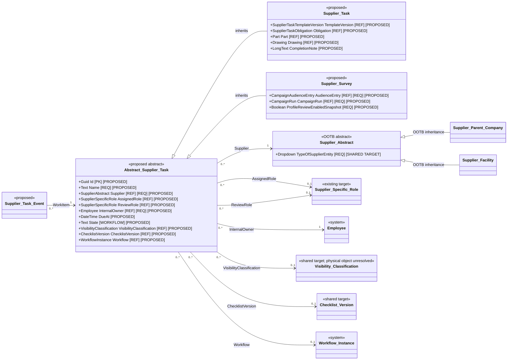

# Supplier Tasks component — solution specification

| Property | Value |
|---|---|
| Mode | Target design layered over the separately preserved OOTB SRM baseline |
| Application | Supplier Relationship Management |
| Component | Supplier Tasks |
| Operational objects | `Abstract Supplier Task`, `Supplier Task`, `Supplier Survey` |
| Workflows | Supplier Task; Supplier Survey |
| As of | 2026-10-19 |
| Primary sources | ADR-002, ADR-003, ADR-004, ADR-005, ADR-006, ADR-007, ADR-076, ADR-077, ADR-078, ADR-079, ADR-080, ADR-081, ADR-083, ADR-084, ADR-085, and ADR-103; user-approved inheritance and scope decisions |

## 1. Executive solution summary

The Supplier Tasks component introduces one abstract operational parent and two concrete descendants:

```text
Abstract Supplier Task
├── Supplier Task
└── Supplier Survey
```

This is direct Intelex object inheritance. It is not a parent-child record association. Shared fields are declared once on `Abstract Supplier Task` and inherited by both descendants. Each concrete descendant has its own workflow and generation logic.

- **Supplier Task** represents a targeted, onboarding, training, access, evidence, checklist, or recurring supplier obligation created for one supplier context.
- **Supplier Survey** represents a checklist request generated through survey campaign preparation and audience selection.
- **Abstract Supplier Task** provides the shared work-item contract: supplier scope, role-based ownership, workflow state, due dates, source context, visibility, exception handling, completion metadata, and common event history.

Supplier Task generation and Supplier Survey generation remain separate. A campaign creates Supplier Survey records. A targeted request, onboarding rule, or supplier-scoped recurring obligation creates Supplier Task records. Both descendants can be queried through the abstract parent for a consolidated supplier workspace and cross-type reporting.

Every material object, field, relationship, stage, action, and notification introduced by this specification is **Proposed** unless explicitly classified as **Extracted**, **Required**, or **Unresolved**. Logical names are not confirmed internal names, stable metadata identifiers, database keys, or physical table names. This document does not claim that the proposed configuration has been implemented.

## 2. Architectural findings and consequences

1. **Inheritance is the reuse boundary.** Common work-item data belongs on `Abstract Supplier Task`; child-only data remains on its concrete descendant.
2. **Workflow is not inherited as one universal lifecycle.** Supplier Task and Supplier Survey have separate workflows because their initiation, validation, completion, and recovery behavior differ materially; only Supplier Task has an optional internal Review stage.
3. **Role references remain live.** The work item points to a Supplier Specific Role rather than permanently assigning accountability to the person occupying that role at creation. The individual actor is captured when an action occurs.
4. **Configuration is versioned.** Active and historical work must not change when a template, checklist, campaign, or routing rule is edited later.
5. **Recurrence produces new records.** Every due occurrence is a separate concrete task record. Completed history is never reopened or overwritten to represent a later period.
6. **Campaigns produce Supplier Surveys.** Campaign configuration, audience evaluation, and campaign runs remain survey-specific and do not create generic Supplier Task records.
7. **One work experience does not mean one workflow.** The portal may query the abstract parent to display both descendants in one work queue while opening the correct child form and enforcing the correct child workflow.
8. **Supplier activation and task completeness are separate.** Incomplete setup work remains visible and actionable but does not create a second supplier-approval gate.
9. **Lifecycle and security are independent controls.** For Supplier Tasks, supplier status capability rules govern whether new work may be issued and whether existing work continues or is withdrawn. For Supplier Surveys, campaign-specific Audience Rules may filter by Supplier Status before issue; the issued audience is then frozen. Supplier-entity scope and visibility classification govern who can see each record.
10. **No automatic inheritance of parent-company responsibility is assumed.** A role must resolve for the exact Supplier Abstract referenced by the work item unless a future governed routing rule explicitly permits another behavior.
11. **Recurring setup uses the Supplier Task form.** The first Supplier Task captures the one-time-versus-recurring choice and all recurrence inputs. When recurring is selected, automation creates and links the Supplier Task Obligation; users do not configure a separate obligation record.
12. **Checklist configuration and answers are shared.** Supplier Survey and templated Supplier Task consume the same Checklist, Checklist Version, Checklist Question, Checklist Question Version, Checklist Choice List, Checklist Choice, Checklist Question Choice, Checklist Question Choice Version, and Supplier Question Answer objects. Checklist and Checklist Question are the editable authoring records; Publish creates immutable checklist, question, and question-choice version snapshots. Choice/Choices questions select a reusable Choice List and generate question-scoped choices. The answer points to `Abstract Supplier Task`; survey revisions remain a conditional relationship used only when the work item is a Supplier Survey.
13. **Profile assignments select stable templates, not versions.** A Supplier Profile Task Assignment points to a Supplier Task Template. When supplier creation generates a task, automation resolves the template's most recent current published version and snapshots that version on the new Supplier Task.
14. **Survey-enabled profile changes are direct master-data edits.** Eligible supplier users edit only approved fields and relationships on their owning records while the Supplier Survey is Assigned. Native audit trails provide the change evidence; no survey proposal, approval, or deferred-apply object is introduced.

## 3. Requirements interpretation

| Requirement ID | Source | Interpreted requirement | Classification |
|---|---|---|---|
| ST-001 | User-approved architecture | Supplier Task and Supplier Survey directly inherit from Abstract Supplier Task | Required |
| ST-002 | User-approved architecture | The two descendants use different objects and different workflows | Required |
| ST-003 | ADR-103 | Reuse assignment, due dates, completion, applicable review, reminders, recurrence, and reporting through a shared task model | Required |
| ST-004 | ADR-103 | Every concrete work item relates to a supplier and resolves an accountable maintained supplier role | Required |
| ST-005 | ADR-103 and user clarification | Supplier Task may require a note, file upload, a governed checklist, or a combination; checklist configuration is available only through a selected task template | Required |
| ST-006 | ADR-103 | A Supplier Task may complete on supplier submission or route to an internal role for review | Required |
| ST-007 | ADR-103 | Preserve optional part, drawing, and originating-process traceability | Required |
| ST-008 | ADR-103 | Snapshot the effective configuration and checklist version on creation | Required |
| ST-009 | ADR-080 | A campaign defines common survey properties and generates one Supplier Survey for each included supplier | Required |
| ST-010 | ADR-005, ADR-002, ADR-077 | Governed supplier setup rules may generate Supplier Tasks after supplier creation without delaying supplier activation | Required |
| ST-011 | ADR-006; refined by ST-030 | Periodic supplier-profile confirmation uses campaign-generated Supplier Surveys, direct governed profile maintenance, and affirmative confirmation | Required |
| ST-012 | ADR-003, ADR-004 | Assignment and review use standardized supplier-specific external and internal roles; action history records the individual actor | Required |
| ST-013 | ADR-003, ADR-007, ADR-081 | Only eligible authenticated contacts may perform supplier actions; missing or inactive membership is an owned exception | Required |
| ST-014 | ADR-076, ADR-078 | Work is scoped to the exact supplier company or facility and cannot expand portal access beyond supplier-entity relationships | Required |
| ST-015 | ADR-079; refined for surveys by ST-031 | Supplier status and capability rules govern creation and continuation of Supplier Tasks; survey status eligibility follows ST-031; history is retained | Required |
| ST-016 | ADR-083 | Both descendants appear in a consolidated supplier work experience with drill-through to underlying records | Required |
| ST-017 | ADR-084 | Visibility classification restricts records within supplier scope and may change without changing workflow ownership | Required |
| ST-018 | ADR-085, ADR-103 | Distinct domain lifecycles and event-driven submissions are not replaced by Supplier Tasks | Required |
| ST-019 | User-approved scope | The excluded baseline requirement objects are outside this document and have no design dependency here | Required |
| ST-020 | User clarification | The same Supplier Task form configures one-time and recurring work; recurring setup automatically creates a related Supplier Task Obligation and each occurrence is a separate Supplier Task | Required |
| ST-021 | Design assumption | Common append-only events support audit, notification idempotency, due-date history, and consolidated reporting | Proposed |
| ST-022 | User clarification | File validation is controlled only by `File Upload Required?`; no configurable minimum file count is used | Required |
| ST-023 | User clarification | Supplier Survey and templated Supplier Task reuse one neutral checklist configuration and operational answer family; neither maintains an independent checklist or answer model | Required |
| ST-024 | User clarification, refined by ST-027 | Supplier Question Answer provides `Answer - Text`, `Answer - Float`, `Answer - File`, and `Answer - Date`, plus M:1 `Answer - Choice` and M:N `Answer - Choices` relationships to the published Checklist Question Choice Version | Required |
| ST-025 | User clarification | A Supplier Profile Task Assignment selects a Supplier Task Template; supplier-creation generation resolves and snapshots the most recent current published Supplier Task Template Version | Required |
| ST-026 | User clarification | Checklist Questions use Guidance, conditionally require a Choice List, generate guarded question-scoped choices, and carry scoring and color metadata on choice values | Required |
| ST-027 | User clarification | Checklist Publish creates immutable Checklist Question Choice Version records for every published Checklist Question Choice under each Checklist Question Version | Required |
| ST-028 | User clarification; superseded in part by ST-030 | The shared Survey Campaign retains Escalation Role and selects an active Survey Recurrence Definition through a conditional Frequency relationship when Schedule Mode is Recurring; its previously requested Review Role is removed | Required |
| ST-029 | User clarification | The shared Survey Campaign dependency exposes inverse 1:M grids for Survey Campaign Audience Rules and Campaign Runs | Required |
| ST-030 | User clarification | Profile-change-enabled Supplier Surveys permit direct edits to approved master-object fields and relationships with native audit trails; no Profile Change Policy, proposal objects, profile-change review, or deferred writeback is used | Required |
| ST-031 | User clarification | Remove the Survey Status Eligibility dependency; Supplier Survey status eligibility is expressed through Survey Campaign Audience Rules with a typed Supplier Status operand, without an automatic post-issue status continuation/withdrawal policy | Required |
| ST-032 | User clarification | The shared Campaign Run and Campaign Audience Entry model uses the revised display/start/checklist/snapshot/grid fields, Campaign Run workflow stages, governed Included/Excluded Selection Outcome records, base/override/effective selection calculations, and Evaluated At handlers defined by the Supplier Surveys specification; campaign configuration is assumed clean and no per-entry configuration-error field or outcome is used | Required |
| ST-033 | User clarification | The shared Campaign Audience Entry snapshots every audience-evaluation Supplier property through read-only fields defaulted from Supplier when the entry is created | Required |
| ST-034 | User clarification | Supplier Abstract exposes a required inherited `Type of Supplier Entity` dropdown with only `Supplier Facility` and `Supplier Parent Company`; shared audience formulas reference that field directly and use supported `IF` expressions for fallback behavior | Required |

## 4. Baseline and target boundary

### 4.1 Extracted baseline retained

The verified baseline supplies the following elements used by this target design:

- `SupplierMgmt_SupAbstractObject` as the abstract supplier base;
- `SupplierMgmt_ParentCompnyObject` and `SupplierMgmt_FacilityObject` as direct supplier descendants;
- the separate Parent Company-to-Facility relationship;
- Supplier Contact and its Employee bridge;
- system Subject, Employee, Group, Workflow Instance, and Workflow Stage concepts; and
- the platform workflow, notification, attachment, configurable-view, and My Tasks capabilities.

The baseline contains no extracted generic supplier-task inheritance family and no extracted Supplier Task or Supplier Survey workflow matching this specification. All component objects and workflow behavior below are therefore target configuration.

### 4.2 Existing target-design dependencies

This specification consumes, without redefining:

- Supplier Management Role and Supplier Specific Role from the Supplier Management Role target model;
- Supplier Profile Template from the Supplier Profile Template target model;
- the replacement Supplier Status and capability rules from the Supplier Status Updates target model for Supplier Tasks, plus the Supplier Status lookup consumed by survey Campaign Audience Rules;
- Supplier Contact ownership and authenticated-user linkage from the User Access Request target model; and
- shared checklist definition/versioning, campaign audience, survey response, and profile-change concepts from the Supplier Surveys target design, as revised by this specification.

Where this document conflicts with the earlier survey target design, this document governs the operational work-item inheritance, the `Supplier Survey` name and parent, fields moved to the abstract parent, and the Supplier Survey workflow. Survey-specific configuration and response structures not changed here remain governed by the Supplier Surveys specification.

## 5. Target logical object model

### 5.1 High-level inheritance and context



`Supplier Task` and `Supplier Survey` are the only direct descendants introduced by this specification. Fields declared on `Abstract Supplier Task` are not redeclared on either child.

### 5.2 Supplier Task configuration and execution

```mermaid
classDiagram
direction LR

class Supplier_Task_Template {
  <<proposed>>
  +Guid Id [PK] [PROPOSED]
  +Text Name [REQ] [PROPOSED]
  +Boolean Active [REQ] [PROPOSED]
}
class Supplier_Task_Template_Version {
  <<proposed>>
  +Guid Id [PK] [PROPOSED]
  +SupplierTaskTemplate Template [REF] [REQ] [PROPOSED]
  +Number VersionNumber [REQ] [PROPOSED]
  +Text State [REQ] [PROPOSED]
  +Boolean NoteRequired [REQ] [PROPOSED]
  +Boolean FileUploadRequired [REQ] [PROPOSED]
  +Boolean ReviewRequired [REQ] [PROPOSED]
}
class Checklist_Version {
  <<shared target>>
}
class Checklist_Question_Version {
  <<shared target>>
}
class Checklist_Choice {
  <<shared target>>
}
class Supplier_Task_Obligation {
  <<proposed>>
  +Guid Id [PK] [PROPOSED]
  +SupplierTask InitialTask [REF] [REQ] [PROPOSED]
  +SupplierAbstract Supplier [REF] [REQ] [PROPOSED]
  +SupplierTaskTemplateVersion TemplateVersion [REF] [PROPOSED]
  +Text RecurrenceDefinition [REQ] [PROPOSED]
  +Boolean Active [REQ] [PROPOSED]
}
class Supplier_Profile_Task_Assignment {
  <<proposed>>
  +Guid Id [PK] [PROPOSED]
  +SupplierProfileTemplate SupplierProfileTemplate [REF] [REQ] [PROPOSED]
  +SupplierTaskTemplate TaskTemplate [REF] [REQ] [PROPOSED]
  +Number TargetDays [REQ] [PROPOSED]
  +Boolean RequiredForCompleteness [REQ] [PROPOSED]
}
class Abstract_Supplier_Task {
  <<proposed abstract; detailed in 5.1>>
}
class Supplier_Task {
  <<proposed descendant>>
  +Text ScheduleType [REQ] [PROPOSED]
  +Text RecurrenceDefinition [PROPOSED]
  +Boolean NoteRequired [REQ] [PROPOSED]
  +Boolean FileUploadRequired [REQ] [PROPOSED]
}
class Supplier_Question_Answer {
  <<proposed>>
  +Guid Id [PK] [PROPOSED]
  +AbstractSupplierTask WorkItem [REF] [REQ] [PROPOSED]
  +ChecklistQuestionVersion QuestionVersion [REF] [REQ] [PROPOSED]
  +Number ResponseIteration [REQ] [PROPOSED]
  +Text AnswerText [PROPOSED]
  +Float AnswerFloat [PROPOSED]
  +File AnswerFile [PROPOSED]
  +Date AnswerDate [PROPOSED]
  +Boolean AnswerBoolean [PROPOSED]
  +ChecklistChoice AnswerChoice [REF] [PROPOSED]
  +ChecklistChoice AnswerChoices [M:N] [REF] [PROPOSED]
}
class Supplier_Profile_Template {
  <<existing target>>
}
class Supplier_Abstract {
  <<OOTB abstract>>
  +Dropdown TypeOfSupplierEntity [REQ] [SHARED TARGET]
}

Supplier_Task_Template_Version "0..*" --> "1" Supplier_Task_Template : Template
Abstract_Supplier_Task <|-- Supplier_Task
Supplier_Task_Template_Version "0..*" --> "0..1" Checklist_Version : ChecklistVersion
Supplier_Task_Obligation "0..1" --> "1" Supplier_Task : InitialTask
Supplier_Task_Obligation "0..*" --> "1" Supplier_Abstract : Supplier
Supplier_Task_Obligation "0..*" --> "0..1" Supplier_Task_Template_Version : TemplateVersion
Supplier_Profile_Task_Assignment "0..*" --> "1" Supplier_Profile_Template : SupplierProfileTemplate
Supplier_Profile_Task_Assignment "0..*" --> "1" Supplier_Task_Template : TaskTemplate
Supplier_Task "0..*" --> "0..1" Supplier_Task_Template_Version : TemplateVersion
Supplier_Task "0..*" --> "0..1" Supplier_Task_Obligation : Obligation
Abstract_Supplier_Task "0..*" --> "0..1" Checklist_Version : ChecklistVersion
Supplier_Question_Answer "0..*" --> "1" Abstract_Supplier_Task : WorkItem
Supplier_Question_Answer "0..*" --> "1" Checklist_Question_Version : QuestionVersion
Supplier_Question_Answer "0..*" --> "0..1" Checklist_Choice : Answer - Choice
Supplier_Question_Answer "0..*" --> "0..*" Checklist_Choice : Answer - Choices
```



### 5.3 Supplier Survey configuration and execution

```mermaid
classDiagram
direction LR

class Checklist {
  <<existing target>>
}
class Checklist_Version {
  <<existing target>>
}
class Checklist_Question {
  <<existing target>>
}
class Checklist_Question_Version {
  <<existing target>>
}
class Checklist_Choice {
  <<existing target>>
}
class Checklist_Choice_List {
  <<existing target>>
}
class Checklist_Question_Choice {
  <<shared target>>
}
class Checklist_Question_Choice_Version {
  <<shared target>>
}
class Color {
  <<existing object>>
}
class Survey_Campaign {
  <<existing target>>
}
class Campaign_Audience_Rule {
  <<existing target>>
}
class Supplier_Status {
  <<existing target>>
}
class Supplier_Abstract {
  <<existing abstract supplier>>
  +Dropdown TypeOfSupplierEntity [REQ] [SHARED TARGET]
}
class Supplier_Parent_Company {
  <<existing target>>
}
class Supplier_Category {
  <<existing target>>
}
class Supplier_Type {
  <<existing target>>
}
class Facility_Type {
  <<existing target>>
}
class Survey_Recurrence_Definition {
  <<shared survey configuration>>
}
class Supplier_Management_Role {
  <<existing target>>
}
class Campaign_Run {
  <<existing target>>
}
class Campaign_Audience_Entry {
  <<existing target>>
}
class Selection_Outcome {
  <<shared survey configuration>>
}
class Supplier_Survey {
  <<proposed descendant>>
}
class Abstract_Supplier_Task {
  <<proposed abstract; detailed in 5.1>>
}
class Survey_Response_Revision {
  <<existing target; parent reference revised>>
}
class Supplier_Question_Answer {
  <<shared target>>
}

Checklist "1" --> "0..*" Checklist_Version : Versions_grid
Checklist "1" --> "0..*" Checklist_Question : Questions_grid
Checklist_Version "1" --> "0..*" Checklist_Question_Version : QuestionVersions_grid
Checklist_Question "1" --> "0..*" Checklist_Question_Version : Versions_grid
Checklist_Question "0..*" --> "0..1" Checklist_Choice_List : ChoiceList
Checklist_Question_Version "0..*" --> "0..1" Checklist_Choice_List : ChoiceList
Checklist_Choice_List "1" --> "0..*" Checklist_Choice : Choices
Checklist_Question "1" --> "0..*" Checklist_Question_Choice : GeneratedChoices_grid
Checklist_Question_Choice "0..*" --> "1" Checklist_Choice_List : ChoiceList
Checklist_Question_Version "1" --> "0..*" Checklist_Question_Choice_Version : PublishedChoices_grid
Checklist_Question_Choice "1" --> "0..*" Checklist_Question_Choice_Version : PublishedVersions_grid
Checklist_Choice "0..*" --> "0..1" Color : BackgroundColor
Checklist_Choice "0..*" --> "0..1" Color : TextColor
Checklist_Question_Choice "0..*" --> "0..1" Color : BackgroundColor
Checklist_Question_Choice "0..*" --> "0..1" Color : TextColor
Checklist_Question_Choice_Version "0..*" --> "0..1" Color : BackgroundColor
Checklist_Question_Choice_Version "0..*" --> "0..1" Color : TextColor
Abstract_Supplier_Task <|-- Supplier_Survey
Survey_Campaign "0..*" --> "1" Checklist : Checklist
Survey_Campaign "0..*" --> "0..1" Survey_Recurrence_Definition : Frequency_required_when_Recurring
Survey_Campaign "0..*" --> "0..1" Supplier_Management_Role : EscalationRole
Survey_Campaign "1" --> "0..*" Campaign_Audience_Rule : AudienceRules_grid
Survey_Campaign "1" --> "0..*" Campaign_Run : CampaignRuns_grid
Campaign_Audience_Rule "0..*" --> "1" Survey_Campaign : Campaign
Campaign_Audience_Rule "0..*" --> "0..1" Supplier_Status : SupplierStatusValue
Campaign_Run "0..*" --> "1" Survey_Campaign : Campaign
Campaign_Run "0..*" --> "1" Checklist_Version : ChecklistVersion
Campaign_Run "1" --> "0..*" Campaign_Audience_Entry : CampaignAudienceEntries_grid
Campaign_Audience_Entry "0..*" --> "1" Campaign_Run : CampaignRun
Campaign_Audience_Entry "0..*" --> "1" Supplier_Abstract : Supplier
Campaign_Audience_Entry "0..*" --> "0..1" Supplier_Parent_Company : ParentCompany
Campaign_Audience_Entry "0..*" --> "0..1" Supplier_Category : SupplierCategory
Campaign_Audience_Entry "0..*" --> "0..1" Supplier_Type : SupplierType
Campaign_Audience_Entry "0..*" --> "0..1" Facility_Type : FacilityType
Campaign_Audience_Entry "0..*" --> "0..1" Supplier_Status : SupplierStatus
Campaign_Audience_Entry "0..*" --> "1" Selection_Outcome : SelectionOutcome
Campaign_Audience_Entry "0..*" --> "0..1" Selection_Outcome : OverrideSelectionOutcome
Campaign_Audience_Entry "0..*" --> "1" Selection_Outcome : SelectionOutcomeCalculated
Supplier_Survey "0..1" --> "1" Campaign_Audience_Entry : AudienceEntry
Supplier_Survey "0..*" --> "1" Campaign_Run : CampaignRun
Abstract_Supplier_Task "0..*" --> "0..1" Checklist_Version : ChecklistVersion
Survey_Response_Revision "0..*" --> "1" Supplier_Survey : Survey
Supplier_Question_Answer "0..*" --> "1" Abstract_Supplier_Task : WorkItem
Supplier_Question_Answer "0..*" --> "0..1" Survey_Response_Revision : SurveyRevision
Supplier_Question_Answer "0..*" --> "1" Checklist_Question_Version : QuestionVersion
Supplier_Question_Answer "0..*" --> "0..1" Checklist_Question_Choice_Version : Answer - Choice
Supplier_Question_Answer "0..*" --> "0..*" Checklist_Question_Choice_Version : Answer - Choices
```



The earlier operational name `Supplier Survey Request` is replaced by `Supplier Survey`. Its common work-item fields move to the abstract parent. Supplier Surveys and templated Supplier Tasks share the neutral Checklist configuration and answer families. Survey-specific campaign and response-revision relationships remain on the concrete survey child or its survey children. Approved profile changes are written directly to their owning audited records rather than staged in survey-specific proposal objects.

## 6. Object inventory

| Object | Kind | Parent | Responsibility | Classification |
|---|---|---|---|---|
| Abstract Supplier Task | Abstract record | None | Shared supplier work-item identity, scope, ownership, dates, workflow, security, source, exception, and completion contract | Required/Proposed |
| Supplier Task | Record | Abstract Supplier Task | Targeted and recurring supplier obligations with note, file, or checklist completion | Required/Proposed |
| Supplier Survey | Record | Abstract Supplier Task | Campaign-generated checklist request and profile-confirmation work | Required/Proposed |
| Supplier Task Template | Configuration | None | Stable administrative identity for reusable targeted-task configuration | Proposed |
| Supplier Task Template Version | Configuration | Supplier Task Template relationship | Immutable published task controls and routing defaults | Proposed |
| Checklist, Checklist Version, Checklist Question, Checklist Question Version, Checklist Choice List, Checklist Choice, Checklist Question Choice, and Checklist Question Choice Version | Shared configuration family | Relationships defined in Supplier Surveys specification | Governed authoring records, reusable choice libraries, generated question choices, and immutable published question/choice snapshots used by both Supplier Survey and templated Supplier Task | Existing target revised/shared |
| Supplier Task Obligation | System-managed operational configuration | None | Supplier-scoped series controller created from the initial Supplier Task and used to generate later occurrences | Required/Proposed |
| Supplier Profile Task Assignment | Configuration child | Supplier Profile Template relationship | Selects a stable task template whose most recent current published version is resolved during supplier creation | Required/Proposed |
| Supplier Question Answer | Shared operational child | Abstract Supplier Task relationship | Typed answer to one shared Checklist Question Version for either Supplier Task or Supplier Survey, including single- and multiple-choice relationships | Proposed |
| Supplier Task Event | Operational child | Abstract Supplier Task relationship | Append-only shared action, delivery, due-date, exception, and state evidence | Proposed |
| Supplier Task Reminder Rule | Configuration child | Supplier Task Template Version relationship | Finite reminder/escalation schedule for Supplier Tasks | Proposed |
| Survey Campaign, Survey Recurrence Definition, Campaign Run, Campaign Audience Entry, and Selection Outcome | Configuration/operational | Existing survey target model | Audience selection, governed recurring frequency, helper-driven launch snapshot, run workflow, effective selection outcomes/overrides, and issuance evidence | Existing target dependency revised by ST-032 |
| Survey Response Revision | Operational child | Supplier Survey relationship | Survey-only submission revision and profile-confirmation envelope referenced conditionally by shared question answers | Existing target revised |

## 7. Field specifications

### 7.1 Abstract Supplier Task

These fields are declared once on the abstract parent and inherited by both concrete descendants.

| Field | Type | Required | Default/source | Editability and behavior | Classification |
|---|---|---:|---|---|---|
| Id | Guid identity | Yes | Platform | Read only; logical identity | Proposed |
| Record Number | Auto number | Yes | Platform | Read only; human reference | Proposed |
| Name | Text, maximum 255 | Yes | Generated or entered before issue | Read only after issue; display field | Proposed |
| Supplier | M:1 Supplier Abstract | Yes | Creator/generator | Immutable after workflow starts; exact company or facility security anchor | Required/Proposed |
| Assigned Role | M:1 Supplier Specific Role | Conditional | Resolved for exact Supplier and configured external library role | Required before issue; live group membership controls supplier action eligibility | Required/Proposed |
| Review Role | M:1 Supplier Specific Role | Conditional | Resolved for exact Supplier and configured internal library role | Used only by Supplier Task; required before submission when Supplier Task.Review Required? is Yes; null and unused for Supplier Survey | Required/Proposed |
| Internal Owner | M:1 Employee | Yes | Template, campaign, source process, or creator | Owns Draft/Preparing/Exception administration; must be an active authorized internal user | Proposed |
| Visibility Classification | M:1 shared visibility classification | Conditional | Configuration/source context | Required where security matrix applies; may change without changing workflow state or owner | Required/Proposed; physical target unresolved |
| Origin Type | Choice | Yes | Manual Targeted, Template, Onboarding, Recurring Obligation, Campaign, Source Process | Read only after issue | Proposed |
| Origin Display | Text, maximum 255 | No | Generator | Frozen readable source label | Proposed |
| Source Application | Text/controlled choice | No | Generator | Identifies originating application; not an executable object name | Proposed |
| Source Record Key | Text | No | Generator | Stable source identifier when a typed relationship is unavailable | Proposed |
| Source Record URL | URL | No | Generator | Authorized drill-through; never grants access | Proposed |
| Instructions Snapshot | Long text | Yes | Template/campaign/manual configuration | Frozen at issue; plain-language instructions actually shown | Required/Proposed |
| Configuration Snapshot | Structured long text | Yes | Generator | Canonical non-executable snapshot of routing, completion, review, reminders, classification, and configuration identifiers | Required/Proposed |
| Checklist Version | M:1 shared Checklist Version | Conditional | Template Version or Campaign Run | Inherited by both descendants; required for Supplier Survey and templated checklist tasks, otherwise null; frozen at issue | Required/Proposed |
| Snapshot Schema Version | Positive integer | Yes | `1` | Read only | Proposed |
| State | Workflow-backed display | Yes | Child workflow | Never independently editable | Proposed |
| Issued At | Datetime | Conditional | Server time on successful issue | Read only | Proposed |
| Original Due At | Datetime | Conditional | Calculated on first issue | Read only and never overwritten | Proposed |
| Due At | Datetime | Conditional | First issue or authorized extension | Drives Assigned-stage due date; null only where approved configuration permits no due date | Required/Proposed |
| Schedule Generation | Positive integer | Yes | `1` | Increment on each authorized due-date change so obsolete reminders cannot fire | Proposed |
| Last Submitted At | Datetime | No | Server time on supplier submission | Read only | Proposed |
| Completed At | Datetime | No | Server time on terminal completion | Read only | Proposed |
| Completed By | M:1 Employee | No | Authenticated action actor or automation identity | Read only | Proposed |
| Exception Resume State | Choice | No | Automation | Child-workflow-specific allowed state; required in Exception | Proposed |
| Exception Reason | Long text | No | Automation/internal owner | Supplier-invisible technical detail unless separately exposed | Proposed |
| Closure Reason | Long text | Conditional | Authorized actor | Required for cancellation, withdrawal, and no-response closure | Proposed |
| Workflow | M:1 Workflow Instance | No | Platform | Platform-managed workflow relationship | Proposed |

`Assigned Role` and `Review Role` point to operational Supplier Specific Roles, not library roles and not copied member lists. Review Role is a Supplier Task workflow feature and is not used by Supplier Survey. The corresponding library-role identifiers are retained in `Configuration Snapshot` for traceability.

### 7.2 Supplier Task

| Field | Type | Required | Default/source | Behavior | Classification |
|---|---|---:|---|---|---|
| Template Version | M:1 Supplier Task Template Version | No | Creator/generator | Required for templated work; null permitted for controlled ad hoc work | Required/Proposed |
| Obligation | M:1 Supplier Task Obligation | No | System created from the initial recurring task or copied by the recurrence generator | Required for every recurring-series occurrence; read only to the setup user | Required/Proposed |
| Profile Task Assignment | M:1 Supplier Profile Task Assignment | No | Supplier creation generator | Identifies onboarding origin | Proposed |
| Part | M:1 canonical Part | No | Creator/source process | Optional business context; exact target object supplied by Product Management design | Required/Proposed |
| Drawing | M:1 drawing/revision context | No | Creator/source process | Allowed only when Part is populated and the drawing belongs to that part; exact target object unresolved | Required/Proposed |
| Period Start / Period End | Date each | No | Obligation generator | Required as a pair for period-based obligations; end cannot precede start | Proposed |
| Schedule Type | Choice | Yes | User selection on initial task; copied on generated occurrences | One Time or Recurring; Recurring is editable only during initial setup | Required/Proposed |
| Recurrence Definition | Governed frequency | Conditional | User selection on initial recurring task | Required when Schedule Type is Recurring; copied to the system-created obligation and read only after issue | Required/Proposed |
| Recurrence End At | Datetime | No | User selection on initial recurring task | Optional series boundary; copied to obligation | Proposed |
| Occurrence Number | Positive integer | Yes | `1` on initial task; system sequence thereafter | Read only | Proposed |
| Note Required? | Yes/No | Yes | Template/ad hoc configuration | Frozen at issue | Required/Proposed |
| File Upload Required? | Yes/No | Yes | Template/ad hoc configuration | Frozen at issue; when Yes, at least one native file must exist at submission | Required/Proposed |
| Review Required? | Yes/No | Yes | Template/ad hoc configuration | Frozen at issue; if Yes, Review Role is mandatory before submission | Required/Proposed |
| Completion Note | Long text | Conditional | Supplier actor | Required at submission when Note Required is Yes; supplier editable only in Assigned | Required/Proposed |
| Submitted File Count | Calculated number | Yes | Native attachment query | Read only; used for submission validation | Proposed |
| Review Comments | Long text | No | Reviewer | Required on Return; optional on Approve | Proposed |

An ad hoc Supplier Task may use any combination of the note and file-upload controls. If no Template Version is selected, the Checklist Version field is hidden, cleared, and unavailable. A checklist may be used only when it is supplied by the selected Template Version; users cannot select a separate checklist or create checklist questions directly on a live task. At least one completion control must be enabled before issue.

The initial Supplier Task is also the setup form for recurrence. Selecting Recurring reveals the recurrence fields. Successful issue creates and links the Supplier Task Obligation automatically and records the initial Supplier Task as occurrence 1. Generated later occurrences display the recurrence and obligation fields as read only.

### 7.3 Supplier Survey

| Field | Type | Required | Default/source | Behavior | Classification |
|---|---|---:|---|---|---|
| Audience Entry | M:1 Campaign Audience Entry | Yes | Campaign issuance | Unique; at most one Supplier Survey per included entry | Required/Proposed |
| Campaign Run | M:1 Campaign Run | Yes | Audience Entry.Campaign Run | Immutable and must equal Audience Entry.Campaign Run | Required/Proposed |
| Supplier Profile Change Enabled Snapshot | Yes/No | Yes | Campaign snapshot | Immutable; when Yes, expose governed direct-edit controls for approved profile fields and relationships | Required/Proposed |
| Response Revision Number | Calculated positive integer | No | Latest related revision | Read only convenience; revisions remain authoritative | Proposed |

Supplier, roles, owner, classification, dates, state, workflow, exception, and closure fields are inherited and must not be redeclared on Supplier Survey.

### 7.4 Supplier Task Template

| Field | Type | Required | Additional Config |
|---|---|---:|---|
| Name | Text | Y | maximum 255<br />display field |
| Description | Text | N |  |
| Active? | Yes/No | N | Default: `Yes`<br />view settings: checkbox |
| Reporting Classification | Lookup | Y | Cross-template reporting category; final catalogue TBD |
| Owner | M:1 Employee | Y |  |
| [Helper] Current Version | Number | N | Default: `0` |

**Business Rules**

- Name must be unique

### 7.5 Supplier Task Template Version

| Field | Type | Required | Additional Config | Behavior |
|---|---|---:|---|---|
| Template | M:1 Supplier Task Template | Y | Read-Only after Create |  |
| Version Number | Number | Y | read-only |  |
| State | Lookup | Y | Default: `Draft`<br />Lookup Values:  Draft, Published, Retired |  |
| Instructions | Text | Y |  |  |
| Assigned Role | M:1 Supplier Management Role | Y |  | Must be an active standard external role |
| Review Required? | Yes/No | N | Default: `No`<br />view settings: checkbox |  |
| Review Role | M:1 Supplier Management Role | N | view action: shown and mandatory if Review Required?=TRUE, otherwise hide, non-mandatory and clear field |  |
| Internal Owner | M:1 Subject | Y |  |  |
| Default Response Days | Number | N |  |  |
| Note Required? | Yes/No | N | Default: `No`<br />view settings: checkbox |  |
| File Upload Required? | Yes/No | N | Default: `No`<br />view settings: checkbox |  |
| Checklist Version | M:1 shared Checklist Version | N | TBD |  |
| Visibility Classification | M:1 Visibility Classification | N |  |  |
| Business Hierarchy | M:1 Business Hierarchy | N |  |  |

**Business Rules**

- Version Number must be unique
- Default Response Days must be positive

**Action Handlers**

- On Create, increment Template's version number helper by 1, then set the Version Number to the helper. E.g. helper starts at 0, we do helper = helper + 1 = 1 and the current version number is 1.

Publishing validates all conditional fields, role classifications, that any selected Checklist Version is Active? = True, at least one enabled completion control, title tokens, due-date rule, and reminder rules. Published versions are immutable. Changes require a new version.

At least one of Note Required, File Upload Required, or Checklist Version must be enabled

### 7.6 Shared Checklist configuration

Supplier Tasks do not define an independent checklist catalogue. They consume the shared `Checklist`, `Checklist Version`, `Checklist Question`, `Checklist Question Version`, `Checklist Choice List`, `Checklist Choice`, `Checklist Question Choice`, and `Checklist Question Choice Version` objects specified in [Supplier Surveys technical specification](supplier-surveys-technical-specification.md). `Checklist` exposes inverse 1:M grids to its Checklist Versions and Checklist Questions; Checklist Version and Checklist Question each expose an inverse 1:M grid to Checklist Question Versions. Checklist Question also exposes its generated Checklist Question Choices. The child-side M:1 fields implement those grids. `Guidance` is the configured explanatory-text field. Choice/Choices questions require a Choice List on both the authoring Question and its mirrored Question Version. Initial question save copies every source Checklist Choice into a Checklist Question Choice; the Choice List remains locked until all generated rows are manually deleted. Choice metadata includes not-applicable, points, calculated max points, weight, and existing Color references. Publish creates the next Checklist Version, defaults each Checklist Question Version from its Checklist Question, and creates one immutable Checklist Question Choice Version from every current Checklist Question Choice for the corresponding Question Version. Supplier answers select these published choice instances. A Supplier Task Template Version may select one Active? = True published Checklist Version; that reference is copied to each generated Supplier Task and frozen at issue.

Survey Campaign uses an M:1 Checklist dropdown rather than a Checklist Version field. Campaign Run preparation resolves that Checklist's single Active? = True Checklist Version, stores it as Checklist Version, and preserves it for all generated Supplier Surveys and retries. Campaign Run uses a calculated Display Field, timezone-aware Start Date / Time, a stored helper-driven Configuration Snapshot rendered as HTML with literal `<br>` line breaks and HTML-encoded interpolated values, workflow stages rather than a State field, and an inverse Campaign Audience Entries grid. Campaign Audience Entry has separate Campaign Run and Supplier fields, immutable create-time defaults for Parent Company, Supplier Category, Supplier Type, Facility Type, and Supplier Status, and governed base, override, and effective Selection Outcome fields. Campaign Escalation Role remains available, but the campaign Review Role and Profile Change Policy are removed. When Schedule Mode is Recurring, the campaign also requires an M:1 Frequency relationship to an active Survey Recurrence Definition; Frequency is hidden and cleared for Manual or Once. Survey Campaign exposes inverse 1:M Survey Campaign Audience Rules and Campaign Runs grids backed by the existing child Campaign fields. Supplier Status is a typed Audience Rule attribute and replaces the removed Survey Status Eligibility object; no status rule means status does not filter that campaign, and post-issue status changes have no automatic workflow effect. The recurrence catalogue, helpers, grids, property snapshots, selection calculations, direct profile-maintenance behavior, audience-rule fields, and their authoritative definitions are defined by the Supplier Surveys specification.

The shared answer model does not combine the two work-item workflows. Supplier Surveys retain Survey Response Revision as a survey-only submission and profile-confirmation envelope, while both concrete work-item types store their typed question responses in `Supplier Question Answer` as specified in §7.9.

### 7.7 Supplier Task Obligation

| Field | Type | Required | Behavior | Classification |
|---|---|---:|---|---|
| Name | Text | Yes | Generated from the initial task; display field | Proposed |
| Initial Task | M:1 Supplier Task | Yes | The user-created or automatically generated occurrence 1; unique and immutable | Required/Proposed |
| Supplier | M:1 Supplier Abstract | Yes | Exact company or facility | Required/Proposed |
| Template Version | M:1 Supplier Task Template Version | No | Copied from Initial Task when present; null for untemplated recurring work | Required/Proposed |
| Assigned Role Override | M:1 Supplier Specific Role | No | Must belong to exact Supplier and match required external classification | Proposed |
| Review Role Override | M:1 Supplier Specific Role | No | Must belong to exact Supplier and be internal | Proposed |
| Part / Drawing | References | No | Same integrity rules as Supplier Task | Required/Proposed |
| Recurrence Definition | Governed frequency | Yes | Copied from Initial Task; mapped to supported scheduler | Required/Proposed |
| Schedule Anchor | Datetime with timezone | Yes | Derived from the initial task's issue/period context | Required/Proposed |
| Response Days Override | Positive integer | No | Overrides template for future occurrences | Proposed |
| Effective To | Datetime | No | Copied from Initial Task.Recurrence End At; bounds future generation | Proposed |
| Active? | Yes/No | Yes | Defaults to Yes; disabling stops future occurrences only | Proposed |
| Next Occurrence At | Datetime | No | Scheduler maintained | Proposed |
| Last Generated At | Datetime | No | Scheduler maintained | Proposed |
| Generation Exception | Long text | No | Internal diagnostics | Proposed |

Supplier Task Obligation has no ordinary end-user creation form. It is created idempotently as part of issuing the initial recurring Supplier Task. Its setup values are copied from that task. Series-management controls may be embedded on the Supplier Task page, while direct obligation access is restricted to administrators and support. Occurrence uniqueness is `(Obligation, Scheduled Occurrence)`. A retry returns the existing occurrence or completes its generation; it never creates a duplicate task.

### 7.8 Supplier Profile Task Assignment

| Field | Type | Required | Additional Config |
|---|---|---:|---|
| Name | Text | Y | visible after create<br />calculation: Profile Template.Name + " - " +  Task Template.Name |
| Supplier Profile Template | M:1 Supplier Profile Template | Y |  |
| Task Template | M:1 Supplier Task Template | Y | filter for Active?=TRUE |
| Active? | Yes/No | N | Default: `Yes`<br />view settings: checkbox |
| Required for Completeness? | Yes/No | N | view settings: checkbox<br />Controls completeness reporting only; never supplier activation |
| Frequency | Frequency | Y | OOTB frequency selector to set up as one-time or recurring task |
| Applies to Entity Type | Lookup | Y | Values: Parent Company, Facility, or Both |

**Business Rules**

- `(Supplier Profile Template, Task Template, Applies to Entity Type)` must be unique

At generation time, automation resolves the selected Task Template to exactly one most recent current published Supplier Task Template Version: the eligible version with the greatest Version Number whose State is Published and whose effective interval includes the generation timestamp, treating a blank Effective From or Effective To as an unbounded endpoint. Because §7.5 permits only one current Published version per Template, zero matches or multiple matches are configuration errors and enter the recoverable generation-exception path. The resolved version is stored on the generated Supplier Task and included in its immutable configuration snapshot; the assignment continues to reference only the stable Task Template.

Version resolution occurs when the idempotent generation operation first creates the Supplier Task. A retry after that task exists resumes the same record and retained Template Version. A retry where no task was created resolves the most recent current published version again. Supplier creation succeeds even if task generation fails. Failures must create an internally visible generation exception with a safe retry key; they must not silently disappear.

An inactive Profile Task Assignment means the task is no longer being generated for a given Supplier Profile.

### 7.9 Supplier Question Answer

| Object / field | Type | Required | Behavior | Classification |
|---|---|---:|---|---|
| Answer.Work Item | M:1 Abstract Supplier Task | Yes | Parent Supplier Task or Supplier Survey | Required/Proposed |
| Answer.Survey Response Revision | M:1 Survey Response Revision | Conditional | Required only when Work Item is Supplier Survey; prohibited for Supplier Task; revision must belong to the same Work Item | Required/Proposed |
| Answer.Response Iteration | Positive integer | Yes | `1` initially; for surveys equals Survey Response Revision.Revision Number; for tasks increments when a returned submission creates a correction answer set | Proposed |
| Answer.Question Version | M:1 Checklist Question Version | Yes | Must belong to Work Item.Checklist Version; unique with Work Item and Response Iteration | Proposed |
| Answer - Text | Text / long text | No | Populated only for Text questions; maximum length comes from Question Version | Required/Proposed |
| Answer - Float | Float/decimal | No | Populated only for Float questions; `0` is valid and minimum/maximum validation applies | Required/Proposed |
| Answer - File | File | No | Populated only for File questions; file storage, malware scanning, size, and retention use approved platform controls | Required/Proposed |
| Answer - Date | Date | No | Populated only for Date questions | Required/Proposed |
| Answer - Boolean | Nullable Boolean | No | Populated only for Yes/No questions; No is a valid supplied answer | Proposed |
| Answer - Choice | M:1 Checklist Question Choice Version | No | Choice answer; selected published choice must belong to Answer.Question Version | Required/Proposed |
| Answer - Choices | M:N Checklist Question Choice Version | No | Choices answer; every selected published choice must belong to Answer.Question Version; duplicate pairs prohibited | Required/Proposed |
| Answer.Responded By | M:1 Employee | No | Last saving actor while Assigned | Proposed |
| Answer.Responded At | Datetime | No | Last save server time | Proposed |

Exactly one answer mechanism appropriate to the shared Question Version may be populated. A required Choice question requires `Answer - Choice`; a required Choices question requires one or more values in `Answer - Choices`. The two choice relationships are mutually exclusive. The M:N relationship uses platform relationship/map metadata and does not require a separate business answer object. The active answer set is scoped by `(Work Item, Response Iteration)`. Answers become immutable when either work item leaves its supplier-editable stage. A return creates a new response iteration by copying prior values; submitted evidence remains immutable and auditable.

### 7.10 Supplier Task Reminder Rule

| Field | Type | Required | Behavior | Classification |
|---|---|---:|---|---|
| Template Version | M:1 Supplier Task Template Version | Yes | Parent | Proposed |
| Order | Positive integer | Yes | Unique within version | Proposed |
| Trigger | Choice | Yes | Before Due, At Due, After Due | Proposed |
| Offset Days | Nonnegative integer | Yes | `0` for At Due | Proposed |
| Recipient Mode | Choice | Yes | Assigned Role, Review Role, Internal Owner | Proposed |
| Notification Template | M:1 platform notification template | Yes | Exact metadata type to verify | Proposed/Unresolved |
| Active? | Yes/No | Yes | Yes | Proposed |

Finite reminder rows are used instead of unbounded daily reminders. An authorized due-date change increments Schedule Generation and recalculates unsent reminders without deleting prior delivery evidence.

### 7.11 Supplier Task Event

| Field | Type | Required | Behavior | Classification |
|---|---|---:|---|---|
| Work Item | M:1 Abstract Supplier Task | Yes | Accepts either concrete descendant | Required/Proposed |
| Event Type | Choice | Yes | Create, Prepare, Issue, Save, Submit, Approve, Return, Retry, Extend Due, Withdraw, Cancel, Close No Response, Notify, Exception, Complete | Proposed |
| Occurred At | Datetime | Yes | Server time | Proposed |
| Actor | M:1 Employee | No | Required for human action; blank for scheduler/service event | Proposed |
| Origin | Choice | Yes | User, Scheduler, Automation | Proposed |
| Correlation Key | Text | Yes | Idempotency token | Proposed |
| Prior State / New State | Text each | No | Frozen workflow labels | Proposed |
| Prior Due At / New Due At | Datetime each | No | Required for due-date change | Proposed |
| Recipient | M:1 Employee | No | One row per notification recipient | Proposed |
| Notification Rule Key | Text | No | Frozen rule identifier | Proposed |
| Schedule Generation | Positive integer | No | Required for scheduled reminders | Proposed |
| Outcome | Choice | Yes | Pending, Succeeded, Failed, Suppressed | Proposed |
| Reason / Details | Long text / structured long text | No | Business reason and technical delivery details | Proposed |

Business event records are append-only. Notification delivery outcome may be updated only by the dispatcher with platform audit enabled. Transport acceptance is not proof that a recipient read the message.

### 7.12 Shared Supplier entity discriminator

This shared change is declared on Supplier Abstract and inherited by both concrete Supplier descendants. It supports the Supplier Surveys audience-entry defaults and any task/survey logic that must distinguish the two supplier entity types without runtime subtype inspection.

| Object | Field | Type | Required | Default / behavior | Classification |
|---|---|---|---:|---|---|
| Supplier Abstract | Type of Supplier Entity | Dropdown | Yes | Allowed values only: `Supplier Facility`, `Supplier Parent Company`. Supplier Facility creation sets `Supplier Facility`; Supplier Parent Company creation sets `Supplier Parent Company`. Configure those literal defaults independently on the concrete create forms or create handlers, make the inherited field read only after creation, and backfill existing records before dependent logic is enabled. | Required/Proposed shared dependency |

## 8. Relationship register

| Source object | Declaring field | Target object | Cardinality | Required | Evidence/classification |
|---|---|---|---|---|---|
| Supplier Task | inheritance | Abstract Supplier Task | Direct inheritance | Yes | Required/Proposed |
| Supplier Survey | inheritance | Abstract Supplier Task | Direct inheritance | Yes | Required/Proposed |
| Abstract Supplier Task | Supplier | Supplier Abstract | Many work items to exactly one supplier | Yes | Required/Proposed |
| Abstract Supplier Task | Assigned Role | Supplier Specific Role | Many to zero/one; required before issue | Conditional | Required/Proposed |
| Abstract Supplier Task | Review Role | Supplier Specific Role | Many to zero/one; required only for Supplier Task when review is enabled; null for Supplier Survey | Conditional | Required/Proposed |
| Abstract Supplier Task | Internal Owner | Employee | Many to one | Yes | Proposed |
| Abstract Supplier Task | Visibility Classification | Shared classification | Many to zero/one | Conditional | Required/Proposed; target unresolved |
| Abstract Supplier Task | Workflow | Workflow Instance | Many to zero/one | Platform conditional | Proposed |
| Abstract Supplier Task | Checklist Version | Shared Checklist Version | Many to zero/one; subtype-conditional requiredness | Conditional | Required/Proposed |
| Survey Campaign | Checklist | Shared Checklist | Many campaigns to one Checklist | Yes | Required/Proposed |
| Survey Campaign | Frequency | Survey Recurrence Definition | Many campaigns to zero/one definition; exactly one when Schedule Mode is Recurring | Conditional | Required/Proposed |
| Survey Campaign | Escalation Role | Supplier Management Role | Many campaigns to zero/one escalation role; required when native escalation is enabled | Conditional | Required/Proposed |
| Survey Campaign | Survey Campaign Audience Rules grid | Survey Campaign Audience Rule | Inverse one-to-many through Survey Campaign Audience Rule.Campaign | No | Required/Proposed |
| Survey Campaign | Campaign Runs grid | Campaign Run | Inverse one-to-many through Campaign Run.Campaign | No | Required/Proposed |
| Survey Campaign Audience Rule | Campaign | Survey Campaign | Many rules to one campaign; inverse grid on campaign | Yes | Existing target/Proposed inverse |
| Survey Campaign Audience Rule | Supplier Status Value | Supplier Status | Many rules to zero/one status; required when Attribute = Supplier Status | Conditional | Required/Proposed shared survey dependency |
| Campaign Run | Campaign | Survey Campaign | Many runs to one campaign; inverse grid on campaign | Yes | Existing target/Proposed inverse |
| Campaign Run | Checklist Version | Shared Checklist Version | Many runs to one resolved version | Yes | Required/Proposed |
| Campaign Run | Campaign Audience Entries grid | Campaign Audience Entry | Inverse one-to-many through Campaign Audience Entry.Campaign Run | No | Required/Proposed |
| Campaign Audience Entry | Campaign Run | Campaign Run | Many entries to one run; unique with Supplier | Yes | Required/Proposed |
| Campaign Audience Entry | Supplier | Supplier Abstract | Many entries to one candidate Supplier; unique with Campaign Run and read only after creation | Yes | Required/Proposed shared survey dependency |
| Campaign Audience Entry | Type of Supplier Entity / Parent Company / Supplier Category / Supplier Type / Facility Type / Supplier Status | Supplier Abstract dropdown / Supplier Parent Company / Supplier Category / Supplier Type / Facility Type / Supplier Status | Type is required; each relationship is many-to-zero/one; all are copied from Supplier on Create and read only afterward | Conditional | Required/Proposed shared survey dependency |
| Campaign Audience Entry | Selection Outcome / Override Selection Outcome / Selection Outcome (Calculated) | Selection Outcome | Base and effective calculated relations required; override optional | Conditional | Required/Proposed |
| Checklist Question | Choice List | Shared Checklist Choice List | Many questions to zero/one list | Required when Answer Type is Choice or Choices | Required/Proposed |
| Checklist Question Version | Choice List | Shared Checklist Choice List | Many question versions to zero/one list | Required when Answer Type is Choice or Choices | Required/Proposed |
| Checklist Choice | Choice List | Shared Checklist Choice List | Many choices to one list | Yes | Required/Proposed |
| Checklist Question Choice | Checklist Question | Shared Checklist Question | Many generated choices to one question | Yes | Required/Proposed |
| Checklist Question Choice | Choice List | Shared Checklist Choice List | Many generated choices to one source list | Yes | Required/Proposed |
| Checklist Question Choice Version | Question Version / Question Choice | Shared Checklist Question Version / Checklist Question Choice | Many published choices to one of each parent; unique parent pair | Yes | Required/Proposed |
| Checklist Question Choice Version | Choice List | Shared Checklist Choice List | Many published choices to one source list | Yes | Required/Proposed |
| Checklist Choice / Checklist Question Choice / Checklist Question Choice Version | Background Color / Text Color | Existing Color | Many to zero/one for each field | No | Required/Proposed |
| Supplier Task | Template Version | Supplier Task Template Version | Many to zero/one | Conditional | Required/Proposed |
| Supplier Task | Obligation | Supplier Task Obligation | Many occurrences to zero/one obligation | Conditional | Proposed |
| Supplier Task | Profile Task Assignment | Supplier Profile Task Assignment | Many to zero/one assignment | No | Proposed |
| Supplier Task | Part | Canonical Part | Many to zero/one | No | Required/Proposed |
| Supplier Task | Drawing | Drawing context | Many to zero/one | Conditional | Required/Proposed; target unresolved |
| Template Version | Template | Supplier Task Template | Many versions to one template | Yes | Proposed |
| Template Version | Checklist Version | Shared Checklist Version | Many to zero/one | Conditional | Proposed |
| Template Version | External/Review Role | Supplier Management Role | Many to one / zero-one | Yes/Conditional | Required/Proposed |
| Supplier Question Answer | Work Item | Abstract Supplier Task | Many to one | Yes | Required/Proposed |
| Supplier Question Answer | Survey Response Revision | Survey Response Revision | Many to zero/one; required only for Supplier Survey answers | Conditional | Required/Proposed |
| Supplier Question Answer | Question Version | Shared Checklist Question Version | Many to one | Yes | Proposed |
| Supplier Question Answer | Answer - Choice | Shared Checklist Question Choice Version | Many answers to zero/one published choice | No; required for required Choice question | Required/Proposed |
| Supplier Question Answer | Answer - Choices | Shared Checklist Question Choice Version | Many-to-many | No; one or more required for required Choices question | Required/Proposed |
| Obligation | Initial Task | Supplier Task | One obligation to exactly one initial task; initial task to zero/one obligation | Yes | Required/Proposed |
| Obligation | Supplier | Supplier Abstract | Many to one | Yes | Proposed |
| Obligation | Template Version | Supplier Task Template Version | Many to zero/one | No | Required/Proposed |
| Profile Task Assignment | Supplier Profile Template | Supplier Profile Template | Many to one | Yes | Required/Proposed |
| Profile Task Assignment | Task Template | Supplier Task Template | Many assignments to one template | Yes | Required/Proposed |
| Supplier Survey | Audience Entry | Campaign Audience Entry | Zero/one survey per entry | Yes | Required/Proposed |
| Supplier Survey | Campaign Run | Campaign Run | Many to one | Yes | Required/Proposed |
| Survey Response Revision | Survey | Supplier Survey | Many revisions to one survey | Yes | Required/Proposed |
| Supplier Task Event | Work Item | Abstract Supplier Task | Many events to one inherited work item | Yes | Proposed |

Reverse related-record lists on Supplier Abstract, Supplier Specific Role, Template, Obligation, Campaign Run, and other parents are navigation projections of these declaring references, not duplicate stored relationships.

## 9. Generation and snapshot rules

### 9.1 Targeted Supplier Task

1. An authorized internal user selects the exact Supplier Abstract.
2. The user selects a published Supplier Task Template Version or creates a controlled ad hoc task.
3. On the same Supplier Task form, the user selects One Time or Recurring. Recurring reveals the recurrence definition and optional end boundary.
4. The user supplies any allowed part, drawing, source, due-date, routing, note, and file-upload controls. Checklist configuration appears only when the selected template supplies a checklist.
5. The system validates supplier lifecycle eligibility, exact-supplier role resolution, portal-action eligibility, classification, completion controls, due date, template/checklist consistency, and recurrence.
6. The system stores the canonical configuration snapshot and starts the Supplier Task workflow. Preparing automatically creates and links the obligation when the initial task is recurring.
7. Validation failure retains Draft or enters Exception; it never creates an apparently assigned task with no eligible actor or a partially configured series.

### 9.2 Supplier creation and onboarding

After a Supplier Abstract is successfully created with a Supplier Profile Template:

1. Evaluate active Supplier Profile Task Assignments for the exact entity type.
2. For each assignment, resolve its selected Task Template to exactly one most recent current published Supplier Task Template Version using the rule in §7.8. Treat no eligible version or ambiguous eligible versions as a recoverable configuration exception.
3. Create the initial Supplier Task using supplier-created-at as the due-date anchor, store the resolved Template Version on the task, and freeze that version's configuration and checklist in the task snapshot.
4. When Schedule Type is Recurring, populate its recurrence setup and automatically create and link the Supplier Task Obligation as part of the same generation operation; copy the resolved Template Version from the initial task to the obligation.
5. Record a deterministic generation key for each `(Supplier, Profile Task Assignment)` operation.
6. Do not roll back or change supplier lifecycle status if generation fails.
7. Surface each failure to the internal owner with a retry action that cannot duplicate a successful task or obligation.

The `Required for Completeness?` flag affects onboarding reports only. It does not prevent supplier creation or activation.

### 9.3 Recurring Supplier Task

1. The user creates the initial Supplier Task through the standard Supplier Task form and selects Recurring.
2. The form reveals the recurrence definition and optional end boundary; no separate obligation setup is shown.
3. During issue, automation validates the recurrence and creates or reuses one Supplier Task Obligation, copies the series configuration, links the initial task as occurrence 1, and calculates the next occurrence.
4. The scheduler selects active obligations whose next occurrence is due and within effective bounds.
5. It validates current supplier capability and the effective template version when one exists.
6. It resolves current exact-supplier roles, freezes the occurrence configuration, and creates one later Supplier Task using the unique occurrence key.
7. It advances `Next Occurrence At` only after durable creation or records a generation exception.
8. Later governed series changes affect future occurrences only; completed or already-issued occurrences remain unchanged.

### 9.4 Supplier Survey

1. The campaign scheduler or authorized owner creates or retrieves the Campaign Run by `(Campaign, Start Date / Time)`; Preparing resolves Checklist Version, stores the helper-driven Configuration Snapshot, and freezes configuration.
2. Audience evaluation creates one entry for every candidate supplier. Supplier identity and every rule-addressable property default from Supplier into read-only structured fields at creation; action-handler inputs then calculate an Included or Excluded base outcome/reason and Evaluated At, while authorized overrides determine the effective calculated values. Campaign configuration is assumed clean, so no per-entry configuration-error branch exists.
3. Each entry whose Selection Outcome (Calculated) is Included produces at most one Supplier Survey.
4. The generator copies common work-item data to inherited fields and survey-specific data to Supplier Survey.
5. The checklist version, effective audience evidence, roles, dates, applicable native Intelex reminder configuration, classification, and direct-profile-change setting are frozen for that issued record.
6. A routing failure retains the Supplier Survey in Exception; other suppliers in the run continue.

## 10. Supplier Task workflow

### 10.1 Executive flow summary

Supplier Tasks may be created manually, from a profile assignment, from a recurring obligation, or from an authorized source process. Manual work begins in Draft; generated work begins in Preparing. The same Supplier Task form captures one-time or recurring setup; Preparing automatically creates the series obligation for an initial recurring task. Preparing also validates eligibility and routing before assignment. The supplier completes the configured note, file, and templated-checklist controls. Submission either completes immediately or routes to the configured internal Review Role. Review may approve or return the task. Technical or routing failures enter Exception with an explicit resume state. Cancellation, withdrawal, and no-response closure are distinct terminal outcomes.

The diagram uses native Mermaid `swimlane-beta` and requires Mermaid 11.16.0 or later.

```mermaid
swimlane-beta LR
  accTitle: Supplier Task workflow
  accDescr: Internal owners prepare targeted supplier work, supplier role members complete it, optional internal reviewers approve or return it, and exception paths retain recoverable context.

  subgraph owner[Internal owner]
    st_draft["Draft<br/>Status: Draft"]
    st_exception["Exception<br/>Status: Exception"]
  end

  subgraph system[Intelex automation]
    st_preparing["Preparing<br/>Status: Preparing"]
    st_route{"Eligibility and routing valid?"}
    st_review_needed{"Review required?"}
    st_completed([Completed])
    st_cancelled([Cancelled])
    st_withdrawn([Withdrawn])
    st_noresponse([Closed No Response])
  end

  subgraph supplier[Calculated supplier role]
    st_assigned["Assigned<br/>Status: Assigned"]
    st_submit{"Completion valid?"}
  end

  subgraph reviewer[Calculated internal review role]
    st_review["Review<br/>Status: In Review"]
    st_decide{"Review decision"}
  end

  st_draft -->|Issue| st_preparing
  st_preparing --> st_route
  st_route -->|Valid| st_assigned
  st_route -->|Invalid| st_exception
  st_assigned -->|Submit| st_submit
  st_submit -->|Invalid: display error| st_assigned
  st_submit -->|Valid| st_review_needed
  st_review_needed -->|No| st_completed
  st_review_needed -->|Yes| st_review
  st_review --> st_decide
  st_decide -->|Approve| st_completed
  st_decide -->|Return with reason| st_assigned
  st_exception -->|Retry recorded resume state| st_preparing
  st_draft -->|Cancel with reason| st_cancelled
  st_assigned -->|Authorized cancel| st_cancelled
  st_review -->|Authorized cancel| st_cancelled
  st_exception -->|Cancel with reason| st_cancelled
  st_preparing -->|Supplier becomes ineligible| st_withdrawn
  st_assigned -->|Supplier becomes ineligible| st_withdrawn
  st_review -->|Supplier becomes ineligible| st_withdrawn
  st_assigned -->|Authorized overdue closure| st_noresponse
```

### 10.2 Stage details

| Stage ID | Stage name | Status | Responsible-person logic | Due-date logic | Entry condition | Exit paths | Evidence/classification | Source |
|---|---|---|---|---|---|---|---|---|
| `st_draft` | Draft | Draft | Internal Owner; manual creator defaults only if authorized | None | Manual targeted creation | Issue → Preparing; Cancel → Cancelled | Proposed | ST-003–ST-008 |
| `st_preparing` | Preparing | Preparing | Internal Owner accountable; automation performs validation | None | Generated task or Issue | Valid → Assigned; invalid → Exception; ineligible → Withdrawn | Proposed | ST-003, ST-012–ST-015 |
| `st_assigned` | Assigned | Assigned | Current eligible members of Assigned Role for exact Supplier; no named-person fallback | `Due At`, evaluated on entry and authorized change; calendar/timezone from snapshot | Successful preparation or Return | Submit → Review/Completed; cancel/withdraw/no response terminal paths | Proposed | ST-004–ST-006, ST-012–ST-015 |
| `st_review` | Review | In Review | Current eligible members of Review Role; first authorized response satisfies one review slot | No review SLA invented; elapsed time reported | Valid submission when Review Required is Yes | Approve → Completed; Return → Assigned; cancel/withdraw | Proposed | ST-006, ST-012 |
| `st_exception` | Exception | Exception | Internal Owner; support may assist without becoming business owner | None; exception age reported | Generation, routing, security, or automation failure | Retry → recorded resume state; Cancel → Cancelled | Proposed | ST-013, ST-021 |
| `st_completed` | Completed | Completed | Terminal | None | Valid no-review submission or approval | None | Proposed | ST-003–ST-006 |
| `st_cancelled` | Cancelled | Cancelled | Terminal | None | Authorized cancellation with reason | None | Proposed | Design assumption |
| `st_withdrawn` | Withdrawn | Withdrawn | Terminal | None | Capability rule removes eligibility | None | Required/Proposed | ST-015 |
| `st_noresponse` | Closed No Response | Closed No Response | Terminal | None | Authorized overdue closure with reason and no valid submission | None | Proposed | ADR-080 pattern |

### 10.3 Workflow actions

| Stage | Sort | Action ID | Action | Actor/availability | Ordered behavior | Validation/error behavior | Result | Notification | Classification/source |
|---|---:|---|---|---|---|---|---|---|---|
| Draft | 1 | `ST-A01` | Issue | Internal Owner | Freeze input → set origin/snapshot → transition Preparing → invoke preparation | Require Supplier, owner, at least one completion control, due-date configuration, valid recurrence, and Template Version whenever a checklist is present | Preparing | None until successful assignment | Proposed; ST-003–ST-008, ST-020, ST-022 |
| Draft | 90 | `ST-A02` | Cancel | Internal Owner | Require reason → event → terminal transition | Block without reason | Cancelled | `ST-N6` where stakeholders were already notified | Proposed |
| Preparing | 1 | `ST-A03` | Prepare and Assign | Automation | Recheck capability → validate classification → create/reuse obligation when initial Schedule Type is Recurring → resolve exact supplier roles → validate eligible portal actor → calculate dates → create responses/reminders → set Issued At → transition | Obligation, routing, or other failure records resume state and internal diagnostic; no partial duplicate series | Assigned or Exception; ineligible → Withdrawn | `ST-N1`, or `ST-N5` on exception | Proposed; ST-012–ST-015, ST-020 |
| Assigned | 1 | `ST-A04` | Submit | Eligible current Assigned Role member | Lock submission → validate current authorization → validate required note/file presence and current Supplier Question Answer iteration → stamp actor/time → freeze supplier input → branch on Review Required | Show specific missing note, required file, missing answer, incompatible `Answer - …` field, invalid choice relationship, stale-role, or access error; remain Assigned | Completed when no review; otherwise Review | `ST-N2` to reviewer; `ST-N4` on immediate completion | Required/Proposed; ST-004–ST-006, ST-022–ST-024 |
| Assigned | 2 | `ST-A05` | Request Due-Date Change | Eligible current Assigned Role member | Require proposed later date and reason → record request event → notify Internal Owner | Does not change Due At automatically | Remains Assigned | `ST-N7` | Proposed; policy unresolved |
| Assigned | 3 | `ST-A06` | Extend Due | Internal Owner | Require later date and reason → event prior/new date → set Due At → increment Schedule Generation → rebuild unsent reminders | Cannot precede current date or reduce due date through this action | Remains Assigned | `ST-N8` | Proposed |
| Assigned | 90 | `ST-A07` | Close No Response | Internal Owner | Verify overdue/no submitted response → require reason → stop reminders → event → terminal transition | Block when not overdue or a submission exists | Closed No Response | `ST-N6` | Proposed |
| Review | 1 | `ST-A08` | Approve | Eligible current Review Role member | Validate current authorization → record actor/comments → set completion metadata → event → terminal transition | Block if role/scope changed or underlying submission is not frozen | Completed | `ST-N4` | Required/Proposed; ST-006, ST-012 |
| Review | 2 | `ST-A09` | Return | Eligible current Review Role member | Require reason → event → preserve submitted evidence → create/open editable response set → transition | Block without reason | Assigned; due date unchanged unless separately extended | `ST-N3` | Required/Proposed; ST-006 |
| Exception | 1 | `ST-A10` | Retry | Internal Owner/support | Require correction → revalidate capability/security/routing → reuse correlation key → resume recorded state | No duplicate task, responses, or notifications | Preparing or recorded state | `ST-N1` only if first successful issue | Proposed; ST-021 |
| Nonterminal | 90 | `ST-A11` | Cancel | Authorized Internal Owner | Require reason → reconcile pending operations → stop future reminders → event → terminal transition | Supplier actor cannot cancel unless future policy explicitly grants it | Cancelled | `ST-N6` if already issued | Proposed |
| Nonterminal | 91 | `ST-A12` | Withdraw | Status automation/authorized owner | Verify capability policy → retain evidence → stop supplier actions/reminders → event → terminal transition | Status change alone does not delete record | Withdrawn | `ST-N6` if already issued | Required/Proposed; ST-015 |

The Request Due-Date Change action is a proposed convenience based on the broader task interaction. Whether it is included in the first implementation and which internal role approves it remain **Unresolved**.

### 10.4 Supplier Task notifications

| ID | Trigger | Condition | Template name | Recipient logic | Timing | Classification |
|---|---|---|---|---|---|---|
| `ST-N1` | Successful issue | At least one eligible current Assigned Role member | Supplier task assigned — Proposed | Each eligible authenticated Assigned Role member under the approved multi-member policy | After Assigned transition | Proposed |
| `ST-N2` | Valid submission | Review Required is Yes | Supplier task submitted for review — Proposed | Current eligible Review Role members | After Review transition | Proposed |
| `ST-N3` | Return | Required reason captured | Supplier task returned — Proposed | Current eligible Assigned Role members | After Assigned transition | Proposed |
| `ST-N4` | Completion | Immediate completion or approval | Supplier task completed — Proposed | Supplier submitter, Assigned Role according to policy, and Internal Owner | After terminal transition | Proposed |
| `ST-N5` | Exception | Issuance or routing failure | Supplier task exception — Proposed | Internal Owner | On Exception entry | Proposed |
| `ST-N6` | Cancel/Withdraw/No Response | Record was issued | Supplier task closed without completion — Proposed | Current Assigned Role members and Internal Owner | After terminal transition | Proposed |
| `ST-N7` | Due-date request | Valid supplier request | Supplier task due-date change requested — Proposed | Internal Owner | After request event | Proposed |
| `ST-N8` | Due-date extension | Due At changed | Supplier task due date changed — Proposed | Current Assigned Role members | After durable date update | Proposed |
| `ST-N9` | Reminder scheduler | Active snapshotted rule, current generation, work item open | Template selected by rule | Rule recipient mode resolved through current eligible membership | Once per rule/recipient/generation | Proposed |

Exact notification templates, To/CC/BCC treatment, delivery retry policy, and multi-member recipient behavior require configuration confirmation.

## 11. Supplier Survey workflow

### 11.1 Executive flow summary

Supplier Surveys are generated only after a Campaign Run freezes its configuration and audience. Preparing reevaluates the campaign's Audience Rules, including any Supplier Status criterion, validates the exact supplier route, and issues the survey. Supplier role members save and submit a versioned response and, when enabled, directly edit approved profile fields and relationships on their owning audited records. Valid submissions complete immediately without profile-change Review or Applying Changes stages. Technical or routing failure enters Exception with an explicit resume state. Pre-issue audience mismatch, authorized withdrawal, cancellation, and closure without response remain distinct outcomes. A status change after issue has no automatic workflow effect.

```mermaid
swimlane-beta LR
  accTitle: Supplier Survey workflow
  accDescr: Campaign-generated surveys are routed to supplier roles, allow governed direct profile maintenance with native audit trails, and complete on valid submission or recover through owned exception paths.

  subgraph system[Intelex automation]
    sv_preparing["Preparing<br/>Status: Preparing"]
    sv_route{"Routing valid?"}
    sv_completed([Completed])
    sv_cancelled([Cancelled])
    sv_withdrawn([Withdrawn])
    sv_noresponse([Closed No Response])
  end

  subgraph supplier[Calculated supplier role]
    sv_assigned["Assigned<br/>Status: Assigned"]
    sv_submit{"Response valid?"}
  end

  subgraph internal[Campaign owner]
    sv_exception["Exception<br/>Status: Exception"]
  end

  sv_preparing --> sv_route
  sv_route -->|Valid| sv_assigned
  sv_route -->|Invalid| sv_exception
  sv_assigned -->|Submit| sv_submit
  sv_submit -->|Invalid: display error| sv_assigned
  sv_submit -->|Valid| sv_completed
  sv_exception -->|Retry recorded resume state| sv_preparing
  sv_preparing -->|Audience no longer matches before issue| sv_withdrawn
  sv_assigned -->|Authorized withdrawal| sv_withdrawn
  sv_assigned -->|Authorized overdue closure| sv_noresponse
  sv_preparing -->|Cancel with reason| sv_cancelled
  sv_assigned -->|Cancel with reason| sv_cancelled
  sv_exception -->|Cancel with reason| sv_cancelled
```

### 11.2 Stage details

| Stage ID | Stage | Status | Responsible-person logic | Due-date logic | Entry | Exit paths | Classification/source |
|---|---|---|---|---|---|---|---|
| `sv_preparing` | Preparing | Preparing | Internal Owner copied from Campaign Run owner; automation issues | None | Initial generated record | Valid → Assigned; failure → Exception; current audience-rule mismatch → Withdrawn; cancel | Proposed; ST-009, ST-011, ST-031 |
| `sv_assigned` | Assigned | Assigned | Current eligible members of exact-supplier Assigned Role | Inherited Due At from frozen campaign response-days calculation | Successful issue | Direct profile edits where enabled; Submit → Completed; no response/cancel/authorized withdrawal | Required/Proposed; ST-009, ST-011–ST-014, ST-030, ST-031 |
| `sv_exception` | Exception | Exception | Internal Owner; support may assist | Exception age reported | Routing, validation, or security failure | Retry → recorded state; cancel | Proposed; ST-013, ST-021 |
| `sv_completed` | Completed | Completed | Terminal | None | Valid submitted response and required profile confirmation | None | Required/Proposed |
| `sv_cancelled` | Cancelled | Cancelled | Terminal | None | Authorized cancellation | None | Proposed |
| `sv_withdrawn` | Withdrawn | Withdrawn | Terminal | None | Pre-issue audience-rule mismatch or authorized operational withdrawal | None | Required/Proposed; ST-031 |
| `sv_noresponse` | Closed No Response | Closed No Response | Terminal | None | Authorized overdue closure without submitted revision | None | Required/Proposed; ADR-080 |

### 11.3 Workflow actions

| Stage | Sort | Action ID | Action | Actor | Ordered behavior | Validation/error behavior | Result | Notification | Classification/source |
|---|---:|---|---|---|---|---|---|---|---|
| Preparing | 1 | `SV-A01` | Issue | Automation | Validate run and entry → reevaluate campaign Audience Rules → resolve roles → secure record → set inherited issue/due fields → create draft revision → enable native Intelex reminders → transition | Rule mismatch retains evidence and prevents assignment; other failure preserves record and resume state | Assigned or Exception; audience mismatch → Withdrawn | `SV-N1` / `SV-N6` | Proposed; ST-009, ST-013, ST-014, ST-031 |
| Assigned | 1 | `SV-A02` | Save Draft | Eligible Assigned Role member | Recheck authorization → validate supplied answer types → save current draft revision; approved profile edits save directly to their owning audited records | Type or scope error remains Assigned | Assigned | None | Proposed |
| Assigned | 2 | `SV-A03` | Submit | Eligible Assigned Role member | Lock → validate Supplier Question Answers for the draft Survey Response Revision, typed-field/choice exclusivity, version, role, scope, and required profile confirmation → stamp actor/time → freeze revision and answer iteration | Specific missing answer, incompatible `Answer - …` field, invalid choice, authorization error, or missing confirmation; only one concurrent submit succeeds | Completed | `SV-N3` | Required/Proposed; ST-011–ST-014, ST-023, ST-024, ST-030 |
| Assigned | 3 | `SV-A04` | Extend Due | Internal Owner | Require later date/reason → event → inherited Due At update → increment generation → allow native Intelex reminder schedule to recalculate | Block invalid date or missing reason | Assigned | `SV-N5` | Proposed |
| Assigned | 90 | `SV-A05` | Close No Response | Internal Owner | Require overdue/no submitted revision/reason → stop native reminders → terminal event | Block otherwise | Closed No Response | `SV-N7` | Required/Proposed |
| Exception | 1 | `SV-A09` | Retry | Internal Owner/support | Require defect correction → revalidate → resume exact recorded processing state | No duplicate survey, response, or notification | Recorded state | Only newly applicable notification | Proposed; ST-021 |
| Nonterminal | 90 | `SV-A10` | Cancel | Internal Owner | Require reason → stop native reminders/delivery → terminal event; previously saved direct profile edits remain effective and audited | Cancellation does not roll back master-object edits | Cancelled | `SV-N7` if issued | Proposed |
| Nonterminal | 91 | `SV-A11` | Withdraw | Authorized internal owner | Require a documented operational reason → retain evidence → stop actions/native reminders; previously saved direct profile edits remain effective and audited | Never deletes submitted response or master-object audit history; Supplier Status change alone does not invoke this action | Withdrawn | `SV-N7` if issued | Required/Proposed; ST-031 |

### 11.4 Supplier Survey notifications

| ID | Trigger | Condition | Template name | Recipient logic | Timing | Classification |
|---|---|---|---|---|---|---|
| `SV-N1` | Issue | Valid eligible route | Supplier survey assigned — Proposed | Current eligible Assigned Role members | After Assigned transition | Proposed |
| `SV-N3` | Completion | Valid submission | Supplier survey completed — Proposed | Supplier submitter and Internal Owner | After terminal transition | Proposed |
| `SV-N5` | Due-date extension | Due At changed | Supplier survey due date changed — Proposed | Current eligible Assigned Role members | After durable update | Proposed |
| `SV-N6` | Exception | Routing, validation, or security failure | Supplier survey exception — Proposed | Internal Owner | On Exception entry | Proposed |
| `SV-N7` | Cancel/Withdraw/No Response | Survey was issued | Supplier survey closed — Proposed | Current Assigned Role members and Internal Owner | After terminal transition | Proposed |
| `SV-N8` | Native Intelex reminder | Platform reminder condition and open survey | Platform-configured template | Platform-configured eligible assigned/escalation recipients or Internal Owner | Per native platform configuration | Required/Proposed; ADR-080 |

## 12. Permissions and security

Comparison standard: application-level permission grants object access; supplier-entity scope, visibility classification, current stage, and current role membership further restrict record visibility and actions. Role assignment never broadens a user's supplier-entity scope.

| Scope | Principal | Permission variation | Condition | Standard compared against | Classification/source |
|---|---|---|---|---|---|
| Abstract Supplier Task descendants | Supplier portal user | View only within related supplier entities and allowed classification | Contact/user scope under ADR-078 plus classification under ADR-084 | Application access | Required |
| Supplier Task / Assigned | Current eligible Assigned Role members | Edit allowed supplier completion fields and perform Submit/Request Due-Date Change | Exact-supplier role membership and active authenticated account | View-only supplier access | Required/Proposed |
| Supplier Survey / Assigned | Current eligible Assigned Role members | Edit draft responses, directly edit approved profile fields/relationships on their owning records, and perform Save/Submit | Exact-supplier role membership, active authenticated account, owning-object permission, allowlist, and native audit trail | View-only supplier access | Required/Proposed |
| Supplier Question Answer | Current eligible Assigned Role members | Edit only the current Response Iteration while the owning concrete work item is Assigned | Parent work-item scope, classification, role membership, and subtype workflow state | Child-record inherited access | Required/Proposed |
| Supplier Task / Review | Current eligible Review Role members | View the Supplier Task submission and perform Approve/Return | Exact-supplier internal role membership and Supplier Task workflow state | Internal application access | Required/Proposed |
| Draft/Preparing/Exception | Internal Owner | Configure, issue, retry, close, and view technical exception details | Current owner and application permission | Internal application access | Proposed |
| Terminal stages | All authorized viewers | Read only | Record-retention policy | Stage edit access | Proposed |
| Templates/checklists/campaigns | SRM application administrators | Create/version/publish checklists and maintain campaign configuration/Active? | Configuration role | Operational-user access | Proposed |

Portal users must not see internal exception diagnostics, unpublished configuration, internal-only checklist administration, audience exclusions for other suppliers, or internal review comments not deliberately exposed.

## 13. Portal, reporting, and calculated views

The consolidated supplier work queue queries `Abstract Supplier Task` and therefore returns both descendants. Each row includes at least record number, concrete type, name, supplier, assigned role, due date, derived overdue flag, state, origin, and permitted context. Opening a row navigates to the concrete child form.

Required views:

- My open supplier work, filtered by current eligible role membership;
- overdue work by supplier, concrete type, role, template/campaign, and age band;
- internal review queue;
- exceptions by owner, resume state, and age;
- onboarding completeness using required profile task assignments;
- recurring-obligation history and missed-generation exceptions;
- campaign completion, no-response, and exclusion populations;
- completed work by supplier, part, drawing, origin, and reporting classification; and
- notification delivery failures without treating delivery success as response completion.

Derived calculations:

- `Overdue = nonterminal AND DueAt < NOW`;
- `Days Overdue` uses the approved business/calendar convention, currently unresolved;
- role-based action eligibility uses current role membership, not snapshotted recipient names;
- completion counts use terminal Completed only, excluding Cancelled, Withdrawn, and Closed No Response; and
- campaign rates use the frozen run audience and distinguish Excluded, Issued, Completed, and Closed No Response.

## 14. Change summary

| Change ID | Action | Element | Baseline/current target | Proposed | Requirement | Rationale | Confidence |
|---|---|---|---|---|---|---|---|
| ST-C01 | Add | Abstract Supplier Task | No generic abstract supplier work item | New abstract base with common work-item fields | ST-001–ST-004 | One reporting and security contract without one universal workflow | High |
| ST-C02 | Add | Supplier Task | No target generic task object | Concrete descendant for targeted/onboarding/recurring work | ST-003–ST-010 | Supports flexible completion and review | High |
| ST-C03 | Reparent/Rename | Supplier Survey | Earlier target used standalone Supplier Survey Request | Concrete descendant of Abstract Supplier Task named Supplier Survey | ST-001, ST-002, ST-009, user decision | Shares common work-item contract while preserving survey lifecycle | High |
| ST-C04 | Add | Supplier Task Template and Version | No target task template version model | Versioned publishable task configuration | ST-005, ST-006, ST-008 | Prevents mutable configuration from changing history | High |
| ST-C05 | Merge/Reuse/Modify | Shared Checklist configuration and operational answers | Survey and task designs had separate answer objects, an explicit selected-choice junction, and a Checklist Definition root with stateful versions | Use one authoring `Checklist` root with inverse grids and Publish-generated immutable checklist/question/choice versions; use Guidance, conditional Choice Lists, generated question choices with scoring/color metadata, and one `Supplier Question Answer` related to Abstract Supplier Task | ST-005, ST-008, ST-023, ST-024, ST-026, ST-027 | One governed checklist and answer model while retaining distinct work-item workflows | High |
| ST-C06 | Add | Supplier Task Obligation | No supplier-scoped recurring task generator | System-created series controller generated from the initial Supplier Task | ST-003, ST-020 | Preserves one record per period without a separate user setup process | High |
| ST-C07 | Add | Supplier Profile Task Assignment | Profile template currently generates roles only | Profile-template child that creates task or obligation | ST-010 | Completes onboarding-task portion without gating activation | High |
| ST-C08 | Add | Supplier Task Event | Earlier survey design had survey-only event | Common append-only event related to abstract parent | ST-021 | Shared audit and notification evidence | Medium; performance validation required |
| ST-C09 | Modify | Survey Response Revision relationship | Related to standalone request | Relates to Supplier Survey descendant | ST-001, ST-009 | Aligns response with inheritance decision | High |
| ST-C10 | Add | Supplier Task workflow | No matching extracted workflow | Separate targeted-task workflow | ST-002–ST-008 | Task-specific creation and validation | High |
| ST-C11 | Modify | Supplier Survey workflow | Earlier target routed profile corrections through Review and Applying Changes with proposal records and deferred writeback | Separate child workflow using inherited common fields; valid submissions complete directly while approved profile edits are made immediately on audited owning records | ST-002, ST-009, ST-011, ST-030 | Preserves campaign-specific generation and direct governed profile maintenance without redundant review machinery | High |
| ST-C12 | Add | Abstract-parent work queue | Separate task-like lists | Consolidated query with child drill-through | ST-016 | One supplier experience without conflating lifecycles | High |
| ST-C13 | Modify | Supplier Profile Task Assignment task-template relationship | Assignment selected a specific Supplier Task Template Version | Assignment selects Supplier Task Template; generation resolves and snapshots the most recent current published version | ST-025 | Administrators configure the stable business template while generated tasks retain immutable version history | High |
| ST-C14 | Modify/Reuse | Shared Survey Campaign dependency | Earlier target used a combined Review Role / Escalation Role field, a Profile Change Policy, a free-form recurrence definition, no inverse child grids, and a separate Survey Status Eligibility object | Retain Escalation Role, remove campaign Review Role, Profile Change Policy, and Survey Status Eligibility, select active Survey Recurrence Definition through Frequency for recurring campaigns, expose inverse Audience Rules and Campaign Runs grids, and add typed Supplier Status audience criteria | ST-009, ST-028–ST-031 | Keeps campaign-generated Supplier Survey routing, scheduling, navigation, profile behavior, and status selection aligned with the authoritative survey model | High |
| ST-C15 | Modify/Add/Remove | Shared Campaign Run and Campaign Audience Entry dependencies | Earlier target exposed occurrence/state/error fields and choice-based selection without override/effective calculations | Reuse the revised Display Field, Start Date / Time, Checklist Version, helper-driven snapshot, Campaign Run workflow, inverse audience-entry grid, Selection Outcome catalogue, override/effective calculations, and Evaluated At handlers; remove obsolete run fields | ST-009, ST-032 | Keeps Supplier Survey generation aligned with the authoritative shared campaign model | High |
| ST-C16 | Add/Reuse | Shared Campaign Audience Entry supplier-property snapshot | Entry retained Supplier and unstructured attribute evidence only | Reuse Supplier plus read-only create-time Type of Supplier Entity, Parent Company, Supplier Category, Supplier Type, Facility Type, and Supplier Status fields | ST-009, ST-033 | Preserves structured evidence for audience evaluation | High |
| ST-C17 | Add/Reuse | Supplier Abstract.Type of Supplier Entity | No explicit inherited discriminator usable by supported formulas | Add the two-value required dropdown, concrete-descendant literal defaults, read-only enforcement, and audience-entry snapshot; use direct field comparisons in Facility-only default expressions | ST-009, ST-033, ST-034 | Provides a supported and auditable entity-type discriminator for shared survey logic | High |

## 15. Requirement traceability

| Requirement | Affected elements | Design response | Status |
|---|---|---|---|
| ST-001 | Abstract Supplier Task, Supplier Task, Supplier Survey | Direct inheritance shown in complete model | Satisfied |
| ST-002 | Both child workflows | Separate complete workflow specifications | Satisfied |
| ST-003 | Base, task templates, obligation, events | Shared fields and services with task-specific workflow | Satisfied |
| ST-004 | Abstract Supplier Task.Assigned Role | Exact-supplier operational role required before issue | Satisfied |
| ST-005 | Supplier Task fields, template, shared checklist model | Notes and file controls support ad hoc or templated tasks; checklist is available only through the selected Template Version | Satisfied |
| ST-006 | Supplier Task.Review Required, Review Role, workflow | Configurable immediate completion or internal review | Satisfied |
| ST-007 | Supplier Task.Part/Drawing, base source fields | Optional context and source trace | Partially satisfied; exact Drawing and typed source relationships require confirmation |
| ST-008 | Snapshot fields, immutable versions | Freeze effective template/checklist configuration | Satisfied |
| ST-009 | Supplier Survey, campaign run/audience | One child survey per effectively Included audience entry using Selection Outcome (Calculated) | Satisfied |
| ST-010 | Profile Task Assignment, generation | One-time task or obligation after supplier creation; no activation gate | Satisfied |
| ST-011 | Supplier Profile Change Enabled Snapshot, direct master-object editing, native audit trails, and survey workflow | Governed direct maintenance with affirmative confirmation and no separate review/writeback | Satisfied at logical design level; security and audit configuration require validation |
| ST-012 | Assigned/Review Role and actor events | Live role ownership with individual action audit | Satisfied |
| ST-013 | Preparing/Exception and permissions | Validate authenticated eligible membership; owned recovery | Satisfied |
| ST-014 | Supplier reference/security | Exact entity is required security anchor | Satisfied |
| ST-015 | Supplier Task capability evaluation and Withdraw | New-task deny and governed existing-task policy with retained history; Supplier Survey behavior is refined separately by ST-031 | Satisfied |
| ST-016 | Abstract-parent views | Consolidated work queue and concrete drill-through | Satisfied |
| ST-017 | Base classification | Shared optional/conditional classification independent of ownership | Partially satisfied; physical shared classification target unresolved |
| ST-018 | Component scope | No replacement of distinct domain lifecycles | Satisfied |
| ST-019 | Documentation scope | Excluded material omitted from model, workflows, comparison, and dependencies | Satisfied |
| ST-020 | Supplier Task form, obligation, occurrence uniqueness | Initial task captures recurrence and automatically creates the obligation; every later occurrence is a new Supplier Task | Satisfied |
| ST-021 | Supplier Task Event | Append-only, idempotent common event model | Satisfied subject to platform performance validation |
| ST-022 | File Upload Required, attachment validation | Boolean configuration only; Yes requires at least one file and No imposes no file-presence validation | Satisfied |
| ST-023 | Shared Checklist family and Supplier Question Answer | Both descendants reference the same Active? = True published Checklist Version, whose Question Versions mirror the authoring Questions, and persist typed responses through one answer object with single- and multiple-choice relationships | Satisfied |
| ST-024 | Supplier Question Answer fields and choice relationships | Requested field names and cardinalities are defined; answer-type validation makes them mutually exclusive | Satisfied |
| ST-025 | Profile Task Assignment.Task Template, supplier-creation generator, Supplier Task.Template Version | Assignment stores the stable Template; generator resolves the most recent current Published Version and snapshots it on the task | Satisfied |
| ST-026 | Checklist Question, Question Version, Choice List, Checklist Choice, Checklist Question Choice | Shared design defines Guidance, conditional Choice List mirroring, guarded choice generation, scoring fields, calculated Max Points, and Color relationships | Satisfied at logical design level; generation/deletion and published snapshot behavior require validation |
| ST-027 | Checklist Question Choice Version, Publish, Supplier Question Answer | Publish copies each current Question Choice into an immutable choice version for its Question Version; answers relate to those issued choice instances | Satisfied at logical design level; transactional and retry behavior requires validation |
| ST-028 | Survey Campaign Escalation Role and Frequency; Survey Recurrence Definition | Shared campaign dependency retains escalation routing and governed conditional recurrence selection; obsolete profile Review Role is removed under ST-030 | Satisfied at logical design level; recurrence rendering and scheduler interpretation require platform validation |
| ST-029 | Survey Campaign Audience Rules and Campaign Runs grids | Shared campaign dependency exposes both existing child Campaign relationships as inverse 1:M grids without duplicating relationship storage | Satisfied at logical design level; related-record grid configuration requires platform validation |
| ST-030 | Supplier Survey workflow, campaign/survey fields, profile security, and audit trails | Removes policy/proposal/snapshot/review/apply machinery and permits only allowlisted direct edits on owning audited records | Satisfied at logical design level; object and relationship audit behavior requires implementation validation |
| ST-031 | Survey Campaign Audience Rule.Supplier Status Value and Supplier Survey issue workflow | Removes Survey Status Eligibility; evaluates campaign-specific status criteria before issue, freezes the issued audience, and applies no implicit post-issue status policy | Satisfied at logical design level; audience evaluation and snapshot behavior require implementation validation |
| ST-032 | Shared Campaign Run, Campaign Audience Entry, Selection Outcome, and Campaign helper fields | Reuses the authoritative revised fields, Included/Excluded formulas without a configuration-error branch, workflow-stage ownership, relationships, overrides, effective selection results, and timestamp behavior | Satisfied at logical design level; Intelex calculation and handler behavior require platform validation |
| ST-033 | Campaign Audience Entry.Supplier and structured supplier-property fields | Reuses all audience-evaluation create-time values as immutable structured evidence while pre-issue reevaluation may read current Supplier values without overwriting them | Satisfied at logical design level; source field names and default expressions require platform validation |
| ST-034 | Supplier Abstract.Type of Supplier Entity and shared Campaign Audience Entry defaults | Defines the two allowed values, concrete-descendant initialization, read-only behavior, backfill, and direct `IF` comparisons used before Facility-only relationship access | Satisfied at logical design level; inherited-field access and descendant defaults require implementation validation |

## 16. Validation findings and unresolved decisions

| Finding | Classification | Result / required action |
|---|---|---|
| Direct inheritance | Required/Proposed | Exactly one abstract parent and two direct descendants; no cycle or redundant transitive edge |
| Field ownership | Proposed | Common fields occur only on Abstract Supplier Task; child-specific fields are not duplicated |
| Workflow ownership | Required/Proposed | Each concrete child has one initial stage and separate workflow; abstract parent has no workflow |
| Reachability | Proposed | All nonterminal stages in both workflows are reachable and have exit paths |
| Terminal outcomes | Proposed | Completed, Cancelled, Withdrawn, and Closed No Response remain distinct |
| Action order | Proposed | Sort values are unique within each stage; cross-cutting actions use reserved 90+ ordering |
| Role resolution | Unresolved platform behavior | Verify that current Group membership can drive stage access and reassignment without rewriting each open record |
| Multi-member behavior | Unresolved business rule | Confirm all-recipient notification and first-authorized-response behavior for each external/internal role type |
| Internal Owner selector | Unresolved design | Confirm whether templates point directly to Employee, to an internal Supplier Management Role, or support both through a governed selector |
| Due-date calendar | Unresolved | Confirm timezone, business-day versus calendar-day rules, DST behavior, and no-due-date exceptions |
| Due-date requests | Proposed/Unresolved | Confirm first-release inclusion and approving internal role |
| Checklist return | Proposed; validation required | Create a new Response Iteration by copying the prior answer set; do not overwrite submitted evidence |
| Shared checklist reuse | Required/Proposed | No duplicated checklist or answer objects remain; validate that both forms can render and persist through Supplier Question Answer while enforcing child-workflow-specific editability |
| Checklist publication | Required/Proposed | Validate inverse relationship grids, default-value expressions for every mirrored question and choice field, atomic creation of Checklist/Question/Question Choice Versions, atomic deactivation of older Checklist Versions, and exactly one Active? = True version per Checklist after publication |
| Choice relationship exclusivity | Required/Proposed | Validate that Choice uses only `Answer - Choice`, Choices uses only `Answer - Choices`, all choices belong to the same Question Version, and duplicate M:N selections are prevented |
| Generated question choices | Required/Proposed | Validate idempotent initial-save copying, conditional Choice List visibility/requiredness, list locking while generated rows exist, audited manual deletion, and exact regeneration after a permitted replacement |
| Published question choices | Required/Proposed | Validate one immutable Checklist Question Choice Version per `(Checklist Question Version, Checklist Question Choice)`, complete field copying, and answer selection only from the owning Question Version |
| Choice scoring and colors | Required/Proposed | Validate Max Points equals Points unless Is Not Applicable = Yes and that Background/Text Color references resolve to the existing Color object |
| Answer - File | Required/Unresolved platform behavior | Confirm the physical File field type, upload limits, malware scanning, security inheritance, retention, download authorization, and immutability after submission |
| Native attachments | Unresolved platform behavior | Verify reliable required-file presence validation, attachment immutability after submission, and security inheritance; no minimum-count configuration is permitted |
| Drawing relationship | Unresolved target | Confirm the governed drawing/revision object and part-integrity rule |
| Typed source relationships | Partially unresolved | Add explicit typed references for each approved consuming application; retain generic source trace only as fallback |
| Visibility classification | Unresolved shared dependency | Confirm physical object, defaulting, inheritance, and reclassification permissions |
| Notification templates | Unresolved configuration | Create and verify template metadata, recipient policy, and idempotent delivery keys |
| Abstract-parent queries | Unresolved platform behavior | Validate configurable views, reports, and security filtering across inherited descendants at expected volume |
| Event volume | Unresolved performance | Validate indexes, retention, delivery updates, and reporting performance for shared event history |
| Scheduler idempotency | Proposed; validation required | Enforce obligation-occurrence and campaign-entry uniqueness under concurrent retries |
| Profile-assignment version resolution | Required/Proposed | Verify assignment forms expose Task Template rather than Template Version; generation selects exactly one current Published version, snapshots it on first task creation, and preserves it across retries after task creation |
| Shared campaign recurrence | Required/Proposed | Verify Survey Campaign Frequency is visible and required only for Recurring, selects only active Survey Recurrence Definitions in Sort order, is cleared otherwise, and its `displayas="recurrence"` value is interpreted correctly by scheduling |
| Shared campaign inverse grids | Required/Proposed | Verify the Survey Campaign Audience Rules and Campaign Runs grids are inverse views of the existing child Campaign fields, are read only, and return only children of the selected campaign |
| Shared campaign status eligibility | Required/Proposed | Verify Supplier Status is a typed Audience Rule criterion with exactly one matching Supplier Status Value, is included in preview evidence and pre-issue reevaluation, and that no Survey Status Eligibility object or hidden global survey-status filter remains |
| Shared campaign run and selection model | Required/Proposed | Verify `(Campaign, Start Date / Time)` uniqueness, Display Field formatting, timezone behavior, helper/JOIN snapshot materialization, HTML-encoded values with literal `<br>` separators and `displayas="html"`, Campaign Run workflow stages, inverse entry grid, governed Selection Outcomes, override precedence, effective-field use, and Evaluated At action handlers; confirm obsolete run fields are absent |
| Shared Supplier entity discriminator | Required/Proposed | Verify every Supplier Facility stores `Supplier Facility`, every Supplier Parent Company stores `Supplier Parent Company`, no other value can be stored, existing records are backfilled, and the inherited field is read only after creation |
| Shared audience property snapshot | Required/Proposed | Verify Type of Supplier Entity, Parent Company, Supplier Category, Supplier Type, Facility Type, and Supplier Status default from Supplier on entry creation, remain read only and unchanged afterward, allow null when the source is null/not applicable, and preserve the audience-evaluation properties together with Supplier identity; Facility-only defaults must branch directly on Supplier.Type of Supplier Entity |
| Direct survey profile maintenance | Required/Proposed | Verify every allowlisted field and relationship can be edited only by an eligible exact-supplier user while the Supplier Survey is Assigned, every direct edit produces sufficient native audit evidence, prohibited fields remain inaccessible, and cancellation or failed submission does not imply rollback |
| Migration | Proposed | No baseline record is automatically migrated; earlier target survey requests require mapping only if implemented before this design |
| ADR status | Source limitation | ADR-006, ADR-080, ADR-081, and ADR-103 remain proposed until governance changes their status |
| Mermaid compatibility | Tooling limitation | Native diagrams require Mermaid 11.16.0 or later |

## 17. Implementation sequence

1. Add and backfill Supplier Abstract.Type of Supplier Entity, configure the two concrete descendant literal defaults and read-only behavior, then confirm the shared visibility-classification target, Supplier Task lifecycle capability rules, governed Supplier Status lookup, exact role-resolution behavior, and external-user eligibility check.
2. Configure `Abstract Supplier Task` and validate inheritance with empty concrete descendants.
3. Configure the shared Checklist authoring/version family and Supplier Question Answer object defined across the two component specifications, including inverse relationship grids, publication default expressions, single-active-version enforcement, and the answer model's M:1 and M:N choice relationships; then configure Supplier Task Template, Version, reminder, and event objects against them.
4. Configure Supplier Task fields, forms, workflow, permissions, views, notifications, and ad hoc creation.
5. Configure automatic Supplier Task Obligation creation from the initial Supplier Task form, plus scheduling and idempotent later-occurrence generation.
6. Add Supplier Profile Task Assignment with its Task Template relationship and post-create generation that resolves the most recent current published Template Version, snapshots it on the generated task, and handles missing or ambiguous versions as recoverable exceptions.
7. Reparent and rename the target survey operational request as Supplier Survey; move common fields to the abstract parent without duplicating them.
8. Configure the simplified Supplier Survey workflow and reconnect response revisions, campaign issuance, the seeded Survey Recurrence Definition and Selection Outcome catalogues, escalation routing, campaign helper calculations, Campaign Run workflow and inverse entry grid, Campaign Audience Entry create-time supplier-property defaults/read-only controls, direct Supplier.Type of Supplier Entity comparisons for Facility-only defaults, base/override/effective audience calculations, Evaluated At handlers, typed Supplier Status audience rules, events, and notifications. Configure direct-edit profile permissions and native audit trails on every approved field and relationship; do not configure obsolete Campaign Run fields, Survey Status Eligibility, profile proposal, review, or deferred-apply records.
9. Build the abstract-parent consolidated work queue and verify concrete drill-through.
10. Execute security, lifecycle, concurrency, scheduler, notification, attachment, reporting, and performance tests before production rollout.

## 18. Acceptance scenarios

| Scenario | Expected result |
|---|---|
| Inspect model metadata | Supplier Task and Supplier Survey directly inherit Abstract Supplier Task; neither duplicates inherited fields |
| Create controlled ad hoc task without template | Authorized user can configure note and/or file work; checklist controls are hidden, cleared, and unavailable |
| Select task template with checklist | Checklist Version is copied from the template and is read only on the task |
| Publish shared Checklist configuration | A new Active Checklist Version, one mirrored Checklist Question Version per current Question, and one Checklist Question Choice Version per current choice are created atomically; older versions and issued work remain unchanged |
| Use the same Checklist content in a survey campaign and task template | Campaign Run resolves the Checklist's active version and the task template selects that published version; both records render the same Question Versions and Choices and persist through Supplier Question Answer |
| Save a Choice or Choices question | Choice List is visible and mandatory; its values generate Checklist Question Choices without duplicates and lock the selected list while rows remain |
| Replace a question's Choice List | Replacement is blocked until every generated Checklist Question Choice is manually deleted; the next permitted save generates the replacement values once |
| Calculate choice metadata | Max Points equals Points unless Is Not Applicable = Yes; optional Weight and background/text Color relationships are retained |
| Answer Choice question | `Answer - Choice` contains one valid Checklist Question Choice Version belonging to the issued Question Version and `Answer - Choices` is empty |
| Answer Choices question | `Answer - Choices` contains one or more valid Checklist Question Choice Versions belonging to the issued Question Version and `Answer - Choice` is empty |
| Answer Text, Float, File, or Date question | Only the matching `Answer - …` field is populated; incompatible fields and choice relationships are empty |
| Publish new template version | Existing tasks retain original snapshot and checklist; new tasks use the new version |
| Change supplier role membership | Departing member loses action access; eligible replacement can act on the same open record; history retains prior actors |
| Missing external role | Work item remains in owned Exception; it is not assigned to a named fallback or parent-company role |
| Contact has no active portal account | Contact receives no authenticated work assignment; issue is blocked or excepted according to routing policy |
| Submit incomplete Supplier Task | Specific missing note, required-file, or checklist validation displays; task remains Assigned |
| Submit no-review Supplier Task | Task completes once; actor and completion time are recorded |
| Return reviewed Supplier Task | Submitted Supplier Question Answers remain auditable; supplier receives a copied correction iteration and unchanged due date unless separately extended |
| Configure recurring task | User enters recurrence on the initial Supplier Task form; one obligation is created and linked automatically with no separate setup form |
| Generate recurring occurrence twice | Exactly one Supplier Task exists for the obligation occurrence; retry resumes safely |
| Edit obligation after issue | Existing occurrence remains unchanged; future occurrences use prospective configuration |
| Configure profile task assignment | Administrator selects an active Supplier Task Template; no Supplier Task Template Version selector or assignment relationship is available |
| Create supplier from profile assignment | Generator resolves the selected template's greatest currently effective Published Version Number, stores that Template Version on the generated Supplier Task, and snapshots its configuration and checklist |
| Publish a newer version before later supplier creation | The later supplier's generated task uses the newer current Published Template Version; previously generated tasks retain their original Template Version and snapshot |
| Retry profile-task generation after task creation | Retry resumes the existing task and retained Template Version rather than resolving a newer version or creating a duplicate |
| Create supplier with required profile task | Supplier creation succeeds; task is generated and appears in completeness reporting |
| Profile-task generation failure | Supplier remains created; exception is visible and retry cannot duplicate successful records |
| Launch survey campaign | Active campaign resolves its selected Checklist's single active version into Campaign Run.Checklist Version; Display Field and Configuration Snapshot use the specified formulas; one Supplier Survey is created for each entry whose Selection Outcome (Calculated) is Included |
| Configure shared recurring campaign | Frequency appears and is required only for Schedule Mode = Recurring, selects an active Survey Recurrence Definition in the specified Sort order, and is hidden and cleared for Manual or Once; Escalation Role remains available and no campaign Review Role or Profile Change Policy exists |
| Open shared Survey Campaign | The Audience Rules and Campaign Runs grids show all and only child records whose existing Campaign field references that campaign; no duplicate relationship field is introduced on either child |
| Open shared Campaign Run | Campaign Audience Entries shows all and only entries whose Campaign Run field references the run; lifecycle is shown by workflow stage and no State field exists |
| Create Supplier Facility and Supplier Parent Company records | Their inherited Type of Supplier Entity values default respectively to `Supplier Facility` and `Supplier Parent Company`, contain no other value, and cannot be changed after creation |
| Create shared Campaign Audience Entry | Supplier is retained and Type of Supplier Entity, Parent Company, Supplier Category, Supplier Type, Facility Type, and Supplier Status default from it; Facility-only values use direct `IF` comparisons to Supplier.Type of Supplier Entity and all preserved values are read only after creation |
| Override shared campaign selection | Active Override Selection Outcome plus required Override Reason replaces the base values in the two effective calculated fields and refreshes Evaluated At |
| Configure shared campaign Supplier Status eligibility | Supplier Status is available as an Audience Rule attribute and requires its typed Supplier Status Value; grouped rule semantics determine the included audience and no Survey Status Eligibility record is used |
| Supplier Survey without profile edits | Valid immutable response and required affirmative profile confirmation complete directly |
| Supplier Survey with an approved profile edit | Eligible supplier user edits the owning master record directly while Assigned; the change is immediately effective and auditable, and valid survey submission completes without Review or Applying Changes |
| Supplier Survey attempts a prohibited profile edit | Non-allowlisted or out-of-scope data remains read only or inaccessible and the attempted change is rejected |
| Cancel Supplier Survey after direct profile edit | The survey is cancelled, while the already saved master-data edit remains effective and auditable; no proposal, approval, deferred apply, or automatic rollback occurs |
| Concurrent survey submissions | One submission succeeds; the second actor sees that submission already occurred |
| Supplier Task supplier becomes ineligible | Supplier Task capability policy prevents new issue and continues or withdraws existing task work according to its governed rule; history remains |
| Supplier Survey status changes before issue | Campaign Audience Rules are reevaluated; a supplier that no longer matches is excluded and any prepared unissued survey is withdrawn with evidence retained |
| Supplier Survey status changes after issue | The issued survey remains in its current workflow stage; no automatic continuation or withdrawal policy is inferred, although an authorized owner may withdraw it with a documented reason |
| Visibility reclassification | Authorized classification change alters visibility without changing state, roles, due date, or workflow responsibility |
| Consolidated work queue | Authorized user sees both concrete types through the abstract query and opens the correct child form |
| Terminal reporting | Completed is not conflated with Cancelled, Withdrawn, or Closed No Response |
