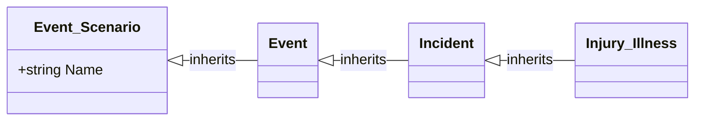

# Intelex model output contract

Read this reference whenever producing or revising an Intelex data-model deliverable.

## Mermaid notation

Use Markdown-fenced Mermaid `classDiagram` by default because it can show fields, associations, cardinalities, and inheritance together.



Use Mermaid-safe, stable identifiers: replace spaces and punctuation with underscores and disambiguate collisions. If a sanitized identifier differs materially from the Intelex display name, include a mapping table.

Write associations from the object that declares the reference field toward the target when that direction is supported by the package:

```text
Source "0..*" --> "1" Target : relationshipField
```

Use only evidence-supported cardinalities. Mark unknown cardinality outside the diagram as unresolved rather than inserting a plausible value.

Show direct inheritance with:

```text
Parent <|-- Child : inherits
```

Do not draw redundant transitive inheritance edges.

## Fields

By default, include identity fields, relationship fields, requirement-relevant fields, and fields needed to explain object responsibility. Include every field only when requested or when the model remains readable.

Use a consistent compact form such as `+Type FieldName`. Optional markers are:

- `[PK]` confirmed identity or primary field
- `[REF]` confirmed reference field
- `[REQ]` confirmed required field
- `[PROPOSED]` proposed field

Do not use a marker unless package evidence or the proposal supports it.

## Large applications

When one diagram would be unreadable, provide:

1. A high-level overview
2. Detailed diagrams grouped by functional domain or inheritance family
3. Stable identifiers across every diagram
4. A cross-domain relationship register or integration diagram

## Object inventory

Track available values for each object: stable ID, internal name, display name, source path, parent object, directly declared fields, identity field, outgoing and incoming relationships, system/custom status, evidence classification, and unresolved metadata.

## Relationship register

Use these columns where the evidence supports them:

| Source object | Declaring field | Target object | Cardinality | Required | Evidence | Classification |
|---|---|---|---|---|---|---|

## Change summary

Use actions such as Add, Modify, Deprecate, Remove, Reparent, Split, Merge, and No structural change.

| Change ID | Action | Element | Baseline | Proposed | Requirement | Rationale | Confidence |
|---|---|---|---|---|---|---|---|

## Requirement traceability

| Requirement | Affected model elements | Design response | Status |
|---|---|---|---|

Use statuses: Satisfied, Partially satisfied, Blocked, or Requires confirmation.

## Validation

Check and report:

- Unresolved relationship targets
- Duplicate or ambiguous identifiers
- Missing parents, conflicting inheritance, and inheritance cycles
- Unsupported cardinality assumptions
- Required references that may prevent record creation
- Orphaned objects
- Effects of base-object changes on descendants
- Contradictions with supplied requirements or ADRs
- Migration, integration, reporting, compatibility, and normalization risks

On revision, regenerate affected diagrams and update the change and traceability tables. State which earlier assumptions or decisions are superseded.

