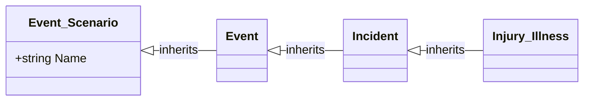

# Intelex model output contract

Read this reference whenever producing or revising an Intelex data-model deliverable.

## Mermaid notation

Use a Markdown-fenced Mermaid `classDiagram` by default when fields, associations, cardinalities, and inheritance must be shown together.



Use Mermaid-safe, stable identifiers by replacing spaces and punctuation with underscores and disambiguating collisions. If a sanitized identifier differs materially from the Intelex display name, include a mapping table.

Write associations from the object declaring the reference field toward the target when supported by evidence:

```text
Source "0..*" --> "1" Target : relationshipField
```

Use only evidence-supported cardinalities. Mark unknown cardinality outside the diagram as unresolved rather than inserting a plausible value.

Show direct inheritance with:

```text
Parent <|-- Child : inherits
```

Do not draw redundant transitive inheritance edges.

## Fields

By default, include identity fields, relationship fields, requirement-relevant fields, and fields needed to explain object responsibility. Include every field only when requested or when the model remains readable.

Use a consistent compact form such as `+Type FieldName`. Optional markers are:

- `[PK]` confirmed identity or primary field
- `[REF]` confirmed reference field
- `[REQ]` confirmed required field
- `[PROPOSED]` proposed field

Do not use a marker unless package evidence or the proposal supports it.

For implementation-oriented target specifications, supplement diagrams with field tables that identify exact display name, type, relationship target and cardinality, requiredness, default or formula, editability, conditional visibility, automation mechanism, and lifecycle restrictions.

## Large applications

When one diagram would be unreadable, provide:

1. A high-level overview
2. Detailed diagrams grouped by functional domain or inheritance family
3. Stable identifiers across every diagram
4. A cross-domain relationship register or integration diagram only when needed to resolve cross-domain complexity

## Object inventory

Track available values for each object: stable ID, internal name, display name, source path, parent object, directly declared fields, identity field, outgoing and incoming relationships, system/custom status, evidence classification, and unresolved metadata.

## Relationship register

Use a standalone relationship register for baseline extraction when it materially assists reconstruction, or when requested. In a target technical specification, prefer complete field tables and do not duplicate the same information in a register without a clear need.

When used, include these columns where evidence supports them:

| Source object | Declaring field | Target object | Cardinality | Required | Evidence | Classification |
|---|---|---|---|---|---|---|

## Change summary

Use actions such as Add, Modify, Deprecate, Remove, Reparent, Split, Merge, and No structural change.

| Change ID | Action | Element | Baseline | Proposed | Requirement | Rationale | Confidence |
|---|---|---|---|---|---|---|---|

## Requirement traceability

| Requirement | Affected model elements | Design response | Status |
|---|---|---|---|

Use statuses: Satisfied, Partially satisfied, Blocked, or Requires confirmation.

## Validation

Check and report:

- unresolved relationship targets;
- duplicate or ambiguous identifiers;
- missing parents, conflicting inheritance, and inheritance cycles;
- unsupported cardinality assumptions;
- required references that may prevent record creation;
- orphaned objects;
- effects of base-object and shared-object changes on descendants and consuming specifications;
- contradictions with supplied requirements or ADRs;
- unsupported or unverified formula syntax;
- migration, integration, reporting, compatibility, and normalization risks;
- stale dependencies on renamed or removed elements.

On revision, regenerate affected diagrams and update field tables, change summaries, traceability, impact analysis, validation, migration guidance, and acceptance criteria. State which earlier assumptions or decisions are superseded.
