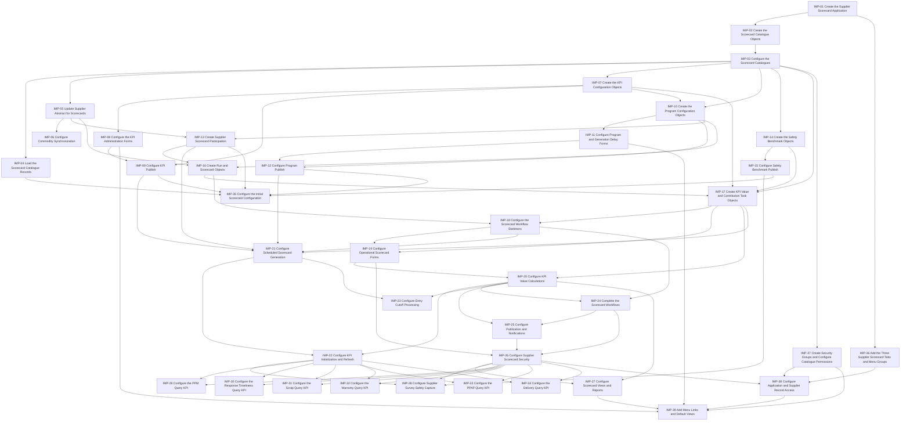

# Supplier Scorecard navigation and security amendment validation adapter

## Scope and planning basis

This revision retains four separate amendment tasks and all 35 original task records unchanged. AMD-02 creates/reuses the three named native Groups and assigns catalogue Rights/maintenance. AMD-03 consumes those Groups for application/tab/object/inherited supplier access. AMD-04 consumes both outputs for final navigation. No specification or tenant configuration is changed by this ownership move.

## Task summary

| Task Number | Task Category | Task Name | Objective and Detailed Scope | Recommended Implementer |
|---|---|---|---|---|
| IMP-01 | Application configuration | Create the Supplier Scorecard Application | **Objective:** Establish the application container and navigation for Supplier Scorecard configuration and operations.  **Detailed scope:** Create the Supplier Scorecard application, application-level settings, navigation areas, and placeholders for administration, contribution, review, published results, and reporting. Do not modify the OOTB SRM application or workflows. | Associate Consultant |
| IMP-02 | Object configuration | Create the Scorecard Catalogue Objects | **Objective:** Establish the inherited catalogue family required by all governed scorecard selections.  **Detailed scope:** Create non-instantiable `Supplier Scorecard Abstract Catalog Record` and its twelve direct children: Supplier Commodity, NAICS Classification, KPI Category, KPI Aggregation Method, KPI Value Type, KPI Contribution Source, KPI Collection Method, KPI Initialization Method, Safety Benchmark Metric, Scorecard Cadence, KPI Value Origin, and Publication Exception Treatment. | Senior Associate Consultant |
| IMP-03 | Catalogue configuration | Configure the Scorecard Catalogues | **Objective:** Make each catalogue usable as a governed Code-based selection source.  **Detailed scope:** Configure inherited `Code`, `Name`, `Active?`, and `Sort`; add `Description` to KPI Aggregation Method and `Frequency` to Scorecard Cadence; configure child administration forms, active-record filters, audit, and basic permissions. Do not expose inverse consumer grids. | Senior Associate Consultant |
| IMP-04 | Initial configuration | Load the Scorecard Catalogue Records | **Objective:** Provide the approved catalogue values required by downstream configuration and automation.  **Detailed scope:** Load the specification-defined records for value type, contribution source, collection method, initialization method, safety metric, cadence, value origin, and publication exception treatment, plus approved commodity, NAICS, KPI category, and aggregation-method records. Preserve stable Codes and approved recurrence expressions. | Associate Consultant |
| IMP-05 | Shared object configuration | Update Supplier Abstract for Scorecards | **Objective:** Add scorecard classification and navigation to the authoritative supplier master.  **Detailed scope:** Add `Commodity` and `NAICS Classification` M:1 fields to `Supplier Abstract`, with catalogue inverses disabled, and add inverse grids for `Scorecard Participations` and `Scorecards`. Apply inherited behavior to Parent Company and Facility without creating another supplier object. | Senior Associate Consultant |
| IMP-06 | Action Handler configuration | Configure Commodity Synchronization | **Objective:** Keep Facility Commodity aligned with Parent Company Commodity under the initial no-override policy.  **Detailed scope:** Configure the Facility create/update handler and Parent Company Commodity update handler, including idempotent child updates, audit, failure reporting, and protection against metadata-only retriggers. | Consultant |
| IMP-07 | Object configuration | Create the KPI Configuration Objects | **Objective:** Provide editable KPI definitions and immutable effective-dated versions.  **Detailed scope:** Create `Supplier Scorecard KPI` and `Supplier Scorecard KPI Version` with all specification fields, relationships, inverse grids, uniqueness rules, conditional requirements, and immutable version behavior. | Senior Associate Consultant |
| IMP-08 | Form configuration | Configure the KPI Administration Forms | **Objective:** Give scorecard administrators a controlled KPI authoring and version-review experience.  **Detailed scope:** Configure KPI authoring and read-only version forms, active catalogue filters, conditional sections for contributor, defaults, query source, and safety benchmark settings, plus the Versions grid and Publish action placement. | Senior Associate Consultant |
| IMP-09 | Action Handler configuration | Configure KPI Publish | **Objective:** Publish one complete, immutable KPI Version without overlap or partial creation.  **Detailed scope:** Configure validation, concurrency control, deterministic version numbering, effective-range overlap prevention, full authoring-to-version field mapping, rollback, administrator authorization, and native execution evidence. | Senior Consultant |
| IMP-10 | Object configuration | Create the Program Configuration Objects | **Objective:** Provide editable scorecard methodologies and immutable published Program graphs.  **Detailed scope:** Create `Scorecard Program`, `Scorecard Program KPI`, `Scorecard Program Version`, and `Scorecard Program KPI Version` with specified fields, M:1/M:N relationships, inverse grids, uniqueness, effective dating, rollup-source reference, and immutable version behavior. | Senior Associate Consultant |
| IMP-11 | Form configuration | Configure Program and Generation Delay Forms | **Objective:** Support Program authoring, version review, KPI membership, and occurrence-specific generation delays.  **Detailed scope:** Configure Program authoring/version forms and grids; create `Scorecard Program Generation Delay`; configure its contextual New form, calculated display, occurrence fields, audit, Applied Run evidence, and read-only applied state. | Senior Associate Consultant |
| IMP-12 | Action Handler configuration | Configure Program Publish | **Objective:** Publish the complete Program Version, KPI membership, and supplier-recipient roles as one controlled change.  **Detailed scope:** Configure graph validation, cadence and rollup checks, cycle prevention, deterministic version numbering, complete child and M:N copying, overlap prevention, concurrency control, rollback, and immutability. | Senior Consultant |
| IMP-13 | Object configuration | Create Supplier Scorecard Participation | **Objective:** Govern which exact supplier entities participate in each Program and effective period.  **Detailed scope:** Create `Supplier Scorecard Participation`, its Supplier and Program relationships, active/effective fields, display value, audit, inverse navigation, and prevention of overlapping active ranges for the same Supplier and Program. | Senior Associate Consultant |
| IMP-14 | Object configuration | Create the Safety Benchmark Objects | **Objective:** Provide effective-dated NAICS and metric benchmarks for safety scoring.  **Detailed scope:** Create `Safety Benchmark` and immutable `Safety Benchmark Version` with catalogue relationships, source evidence, effective ranges, inverse Versions grid, uniqueness, and administration/read-only forms. | Senior Associate Consultant |
| IMP-15 | Action Handler configuration | Configure Safety Benchmark Publish | **Objective:** Publish complete benchmark versions with controlled effective dates.  **Detailed scope:** Configure required-field validation, stable benchmark uniqueness, effective-range checks, deterministic version numbering, full field copying, concurrency control, rollback, authorization, and immutable published records. | Consultant |
| IMP-16 | Object configuration | Create Run and Scorecard Objects | **Objective:** Establish the operational parent and supplier-period snapshot records.  **Detailed scope:** Create `Supplier Scorecard Run` and `Supplier Scorecard` with all specified scalar fields, supplier/program relationships, snapshots, inverse grids, Source Scorecards M:N, publication metadata, and uniqueness for Program occurrence and Run/Supplier. | Senior Associate Consultant |
| IMP-17 | Object configuration | Create KPI Value and Contribution Task Objects | **Objective:** Establish operational KPI results and consolidated contributor work records.  **Detailed scope:** Create `Scorecard KPI Value` and `Scorecard Contribution Task` with typed values, points, applicability, confirmation, exception, override, source evidence, catalogue relationships, contributor assignment, inverse grids, and required uniqueness rules. | Senior Associate Consultant |
| IMP-18 | Workflow configuration | Configure the Scorecard Workflow Skeletons | **Objective:** Establish stable stages, statuses, responsibility, due-date fields, and basic transitions for stage-aware configuration.  **Detailed scope:** Configure simple workflows for Supplier Scorecard Run, Supplier Scorecard, and Scorecard Contribution Task using the stages and terminal outcomes in the specification, with basic responsibility and transition actions only. | Associate Consultant |
| IMP-19 | Form configuration | Configure Operational Scorecard Forms | **Objective:** Provide responsive, stage-aware forms for Run coordination, contribution, review, correction, and published viewing.  **Detailed scope:** Configure Run, Scorecard, KPI Value, and Contribution Task forms and grids; typed-value visibility; stage containers; contributor editing; internal-only exception/override controls; source links; read-only publication views; and responsive connected-browser behavior. | Senior Associate Consultant |
| IMP-20 | Action Handler configuration | Configure KPI Value Calculations | **Objective:** Maintain effective points, completeness, provenance, confirmation evidence, and Scorecard totals when KPI values change.  **Detailed scope:** Configure input recalculation, confirmation metadata, publication-exception and override handlers, `Value Origin` assignment, parent total/category recalculation, recursion protection, retry behavior, and `Last Calculated At`. | Senior Consultant |
| IMP-21 | Event Service configuration | Configure Scheduled Scorecard Generation | **Objective:** Generate each due Program occurrence exactly once, including delayed occurrences, supplier snapshots, KPI values, and contribution tasks.  **Detailed scope:** Configure cadence evaluation, period boundaries, Generation Delay gate, Program/KPI version resolution, participation and status checks, rollup selection, retry-safe graph creation by specified uniqueness keys, failure ownership, and transition to Data Entry only after complete generation. | Senior Consultant |
| IMP-22 | Service and action configuration | Configure KPI Initialization and Refresh | **Objective:** Initialize operational KPI values and refresh one governed Query result without losing historical evidence or overrides.  **Detailed scope:** Configure no-default, static-default, and prior-period initialization; query capture metadata; open-period refresh; privileged targeted post-publication refresh; source evidence updates; total recalculation; and safeguards against background refresh of Published Scorecards. | Senior Consultant |
| IMP-23 | Event Service configuration | Configure Entry Cutoff Processing | **Objective:** Apply approved supplier-nonresponse behavior while keeping missing internal input visible and controlled.  **Detailed scope:** Configure the Entry Due At service to set only eligible supplier nonresponses to zero, stamp the governed origin, leave internal gaps unresolved, respect optional values, and preserve retry-safe execution evidence. | Consultant |
| IMP-24 | Workflow configuration | Complete the Scorecard Workflows | **Objective:** Enforce complete data entry, review-window, publication-ready, contribution-completion, return, cancellation, and due-date behavior.  **Detailed scope:** Add full validation, error handling, calculated responsibility and due dates, hidden parent-driven child transitions, Open/Close Review behavior, contribution completion/reopen rules, cancellation cascade, and native reminders. | Senior Consultant |
| IMP-25 | Action Handler configuration | Configure Publication and Notifications | **Objective:** Publish a complete Run safely and notify only authorized internal and supplier recipients without duplicates.  **Detailed scope:** Configure final validation, source-link safety checks, child and parent publication completion, publication stamps, recipient-role resolution, broad review notification, supplier publication notification, rollback or retry-safe partial-failure handling, and notification deduplication. | Senior Consultant |
| IMP-26 | Security configuration | Configure Supplier Scorecard Security | **Objective:** Restrict administration, contribution, aggregate viewing, corrections, publication, and supplier access while preserving source security.  **Detailed scope:** Configure application/object/record/workflow permissions for administrators, coordinators, reviewers, contributors, correction users, internal viewers, and supplier users; enforce supplier-entity scope, parent/child access rules, internal-only fields, read-only published results, and no access expansion from Group assignment. | Senior Consultant |
| IMP-27 | Reporting and view configuration | Configure Scorecard Views and Reports | **Objective:** Provide operational oversight, published detail, profile drilldown, category results, trends, and on-demand authorized ranking.  **Detailed scope:** Configure responsive entry/review/admin/published views, supplier-profile grids, overdue and completeness reports, snapshot-aware KPI reporting, category aggregation, current-measure workspace links, and secured overall/commodity rank calculation without persisted rank fields. | Consultant |
| IMP-28 | Integration configuration | Configure Supplier Survey Safety Capture | **Objective:** Capture LTIR, TRIR, and Safety Kaizen results from the authoritative Supplier Survey model with exact benchmark evidence.  **Detailed scope:** Configure supplier/period survey matching, completed-survey selection, NAICS/metric benchmark-version resolution, points calculation, nonresponse handling, Kaizen carry-forward, source references, and safe refresh behavior. | Senior Consultant |
| IMP-29 | Integration configuration | Configure the PPM Query KPI | **Objective:** Calculate the approved PPM score from chargeable supplier NCR quantities and consumed parts for the same supplier and period.  **Detailed scope:** Configure the governed source report/query binding, supplier and period mapping, included dispositions, parts-consumption input, aggregation and points logic, empty/failure behavior, correction handling, evidence link, and security-preserving drilldown. | Senior Consultant |
| IMP-30 | Integration configuration | Configure the Response Timeliness Query KPI | **Objective:** Score supplier response timeliness without charging internal review delay to the supplier.  **Detailed scope:** Configure the approved response source, supplier and period mapping, supplier submission timestamp, applicable due date, exclusions, scoring logic, correction handling, empty/failure behavior, and source-security-safe evidence link. | Consultant |
| IMP-31 | Integration configuration | Configure the Scrap Query KPI | **Objective:** Supply approved scrap results to Scorecards while leaving debit settlement outside Intelex.  **Detailed scope:** Configure the approved scrap source report, supplier and period mapping, aggregation and scoring rules, correction handling, empty/failure behavior, and secure evidence link; do not add debit settlement processing. | Consultant |
| IMP-32 | Integration configuration | Configure the Warranty Query KPI | **Objective:** Supply the approved warranty result from its authoritative source to the matching supplier-period KPI Value.  **Detailed scope:** Configure the approved warranty source binding, supplier and period mapping, inclusions, aggregation, points logic, correction timing, empty/failure behavior, evidence link, and source security. | Consultant |
| IMP-33 | Integration configuration | Configure the PPAP Query KPI | **Objective:** Supply the approved PPAP result from its authoritative source to the matching supplier-period KPI Value.  **Detailed scope:** Configure the approved PPAP source binding, supplier and period mapping, inclusions, aggregation, points logic, correction timing, empty/failure behavior, evidence link, and source security. | Consultant |
| IMP-34 | Integration configuration | Configure the Delivery Query KPI | **Objective:** Supply the approved delivery result from its authoritative source to the matching supplier-period KPI Value.  **Detailed scope:** Configure the approved delivery source binding, supplier and period mapping, inclusions, aggregation, points logic, correction timing, empty/failure behavior, evidence link, and source security. | Consultant |
| IMP-35 | Initial configuration | Configure the Initial Scorecard Configuration | **Objective:** Make the approved direct-entry-first Scorecard configuration available for operational generation.  **Detailed scope:** Create and publish approved safety benchmark, KPI, and Program records; assign KPI membership and recipient roles; create effective-dated supplier Participations; configure required status-capability decisions; and verify that published configuration resolves by the intended period. Query KPIs remain Direct Entry until their integration task is complete. | Senior Associate Consultant |
| IMP-36 | Application configuration | Add the Three Supplier Scorecard Tabs and Menu Groups | **Objective:** Give internal viewers, program administrators, and developers their own clearly organized navigation.  **Detailed scope:** Configure the existing Supplier Scorecard application with exactly three ordered tabs: Supplier Scorecards, Program Administration, and Program Development. Add their nine ordered menu grouping headers. Use the application and placeholder navigation provided by the original application assignment; configure the approved three-tab structure without duplicating tabs or retaining an additional contribution tab. Leave final menu destinations, visibility bindings, and default views to the separate menu amendment task. | Associate Consultant |
| IMP-37 | Catalogue configuration | Create Security Groups and Configure Catalogue Permissions | **Objective:** Establish the three dedicated security groups and give them the approved catalogue read and maintenance permissions.  **Detailed scope:** Create or reuse exactly one native Group for each of these names: Supplier Scorecard App - Supplier User Security Group; Supplier Scorecard App - Viewers Security Group; Supplier Scorecard App - Application Admin Security Group. Give all three View via Rights on the thirteen concrete scorecard catalogues. Give the Application Admin group View/Create/Edit/Delete on Supplier Commodity, NAICS Classification and KPI Category subject to existing protections, and reserve maintenance of the ten technical catalogues for Administrators. Apply the maintainer rules to inherited and directly declared editable fields and preserve supported lookup and historical references. Repeating setup must not duplicate Groups or repurpose a general Supplier User group. | Senior Associate Consultant |
| IMP-38 | Security configuration | Configure Application and Supplier Record Access | **Objective:** Give suppliers published results through their supplier records and give internal viewers and administrators the approved application access.  **Detailed scope:** Use the three exact named Group records supplied by the catalogue-permission amendment. Configure application/tab Use independently of object grants. The supplier group gets no app/tab Use and inherits View only from accessible Supplier Abstract records to Published Supplier Scorecards and then their associated Scorecard KPI Values. Supplier Scorecard App - Viewers Security Group gets app and Supplier Scorecards tab Use plus View on all fourteen non-catalogue objects. Supplier Scorecard App - Application Admin Security Group gets app, Supplier Scorecards and Program Administration tab Use plus View/Create/Edit/Delete on those fourteen objects, subject to existing lifecycle, field, controlled-action and deletion protections. Retain Administrators-only Program Development. Supply current review eligibility and supplier notification eligibility without requiring supplier app/tab Use. | Senior Consultant |
| IMP-39 | Reporting and view configuration | Add Menu Links and Default Views | **Objective:** Let users open the approved scorecard destinations from the correct menu and see the intended view when entering each tab.  **Detailed scope:** Add the named overview, history, contribution-progress, review and reported-data views and the 24 ordered menu links across three tabs and nine groupings. Apply the supplied Use/review rules for Supplier Scorecard App - Viewers Security Group, Supplier Scorecard App - Application Admin Security Group and existing Administrators. Default Supplier Scorecards to Scorecard Overview and the other two tabs to blank content until a menu is selected. Configure supplier-context links for Supplier Scorecard App - Supplier User Security Group to open authorized Published Scorecards and associated KPI Values through inherited View without app/tab Use. Omit My Contribution Tasks. | Consultant |

## External inputs and constraints

- **IN-01 — Catalogue inheritance and uniqueness result:** Confirm per-concrete-child uniqueness for inherited `Code`, or provide approved globally unique replacement Codes.
- **IN-02 — Approved catalogue content:** Approve Commodity, NAICS, KPI Category, KPI Aggregation Method, Value Type, and any changes to the specification seed values.
- **IN-03 — Cadence and calendar configuration:** Supply verified recurrence expressions, period-boundary rules, scheduler timezone, business calendar, generation time, entry/review cutoffs, reminders, and escalation behavior.
- **IN-04 — Approved operating model:** Approve or reject ADR-113 parent-periodic/facility-monthly rollup behavior.
- **IN-05 — Approved exception policy:** Approve `SET_TO_ZERO` and `EXCLUDE_FROM_DENOMINATOR`, or provide replacement policy.
- **IN-06 — Named groups and separation of duties:** Name administrator, coordinator, review, correction, contributor, and support groups and approve role separation.
- **IN-07 — Supplier status capability decisions:** Approve status/capability matrix entries and parent-restriction behavior for monthly and, if used, periodic generation.
- **IN-08 — Tenant capability results:** Confirm Group responsibility, M:N version copying, inherited-Code behavior, aggregate recalculation, completed-parent child correction, report/query binding, recurrence rendering, and scheduler interpretation.
- **IN-09 — Approved KPI catalogue:** Supply KPI definitions, categories, maxima, initialization, applicability, missing-value behavior, aggregation, contacts, effective dates, Program membership, requiredness, and participant population.
- **IN-10 — Security decisions:** Approve entity-scope rules, parent/facility access, supplier recipient roles, correction role, field visibility, and source-link expectations.
- **IN-11 — Ranking rules:** Define ties, exclusions, null scores, population count, and interaction with security filtering.
- **IN-12 — Commodity and NAICS governance:** Confirm Commodity override policy, NAICS ownership, missing-code behavior, benchmark sources, and update procedure.
- **IN-13 — Safety survey/scoring configuration:** Provide issued survey identifiers/schedules, supplier/period matching, completion rules, and exact LTIR/TRIR and Kaizen scoring.
- **IN-14 — PPM source contract:** Select parts-consumption integration, map chargeable NCR dispositions/quantities, supplier keys, periods, scoring, corrections, and secure drilldown.
- **IN-15 — Response timeliness source contract:** Define authoritative source, supplier/period keys, due/submission timestamps, exclusions, scoring, corrections, and secure drilldown.
- **IN-16 — Scrap source contract:** Define authoritative source, supplier/period keys, aggregation, scoring, corrections, and secure drilldown.
- **IN-17 — Warranty source contract:** Define authoritative source, supplier/period keys, inclusions, aggregation, scoring, corrections, and secure drilldown.
- **IN-18 — PPAP source contract:** Define authoritative source, supplier/period keys, inclusions, aggregation, scoring, corrections, and secure drilldown.
- **IN-19 — Delivery source contract:** Define authoritative source, supplier/period keys, inclusions, aggregation, scoring, corrections, and secure drilldown.
- **IN-20 — Approved security-group membership and responsibilities:** Supply approved membership and separation of duties for Supplier Scorecard App - Supplier User Security Group; Supplier Scorecard App - Viewers Security Group; Supplier Scorecard App - Application Admin Security Group, existing Administrators and coordinator/review responsibilities. The three named Group records and their identifiers are created/reused by the catalogue-permission amendment, not requested from the user. Group creation and decided grants can proceed; membership administration and identity-based checks consume the approved external membership input.
- **IN-21 — Supported native navigation settings:** Supply supported native menu destination, blank tab content and reporting-cycle review-menu visibility settings only where unverified. All labels, order, purposes and defaults are approved. New view identifiers are build outputs, not user decisions; only affected bindings wait.
- **IN-22 — Generation Lag Time Increment destination:** The separately drafted November 5 generation-scheduling amendment supplies the Generation Lag Time Increment object and administration form beneath the existing catalogue work. Only that catalogue permission assignment and its menu link wait for this output. This navigation amendment does not create the object or absorb the earlier scheduling work.
- **IN-23 — Native supplier inheritance, publication filtering and entry:** The technical team supplies supported native View-only relationship inheritance on Supplier Scorecard.Supplier and Scorecard KPI Value.Scorecard, current-access propagation, Published enforcement on both direct paths, supplier recipient authorization before/after publication, and supplier entry without app/tab Use. The OOTB evidence does not establish these native bindings. Only those controls/entry bindings wait; do not invent enum values, copy ACLs to custom fields or grant Use as a workaround.

## Detailed configuration tasks

### IMP-01 — Create the Supplier Scorecard Application

**Task ID:** IMP-01

**Title:** Create the Supplier Scorecard Application

**Category:** Application configuration

**Objective:** Establish the application container and navigation for Supplier Scorecard configuration and operations.

**Detailed scope:** Create the Supplier Scorecard application, application-level settings, navigation areas, and placeholders for administration, contribution, review, published results, and reporting. Do not modify the OOTB SRM application or workflows.

**Deliverable:** Configured Supplier Scorecard application shell with role-ready navigation.

**Work needed first:** None

**What is waiting:** Not blocked.

**Recommended implementer role:** Associate Consultant

**Recommended reviewer/approver role:** Senior Consultant

**Why this role is recommended:** This is bounded application setup using an established Intelex pattern; Senior Consultant review protects the SRM boundary.

**Build instructions:**

1. Create the Supplier Scorecard application, application-level settings, navigation areas, and placeholders for administration, contribution, review, published results, and reporting. Do not modify the OOTB SRM application or workflows.

**How to check the result:**

- The application opens; each planned navigation area is present; no OOTB SRM workflow or object is copied or changed.

**Information needed for this task:** None

**Specification references:** Original implementation-plan assignment APP-01. Sections 1, 3, 5, 16.3

**Assumptions and open questions:** Application naming follows the specification display name; internal system name remains tenant-generated/verified.

### IMP-02 — Create the Scorecard Catalogue Objects

**Task ID:** IMP-02

**Title:** Create the Scorecard Catalogue Objects

**Category:** Object configuration

**Objective:** Establish the inherited catalogue family required by all governed scorecard selections.

**Detailed scope:** Create non-instantiable `Supplier Scorecard Abstract Catalog Record` and its twelve direct children: Supplier Commodity, NAICS Classification, KPI Category, KPI Aggregation Method, KPI Value Type, KPI Contribution Source, KPI Collection Method, KPI Initialization Method, Safety Benchmark Metric, Scorecard Cadence, KPI Value Origin, and Publication Exception Treatment.

**Deliverable:** Abstract catalogue parent and twelve correctly inherited concrete child objects.

**Work needed first:** IMP-01

**What is waiting:** Blocked until APP-01 is complete.

**Recommended implementer role:** Senior Associate Consultant

**Recommended reviewer/approver role:** Senior Consultant

**Why this role is recommended:** The object work is routine, but inheritance and non-instantiable behavior require independent configuration judgment.

What the earlier tasks provide: IMP-01: Configured Supplier Scorecard application shell with role-ready navigation.

**Build instructions:**

1. Create non-instantiable `Supplier Scorecard Abstract Catalog Record` and its twelve direct children: Supplier Commodity, NAICS Classification, KPI Category, KPI Aggregation Method, KPI Value Type, KPI Contribution Source, KPI Collection Method, KPI Initialization Method, Safety Benchmark Metric, Scorecard Cadence, KPI Value Origin, and Publication Exception Treatment.

**How to check the result:**

- Exactly twelve direct children inherit from the abstract parent; the parent cannot be instantiated or selected; no multiple parent or cycle exists.

**Information needed for this task:** None

**Specification references:** Original implementation-plan assignment OBJ-02. Sections 4.2, 5, 7.1, 21.1

**Assumptions and open questions:** None.

### IMP-03 — Configure the Scorecard Catalogues

**Task ID:** IMP-03

**Title:** Configure the Scorecard Catalogues

**Category:** Catalogue configuration

**Objective:** Make each catalogue usable as a governed Code-based selection source.

**Detailed scope:** Configure inherited `Code`, `Name`, `Active?`, and `Sort`; add `Description` to KPI Aggregation Method and `Frequency` to Scorecard Cadence; configure child administration forms, active-record filters, audit, and basic permissions. Do not expose inverse consumer grids.

**Deliverable:** Configured catalogue fields, forms, filters, audit, and permissions.

**Work needed first:** IMP-02

**What is waiting:** Blocked until OBJ-02 is complete; tenant capability results may block final constraint and recurrence configuration.

**Recommended implementer role:** Senior Associate Consultant

**Recommended reviewer/approver role:** Senior Consultant

**Why this role is recommended:** Inherited fields, recurrence presentation, and inverse suppression exceed simple catalogue setup.

What the earlier tasks provide: IMP-02: Abstract catalogue parent and twelve correctly inherited concrete child objects.

**Build instructions:**

1. Configure inherited `Code`, `Name`, `Active?`, and `Sort`; add `Description` to KPI Aggregation Method and `Frequency` to Scorecard Cadence; configure child administration forms, active-record filters, audit, and basic permissions. Do not expose inverse consumer grids.

**How to check the result:**

- Common fields exist only on the parent; child-specific fields exist only where specified; active filters work; catalogue M:1 inverses and consumer grids are absent.

**Information needed for this task:** IN-08: Confirm Group responsibility, M:N version copying, inherited-Code behavior, aggregate recalculation, completed-parent child correction, report/query binding, recurrence rendering, and scheduler interpretation.

**Specification references:** Original implementation-plan assignment CFG-03. Sections 6, 7, 16.1, 21.1

**Assumptions and open questions:** Exact uniqueness constraint and recurrence storage follow externally supplied tenant results.

### IMP-04 — Load the Scorecard Catalogue Records

**Task ID:** IMP-04

**Title:** Load the Scorecard Catalogue Records

**Category:** Initial configuration

**Objective:** Provide the approved catalogue values required by downstream configuration and automation.

**Detailed scope:** Load the specification-defined records for value type, contribution source, collection method, initialization method, safety metric, cadence, value origin, and publication exception treatment, plus approved commodity, NAICS, KPI category, and aggregation-method records. Preserve stable Codes and approved recurrence expressions.

**Deliverable:** Approved, audited records in every concrete catalogue.

**Work needed first:** IMP-03

**What is waiting:** Blocked by CFG-03 and by approved catalogue content, recurrence expressions, and inherited-Code uniqueness outcome.

**Recommended implementer role:** Associate Consultant

**Recommended reviewer/approver role:** Senior Consultant

**Why this role is recommended:** Record loading is bounded once governance and platform constraints are supplied.

What the earlier tasks provide: IMP-03: Configured catalogue fields, forms, filters, audit, and permissions.

**Build instructions:**

1. Load the specification-defined records for value type, contribution source, collection method, initialization method, safety metric, cadence, value origin, and publication exception treatment, plus approved commodity, NAICS, KPI category, and aggregation-method records. Preserve stable Codes and approved recurrence expressions.

**How to check the result:**

- Every approved record is present once on the correct concrete child; Codes are stable; inactive filtering works; cadence Frequency values are valid.

**Information needed for this task:** IN-01: Confirm per-concrete-child uniqueness for inherited `Code`, or provide approved globally unique replacement Codes. IN-02: Approve Commodity, NAICS, KPI Category, KPI Aggregation Method, Value Type, and any changes to the specification seed values. IN-03: Supply verified recurrence expressions, period-boundary rules, scheduler timezone, business calendar, generation time, entry/review cutoffs, reminders, and escalation behavior. IN-05: Approve `SET_TO_ZERO` and `EXCLUDE_FROM_DENOMINATOR`, or provide replacement policy.

**Specification references:** Original implementation-plan assignment DAT-04. Sections 7.2–7.13, 20.2, 21.2

**Assumptions and open questions:** No unapproved catalogue values are invented.

### IMP-05 — Update Supplier Abstract for Scorecards

**Task ID:** IMP-05

**Title:** Update Supplier Abstract for Scorecards

**Category:** Shared object configuration

**Objective:** Add scorecard classification and navigation to the authoritative supplier master.

**Detailed scope:** Add `Commodity` and `NAICS Classification` M:1 fields to `Supplier Abstract`, with catalogue inverses disabled, and add inverse grids for `Scorecard Participations` and `Scorecards`. Apply inherited behavior to Parent Company and Facility without creating another supplier object.

**Deliverable:** Supplier Abstract extensions and inherited Parent Company/Facility presentation.

**Work needed first:** IMP-03

**What is waiting:** Blocked until CFG-03 is complete.

**Recommended implementer role:** Senior Associate Consultant

**Recommended reviewer/approver role:** Senior Consultant

**Why this role is recommended:** The fields are straightforward, but changes to an authoritative inherited object require careful cross-application configuration.

What the earlier tasks provide: IMP-03: Configured catalogue fields, forms, filters, audit, and permissions.

**Build instructions:**

1. Add `Commodity` and `NAICS Classification` M:1 fields to `Supplier Abstract`, with catalogue inverses disabled, and add inverse grids for `Scorecard Participations` and `Scorecards`. Apply inherited behavior to Parent Company and Facility without creating another supplier object.

**How to check the result:**

- Both catalogue fields are inherited by Parent Company and Facility; catalogue inverses remain disabled; navigation grids use the owned child relationships.

**Information needed for this task:** None

**Specification references:** Original implementation-plan assignment OBJ-05. Sections 3.1, 4.1, 10.2, 20.1

**Assumptions and open questions:** Existing `Type of Supplier Entity` is reused and not duplicated.

### IMP-06 — Configure Commodity Synchronization

**Task ID:** IMP-06

**Title:** Configure Commodity Synchronization

**Category:** Action Handler configuration

**Objective:** Keep Facility Commodity aligned with Parent Company Commodity under the initial no-override policy.

**Detailed scope:** Configure the Facility create/update handler and Parent Company Commodity update handler, including idempotent child updates, audit, failure reporting, and protection against metadata-only retriggers.

**Deliverable:** Two working Commodity synchronization handlers with controlled failure behavior.

**Work needed first:** IMP-05

**What is waiting:** Blocked by OBJ-05 and the approved Commodity override policy.

**Recommended implementer role:** Consultant

**Recommended reviewer/approver role:** Senior Consultant

**Why this role is recommended:** Cross-object child updates, idempotency, and partial failure reporting require Consultant-level automation judgment.

What the earlier tasks provide: IMP-05: Supplier Abstract extensions and inherited Parent Company/Facility presentation.

**Build instructions:**

1. Configure the Facility create/update handler and Parent Company Commodity update handler, including idempotent child updates, audit, failure reporting, and protection against metadata-only retriggers.

**How to check the result:**

- Facility creation/parent change copies Commodity; Parent Company changes update related Facilities once; failures are reported without recursive updates.

**Information needed for this task:** IN-12: Confirm Commodity override policy, NAICS ownership, missing-code behavior, benchmark sources, and update procedure.

**Specification references:** Original implementation-plan assignment AUT-06. Section 10.2

**Assumptions and open questions:** Initial release does not permit Facility override.

### IMP-07 — Create the KPI Configuration Objects

**Task ID:** IMP-07

**Title:** Create the KPI Configuration Objects

**Category:** Object configuration

**Objective:** Provide editable KPI definitions and immutable effective-dated versions.

**Detailed scope:** Create `Supplier Scorecard KPI` and `Supplier Scorecard KPI Version` with all specification fields, relationships, inverse grids, uniqueness rules, conditional requirements, and immutable version behavior.

**Deliverable:** Complete KPI authoring/version object and field configuration.

**Work needed first:** IMP-03

**What is waiting:** Blocked until CFG-03 is complete.

**Recommended implementer role:** Senior Associate Consultant

**Recommended reviewer/approver role:** Senior Consultant

**Why this role is recommended:** Numerous conditional relationships and immutable version fields require independent configuration judgment but not advanced automation.

What the earlier tasks provide: IMP-03: Configured catalogue fields, forms, filters, audit, and permissions.

**Build instructions:**

1. Create `Supplier Scorecard KPI` and `Supplier Scorecard KPI Version` with all specification fields, relationships, inverse grids, uniqueness rules, conditional requirements, and immutable version behavior.

**How to check the result:**

- Every Section 8.1/8.2 field exists with correct ownership, relationship, requirement, editability, and inverse behavior; version records are read only.

**Information needed for this task:** None

**Specification references:** Original implementation-plan assignment OBJ-07. Sections 4.3, 8.1, 8.2

**Assumptions and open questions:** Exact executable expressions are deferred to their automation tasks.

### IMP-08 — Configure the KPI Administration Forms

**Task ID:** IMP-08

**Title:** Configure the KPI Administration Forms

**Category:** Form configuration

**Objective:** Give scorecard administrators a controlled KPI authoring and version-review experience.

**Detailed scope:** Configure KPI authoring and read-only version forms, active catalogue filters, conditional sections for contributor, defaults, query source, and safety benchmark settings, plus the Versions grid and Publish action placement.

**Deliverable:** Usable KPI authoring and immutable-version forms.

**Work needed first:** IMP-07

**What is waiting:** Blocked until OBJ-07 is complete.

**Recommended implementer role:** Senior Associate Consultant

**Recommended reviewer/approver role:** Senior Consultant

**Why this role is recommended:** The layout is sizeable and includes interdependent show/hide/clear/required behavior.

What the earlier tasks provide: IMP-07: Complete KPI authoring/version object and field configuration.

**Build instructions:**

1. Configure KPI authoring and read-only version forms, active catalogue filters, conditional sections for contributor, defaults, query source, and safety benchmark settings, plus the Versions grid and Publish action placement.

**How to check the result:**

- Only relevant fields appear for each governed Code combination; hidden conditional fields clear as specified; published versions cannot be edited.

**Information needed for this task:** None

**Specification references:** Original implementation-plan assignment FRM-08. Sections 8.1, 8.2, 16.1

**Assumptions and open questions:** None.

### IMP-09 — Configure KPI Publish

**Task ID:** IMP-09

**Title:** Configure KPI Publish

**Category:** Action Handler configuration

**Objective:** Publish one complete, immutable KPI Version without overlap or partial creation.

**Detailed scope:** Configure validation, concurrency control, deterministic version numbering, effective-range overlap prevention, full authoring-to-version field mapping, rollback, administrator authorization, and native execution evidence.

**Deliverable:** Controlled KPI Publish action.

**Work needed first:** IMP-07, IMP-08

**What is waiting:** Blocked by OBJ-07 and FRM-08; final mechanism depends on tenant capability results.

**Recommended implementer role:** Senior Consultant

**Recommended reviewer/approver role:** Principal Consultant

**Why this role is recommended:** Concurrency, atomicity, rollback, and immutable effective dating are consequential cross-record automation.

What the earlier tasks provide: IMP-07: Complete KPI authoring/version object and field configuration. IMP-08: Usable KPI authoring and immutable-version forms.

**Build instructions:**

1. Configure validation, concurrency control, deterministic version numbering, effective-range overlap prevention, full authoring-to-version field mapping, rollback, administrator authorization, and native execution evidence.

**How to check the result:**

- One action creates exactly one complete version; invalid or overlapping data creates none; concurrent attempts cannot duplicate version numbers.

**Information needed for this task:** IN-08: Confirm Group responsibility, M:N version copying, inherited-Code behavior, aggregate recalculation, completed-parent child correction, report/query binding, recurrence rendering, and scheduler interpretation.

**Specification references:** Original implementation-plan assignment AUT-09. Section 8.3; Sections 21.1–21.2

**Assumptions and open questions:** None.

### IMP-10 — Create the Program Configuration Objects

**Task ID:** IMP-10

**Title:** Create the Program Configuration Objects

**Category:** Object configuration

**Objective:** Provide editable scorecard methodologies and immutable published Program graphs.

**Detailed scope:** Create `Scorecard Program`, `Scorecard Program KPI`, `Scorecard Program Version`, and `Scorecard Program KPI Version` with specified fields, M:1/M:N relationships, inverse grids, uniqueness, effective dating, rollup-source reference, and immutable version behavior.

**Deliverable:** Complete Program authoring/version object and field configuration.

**Work needed first:** IMP-03, IMP-07

**What is waiting:** Blocked until CFG-03 and OBJ-07 are complete.

**Recommended implementer role:** Senior Associate Consultant

**Recommended reviewer/approver role:** Senior Consultant

**Why this role is recommended:** The graph is larger than routine object setup and mixes child and M:N version content.

What the earlier tasks provide: IMP-03: Configured catalogue fields, forms, filters, audit, and permissions. IMP-07: Complete KPI authoring/version object and field configuration.

**Build instructions:**

1. Create `Scorecard Program`, `Scorecard Program KPI`, `Scorecard Program Version`, and `Scorecard Program KPI Version` with specified fields, M:1/M:N relationships, inverse grids, uniqueness, effective dating, rollup-source reference, and immutable version behavior.

**How to check the result:**

- All Section 9.1–9.4 fields and relationships exist; `Entity Level` and `Recurrence Definition` do not; version records and children are read only.

**Information needed for this task:** None

**Specification references:** Original implementation-plan assignment OBJ-10. Sections 4.3, 9.1–9.4, 21.1

**Assumptions and open questions:** None.

### IMP-11 — Configure Program and Generation Delay Forms

**Task ID:** IMP-11

**Title:** Configure Program and Generation Delay Forms

**Category:** Form configuration

**Objective:** Support Program authoring, version review, KPI membership, and occurrence-specific generation delays.

**Detailed scope:** Configure Program authoring/version forms and grids; create `Scorecard Program Generation Delay`; configure its contextual New form, calculated display, occurrence fields, audit, Applied Run evidence, and read-only applied state.

**Deliverable:** Program/version administration forms and Generation Delay object/form/grid.

**Work needed first:** IMP-10

**What is waiting:** Blocked until OBJ-10 is complete; valid occurrence selection depends on approved cadence rules.

**Recommended implementer role:** Senior Associate Consultant

**Recommended reviewer/approver role:** Senior Consultant

**Why this role is recommended:** This combines a larger administration form with contextual child creation and lifecycle-dependent editability.

What the earlier tasks provide: IMP-10: Complete Program authoring/version object and field configuration.

**Build instructions:**

1. Configure Program authoring/version forms and grids; create `Scorecard Program Generation Delay`; configure its contextual New form, calculated display, occurrence fields, audit, Applied Run evidence, and read-only applied state.

**How to check the result:**

- Program grids expose membership, versions, and delays; Program defaults/locks on new Delay; invalid dates, duplicate occurrence, and applied edits are prevented.

**Information needed for this task:** None

**Specification references:** Original implementation-plan assignment FRM-11. Sections 9.1, 9.5, 9.6, 16.1

**Assumptions and open questions:** Exact display formulas and occurrence picker implementation use verified tenant syntax.

### IMP-12 — Configure Program Publish

**Task ID:** IMP-12

**Title:** Configure Program Publish

**Category:** Action Handler configuration

**Objective:** Publish the complete Program Version, KPI membership, and supplier-recipient roles as one controlled change.

**Detailed scope:** Configure graph validation, cadence and rollup checks, cycle prevention, deterministic version numbering, complete child and M:N copying, overlap prevention, concurrency control, rollback, and immutability.

**Deliverable:** Controlled Program Publish action.

**Work needed first:** IMP-10, IMP-11

**What is waiting:** Blocked by OBJ-10 and FRM-11; tenant M:N-copy result and approved rollup operating model may also block completion.

**Recommended implementer role:** Senior Consultant

**Recommended reviewer/approver role:** Principal Consultant

**Why this role is recommended:** Atomic multi-record/M:N publication, cycle checks, and high rework risk require senior technical authority.

What the earlier tasks provide: IMP-10: Complete Program authoring/version object and field configuration. IMP-11: Program/version administration forms and Generation Delay object/form/grid.

**Build instructions:**

1. Configure graph validation, cadence and rollup checks, cycle prevention, deterministic version numbering, complete child and M:N copying, overlap prevention, concurrency control, rollback, and immutability.

**How to check the result:**

- A valid action creates one complete Program graph; invalid membership, cadence, routing, overlap, or rollup creates no partial version.

**Information needed for this task:** IN-04: Approve or reject ADR-113 parent-periodic/facility-monthly rollup behavior. IN-08: Confirm Group responsibility, M:N version copying, inherited-Code behavior, aggregate recalculation, completed-parent child correction, report/query binding, recurrence rendering, and scheduler interpretation.

**Specification references:** Original implementation-plan assignment AUT-12. Sections 9.5, 21.1–21.2

**Assumptions and open questions:** Rollup validation is enabled only if ADR-113 behavior is approved.

### IMP-13 — Create Supplier Scorecard Participation

**Task ID:** IMP-13

**Title:** Create Supplier Scorecard Participation

**Category:** Object configuration

**Objective:** Govern which exact supplier entities participate in each Program and effective period.

**Detailed scope:** Create `Supplier Scorecard Participation`, its Supplier and Program relationships, active/effective fields, display value, audit, inverse navigation, and prevention of overlapping active ranges for the same Supplier and Program.

**Deliverable:** Participation object, forms, relationships, audit, and range control.

**Work needed first:** IMP-05, IMP-10

**What is waiting:** Blocked until OBJ-05 and OBJ-10 are complete.

**Recommended implementer role:** Senior Associate Consultant

**Recommended reviewer/approver role:** Senior Consultant

**Why this role is recommended:** Effective-range control and authoritative supplier relationships require more judgment than a basic child object.

What the earlier tasks provide: IMP-05: Supplier Abstract extensions and inherited Parent Company/Facility presentation. IMP-10: Complete Program authoring/version object and field configuration.

**Build instructions:**

1. Create `Supplier Scorecard Participation`, its Supplier and Program relationships, active/effective fields, display value, audit, inverse navigation, and prevention of overlapping active ranges for the same Supplier and Program.

**How to check the result:**

- Parent Company or Facility can be selected without Program entity filtering; duplicate/overlapping ranges are blocked; status Deny cannot be overridden.

**Information needed for this task:** None

**Specification references:** Original implementation-plan assignment OBJ-13. Sections 10.1, 10.3

**Assumptions and open questions:** Capability records are supplied by the authoritative Supplier Status design.

### IMP-14 — Create the Safety Benchmark Objects

**Task ID:** IMP-14

**Title:** Create the Safety Benchmark Objects

**Category:** Object configuration

**Objective:** Provide effective-dated NAICS and metric benchmarks for safety scoring.

**Detailed scope:** Create `Safety Benchmark` and immutable `Safety Benchmark Version` with catalogue relationships, source evidence, effective ranges, inverse Versions grid, uniqueness, and administration/read-only forms.

**Deliverable:** Complete benchmark authoring/version configuration.

**Work needed first:** IMP-03

**What is waiting:** Blocked until CFG-03 is complete; initial records depend on approved NAICS and benchmark governance.

**Recommended implementer role:** Senior Associate Consultant

**Recommended reviewer/approver role:** Senior Consultant

**Why this role is recommended:** Effective dating and governed catalogue combinations require independent configuration judgment.

What the earlier tasks provide: IMP-03: Configured catalogue fields, forms, filters, audit, and permissions.

**Build instructions:**

1. Create `Safety Benchmark` and immutable `Safety Benchmark Version` with catalogue relationships, source evidence, effective ranges, inverse Versions grid, uniqueness, and administration/read-only forms.

**How to check the result:**

- One stable benchmark exists per NAICS/Metric; version fields are immutable; catalogue inverses remain disabled.

**Information needed for this task:** IN-12: Confirm Commodity override policy, NAICS ownership, missing-code behavior, benchmark sources, and update procedure.

**Specification references:** Original implementation-plan assignment OBJ-14. Sections 4.5, 11.1, 11.2

**Assumptions and open questions:** None.

### IMP-15 — Configure Safety Benchmark Publish

**Task ID:** IMP-15

**Title:** Configure Safety Benchmark Publish

**Category:** Action Handler configuration

**Objective:** Publish complete benchmark versions with controlled effective dates.

**Detailed scope:** Configure required-field validation, stable benchmark uniqueness, effective-range checks, deterministic version numbering, full field copying, concurrency control, rollback, authorization, and immutable published records.

**Deliverable:** Controlled Safety Benchmark Publish action.

**Work needed first:** IMP-14

**What is waiting:** Blocked until OBJ-14 is complete.

**Recommended implementer role:** Consultant

**Recommended reviewer/approver role:** Senior Consultant

**Why this role is recommended:** This is moderately complex publish automation using the already established version pattern.

What the earlier tasks provide: IMP-14: Complete benchmark authoring/version configuration.

**Build instructions:**

1. Configure required-field validation, stable benchmark uniqueness, effective-range checks, deterministic version numbering, full field copying, concurrency control, rollback, authorization, and immutable published records.

**How to check the result:**

- Valid publication creates one complete version; overlaps or missing data create none; published data cannot be edited.

**Information needed for this task:** None

**Specification references:** Original implementation-plan assignment AUT-15. Section 11.2; Section 21.2

**Assumptions and open questions:** None.

### IMP-16 — Create Run and Scorecard Objects

**Task ID:** IMP-16

**Title:** Create Run and Scorecard Objects

**Category:** Object configuration

**Objective:** Establish the operational parent and supplier-period snapshot records.

**Detailed scope:** Create `Supplier Scorecard Run` and `Supplier Scorecard` with all specified scalar fields, supplier/program relationships, snapshots, inverse grids, Source Scorecards M:N, publication metadata, and uniqueness for Program occurrence and Run/Supplier.

**Deliverable:** Complete Run and Scorecard object/field/relationship configuration.

**Work needed first:** IMP-05, IMP-10, IMP-13

**What is waiting:** Blocked until OBJ-05, OBJ-10, and OBJ-13 are complete.

**Recommended implementer role:** Senior Associate Consultant

**Recommended reviewer/approver role:** Senior Consultant

**Why this role is recommended:** Snapshot and rollup relationships make this more consequential than routine object creation.

What the earlier tasks provide: IMP-05: Supplier Abstract extensions and inherited Parent Company/Facility presentation. IMP-10: Complete Program authoring/version object and field configuration. IMP-13: Participation object, forms, relationships, audit, and range control.

**Build instructions:**

1. Create `Supplier Scorecard Run` and `Supplier Scorecard` with all specified scalar fields, supplier/program relationships, snapshots, inverse grids, Source Scorecards M:N, publication metadata, and uniqueness for Program occurrence and Run/Supplier.

**How to check the result:**

- Every Section 12.1/12.2 field exists; uniqueness is enforceable; ranks are not persisted; owned inverse grids do not duplicate relationships.

**Information needed for this task:** None

**Specification references:** Original implementation-plan assignment OBJ-16. Sections 4.4, 12.1, 12.2

**Assumptions and open questions:** Total calculations are configured in AUT-20.

### IMP-17 — Create KPI Value and Contribution Task Objects

**Task ID:** IMP-17

**Title:** Create KPI Value and Contribution Task Objects

**Category:** Object configuration

**Objective:** Establish operational KPI results and consolidated contributor work records.

**Detailed scope:** Create `Scorecard KPI Value` and `Scorecard Contribution Task` with typed values, points, applicability, confirmation, exception, override, source evidence, catalogue relationships, contributor assignment, inverse grids, and required uniqueness rules.

**Deliverable:** Complete KPI Value and Contribution Task object/field configuration.

**Work needed first:** IMP-03, IMP-07, IMP-14, IMP-16

**What is waiting:** Blocked until CFG-03, OBJ-07, OBJ-14, and OBJ-16 are complete.

**Recommended implementer role:** Senior Associate Consultant

**Recommended reviewer/approver role:** Senior Consultant

**Why this role is recommended:** The configuration is field-heavy and security-sensitive but automation is handled separately.

What the earlier tasks provide: IMP-03: Configured catalogue fields, forms, filters, audit, and permissions. IMP-07: Complete KPI authoring/version object and field configuration. IMP-14: Complete benchmark authoring/version configuration. IMP-16: Complete Run and Scorecard object/field/relationship configuration.

**Build instructions:**

1. Create `Scorecard KPI Value` and `Scorecard Contribution Task` with typed values, points, applicability, confirmation, exception, override, source evidence, catalogue relationships, contributor assignment, inverse grids, and required uniqueness rules.

**How to check the result:**

- Every Section 12.3/12.4 field exists with correct ownership, editability, inverse suppression, and unique keys; no custom status field is added.

**Information needed for this task:** None

**Specification references:** Original implementation-plan assignment OBJ-17. Sections 4.4, 12.3, 12.4

**Assumptions and open questions:** Executable calculation syntax is not set in this task.

### IMP-18 — Configure the Scorecard Workflow Skeletons

**Task ID:** IMP-18

**Title:** Configure the Scorecard Workflow Skeletons

**Category:** Workflow configuration

**Objective:** Establish stable stages, statuses, responsibility, due-date fields, and basic transitions for stage-aware configuration.

**Detailed scope:** Configure simple workflows for Supplier Scorecard Run, Supplier Scorecard, and Scorecard Contribution Task using the stages and terminal outcomes in the specification, with basic responsibility and transition actions only.

**Deliverable:** Three workflow skeletons with stable stage system names.

**Work needed first:** IMP-16, IMP-17

**What is waiting:** Blocked until OBJ-16 and OBJ-17 are complete.

**Recommended implementer role:** Associate Consultant

**Recommended reviewer/approver role:** Senior Consultant

**Why this role is recommended:** First-pass stages and straightforward responsibility are an established configuration pattern.

What the earlier tasks provide: IMP-16: Complete Run and Scorecard object/field/relationship configuration. IMP-17: Complete KPI Value and Contribution Task object/field configuration.

**Build instructions:**

1. Configure simple workflows for Supplier Scorecard Run, Supplier Scorecard, and Scorecard Contribution Task using the stages and terminal outcomes in the specification, with basic responsibility and transition actions only.

**How to check the result:**

- Stages/outcomes exactly match Section 14; native stage/status is authoritative; no custom workflow-state field exists.

**Information needed for this task:** None

**Specification references:** Original implementation-plan assignment WFL-18. Sections 14.1–14.3

**Assumptions and open questions:** Full validation and calculated behavior are deferred to WFL-24.

### IMP-19 — Configure Operational Scorecard Forms

**Task ID:** IMP-19

**Title:** Configure Operational Scorecard Forms

**Category:** Form configuration

**Objective:** Provide responsive, stage-aware forms for Run coordination, contribution, review, correction, and published viewing.

**Detailed scope:** Configure Run, Scorecard, KPI Value, and Contribution Task forms and grids; typed-value visibility; stage containers; contributor editing; internal-only exception/override controls; source links; read-only publication views; and responsive connected-browser behavior.

**Deliverable:** Complete responsive operational form set.

**Work needed first:** IMP-17, IMP-18

**What is waiting:** Blocked until OBJ-17 and WFL-18 are complete.

**Recommended implementer role:** Senior Associate Consultant

**Recommended reviewer/approver role:** Senior Consultant

**Why this role is recommended:** Multiple large stage-aware forms and sensitive conditional controls require independent judgment.

What the earlier tasks provide: IMP-17: Complete KPI Value and Contribution Task object/field configuration. IMP-18: Three workflow skeletons with stable stage system names.

**Build instructions:**

1. Configure Run, Scorecard, KPI Value, and Contribution Task forms and grids; typed-value visibility; stage containers; contributor editing; internal-only exception/override controls; source links; read-only publication views; and responsive connected-browser behavior.

**How to check the result:**

- Only the matching typed field appears; stage/edit rules work; supplier views exclude internal rationale and controls; published views are read only.

**Information needed for this task:** None

**Specification references:** Original implementation-plan assignment FRM-19. Sections 12, 14, 16.3

**Assumptions and open questions:** No native-mobile/offline forms are configured.

### IMP-20 — Configure KPI Value Calculations

**Task ID:** IMP-20

**Title:** Configure KPI Value Calculations

**Category:** Action Handler configuration

**Objective:** Maintain effective points, completeness, provenance, confirmation evidence, and Scorecard totals when KPI values change.

**Detailed scope:** Configure input recalculation, confirmation metadata, publication-exception and override handlers, `Value Origin` assignment, parent total/category recalculation, recursion protection, retry behavior, and `Last Calculated At`.

**Deliverable:** Verified KPI Value and parent-total calculation handlers.

**Work needed first:** IMP-17, IMP-19

**What is waiting:** Blocked by OBJ-17 and FRM-19; final mechanism depends on approved exception policy and tenant calculation results.

**Recommended implementer role:** Senior Consultant

**Recommended reviewer/approver role:** Principal Consultant

**Why this role is recommended:** Cross-grid totals, recursion, retry, privileged changes, and scoring consequences require senior authority.

What the earlier tasks provide: IMP-17: Complete KPI Value and Contribution Task object/field configuration. IMP-19: Complete responsive operational form set.

**Build instructions:**

1. Configure input recalculation, confirmation metadata, publication-exception and override handlers, `Value Origin` assignment, parent total/category recalculation, recursion protection, retry behavior, and `Last Calculated At`.

**How to check the result:**

- All specified input combinations produce correct effective points/maxima, origin, completeness, metadata, totals, null-denominator behavior, and no recursive loop.

**Information needed for this task:** IN-05: Approve `SET_TO_ZERO` and `EXCLUDE_FROM_DENOMINATOR`, or provide replacement policy. IN-08: Confirm Group responsibility, M:N version copying, inherited-Code behavior, aggregate recalculation, completed-parent child correction, report/query binding, recurrence rendering, and scheduler interpretation.

**Specification references:** Original implementation-plan assignment AUT-20. Sections 12.2–12.3, 14.4, 15.2–15.4

**Assumptions and open questions:** Approved scoring ranges and exception policy are external inputs.

### IMP-21 — Configure Scheduled Scorecard Generation

**Task ID:** IMP-21

**Title:** Configure Scheduled Scorecard Generation

**Category:** Event Service configuration

**Objective:** Generate each due Program occurrence exactly once, including delayed occurrences, supplier snapshots, KPI values, and contribution tasks.

**Detailed scope:** Configure cadence evaluation, period boundaries, Generation Delay gate, Program/KPI version resolution, participation and status checks, rollup selection, retry-safe graph creation by specified uniqueness keys, failure ownership, and transition to Data Entry only after complete generation.

**Deliverable:** Scheduled generation service with retry-safe occurrence processing.

**Work needed first:** IMP-09, IMP-12, IMP-13, IMP-17, IMP-18

**What is waiting:** Blocked by all prerequisites and by approved cadence/calendar, operating-model, status-capability, and tenant scheduler results.

**Recommended implementer role:** Senior Consultant

**Recommended reviewer/approver role:** Principal Consultant

**Why this role is recommended:** Multi-stage generation, delay gating, idempotency, version resolution, rollups, and failure recovery are advanced automation.

What the earlier tasks provide: IMP-09: Controlled KPI Publish action. IMP-12: Controlled Program Publish action. IMP-13: Participation object, forms, relationships, audit, and range control. IMP-17: Complete KPI Value and Contribution Task object/field configuration. IMP-18: Three workflow skeletons with stable stage system names.

**Build instructions:**

1. Configure cadence evaluation, period boundaries, Generation Delay gate, Program/KPI version resolution, participation and status checks, rollup selection, retry-safe graph creation by specified uniqueness keys, failure ownership, and transition to Data Entry only after complete generation.

**How to check the result:**

- Repeated execution creates no duplicates; delayed occurrences preserve the original anchor; missing versions/capability denials create no unauthorized Scorecard; partial work resumes safely.

**Information needed for this task:** IN-03: Supply verified recurrence expressions, period-boundary rules, scheduler timezone, business calendar, generation time, entry/review cutoffs, reminders, and escalation behavior. IN-04: Approve or reject ADR-113 parent-periodic/facility-monthly rollup behavior. IN-07: Approve status/capability matrix entries and parent-restriction behavior for monthly and, if used, periodic generation. IN-08: Confirm Group responsibility, M:N version copying, inherited-Code behavior, aggregate recalculation, completed-parent child correction, report/query binding, recurrence rendering, and scheduler interpretation.

**Specification references:** Original implementation-plan assignment AUT-21. Sections 9.6, 10.3, 13.1, 13.5, 21.2

**Assumptions and open questions:** Parent rollup is configured only when externally approved.

### IMP-22 — Configure KPI Initialization and Refresh

**Task ID:** IMP-22

**Title:** Configure KPI Initialization and Refresh

**Category:** Service and action configuration

**Objective:** Initialize operational KPI values and refresh one governed Query result without losing historical evidence or overrides.

**Detailed scope:** Configure no-default, static-default, and prior-period initialization; query capture metadata; open-period refresh; privileged targeted post-publication refresh; source evidence updates; total recalculation; and safeguards against background refresh of Published Scorecards.

**Deliverable:** Initialization component and targeted Refresh KPI Result action.

**Work needed first:** IMP-20, IMP-21

**What is waiting:** Blocked by AUT-20 and AUT-21; post-publication behavior depends on the completed-parent capability result.

**Recommended implementer role:** Senior Consultant

**Recommended reviewer/approver role:** Principal Consultant

**Why this role is recommended:** Historical carry-forward, privileged completed-record correction, and evidence preservation are high-consequence automation.

What the earlier tasks provide: IMP-20: Verified KPI Value and parent-total calculation handlers. IMP-21: Scheduled generation service with retry-safe occurrence processing.

**Build instructions:**

1. Configure no-default, static-default, and prior-period initialization; query capture metadata; open-period refresh; privileged targeted post-publication refresh; source evidence updates; total recalculation; and safeguards against background refresh of Published Scorecards.

**How to check the result:**

- Each initialization Code behaves as specified; prior override rationale is not copied; refresh affects one KPI only, preserves override, recalculates totals, and cannot be selected by background jobs after publication.

**Information needed for this task:** IN-08: Confirm Group responsibility, M:N version copying, inherited-Code behavior, aggregate recalculation, completed-parent child correction, report/query binding, recurrence rendering, and scheduler interpretation.

**Specification references:** Original implementation-plan assignment AUT-22. Sections 13.2, 13.3, 15.3

**Assumptions and open questions:** Source-specific calculations are added by INT-28–INT-34.

### IMP-23 — Configure Entry Cutoff Processing

**Task ID:** IMP-23

**Title:** Configure Entry Cutoff Processing

**Category:** Event Service configuration

**Objective:** Apply approved supplier-nonresponse behavior while keeping missing internal input visible and controlled.

**Detailed scope:** Configure the Entry Due At service to set only eligible supplier nonresponses to zero, stamp the governed origin, leave internal gaps unresolved, respect optional values, and preserve retry-safe execution evidence.

**Deliverable:** Scheduled entry-cutoff service.

**Work needed first:** IMP-20, IMP-21

**What is waiting:** Blocked by AUT-20 and AUT-21 and by approved exception/nonresponse policy.

**Recommended implementer role:** Consultant

**Recommended reviewer/approver role:** Senior Consultant

**Why this role is recommended:** The service is bounded but changes scoring outcomes and must distinguish supplier from internal responsibility.

What the earlier tasks provide: IMP-20: Verified KPI Value and parent-total calculation handlers. IMP-21: Scheduled generation service with retry-safe occurrence processing.

**Build instructions:**

1. Configure the Entry Due At service to set only eligible supplier nonresponses to zero, stamp the governed origin, leave internal gaps unresolved, respect optional values, and preserve retry-safe execution evidence.

**How to check the result:**

- Only configured supplier nonresponses become zero; internal gaps remain incomplete; repeat execution is safe; optional blanks remain distinguishable.

**Information needed for this task:** IN-05: Approve `SET_TO_ZERO` and `EXCLUDE_FROM_DENOMINATOR`, or provide replacement policy.

**Specification references:** Original implementation-plan assignment AUT-23. Sections 13.4, 15.1

**Assumptions and open questions:** None.

### IMP-24 — Complete the Scorecard Workflows

**Task ID:** IMP-24

**Title:** Complete the Scorecard Workflows

**Category:** Workflow configuration

**Objective:** Enforce complete data entry, review-window, publication-ready, contribution-completion, return, cancellation, and due-date behavior.

**Detailed scope:** Add full validation, error handling, calculated responsibility and due dates, hidden parent-driven child transitions, Open/Close Review behavior, contribution completion/reopen rules, cancellation cascade, and native reminders.

**Deliverable:** Completed Run, Scorecard, and Contribution Task workflows.

**Work needed first:** IMP-18, IMP-20

**What is waiting:** Blocked by WFL-18 and AUT-20 and by named groups, calendar, reminder, and exception-policy inputs.

**Recommended implementer role:** Senior Consultant

**Recommended reviewer/approver role:** Principal Consultant

**Why this role is recommended:** Coordinated parent/child workflow, error recovery, and cancellation consequences require senior authority.

What the earlier tasks provide: IMP-18: Three workflow skeletons with stable stage system names. IMP-20: Verified KPI Value and parent-total calculation handlers.

**Build instructions:**

1. Add full validation, error handling, calculated responsibility and due dates, hidden parent-driven child transitions, Open/Close Review behavior, contribution completion/reopen rules, cancellation cascade, and native reminders.

**How to check the result:**

- Review opens only when data is complete/excepted; one window is maintained; contribution completion validates linked values; cancellation is retry-safe and stops reminders.

**Information needed for this task:** IN-03: Supply verified recurrence expressions, period-boundary rules, scheduler timezone, business calendar, generation time, entry/review cutoffs, reminders, and escalation behavior. IN-05: Approve `SET_TO_ZERO` and `EXCLUDE_FROM_DENOMINATOR`, or provide replacement policy. IN-06: Name administrator, coordinator, review, correction, contributor, and support groups and approve role separation.

**Specification references:** Original implementation-plan assignment WFL-24. Sections 14.1–14.3, 15.1

**Assumptions and open questions:** Silence at review deadline remains consent; no review-response object is added.

### IMP-25 — Configure Publication and Notifications

**Task ID:** IMP-25

**Title:** Configure Publication and Notifications

**Category:** Action Handler configuration

**Objective:** Publish a complete Run safely and notify only authorized internal and supplier recipients without duplicates.

**Detailed scope:** Configure final validation, source-link safety checks, child and parent publication completion, publication stamps, recipient-role resolution, broad review notification, supplier publication notification, rollback or retry-safe partial-failure handling, and notification deduplication.

**Deliverable:** Publish Scorecards action and specified notification behavior.

**Work needed first:** IMP-20, IMP-24

**What is waiting:** Blocked by AUT-20 and WFL-24 and by approved exception policy, recipient/security decisions, and tenant notification/transaction results.

**Recommended implementer role:** Senior Consultant

**Recommended reviewer/approver role:** Principal Consultant

**Why this role is recommended:** Atomic multi-record publication and external recipient resolution carry substantial security and recovery consequences.

What the earlier tasks provide: IMP-20: Verified KPI Value and parent-total calculation handlers. IMP-24: Completed Run, Scorecard, and Contribution Task workflows.

**Build instructions:**

1. Configure final validation, source-link safety checks, child and parent publication completion, publication stamps, recipient-role resolution, broad review notification, supplier publication notification, rollback or retry-safe partial-failure handling, and notification deduplication.

**How to check the result:**

- All required validation passes before publication; partial failure is rolled back or resumes safely; unresolved required recipients hold only the affected publication; notifications are not duplicated.

**Information needed for this task:** IN-05: Approve `SET_TO_ZERO` and `EXCLUDE_FROM_DENOMINATOR`, or provide replacement policy. IN-06: Name administrator, coordinator, review, correction, contributor, and support groups and approve role separation. IN-08: Confirm Group responsibility, M:N version copying, inherited-Code behavior, aggregate recalculation, completed-parent child correction, report/query binding, recurrence rendering, and scheduler interpretation. IN-10: Approve entity-scope rules, parent/facility access, supplier recipient roles, correction role, field visibility, and source-link expectations.

**Specification references:** Original implementation-plan assignment AUT-25. Sections 14.1, 16.2, 21.2

**Assumptions and open questions:** No supplier acknowledgement or dispute workflow is configured.

### IMP-26 — Configure Supplier Scorecard Security

**Task ID:** IMP-26

**Title:** Configure Supplier Scorecard Security

**Category:** Security configuration

**Objective:** Restrict administration, contribution, aggregate viewing, corrections, publication, and supplier access while preserving source security.

**Detailed scope:** Configure application/object/record/workflow permissions for administrators, coordinators, reviewers, contributors, correction users, internal viewers, and supplier users; enforce supplier-entity scope, parent/child access rules, internal-only fields, read-only published results, and no access expansion from Group assignment.

**Deliverable:** Complete scorecard security configuration across all surfaces.

**Work needed first:** IMP-19, IMP-24, IMP-25

**What is waiting:** Blocked by FRM-19, WFL-24, and AUT-25 and by approved groups, entity-scope, correction-role, and recipient decisions.

**Recommended implementer role:** Senior Consultant

**Recommended reviewer/approver role:** Principal Consultant

**Why this role is recommended:** Nuanced cross-object, workflow, source, parent/facility, and supplier security requires senior technical authority.

What the earlier tasks provide: IMP-19: Complete responsive operational form set. IMP-24: Completed Run, Scorecard, and Contribution Task workflows. IMP-25: Publish Scorecards action and specified notification behavior.

**Build instructions:**

1. Configure application/object/record/workflow permissions for administrators, coordinators, reviewers, contributors, correction users, internal viewers, and supplier users; enforce supplier-entity scope, parent/child access rules, internal-only fields, read-only published results, and no access expansion from Group assignment.

**How to check the result:**

- Contributors see only assigned/authorized values; Facility users cannot see siblings; parent-authorized access follows policy; suppliers see published results only; source links never grant source access.

**Information needed for this task:** IN-06: Name administrator, coordinator, review, correction, contributor, and support groups and approve role separation. IN-10: Approve entity-scope rules, parent/facility access, supplier recipient roles, correction role, field visibility, and source-link expectations.

**Specification references:** Original implementation-plan assignment SEC-26. Sections 16.1–16.2; Section 21.1

**Assumptions and open questions:** Formal penetration/security testing is outside this plan.

### IMP-27 — Configure Scorecard Views and Reports

**Task ID:** IMP-27

**Title:** Configure Scorecard Views and Reports

**Category:** Reporting and view configuration

**Objective:** Provide operational oversight, published detail, profile drilldown, category results, trends, and on-demand authorized ranking.

**Detailed scope:** Configure responsive entry/review/admin/published views, supplier-profile grids, overdue and completeness reports, snapshot-aware KPI reporting, category aggregation, current-measure workspace links, and secured overall/commodity rank calculation without persisted rank fields.

**Deliverable:** Native operational and published reports/views with profile navigation and on-demand ranks.

**Work needed first:** IMP-20, IMP-26

**What is waiting:** Blocked by AUT-20 and SEC-26 and by approved ranking rules and tenant report/query results.

**Recommended implementer role:** Consultant

**Recommended reviewer/approver role:** Senior Consultant

**Why this role is recommended:** Cross-object reporting and secured query ranking require broader technical judgment but not bespoke UI architecture.

What the earlier tasks provide: IMP-20: Verified KPI Value and parent-total calculation handlers. IMP-26: Complete scorecard security configuration across all surfaces.

**Build instructions:**

1. Configure responsive entry/review/admin/published views, supplier-profile grids, overdue and completeness reports, snapshot-aware KPI reporting, category aggregation, current-measure workspace links, and secured overall/commodity rank calculation without persisted rank fields.

**How to check the result:**

- Reports distinguish all value origins/states; ranks use only authorized published peers; profile drilldown performs without loading all history; no Power BI dataset is created.

**Information needed for this task:** IN-08: Confirm Group responsibility, M:N version copying, inherited-Code behavior, aggregate recalculation, completed-parent child correction, report/query binding, recurrence rendering, and scheduler interpretation. IN-10: Approve entity-scope rules, parent/facility access, supplier recipient roles, correction role, field visibility, and source-link expectations. IN-11: Define ties, exclusions, null scores, population count, and interaction with security filtering.

**Specification references:** Original implementation-plan assignment RPT-27. Sections 15.4–15.5, 16.3

**Assumptions and open questions:** Power BI and normalized staging remain unapproved and out of scope.

### IMP-28 — Configure Supplier Survey Safety Capture

**Task ID:** IMP-28

**Title:** Configure Supplier Survey Safety Capture

**Category:** Integration configuration

**Objective:** Capture LTIR, TRIR, and Safety Kaizen results from the authoritative Supplier Survey model with exact benchmark evidence.

**Detailed scope:** Configure supplier/period survey matching, completed-survey selection, NAICS/metric benchmark-version resolution, points calculation, nonresponse handling, Kaizen carry-forward, source references, and safe refresh behavior.

**Deliverable:** Governed safety Query KPI bindings and carry-forward behavior.

**Work needed first:** IMP-15, IMP-22, IMP-26

**What is waiting:** Blocked by AUT-15, AUT-22, and SEC-26 and by approved survey identifiers/schedules, safety scoring, NAICS, and benchmark governance.

**Recommended implementer role:** Senior Consultant

**Recommended reviewer/approver role:** Principal Consultant

**Why this role is recommended:** Cross-component effective dating, scoring, evidence, and nonresponse handling are consequential.

What the earlier tasks provide: IMP-15: Controlled Safety Benchmark Publish action. IMP-22: Initialization component and targeted Refresh KPI Result action. IMP-26: Complete scorecard security configuration across all surfaces.

**Build instructions:**

1. Configure supplier/period survey matching, completed-survey selection, NAICS/metric benchmark-version resolution, points calculation, nonresponse handling, Kaizen carry-forward, source references, and safe refresh behavior.

**How to check the result:**

- Exact completed survey and benchmark version are stored; missing NAICS/benchmark is reported rather than guessed; Kaizen carry-forward follows the approved period rule.

**Information needed for this task:** IN-12: Confirm Commodity override policy, NAICS ownership, missing-code behavior, benchmark sources, and update procedure. IN-13: Provide issued survey identifiers/schedules, supplier/period matching, completion rules, and exact LTIR/TRIR and Kaizen scoring.

**Specification references:** Original implementation-plan assignment INT-28. Sections 11, 13.4, 17

**Assumptions and open questions:** Supplier Survey implementation is supplied by its authoritative specification.

### IMP-29 — Configure the PPM Query KPI

**Task ID:** IMP-29

**Title:** Configure the PPM Query KPI

**Category:** Integration configuration

**Objective:** Calculate the approved PPM score from chargeable supplier NCR quantities and consumed parts for the same supplier and period.

**Detailed scope:** Configure the governed source report/query binding, supplier and period mapping, included dispositions, parts-consumption input, aggregation and points logic, empty/failure behavior, correction handling, evidence link, and security-preserving drilldown.

**Deliverable:** One governed PPM Query KPI source integration.

**Work needed first:** IMP-22, IMP-26

**What is waiting:** Blocked by AUT-22 and SEC-26 and by the complete PPM source contract.

**Recommended implementer role:** Senior Consultant

**Recommended reviewer/approver role:** Principal Consultant

**Why this role is recommended:** Multi-source calculation and supplier-period reconciliation have substantial architectural and scoring consequences.

What the earlier tasks provide: IMP-22: Initialization component and targeted Refresh KPI Result action. IMP-26: Complete scorecard security configuration across all surfaces.

**Build instructions:**

1. Configure the governed source report/query binding, supplier and period mapping, included dispositions, parts-consumption input, aggregation and points logic, empty/failure behavior, correction handling, evidence link, and security-preserving drilldown.

**How to check the result:**

- Numerator/denominator use approved sources and period; missing/failure states are explicit; correction and refresh are safe; drilldown reapplies source security.

**Information needed for this task:** IN-14: Select parts-consumption integration, map chargeable NCR dispositions/quantities, supplier keys, periods, scoring, corrections, and secure drilldown.

**Specification references:** Original implementation-plan assignment INT-29. Sections 17, 22.11

**Assumptions and open questions:** Parts-consumption transfer method is externally supplied.

### IMP-30 — Configure the Response Timeliness Query KPI

**Task ID:** IMP-30

**Title:** Configure the Response Timeliness Query KPI

**Category:** Integration configuration

**Objective:** Score supplier response timeliness without charging internal review delay to the supplier.

**Detailed scope:** Configure the approved response source, supplier and period mapping, supplier submission timestamp, applicable due date, exclusions, scoring logic, correction handling, empty/failure behavior, and source-security-safe evidence link.

**Deliverable:** One governed response-timeliness Query KPI integration.

**Work needed first:** IMP-22, IMP-26

**What is waiting:** Blocked by AUT-22 and SEC-26 and by the complete response-timeliness source contract.

**Recommended implementer role:** Consultant

**Recommended reviewer/approver role:** Senior Consultant

**Why this role is recommended:** This is a bounded report-fed source once its business contract is supplied.

What the earlier tasks provide: IMP-22: Initialization component and targeted Refresh KPI Result action. IMP-26: Complete scorecard security configuration across all surfaces.

**Build instructions:**

1. Configure the approved response source, supplier and period mapping, supplier submission timestamp, applicable due date, exclusions, scoring logic, correction handling, empty/failure behavior, and source-security-safe evidence link.

**How to check the result:**

- Scoring uses supplier submission and applicable due date only; internal review time is excluded; correction, failure, and evidence behavior match the source contract.

**Information needed for this task:** IN-15: Define authoritative source, supplier/period keys, due/submission timestamps, exclusions, scoring, corrections, and secure drilldown.

**Specification references:** Original implementation-plan assignment INT-30. Section 17

**Assumptions and open questions:** None.

### IMP-31 — Configure the Scrap Query KPI

**Task ID:** IMP-31

**Title:** Configure the Scrap Query KPI

**Category:** Integration configuration

**Objective:** Supply approved scrap results to Scorecards while leaving debit settlement outside Intelex.

**Detailed scope:** Configure the approved scrap source report, supplier and period mapping, aggregation and scoring rules, correction handling, empty/failure behavior, and secure evidence link; do not add debit settlement processing.

**Deliverable:** One governed Scrap Query KPI integration.

**Work needed first:** IMP-22, IMP-26

**What is waiting:** Blocked by AUT-22 and SEC-26 and by the complete Scrap source contract.

**Recommended implementer role:** Consultant

**Recommended reviewer/approver role:** Senior Consultant

**Why this role is recommended:** This is a bounded source integration once the authoritative mapping and rules are supplied.

What the earlier tasks provide: IMP-22: Initialization component and targeted Refresh KPI Result action. IMP-26: Complete scorecard security configuration across all surfaces.

**Build instructions:**

1. Configure the approved scrap source report, supplier and period mapping, aggregation and scoring rules, correction handling, empty/failure behavior, and secure evidence link; do not add debit settlement processing.

**How to check the result:**

- Correct supplier-period scrap result is captured; debit processing is absent; correction/failure behavior is explicit; source security is preserved.

**Information needed for this task:** IN-16: Define authoritative source, supplier/period keys, aggregation, scoring, corrections, and secure drilldown.

**Specification references:** Original implementation-plan assignment INT-31. Sections 2 (SC-023), 17

**Assumptions and open questions:** None.

### IMP-32 — Configure the Warranty Query KPI

**Task ID:** IMP-32

**Title:** Configure the Warranty Query KPI

**Category:** Integration configuration

**Objective:** Supply the approved warranty result from its authoritative source to the matching supplier-period KPI Value.

**Detailed scope:** Configure the approved warranty source binding, supplier and period mapping, inclusions, aggregation, points logic, correction timing, empty/failure behavior, evidence link, and source security.

**Deliverable:** One governed Warranty Query KPI integration.

**Work needed first:** IMP-22, IMP-26

**What is waiting:** Blocked by AUT-22 and SEC-26 and by the complete Warranty source contract.

**Recommended implementer role:** Consultant

**Recommended reviewer/approver role:** Senior Consultant

**Why this role is recommended:** This is a bounded source integration once its contract is supplied.

What the earlier tasks provide: IMP-22: Initialization component and targeted Refresh KPI Result action. IMP-26: Complete scorecard security configuration across all surfaces.

**Build instructions:**

1. Configure the approved warranty source binding, supplier and period mapping, inclusions, aggregation, points logic, correction timing, empty/failure behavior, evidence link, and source security.

**How to check the result:**

- The approved result maps to the correct supplier/period; refresh and correction follow policy; failures are explicit; drilldown preserves source authorization.

**Information needed for this task:** IN-17: Define authoritative source, supplier/period keys, inclusions, aggregation, scoring, corrections, and secure drilldown.

**Specification references:** Original implementation-plan assignment INT-32. Section 17

**Assumptions and open questions:** None.

### IMP-33 — Configure the PPAP Query KPI

**Task ID:** IMP-33

**Title:** Configure the PPAP Query KPI

**Category:** Integration configuration

**Objective:** Supply the approved PPAP result from its authoritative source to the matching supplier-period KPI Value.

**Detailed scope:** Configure the approved PPAP source binding, supplier and period mapping, inclusions, aggregation, points logic, correction timing, empty/failure behavior, evidence link, and source security.

**Deliverable:** One governed PPAP Query KPI integration.

**Work needed first:** IMP-22, IMP-26

**What is waiting:** Blocked by AUT-22 and SEC-26 and by the complete PPAP source contract.

**Recommended implementer role:** Consultant

**Recommended reviewer/approver role:** Senior Consultant

**Why this role is recommended:** This is a bounded cross-application source integration once its contract is supplied.

What the earlier tasks provide: IMP-22: Initialization component and targeted Refresh KPI Result action. IMP-26: Complete scorecard security configuration across all surfaces.

**Build instructions:**

1. Configure the approved PPAP source binding, supplier and period mapping, inclusions, aggregation, points logic, correction timing, empty/failure behavior, evidence link, and source security.

**How to check the result:**

- The approved result maps to the correct supplier/period; refresh and correction follow policy; failures are explicit; drilldown preserves PPAP security.

**Information needed for this task:** IN-18: Define authoritative source, supplier/period keys, inclusions, aggregation, scoring, corrections, and secure drilldown.

**Specification references:** Original implementation-plan assignment INT-33. Section 17

**Assumptions and open questions:** None.

### IMP-34 — Configure the Delivery Query KPI

**Task ID:** IMP-34

**Title:** Configure the Delivery Query KPI

**Category:** Integration configuration

**Objective:** Supply the approved delivery result from its authoritative source to the matching supplier-period KPI Value.

**Detailed scope:** Configure the approved delivery source binding, supplier and period mapping, inclusions, aggregation, points logic, correction timing, empty/failure behavior, evidence link, and source security.

**Deliverable:** One governed Delivery Query KPI integration.

**Work needed first:** IMP-22, IMP-26

**What is waiting:** Blocked by AUT-22 and SEC-26 and by the complete Delivery source contract.

**Recommended implementer role:** Consultant

**Recommended reviewer/approver role:** Senior Consultant

**Why this role is recommended:** This is a bounded source integration once its contract is supplied.

What the earlier tasks provide: IMP-22: Initialization component and targeted Refresh KPI Result action. IMP-26: Complete scorecard security configuration across all surfaces.

**Build instructions:**

1. Configure the approved delivery source binding, supplier and period mapping, inclusions, aggregation, points logic, correction timing, empty/failure behavior, evidence link, and source security.

**How to check the result:**

- The approved result maps to the correct supplier/period; refresh and correction follow policy; failures are explicit; drilldown preserves source authorization.

**Information needed for this task:** IN-19: Define authoritative source, supplier/period keys, inclusions, aggregation, scoring, corrections, and secure drilldown.

**Specification references:** Original implementation-plan assignment INT-34. Section 17

**Assumptions and open questions:** None.

### IMP-35 — Configure the Initial Scorecard Configuration

**Task ID:** IMP-35

**Title:** Configure the Initial Scorecard Configuration

**Category:** Initial configuration

**Objective:** Make the approved direct-entry-first Scorecard configuration available for operational generation.

**Detailed scope:** Create and publish approved safety benchmark, KPI, and Program records; assign KPI membership and recipient roles; create effective-dated supplier Participations; configure required status-capability decisions; and verify that published configuration resolves by the intended period. Query KPIs remain Direct Entry until their integration task is complete.

**Deliverable:** Published initial benchmark/KPI/Program versions, Participations, routing, and capability configuration.

**Work needed first:** IMP-04, IMP-09, IMP-12, IMP-13, IMP-15

**What is waiting:** Blocked by all prerequisites and by the approved KPI catalogue, participant population, groups, status decisions, cadence/calendar, Commodity/NAICS governance, and operating model.

**Recommended implementer role:** Senior Associate Consultant

**Recommended reviewer/approver role:** Senior Consultant

**Why this role is recommended:** This is controlled configuration-record setup using completed publish mechanisms; review protects the approved design baseline.

What the earlier tasks provide: IMP-04: Approved, audited records in every concrete catalogue. IMP-09: Controlled KPI Publish action. IMP-12: Controlled Program Publish action. IMP-13: Participation object, forms, relationships, audit, and range control. IMP-15: Controlled Safety Benchmark Publish action.

**Build instructions:**

1. Create and publish approved safety benchmark, KPI, and Program records; assign KPI membership and recipient roles; create effective-dated supplier Participations; configure required status-capability decisions; and verify that published configuration resolves by the intended period. Query KPIs remain Direct Entry until their integration task is complete.

**How to check the result:**

- Approved KPIs and Program publish without overlap; each intended supplier has one valid Participation; routing resolves; Direct Entry remains the default until each Query integration is ready.

**Information needed for this task:** IN-02: Approve Commodity, NAICS, KPI Category, KPI Aggregation Method, Value Type, and any changes to the specification seed values. IN-03: Supply verified recurrence expressions, period-boundary rules, scheduler timezone, business calendar, generation time, entry/review cutoffs, reminders, and escalation behavior. IN-04: Approve or reject ADR-113 parent-periodic/facility-monthly rollup behavior. IN-06: Name administrator, coordinator, review, correction, contributor, and support groups and approve role separation. IN-07: Approve status/capability matrix entries and parent-restriction behavior for monthly and, if used, periodic generation. IN-09: Supply KPI definitions, categories, maxima, initialization, applicability, missing-value behavior, aggregation, contacts, effective dates, Program membership, requiredness, and participant population. IN-12: Confirm Commodity override policy, NAICS ownership, missing-code behavior, benchmark sources, and update procedure.

**Specification references:** Original implementation-plan assignment DAT-35. Sections 8–10, 20.2–20.3, 22.1–22.8

**Assumptions and open questions:** Historical spreadsheet import is excluded and would require a separate migration plan.

### IMP-36 — Add the Three Supplier Scorecard Tabs and Menu Groups

**Task ID:** IMP-36

**Title:** Add the Three Supplier Scorecard Tabs and Menu Groups

**Category:** Application configuration

**Objective:** Give internal viewers, program administrators, and developers their own clearly organized navigation.

**Detailed scope:** Configure the existing Supplier Scorecard application with exactly three ordered tabs: Supplier Scorecards, Program Administration, and Program Development. Add their nine ordered menu grouping headers. Use the application and placeholder navigation provided by the original application assignment; configure the approved three-tab structure without duplicating tabs or retaining an additional contribution tab. Leave final menu destinations, visibility bindings, and default views to the separate menu amendment task.

**Deliverable:** Three ordered application tabs and nine ordered menu grouping headers in the existing Supplier Scorecard application.

**Work needed first:** IMP-01

**What is waiting:** The tab and grouping labels are decided. Configuration can start when the original application task has supplied the Supplier Scorecard application and its placeholder navigation.

**Recommended implementer role:** Associate Consultant

**Recommended reviewer/approver role:** Senior Consultant

**Why this role is recommended:** Adding tabs and ordered menu grouping headers is bounded application configuration suited to an Associate Consultant, with Senior Consultant review.

What the earlier tasks provide: IMP-01: Configured Supplier Scorecard application shell with role-ready navigation.

**Fields and features to set up:**

| Field or feature | What to set up |
|---|---|
| Supplier Scorecards tab | Add the first Application tab with display label Supplier Scorecards. |
| Program Administration tab | Add the second Application tab with display label Program Administration. |
| Program Development tab | Add the third Application tab with display label Program Development. |
| Supplier Scorecards — Performance & History | Add the Menu grouping header Performance & History in position 1 within Supplier Scorecards. |
| Supplier Scorecards — Reporting Progress & Review | Add the Menu grouping header Reporting Progress & Review in position 2 within Supplier Scorecards. |
| Program Administration — Program & Scoring Setup | Add the Menu grouping header Program & Scoring Setup in position 1 within Program Administration. |
| Program Administration — Program Operations & Data Review | Add the Menu grouping header Program Operations & Data Review in position 2 within Program Administration. |
| Program Administration — Business Classifications | Add the Menu grouping header Business Classifications in position 3 within Program Administration. |
| Program Development — Scoring & Value Definitions | Add the Menu grouping header Scoring & Value Definitions in position 1 within Program Development. |
| Program Development — Data Collection & Initialization | Add the Menu grouping header Data Collection & Initialization in position 2 within Program Development. |
| Program Development — Scheduling | Add the Menu grouping header Scheduling in position 3 within Program Development. |
| Program Development — Result Provenance & Exceptions | Add the Menu grouping header Result Provenance & Exceptions in position 4 within Program Development. |

**Build instructions:**

1. Configure the supplied Supplier Scorecard application with the three ordered tab shells, reusing or replacing its placeholder navigation so no duplicate or extra tab remains.
2. Add the nine menu grouping headers to the stated tabs in their stated order; create no additional contribution tab.

**How to check the result:**

- The application has exactly three tabs in this order: Supplier Scorecards, Program Administration, Program Development.
- Supplier Scorecards has two grouping headers, Program Administration has three, and Program Development has four, using the exact displayed labels and order assigned here.

**Information needed for this task:** None

**Specification references:** Linked original assignment APP-01; its record and dependencies remain unchanged. Technical specification Sections 16.4 and 21.2; SC-035.

**Assumptions and open questions:** The original application task remains unchanged and supplies the application container. This amendment adds only the approved tabs/groupings and does not recreate that container.

### IMP-37 — Create Security Groups and Configure Catalogue Permissions

**Task ID:** IMP-37

**Title:** Create Security Groups and Configure Catalogue Permissions

**Category:** Catalogue configuration

**Objective:** Establish the three dedicated security groups and give them the approved catalogue read and maintenance permissions.

**Detailed scope:** Create or reuse exactly one native Group for each of these names: Supplier Scorecard App - Supplier User Security Group; Supplier Scorecard App - Viewers Security Group; Supplier Scorecard App - Application Admin Security Group. Give all three View via Rights on the thirteen concrete scorecard catalogues. Give the Application Admin group View/Create/Edit/Delete on Supplier Commodity, NAICS Classification and KPI Category subject to existing protections, and reserve maintenance of the ten technical catalogues for Administrators. Apply the maintainer rules to inherited and directly declared editable fields and preserve supported lookup and historical references. Repeating setup must not duplicate Groups or repurpose a general Supplier User group.

**Deliverable:** Three exact named native Group records, thirteen-catalogue View Rights, and the three-business/ten-technical catalogue maintenance permissions.

**Work needed first:** IMP-03

**What is waiting:** The original catalogue task must supply its catalogue objects and forms. The exact Group names and grants are decided, so Group creation/reuse and the twelve available catalogue assignments can proceed without a new naming decision. Only Generation Lag Time Increment Rights and maintenance wait for its object/form from the separate scheduling amendment; membership administration remains outside this task.

**Recommended implementer role:** Senior Associate Consultant

**Recommended reviewer/approver role:** Senior Consultant

**Why this role is recommended:** Creating native Groups and separating catalogue read Rights, record maintenance and inherited/direct field editability requires Senior Associate Consultant judgment, with Senior Consultant review.

What the earlier tasks provide: IMP-03: Configured catalogue fields, forms, filters, audit, and permissions.

**Fields and features to set up:**

| Field or feature | What to set up |
|---|---|
| Supplier Scorecard App - Supplier User Security Group Group record | Create the native Group with exact Name Supplier Scorecard App - Supplier User Security Group if absent. Reuse the verified exact matching record if present so repeating setup creates no duplicate; do not rename a general Supplier User group or assign members without approved membership. |
| Supplier Scorecard App - Viewers Security Group Group record | Create the native Group with exact Name Supplier Scorecard App - Viewers Security Group if absent. Reuse the verified exact matching record if present so repeating setup creates no duplicate; do not rename a general Supplier User group or assign members without approved membership. |
| Supplier Scorecard App - Application Admin Security Group Group record | Create the native Group with exact Name Supplier Scorecard App - Application Admin Security Group if absent. Reuse the verified exact matching record if present so repeating setup creates no duplicate; do not rename a general Supplier User group or assign members without approved membership. |
| Supplier Commodity View Rights | Grant View via Rights on Supplier Commodity to all three exact named security groups stated in this task. This is catalogue read access, not application/tab Use or maintenance. |
| NAICS Classification View Rights | Grant View via Rights on NAICS Classification to all three exact named security groups stated in this task. This is catalogue read access, not application/tab Use or maintenance. |
| KPI Category View Rights | Grant View via Rights on KPI Category to all three exact named security groups stated in this task. This is catalogue read access, not application/tab Use or maintenance. |
| KPI Aggregation Method View Rights | Grant View via Rights on KPI Aggregation Method to all three exact named security groups stated in this task. This is catalogue read access, not application/tab Use or maintenance. |
| KPI Value Type View Rights | Grant View via Rights on KPI Value Type to all three exact named security groups stated in this task. This is catalogue read access, not application/tab Use or maintenance. |
| KPI Contribution Source View Rights | Grant View via Rights on KPI Contribution Source to all three exact named security groups stated in this task. This is catalogue read access, not application/tab Use or maintenance. |
| KPI Collection Method View Rights | Grant View via Rights on KPI Collection Method to all three exact named security groups stated in this task. This is catalogue read access, not application/tab Use or maintenance. |
| KPI Initialization Method View Rights | Grant View via Rights on KPI Initialization Method to all three exact named security groups stated in this task. This is catalogue read access, not application/tab Use or maintenance. |
| Safety Benchmark Metric View Rights | Grant View via Rights on Safety Benchmark Metric to all three exact named security groups stated in this task. This is catalogue read access, not application/tab Use or maintenance. |
| Scorecard Cadence View Rights | Grant View via Rights on Scorecard Cadence to all three exact named security groups stated in this task. This is catalogue read access, not application/tab Use or maintenance. |
| Generation Lag Time Increment View Rights | Grant View via Rights on Generation Lag Time Increment to all three exact named security groups stated in this task. This is catalogue read access, not application/tab Use or maintenance. |
| KPI Value Origin View Rights | Grant View via Rights on KPI Value Origin to all three exact named security groups stated in this task. This is catalogue read access, not application/tab Use or maintenance. |
| Publication Exception Treatment View Rights | Grant View via Rights on Publication Exception Treatment to all three exact named security groups stated in this task. This is catalogue read access, not application/tab Use or maintenance. |
| Supplier Commodity catalogue maintenance | Grant View, Create, Edit and Delete on Supplier Commodity to Supplier Scorecard App - Application Admin Security Group and Administrators. Grant no Create/Edit/Delete to the supplier or viewer security group. Enforce the same restrictions on forms, direct URLs, APIs and import/update paths, with existing stable-Code, reference and deletion protections. |
| NAICS Classification catalogue maintenance | Grant View, Create, Edit and Delete on NAICS Classification to Supplier Scorecard App - Application Admin Security Group and Administrators. Grant no Create/Edit/Delete to the supplier or viewer security group. Enforce the same restrictions on forms, direct URLs, APIs and import/update paths, with existing stable-Code, reference and deletion protections. |
| KPI Category catalogue maintenance | Grant View, Create, Edit and Delete on KPI Category to Supplier Scorecard App - Application Admin Security Group and Administrators. Grant no Create/Edit/Delete to the supplier or viewer security group. Enforce the same restrictions on forms, direct URLs, APIs and import/update paths, with existing stable-Code, reference and deletion protections. |
| KPI Aggregation Method catalogue maintenance | Restrict Create, Edit and Delete on KPI Aggregation Method to members of Administrators. The three named Supplier Scorecard groups retain View via Rights only; Application Admin membership alone grants no maintenance through forms, direct URLs, APIs or import/update paths. Preserve stable-Code, reference and lifecycle restrictions. |
| KPI Value Type catalogue maintenance | Restrict Create, Edit and Delete on KPI Value Type to members of Administrators. The three named Supplier Scorecard groups retain View via Rights only; Application Admin membership alone grants no maintenance through forms, direct URLs, APIs or import/update paths. Preserve stable-Code, reference and lifecycle restrictions. |
| KPI Contribution Source catalogue maintenance | Restrict Create, Edit and Delete on KPI Contribution Source to members of Administrators. The three named Supplier Scorecard groups retain View via Rights only; Application Admin membership alone grants no maintenance through forms, direct URLs, APIs or import/update paths. Preserve stable-Code, reference and lifecycle restrictions. |
| KPI Collection Method catalogue maintenance | Restrict Create, Edit and Delete on KPI Collection Method to members of Administrators. The three named Supplier Scorecard groups retain View via Rights only; Application Admin membership alone grants no maintenance through forms, direct URLs, APIs or import/update paths. Preserve stable-Code, reference and lifecycle restrictions. |
| KPI Initialization Method catalogue maintenance | Restrict Create, Edit and Delete on KPI Initialization Method to members of Administrators. The three named Supplier Scorecard groups retain View via Rights only; Application Admin membership alone grants no maintenance through forms, direct URLs, APIs or import/update paths. Preserve stable-Code, reference and lifecycle restrictions. |
| Safety Benchmark Metric catalogue maintenance | Restrict Create, Edit and Delete on Safety Benchmark Metric to members of Administrators. The three named Supplier Scorecard groups retain View via Rights only; Application Admin membership alone grants no maintenance through forms, direct URLs, APIs or import/update paths. Preserve stable-Code, reference and lifecycle restrictions. |
| Scorecard Cadence catalogue maintenance | Restrict Create, Edit and Delete on Scorecard Cadence to members of Administrators. The three named Supplier Scorecard groups retain View via Rights only; Application Admin membership alone grants no maintenance through forms, direct URLs, APIs or import/update paths. Preserve stable-Code, reference and lifecycle restrictions. |
| Generation Lag Time Increment catalogue maintenance | Restrict Create, Edit and Delete on Generation Lag Time Increment to members of Administrators. The three named Supplier Scorecard groups retain View via Rights only; Application Admin membership alone grants no maintenance through forms, direct URLs, APIs or import/update paths. Preserve stable-Code, reference and lifecycle restrictions. |
| KPI Value Origin catalogue maintenance | Restrict Create, Edit and Delete on KPI Value Origin to members of Administrators. The three named Supplier Scorecard groups retain View via Rights only; Application Admin membership alone grants no maintenance through forms, direct URLs, APIs or import/update paths. Preserve stable-Code, reference and lifecycle restrictions. |
| Publication Exception Treatment catalogue maintenance | Restrict Create, Edit and Delete on Publication Exception Treatment to members of Administrators. The three named Supplier Scorecard groups retain View via Rights only; Application Admin membership alone grants no maintenance through forms, direct URLs, APIs or import/update paths. Preserve stable-Code, reference and lifecycle restrictions. |
| Inherited Code editability | Apply the concrete catalogue maintainer rule to inherited Code. Keep it editable before first use only and stable thereafter; do not redeclare the field. |
| Inherited Name editability | Apply the concrete catalogue maintainer rule to inherited Name, retaining localizable labels without redeclaring the field. |
| Inherited Active? editability | Apply the concrete catalogue maintainer rule to inherited Active?. Preserve inactive references on version/historical records without redeclaring the field. |
| Inherited Sort editability | Apply the concrete catalogue maintainer rule to inherited Sort without redeclaring the field. |
| KPI Aggregation Method.Description editability | Allow editing only by Administrators; changing a catalogue record does not implement an unsupported algorithm. |
| Scorecard Cadence.Frequency editability | Allow editing only by Administrators before the Cadence is first referenced by a published Program Version. Keep Frequency stable thereafter; a materially different schedule requires a new Cadence record. |
| Catalogue lookup behavior | Keep permitted active values selectable on consuming records and inactive values readable where already referenced historically. Catalogue View Rights grant no maintenance or application/tab Use. |

**Build instructions:**

1. Create or reuse the three exact named Groups before assigning catalogue Rights, without duplicate creation or repurposing a general Supplier User group; keep membership administration with its supplied owner.
2. Grant catalogue View via Rights to the three supplied Group records on each of the thirteen concrete catalogues.
3. Configure business-catalogue maintenance and Administrators-only technical maintenance at their record and field boundaries.
4. Apply the new grants without bypassing stable-Code, published-reference, used-Cadence or deletion protections.

**How to check the result:**

- Exactly one verified Group is used for each approved exact name; repeating setup creates no duplicate or changes to a general Supplier User group.
- A user belonging only to Supplier Scorecard App - Supplier User Security Group can read all thirteen concrete catalogues via Rights and receives no catalogue Create, Edit or Delete permission.
- A user belonging only to Supplier Scorecard App - Viewers Security Group can read all thirteen concrete catalogues via Rights and cannot maintain them.
- A user belonging only to Supplier Scorecard App - Application Admin Security Group can read all thirteen catalogues and maintain Supplier Commodity, NAICS Classification and KPI Category subject to lifecycle protections.
- The Application Admin user cannot maintain any of the ten technical catalogues through forms, direct URLs, APIs or import/update paths; Administrators can maintain supported technical records subject to the existing locks.
- Catalogue lookup adds no application/tab Use, inherited fields remain inherited, and inactive historical references remain readable.

**Information needed for this task:** IN-22: Supply the Generation Lag Time Increment object and form from the separate scheduling amendment. Only that catalogue View Rights and maintenance assignment waits; the twelve other catalogue assignments can proceed.

**Specification references:** Linked original CFG-03 remains unchanged. Updated technical specification Sections 7, 16.1.1 and 16.1.2; SC-036, SC-038 and SC-040.

**Assumptions and open questions:** These are native Group records, not new business objects or inheritance classes. This task owns their creation/reuse and catalogue Rights/maintenance. The access amendment consumes the created Groups for app/tab/object/inherited access; the original catalogue configuration remains unchanged. Group membership is externally administered.

### IMP-38 — Configure Application and Supplier Record Access

**Task ID:** IMP-38

**Title:** Configure Application and Supplier Record Access

**Category:** Security configuration

**Objective:** Give suppliers published results through their supplier records and give internal viewers and administrators the approved application access.

**Detailed scope:** Use the three exact named Group records supplied by the catalogue-permission amendment. Configure application/tab Use independently of object grants. The supplier group gets no app/tab Use and inherits View only from accessible Supplier Abstract records to Published Supplier Scorecards and then their associated Scorecard KPI Values. Supplier Scorecard App - Viewers Security Group gets app and Supplier Scorecards tab Use plus View on all fourteen non-catalogue objects. Supplier Scorecard App - Application Admin Security Group gets app, Supplier Scorecards and Program Administration tab Use plus View/Create/Edit/Delete on those fourteen objects, subject to existing lifecycle, field, controlled-action and deletion protections. Retain Administrators-only Program Development. Supply current review eligibility and supplier notification eligibility without requiring supplier app/tab Use.

**Deliverable:** Application/tab Use grants, fourteen-object permissions, published-only supplier View inheritance and review/notification eligibility bindings for the supplied Groups.

**Work needed first:** IMP-26, IMP-36, IMP-37

**What is waiting:** Consume the original security outputs, the three configured tabs and the three named Group records from the catalogue-permission amendment. The decided Use and object grants can then proceed. Approved membership affects identity-based checks; only unsupported native View-only inheritance, current-access propagation, Published filtering and recipient authorization bindings wait for the technical input.

**Recommended implementer role:** Senior Consultant

**Recommended reviewer/approver role:** Principal Consultant

**Why this role is recommended:** App/tab permissions, object grants, supplier inheritance, publication conditions and protected operations require a Senior Consultant and separate Principal Consultant reviewer.

What the earlier tasks provide: IMP-26: Complete scorecard security configuration across all surfaces. IMP-36: Three ordered application tabs and nine ordered menu grouping headers in the existing Supplier Scorecard application. IMP-37: Three exact named native Group records, thirteen-catalogue View Rights, and the three-business/ten-technical catalogue maintenance permissions.

**Fields and features to set up:**

| Field or feature | What to set up |
|---|---|
| Supplier group application Use | Grant no Use for the Supplier Scorecard application to Supplier Scorecard App - Supplier User Security Group. Supplier identities must not acquire app Use through another group; apply approved membership separation. |
| Supplier group tab Use | Grant no Use for Supplier Scorecards, Program Administration or Program Development to Supplier Scorecard App - Supplier User Security Group; inherited record View must not become tab access. |
| Viewer group application Use | Grant Use for the Supplier Scorecard application to Supplier Scorecard App - Viewers Security Group. |
| Viewer group Supplier Scorecards tab Use | Grant Use for Supplier Scorecards to Supplier Scorecard App - Viewers Security Group, and no Use for Program Administration or Program Development through this group. |
| Application Admin group application Use | Grant Use for the Supplier Scorecard application to Supplier Scorecard App - Application Admin Security Group. |
| Application Admin group Supplier Scorecards tab Use | Grant Use for Supplier Scorecards to Supplier Scorecard App - Application Admin Security Group. |
| Application Admin group Program Administration tab Use | Grant Use for Program Administration to Supplier Scorecard App - Application Admin Security Group. |
| Program Development tab Use | Restrict Program Development Use to existing Administrators; none of the three named Supplier Scorecard groups receives this grant. |
| Supplier Scorecard KPI object permissions | Grant View on Supplier Scorecard KPI to Supplier Scorecard App - Viewers Security Group, and View/Create/Edit/Delete to Supplier Scorecard App - Application Admin Security Group. Keep stable Code after first Publish and existing authoring/Publish controls. Give the supplier group no blanket View or write grant; the two supplier-readable operational types use the separate inherited View rules. |
| Supplier Scorecard KPI Version object permissions | Grant View on Supplier Scorecard KPI Version to Supplier Scorecard App - Viewers Security Group, and View/Create/Edit/Delete to Supplier Scorecard App - Application Admin Security Group. Create versions only through Publish; base rights do not permit manual creation, editing, deletion, re-dating or import-over. Give the supplier group no blanket View or write grant; the two supplier-readable operational types use the separate inherited View rules. |
| Scorecard Program object permissions | Grant View on Scorecard Program to Supplier Scorecard App - Viewers Security Group, and View/Create/Edit/Delete to Supplier Scorecard App - Application Admin Security Group. Keep existing authoring, schedule, membership, stable-Code and Publish controls. Give the supplier group no blanket View or write grant; the two supplier-readable operational types use the separate inherited View rules. |
| Scorecard Program KPI object permissions | Grant View on Scorecard Program KPI to Supplier Scorecard App - Viewers Security Group, and View/Create/Edit/Delete to Supplier Scorecard App - Application Admin Security Group. Keep membership changes within Program authoring and its existing publication restrictions. Give the supplier group no blanket View or write grant; the two supplier-readable operational types use the separate inherited View rules. |
| Scorecard Program Version object permissions | Grant View on Scorecard Program Version to Supplier Scorecard App - Viewers Security Group, and View/Create/Edit/Delete to Supplier Scorecard App - Application Admin Security Group. Create only through Program Publish and keep immutable; base rights do not permit independent creation, edits, deletion or import-over. Give the supplier group no blanket View or write grant; the two supplier-readable operational types use the separate inherited View rules. |
| Scorecard Program KPI Version object permissions | Grant View on Scorecard Program KPI Version to Supplier Scorecard App - Viewers Security Group, and View/Create/Edit/Delete to Supplier Scorecard App - Application Admin Security Group. Create only with Program Publish and keep immutable; base rights do not permit independent creation, edits or deletion. Give the supplier group no blanket View or write grant; the two supplier-readable operational types use the separate inherited View rules. |
| Scorecard Program Generation Delay object permissions | Grant View on Scorecard Program Generation Delay to Supplier Scorecard App - Viewers Security Group, and View/Create/Edit/Delete to Supplier Scorecard App - Application Admin Security Group. Create only through New Delay for Next Generation on Program.Generation Delays; preserve read-only cycle fields and immutable/non-ordinarily-deletable applied records. Give the supplier group no blanket View or write grant; the two supplier-readable operational types use the separate inherited View rules. |
| Supplier Scorecard Participation object permissions | Grant View on Supplier Scorecard Participation to Supplier Scorecard App - Viewers Security Group, and View/Create/Edit/Delete to Supplier Scorecard App - Application Admin Security Group. Keep exact supplier scope, creation-only Supplier/Program selection, range checks and status-capability restrictions. Give the supplier group no blanket View or write grant; the two supplier-readable operational types use the separate inherited View rules. |
| Safety Benchmark object permissions | Grant View on Safety Benchmark to Supplier Scorecard App - Viewers Security Group, and View/Create/Edit/Delete to Supplier Scorecard App - Application Admin Security Group. Keep stable identity, NAICS/metric uniqueness, authoring and Publish controls. Give the supplier group no blanket View or write grant; the two supplier-readable operational types use the separate inherited View rules. |
| Safety Benchmark Version object permissions | Grant View on Safety Benchmark Version to Supplier Scorecard App - Viewers Security Group, and View/Create/Edit/Delete to Supplier Scorecard App - Application Admin Security Group. Create only through Benchmark Publish and keep immutable; base rights do not permit manual creation, editing, deletion or import-over. Give the supplier group no blanket View or write grant; the two supplier-readable operational types use the separate inherited View rules. |
| Supplier Scorecard Run object permissions | Grant View on Supplier Scorecard Run to Supplier Scorecard App - Viewers Security Group, and View/Create/Edit/Delete to Supplier Scorecard App - Application Admin Security Group. Keep generated-record creation, captured-field locks and existing coordinator, cancellation and publication controls. Give the supplier group no blanket View or write grant; the two supplier-readable operational types use the separate inherited View rules. |
| Supplier Scorecard object permissions | Grant View on Supplier Scorecard to Supplier Scorecard App - Viewers Security Group, and View/Create/Edit/Delete to Supplier Scorecard App - Application Admin Security Group. Keep generated creation, captured fields, publication locks and privileged correction rules; no unrestricted manual creation or graph deletion. Give the supplier group no blanket View or write grant; the two supplier-readable operational types use the separate inherited View rules. |
| Scorecard KPI Value object permissions | Grant View on Scorecard KPI Value to Supplier Scorecard App - Viewers Security Group, and View/Create/Edit/Delete to Supplier Scorecard App - Application Admin Security Group. Keep generated creation, typed/stage edit rules, read-only queried/calculated evidence and protected overrides/exceptions and published corrections. Give the supplier group no blanket View or write grant; the two supplier-readable operational types use the separate inherited View rules. |
| Scorecard Contribution Task object permissions | Grant View on Scorecard Contribution Task to Supplier Scorecard App - Viewers Security Group, and View/Create/Edit/Delete to Supplier Scorecard App - Application Admin Security Group. Keep generated creation, assignment, completion/reopen eligibility, field locks and cancellation/deletion controls. Give the supplier group no blanket View or write grant; the two supplier-readable operational types use the separate inherited View rules. |
| Supplier Scorecard supplier View inheritance | For Supplier Scorecard App - Supplier User Security Group, inherit View only from the exact Supplier Abstract selected by Supplier Scorecard.Supplier. Require the Scorecard's native Published termination. Use the supported native binding; do not copy ACLs, use cross-supplier Run permissions or add another supplier relationship. |
| Scorecard KPI Value supplier View inheritance | For Supplier Scorecard App - Supplier User Security Group, inherit View only through Scorecard KPI Value.Scorecard to the authorized Published Scorecard, transitively using its Supplier access. Gate direct KPI Value access on that Scorecard's Published termination; KPI Value has no new workflow or publication field. Inherit no Create/Edit/Delete. |
| Supplier access-path and revocation enforcement | Apply current supplier authorization and Published checks to both record types through forms, direct URLs, APIs, search, exports, attachments and related-record navigation. Loss of Supplier Abstract access removes derived Scorecard/KPI Value View. Do not inherit through Run, Parent Company snapshot, Source Scorecards, Rolled Up Into or catalogue Rights; supplier access adds no Run, Program, version, Participation, Benchmark or Contribution Task View. |
| Supplier internal-field and source protection | Keep Override Rationale and Publication Exception Rationale internal through the existing field controls, keep administrative actions unavailable to suppliers, and reapply source-application security when following Source Evidence Link. Record View does not grant source-record access. |
| Applicable-review authorization condition | Supply current reporting-cycle review eligibility to final Scorecards in Review visibility and destination; object View or tab Use alone does not authorize review actions. |
| Protected actions beneath object grants | Keep contributor, coordinator, reviewer, correction, override, exception and publication eligibility at the actual action boundary. Base Application Admin CRUD remains subject to generated-record, immutable-version, applied-delay and deletion safeguards. |
| Prepublication supplier recipient eligibility | Bind the existing publication recipient resolution to current Supplier Scorecard App - Supplier User Security Group membership, eligible exact-supplier recipient role and View to the related Supplier Abstract. Before publication, validate eligibility for the intended Published result without requiring draft Scorecard View or app/tab Use; unresolved required recipients hold the affected publication. |
| Postpublication supplier notification authorization | After Scorecard Published termination and before existing notification dispatch, recheck recipient membership, account/role eligibility and actual inherited View of that Published Scorecard. Require no app/tab Use for Supplier Scorecard App - Supplier User Security Group; retain the existing dispatch, deduplication and supplier-context link behavior. |

**Build instructions:**

1. Configure app/tab Use separately from the stated View and CRUD object grants; retain Administrators-only Program Development and existing field/lifecycle/action safeguards.
2. Configure supplier View inheritance on Supplier Scorecard.Supplier and Scorecard KPI Value.Scorecard using the supplied native method, with current-access and Published checks on both direct paths before supplier entry is enabled.
3. Apply internal-field/source protections and supply current reporting-cycle review eligibility for final menu binding.
4. Bind supplier recipient authorization around the existing publication notification process: validate supplier membership and Supplier Abstract access before publication without exposing drafts, then recheck actual inherited Published View before sending without app/tab Use.

**How to check the result:**

- A user belonging only to Supplier Scorecard App - Supplier User Security Group has no application/tab Use yet can View its authorized Published Scorecard and KPI Values through supplier permission inheritance.
- That supplier user cannot open unpublished or out-of-scope Scorecards/KPI Values via direct URL, API, search, export, attachment or related route, and loss of source Supplier Abstract access removes derived View.
- The supplier group inherits no Create/Edit/Delete, no other non-catalogue object access, and no internal rationales, administrative actions or unauthorized source details.
- A user belonging only to Supplier Scorecard App - Viewers Security Group can Use the app and Supplier Scorecards tab and View all fourteen non-catalogue types, but receives no record write or other tab Use through this group.
- A user belonging only to Supplier Scorecard App - Application Admin Security Group can Use the app, Supplier Scorecards and Program Administration and has base CRUD on fourteen non-catalogue types, while Program Development and protected version/generated/applied-delay actions remain restricted.
- Recipient eligibility can pass before publication using the supplier authorization without draft access; after publication only a still-eligible recipient with actual inherited Published View receives the existing supplier link, without app/tab Use.
- Review menu eligibility remains reporting-cycle specific; tab Use and object View alone do not grant review actions.

**Information needed for this task:** IN-20: Supply approved membership and role-separation decisions for the three named Groups and existing Administrators/coordinator/review responsibilities. Group records are supplied by the catalogue-permission amendment; membership administration remains external, while the decided access grants can proceed on those records. IN-23: Supply the supported native View-only inheritance binding for Supplier Scorecard.Supplier and Scorecard KPI Value.Scorecard, current-access propagation, Published enforcement on both direct paths, and recipient eligibility checks before/after publication. Only these controls wait; do not invent enum values, copy supplier ACLs, or grant app Use as a workaround.

**Specification references:** Linked original SEC-26 remains unchanged. Updated technical specification Sections 12.2, 12.3, 16.1 and 16.2; SC-038 through SC-040. Existing AUT-25 dispatch remains unchanged; this amendment adds its recipient eligibility security binding.

**Assumptions and open questions:** The three native Group records and catalogue Rights are supplied by the catalogue-permission amendment; this task does not create or rename Groups. Final menu/supplier entry links belong to the menu amendment. Existing publication dispatch remains owned by the original notification task; this task adds only its group/record eligibility binding and application/object/record access rules.

### IMP-39 — Add Menu Links and Default Views

**Task ID:** IMP-39

**Title:** Add Menu Links and Default Views

**Category:** Reporting and view configuration

**Objective:** Let users open the approved scorecard destinations from the correct menu and see the intended view when entering each tab.

**Detailed scope:** Add the named overview, history, contribution-progress, review and reported-data views and the 24 ordered menu links across three tabs and nine groupings. Apply the supplied Use/review rules for Supplier Scorecard App - Viewers Security Group, Supplier Scorecard App - Application Admin Security Group and existing Administrators. Default Supplier Scorecards to Scorecard Overview and the other two tabs to blank content until a menu is selected. Configure supplier-context links for Supplier Scorecard App - Supplier User Security Group to open authorized Published Scorecards and associated KPI Values through inherited View without app/tab Use. Omit My Contribution Tasks.

**Deliverable:** Twenty-four authorized menu links, supplemental views, three tab defaults and supplier-context links opening published inherited records without application/tab Use.

**Work needed first:** IMP-27, IMP-37, IMP-38, IMP-08, IMP-11

**What is waiting:** Complete the original reports/forms, catalogue Rights/maintenance and named-group access outputs before final assembly. Only unverified native menu/default/review bindings wait for the navigation input. Supplier-context opening without app/tab Use waits only for the native access method. Only the increment menu link waits for its separate catalogue object/form.

**Recommended implementer role:** Consultant

**Recommended reviewer/approver role:** Senior Consultant

**Why this role is recommended:** Binding cross-object views, completed authoring forms, access rules, and default views requires Consultant judgment, reviewed by a Senior Consultant.

What the earlier tasks provide: IMP-27: Native operational and published reports/views with profile navigation and on-demand ranks. IMP-37: Three exact named native Group records, thirteen-catalogue View Rights, and the three-business/ten-technical catalogue maintenance permissions. IMP-38: Application/tab Use grants, fourteen-object permissions, published-only supplier View inheritance and review/notification eligibility bindings for the supplied Groups. IMP-08: Usable KPI authoring and immutable-version forms. IMP-11: Program/version administration forms and Generation Delay object/form/grid.

**Fields and features to set up:**

| Field or feature | What to set up |
|---|---|
| Supplier Scorecards > Performance & History > Scorecard Overview | Add menu item Scorecard Overview in position 1 within this grouping. Open the native dashboard/report views showing current results, reporting-cycle status, and contribution completion. |
| Supplier Scorecards > Performance & History > Supplier Scorecards | Add menu item Supplier Scorecards in position 2 within this grouping. Open the Supplier Scorecard inventory with supplier, program, reporting-period, and publication-status filters; apply existing record and stage permissions. |
| Supplier Scorecards > Performance & History > Supplier Scorecard History | Add menu item Supplier Scorecard History in position 3 within this grouping. Open supplier company/facility profiles and their related current and historical Supplier Scorecards. |
| Supplier Scorecards > Reporting Progress & Review > Contribution Progress | Add menu item Contribution Progress in position 1 within this grouping. Open read-only reporting over Scorecard Contribution Task and related Runs, showing assigned, completed, and overdue work within authorized scope. |
| Supplier Scorecards > Reporting Progress & Review > Scorecards in Review | Add menu item Scorecards in Review in position 2 within this grouping. Open the consolidated review view for applicable Runs and Scorecards. Bind menu visibility to the applicable-review authorization policy; ordinary internal-viewer access alone must not display or authorize the review menu. |
| Program Administration > Program & Scoring Setup > Scorecard Programs | Add menu item Scorecard Programs in position 1 within this grouping. Open Scorecard Program authoring. Its existing grids provide Program KPI membership, immutable Versions, and Generation Delays; delay creation stays on the controlled Program.Generation Delays action. |
| Program Administration > Program & Scoring Setup > KPI Library | Add menu item KPI Library in position 2 within this grouping. Open Supplier Scorecard KPI authoring for definitions, scoring settings, collection methods, applicability, and effective dates; open immutable Versions through the KPI record. |
| Program Administration > Program & Scoring Setup > Supplier Participation | Add menu item Supplier Participation in position 3 within this grouping. Open Supplier Scorecard Participation for exact supplier/program assignments and effective periods. |
| Program Administration > Program & Scoring Setup > Safety Benchmarks | Add menu item Safety Benchmarks in position 4 within this grouping. Open Safety Benchmark authoring and its related immutable Versions for effective-dated values. |
| Program Administration > Program Operations & Data Review > Scorecard Runs | Add menu item Scorecard Runs in position 1 within this grouping. Open the Supplier Scorecard Run inventory for monitoring and authorized operational actions; retain existing coordinator and workflow action checks. |
| Program Administration > Program Operations & Data Review > Reported KPI Data | Add menu item Reported KPI Data in position 2 within this grouping. Open the governed Scorecard KPI Value review/reporting view with reported values, provenance, queried/base, override and effective points, and publication exceptions; expose native audit/workflow evidence subject to existing privileged-action and supplier-scope controls. |
| Program Administration > Business Classifications > Supplier Commodities | Add menu item Supplier Commodities in position 1 within this grouping. Open Supplier Commodity catalogue maintenance. |
| Program Administration > Business Classifications > NAICS Classifications | Add menu item NAICS Classifications in position 2 within this grouping. Open NAICS Classification catalogue maintenance. |
| Program Administration > Business Classifications > KPI Categories | Add menu item KPI Categories in position 3 within this grouping. Open KPI Category catalogue maintenance. |
| Program Development > Scoring & Value Definitions > KPI Aggregation Methods | Add menu item KPI Aggregation Methods in position 1 within this grouping. Open KPI Aggregation Method catalogue maintenance for supported rollup and aggregation algorithms. |
| Program Development > Scoring & Value Definitions > KPI Value Types | Add menu item KPI Value Types in position 2 within this grouping. Open KPI Value Type catalogue maintenance for supported typed-value presentation and validation. |
| Program Development > Scoring & Value Definitions > Safety Benchmark Metrics | Add menu item Safety Benchmark Metrics in position 3 within this grouping. Open Safety Benchmark Metric catalogue maintenance for KPI-to-benchmark matching. |
| Program Development > Data Collection & Initialization > KPI Contribution Sources | Add menu item KPI Contribution Sources in position 1 within this grouping. Open KPI Contribution Source catalogue maintenance for internal, supplier, and automated contribution handling. |
| Program Development > Data Collection & Initialization > KPI Collection Methods | Add menu item KPI Collection Methods in position 2 within this grouping. Open KPI Collection Method catalogue maintenance for direct-entry and query processing. |
| Program Development > Data Collection & Initialization > KPI Initialization Methods | Add menu item KPI Initialization Methods in position 3 within this grouping. Open KPI Initialization Method catalogue maintenance for default and prior-period initialization. |
| Program Development > Scheduling > Scorecard Cadences | Add menu item Scorecard Cadences in position 1 within this grouping. Open Scorecard Cadence catalogue maintenance for scheduler recurrence and reporting-period behavior. |
| Program Development > Scheduling > Generation Lag Time Increments | Add menu item Generation Lag Time Increments in position 2 within this grouping. Open Generation Lag Time Increment catalogue maintenance for the exact case-sensitive interval Codes d and M after its object/form exists. |
| Program Development > Result Provenance & Exceptions > KPI Value Origins | Add menu item KPI Value Origins in position 1 within this grouping. Open KPI Value Origin catalogue maintenance for system-assigned provenance classifications. |
| Program Development > Result Provenance & Exceptions > Publication Exception Treatments | Add menu item Publication Exception Treatments in position 2 within this grouping. Open Publication Exception Treatment catalogue maintenance for zero-point and denominator-exclusion behavior. |
| Supplier Scorecards default view | Set the tab default to Scorecard Overview, so opening the tab displays that overview. |
| Program Administration default view | Set a blank content view when the tab opens. Do not open a dashboard, inventory, or record automatically; show the selected menu destination only after a menu item is chosen. |
| Program Development default view | Set a blank content view when the tab opens. Do not open a dashboard, inventory, or record automatically; show the selected menu destination only after a menu item is chosen. |
| Published supplier Scorecard profile links | Configure the existing Supplier Abstract.Scorecards profile/related view links so Supplier Scorecard App - Supplier User Security Group opens only its authorized Published Scorecard using inherited View without app/tab Use. Keep exact supplier context and use the supported entry method; add no supplier application tab. |
| Published supplier KPI Value detail links | From an authorized Published Scorecard, open its associated Scorecard KPI Value through the Scorecard relationship and inherited View without app/tab Use. Apply the supplied Published, current-supplier, internal-field and source checks to profile/publication links and direct detail entry. |

**Build instructions:**

1. Create the named overview and supplemental views using the existing configured objects, responsive forms, and native reporting.
2. Bind the 24 menu items in stated tab/group order using Supplier Scorecard App - Viewers Security Group and Supplier Scorecard App - Application Admin Security Group eligibility on their permitted tabs, retain Administrators-only Program Development and apply reporting-cycle review authorization to Scorecards in Review.
3. Apply the three explicit tab default views. Configure no My Contribution Tasks menu, no fourth application tab, no abstract-catalogue administration menu, and no standalone unrestricted Generation Delay creation menu.
4. Configure supplier-profile, publication-link and associated KPI detail destinations using the supported no-app-Use entry method and supplied published inherited View; do not grant app/tab Use or bypass source security.

**How to check the result:**

- The final navigation contains three tabs, nine grouping headers, and 24 menu items: five under Supplier Scorecards, nine under Program Administration, and ten under Program Development.
- Opening Supplier Scorecards displays Scorecard Overview. Opening Program Administration or Program Development displays blank content until a menu is selected.
- Each of the 24 menu items opens its named object inventory or view, and Scorecards in Review is shown only to users authorized for the applicable reporting cycle.
- Program and KPI Versions open through their authoring records, and Generation Delay creation remains through the controlled Program grid action.
- The three business catalogue menus permit the assigned business maintainers, while the ten technical catalogue menus require Administrators membership; selecting supported values on consuming forms does not grant maintenance.
- Contribution Progress is read only, My Contribution Tasks is absent, and no abstract-catalogue or standalone unrestricted Generation Delay creation menu is introduced.
- A user belonging only to Supplier Scorecard App - Supplier User Security Group opens its authorized Published Scorecard and associated KPI detail from supplier profiles/publication links without app/tab Use; links reject unpublished or out-of-scope records and retain internal-field/source protections.

**Information needed for this task:** IN-21: Supply only unverified native menu/default settings, including blank tab content and applicable-review visibility. Labels, order and defaults are approved; new view identifiers are build outputs. IN-22: Supply the Generation Lag Time Increment object/form from the separate scheduling amendment before completing that one menu link; other links can proceed. IN-23: Supply supported supplier-profile entry to authorized Published Scorecard and KPI Value records without application/tab Use. The security amendment supplies inherited View and Published checks; do not add Use to bypass an unsupported entry method.

**Specification references:** Linked original RPT-27 remains unchanged. FRM-08 and FRM-11 supply completed authoring experiences. Updated technical specification Sections 16.1 through 16.4; SC-035 through SC-040.

**Assumptions and open questions:** Original calculations, ranking, forms, notifications, version grids and controlled delay creation remain in use. This task owns menu/default and supplier-context destination bindings; Group creation and catalogue Rights belong to the catalogue task; Use/object grants, inherited View and recipient eligibility belong to the access task. No new data object, field or workflow is assigned.

## Work that depends on earlier tasks

Each arrow means the later task consumes the earlier configuration output. Group creation and catalogue grants now precede application/record access. Supplied inputs are not graph nodes.

## Who covers each part of the build

| Part of the build | Responsible task | What happens |
|---|---|---|
| Retained original assignment APP-01 | IMP-01 | The proposed build retains the complete original assignment and its scope: Create the Supplier Scorecard application, application-level settings, navigation areas, and placeholders for administration, contribution, review, published results, and reporting. Do not modify the OOTB SRM application or workflows. |
| Retained original assignment OBJ-02 | IMP-02 | The proposed build retains the complete original assignment and its scope: Create non-instantiable `Supplier Scorecard Abstract Catalog Record` and its twelve direct children: Supplier Commodity, NAICS Classification, KPI Category, KPI Aggregation Method, KPI Value Type, KPI Contribution Source, KPI Collection Method, KPI Initialization Method, Safety Benchmark Metric, Scorecard Cadence, KPI Value Origin, and Publication Exception Treatment. |
| Retained original assignment CFG-03 | IMP-03 | The proposed build retains the complete original assignment and its scope: Configure inherited `Code`, `Name`, `Active?`, and `Sort`; add `Description` to KPI Aggregation Method and `Frequency` to Scorecard Cadence; configure child administration forms, active-record filters, audit, and basic permissions. Do not expose inverse consumer grids. |
| Retained original assignment DAT-04 | IMP-04 | The proposed build retains the complete original assignment and its scope: Load the specification-defined records for value type, contribution source, collection method, initialization method, safety metric, cadence, value origin, and publication exception treatment, plus approved commodity, NAICS, KPI category, and aggregation-method records. Preserve stable Codes and approved recurrence expressions. |
| Retained original assignment OBJ-05 | IMP-05 | The proposed build retains the complete original assignment and its scope: Add `Commodity` and `NAICS Classification` M:1 fields to `Supplier Abstract`, with catalogue inverses disabled, and add inverse grids for `Scorecard Participations` and `Scorecards`. Apply inherited behavior to Parent Company and Facility without creating another supplier object. |
| Retained original assignment AUT-06 | IMP-06 | The proposed build retains the complete original assignment and its scope: Configure the Facility create/update handler and Parent Company Commodity update handler, including idempotent child updates, audit, failure reporting, and protection against metadata-only retriggers. |
| Retained original assignment OBJ-07 | IMP-07 | The proposed build retains the complete original assignment and its scope: Create `Supplier Scorecard KPI` and `Supplier Scorecard KPI Version` with all specification fields, relationships, inverse grids, uniqueness rules, conditional requirements, and immutable version behavior. |
| Retained original assignment FRM-08 | IMP-08 | The proposed build retains the complete original assignment and its scope: Configure KPI authoring and read-only version forms, active catalogue filters, conditional sections for contributor, defaults, query source, and safety benchmark settings, plus the Versions grid and Publish action placement. |
| Retained original assignment AUT-09 | IMP-09 | The proposed build retains the complete original assignment and its scope: Configure validation, concurrency control, deterministic version numbering, effective-range overlap prevention, full authoring-to-version field mapping, rollback, administrator authorization, and native execution evidence. |
| Retained original assignment OBJ-10 | IMP-10 | The proposed build retains the complete original assignment and its scope: Create `Scorecard Program`, `Scorecard Program KPI`, `Scorecard Program Version`, and `Scorecard Program KPI Version` with specified fields, M:1/M:N relationships, inverse grids, uniqueness, effective dating, rollup-source reference, and immutable version behavior. |
| Retained original assignment FRM-11 | IMP-11 | The proposed build retains the complete original assignment and its scope: Configure Program authoring/version forms and grids; create `Scorecard Program Generation Delay`; configure its contextual New form, calculated display, occurrence fields, audit, Applied Run evidence, and read-only applied state. |
| Retained original assignment AUT-12 | IMP-12 | The proposed build retains the complete original assignment and its scope: Configure graph validation, cadence and rollup checks, cycle prevention, deterministic version numbering, complete child and M:N copying, overlap prevention, concurrency control, rollback, and immutability. |
| Retained original assignment OBJ-13 | IMP-13 | The proposed build retains the complete original assignment and its scope: Create `Supplier Scorecard Participation`, its Supplier and Program relationships, active/effective fields, display value, audit, inverse navigation, and prevention of overlapping active ranges for the same Supplier and Program. |
| Retained original assignment OBJ-14 | IMP-14 | The proposed build retains the complete original assignment and its scope: Create `Safety Benchmark` and immutable `Safety Benchmark Version` with catalogue relationships, source evidence, effective ranges, inverse Versions grid, uniqueness, and administration/read-only forms. |
| Retained original assignment AUT-15 | IMP-15 | The proposed build retains the complete original assignment and its scope: Configure required-field validation, stable benchmark uniqueness, effective-range checks, deterministic version numbering, full field copying, concurrency control, rollback, authorization, and immutable published records. |
| Retained original assignment OBJ-16 | IMP-16 | The proposed build retains the complete original assignment and its scope: Create `Supplier Scorecard Run` and `Supplier Scorecard` with all specified scalar fields, supplier/program relationships, snapshots, inverse grids, Source Scorecards M:N, publication metadata, and uniqueness for Program occurrence and Run/Supplier. |
| Retained original assignment OBJ-17 | IMP-17 | The proposed build retains the complete original assignment and its scope: Create `Scorecard KPI Value` and `Scorecard Contribution Task` with typed values, points, applicability, confirmation, exception, override, source evidence, catalogue relationships, contributor assignment, inverse grids, and required uniqueness rules. |
| Retained original assignment WFL-18 | IMP-18 | The proposed build retains the complete original assignment and its scope: Configure simple workflows for Supplier Scorecard Run, Supplier Scorecard, and Scorecard Contribution Task using the stages and terminal outcomes in the specification, with basic responsibility and transition actions only. |
| Retained original assignment FRM-19 | IMP-19 | The proposed build retains the complete original assignment and its scope: Configure Run, Scorecard, KPI Value, and Contribution Task forms and grids; typed-value visibility; stage containers; contributor editing; internal-only exception/override controls; source links; read-only publication views; and responsive connected-browser behavior. |
| Retained original assignment AUT-20 | IMP-20 | The proposed build retains the complete original assignment and its scope: Configure input recalculation, confirmation metadata, publication-exception and override handlers, `Value Origin` assignment, parent total/category recalculation, recursion protection, retry behavior, and `Last Calculated At`. |
| Retained original assignment AUT-21 | IMP-21 | The proposed build retains the complete original assignment and its scope: Configure cadence evaluation, period boundaries, Generation Delay gate, Program/KPI version resolution, participation and status checks, rollup selection, retry-safe graph creation by specified uniqueness keys, failure ownership, and transition to Data Entry only after complete generation. |
| Retained original assignment AUT-22 | IMP-22 | The proposed build retains the complete original assignment and its scope: Configure no-default, static-default, and prior-period initialization; query capture metadata; open-period refresh; privileged targeted post-publication refresh; source evidence updates; total recalculation; and safeguards against background refresh of Published Scorecards. |
| Retained original assignment AUT-23 | IMP-23 | The proposed build retains the complete original assignment and its scope: Configure the Entry Due At service to set only eligible supplier nonresponses to zero, stamp the governed origin, leave internal gaps unresolved, respect optional values, and preserve retry-safe execution evidence. |
| Retained original assignment WFL-24 | IMP-24 | The proposed build retains the complete original assignment and its scope: Add full validation, error handling, calculated responsibility and due dates, hidden parent-driven child transitions, Open/Close Review behavior, contribution completion/reopen rules, cancellation cascade, and native reminders. |
| Retained original assignment AUT-25 | IMP-25 | The proposed build retains the complete original assignment and its scope: Configure final validation, source-link safety checks, child and parent publication completion, publication stamps, recipient-role resolution, broad review notification, supplier publication notification, rollback or retry-safe partial-failure handling, and notification deduplication. |
| Retained original assignment SEC-26 | IMP-26 | The proposed build retains the complete original assignment and its scope: Configure application/object/record/workflow permissions for administrators, coordinators, reviewers, contributors, correction users, internal viewers, and supplier users; enforce supplier-entity scope, parent/child access rules, internal-only fields, read-only published results, and no access expansion from Group assignment. |
| Retained original assignment RPT-27 | IMP-27 | The proposed build retains the complete original assignment and its scope: Configure responsive entry/review/admin/published views, supplier-profile grids, overdue and completeness reports, snapshot-aware KPI reporting, category aggregation, current-measure workspace links, and secured overall/commodity rank calculation without persisted rank fields. |
| Retained original assignment INT-28 | IMP-28 | The proposed build retains the complete original assignment and its scope: Configure supplier/period survey matching, completed-survey selection, NAICS/metric benchmark-version resolution, points calculation, nonresponse handling, Kaizen carry-forward, source references, and safe refresh behavior. |
| Retained original assignment INT-29 | IMP-29 | The proposed build retains the complete original assignment and its scope: Configure the governed source report/query binding, supplier and period mapping, included dispositions, parts-consumption input, aggregation and points logic, empty/failure behavior, correction handling, evidence link, and security-preserving drilldown. |
| Retained original assignment INT-30 | IMP-30 | The proposed build retains the complete original assignment and its scope: Configure the approved response source, supplier and period mapping, supplier submission timestamp, applicable due date, exclusions, scoring logic, correction handling, empty/failure behavior, and source-security-safe evidence link. |
| Retained original assignment INT-31 | IMP-31 | The proposed build retains the complete original assignment and its scope: Configure the approved scrap source report, supplier and period mapping, aggregation and scoring rules, correction handling, empty/failure behavior, and secure evidence link; do not add debit settlement processing. |
| Retained original assignment INT-32 | IMP-32 | The proposed build retains the complete original assignment and its scope: Configure the approved warranty source binding, supplier and period mapping, inclusions, aggregation, points logic, correction timing, empty/failure behavior, evidence link, and source security. |
| Retained original assignment INT-33 | IMP-33 | The proposed build retains the complete original assignment and its scope: Configure the approved PPAP source binding, supplier and period mapping, inclusions, aggregation, points logic, correction timing, empty/failure behavior, evidence link, and source security. |
| Retained original assignment INT-34 | IMP-34 | The proposed build retains the complete original assignment and its scope: Configure the approved delivery source binding, supplier and period mapping, inclusions, aggregation, points logic, correction timing, empty/failure behavior, evidence link, and source security. |
| Retained original assignment DAT-35 | IMP-35 | The proposed build retains the complete original assignment and its scope: Create and publish approved safety benchmark, KPI, and Program records; assign KPI membership and recipient roles; create effective-dated supplier Participations; configure required status-capability decisions; and verify that published configuration resolves by the intended period. Query KPIs remain Direct Entry until their integration task is complete. |
| Three ordered application tab shells | IMP-36 | Configure the three approved tabs in the supplied application. |
| Nine ordered menu grouping headers | IMP-36 | Configure the approved two/three/four grouping headers in order. |
| Thirteen catalogue View Rights | IMP-37 | Give all three exact named security groups View via Rights on each concrete catalogue; only increment assignments wait for that target. |
| Business/technical catalogue maintenance boundary | IMP-37 | Give named Application Admin maintenance on three business catalogues and reserve ten technical catalogue maintenance to Administrators. |
| Catalogue field editability and lookup | IMP-37 | Apply maintainer rules to inherited Code/Name/Active?/Sort and direct Description/Frequency while preserving stability and historical lookup. |
| Three dedicated native Group records | IMP-37 | Create/reuse the exact Supplier, Viewer and Application Admin Groups without duplicate creation or repurposing a general Supplier User group. |
| Application and tab Use matrix | IMP-38 | Supplier gets no Use; Viewer gets app/consumer tab Use; Application Admin gets app/consumer/admin tab Use; Administrators retains Development Use. |
| Fourteen non-catalogue object grants | IMP-38 | Viewer gets View and Application Admin gets base CRUD on fourteen non-catalogue types, subject to field/lifecycle/action/deletion safeguards. |
| Published supplier Scorecard View inheritance | IMP-38 | Inherit View only through Supplier Scorecard.Supplier from current exact Supplier Abstract access, gated by native Published. |
| Published supplier KPI Value View inheritance | IMP-38 | Inherit View only through Scorecard KPI Value.Scorecard to the authorized Published Scorecard, including direct child checks. |
| Supplier field/source access enforcement | IMP-38 | Apply derived supplier View without exposing internal rationales, privileged actions or unauthorized source detail. |
| Reporting-cycle review eligibility | IMP-38 | Supply current review eligibility independently of object View/tab Use. |
| Supplier publication recipient eligibility binding | IMP-38 | Check supplier-group/role/current supplier authorization before publication without draft access; recheck actual inherited Published View before unchanged dispatch without app Use. |
| Twenty-four ordered menu links | IMP-39 | Bind the approved unchanged 24 menu paths and supplemental views; only the increment link waits for its separate target. |
| Three default-view bindings | IMP-39 | Configure Scorecard Overview, Blank view and Blank view. |
| Named-group menu visibility bindings | IMP-39 | Bind the approved Use audiences and reporting-cycle review condition. |
| Supplier profile/publication/detail entry links | IMP-39 | Open authorized Published Scorecards and associated KPI details without app/tab Use and without bypassing inherited View. |
| Approved membership administration | External | Consume approved group membership and separation of duties; membership administration remains outside configuration tasks. |
| Generation Lag Time Increment object/form | External | Consume the separate scheduling amendment output; do not add its creation here. |
| Native audit and lifecycle/action controls | Reuse | Keep native audit, immutable versions, generated creation, applied-delay, field and deletion safeguards beneath new grants. |
| Existing contribution and publication dispatch | Reuse | Keep original task assignment, contribution links and existing notification dispatch/deduplication; the new amendment changes supplier eligibility binding only. |
| My Contribution Tasks menu | Not applicable | Omit the discarded proposal; do not assert deletion of an unverified tenant menu. |
| New business objects/fields/inheritance classes | Not applicable | Native Group records and record-permission inheritance use existing data objects and relationships. |
