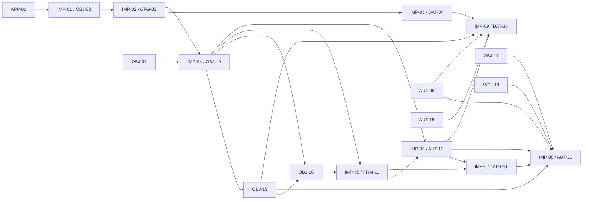

# Supplier Scorecard implementation plan amendment

## Scope and planning basis

This amendment covers only the configuration changes introduced by the Generation Lag Time, Schedule Anchor, and next-cycle Generation Delay requirements in the Supplier Scorecard technical specification dated 2026-11-04. It does not replace or re-review the rest of the Supplier Scorecard implementation plan.

The validation IDs below identify the changed assignments in this amendment. When incorporated into the main plan, use the target task IDs shown in each detailed record. IMP-07 is a new task and becomes AUT-11.

| Task Number | Task Category | Task Name | Objective and Detailed Scope | Recommended Implementer |
|---|---|---|---|---|
| IMP-01 | Object configuration | Create the Scorecard Catalogue Objects | **Objective:** Create the reference-list structure needed for every governed Supplier Scorecard selection, including generation lag units.  **Detailed scope:** Create the non-instantiable Supplier Scorecard Abstract Catalog Record and its thirteen direct children: Supplier Commodity, NAICS Classification, KPI Category, KPI Aggregation Method, KPI Value Type, KPI Contribution Source, KPI Collection Method, KPI Initialization Method, Safety Benchmark Metric, Scorecard Cadence, Generation Lag Time Increment, KPI Value Origin, and Publication Exception Treatment. | Senior Associate Consultant |
| IMP-02 | Catalogue configuration | Configure the Scorecard Catalogues | **Objective:** Make each Supplier Scorecard reference list usable through consistent labels, active filtering, audit, and permissions.  **Detailed scope:** Configure inherited Code, Name, Active?, and Sort on the abstract parent; configure Description on KPI Aggregation Method and Frequency on Scorecard Cadence; configure administration forms, active-record filters, audit, and basic permissions for all thirteen children. Generation Lag Time Increment has no local fields and exposes no inverse consumer grid. | Senior Associate Consultant |
| IMP-03 | Initial configuration | Load the Scorecard Catalogue Records | **Objective:** Provide the approved reference values needed by Program setup, publishing, and scorecard generation.  **Detailed scope:** Load the approved records for all scorecard catalogues, including Generation Lag Time Increment records d / Days / active / sort 10 and M / Months / active / sort 20. Preserve the exact case of d and M because automation uses Code rather than Name. | Associate Consultant |
| IMP-04 | Object configuration | Create the Program Configuration Objects | **Objective:** Provide editable Program scheduling and immutable published scheduling values for each effective period.  **Detailed scope:** Create Scorecard Program, Scorecard Program KPI, Scorecard Program Version, and Scorecard Program KPI Version. Add Generation Lag Time, Generation Lag Time Increment, and Schedule Anchor to Program and copy all three to Program Version; retain the remaining Program fields, relationships, membership, effective dating, rollup source, and version behavior already assigned to this task. | Senior Associate Consultant |
| IMP-05 | Form configuration | Configure Program and Generation Delay Forms | **Objective:** Let administrators configure Program timing and delay the next reporting cycle once, while preserving a clear history for each cycle.  **Detailed scope:** Configure Program and Program Version forms for generation lag and Schedule Anchor. Create Scorecard Program Generation Delay with read-only cycle fields, editable Delay Until and Reason before application, Applied Run evidence, audit, cycle-level uniqueness, the Program.Generation Delays grid, and a controlled action location instead of an unrestricted New option. | Senior Associate Consultant |
| IMP-06 | Action Handler configuration | Configure Program Publish | **Objective:** Publish complete Program scheduling and KPI membership as one controlled, immutable version.  **Detailed scope:** Extend Program Publish to validate generation lag, the exact d or M increment Code, and Schedule Anchor; copy Generation Lag Time, Generation Lag Time Increment, and Schedule Anchor to Program Version; retain the assigned membership, recipient-role, overlap, cadence, rollup, concurrency, rollback, and immutability behavior. | Senior Consultant |
| IMP-07 | Action Handler configuration | Configure Next Generation Delay Creation | **Objective:** Create one delay for the Program's next ungenerated reporting cycle without allowing a later cycle or duplicate delay to be selected.  **Detailed scope:** Add the New Delay for Next Generation action on Program.Generation Delays. The action locks the Program, calculates the earliest cycle without a Run, calculates and stores the cycle boundaries and original Scheduled Generation Date, rejects an existing Delay or concurrent Run for that cycle, creates the record as one complete operation, and then opens it for Delay Until and Reason entry. | Senior Consultant |
| IMP-08 | Event Service configuration | Configure Scheduled Scorecard Generation | **Objective:** Generate each due Program cycle once, honour its published generation lag, and apply at most one editable delay to that cycle.  **Detailed scope:** Extend scheduled generation to calculate reporting cycles from published Program scheduling, apply the exact d or M lag to each cycle, match a Delay by Program and reporting-period boundaries, stop later cycles while an earlier cycle is delayed, create or resume the Run safely, and set Applied Run and Applied At only after complete generation succeeds. | Senior Consultant |
| IMP-09 | Initial configuration | Configure the Initial Scorecard Configuration | **Objective:** Make the approved initial Programs ready to generate on the intended business schedule.  **Detailed scope:** Create and publish the approved initial benchmark, KPI, Program, and Participation records. For each Program, enter the approved Generation Lag Time and Generation Lag Time Increment, verify the calculated Schedule Anchor, and confirm that the first and final reporting cycles resolve to the intended Scheduled Generation Dates. | Senior Associate Consultant |

## External inputs and constraints

- **Inherited Code uniqueness:** The target tenant must support Code uniqueness within each concrete catalogue child, or approved globally unique replacement Codes must be supplied. This blocks IMP-02 and IMP-03 only.
- **Generation Lag Time Increment behavior:** The target tenant must accept exact Code `d` for days and exact Code `M` for months in the supported DATEADD expression. The verified expression syntax is required before completing IMP-04, IMP-06, IMP-07, and IMP-08.
- **Cadence rules:** Approved Frequency expressions, reporting-period start/end rules, scheduler timezone, and generation execution time are required before completing IMP-06, IMP-07, and IMP-08.
- **Controlled action mechanism:** The target tenant must provide a supported way to lock the Program, calculate defaults, create the Delay as one complete operation, and open the created record. The verified mechanism blocks IMP-07 only.
- **Initial Program schedule values:** Approved Cadence, Effective From, Effective To, Generation Lag Time, and Generation Lag Time Increment values are required for each initial Program before IMP-09 can be completed.

## Detailed tasks

### IMP-01 — Create the Scorecard Catalogue Objects

- **Target task ID:** OBJ-02
- **Task ID:** IMP-01
- **Title:** Create the Scorecard Catalogue Objects
- **Category:** Object configuration
- **Objective:** Create the reference-list structure needed for every governed Supplier Scorecard selection, including generation lag units.
- **Detailed scope:** Create the non-instantiable Supplier Scorecard Abstract Catalog Record and its thirteen direct children: Supplier Commodity, NAICS Classification, KPI Category, KPI Aggregation Method, KPI Value Type, KPI Contribution Source, KPI Collection Method, KPI Initialization Method, Safety Benchmark Metric, Scorecard Cadence, Generation Lag Time Increment, KPI Value Origin, and Publication Exception Treatment.
- **Configuration changes:**

  | Element | Instruction |
  |---|---|
  | Generation Lag Time Increment | Add this as the thirteenth direct child of Supplier Scorecard Abstract Catalog Record. |
  | Inherited fields | Inherit Code, Name, Active?, and Sort from the abstract parent; do not redeclare these fields on the child. |
  | Object behavior | Keep the abstract parent non-instantiable and non-selectable; permit records only on concrete children. |

- **Deliverable:** Abstract catalogue parent with thirteen correctly inherited concrete child objects.
- **Strict technical prerequisites:** APP-01
- **Blocked status:** Blocked until the Supplier Scorecard application from APP-01 exists.
- **Recommended implementer role:** Senior Associate Consultant
- **Recommended reviewer/approver role:** Senior Consultant
- **Role rationale:** The object creation is established configuration work, but inheritance and the non-instantiable parent require independent configuration judgment.
- **Acceptance criteria:**
  - Exactly thirteen direct children inherit from Supplier Scorecard Abstract Catalog Record.
  - Generation Lag Time Increment contains no duplicate local Code, Name, Active?, or Sort fields.
  - The abstract parent cannot be used to create a record or selected through an M:1 field.
  - No child has more than one inheritance parent and no inheritance cycle exists.
- **Specification references:** Sections 4.2, 5, 7.1, 7.12, and 21.1; SC-033.
- **Assumptions and open questions:** None.

### IMP-02 — Configure the Scorecard Catalogues

- **Target task ID:** CFG-03
- **Task ID:** IMP-02
- **Title:** Configure the Scorecard Catalogues
- **Category:** Catalogue configuration
- **Objective:** Make each Supplier Scorecard reference list usable through consistent labels, active filtering, audit, and permissions.
- **Detailed scope:** Configure inherited Code, Name, Active?, and Sort on the abstract parent; configure Description on KPI Aggregation Method and Frequency on Scorecard Cadence; configure administration forms, active-record filters, audit, and basic permissions for all thirteen children. Generation Lag Time Increment has no local fields and exposes no inverse consumer grid.
- **Configuration changes:**

  | Element | Instruction |
  |---|---|
  | Generation Lag Time Increment administration | Add a child administration form and grid showing inherited Code, Name, Active?, and Sort. |
  | New selections | Filter Generation Lag Time Increment relationships to active records only. |
  | Relationship behavior | Disable the inverse option on every M:1 field that targets Generation Lag Time Increment and do not add a consumer grid to its form. |
  | Permissions and audit | Allow catalogue administration only to the approved scorecard administrators and system administrators; enable ordinary object audit. |

- **Deliverable:** Configured catalogue fields, forms, filters, audit, and permissions for all thirteen children.
- **Strict technical prerequisites:** IMP-01
- **Blocked status:** Blocked by IMP-01. Inherited Code uniqueness must also be supported within each concrete child, or approved replacement Codes must be supplied.
- **Recommended implementer role:** Senior Associate Consultant
- **Recommended reviewer/approver role:** Senior Consultant
- **Role rationale:** The work combines inherited field behavior, relationship settings, and bounded catalogue permissions.
- **Acceptance criteria:**
  - The Generation Lag Time Increment form displays the four inherited fields and no duplicate local fields.
  - Inactive increment records are unavailable for new Program selections but remain valid on published history.
  - No Generation Lag Time Increment consumer grid or inverse relationship is exposed.
  - Only authorized catalogue administrators can create or change increment records.
- **Specification references:** Sections 6, 7.1, 7.12, 16.1, and 21.1; SC-028, SC-029, SC-030, and SC-033.
- **Assumptions and open questions:** Concrete-child uniqueness for inherited Code remains a supplied tenant capability result.

### IMP-03 — Load the Scorecard Catalogue Records

- **Target task ID:** DAT-04
- **Task ID:** IMP-03
- **Title:** Load the Scorecard Catalogue Records
- **Category:** Initial configuration
- **Objective:** Provide the approved reference values needed by Program setup, publishing, and scorecard generation.
- **Detailed scope:** Load the approved records for all scorecard catalogues, including Generation Lag Time Increment records d / Days / active / sort 10 and M / Months / active / sort 20. Preserve the exact case of d and M because automation uses Code rather than Name.
- **Configuration changes:**

  | Code | Name | Active? | Sort |
  |---|---|---:|---:|
  | d | Days | TRUE | 10 |
  | M | Months | TRUE | 20 |

- **Deliverable:** Approved, audited records in every concrete catalogue, including the two Generation Lag Time Increment records.
- **Strict technical prerequisites:** IMP-02
- **Blocked status:** Blocked by IMP-02 and by the inherited Code uniqueness input described above.
- **Recommended implementer role:** Associate Consultant
- **Recommended reviewer/approver role:** Senior Consultant
- **Role rationale:** Loading two exact reference values is bounded configuration once the catalogue structure and Code rules are available.
- **Acceptance criteria:**
  - Code `d` exists once with Name Days, Active? TRUE, and Sort 10.
  - Code `M` exists once with Name Months, Active? TRUE, and Sort 20.
  - The case of both Codes is preserved.
  - Changing a display Name does not change Code-based scheduling behavior.
- **Specification references:** Section 7.12, Section 20.2, and Section 21.2; SC-033.
- **Assumptions and open questions:** No additional generation-lag increments are approved.

### IMP-04 — Create the Program Configuration Objects

- **Target task ID:** OBJ-10
- **Task ID:** IMP-04
- **Title:** Create the Program Configuration Objects
- **Category:** Object configuration
- **Objective:** Provide editable Program scheduling and immutable published scheduling values for each effective period.
- **Detailed scope:** Create Scorecard Program, Scorecard Program KPI, Scorecard Program Version, and Scorecard Program KPI Version. Add Generation Lag Time, Generation Lag Time Increment, and Schedule Anchor to Program and copy all three to Program Version; retain the remaining Program fields, relationships, membership, effective dating, rollup source, and version behavior already assigned to this task.
- **Configuration changes:**

  | Object and field | Instruction |
  |---|---|
  | Program.Generation Lag Time | Add a required Integer with default 0 and minimum value 0. |
  | Program.Generation Lag Time Increment | Add a required M:1 relationship to Generation Lag Time Increment; disable the inverse relationship and filter new selections to active Code `d` or `M`. |
  | Program.Schedule Anchor | Add a required read-only calculated Date using DATEADD with Generation Lag Time Increment.Code, Generation Lag Time, and Effective From. |
  | Program Version.Generation Lag Time | Add a required read-only Integer populated by Program Publish. |
  | Program Version.Generation Lag Time Increment | Add a required read-only M:1 relationship populated by Program Publish; disable the inverse relationship. |
  | Program Version.Schedule Anchor | Add a required read-only Date populated by Program Publish. |

- **Deliverable:** Complete Program authoring and version objects with generation-lag scheduling fields.
- **Strict technical prerequisites:** IMP-02, OBJ-07
- **Blocked status:** Blocked by IMP-02 and OBJ-07. The Schedule Anchor formula cannot be completed until the supported DATEADD syntax and exact `d` / `M` interval behavior are supplied.
- **Recommended implementer role:** Senior Associate Consultant
- **Recommended reviewer/approver role:** Senior Consultant
- **Role rationale:** The object model is larger than routine setup and includes a relationship-based calculated date and immutable version fields.
- **Acceptance criteria:**
  - Generation Lag Time rejects negative values.
  - Only active increment records with Code `d` or `M` can be selected.
  - Effective From 2026-01-01 with lag 1 and Code `M` calculates Schedule Anchor 2026-02-01.
  - Program Version scheduling fields are read only and retain the published values when the authoring Program later changes.
- **Specification references:** Sections 4.3, 9.1, 9.3, and 21.1; SC-033.
- **Assumptions and open questions:** The exact deployable DATEADD expression remains a supplied tenant capability result.

### IMP-05 — Configure Program and Generation Delay Forms

- **Target task ID:** FRM-11
- **Task ID:** IMP-05
- **Title:** Configure Program and Generation Delay Forms
- **Category:** Form configuration
- **Objective:** Let administrators configure Program timing and delay the next reporting cycle once, while preserving a clear history for each cycle.
- **Detailed scope:** Configure Program and Program Version forms for generation lag and Schedule Anchor. Create Scorecard Program Generation Delay with read-only cycle fields, editable Delay Until and Reason before application, Applied Run evidence, audit, cycle-level uniqueness, the Program.Generation Delays grid, and a controlled action location instead of an unrestricted New option.
- **Configuration changes:**

  | Element | Instruction |
  |---|---|
  | Program form | Show Generation Lag Time and Generation Lag Time Increment with Schedule Anchor immediately afterward as read only. |
  | Program Version form | Show the published lag, increment, and Schedule Anchor as read-only values. |
  | Generation Delay cycle fields | Add Program, Reporting Period Start, Reporting Period End, and Scheduled Generation Date as required read-only fields. |
  | Generation Delay editable fields | Add required Delay Until and Reason; permit changes only while Applied Run is blank. |
  | Generation Delay evidence | Add read-only Applied Run and Applied At; enable ordinary object audit. |
  | Generation Delay uniqueness | Enforce one record for Program plus Reporting Period Start plus Reporting Period End, and add Program plus Scheduled Generation Date as a second safeguard. |
  | Generation Delays grid | Show reporting-period dates, Scheduled Generation Date, Delay Until, Reason, Created By/At, Applied Run, and Applied At. Place New Delay for Next Generation on the grid and remove unrestricted New access. |

- **Deliverable:** Program scheduling forms and a cycle-specific Generation Delay object, form, and grid.
- **Strict technical prerequisites:** IMP-04, OBJ-16
- **Blocked status:** Blocked by IMP-04 and by the Supplier Scorecard Run object from OBJ-16, which is required for Applied Run.
- **Recommended implementer role:** Senior Associate Consultant
- **Recommended reviewer/approver role:** Senior Consultant
- **Role rationale:** This is a larger administration form with cycle-level uniqueness, conditional editability, and a relationship to the operational Run.
- **Acceptance criteria:**
  - Program administrators can enter the lag and see the calculated Schedule Anchor but cannot edit the anchor.
  - A Generation Delay's Program and three cycle fields cannot be changed by the administrator.
  - Delay Until and Reason remain editable until Applied Run is populated.
  - A second Delay for the same Program/reporting period is rejected.
  - Applied Delay records are read only and cannot be deleted through ordinary administration.
  - The only visible creation route is New Delay for Next Generation.
- **Specification references:** Sections 9.1, 9.3, 9.6, and 16.1; SC-027, SC-033, and SC-034.
- **Assumptions and open questions:** Exact display-field concatenation remains subject to supported tenant syntax.

### IMP-06 — Configure Program Publish

- **Target task ID:** AUT-12
- **Task ID:** IMP-06
- **Title:** Configure Program Publish
- **Category:** Action Handler configuration
- **Objective:** Publish complete Program scheduling and KPI membership as one controlled, immutable version.
- **Detailed scope:** Extend Program Publish to validate generation lag, the exact d or M increment Code, and Schedule Anchor; copy Generation Lag Time, Generation Lag Time Increment, and Schedule Anchor to Program Version; retain the assigned membership, recipient-role, overlap, cadence, rollup, concurrency, rollback, and immutability behavior.
- **Configuration changes:**

  | Execution point | Instruction |
  |---|---|
  | Before version creation | Reject a negative lag, a missing or inactive increment, an increment Code other than exact `d` or `M`, or a Schedule Anchor that does not equal DATEADD of the selected Code, lag, and Effective From. |
  | Version creation | Copy Generation Lag Time, the exact Generation Lag Time Increment relationship, and Schedule Anchor to the new Program Version. |
  | Effective range | Treat Effective To as the final reporting-cycle boundary; do not reject a final Scheduled Generation Date solely because the lag places it after Effective To. |
  | Failure handling | Roll back the Program Version, Program KPI Versions, and copied recipient roles when any scheduling or graph creation step fails. |

- **Deliverable:** Controlled Program Publish action that freezes the approved generation schedule in Program Version.
- **Strict technical prerequisites:** IMP-04, IMP-05
- **Blocked status:** Blocked by IMP-04 and IMP-05. Completion also requires the supplied DATEADD syntax, Cadence Frequency expressions, and reporting-period boundary rules.
- **Recommended implementer role:** Senior Consultant
- **Recommended reviewer/approver role:** Principal Consultant
- **Role rationale:** Atomic multi-record publishing, concurrency control, and schedule validation have a high consequence of failure.
- **Acceptance criteria:**
  - A valid Program creates one complete immutable Program Version and its complete KPI membership.
  - The published lag, increment relationship, and Schedule Anchor equal the authoring values at Publish time.
  - Invalid lag or anchor values prevent version creation before any partial graph is saved.
  - A Program effective through 2026-12-31 may retain a final Scheduled Generation Date in 2027 when the December reporting cycle is in range.
- **Specification references:** Sections 9.3, 9.5, and 21.2; SC-033.
- **Assumptions and open questions:** Rollup validation remains conditional on approval of the parent-periodic operating model.

### IMP-07 — Configure Next Generation Delay Creation

- **Target task ID:** AUT-11
- **Task ID:** IMP-07
- **Title:** Configure Next Generation Delay Creation
- **Category:** Action Handler configuration
- **Objective:** Create one delay for the Program's next ungenerated reporting cycle without allowing a later cycle or duplicate delay to be selected.
- **Detailed scope:** Add the New Delay for Next Generation action on Program.Generation Delays. The action locks the Program, calculates the earliest cycle without a Run, calculates and stores the cycle boundaries and original Scheduled Generation Date, rejects an existing Delay or concurrent Run for that cycle, creates the record as one complete operation, and then opens it for Delay Until and Reason entry.
- **Configuration changes:**

  | Action order | Instruction |
  |---|---|
  | 1. Access and lock | Allow only Supplier Scorecard Application Administrators and system administrators; lock the selected Program before calculating the next cycle. |
  | 2. Find the cycle | Find the earliest cadence-generated reporting cycle for the Program that does not already have a Run. Do not offer a cycle picker. |
  | 3. Calculate dates | Calculate Reporting Period Start and End from the published Cadence and calculate Scheduled Generation Date by applying the published lag and exact increment Code to the reporting occurrence. |
  | 4. Prevent duplicates | Before creation, reject an existing Delay for the Program/reporting-period key and reject an existing or concurrently created Run for the calculated Scheduled Generation Date. |
  | 5. Create and open | Create Program, Reporting Period Start, Reporting Period End, and Scheduled Generation Date together; if creation succeeds, open the record for required Delay Until and Reason entry. |
  | 6. Failure handling | If any check or field population fails, create no Delay record and release the Program lock. |

- **Deliverable:** Controlled action that creates one correctly stamped Delay for the next ungenerated Program cycle.
- **Strict technical prerequisites:** IMP-05, IMP-06
- **Blocked status:** Blocked by IMP-05 and IMP-06. Completion also requires the supplied Program-locking, transactional creation, action navigation, Cadence, period-boundary, and DATEADD mechanisms.
- **Recommended implementer role:** Senior Consultant
- **Recommended reviewer/approver role:** Principal Consultant
- **Role rationale:** The action combines concurrency control, cross-record schedule calculation, duplicate prevention, and complete rollback.
- **Acceptance criteria:**
  - The action creates a Delay only for the earliest Program cycle without a Run.
  - The user cannot choose or pre-stage a later cycle.
  - The action stores and locks the Program, reporting-period dates, and Scheduled Generation Date before Delay Until and Reason are entered.
  - A cycle with an existing Delay opens no second record and presents a clear duplicate message.
  - A cycle with an existing or concurrently created Run produces no Delay.
  - A failed action leaves no partial Delay and can be run again safely.
- **Specification references:** Sections 9.6, 16.1, 18, and 21.2; SC-027 and SC-034.
- **Assumptions and open questions:** The exact native action and lock bindings remain supplied tenant capability results.

### IMP-08 — Configure Scheduled Scorecard Generation

- **Target task ID:** AUT-21
- **Task ID:** IMP-08
- **Title:** Configure Scheduled Scorecard Generation
- **Category:** Event Service configuration
- **Objective:** Generate each due Program cycle once, honour its published generation lag, and apply at most one editable delay to that cycle.
- **Detailed scope:** Extend scheduled generation to calculate reporting cycles from published Program scheduling, apply the exact d or M lag to each cycle, match a Delay by Program and reporting-period boundaries, stop later cycles while an earlier cycle is delayed, create or resume the Run safely, and set Applied Run and Applied At only after complete generation succeeds.
- **Configuration changes:**

  | Processing point | Instruction |
  |---|---|
  | Build the due cycle | Generate the reporting occurrence and period boundaries from Program Version Effective From, Effective To, Cadence Frequency, and Cadence Code. Apply the published lag independently to obtain Scheduled Generation Date. |
  | Apply a Delay | Find the Delay by Program, Reporting Period Start, and Reporting Period End; require its stored Scheduled Generation Date to equal the calculated date. |
  | Before Delay Until | Create no Run for the delayed cycle or any later cycle of that Program; retain the cycle for the next service execution. |
  | On or after Delay Until | Create or resume the unique Run for Program and Scheduled Generation Date and continue the assigned supplier, KPI, task, and workflow generation. |
  | Complete the Delay | Set Applied Run and Applied At only after the complete Run and child records succeed. Leave the Delay unapplied when generation fails. |
  | Safe repeat execution | Reuse the Program/cycle, Run/Supplier, Scorecard/KPI membership, and Run/contributor uniqueness keys so another execution does not create duplicates. |

- **Deliverable:** Scheduled generation service with lagged cycle dates, sequential Delay handling, and safe repeat execution.
- **Strict technical prerequisites:** AUT-09, IMP-06, IMP-07, OBJ-13, OBJ-17, WFL-18
- **Blocked status:** Blocked by all listed implementation tasks and by the supplied Cadence, reporting-period, scheduler-timezone, DATEADD, and business-calendar inputs.
- **Recommended implementer role:** Senior Consultant
- **Recommended reviewer/approver role:** Principal Consultant
- **Role rationale:** Multi-stage generation, ordered delay handling, concurrency, safe repeat execution, and failure recovery are advanced automation.
- **Acceptance criteria:**
  - A Monthly Program effective 2026-01-01 through 2026-12-31 with lag 1 and Code `M` schedules January for 2026-02-01 and December for 2027-01-01.
  - January, February, and March may each have one separate Delay as each becomes the next ungenerated cycle.
  - Changing January's Delay Until updates the existing record and does not change its Scheduled Generation Date.
  - A delayed January cycle prevents February from generating first.
  - Applied Run and Applied At remain blank after failed generation and populate only after complete success.
  - Repeated service execution creates no duplicate Run, Scorecard, KPI Value, Contribution Task, or Delay application.
- **Specification references:** Sections 9.6, 12.1, 13.1, and 21.2; SC-007, SC-027, SC-033, and SC-034.
- **Assumptions and open questions:** Parent rollup remains enabled only when the related operating model is approved.

### IMP-09 — Configure the Initial Scorecard Configuration

- **Target task ID:** DAT-35
- **Task ID:** IMP-09
- **Title:** Configure the Initial Scorecard Configuration
- **Category:** Initial configuration
- **Objective:** Make the approved initial Programs ready to generate on the intended business schedule.
- **Detailed scope:** Create and publish the approved initial benchmark, KPI, Program, and Participation records. For each Program, enter the approved Generation Lag Time and Generation Lag Time Increment, verify the calculated Schedule Anchor, and confirm that the first and final reporting cycles resolve to the intended Scheduled Generation Dates.
- **Configuration changes:**

  | Program setting | Instruction |
  |---|---|
  | Cadence and effective range | Enter the approved Cadence, Effective From, and Effective To for each initial Program. |
  | Generation lag | Enter the approved non-negative Generation Lag Time and select the approved active increment Code `d` or `M`. |
  | Schedule Anchor | Confirm the read-only calculated date before Publish and correct the editable source values when it is not the approved date. |
  | Publish | Publish the Program only after its KPI membership, recipient roles, routing, effective range, and generation schedule are complete. |

- **Deliverable:** Published initial Program configuration with approved lag, Schedule Anchor, KPI membership, Participation, routing, and capability configuration.
- **Strict technical prerequisites:** IMP-03, AUT-09, IMP-06, OBJ-13, AUT-15
- **Blocked status:** Blocked by the listed implementation tasks and by approved initial Program schedule values, KPI content, participant population, groups, status decisions, and operating model.
- **Recommended implementer role:** Senior Associate Consultant
- **Recommended reviewer/approver role:** Senior Consultant
- **Role rationale:** This is controlled configuration-record setup using completed Publish behavior; review protects the approved business schedule.
- **Acceptance criteria:**
  - Every initial Program contains an approved lag and active increment.
  - The calculated Schedule Anchor equals the approved first Scheduled Generation Date.
  - A Monthly Program effective 2026-01-01 with lag 1 and Code `M` shows Schedule Anchor 2026-02-01.
  - The final reporting cycle remains scheduled when its lagged generation date is after Effective To.
  - Each Program publishes without an overlapping effective range or incomplete routing.
- **Specification references:** Sections 7.12, 9, 20.2, 20.3, and 21.2; SC-033.
- **Assumptions and open questions:** Historical spreadsheet import remains outside this configuration assignment.

## Strict technical dependency diagram

## Assumptions, exclusions, and coverage

- Existing plan tasks not listed in this amendment are unchanged and are not content-reviewed by this scoped revision.
- This amendment does not add migration, formal testing, deployment, training, documentation, estimates, or project-governance work.
- Generation Delay history is stored one record per Program/reporting cycle. The administrator changes Delay Until or Reason on the existing unapplied record rather than creating another record for that cycle.
- A Generation Delay changes actual Run timing only. It does not shift the Cadence, Schedule Anchor, or later Scheduled Generation Dates.
- Catalogue structure and values are covered by IMP-01 through IMP-03.
- Program lag fields, Schedule Anchor, forms, and published copies are covered by IMP-04 through IMP-06.
- Cycle-specific Delay records and controlled next-cycle creation are covered by IMP-05 and IMP-07.
- Ordered generation and Delay application are covered by IMP-08.
- Initial approved Program values are covered by IMP-09.
