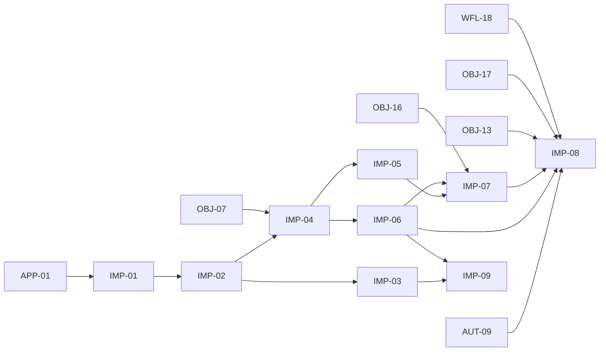

# Supplier Scorecard generation scheduling subtasks

## Scope and planning basis

These subtasks add only the Generation Lag Time, Schedule Anchor, and cycle-specific Generation Delay changes approved after the original Supplier Scorecard implementation plan was written. They do not restate or replace the broader Main Plan tasks. Each mapped subtask can be created beneath its named Main Plan parent without changing the parent's existing description.

IMP-07 introduces a new automation assignment. It supports the Generation Delay form work and is proposed as a subtask of FRM-11 because that parent owns the administrator experience for creating a delay.

| Task Number | Task Category | Task Name | Objective and Detailed Scope | Recommended Implementer |
|---|---|---|---|---|
| IMP-01 | Object configuration | Create the Generation Lag Time Increment Object | **Objective:** Add the governed reference-list object needed to express a Program generation lag in days or months.  **Detailed scope:** Add Generation Lag Time Increment as one new direct child of Supplier Scorecard Abstract Catalog Record. Inherit Code, Name, Active?, and Sort from the abstract parent and declare no local fields. | Senior Associate Consultant |
| IMP-02 | Catalogue configuration | Configure the Generation Lag Time Increment Catalogue | **Objective:** Make Generation Lag Time Increment available as a controlled Program selection.  **Detailed scope:** Add its administration form and grid, active-record filtering, audit, and administrator permissions. Disable inverse relationships on fields that select the increment and do not expose a catalogue-side consumer grid. | Senior Associate Consultant |
| IMP-03 | Initial configuration | Add the Generation Lag Time Increment Records | **Objective:** Provide the two approved units used by Program scheduling calculations.  **Detailed scope:** Add Code `d`, Name Days, Active? TRUE, Sort 10 and Code `M`, Name Months, Active? TRUE, Sort 20. Preserve the exact case because scheduling uses Code rather than Name. | Associate Consultant |
| IMP-04 | Object configuration | Add Program Generation Schedule Fields | **Objective:** Add the Program values needed to calculate and preserve its generation schedule.  **Detailed scope:** Add Generation Lag Time, Generation Lag Time Increment, and calculated Schedule Anchor to Scorecard Program. Add matching read-only fields to Scorecard Program Version for Program Publish to populate. | Senior Associate Consultant |
| IMP-05 | Form configuration | Update Program and Generation Delay Forms | **Objective:** Show the new Program schedule values and change Generation Delay so its reporting cycle is system-assigned rather than user-selected.  **Detailed scope:** Add generation lag and Schedule Anchor controls to Program and Program Version forms. Add Reporting Period Start and Reporting Period End to Generation Delay; make Program, both period dates, and Scheduled Generation Date read only; add cycle-level uniqueness; replace unrestricted New access with New Delay for Next Generation. | Senior Associate Consultant |
| IMP-06 | Action Handler configuration | Extend Program Publish for Generation Scheduling | **Objective:** Validate and preserve the approved generation schedule whenever a Program Version is published.  **Detailed scope:** Add pre-publish checks for Generation Lag Time, exact increment Code `d` or `M`, and Schedule Anchor. Copy the lag, increment relationship, and anchor to the new Program Version within the existing all-or-nothing Publish operation. | Senior Consultant |
| IMP-07 | Action Handler configuration | Configure Next Generation Delay Creation | **Objective:** Create one delay for the Program's next ungenerated reporting cycle without allowing a later cycle or duplicate delay to be selected.  **Detailed scope:** Add New Delay for Next Generation to Program.Generation Delays. Lock the Program, calculate the earliest cycle without a Run, store its period boundaries and original Scheduled Generation Date, reject an existing Delay or concurrent Run, create the record as one complete operation, and open it for Delay Until and Reason entry. | Senior Consultant |
| IMP-08 | Event Service configuration | Extend Scheduled Generation for Lag and Delay | **Objective:** Apply the published generation lag and one cycle-specific delay without changing the remainder of the scheduled generation process.  **Detailed scope:** Add lagged Scheduled Generation Date calculation, cycle-key Delay matching, later-cycle blocking while an earlier cycle is delayed, and Applied Run/Applied At updates after successful generation. Retain the remaining Run, Scorecard, KPI Value, Contribution Task, participation, and workflow generation owned by AUT-21. | Senior Consultant |
| IMP-09 | Initial configuration | Add Generation Scheduling to Initial Programs | **Objective:** Populate the new schedule settings on each approved initial Program.  **Detailed scope:** Enter the approved Generation Lag Time and Generation Lag Time Increment, review the calculated Schedule Anchor, and confirm the first and final Scheduled Generation Dates before publishing each initial Program. | Senior Associate Consultant |

## Main Plan parent mapping

| Subtask | Main Plan parent | Relationship |
|---|---|---|
| IMP-01 | OBJ-02 | Adds only the thirteenth catalogue child; OBJ-02 retains ownership of the original abstract parent and twelve children. |
| IMP-02 | CFG-03 | Configures only the new Generation Lag Time Increment catalogue. |
| IMP-03 | DAT-04 | Adds only the two new increment records. |
| IMP-04 | OBJ-10 | Adds only the six new Program and Program Version scheduling fields. |
| IMP-05 | FRM-11 | Adds or changes only schedule-related controls, cycle fields, uniqueness, and the delay creation entry point. |
| IMP-06 | AUT-12 | Adds only generation-schedule validation and version-copy behavior. |
| IMP-07 | FRM-11 | Adds the specialist automation behind the new delay creation entry point. |
| IMP-08 | AUT-21 | Adds only generation lag and revised delay handling to the existing generation service. |
| IMP-09 | DAT-35 | Populates only the newly required schedule values on the initial Programs. |

## External inputs and constraints

- **Inherited Code uniqueness:** The target tenant must support Code uniqueness within Generation Lag Time Increment, or approved replacement Codes must be supplied. This blocks IMP-02 and IMP-03 only.
- **DATEADD behavior:** The target tenant must accept exact Code `d` for days and exact Code `M` for months in the supported DATEADD expression. The verified expression syntax is required for IMP-04, IMP-06, IMP-07, and IMP-08.
- **Cadence rules:** Approved Frequency expressions, reporting-period boundary rules, scheduler timezone, and generation execution time are required for IMP-06, IMP-07, and IMP-08.
- **Controlled action mechanism:** A supported way to lock the Program, create the Delay as one complete operation, and open the new record is required for IMP-07.
- **Initial Program values:** Approved Generation Lag Time and Generation Lag Time Increment values are required for each initial Program before IMP-09 can be completed.

## Detailed subtasks

### IMP-01 — Create the Generation Lag Time Increment Object

- **Parent Main Plan task:** OBJ-02 — Create the Scorecard Catalogue Objects
- **Task ID:** IMP-01
- **Title:** Create the Generation Lag Time Increment Object
- **Category:** Object configuration
- **Objective:** Add the governed reference-list object needed to express a Program generation lag in days or months.
- **Detailed scope:** Add Generation Lag Time Increment as one new direct child of Supplier Scorecard Abstract Catalog Record. Inherit Code, Name, Active?, and Sort from the abstract parent and declare no local fields.
- **Configuration changes:**

  | Element | Instruction |
  |---|---|
  | Generation Lag Time Increment | Add one concrete catalogue child beneath Supplier Scorecard Abstract Catalog Record. |
  | Inherited fields | Inherit Code, Name, Active?, and Sort; do not create duplicate local fields. |
  | Object behavior | Permit records on Generation Lag Time Increment while retaining the abstract parent's non-instantiable behavior. |

- **Deliverable:** One new inherited Generation Lag Time Increment catalogue object.
- **Strict technical prerequisites:** APP-01
- **Blocked status:** Blocked until the Supplier Scorecard application and Supplier Scorecard Abstract Catalog Record planned under OBJ-02 exist.
- **Recommended implementer role:** Senior Associate Consultant
- **Recommended reviewer/approver role:** Senior Consultant
- **Role rationale:** This is a bounded object addition, but correct inheritance and abstract-parent behavior require independent configuration judgment.
- **Acceptance criteria:**
  - Generation Lag Time Increment is a direct child of Supplier Scorecard Abstract Catalog Record.
  - It exposes inherited Code, Name, Active?, and Sort without redeclaring them.
  - Records can be created on the child but not on the abstract parent.
- **Specification references:** Sections 4.2, 5, 7.1, and 7.12; SC-033.
- **Assumptions and open questions:** None.

### IMP-02 — Configure the Generation Lag Time Increment Catalogue

- **Parent Main Plan task:** CFG-03 — Configure the Scorecard Catalogues
- **Task ID:** IMP-02
- **Title:** Configure the Generation Lag Time Increment Catalogue
- **Category:** Catalogue configuration
- **Objective:** Make Generation Lag Time Increment available as a controlled Program selection.
- **Detailed scope:** Add its administration form and grid, active-record filtering, audit, and administrator permissions. Disable inverse relationships on fields that select the increment and do not expose a catalogue-side consumer grid.
- **Configuration changes:**

  | Element | Instruction |
  |---|---|
  | Administration surface | Show inherited Code, Name, Active?, and Sort on the catalogue form and grid. |
  | New selections | Return active Generation Lag Time Increment records only. |
  | Relationship behavior | Disable the inverse option on every M:1 field that selects the increment; add no consumer grid to the catalogue. |
  | Permissions and audit | Allow maintenance only by approved scorecard administrators and system administrators; enable ordinary object audit. |

- **Deliverable:** Configured administration, selection, relationship, audit, and permission behavior for Generation Lag Time Increment.
- **Strict technical prerequisites:** IMP-01
- **Blocked status:** Blocked by IMP-01 and by the supplied inherited-Code uniqueness behavior.
- **Recommended implementer role:** Senior Associate Consultant
- **Recommended reviewer/approver role:** Senior Consultant
- **Role rationale:** The change is bounded but combines inherited fields, selection filtering, relationship settings, and catalogue permissions.
- **Acceptance criteria:**
  - The form and grid show the four inherited fields.
  - Inactive records are unavailable for new Program selections but remain valid on published records.
  - No inverse relationship or catalogue-side consumer grid is exposed.
  - Only authorized administrators can maintain records.
- **Specification references:** Sections 6, 7.12, and 16.1; SC-028, SC-029, SC-030, and SC-033.
- **Assumptions and open questions:** Concrete-child uniqueness for inherited Code remains a supplied tenant capability result.

### IMP-03 — Add the Generation Lag Time Increment Records

- **Parent Main Plan task:** DAT-04 — Load the Scorecard Catalogue Records
- **Task ID:** IMP-03
- **Title:** Add the Generation Lag Time Increment Records
- **Category:** Initial configuration
- **Objective:** Provide the two approved units used by Program scheduling calculations.
- **Detailed scope:** Add Code `d`, Name Days, Active? TRUE, Sort 10 and Code `M`, Name Months, Active? TRUE, Sort 20. Preserve the exact case because scheduling uses Code rather than Name.
- **Configuration changes:**

  | Code | Name | Active? | Sort |
  |---|---|---:|---:|
  | d | Days | TRUE | 10 |
  | M | Months | TRUE | 20 |

- **Deliverable:** Two approved Generation Lag Time Increment records.
- **Strict technical prerequisites:** IMP-02
- **Blocked status:** Blocked by IMP-02 and by the supplied inherited-Code uniqueness behavior.
- **Recommended implementer role:** Associate Consultant
- **Recommended reviewer/approver role:** Senior Consultant
- **Role rationale:** This is a bounded two-record configuration change with exact supplied values.
- **Acceptance criteria:**
  - Code `d` exists once with Name Days, Active? TRUE, and Sort 10.
  - Code `M` exists once with Name Months, Active? TRUE, and Sort 20.
  - Both Codes retain their specified case.
- **Specification references:** Section 7.12 and Section 21.2; SC-033.
- **Assumptions and open questions:** No additional lag increments are approved.

### IMP-04 — Add Program Generation Schedule Fields

- **Parent Main Plan task:** OBJ-10 — Create the Program Configuration Objects
- **Task ID:** IMP-04
- **Title:** Add Program Generation Schedule Fields
- **Category:** Object configuration
- **Objective:** Add the Program values needed to calculate and preserve its generation schedule.
- **Detailed scope:** Add Generation Lag Time, Generation Lag Time Increment, and calculated Schedule Anchor to Scorecard Program. Add matching read-only fields to Scorecard Program Version for Program Publish to populate.
- **Configuration changes:**

  | Object and field | Instruction |
  |---|---|
  | Program.Generation Lag Time | Add a required Integer with default 0 and minimum value 0. |
  | Program.Generation Lag Time Increment | Add a required M:1 relationship to Generation Lag Time Increment; disable the inverse relationship and filter to active Code `d` or `M`. |
  | Program.Schedule Anchor | Add a required read-only calculated Date using DATEADD with increment Code, lag, and Effective From. |
  | Program Version.Generation Lag Time | Add a required read-only Integer populated by Program Publish. |
  | Program Version.Generation Lag Time Increment | Add a required read-only M:1 relationship populated by Program Publish; disable the inverse relationship. |
  | Program Version.Schedule Anchor | Add a required read-only Date populated by Program Publish. |

- **Deliverable:** Six new Program scheduling fields across Scorecard Program and Scorecard Program Version.
- **Strict technical prerequisites:** IMP-02, OBJ-07
- **Blocked status:** Blocked by IMP-02 and OBJ-07. Schedule Anchor remains blocked until supported DATEADD syntax and exact `d` / `M` interval behavior are supplied.
- **Recommended implementer role:** Senior Associate Consultant
- **Recommended reviewer/approver role:** Senior Consultant
- **Role rationale:** The change includes a relationship-based calculated date and matching immutable version fields.
- **Acceptance criteria:**
  - Generation Lag Time rejects negative values.
  - Only active Code `d` or `M` increments can be selected.
  - Effective From 2026-01-01 with lag 1 and Code `M` calculates Schedule Anchor 2026-02-01.
  - The three Program Version fields are read only.
- **Specification references:** Sections 4.3, 9.1, and 9.3; SC-033.
- **Assumptions and open questions:** The deployable DATEADD expression remains a supplied tenant capability result.

### IMP-05 — Update Program and Generation Delay Forms

- **Parent Main Plan task:** FRM-11 — Configure Program and Generation Delay Forms
- **Task ID:** IMP-05
- **Title:** Update Program and Generation Delay Forms
- **Category:** Form configuration
- **Objective:** Show the new Program schedule values and change Generation Delay so its reporting cycle is system-assigned rather than user-selected.
- **Detailed scope:** Add generation lag and Schedule Anchor controls to Program and Program Version forms. Add Reporting Period Start and Reporting Period End to Generation Delay; make Program, both period dates, and Scheduled Generation Date read only; add cycle-level uniqueness; replace unrestricted New access with New Delay for Next Generation.
- **Configuration changes:**

  | Element | Instruction |
  |---|---|
  | Program form | Add Generation Lag Time and Generation Lag Time Increment, followed by read-only Schedule Anchor. |
  | Program Version form | Add the published lag, increment, and Schedule Anchor as read-only controls. |
  | Generation Delay cycle fields | Add required read-only Reporting Period Start and Reporting Period End; change Scheduled Generation Date from administrator-selected to required read only. |
  | Cycle uniqueness | Add uniqueness for Program plus Reporting Period Start plus Reporting Period End; retain Program plus Scheduled Generation Date as a second safeguard. |
  | Generation Delays grid | Add both reporting-period dates and place New Delay for Next Generation on the grid; remove unrestricted New access. |

- **Deliverable:** Updated Program forms and cycle-controlled Generation Delay form and grid.
- **Strict technical prerequisites:** IMP-04
- **Blocked status:** Blocked by IMP-04. Exact display-field concatenation remains subject to supported tenant syntax.
- **Recommended implementer role:** Senior Associate Consultant
- **Recommended reviewer/approver role:** Senior Consultant
- **Role rationale:** This is a bounded form revision with new calculated controls, protected cycle fields, and two uniqueness rules.
- **Acceptance criteria:**
  - Program administrators can enter lag values and see, but not edit, Schedule Anchor.
  - Generation Delay's Program, period dates, and Scheduled Generation Date cannot be changed by the administrator.
  - A second Delay for the same Program/reporting period is rejected.
  - The visible creation route is New Delay for Next Generation rather than unrestricted New.
- **Specification references:** Sections 9.1, 9.3, 9.6, and 16.1; SC-027, SC-033, and SC-034.
- **Assumptions and open questions:** The original FRM-11 scope continues to own Delay Until, Reason, Applied Run, Applied At, audit, and applied-record editability.

### IMP-06 — Extend Program Publish for Generation Scheduling

- **Parent Main Plan task:** AUT-12 — Configure Program Publish
- **Task ID:** IMP-06
- **Title:** Extend Program Publish for Generation Scheduling
- **Category:** Action Handler configuration
- **Objective:** Validate and preserve the approved generation schedule whenever a Program Version is published.
- **Detailed scope:** Add pre-publish checks for Generation Lag Time, exact increment Code `d` or `M`, and Schedule Anchor. Copy the lag, increment relationship, and anchor to the new Program Version within the existing all-or-nothing Publish operation.
- **Configuration changes:**

  | Execution point | Instruction |
  |---|---|
  | Before version creation | Reject a negative lag, missing or inactive increment, increment Code other than exact `d` or `M`, or Schedule Anchor that does not equal DATEADD of Code, lag, and Effective From. |
  | Version creation | Copy Generation Lag Time, the exact increment relationship, and Schedule Anchor to Program Version. |
  | Effective range | Do not reject a final Scheduled Generation Date solely because its lag places it after Effective To. |
  | Failure handling | Include these new schedule values in the existing Publish rollback boundary. |

- **Deliverable:** Generation-schedule validation and copy behavior added to Program Publish.
- **Strict technical prerequisites:** IMP-04
- **Blocked status:** Blocked by IMP-04 and by supplied DATEADD syntax, Frequency expressions, and reporting-period boundary rules.
- **Recommended implementer role:** Senior Consultant
- **Recommended reviewer/approver role:** Principal Consultant
- **Role rationale:** The change affects an atomic multi-record Publish operation and has a high consequence if schedule values are copied incorrectly.
- **Acceptance criteria:**
  - Invalid lag, increment, or anchor prevents Program Version creation.
  - Valid schedule values are copied exactly to Program Version.
  - A December reporting cycle may retain a January Scheduled Generation Date when its Program Version is effective through December 31.
  - A failure leaves no partial version graph.
- **Specification references:** Sections 9.3, 9.5, and 21.2; SC-033.
- **Assumptions and open questions:** Existing AUT-12 scope continues to own KPI membership, recipient roles, overlap, cadence, rollup, concurrency, and rollback behavior.

### IMP-07 — Configure Next Generation Delay Creation

- **Parent Main Plan task:** FRM-11 — Configure Program and Generation Delay Forms
- **Task ID:** IMP-07
- **Title:** Configure Next Generation Delay Creation
- **Category:** Action Handler configuration
- **Objective:** Create one delay for the Program's next ungenerated reporting cycle without allowing a later cycle or duplicate delay to be selected.
- **Detailed scope:** Add New Delay for Next Generation to Program.Generation Delays. Lock the Program, calculate the earliest cycle without a Run, store its period boundaries and original Scheduled Generation Date, reject an existing Delay or concurrent Run, create the record as one complete operation, and open it for Delay Until and Reason entry.
- **Configuration changes:**

  | Action order | Instruction |
  |---|---|
  | Access and lock | Allow only Supplier Scorecard Application Administrators and system administrators; lock the Program before calculation. |
  | Find the cycle | Find the earliest cadence-generated reporting cycle without a Run; do not offer a cycle picker. |
  | Calculate dates | Calculate Reporting Period Start, Reporting Period End, and Scheduled Generation Date from the published schedule. |
  | Prevent duplicates | Reject an existing Delay for the Program/reporting-period key and an existing or concurrent Run for the Scheduled Generation Date. |
  | Create and open | Create all protected cycle fields together, then open the record for required Delay Until and Reason entry. |
  | Failure handling | Create no Delay and release the Program lock if any step fails. |

- **Deliverable:** Controlled New Delay for Next Generation action.
- **Strict technical prerequisites:** IMP-05, IMP-06, OBJ-16
- **Blocked status:** Blocked by the listed tasks and by supplied Program-locking, complete child-creation, form-navigation, Cadence, period-boundary, and DATEADD mechanisms.
- **Recommended implementer role:** Senior Consultant
- **Recommended reviewer/approver role:** Principal Consultant
- **Role rationale:** The action combines concurrency control, cross-record schedule calculation, duplicate prevention, and complete rollback.
- **Acceptance criteria:**
  - Only the earliest Program cycle without a Run can be delayed.
  - The user cannot select or pre-stage a later cycle.
  - The action stores and locks the Program, period dates, and Scheduled Generation Date.
  - An existing Delay or Run prevents another Delay from being created for the cycle.
  - A failure leaves no partial Delay and the action can be run again safely.
- **Specification references:** Sections 9.6, 16.1, 18, and 21.2; SC-027 and SC-034.
- **Assumptions and open questions:** Exact native action, lock, and navigation bindings remain supplied tenant capability results.

### IMP-08 — Extend Scheduled Generation for Lag and Delay

- **Parent Main Plan task:** AUT-21 — Configure Scheduled Scorecard Generation
- **Task ID:** IMP-08
- **Title:** Extend Scheduled Generation for Lag and Delay
- **Category:** Event Service configuration
- **Objective:** Apply the published generation lag and one cycle-specific delay without changing the remainder of the scheduled generation process.
- **Detailed scope:** Add lagged Scheduled Generation Date calculation, cycle-key Delay matching, later-cycle blocking while an earlier cycle is delayed, and Applied Run/Applied At updates after successful generation. Retain the remaining Run, Scorecard, KPI Value, Contribution Task, participation, and workflow generation owned by AUT-21.
- **Configuration changes:**

  | Processing point | Instruction |
  |---|---|
  | Scheduled date | Apply Program Version Generation Lag Time and exact increment Code independently to each reporting occurrence. |
  | Delay lookup | Find the Delay by Program, Reporting Period Start, and Reporting Period End; require its stored Scheduled Generation Date to match the calculated date. |
  | Before Delay Until | Create no Run for that cycle or any later Program cycle; retain the cycle for the next service execution. |
  | After successful generation | Set Applied Run and Applied At only after the complete Run and child records succeed. |
  | Failed or repeated execution | Leave the Delay unapplied after failure and use existing uniqueness keys so another execution creates no duplicates. |

- **Deliverable:** Generation lag and revised cycle-specific Delay handling added to scheduled generation.
- **Strict technical prerequisites:** AUT-09, IMP-06, IMP-07, OBJ-13, OBJ-17, WFL-18
- **Blocked status:** Blocked by the listed tasks and by supplied Cadence, period-boundary, scheduler-timezone, DATEADD, and business-calendar inputs.
- **Recommended implementer role:** Senior Consultant
- **Recommended reviewer/approver role:** Principal Consultant
- **Role rationale:** Ordered delay handling, concurrency, safe repeat execution, and post-success evidence are advanced automation changes.
- **Acceptance criteria:**
  - A Monthly Program effective 2026-01-01 through 2026-12-31 with lag 1 and Code `M` schedules January for 2026-02-01 and December for 2027-01-01.
  - January, February, and March may each have one separate Delay as each becomes the next ungenerated cycle.
  - A delayed January cycle prevents February from generating first.
  - Changing Delay Until does not change the cycle's original Scheduled Generation Date.
  - Applied Run and Applied At populate only after complete successful generation.
  - Repeated execution creates no duplicate generated records or Delay application.
- **Specification references:** Sections 9.6, 12.1, 13.1, and 21.2; SC-007, SC-027, SC-033, and SC-034.
- **Assumptions and open questions:** Existing AUT-21 scope continues to own participation, status, rollup, Run, Scorecard, KPI Value, Contribution Task, workflow, and failure ownership behavior.

### IMP-09 — Add Generation Scheduling to Initial Programs

- **Parent Main Plan task:** DAT-35 — Configure the Initial Scorecard Configuration
- **Task ID:** IMP-09
- **Title:** Add Generation Scheduling to Initial Programs
- **Category:** Initial configuration
- **Objective:** Populate the new schedule settings on each approved initial Program.
- **Detailed scope:** Enter the approved Generation Lag Time and Generation Lag Time Increment, review the calculated Schedule Anchor, and confirm the first and final Scheduled Generation Dates before publishing each initial Program.
- **Configuration changes:**

  | Program setting | Instruction |
  |---|---|
  | Generation lag | Enter the approved non-negative Generation Lag Time and active increment Code `d` or `M`. |
  | Schedule Anchor | Review the calculated date and correct the editable source values before Publish when it is not the approved first Scheduled Generation Date. |
  | Final cycle | Confirm the final in-range reporting cycle remains scheduled when its lagged date falls after Effective To. |

- **Deliverable:** Generation schedule values populated on every approved initial Program.
- **Strict technical prerequisites:** IMP-03, IMP-06
- **Blocked status:** Blocked by IMP-03 and IMP-06 and by approved lag values for each initial Program.
- **Recommended implementer role:** Senior Associate Consultant
- **Recommended reviewer/approver role:** Senior Consultant
- **Role rationale:** This is controlled configuration-record setup using completed Program fields and Publish behavior.
- **Acceptance criteria:**
  - Every initial Program has an approved lag and active increment.
  - Schedule Anchor equals the approved first Scheduled Generation Date.
  - Effective From 2026-01-01 with lag 1 and Code `M` produces Schedule Anchor 2026-02-01.
  - The final reporting cycle is not omitted because its generation date is after Effective To.
- **Specification references:** Sections 7.12, 9, 20.2, and 21.2; SC-033.
- **Assumptions and open questions:** DAT-35 retains ownership of all other initial KPI, Program, Participation, routing, benchmark, and capability records.

## Strict technical dependency diagram

## Assumptions, exclusions, and coverage

- Parent-child placement in Forecast is organizational; the dependency diagram above represents only technical prerequisites.
- Main Plan tasks retain every part of their original scope not explicitly changed by these subtasks.
- This subtask set does not add migration, formal testing, deployment, training, documentation, estimates, or project-governance work.
- IMP-01 through IMP-03 own only the new Generation Lag Time Increment object, its configuration, and its two records.
- IMP-04 through IMP-06 own only the new Program scheduling fields, form controls, and Publish changes.
- IMP-05 and IMP-07 own only the revised cycle assignment and controlled creation of Generation Delay.
- IMP-08 owns only the new generation-lag and cycle-specific Delay behavior within AUT-21.
- IMP-09 owns only the new schedule values on initial Programs.
